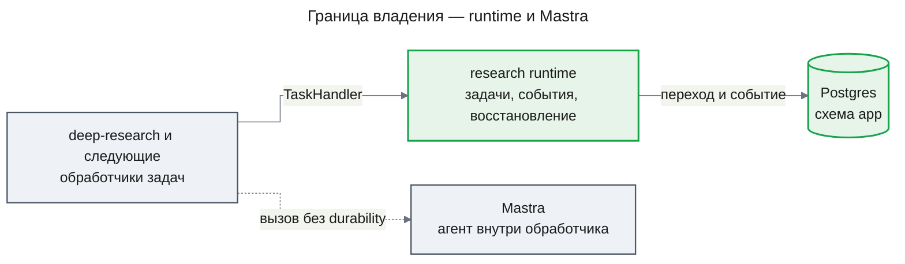

# ADR-0001 Свой runtime на Postgres — единственный durable-владелец задач

## Status

Accepted

## Decision

Состоянием задач исследования, их событиями и восстановлением после убийства процесса должен владеть кто-то один. Этот владелец — собственный runtime в модуле `research` на Postgres: он durable, то есть его состояние переживает перезапуск. На production-экземпляре Mastra не зарегистрирован ни один workflow приложения (скрытые служебные workflows Mastra не в счёт; проверка — `listWorkflows()` пуст), а восстановление run выключено и для workflows, и для durable-агентов. Внутри обработчика Mastra используется только через обычных агентов, без `DurableAgent` и без иной персистентности run, которую мог бы возобновить перезапуск. Решение исключает как владельцев задач Mastra workflows, гибрид с восстановлением Mastra, Temporal и очереди на Postgres.

### Decision Details

| Item | Content |
|------|---------|
| **Why now** | Первая фича исследовательского контура задаёт контракт обработчика (`TaskHandler`, `TaskContext`), на который пишут все следующие фичи |
| **Known unknowns** | Достаточно ли опроса Postgres и `LISTEN/NOTIFY` по задержке старта зависимой задачи при росте числа расследований за пределы прототипа |
| **Kill criteria** | Требование исполнять задачи вне одного Postgres (несколько баз, регионы) или задержка старта, которую не снимает настройка опроса |

## Context

Исследовательская Agent OS исполняет расследования как граф задач: зависимости, ожидание, бюджет вызовов, дедупликация, отказ циклов, дедлайны и восстановление после убийства процесса ([PRD](../features/research-runtime/prd.md), FR-01–FR-10). Второй владелец того же состояния ломает атомарность перехода и события и даёт двойное восстановление.

В `apps/api` уже есть Mastra 1.80 (`@mastra/core`) для агента чата и его памяти. Mastra предлагает evented workflows и воркеры, но её шина событий по умолчанию (`EventEmitterPubSub`) живёт в памяти процесса, а долговечная шина требует внешнего брокера. У Mastra есть и своё восстановление run: при старте сервера она возобновляет активные run workflows (`recovery.workflows`, по умолчанию `auto`) и, по `recovery.durableAgents`, run durable-агентов. Приложение на NestJS это восстановление сейчас не запускает (`@mastra/core` 1.80.0, `MastraLifecycle.start` вызывает только `startWorkers()`).

Зависимостей между задачами, бюджета на расследование, дедупликации и отказа циклов Mastra не даёт ([design-runtime.md](../features/research-runtime/design-runtime.md), KD-1 и Fact Disposition Table).

Решение связывает не только `research-runtime`. На этом runtime строятся `deep-research`, `dataset-exploration` и `evidence-graph`, а `chat-storage` переносит беседы в ту же базу рядом с ним. Откат после их появления означает перенос данных задач и переписывание обработчиков всех этих фич.

## Rationale

Корректность runtime держится на одной транзакции: охраняемый переход задачи, событие и строки доставки фиксируются вместе (design-runtime.md, KD-3 и KD-4). Это возможно, только когда хранилище состояния и хранилище событий — одна база и один владелец. Дедупликацию, бюджет, отказ циклов и дедлайны пришлось бы строить и поверх Mastra, поэтому свой runtime строит их один раз и без второго владельца. Дедупликация, отказ цикла и fencing по `attempt` подтверждены spike на Postgres 16 (design-runtime.md, Appendix: Evidence), так что внешний движок для них не нужен.

### Options Considered

1. **Mastra evented workflows и воркеры как владелец**
   - Pros: Шаги и suspend/resume уже готовы, а Mastra уже есть в зависимостях.
   - Cons: Шина событий по умолчанию живёт в памяти процесса, а долговечная требует внешнего брокера. У состояния Mastra и состояния исследования появляются два владельца, и переход с событием перестают быть атомарными. Дедупликацию, бюджет, отказ циклов и дедлайны всё равно пришлось бы строить самим.

2. **Гибрид: свой runtime плюс восстановление run Mastra**
   - Pros: Шаги обработчика переживают перезапуск силами Mastra.
   - Cons: Одно исполнение восстанавливают два механизма: повторная попытка runtime и восстановление run Mastra (workflows или durable-агента). Они дают двойной эффект и спор, чей итог верен.

3. **Temporal**
   - Pros: Temporal даёт зрелую долговечную оркестрацию с историей и повторами.
   - Cons: Он требует новой инфраструктуры (кластер, воркеры, SDK) вне scope прототипа. Граф, бюджет и evidence всё равно моделируются поверх него, а транзакция с данными исследования в Postgres невозможна.

4. **Очереди на Postgres (pg-boss, graphile-worker)**
   - Pros: Claim, повторы и расписание уже готовы.
   - Cons: В очередях нет графа зависимостей, ожидания, бюджета на расследование и дедупликации в его пределах. Событие и переход в одной транзакции дают только свои таблицы.

5. **Свой runtime на Postgres (выбран)**
   - Pros: Переход, событие и доставка фиксируются в одной транзакции в базе, которая уже есть. Механика следует требованиям спецификации без обходов.
   - Cons: Механика конкуренции и восстановления своя, и это главный риск: её корректность доказывают тесты убийств и гонок.

## Consequences

### Positive Consequences

- Каждый переход задачи и его событие атомарны; событие не теряется при убийстве процесса
- Один механизм восстановления: lease, reaper и fencing по `attempt`
- Следующие фичи пишут обработчики по контракту `packages/contracts`, не зная внутренностей планировщика

### Negative Consequences

- Конкуренция, восстановление и доставка событий — собственный код, который надо доказывать тестами убийств и гонок
- Возможности Mastra для долгих workflows (suspend/resume, история шагов) не используются; обработчик сохраняет прогресс через checkpoint runtime
- Масштаб ограничен одним Postgres

### Neutral Consequences

- Mastra остаётся зависимостью чата и агентов; её таблицы `mastra_*` runtime не читает и не пишет

## Implementation Guidance

- Состояние задачи, событие и доставка меняются только в транзакциях runtime; обработчик не пишет в его таблицы напрямую
- Код runtime не импортирует `@mastra/*`; запрет проверяется lint, а не договорённостью
- Экземпляр Mastra работает с выключенным восстановлением run (`recovery.workflows` и `recovery.durableAgents` — `off`), и на нём не зарегистрирован ни один workflow приложения (скрытые служебные workflows Mastra не в счёт; проверка — `listWorkflows()` пуст)
- Обработчики не используют `DurableAgent` и иную персистентность run Mastra, которую мог бы возобновить перезапуск; запрещён, например, вызов `restartAllActiveWorkflowRuns`
- Повтор исполнения — только попытка runtime после восстановления; обработчик идемпотентен по ключу evidence
- Ни одна транзакция runtime не держится через вызов обработчика или внешней системы

## Related Information

- [design-runtime.md](../features/research-runtime/design-runtime.md) — KD-1 (решение), KD-3 и KD-4 (транзакции и outbox), AC-RT-7 (наблюдаемая граница с Mastra)
- [prd.md](../features/research-runtime/prd.md) — FR-01–FR-10, дорожная карта фич
- [ADR-0003](ADR-0003-drizzle-data-layer.md) — схема `app` и миграции, где живут таблицы runtime
- [Transactional outbox](https://microservices.io/patterns/data/transactional-outbox.html) — событие в транзакции изменения
- [M. Kleppmann — How to do distributed locking](https://martin.kleppmann.com/2016/02/08/how-to-do-distributed-locking.html) — fencing token
