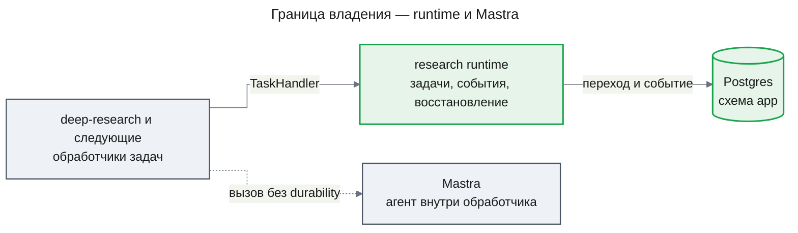

# ADR-0001 Свой runtime на Postgres — единственный durable-владелец задач

## Status

Accepted

## Context

Исследовательская Agent OS исполняет расследования как граф задач: зависимости, ожидание, бюджет вызовов, дедупликация, отказ циклов, дедлайны и восстановление после убийства процесса ([PRD](../features/research-runtime/prd.md), FR-01–FR-10). Кто-то один должен владеть состоянием задач, событиями и восстановлением; второй владелец того же состояния ломает атомарность перехода и события и даёт двойное восстановление.

В `apps/api` уже есть Mastra 1.80 (`@mastra/core`) — для агента чата и его памяти. Mastra предлагает evented workflows и воркеры, но шина событий по умолчанию — `EventEmitterPubSub` в памяти процесса; долговечная шина требует внешнего брокера. У Mastra есть и своё восстановление run: при старте сервера Mastra возобновляются активные run workflows (`recovery.workflows`, по умолчанию `auto`) и, по `recovery.durableAgents`, run durable-агентов; приложение на NestJS сейчас его не запускает (`@mastra/core` 1.80.0, `MastraLifecycle.start` вызывает только `startWorkers()`). Зависимостей между задачами, бюджета на расследование, дедупликации и отказа циклов Mastra не даёт ([design-runtime.md](../features/research-runtime/design-runtime.md), KD-1 и Fact Disposition Table).

Решение связывает не только `research-runtime`: на этом runtime строятся `deep-research`, `dataset-exploration` и `evidence-graph`, а `chat-storage` переносит беседы в ту же базу рядом с ним. Откат после их появления — перенос данных задач и переписывание обработчиков всех этих фич.

## Decision

Собственный runtime в модуле `research` на Postgres — единственный durable-владелец задач, событий и восстановления. На production-экземпляре Mastra не зарегистрирован ни один workflow приложения (скрытые служебные workflows Mastra не в счёт; проверка — listWorkflows() пуст), а восстановление run выключено и для workflows, и для durable-агентов. Внутри обработчика Mastra используется только через обычных агентов, без `DurableAgent` и без иной персистентности run, которую мог бы возобновить перезапуск.

### Decision Details

| Item | Content |
|------|---------|
| **Decision** | Задачи, события и восстановление принадлежат только своему runtime на Postgres; Mastra — агенты внутри обработчика, без workflows и восстановления run |
| **Why now** | Первая фича исследовательского контура задаёт контракт обработчика (`TaskHandler`, `TaskContext`), на который пишут все следующие фичи |
| **Why this** | Переход задачи и его событие пишутся одной транзакцией; механику, которую пришлось бы строить и поверх Mastra, строим один раз и без второго владельца |
| **Known unknowns** | Достаточно ли опроса Postgres и `LISTEN/NOTIFY` по задержке старта зависимой задачи при росте числа расследований за пределы прототипа |
| **Kill criteria** | Требование исполнять задачи вне одного Postgres (несколько баз, регионы) или задержка старта, которую не снимает настройка опроса |

## Rationale

Корректность runtime держится на одной транзакции: охраняемый переход задачи, событие и строки доставки фиксируются вместе (design-runtime.md, KD-3 и KD-4). Это возможно, только когда хранилище состояния и хранилище событий — одна база и один владелец. Дедупликация, отказ цикла и fencing по `attempt` подтверждены spike на Postgres 16 (design-runtime.md, Appendix: Evidence), то есть внешний движок для них не нужен.

### Options Considered

1. **Mastra evented workflows и воркеры как владелец**
   - Pros: готовые шаги, suspend/resume, уже в зависимостях
   - Cons: шина по умолчанию в памяти, долговечная требует внешнего брокера; состояние Mastra и состояние исследования — два владельца, переход и событие не атомарны; дедупликацию, бюджет, отказ циклов и дедлайны всё равно пришлось бы строить самим

2. **Гибрид: свой runtime плюс восстановление run Mastra**
   - Pros: шаги обработчика переживают перезапуск силами Mastra
   - Cons: два механизма восстановления одного и того же исполнения — повторная попытка runtime и восстановление run Mastra (workflows или durable-агента) — дают двойной эффект и спор, чей итог верен

3. **Temporal**
   - Pros: зрелая долговечная оркестрация, история, повторы
   - Cons: новая инфраструктура (кластер, воркеры, SDK) вне scope прототипа; граф, бюджет и evidence всё равно моделируются поверх; транзакция с данными исследования в Postgres невозможна

4. **Очереди на Postgres (pg-boss, graphile-worker)**
   - Pros: claim, повторы и расписание готовы
   - Cons: нет графа зависимостей, ожидания, бюджета на расследование и дедупликации в его пределах; событие с переходом в одной транзакции — только своими таблицами

5. **Свой runtime на Postgres (выбран)**
   - Pros: переход, событие и доставка в одной транзакции; одна база, которая уже есть; механика под требования спецификации без обходов
   - Cons: собственная механика конкуренции и восстановления — главный риск, её корректность доказывается тестами убийств и гонок

## Consequences

### Positive Consequences

- Каждый переход задачи и его событие атомарны; событие не теряется при убийстве процесса
- Один механизм восстановления: lease, reaper и fencing по `attempt`
- Следующие фичи пишут обработчики по контракту `packages/contracts`, не зная внутренностей планировщика

### Negative Consequences

- Конкуренция, восстановление и доставка событий — собственный код, который надо доказывать тестами убийств и гонок
- Возможности Mastra для долгих workflows (suspend/resume, история шагов) не используются; обработчик сохраняет прогресс через checkpoint runtime
- Масштаб ограничен одним Postgres

### Neutral Consequences

- Mastra остаётся зависимостью чата и агентов; её таблицы `mastra_*` runtime не читает и не пишет

## Implementation Guidance

- Состояние задачи, событие и доставка меняются только в транзакциях runtime; обработчик не пишет в его таблицы напрямую
- Код runtime не импортирует `@mastra/*`; запрет проверяется lint, а не договорённостью
- Экземпляр Mastra работает с выключенным восстановлением run (`recovery.workflows` и `recovery.durableAgents` — `off`), и на нём не зарегистрирован ни один workflow приложения (скрытые служебные workflows Mastra не в счёт; проверка — listWorkflows() пуст); обработчики не используют `DurableAgent` и иную персистентность run Mastra, которую мог бы возобновить перезапуск (запрещён, например, вызов `restartAllActiveWorkflowRuns`)
- Повтор исполнения — только попытка runtime после восстановления; обработчик идемпотентен по ключу evidence
- Ни одна транзакция runtime не держится через вызов обработчика или внешней системы

## Related Information

- [design-runtime.md](../features/research-runtime/design-runtime.md) — KD-1 (решение), KD-3 и KD-4 (транзакции и outbox), AC-RT-7 (наблюдаемая граница с Mastra)
- [prd.md](../features/research-runtime/prd.md) — FR-01–FR-10, дорожная карта фич
- [ADR-0003](ADR-0003-drizzle-data-layer.md) — схема `app` и миграции, где живут таблицы runtime
- [Transactional outbox](https://microservices.io/patterns/data/transactional-outbox.html) — событие в транзакции изменения
- [M. Kleppmann — How to do distributed locking](https://martin.kleppmann.com/2016/02/08/how-to-do-distributed-locking.html) — fencing token
