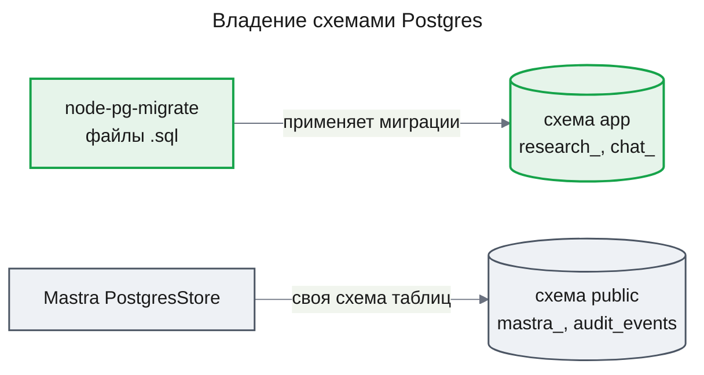

# ADR-0002 Схема `app` и SQL-миграции node-pg-migrate

## Status

Superseded by ADR-0003

Выбор инструмента заменён [ADR-0003](ADR-0003-drizzle-data-layer.md) (Drizzle); схема `app` сохраняется.

## Context

До `research-runtime` в проекте нет механизма миграций. Postgres делят Mastra — её `PostgresStore` сам создаёт и меняет таблицы `mastra_*` в схеме `public` — и `AuditService`, который создаёт `audit_events` своим DDL при старте. Runtime добавляет первые собственные таблицы приложения, которые надо создавать и менять версионно, предсказуемо и без вмешательства в чужие таблицы ([design-runtime.md](../features/research-runtime/design-runtime.md), KD-2 и Migration Strategy).

Решение связывает не только эту фичу: `chat-storage` переносит беседы и сообщения из Mastra Memory в собственные таблицы и опирается на тот же механизм миграций ([prd.md](../features/research-runtime/prd.md), дорожная карта). Смена схемы или инструмента после этого — перенос данных двух фич и переписывание истории миграций.

## Decision

Таблицы, которыми владеет приложение, живут в отдельной схеме Postgres `app`. Механизм миграций проекта — node-pg-migrate с миграциями в виде `.sql`-файлов и журналом `app.schema_migrations`. Таблицы `mastra_*` и `audit_events` в `public` этим механизмом не затрагиваются.

### Decision Details

| Item | Content |
|------|---------|
| **Decision** | Схема `app` для таблиц приложения; миграции — `.sql`-файлы, исполняемые node-pg-migrate |
| **Why now** | Runtime создаёт первые таблицы приложения; `chat-storage` будет вторым потребителем того же механизма |
| **Why this** | Источник истины и предмет ревью — написанный вручную SQL; ни модели, ни генерируемого клиента, ни shadow-базы; журнал и блокировка запуска из коробки |
| **Known unknowns** | Как запускать модуль опций миграций из TypeScript без сборки — type stripping Node 24 или вывод `nest build` (design-runtime.md, Appendix: Evidence, unknowns) |
| **Kill criteria** | В приложении появляется модель данных ORM (Prisma или Drizzle) как слой доступа к `app`, и миграции выгоднее генерировать из неё; или ручные миграции расходятся с кодом так, что тесты соответствия этого не ловят |

## Rationale

Главное требование к размещению — не трогать то, чем владеет Mastra: отдельная схема `app` отделяет таблицы приложения от `mastra_*` в `public` по владельцу, а не по соглашению об именах. Внутри схемы `app` инструмент выбран по тому, что ревьюится: проект не держит модели данных ORM, поэтому источником истины остаётся написанный вручную SQL, а не вывод генератора. node-pg-migrate исполняет только файлы из каталога миграций, ведёт журнал в выбранной схеме и берёт advisory lock на запуск; это проверено spike на node-pg-migrate 9.0.0 и Postgres 16 (design-runtime.md, Appendix: Evidence).

### Options Considered

1. **Prisma Migrate**
   - Pros: декларативная модель, генерация клиента; модели привязываются к схеме `app` через список `schemas` в datasource
   - Cons: второй язык схемы (Prisma Schema) рядом с SQL; генерируемый клиент, которого проект не использует; `migrate dev` требует shadow-базу, то есть права создавать базы или отдельный URL

2. **drizzle-kit**
   - Pros: схема в TypeScript, генерация SQL; `schemaFilter` и `tablesFilter` ограничивают `push` и `pull` схемой `app`
   - Cons: `generate` строит SQL из TS-модели по разнице JSON-снимков, поэтому проверяемый SQL — вывод, а не источник; модель и снимки надо держать рядом с миграциями

3. **Kysely Migrator**
   - Pros: лёгкий, транзакционный
   - Cons: миграции — TS-модули, требующие сборки или загрузчика; тянет query builder ради одного runner

4. **Таблицы с префиксом в схеме `public`**
   - Pros: без новой схемы
   - Cons: таблицы приложения смешаны с `mastra_*` и `audit_events`; граница владения держится только на префиксе

5. **Схема `app` и node-pg-migrate с `.sql` (выбран)**
   - Pros: чужие таблицы вне досягаемости; SQL — источник истины и ревьюится как есть; без модели и shadow-базы; журнал и блокировка запуска из коробки
   - Cons: миграции пишутся вручную, без генерации; одна новая зависимость

## Consequences

### Positive Consequences

- Таблицы приложения и таблицы Mastra не пересекаются ни по схеме, ни по инструменту
- Каждая фича добавляет свои миграции в одну историю; порядок и однократность применения держит журнал
- Применённые миграции проверяются при старте приложения, до приёма запросов

### Negative Consequences

- Нет автогенерации миграций из модели; соответствие кода и схемы держат тесты (например, домены CHECK против enum контрактов)
- Ссылки из `app` на таблицы `public` (беседы Mastra) не делаются внешними ключами до переноса бесед в `chat-storage`

### Neutral Consequences

- `audit_events` остаётся со своим DDL в `AuditService`; перенос в механизм миграций — отдельное решение

## Implementation Guidance

- Каждая таблица, которой владеет приложение, создаётся миграцией в схеме `app`; DDL при старте сервиса для новых таблиц не используется
- Миграции только вперёд: исправление — новый файл, применённый файл не меняется
- Таблицы фичи несут её префикс (`research_`, `chat_`)
- Приложение при старте только проверяет применённость миграций и не мигрирует само
- Опции runner задаются в одном месте и общие для скрипта, тестов и проверки при старте

## Related Information

- [design-runtime.md](../features/research-runtime/design-runtime.md) — KD-2 (решение), Migration Strategy, AC-RT-3 (проверка при старте)
- [prd.md](../features/research-runtime/prd.md) — FR-10, дорожная карта (`chat-storage`)
- [ADR-0001](ADR-0001-durable-runtime-owner.md) — runtime, чьи таблицы первыми живут в схеме `app`
- [node-pg-migrate](https://salsita.github.io/node-pg-migrate/) — runner, SQL-миграции, advisory lock
- [Prisma — multi-schema](https://www.prisma.io/docs/orm/prisma-schema/data-model/multi-schema) и [shadow database](https://www.prisma.io/docs/orm/prisma-migrate/understanding-prisma-migrate/shadow-database) — список `schemas`; shadow-база для `migrate dev`
- [drizzle-kit generate](https://orm.drizzle.team/docs/drizzle-kit-generate) и [drizzle.config](https://orm.drizzle.team/docs/drizzle-config-file) — генерация по JSON-снимкам; `schemaFilter` и `tablesFilter` для `push` и `pull`
