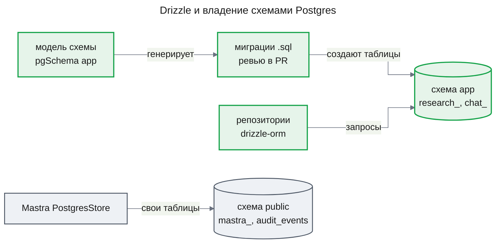

# ADR-0003 Drizzle — схема `app`, миграции и доступ к данным

## Status

Accepted

## Context

[ADR-0002](ADR-0002-app-schema-migrations.md) отвёл таблицам приложения схему `app` и выбрал node-pg-migrate с `.sql`-файлами; запросы при этом пишутся на сыром `pg`. Кода на этом решении ещё нет. Runtime исследований и следующий за ним `chat-storage` дают сотни запросов к одним таблицам, и при сыром `pg` имена столбцов, типы строк и маппинг повторяются в каждом репозитории без связи с DDL.

Запросы runtime требуют от слоя данных: частичный UNIQUE и `INSERT … ON CONFLICT` с арбитром по нему, блокировки строк `FOR NO KEY UPDATE` и `FOR UPDATE OF … SKIP LOCKED`, рекурсивный CTE проверки цикла, savepoint во вложенной транзакции, `bytea`, составные FK с каскадом, CHECK и identity ([design-runtime.md](../features/research-runtime/design-runtime.md), KD-3, Data Model). Таблицы `mastra_*` и `audit_events` в `public` остаются чужими; приложение работает несколькими экземплярами и само не мигрирует.

## Decision

Слой данных схемы `app` — Drizzle: модель таблиц на TypeScript через `pgSchema('app')`, миграции генерирует drizzle-kit в `.sql`-файлы, применяет мигратор drizzle-orm, запросы строит drizzle-orm поверх существующего драйвера `pg`. Схема `app` из ADR-0002 сохраняется; `mastra_*` и `audit_events` этим механизмом не затрагиваются. Решение заменяет выбор инструмента в ADR-0002 и связывает `research-runtime`, `chat-storage` и каждую следующую фичу с таблицами в `app`.

### Decision Details

| Item | Content |
|------|---------|
| **Decision** | drizzle-orm и drizzle-kit — определение схемы `app`, миграции и доступ к данным |
| **Why now** | Первые таблицы `app` ещё не написаны; после runtime и `chat-storage` смена слоя — переписывание репозиториев и истории миграций |
| **Why this** | Одна типизированная модель для DDL и запросов; spike подтвердил каждую конструкцию runtime; обход нужен для `FOR UPDATE OF`, рекурсивного CTE и запуска миграций; запросы остаются на уровне SQL, без скрытых обращений |
| **Known unknowns** | Формат каталога миграций и мигратор в Drizzle 1.0 (сейчас beta) — переход проверяется при обновлении; загрузка drizzle-kit модуля схемы, импортирующего `@agent-os/contracts` (ESM), — проверяется в плане |
| **Kill criteria** | Больше половины запросов репозиториев в `app` — фрагменты `sql`, или больше одной сгенерированной миграции на фичу правится руками после generate — тогда SQL-first (ADR-0002) выгоднее, схема `app` остаётся |

## Rationale

Главный выигрыш — один источник для структуры таблиц и типов строк: модель в TypeScript порождает и миграцию, и типы запросов, поэтому переименование столбца ломает сборку, а не прод. Цена — ревьюится сгенерированный SQL, а не написанный. Генерация миграций из TS-модели перевешивает SQL-first с типами, сгенерированными из базы: типы есть без запущенной базы, и расхождение модели с миграциями CI ловит без неё же. Spike на drizzle-orm 0.45.4, drizzle-kit 0.31.11, Node 24.11, TypeScript 6 и Postgres 16 из `infra/docker-compose.yml` подтвердил требуемые конструкции и показал, где нужен обход (design-runtime.md, Appendix: Evidence).

### Options Considered

1. **node-pg-migrate и сырой `pg` (ADR-0002)**
   - Pros: SQL — источник истины и ревьюится как есть; advisory lock запуска из коробки; без генератора и снимков
   - Cons: нет связи типов между таблицами и кодом; каждый репозиторий повторяет столбцы и маппинг строк вручную; расхождение схемы и кода ловят только тесты

2. **Kysely**
   - Pros: типизированный построитель близко к SQL; рекурсивные CTE и блокировки с `of` в построителе
   - Cons: типы берутся из мигрированной базы (kysely-codegen) — их перегенерация требует живой базы в dev и CI; миграции остаются рукописными TS-модулями

3. **Prisma**
   - Pros: декларативная модель, генерация миграций, зрелый инструмент
   - Cons: отдельный язык схемы и генерируемый клиент; блокировки строк и `ON CONFLICT` с арбитром по частичному индексу вне API клиента — критичные запросы runtime ушли бы в `$queryRaw`; `migrate dev` требует shadow-базу

4. **Drizzle (выбран)**
   - Pros: модель в TS даёт DDL и типы запросов; `ON CONFLICT` с `target` и `where`, четыре силы блокировки с `skipLocked`, вложенная транзакция как savepoint, `customType` для `bytea`, identity, CHECK, составной FK с каскадом — в построителе; `schemaFilter` ограничивает drizzle-kit схемой `app`; custom-миграции для невыразимого; работает поверх пула `pg`
   - Cons: проверяемый SQL — вывод генератора, читается в PR; снимки `meta/` сталкиваются между ветками; мигратор без блокировки и без сверки хэшей; сгенерированный `CREATE SCHEMA` мешает журналу в `app`; блокировка с `OF` для таблицы схемы и рекурсивный CTE — через обход; версия до 1.0

## Consequences

### Positive Consequences

- Таблица, ограничение и тип строки описаны один раз; запросы проверяются компилятором
- Миграции генерируются из модели; расхождение модели и истории миграций видно как непустой `drizzle-kit generate`
- Таблицы приложения и таблицы Mastra не пересекаются ни по схеме, ни по инструменту

### Negative Consequences

- Ревью миграции — чтение сгенерированного SQL; генератор может выбрать не ту форму изменения (переименование против пересоздания), и это ловит только ревьюер
- Блокировка запуска миграций и проверка при старте пишутся в проекте поверх мигратора
- Запросы, которых нет в построителе, пишутся фрагментами `sql` и теряют часть проверки типов
- Миграции, сгенерированные на параллельных ветках, сталкиваются в снимках `meta/` (цепочка `prevId`)
- Миграцию с меткой времени старше уже применённой мигратор пропускает молча: drizzle-orm 0.45.4 применяет только файлы новее последней записи журнала; лекарство — перегенерировать миграцию после rebase
- Обновление до Drizzle 1.0 — отдельная работа с каталогом миграций

### Neutral Consequences

- `audit_events` остаётся со своим DDL в `AuditService`; перенос в модель — отдельное решение
- drizzle-kit — только инструмент разработки; в рантайме нужен drizzle-orm

## Implementation Guidance

- Модель схемы `app` — один модуль; каждая таблица, ограничение и индекс схемы `app` объявляются в нём, таблицы фичи несут её префикс (`research_`, `chat_`)
- Конструкцию, которую модель не выражает (триггер, функция), добавляет custom-миграция drizzle-kit; DDL при старте сервиса не используется
- Сгенерированный SQL ревьюится в PR как код; миграции только вперёд, применённый файл не меняется
- Миграции применяет одна функция проекта: выделенное соединение, advisory lock, мигратор drizzle-orm; `drizzle-kit push` к общим базам не применяется
- Журнал миграций живёт в схеме `app` (по умолчанию библиотека пишет в схему `drizzle`): функция миграций передаёт схему журнала явно, и каждый вызывающий — скрипт, e2e-обвязка, проверка при старте — пользуется только ею
- Приложение при старте только сверяет файлы миграций с журналом и не мигрирует само
- Запросы строит drizzle-orm; где построителя не хватает — фрагмент `sql` с параметрами, `sql.raw` только для констант кода
- CI проверяет, что генерация по модели не даёт новых миграций, и запускает `drizzle-kit check`, падая на коллизии снапшотов и на его предупреждении о нарушенном порядке timestamp журнала; пропущенную миграцию дополнительно ловит проверка после `migrate()` и при старте

## Related Information

- [ADR-0002](ADR-0002-app-schema-migrations.md) — схема `app` и node-pg-migrate; инструмент заменён этим ADR
- [ADR-0001](ADR-0001-durable-runtime-owner.md) — runtime, чьи таблицы первыми живут в схеме `app`
- [design-runtime.md](../features/research-runtime/design-runtime.md) — KD-2, Data Model, Migration Strategy, Appendix: Evidence (spike Drizzle, обходы и ограничение `OF` неполными именами таблиц)
- [Drizzle — Migrations](https://orm.drizzle.team/docs/migrations) — `generate`, `migrate`, программный `migrate()`
- [Drizzle — drizzle.config](https://orm.drizzle.team/docs/drizzle-config-file) — `schemaFilter`, `migrations.schema` и `migrations.table`
- [Drizzle — custom migrations](https://orm.drizzle.team/docs/kit-custom-migrations) — `generate --custom`
- [PostgreSQL 16 — Locking Clause](https://www.postgresql.org/docs/16/sql-select.html#SQL-FOR-UPDATE-SHARE) — синтаксис `FOR UPDATE … OF … SKIP LOCKED`
