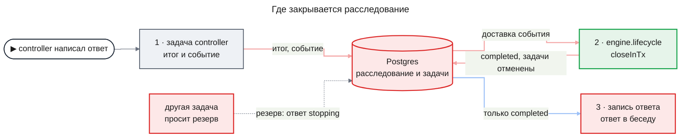

# ADR-0006 Окончательные статусы расследования `completed` и `failed`; закрывает потребитель событий движка

## Status

Accepted

## Decision

Расследование, у которого готов ответ или сорвалась главная задача, сейчас навсегда остаётся `active`, и его незаконченные задачи продолжают работать и тратить токены. Строка расследования получает два окончательных статуса: `completed` — ответ есть, `failed` — ответа нет. Закрывает расследование новый потребитель событий движка `engine.lifecycle`: когда кончилась главная задача, он в одной транзакции меняет статус и отменяет все незаконченные задачи. Резерв токенов, который записывается перед каждым вызовом модели, в той же транзакции проверяет, что расследование ещё `active` и отмена задачи не запрошена; иначе резерв отказывает ответом `stopping`, и вызова нет. Решение исключает отмену без новых статусов, закрытие внутри главной задачи, закрытие в момент записи ответа в беседу, а для запрета вызовов — только сигнал отмены и отдельное чтение статуса до резерва.

### Decision Details

| Item | Content |
|------|---------|
| **Why now** | Часть `lifecycle` добавляет статусы в проверку столбца и миграцией закрывает уже законченные расследования; после этого закрытый статус читают движок, самопроверка и запись ответа в беседу |
| **Known unknowns** | Как часто доставка закрытия исчерпывает попытки под нагрузкой и оставляет расследование `active` до сроков его задач |
| **Kill criteria** | В журнале вызовов после выпуска находятся вызовы модели, начатые после закрытия (`completed`, `failed`) или остановки расследования; или фиче `research-followup` нужно возвращать закрытое расследование в `active`, а не продолжать его новым |

## Context

Сотрудник видит беседу, а расследование идёт в фоне: сервер дробит его на задачи — сбор записей, анализ подвопроса, проверку, ответ, — и исполнители берут их по очереди. Главная задача, **controller**, одна на расследование: она ведёт его по шагам и в конце пишет ответ. Каждое изменение задачи записывается **событием** в той же транзакции, а runtime доставляет события **потребителям** — коду, который на них реагирует, — по одному, в транзакции и с повтором при сбое. Когда расследование «завершено», ответ появляется в беседе отдельным сообщением, а карточка ресерча показывает «Завершён».

Сейчас у строки расследования три статуса: `active`, `cancelled` и `deleting`. Законченное расследование остаётся `active`, а «завершено» движок вычисляет по итогу задачи controller. Поэтому после ответа задачи расследования продолжают работать и тратить токены, а провал controller ничего не отменяет. PRD требует обратного: расследование становится «завершено», как только ответ готов, раньше, чем ответ записан в беседу, и с этого момента новый вызов модели не начинается ([prd.md](../features/agent-quality/prd.md), FR-19).

Варианты должны были выполнить четыре условия. Рестарт сервера не теряет и не дублирует закрытие. Закрытие не нарушает общий порядок блокировок runtime. Закрываются и прогоны самопроверки, у которых нет беседы. Закрытие решает код по статусу задачи, а не модель.

**Почему это архитектурное решение.**

1. **Дорого откатить.** Новые значения входят в проверку столбца `research_investigations.status`, а миграция закрывает уже законченные расследования по статусу их задачи controller. На закрытый статус опираются `InvestigationView.status` движка, `RunRecord.status` самопроверки и запись ответа в беседу. Откат — обратная миграция данных и правка всех трёх читателей.
2. **Связывает за пределами фичи.** Потребителя закрытия регистрирует функция сборки движка `createEngine`, поэтому его получают все сборки движка: `apps/api`, программа самопроверки и тестовые обвязки. Каждый вызов модели проходит резерв с этой проверкой. Фича `research-followup` будет возобновлять расследование, для которого закрытие окончательно.
3. **Были реальные варианты.** Три способа закрыть и два способа запретить новый вызов модели реализуемы; они сравнены ниже.

## Rationale

Потребитель событий получает конец задачи controller уже после того, как её итог записан, и runtime повторяет доставку до успеха. Падение процесса между итогом и закрытием оставляет событие недоставленным, и после подъёма закрытие происходит один раз. Доставка идёт под блокировкой строки расследования, поэтому закрытие берёт строки в обычном порядке. Закрытие наступает до записи ответа в беседу и не зависит от неё, поэтому токены не тратятся во время ожидания записи, а прогоны самопроверки закрываются так же.

Отдельные статусы `completed` и `failed` отличают завершение от остановки.

Запрет нового вызова проверяется в той же транзакции, что записывает резерв. Поэтому он действует на любом экземпляре сервера с момента, когда закрытие или остановка зафиксированы в базе.

### Options Considered

**Как закрывать расследование**

1. **Оставить три статуса и вызывать отмену в момент ответа**
   - Pros: Работает существующая отмена `InvestigationService.cancel`, и столбец статуса не меняется.
   - Cons: Строка успешного расследования говорила бы `cancelled`, и завершение нельзя было бы отличить от остановки.

2. **Закрывать в самой задаче controller, в транзакции записи ответа**
   - Pros: Ответ и закрытие фиксируются одним действием.
   - Cons: Эта транзакция уже держит строку задачи и взяла бы строку расследования вторым шагом, против общего порядка блокировок. Закрытие отменило бы и саму задачу controller, ещё не законченную, поэтому падение процесса между закрытием и итогом оставило бы её отменённой вместо успешной.

3. **Закрывать в момент записи ответа в беседу**
   - Pros: «Завершено» совпадает с моментом, когда сотрудник видит ответ.
   - Cons: Расследование тратило бы токены всё время ожидания записи. Прогоны самопроверки идут без беседы и не закрывались бы вовсе.

4. **Окончательные статусы; закрывает потребитель `engine.lifecycle` (выбран)**
   - Pros: Закрытие переживает рестарт и происходит один раз, наступает до записи ответа и закрывает прогоны без беседы.
   - Cons: Закрытие отстаёт от итога controller на одну доставку события, и в это окно задача ещё может начать вызов модели.

**Как запретить новый вызов модели после закрытия или остановки**

1. **Только сигнал отмены**
   - Pros: Резерв не меняется.
   - Cons: Задача на другом экземпляре узнаёт о сигнале только на пульсе аренды и до него успевает начать новый вызов.

2. **Отдельное чтение статуса в шлюзе модели до резерва**
   - Pros: Резерв не меняется.
   - Cons: Между чтением и резервом остановка может успеть зафиксироваться.

3. **Проверка в транзакции резерва (выбран)**
   - Pros: Запрет действует на любом экземпляре с момента фиксации в базе. Отказ `stopping` ведёт себя как прежний отказ `fenced`, который получает попытка, уже переданная другому исполнителю: ни строки журнала вызовов, ни транскрипта.
   - Cons: Уже идущий вызов проверка не прерывает; его прерывает сигнал отмены — в своём процессе сразу, на другом экземпляре после пульса.

Схема показывает выбранный путь: от итога controller до ответа в беседе.

## Consequences

### Positive Consequences

- После закрытия или остановки ни одна задача расследования не начинает новый вызов модели ни на одном экземпляре
- Завершение и остановка различимы в строке расследования, и «завершено» для всех читателей наступает только после закрытия
- Рестарт между итогом controller и закрытием не теряет закрытие и не повторяет его
- Прогоны самопроверки закрываются тем же путём, что расследования из беседы

### Negative Consequences

- Карточку «Не удалось» переводит отдельный потребитель того же события, `chat-entry.answers`, и его доставка идёт отдельно от закрытия. Поэтому карточка может появиться на одну доставку раньше отмены задач; в это окно, обычно меньше секунды, задача ещё может начать вызов модели
- Если доставка закрытия исчерпала попытки, расследование остаётся `active`, его задачи доходят до своих сроков, а запуск через окно `RESEARCH_APPEND_GIVE_UP_MS` становится «Не удалось»
- Закрытие окончательно: возобновлению расследования нужен свой путь

### Neutral Consequences

- Ответ, собранный при принудительной остановке — бюджет, недоступная модель, предел шагов, — даёт `completed`
- Расследования без задачи controller — оболочки неудачного старта — миграция оставляет `active`: их переиспользует повтор старта

## Implementation Guidance

- Расследование выходит из `active` один раз; закрытый статус меняется только на `deleting`
- Потребитель `engine.lifecycle` получает события `TaskSucceeded` и `TaskFailed` и для задачи controller вызывает операцию runtime `InvestigationService.closeInTx` в транзакции доставки
- Закрытие и отмена незаконченных задач идут в одной транзакции и тем же путём, что `InvestigationService.cancel`
- Закрытие решает код по статусу задачи controller; модель в нём не участвует
- Закрытие расследования не в `active` ничего не меняет, поэтому повторная доставка безопасна
- Резерв вызова модели (`postgresCallLedger.reserve`) идёт через охрану попытки `TaskContext.withAttemptGuard` в режиме `requireActive`, где охрана отвечает `stopping`; запись ответа задачей controller, запись утверждений и закрытие резервов, которые должны пройти и после запроса отмены, идут без этого режима
- Читатели «завершено» берут его из закрытого статуса, а не из итога задачи controller
- Ответ ресерча пишется в беседу, только если его расследование `completed`

## Related Information

- [design-lifecycle.md](../features/agent-quality/design-lifecycle.md) — KD-1, KD-2, Contract Definitions, State Transitions and Invariants, Risks and Mitigation
- [agent-quality/prd.md](../features/agent-quality/prd.md) — FR-19, AC-19.1, AC-19.2, Success Criteria
- [design-runtime.md](../features/research-runtime/design-runtime.md#contract-definitions) — `InvestigationService`, `TaskContext.withAttemptGuard`
- [design-engine.md](../features/deep-research/design-engine.md#contract-definitions) — `InvestigationView.status`, резерв вызова модели
- [ADR-0001](ADR-0001-durable-runtime-owner.md) — runtime как единственный владелец задач, событий и восстановления
