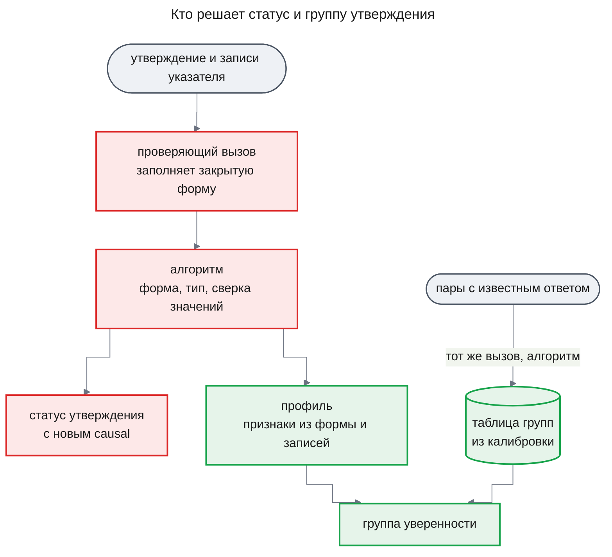

# ADR-0007 Статус утверждения выводит алгоритм из закрытой JSON-оценки модели, а группу уверенности — таблица из калибровки

## Status

Proposed

## Decision

В расследовании модель пишет утверждения — короткие факты из логов со ссылками на записи. Сейчас утверждение становится «установленным», если код нашёл в записях названные в нём значения, а смысл никто не проверяет. Решение такое: понимание текста остаётся только за отдельным вызовом модели — **проверяющим вызовом**. Он читает одно утверждение вместе с записями его **указателя** (номерами записей, на которые утверждение опирается) и заполняет форму с закрытыми ответами: подтверждают ли записи утверждение, какого оно типа и как к нему относится каждая запись. Статус утверждения выводит код по этой форме, по номерам записей и по сверке значений; текст код не читает.

Насколько система уверена в установленном выводе, говорит **группа уверенности**. Её выбирает код по **профилю** — сочетанию четырёх признаков из формы и записей: тип утверждения, совпали ли значения, сколько независимых записей его подтверждают и есть ли противоречащие. Какой группе соответствует каждый профиль, задаёт таблица групп, которую строит **калибровка** — прогон проверяющего вызова на парах «утверждение — записи» с заранее известным ответом. Сервер не стартует, если для модели и промпта проверяющего вызова такой таблицы нет.

### Decision Details

| Item | Content |
|------|---------|
| **Why now** | Часть `engine` фичи `agent-quality` вводит новый статус `causal`, поля оценки и группы в хранимых утверждениях и таблицу групп как условие старта сервера; после этого на них опираются ответ сотруднику, самопроверка и каждый следующий процесс с проверкой |
| **Known unknowns** | Отличает ли модель класса Haiku смысл от совпадения значений на логах и по-русски (гипотеза H-01 PRD); упорядочены ли группы по реальной верности на первом, небольшом наборе пар (H-03) |
| **Kill criteria** | Отчёт калибровки показывает, что на парах «значения совпали, смысл неверен» доля верных решений алгоритма не отличается от нуля — одна сверка значений на этих парах ошибается всегда (опровержение H-01 PRD); или группа выше не точнее группы ниже после двух калибровок подряд |

## Context

Сотрудник задаёт вопрос в чате, расследование идёт в фоне, и в беседу приходит ответ с разделами «Установлено», «Предположения» и «Не выяснено». Сейчас статус утверждения ставит код: он ищет в заново запрошенных записях названные в утверждении сервис, событие, интервал и число. Фраза «ошибки оплаты вызвал релиз в 19:30» проходит, если в логах есть и релиз, и ошибки, даже когда связи между ними нет. Насколько можно верить выводу, ответ не говорит.

Ограничение PRD «Модель оценивает, алгоритм решает» требует: что требует понимания текста, решает вызов модели в форме JSON, а решение принимает алгоритм по полям этой формы, по статусам или по обоим. Списков слов, поиска подстрок и правил по тексту в коде быть не должно. PRD фичи `agent-quality` требует, чтобы статус ставил отдельный от автора утверждения вызов (FR-12), причинные выводы шли в «Предположения» (FR-14), а группу уверенности выводил алгоритм с границами из калибровки, а не руками (FR-06, FR-15). У каждого установленного вывода должна быть группа (AC-15.1).

**Почему это архитектурное решение.**

1. **Дорого откатить.** Хранимые утверждения получают новый статус `causal`, тип, оценку и группу; миграция расширяет проверку столбца статуса. Ответы в беседах уже несут группы и метки причинности, а экран ответа в веб-приложении (`web`) их показывает. Откат — обратная миграция, правка ответа, экрана и самопроверки.
2. **Связывает за пределами фичи.** Каждый следующий процесс исследования с возможностью проверки обязан иметь откалиброванную таблицу групп для своего проверяющего вызова, иначе сервер не стартует. Любая смена модели или промпта проверяющего вызова требует новой калибровки. Самопроверка меряет эффект по тому же правилу статуса.
3. **Были реальные варианты.** Для статуса, для группы и для случая без таблицы есть по нескольку реализуемых путей; они сравнены ниже.

## Rationale

Вопрос «подтверждают ли эти записи это утверждение» — задача, где проверить легче, чем написать, и малые модели решают её почти как большие. Так измерено на английской прозе; для логов на русском это гипотеза H-01 (PRD, раздел «Подход и почему мы в него верим», блок 1). Закрытая форма делает ответ модели данными: алгоритм проверяет форму, и ответ не по форме ведёт к «не установлено», а не к «подтверждено». Сверка значений остаётся вторым условием, поэтому модель, которая сказала «подтверждают» при расходящемся числе, вывод не установит.

Группа по таблице из калибровки опирается на измеренную долю верных решений, а не на мнение модели о себе. Таблица привязана к модели и **отпечатку промпта** проверяющего вызова — короткому хэшу текста шаблона промпта, который меняется при любой правке. Сервер без подходящей таблицы не стартует, а не подставляет всем выводам низшую группу: иначе после правки промпта сотрудник видел бы «низкую» уверенность у каждого вывода и не мог бы понять, что калибровку просто не прогнали. Программа самопроверки от этого правила освобождена, потому что именно её команда калибровки строит таблицу.

Схема показывает, кто что решает.

### Options Considered

**Кто ставит статус**

1. **Оставить сверку значений кодом как единственное условие**
   - Pros: Нет новых вызовов модели и новых полей.
   - Cons: Совпадение значений не значит, что смысл верен; причинную фразу с найденными значениями код установит.

2. **Статус — прямо ответ модели «установлено / нет»**
   - Pros: Один вызов, никакого алгоритма.
   - Cons: Решение принимает модель; ошибку формы, номер несуществующей записи и расхождение числа никто не проверяет.

3. **Правила по тексту в коде, например список «причинных» слов**
   - Pros: Дёшево и без вызова модели.
   - Cons: Нарушает ограничение PRD «Модель оценивает, алгоритм решает»; правило ломается на другом языке и другой формулировке.

4. **Закрытая форма от модели, решение алгоритма по форме и сверке значений (выбран)**
   - Pros: Смысл читает модель, решение воспроизводимо и проверяемо; ответ не по форме не превращается в «подтверждено».
   - Cons: Вызов проверяющей модели делается на каждое утверждение, а не один на раунд проверки.

**Откуда группа уверенности**

1. **Модель сама называет уверенность числом**
   - Pros: Ни калибровки, ни таблицы.
   - Cons: Такое число не измерено как вероятность; опоры для него в источниках нет.

2. **Правила групп, записанные в коде руками**
   - Pros: Просто и предсказуемо.
   - Cons: PRD запрещает ручные границы; после смены модели или промпта они молча перестают соответствовать точности.

3. **Профиль признаков и таблица групп из калибровки (выбран)**
   - Pros: Группа опирается на измеренную точность и пересчитывается вместе с моделью или промптом.
   - Cons: Каждая правка промпта проверяющего вызова требует прогона калибровки до выпуска.

**Что делать, если таблицы групп нет**

1. **Стартовать и давать каждому установленному выводу низшую группу, с предупреждением в логе**
   - Pros: Выпуск промпта или модели не ждёт калибровки.
   - Cons: Сотрудник видит «низкую» уверенность у каждого вывода и не может отличить слабый вывод от непрогнанной калибровки.

2. **Стартовать и не показывать групп**
   - Pros: Ничего не выдаётся за измеренное.
   - Cons: Нарушает AC-15.1: у каждого установленного вывода должна быть группа.

3. **Сервер не стартует; ошибка называет процесс, его версию и отпечаток промпта (выбран)**
   - Pros: Устаревшие или отсутствующие границы не доходят до сотрудника.
   - Cons: Забытая калибровка останавливает выпуск, пока её не прогонят.

## Consequences

### Positive Consequences

- «Установлено» значит «отдельный вызов подтвердил смысл, и значения совпали», а не только «значения нашлись»
- Причинные выводы стоят в «Предположениях» с меткой и никогда не попадают в «Установлено»
- У каждого установленного вывода есть группа, чья точность измерена на парах с известным ответом
- Самопроверка меряет то же правило, по которому решает движок: калибровка вызывает ту же функцию решения

### Negative Consequences

- Каждое проверяемое утверждение получает свой вызов модели вместо общего вызова на раунд, и эти вызовы входят в бюджет расследования; повторного запроса записей из источника при этом нет
- Строгость отсеивает и часть верных выводов; доля найденных причин может упасть (гипотеза H-04 PRD)
- Выпуск новой модели или промпта проверяющего вызова невозможен без прогона калибровки

### Neutral Consequences

- Утверждение, которое не удалось проверить — бюджет, отмена, срок, — остаётся непроверенным и стоит в «Предположениях» с меткой непроверенного вывода (deep-research `uxrd.md`, MC-27), как сейчас
- Профиль, которого калибровка не видела, получает низшую группу

## Implementation Guidance

- Проверяющий вызов — роль `verifier`; он отвечает закрытой формой `ClaimAssessment` (design-engine.md, Contract Definitions): подтверждение, тип утверждения и отношение каждой данной записи; каждый объект схемы закрыт
- Статус выводит чистая функция `decideClaim` без вызовов модели и базы; она же работает в калибровке. Сверку значений делает прежняя функция `verifyClaim` на записях указателя
- Код не читает текст утверждения и записей для решения: только поля формы, номера записей, типизированные поля записей и статусы
- Ответ не по форме и указатель на чужие или несуществующие записи дают «не установлено», а не «подтверждено»
- Утверждение типа `causal` получает статус `causal` и никогда не стоит в «Установлено»
- Группу выбирает таблица групп по профилю утверждения; таблица привязана к модели и отпечатку промпта роли `verifier`; её строит команда `calibrate` программы самопроверки
- Функция сборки движка `createEngine` с признаком `requireCalibration` отказывает с `calibration_missing`, если для загруженной конфигурации нет таблицы; сборка сервера передаёт этот признак, программа самопроверки — нет

## Related Information

- [design-engine.md](../features/agent-quality/design-engine.md) — KD-2, KD-3, «Как утверждение получает статус», «Как считается группа уверенности», «Как калибровка ставит таблицу групп», Contract Definitions
- [agent-quality/prd.md](../features/agent-quality/prd.md) — FR-06, FR-12, FR-13, FR-14, FR-15, AC-15.1, Constraints «Модель оценивает, алгоритм решает»
- [design-self-check.md](../features/agent-quality/design-self-check.md#contract-definitions) — `CalibrationPair`, `Engine.assess`, версия промпта
- [deep-research/design-engine.md](../features/deep-research/design-engine.md) — KD-6, которое это решение заменяет
- [ADR-0005](ADR-0005-process-config-data-only.md) — процесс задаёт конфигурация-данные; таблица групп лежит рядом с ней как данные
