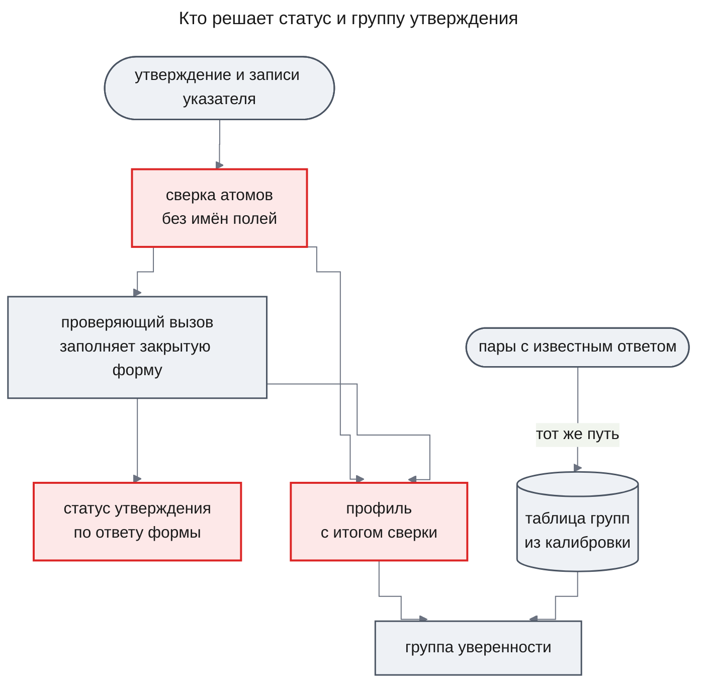

# ADR-0008 Статус утверждения ставит закрытый ответ проверяющего вызова, атомы — примитивы без предметного словаря, а группу уверенности задаёт таблица из калибровки

## Status

Accepted (2026-11-08). Заменяет [ADR-0007](ADR-0007-claim-status-from-assessment-and-calibrated-groups.md).

## Decision

В расследовании модель пишет утверждения — короткие факты из записей источника со ссылками на эти записи. Каждое утверждение называет **атомы** — значения, которые код может найти в записях. Атом — один из трёх примитивов, одинаковых для любого источника данных: `text` — строка как написана в записи, `number` — число, `time` — момент или интервал ISO 8601. Код сверяет каждый атом со всеми полями записей указателя, не зная имён полей, и получает итог: найден, не найден или противоречит.

Статус утверждения ставит закрытый ответ **проверяющего вызова** — отдельного вызова модели, который читает одно утверждение, записи его **указателя** (номера записей, на которые утверждение опирается) и итог сверки атомов. Код переводит ответ в статус: «подтверждают» — `supported`, «не подтверждают» — `refuted`, «мало данных» — `insufficient`, причинное утверждение — `causal`. Итог сверки статуса не отменяет: он — свидетельство во входе вызова и признак профиля. Сам код решает только то, что проверяется без понимания текста: указатель ведёт на существующие записи этого расследования, пакет помещается в окно роли, ответ проходит закрытую форму, резерв помещается в бюджет.

Насколько система уверена в установленном выводе, говорит **группа уверенности**. Её выбирает код по **профилю** из четырёх признаков: тип утверждения, итог сверки атомов (все найдены, хоть один не найден или противоречит, атомов нет), число независимых подтверждающих записей и есть ли противоречащие. Какой группе соответствует профиль, задаёт таблица групп, которую строит **калибровка** на парах «утверждение — записи» с известным ответом. Сервер не стартует, если для модели и промпта проверяющего вызова такой таблицы нет.

### Decision Details

| Item | Content |
|------|---------|
| **Why now** | Первые четыре расследования на настоящих моделях не установили ни одного вывода: все шесть утверждений, которые проверяющий вызов подтвердил, код убрал, потому что сверка искала время только в поле `ts`, а утверждения указывали на группы подсчёта без этого поля. Перечень видов атомов оказался словарём одного учебного источника |
| **Known unknowns** | Ловит ли модель класса Haiku число или время, приписанные не той записи, когда код больше не отменяет её «подтверждают» (меряют пары `values_match_meaning_wrong` и `contradicted` на группах подсчёта); различимы ли группы при 24 профилях на небольшом наборе пар (гипотеза H-03 PRD) |
| **Kill criteria** | Отчёт калибровки показывает, что на парах с неверно приписанным числом или временем доля верных решений алгоритма ниже доли, которую дало бы правило «итог сверки `unmatched` — не установлено», — тогда для этой модели и промпта возвращается вето; или группа выше не точнее группы ниже после двух калибровок подряд |

## Context

Сотрудник задаёт вопрос в чате, расследование идёт в фоне, и в беседу приходит ответ с разделами «Установлено», «Предположения» и «Не выяснено». [ADR-0007](ADR-0007-claim-status-from-assessment-and-calibrated-groups.md) решило, что статус выводит код из закрытой формы проверяющего вызова и из сверки значений, причём сверка — второе условие: модель, сказавшая «подтверждают» при не найденном значении, вывода не устанавливала. Атомы были пяти видов — `traceId`, `service`, `event`, `interval`, `number`, — и сверка знала, в каком поле искать каждый.

Разбор первых четырёх расследований на настоящих моделях показал, что это второе условие и отсеяло все подтверждённые выводы. Утверждения о счётчиках указывали на группы подсчёта `{start, key, count}`, а сверка интервала смотрела только на записи с полем `ts`, поэтому атом интервала всегда был «не найден». Какое время у группы подсчёта, дизайн не определял, а генератор калибровочных пар этот случай обошёл, поэтому калибровка его не увидела. Владелец 2026-11-08 решил: атомы — универсальные примитивы, статус ставит ответ модели, а сверка становится её входом и признаком профиля.

Ограничение PRD «Модель оценивает, алгоритм решает» сохраняется: понимание текста — только в проверяющем вызове и только через закрытую форму, а статус и группу код выводит из полей формы, номеров записей и значений полей записей. Списков слов, поиска подстрок и правил по тексту в коде нет. FR-13 PRD 1.12 «Сверка значений — свидетельство, а не второе условие» с этим решением согласуется: итог сверки идёт во вход проверяющего вызова, но статуса не ставит. AC-13.2 требует, чтобы отчёт калибровки ставил рядом долю верных решений алгоритма и долю правила «значение не нашлось — не установлено» ([prd.md](../features/agent-quality/prd.md#functional-requirements)).

**Почему это архитектурное решение.**

1. **Дорого откатить.** Хранимые ревизии утверждений пишут атомы новых видов и профиль с третьим значением итога сверки; контракт калибровочных пар части `self-check` меняет формат атомов; поставляемая таблица групп строится заново на 24 профилях. Откат — снова правка генератора пар, таблицы, промптов и правила статуса.
2. **Связывает за пределами фичи.** Каждый следующий процесс с проверкой и каждый новый источник данных пишет атомы этими тремя примитивами и получает статус по ответу проверяющего вызова; каждая смена модели или промпта проверяющего вызова требует новой калибровки.
3. **Были реальные варианты.** Они сравнены ниже.

## Rationale

Сверка без имён полей сравнивает значения буквально: время начала группы подсчёта она не отличает от времени строки лога, а число, найденное в записи, не обязательно то, о котором утверждение. Поэтому её «найдено» и «не найдено» — слабый признак, и вето по нему снова молча отсеивало бы верные выводы. Модель видит запись целиком и итог сверки и может рассудить, о той ли записи значение. Утверждения, которые модель подтвердила при несовпавших значениях, не смешиваются с остальными: у них свой профиль, и калибровка меряет их точность отдельно.

Почему группа берётся из таблицы калибровки, привязанной к модели и отпечатку промпта, и почему сервер без неё не стартует, объясняет ADR-0007; эти доводы не изменились.

Схема показывает, кто что решает.

### Options Considered

**Как сверка значений участвует в статусе**

1. **Оставить сверку вето и научить её группам подсчёта**
   - Pros: Строгость ADR-0007 сохраняется; правка — одна ветка сверки.
   - Cons: У каждого нового вида записей и источника своя дыра в словаре, и вето снова молча отсеет верные выводы.

2. **Универсальные атомы, но сверка остаётся вето**
   - Pros: Словарь больше не привязан к источнику.
   - Cons: Сверка без имён полей не знает, к какому полю относится значение, поэтому её «не найдено» и «противоречит» слабее суждения модели, а вето решало бы по слабому признаку.

3. **Универсальные атомы как вход вызова и признак профиля, статус по ответу модели (выбран)**
   - Pros: Модель судит смысл и значения, видя итог сверки; утверждения с несовпавшими значениями получают свой профиль, и калибровка меряет их точность отдельно.
   - Cons: Код больше не гарантирует, что при не найденном числе вывод не установлен; это делает модель, и её точность на таких парах меряет калибровка.

**Как устроены атомы**

1. **Добавить в старый перечень виды для групп подсчёта**
   - Pros: Самая малая правка.
   - Cons: Каждый новый источник снова потребует правки словаря и сверки.

2. **Убрать атомы совсем**
   - Pros: Нет словаря и нет сверки.
   - Cons: Модель теряет точный итог сверки как свидетельство, а профиль — признак, который калибровка уже различает.

3. **Три примитива `text`, `number`, `time` при прежней структуре атома (выбран)**
   - Pros: Одинаково для любого источника; структура атома — вид и значение строкой — не меняется, а ревизии с прежними видами читаются без миграции.
   - Cons: `text` и `number` без имени поля не могут быть «противоречит», поэтому сверка различает только «найдено» и «не найдено» у них.

Группа уверенности из профиля и таблицы калибровки и отказ сервера стартовать без таблицы остаются такими, как их выбрало ADR-0007; там же разобраны отвергнутые варианты для них.

## Consequences

### Positive Consequences

- Подтверждённые выводы о группах подсчёта и о записях любых других источников больше не отсеиваются из-за словаря сверки
- Worker пишет атомы одинаково для любого источника данных, а сверка не требует правки под новый источник
- Самопроверка меряет то же правило, по которому решает движок: калибровка вызывает ту же сверку и ту же функцию решения
- Причинные выводы, как и раньше, стоят в «Предположениях» с меткой и никогда не попадают в «Установлено»

### Negative Consequences

- «Установлено» значит «отдельный вызов подтвердил смысл, видя итог сверки», а не «и значения совпали»: модель может установить вывод с не найденным значением; такой вывод получает профиль с несовпавшими значениями и группу по его измеренной точности
- Поставляемую таблицу групп нужно построить заново: меняются промпт проверяющего вызова, набор пар и число профилей
- Контракт калибровочных пар части `self-check` меняет формат атомов

### Neutral Consequences

- Утверждение, которое не удалось проверить — бюджет, отмена, срок, — остаётся непроверенным и стоит в «Предположениях» с пометкой «не проверено», как раньше
- Профиль, которого калибровка не видела, получает низшую группу

## Implementation Guidance

- Атом — вид и значение строкой; виды `text`, `number`, `time`. Сохранённые атомы прежних видов при сверке читаются так: `traceId`, `service`, `event` — `text`, `interval` — `time`, `number` — `number`
- Сверку делает чистая функция `checkAtoms` до вызова модели; её итог получают и вход проверяющего вызова (`buildClaimCheck`), и решение (`decideClaim`)
- Статус выводит чистая функция `decideClaim` только из закрытой формы `ClaimAssessment`; итог сверки входит только в профиль. Причины `values_missing` и кодового `refuted` нет
- Ответ не по форме и указатель на чужие или несуществующие записи дают «не установлено», а не «подтверждено»
- Промпт роли `verifier` говорит, что сверка буквальна и не знает значения полей, и что модель сама судит, подтверждают ли записи утверждение вместе с его значениями
- Группу выбирает таблица групп по профилю; таблица привязана к модели и отпечатку промпта роли `verifier`; её строит команда `calibrate` программы самопроверки; `createEngine` с признаком `requireCalibration` отказывает с `calibration_missing`, если таблицы нет

## Related Information

- [design-engine.md](../features/agent-quality/design-engine.md) — KD-2, KD-3, KD-9, «Как утверждение получает статус», «Как считается группа уверенности», «Как калибровка ставит таблицу групп», Contract Definitions, Open Questions
- [agent-quality/prd.md](../features/agent-quality/prd.md) — FR-06, FR-12, FR-13, FR-14, FR-15, Constraints «Модель оценивает, алгоритм решает»
- [design-self-check.md](../features/agent-quality/design-self-check.md#contract-definitions) — `CalibrationPair`, `Engine.assess`, версия промпта
- [ADR-0007](ADR-0007-claim-status-from-assessment-and-calibrated-groups.md) — решение, которое это заменяет
- [ADR-0005](ADR-0005-process-config-data-only.md) — процесс задаёт конфигурация-данные; таблица групп лежит рядом с ней как данные
