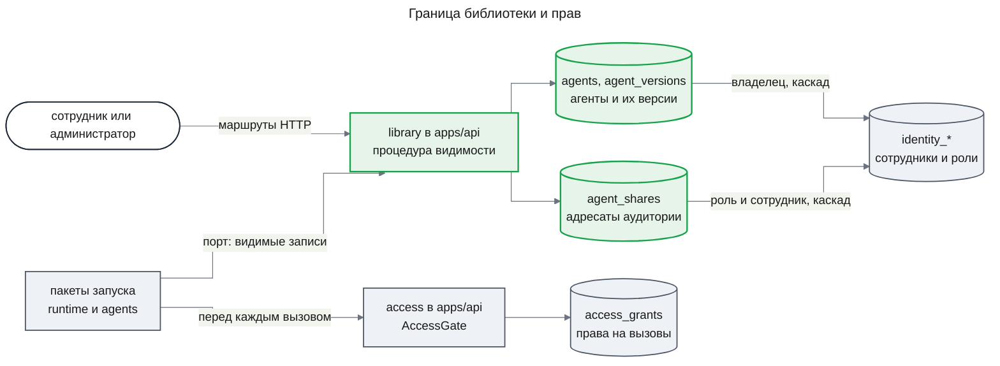

# ADR-0016 Записи, которые делают люди, хранит модуль `library` в `apps/api` за портом, а чтение для сотрудника и для запуска проходит одну процедуру видимости

## Status

Accepted (2026-11-17); агент с неизменными версиями и отметка удаления — по [design-agents.md](../features/data-model/design-agents.md) фичи `data-model`, KD-1 и KD-7 (2026-11-23). Дополняет ADR-0009 и [ADR-0015](ADR-0015-access-gate-and-model-catalogue.md), не заменяя их.

## Decision

Агентов теперь делают сотрудники и администраторы, и такие записи нужно хранить и решать, кто их видит. Решено: записи любого вида ведёт модуль `library` в `apps/api` в трёх таблицах. `agents` — строка на агента: вид, имя, описание, владелец, отметка удаления и указатель `active_version_id` на активную версию. `agent_versions` — неизменные версии определения с номером и автором, содержимое вида — один столбец jsonb. `agent_shares` — адресаты аудитории. Сохранение вставляет новую версию и переводит указатель, удаление ставит отметку `deleted_at`, и удалённый агент отвечает как несуществующий; беседа остаётся на своей версии ([ADR-0017](ADR-0017-run-snapshots-from-library.md)). `agents` ссылается на владельца, `agent_shares` — на агента, роль и сотрудника; все эти ссылки — внешний ключ с каскадом. Пакеты этих таблиц не читают и получают записи только через порт, который реализует `LibraryService`.

Кто видит запись, решает одна процедура видимости: все чтения для сотрудника и для запуска идут через один запрос репозитория с этим условием, и невидимая запись отвечает как несуществующая. Панель администратора читает своим условием, которое личных записей не находит, а список запретов отдаёт ей только имя, автора и дату закрытия. Права на инструменты и модели остаются отдельно, в `access_grants` за `AccessGate`, а будущие виды — скиллы и приложения — войдут в эту же схему.

Схема показывает, кто к каким таблицам обращается.

Решение исключает таблицы библиотеки в пакете `agents`, таблицу на каждый вид, аудиторию массивом в строке записи, записи как новые цели в `access_grants`, проверку видимости в каждом обработчике и фильтр видимости в памяти.

### Связь с ADR-0009 и ADR-0015

**ADR-0009** (определения агентов — данные со строгой схемой и закрытым реестром инструментов) остаётся в силе. Содержимое записи — тоже данные: схема её вида проверяет его при сохранении, а встроенные инструменты записи берутся из закрытого набора. Этот ADR дополняет ADR-0009 тем, что тот оставлял будущей фиче: где хранится определение, которое сделал человек, и кто может его прочитать. Как содержимое записи становится определением запуска и как встроенные записи заменяют определения в коде и JSON, решает часть `runtime` ([prd.md](../features/custom-agents/prd.md), FR-12); пересмотр ADR-0009 — тоже её дело.

**ADR-0015** (права, квоты и каталог в `access_*`, один порт `AccessGate` перед каждым вызовом) остаётся в силе целиком. Запись не даёт агенту прав: он получает только инструменты и модели запускающего, и это проверяет `AccessGate`. Библиотека повторяет границу ADR-0015 — таблицы рядом с `identity_*` в `apps/api`, пакеты только через порт. Она уточняет одно его следствие: «новая цель права добавляется в `access`» не относится к записям библиотеки, потому что аудитория записи — не право.

## Context

Сегодня определения агентов поставляет платформа: они записаны в коде и в JSON-файле. Фича `custom-agents` даёт сотрудникам делать агентов и workflow и открывать их своим ролям, а администраторам — вести системные записи и открывать их ролям, сотрудникам или всем. Схема доступа одна для всех видов: позже в библиотеку войдут скиллы и приложения, и второй схемы для них не будет ([prd.md](../features/custom-agents/prd.md), Background, FR-01).

Варианты должны были выдержать четыре условия:

- Видимость зависит от ролей, в которых смотрящий состоит сейчас, а сотрудники и роли живут в `apps/api` в таблицах `identity_*` (FR-02, FR-11).
- Удаление учётной записи уносит её записи, а удаление роли закрывает её записи (FR-11, AC-11.2).
- Личную запись не получает никто, кроме владельца, включая администраторов (NFR-01).
- Пакеты не импортируют `apps/api`, читают только таблицы своего префикса и получают порты параметрами ([ADR-0004](ADR-0004-agent-framework-packages.md), code-system README). Таблицы слоя приложения ссылаются на сотрудника внешним ключом ([ADR-0012](ADR-0012-closed-api-and-server-issued-employee-id.md)).

**Почему это архитектурное решение.**

1. **Дорого откатить.** Перенос владельца таблиц — это перенос данных и замена всех потребителей записей.
2. **Связывает за пределами фичи.** Будущие виды обязаны жить в этой схеме, а каждый новый маршрут и каждая операция чтения — идти через процедуру видимости.
3. **Были реальные варианты.** Они сравнены ниже.

## Rationale

Видимость нужна ролям, поэтому таблицы стоят рядом с ролями в `apps/api`, как таблицы прав `access_*`. Там каскад получается даром: удалённая учётная запись уносит свои записи и их адресатов, удалённая роль — свои адресаты. Общие поля всех видов — столбцы, поэтому доступ, копия, версия и аудит написаны один раз, а новый вид добавляет только значение вида и схему содержимого. Условие видимости стоит в одном запросе репозитория, поэтому новый маршрут не может забыть проверку.

### Options Considered

1. **Таблицы в пакете `agents`, роли и владелец — текстом**
   - Pros: Запуск читает записи из таблиц своего пакета, без порта.
   - Cons: Каскада нет, и удаление роли или сотрудника пришлось бы чистить кодом. Видимость всё равно требует ролей из `apps/api`, то есть порта в обратную сторону.

2. **Таблица на каждый вид**
   - Pros: Содержимое каждого вида лежит в своей таблице.
   - Cons: Каждое правило доступа и каждый запрос видимости пришлось бы повторять по числу видов.

3. **Аудитория массивом в строке записи**
   - Pros: Запись и её аудитория читаются одной строкой.
   - Cons: Массив ролей не держит внешний ключ, поэтому удаление роли не убирает её из аудитории.

4. **Записи как новые цели в `access_grants`**
   - Pros: Один механизм отвечает, кто что может.
   - Cons: Права выдаёт только администратор, а аудиторию задаёт и сотрудник. Смешение двух механизмов размыло бы обе проверки.

5. **Проверка видимости в каждом обработчике после чтения строки**
   - Pros: Запрос репозитория остаётся простым поиском по номеру.
   - Cons: Каждый новый маршрут — новое место, где проверку можно забыть.

6. **Чтение всех записей и фильтр видимости в памяти чистой функцией**
   - Pros: Правило видимости проверяется таблицей случаев без базы.
   - Cons: Сервер читал бы чужие личные записи, чтобы их выбросить, и время списка росло бы с размером библиотеки.

7. **Одна строка на запись, которую правка переписывает на месте**
   - Pros: Одна таблица на определение, номер версии — просто счётчик.
   - Cons: Прежнего определения нет, и идущая беседа держала бы свою копию определения (снимок) во входе задачи.

8. **Модуль `library` в `apps/api` с таблицами `agents`, `agent_versions` и `agent_shares`, доступ пакетов через порт, одна процедура видимости в запросе репозитория (выбран)**
   - Pros: Каскад по сотрудникам и ролям без кода очистки. Новый вид не пишет свой доступ. Определение лежит в неизменных версиях, и беседа стоит на своей, а имя и описание — на строке агента, поэтому уникальность имени и вызов по имени не соединяются с версией. Видимость решается в одном месте, и невидимая запись на любом маршруте отвечает как несуществующая.
   - Cons: Ошибка в этом одном условии открыла бы чужие личные записи сразу на всех маршрутах. Запуск получает записи через порт, а не из своих таблиц.

## Consequences

### Positive Consequences

- Снятие с роли и удаление роли закрывают её записи со следующего чтения: роли смотрящего читаются в момент запроса
- Удаление учётной записи из базы уносит её агентов, их версии и адресатов без кода очистки, если на этих версиях не стоят беседы (их ключ на версию запрещает удаление)
- Скиллы и приложения получат аудиторию, «поделиться», копию, версию и аудит без своего кода доступа

### Negative Consequences

- Ошибка в процедуре видимости или в условии панели открывает чужие личные записи на всех маршрутах сразу; оба условия проверяет один тест по всем маршрутам сотрудника и панели с двумя сотрудниками и администратором
- Каждый пакет, которому нужны записи, объявляет свой порт, а модуль библиотеки делится на модуль порта и модуль маршрутов, чтобы не попасть в круговой импорт с `AgentsModule`

### Consequences for the next parts and future code

- Часть `runtime` объявляет порт записей по образцу `AccessGate`, и `LibraryService` его реализует; на невидимую запись порт отвечает так же, как на несуществующую.
- Новый вид записи добавляет значение вида и схему содержимого, а не свою таблицу и не свою аудиторию.
- Права на инструменты и модели нового вида остаются в `access` и проверяются `AccessGate`; аудиторию записи `access_grants` не хранит.
- Новый маршрут или операция, которые отдают вызывающему запись или её заголовок, читают через процедуру видимости или через условие панели. Список запретов отдаёт панели только имя, автора и дату закрытия (NFR-01), а проверки имени и ключа встроенной записи ничего вызывающему не отдают.

## Implementation Guidance

- Таблицы `agents`, `agent_versions` и `agent_shares` ведёт только модуль `library` в `apps/api`; пакеты зовут порт
- Общие поля агента — столбцы строки `agents`, содержимое вида — столбец jsonb неизменной версии, его проверяет схема вида из `packages/contracts`; версия не обновляется и не удаляется
- Адресаты аудитории ссылаются на запись, роль и сотрудника внешним ключом с каскадом
- Право администратора видимость не расширяет: администратор читает записи сотрудников, открытые ролям, только условием панели, а личные не получает никогда
- Модуль порта не импортирует модули своих потребителей ([port-module-split.md](../code-system/patterns/port-module-split.md)); поиск «чужое = нет» — по видимости ([auth-boundary.md](../code-system/patterns/auth-boundary.md))

## Related Information

- [design-library.md](../features/custom-agents/design-library.md) — KD-1, KD-2, KD-6, «Как решается видимость», Contract Definitions, Data Model
- [prd.md](../features/custom-agents/prd.md) — FR-01, FR-02, FR-11, NFR-01, «Одна схема доступа»
- [ADR-0015](ADR-0015-access-gate-and-model-catalogue.md)
- [ADR-0004](ADR-0004-agent-framework-packages.md)
- [ADR-0012](ADR-0012-closed-api-and-server-issued-employee-id.md)
- [ADR-0017](ADR-0017-run-snapshots-from-library.md)
- [design-agents.md](../features/data-model/design-agents.md) — KD-1, KD-2, KD-7, «Таблицы каталога»
- [code-system, приложение `apps/api`](../code-system/packages/api.md) — Правила областей, пункт «Библиотека»
