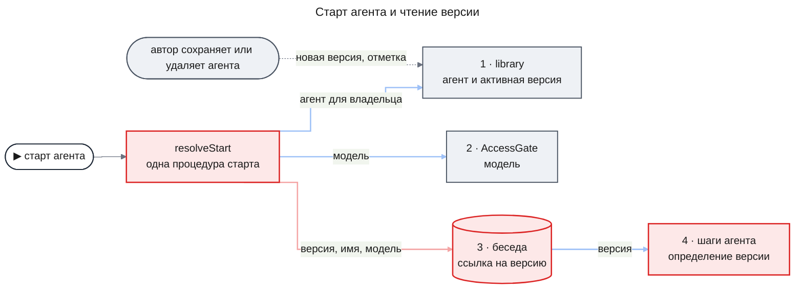

# ADR-0017 Каждый старт проходит одну процедуру и закрепляет беседу за неизменной версией агента, а определение хранится один раз — в версии

## Status

Accepted (2026-11-17); закрепление беседы за версией вместо снимка во входе задачи — по [design-agents.md](../features/data-model/design-agents.md) фичи `data-model`, KD-6 (2026-11-23). Заменяет ADR-0009. Использует [ADR-0016](ADR-0016-library-records-and-visibility.md) и не меняет [ADR-0015](ADR-0015-access-gate-and-model-catalogue.md).

## Decision

Определения агентов живут в библиотеке, где автор правит и удаляет их, пока запуски идут. Решено: каждый старт — корень беседы, агент, сабагент, ответвление, перезапуск — проходит одну процедуру в пакете `agents`: `resolveStart` для старта по id и `resolveNamedStart` для вызова по имени (`packages/agents/src/start/resolve-start.ts`). Процедура спрашивает библиотеку от имени владельца дерева, выбирает версию агента, имя запуска и модель и проверяет модель. Беседа хранит ссылку на версию, с которой стартовала, — `conversations.agent_version_id` с внешним ключом и запретом удаления. Версия неизменна, поэтому она и есть зафиксированное определение: шаги читают её, а во вход задачи определение не копируется. Каталог определений в памяти, который сервер собирал при старте из кода и JSON, удалён вместе с этими определениями.

Схема показывает старт и то, откуда шаги потом берут определение.

Сохранение агента создаёт новую версию и переводит на неё указатель, удаление ставит отметку ([ADR-0016](ADR-0016-library-records-and-visibility.md)). Следующий старт получит новую активную версию или временного агента, перезапуск удалённого — отказ `record_unavailable`, а идущая беседа доработает на своей версии. Решение исключает четыре пути: чтение активной версии на каждом шаге; каталог агентов, загруженный при старте сервера; копию определения во входе задачи; проверку видимости в каждом инструменте.

### Связь с ADR-0009, ADR-0015 и ADR-0016

**ADR-0009** заменён целиком. Он решал, что агентов задают определения-данные со строгой схемой, которые сервер проверяет при загрузке, а инструменты берутся из закрытого реестра. Определений, загружаемых при старте, больше нет. Два правила ADR-0009 продолжают действовать, но держит их уже ADR-0016: содержимое версии — данные, которые схема её вида проверяет при сохранении, а встроенные инструменты берутся из закрытого набора.

**ADR-0016** (агенты и версии в модуле `library`, порт и одна процедура видимости) используется как есть. `RecordLibrary` — порт, который объявляет `agents` и реализует `LibraryService`; невидимый агент отвечает как несуществующий. Версию по её id беседа читает без проверки видимости: видимость проверил старт, а версия неизменна.

**ADR-0015** (права, квоты и каталог моделей за портом `AccessGate`) не меняется. Версия не несёт ни прав, ни учётных данных: `AccessGate` проверяет модель и инструмент перед каждым вызовом. Процедура старта спрашивает тот же порт о модели беседы ещё до старта, чтобы модель без права остановила старт, а не первый вызов.

## Context

Платформа поставляла определения агентов в коде и JSON; фича `custom-agents` перенесла их в библиотеку, где их делают сотрудники и администраторы ([prd.md](../features/custom-agents/prd.md), FR-12). Тогда библиотека хранила одну строку на агента без прежних версий, и запуск держал копию определения — снимок — во входе задачи. Фича `data-model` дала агенту неизменные версии (R1) и потребовала хранить каждый изменяемый факт один раз (R13): снимок повторял содержимое версии, а ссылка на версию без внешнего ключа нарушала бы R14 ([design-agents.md](../features/data-model/design-agents.md), KD-1, KD-6).

Варианты должны были выдержать пять условий:

- Правка и удаление агента не меняют ни работающих агентов, ни открытых бесед (FR-13).
- Правка доходит до следующего старта без выпуска платформы (AC-12.1).
- Перед каждым стартом проверяется, что агент виден владельцу дерева, в том числе когда старт просит его агент (FR-14).
- Определение хранится один раз, а ссылка внутри базы — внешний ключ (R13, R14; [ADR-0024](ADR-0024-every-reference-is-a-foreign-key.md)).
- Состояние запуска живёт в Postgres и переживает рестарт сервера ([ADR-0001](ADR-0001-durable-runtime-owner.md)); пакеты не читают таблиц библиотеки и получают её через порт (ADR-0016).

**Почему это архитектурное решение.**

1. **Дорого откатить.** Ссылка на версию меняет хранимую форму бесед и входа задачи, а версии под ней нельзя удалить. Обратный ход — снова смена хранимого формата и пересоздание баз.
2. **Связывает за пределами фичи.** Будущие виды агентов и флоу переобучения, который создаёт и проверяет версию до перевода указателя (R18), строятся на закреплении беседы за версией; каждый новый вид старта обязан пройти эту процедуру.
3. **Были реальные варианты.** Они сравнены ниже.

## Options Considered

- **Беседа ссылается на неизменную версию, одна процедура старта (выбран)** — работающий агент не замечает правки, а следующий старт берёт новую активную версию. Определение хранится один раз, ссылка стоит под внешним ключом и переживает рестарт. Видимость и модель проверяются в одном месте для любого вида старта.
- **Снимок определения во входе задачи** — так было, пока прежних версий не хранили. С версиями снимок повторяет содержимое версии второй копией, а его ссылка на запись была бы без ключа.
- **Чтение активной версии на каждом шаге** — правка автора меняла бы работающих агентов посреди работы (против FR-13).
- **Загрузка агентов из базы в каталог при старте сервера** — правка доходила бы до запусков только после рестарта (против AC-12.1), а видимость зависит от того, кто запускает, и общий каталог её не решает.

## Consequences

- Автор правит и удаляет агента в любой момент, а идущая работа доходит до конца на своей версии.
- Версию, на которой шла беседа, удалить нельзя, поэтому агента не удаляют физически: удаление — отметка `deleted_at`, и версии остаются.
- Исправление ошибки в агенте получают только новые старты, а идущие беседы работают на ошибочной версии.
- Происхождение беседы (`RunOrigin`) читается через ссылку: версия → агент → владелец; имя и автор в нём — текущие, номер — версии беседы.
- Агент читает определение версии один раз, когда строит живой объект задачи. Описание инструмента старта — агентов из списка `agents` версии и агентов, предложенных в чате, — он заново читает из каталога на каждом шаге.

## Implementation Guidance

- Библиотеку спрашивают только через порт `RecordLibrary` и только от имени владельца дерева; автор агента на запуск не влияет
- Процедура старта спрашивает библиотеку и модель до транзакции, которая стартует запуск; ссылка беседы на версию больше не меняется
- Вход задачи — запрос старта: id версии, имя запуска, член команды, итоговая модель, задание, ответвление, id вызова; определения в нём нет
- Определение, которое шаг передаёт модели, вычисляет из версии одна чистая функция (`runDefinition`)
- Ответвление и перезапуск сабагента берут версию своей беседы, а перезапуск агента или корня — активную версию того же агента под именем перезапущенной беседы
- Данные, которые должны меняться и у идущей работы, — права, квоты, аккаунты MCP — в версии не лежат и проверяются перед каждым вызовом через `AccessGate`
- Форма — [immutable-versions.md](../code-system/patterns/immutable-versions.md)

## Related Information

- [design-agents.md](../features/data-model/design-agents.md) — KD-1, KD-3, KD-6, «Старт: версия, имя и модель беседы»
- [design-runtime.md](../features/custom-agents/design-runtime.md) — KD-1, KD-2
- [prd.md](../features/custom-agents/prd.md) — FR-12, FR-13, FR-14, FR-17
- [immutable-versions.md](../code-system/patterns/immutable-versions.md)
- [ADR-0016](ADR-0016-library-records-and-visibility.md)
- [ADR-0015](ADR-0015-access-gate-and-model-catalogue.md)
- [ADR-0024](ADR-0024-every-reference-is-a-foreign-key.md)
- [ADR-0001](ADR-0001-durable-runtime-owner.md)
