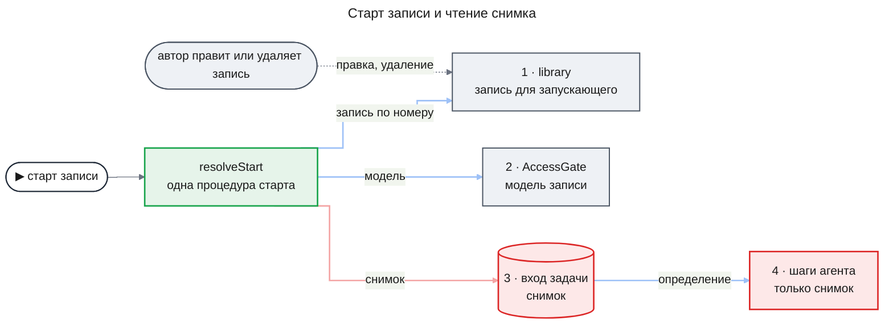

# ADR-0017 Каждый старт проходит одну процедуру и дальше работает только на снимке во входе задачи, а каталог определений, который сервер собирает при старте, удаляется

## Status

Accepted (2026-11-17). Заменяет ADR-0009. Использует [ADR-0016](ADR-0016-library-records-and-visibility.md) как есть и не меняет [ADR-0015](ADR-0015-access-gate-and-model-catalogue.md).

## Decision

Определения агентов теперь живут в библиотеке, где автор правит и удаляет их, пока запуски идут. Решено: каждый старт — корень беседы, агент, перезапуск — проходит одну процедуру `resolveStart` в пакете `agents`. Для записи она спрашивает библиотеку от имени запускающего, проверяет модель и пишет полную копию определения — снимок — во вход задачи запуска (`runtime_tasks.input`); ответвление получает снимок из снимка вызывающего. После старта шаги и инструменты берут определение только из снимка, поэтому сессия переживает правку и удаление своей записи. Каталог определений в памяти, который сервер собирает при старте из кода и JSON, удаляется вместе с этими определениями.

Схема показывает старт записи и то, откуда шаги потом берут определение.

Правка или удаление записи меняет только библиотеку: следующий старт получит новую версию или отказ `record_unavailable`, а идущий запуск доработает на снимке. Решение исключает четыре пути: чтение записи на каждом шаге; каталог записей, загруженный при старте сервера; хранение в запуске только номера и версии; проверку видимости в каждом инструменте.

### Связь с ADR-0009, ADR-0015 и ADR-0016

**ADR-0009** заменяется целиком. Он решал, что агентов задают определения-данные со строгой схемой, которые сервер проверяет при загрузке, а инструменты берутся из закрытого реестра. Определений, загружаемых при старте, больше нет: `AgentDefinitionSchema`, `DefinitionCatalog` и его проверка `checkCatalog` удаляются. Два правила ADR-0009 продолжают действовать, но держит их уже ADR-0016: содержимое записи — данные, которые схема её вида проверяет при сохранении, а встроенные инструменты записи берутся из закрытого набора. Ссылку на другого агента теперь проверяет не загрузка, а каждый старт: запись, невидимая запускающему, даёт отказ.

**ADR-0016** (записи в модуле `library`, порт и одна процедура видимости) используется как есть. `RecordLibrary` — тот порт, который ADR-0016 поручил части `runtime`: его объявляет `agents`, реализует `LibraryService`, и невидимая запись отвечает как несуществующая. ADR-0016 оставил пересмотр ADR-0009 этой части, и этот ADR его выполняет.

**ADR-0015** (права, квоты и каталог моделей за портом `AccessGate`) не меняется. Снимок не несёт ни прав, ни учётных данных: инструменты без права у запускающего выпадают, а `AccessGate` проверяет модель и инструмент перед каждым вызовом, как сегодня. `resolveStart` спрашивает тот же порт о модели записи ещё до старта, чтобы модель без права остановила старт, а не первый вызов.

## Context

Сегодня определения агентов поставляет платформа: главный чат и `general-purpose` записаны в коде, `deep-research` — в JSON. При старте сервер складывает их в каталог в памяти и один раз проверяет. Запуск запоминает только имя определения и модель, а промпт, инструменты, серверы и предел ходов каждый шаг читает из каталога по имени. Фича `custom-agents` переносит определения в библиотеку ([ADR-0016](ADR-0016-library-records-and-visibility.md)): записи делают сотрудники и администраторы, и других источников агентов нет ([prd.md](../features/custom-agents/prd.md), FR-12).

Варианты должны были выдержать пять условий:

- Правка и удаление записи не меняют ни работающих агентов, ни открытых бесед, а workflow фиксируется целиком, вместе с исполнителями (FR-13).
- Правка доходит до следующего старта без выпуска платформы (AC-12.1).
- Перед каждым стартом проверяется, что запись видна именно запускающему, в том числе когда старт просит его агент (FR-14).
- Библиотека хранит только последнюю версию записи, истории версий нет (FR-08).
- Состояние запуска живёт в Postgres и переживает рестарт сервера ([ADR-0001](ADR-0001-durable-runtime-owner.md)); пакеты не читают таблиц библиотеки и получают её через порт ([ADR-0004](ADR-0004-agent-framework-packages.md), ADR-0016).

**Почему это архитектурное решение.**

1. **Дорого откатить.** Снимок меняет хранимый формат задач и сессий, и прежние беседы при выпуске стирает миграция ([design-runtime.md](../features/custom-agents/design-runtime.md), KD-3). Отказ от снимка — ещё одна смена хранимого формата.
2. **Связывает за пределами фичи.** На снимке будут запускаться будущие виды записей, а каждый новый вид старта обязан пройти `resolveStart`.
3. **Были реальные варианты.** Они сравнены ниже.

## Rationale

Только снимок даёт оба свойства сразу: работающий агент не замечает правки, а следующий старт берёт новую версию. Копия фиксирует запуск, а запрос к библиотеке на каждом старте записи приносит свежую запись и проверяет видимость для того, кто запускает. Снимок лежит во входе задачи, который шаг и так читает каждый раз, поэтому он переживает рестарт без новой таблицы. Тело снимка — содержимое записи в библиотечной форме (`AgentContent`, `WorkflowContent`), так что второго формата определения нет, а одна процедура старта не даёт забыть видимость в новом виде старта.

### Options Considered

1. **Чтение записи по номеру на каждом шаге**
   - Pros: Копии нет, и шаг всегда видит последнюю версию записи.
   - Cons: Правка автора меняла бы работающих агентов посреди работы (против AC-13.1), а удаление записи оставило бы идущий запуск без определения.

2. **Загрузка записей из базы в каталог при старте сервера**
   - Pros: Каталог и поиск определения по имени остаются такими, как сегодня.
   - Cons: Правка доходила бы до запусков только после рестарта (против AC-12.1). Видимость зависит от того, кто запускает, а один общий каталог её не решает.

3. **Хранение в запуске только номера и версии записи**
   - Pros: Вход задачи остаётся маленьким.
   - Cons: Прежних версий в библиотеке нет (FR-08), поэтому после следующего сохранения запуск не нашёл бы своей версии.

4. **Снимок во входе задачи, который пишет одна процедура старта (выбран)**
   - Pros: Работающие агенты и открытые беседы доходят до конца на своей версии, а следующий старт берёт последнюю видимую. Снимок переживает рестарт, потому что вход задачи лежит в Postgres. Видимость и модель проверяются в одном месте для любого вида старта.
   - Cons: Смена формата стирает прежние беседы (KD-3). Исправление неудачной правки тоже не доходит до идущих запусков и открытых бесед.

## Consequences

### Positive Consequences

- Автор правит и удаляет запись в любой момент, а идущая работа доходит до конца на прежней версии (AC-13.1, AC-13.4)
- Администратор меняет встроенную запись без выпуска платформы, и правка доходит до следующего старта (AC-12.1)
- Удалённая, закрытая или ставшая невидимой запись отказывает на старте одной причиной `record_unavailable`, кто бы ни запускал — сотрудник или его агент (AC-13.2, AC-14.1, AC-14.3)
- Происхождение в снимке говорит, с какой записи и версии стартовал запуск, даже когда записи уже нет (FR-17)

### Negative Consequences

- Прежние беседы, сессии и результаты ресерчей стираются при выпуске (FR-19)
- Исправление ошибки в записи получают только новые старты — «Запустить с нуля» и новая беседа, а идущие запуски и открытые беседы работают на ошибочной версии

### Consequences for future code

- Новый вид записи запускается через снимок: тело снимка — содержимое в его хранимой форме из `contracts`, второго формата определения нет
- Новый вид старта зовёт `resolveStart` и не повторяет её шагов; новая проверка перед стартом встаёт в эту процедуру
- Данные, которые должны меняться и у идущей работы, — права, квоты, аккаунты MCP — в снимок не попадают и проверяются перед каждым вызовом через `AccessGate`
- Живое чтение библиотеки во время работы — сейчас это список записей главного чата на каждом шаге корня — снимок не меняет

## Implementation Guidance

- Библиотеку спрашивают только через порт `RecordLibrary` и только от имени запускающего; автор записи на запуск не влияет
- `resolveStart` спрашивает библиотеку и модель до транзакции, которая стартует запуск; записанный снимок больше не меняется ([design-runtime.md](../features/custom-agents/design-runtime.md), KD-2)
- Определение, которое шаг передаёт модели, вычисляет из снимка одна чистая функция
- Ответвление берёт снимок из снимка вызывающего, а перезапуск записи — новый старт по её номеру
- Снимок хранится в одном месте — во входе задачи; строка сессии его не дублирует (KD-3)
- В снимке нет учётных данных
- Форма процедуры, снимка и чтения — [run-snapshot.md](../code-system/patterns/run-snapshot.md)

## Related Information

- [design-runtime.md](../features/custom-agents/design-runtime.md) — KD-1, KD-2, KD-3, «Откуда берётся снимок», State Transitions and Invariants
- [design-library.md](../features/custom-agents/design-library.md#contract-definitions) — «Для части `runtime`»
- [prd.md](../features/custom-agents/prd.md) — FR-08, FR-12, FR-13, FR-14, FR-17, FR-19
- [run-snapshot.md](../code-system/patterns/run-snapshot.md)- [ADR-0016](ADR-0016-library-records-and-visibility.md)
- [ADR-0015](ADR-0015-access-gate-and-model-catalogue.md)
- [ADR-0001](ADR-0001-durable-runtime-owner.md)
- [ADR-0004](ADR-0004-agent-framework-packages.md)
