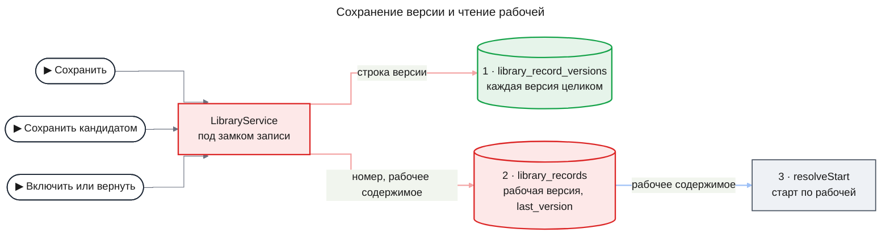

# ADR-0018 Каждая сохранённая версия системной записи лежит целиком в истории `library_record_versions`, а строка записи по-прежнему держит рабочую

## Status

Accepted (2026-11-19). Дополняет [ADR-0016](ADR-0016-library-records-and-visibility.md), не заменяя его. Решение [ADR-0017](ADR-0017-run-snapshots-from-library.md) о снимке не меняет.

## Decision

Администратор теперь сохраняет правку системной записи кандидатом, открывает прежние версии и возвращает их, поэтому каждой версии нужно место, где она лежит целиком. Решено: каждое сохранение системной записи — «Сохранить» и кандидат — пишет строку с полным содержимым в таблицу `library_record_versions` модуля `library`. Рабочие версии и кандидаты нумеруются одной последовательностью: новое поле `library_records.last_version` держит самый большой выданный номер, «Сохранить» берёт следующий номер и делает его рабочим, а кандидат только берёт номер. `library_records.version` остаётся номером рабочей версии, токеном «никто не сохранил раньше вас» в теле `PUT` и значением закрепления исполнителя workflow, а содержимое рабочей версии по-прежнему лежит в строке записи. Включение и возврат кладут в строку записи содержимое версии из истории, отклонённый кандидат остаётся в истории, а исполнитель считается изменённым, когда закреплённая версия не равна рабочей.

Схема показывает, куда пишет сохранение и откуда старт берёт рабочую версию.

Кандидат пишет только строку истории и номер в `last_version`; рабочее содержимое в строке записи меняют «Сохранить», включение и возврат. Решение исключает три пути: номер кандидата `version + 1`, отдельную таблицу кандидатов со своими номерами и содержимое только в истории.

### Связь с ADR-0016 и ADR-0017

**ADR-0016** (записи в модуле `library` за портом, одна процедура видимости) дополняется. История — ещё одна таблица модуля `library`: пакеты её не читают, а удалённая запись уносит свою историю каскадом. Версии читают панель и проверка версии: маршруты версий закрыты `@AdminOnly()`, а обработчик проверки получает содержимое версии через `LibraryService.version` условием панели. Столбец `version`, общий для всех видов, сохраняет смысл. У записей сотрудников истории нет, и `last_version` у них всегда равен `version`.

**ADR-0017** (снимок во входе задачи, одна процедура старта) не меняется. Старт в беседе по-прежнему читает содержимое из строки записи, поэтому `resolveStart`, списки и снимки читают её как раньше. Его условие «истории версий нет» перестаёт быть верным для системных записей, но кандидат и прежняя версия не работают ни в одной беседе, пока их не включат, а идущие беседы доходят на своих снимках.

## Context

Сегодня у записи одна строка: `version` — номер рабочей версии, токен конфликта и закрепление исполнителя, а прежнего содержимого нет. Исполнитель workflow считается изменённым, когда закреплённая версия меньше последней. Фича `self-correction` требует хранить каждую сохранённую версию системной записи целиком (FR-07), сохранять правку кандидатом, который не работает до включения и может быть не один (FR-08), и возвращать прежнюю версию одним действием (FR-20). Отклонённый кандидат остаётся в истории с отметкой «отклонён».

Варианты должны были выдержать четыре условия:

- Чтения записи для старта, списков и снимков не меняются: «Сохранить» сразу делает версию рабочей, как сейчас.
- `version` в теле `PUT` по-прежнему ловит конфликт двух редакторов, а исполнитель закреплён на номере версии.
- Версии и кандидаты нумеруются вместе, и рабочая версия может быть меньше кандидата ([uxrd.md](../features/self-correction/uxrd.md) EV-02).
- Включение кандидата, основа которого уже не рабочая, отклоняется как конфликт (AC-08.2).

**Почему это архитектурное решение.**

1. **Дорого откатить.** Миграция пишет в историю текущую версию каждой системной записи и ставит `last_version`; другая схема — ещё один перенос данных и новое правило «изменено» в API и вебе.
2. **Связывает за пределами фичи.** Каждый будущий путь сохранения системной записи, в том числе кандидат анализатора части `loop` (`LibraryService.saveCandidate`), пишет строку истории и берёт номер из `last_version`, а каждое сравнение версий исходит из правила «не равна рабочей».
3. **Были реальные варианты.** Они сравнены ниже.

## Rationale

Рабочее содержимое остаётся в строке записи, поэтому ни одно чтение записи не меняется. Один счётчик `last_version` выдаёт номер каждой версии один раз, даже когда кандидат стоит выше рабочей. `version` сохраняет все три роли, поэтому тело `PUT`, баннер конфликта и закрепление исполнителя работают как сейчас; меняется только правило «изменено», потому что после возврата рабочая версия может стать меньше закреплённой.

### Options Considered

1. **Кандидат с номером `version + 1`**
   - Pros: Новое поле не нужно, номер выводится из рабочей версии.
   - Cons: Следующее «Сохранить» выдало бы тот же номер, что у кандидата.

2. **Своя таблица кандидатов со своими номерами**
   - Pros: История рабочих версий и кандидаты лежат раздельно.
   - Cons: UXRD нумерует версии и кандидатов вместе, а у двух таблиц было бы две последовательности номеров.

3. **Содержимое только в истории, строка записи указывает на рабочую версию**
   - Pros: Содержимое каждой версии лежит в одном месте.
   - Cons: Пришлось бы менять каждое чтение записи — `resolveStart`, списки и снимки.

4. **Полная строка истории на каждое сохранение, одна последовательность через `last_version`, рабочее содержимое в строке записи (выбран)**
   - Pros: Чтения записи не меняются. Номер выдаётся один раз для версий и кандидатов вместе. `version` остаётся токеном конфликта и закреплением.
   - Cons: Содержимое рабочей версии лежит в двух местах, и включение переписывает строку записи из истории. После возврата рабочая версия может стать меньше закреплённой, и правило «изменено» меняется в API и в его копии в вебе.

## Consequences

### Positive Consequences

- Администратор открывает любую сохранённую версию и сравнивает её с рабочей (AC-07.1); история не пуста и у записи, созданной до этого решения
- Кандидат не работает ни в одной беседе, пока его не включат (AC-08.1), а включение кандидата с устаревшей основой отклоняется (AC-08.2)
- Возврат прежней версии — то же включение с аудитом `library_restore` (AC-20.1); отклонённый кандидат остаётся в истории

### Negative Consequences

- Миграция переносит в историю текущее содержимое всех системных записей
- `ExecutorSourceState.latestVersion` теперь значит «рабочая версия», и правило «изменено» в API и вебе меняется с «меньше» на «не равна»
- Записи сотрудников истории не получают

### Consequences for future code

- Новый путь сохранения системной записи пишет строку истории и берёт номер из `last_version` под замком записи
- Номер выдаётся записи один раз; содержимое строки истории после записи не меняется
- Код, который сравнивает закреплённую версию с текущей, сравнивает её с рабочей на неравенство

## Implementation Guidance

- Таблицу `library_record_versions` читает и пишет только модуль `library`; пакеты получают версию через `LibraryService`
- Строка истории ссылается на запись внешним ключом с каскадом, пара «запись и номер» уникальна
- Хранимое состояние версии — `candidate`, `rejected` или `released`; «рабочая» и «прежняя» выводятся из `library_records.version`
- Включается только кандидат, основа которого — рабочая версия; возврат прежней версии основу не проверяет
- Кандидат, включение, возврат и отклонение пишут аудит записей с администратором, записью и версией

## Related Information

- [design-eval.md](../features/self-correction/design-eval.md) — KD-1, Data Model, State Transitions and Invariants, Flow 1
- [prd.md](../features/self-correction/prd.md) — FR-07, FR-08, FR-20
- [uxrd.md](../features/self-correction/uxrd.md) — EV-02
- [ADR-0016](ADR-0016-library-records-and-visibility.md)
- [ADR-0017](ADR-0017-run-snapshots-from-library.md)
