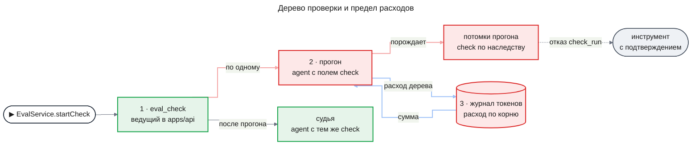

# ADR-0019 Прогоны вне беседы ведёт задача-ведущий в `apps/api`, а поле `check` во входе агента отказывает действиям с подтверждением и держит предел расходов всего дерева

## Status

Accepted (2026-11-19). Дополняет [ADR-0017](ADR-0017-run-snapshots-from-library.md) новым источником старта, не заменяя его. Использует [ADR-0001](ADR-0001-durable-runtime-owner.md), [ADR-0004](ADR-0004-agent-framework-packages.md), [ADR-0015](ADR-0015-access-gate-and-model-catalogue.md) и [ADR-0018](ADR-0018-library-record-version-history.md) как есть.

## Decision

Проверка версии записи прогоняет случаи без беседы, от имени администратора, и ни один прогон не должен менять внешние системы или тратить больше предела. Решено: такую работу ведёт задача своего типа — `eval_check` с обработчиком `EvalCheckHandler` модуля `eval` в `apps/api`; прогоны и проверяющий агент — её дети типа `agent`, по одному за раз. Прогон — обычная задача `agent` с полем `check` во входе, которое наследуют все её потомки: инструмент, которому нужно подтверждение человека, получает отказ с новой причиной `check_run`, `start_workflow` идёт без подтверждения, а прогон записи `chat` идёт с `check.asRoot` и префиксом истории из копии случая. Перед каждым вызовом модели задача дерева сравнивает `runtime.ledger.spendOfRoot` с `check.capUsd` и при достижении предела падает с новой причиной `spend_cap`; ведущий сверяет то же перед каждым ребёнком.

Схема показывает дерево проверки и место сверки с пределом.

Сверку перед вызовом модели делает каждая задача дерева с полем `check`, включая потомков и судью, а не только сам прогон. Решение исключает признак «корень без беседы» у задачи `agent`, агента-родителя, цикл в памяти API и параллельные прогоны случаев; прогон `chat` только на вопросе, отказ `start_workflow` и ответвление от живой сессии; обёртку предела над `AccessGate` и остановку дерева ведущим.

### Связь с ADR-0001, ADR-0004, ADR-0015, ADR-0017 и ADR-0018

**ADR-0001** (свой runtime на Postgres — единственный durable-владелец задач) используется как есть: ведущий — ещё одна задача этого runtime, и проверка переживает рестарт, как беседа. **ADR-0004** (пакеты не импортируют `apps/api`, приложение — точка сборки) тоже: `apps/api` регистрирует обработчик в `runtime.handlers`, а вход ребёнка готовит операция пакета `agents.sessions.prepareRun`.

**ADR-0017** (каждый старт проходит `resolveStart` и работает на снимке) дополняется источником `supplied`: вызывающий передаёт запись, которую уже прочёл, а `resolveStart` проверяет её модель и пишет снимок, не спрашивая библиотеку. Так прогон стартует на версии из истории ([ADR-0018](ADR-0018-library-record-version-history.md)), а судья — на записи, которой нет в чате. Источник `supplied` — исключение из правила ADR-0017 «библиотеку спрашивают от имени запускающего»: версию и судью ведущий читает через `LibraryService` условием панели, а запускающий — администратор, который начал проверку.

**ADR-0015** (права и квоты за портом `AccessGate`) не меняется: прогоны и судья — задачи администратора, и `AccessGate` проверяет его права и квоту перед каждым вызовом. Предел дерева — отдельная сверка, потому что порт спрашивают с сотрудником и моделью, без задачи.

## Context

Сегодня у runtime один тип задачи — `agent`. Корень без родителя после ответа ждёт следующего сообщения и не кончается никогда, а корневые инструменты он получает по отсутствию родителя. Ожидание человека идёт через `needsConfirmation`, причины отказа — закрытый список с проверкой в базе. Предела расходов на дерево задач нет: шлюз моделей знает только сотрудника и модель. Посева истории нет, а ответвление (`forkedFrom`) ссылается на живую сессию.

Варианты должны были выдержать пять условий:

- Запись получает тот же вход, что тогда: workflow — бриф, агент — задание, главный чат — историю беседы до оценённого сообщения (FR-09).
- Изменяющие действия не выполняются, а прогон показывает попытку (AC-09.3, NFR-03).
- После того как расход проверки дошёл до предела, новый вызов модели не стартует; доходят только шедшие (FR-13, NFR-05).
- Проверка длится минуты и после рестарта API продолжается без повтора законченных попыток.
- У записи одновременно идёт одна проверка (FR-12).

**Почему это архитектурное решение.**

1. **Дорого откатить.** Решение вводит второй тип задачи runtime, таблицы `eval_*`, поле `check` в хранимом входе агента и новые значения `check_run` и `spend_cap`, которые миграция добавляет в проверки базы.
2. **Связывает за пределами фичи.** Часть `loop` запускает проверку своим ребёнком и строит свой цикл по той же форме ведущего; каждый новый способ породить ребёнка обязан копировать `check`, а каждый новый инструмент с подтверждением в прогоне получает отказ.
3. **Были реальные варианты.** Они сравнены ниже.

## Rationale

Прогону без беседы нужен родитель, которому runtime сообщит конец через `child_finished`, и ведущий — этот родитель. Его шаг записывает исход ребёнка и порождает следующего через `effects.spawn` одной транзакцией, поэтому потерянный шаг повторяется без второго прогона. Дети идут по одному, чтобы предел останавливал проверку на понятной границе (AC-13.1). Одно поле во входе оставляет прогону шаги, инструменты и сжатие любого агента, а наследование нужно, потому что изменяющий вызов может сделать исполнитель workflow или ребёнок от `start_agent`. Только сверка перед каждым вызовом модели останавливает и вызовы внутри прогона workflow, в том числе у параллельных исполнителей.

### Options Considered

**Кто ведёт прогоны**

1. **Признак «корень без беседы» у задачи `agent`**
   - Pros: Не нужен новый тип задачи.
   - Cons: О конце прогона некому было бы сообщить.
2. **Агент-родитель**
   - Pros: Ведущий — обычный агент без нового обработчика.
   - Cons: Ход проверки решала бы модель, а не код.
3. **Цикл в памяти API**
   - Pros: Нет задачи и её шагов, только код сервиса.
   - Cons: Рестарт терял бы проверку.
4. **Случаи параллельно**
   - Pros: Проверка шла бы быстрее.
   - Cons: Предел превышался бы на число идущих прогонов.
5. **Задача `eval_check` в `apps/api`, дети по одному (выбран)**
   - Pros: Проверка переживает рестарт, потерянный шаг не даёт второго прогона, а предел останавливает её между случаями.
   - Cons: Случаи идут последовательно, а форма ведущего — новый паттерн рядом с `agent`.

**Как прогон отказывает изменениям и получает вход**

1. **Прогон `chat` только на вопросе**
   - Pros: Префикс истории не нужен.
   - Cons: FR-09 требует историю до оценённого сообщения.
2. **Отказ и `start_workflow`**
   - Pros: Бриф без проверки человеком не уходит.
   - Cons: Прогон `chat` не повторил бы ни одного ответа через workflow.
3. **Ответвление от живой сессии (`forkedFrom`)**
   - Pros: История берётся из беседы готовой.
   - Cons: Беседы может уже не быть.
4. **Поле `check` во входе с наследованием, префикс из копии случая (выбран)**
   - Pros: Прогон — обычный агент, а отказ доходит до исполнителей и детей `start_agent`.
   - Cons: Бриф `start_workflow` идёт таким, как его написала модель. В прогоне `chat` нет агентов прежних ходов, и `message_agent` к ним получает отказ.

**Где стоит предел**

1. **Обёртка над `AccessGate`**
   - Pros: Одна проверка перед каждым вызовом вместо двух.
   - Cons: Порт спрашивают с сотрудником и моделью, без задачи.
2. **Остановка дерева ведущим**
   - Pros: Сверка в одном месте.
   - Cons: Ведущий просыпается только на конце ребёнка, а внутри прогона workflow вызовы шли бы без проверки.
3. **Сверка `spendOfRoot` с `check.capUsd` перед каждым вызовом модели (выбран)**
   - Pros: После предела новый вызов не стартует нигде в дереве; предел копируется во вход при старте, и смена настройки идущую проверку не меняет.
   - Cons: Превышение — на вызовы, которые уже шли. Бюджета у каждой задачи, который описывает `project-context`, по-прежнему нет.

## Consequences

### Positive Consequences

- Проверка переживает рестарт API и продолжается с первой незаконченной попытки
- Изменяющих вызовов в прогоне ноль, а строка вызова хранит инструмент, сервер и аргументы (AC-09.3)
- Предел останавливает всё дерево: прогон с `spend_cap` даёт случаю «не оценено», остальные получают «не стартовал» (AC-13.1)
- Сессии прогонов отмечены `agent_sessions.check_run` и не входят в `recordCounts` и `firstRun`

### Negative Consequences

- Проверка идёт медленнее параллельной
- Прогон `chat` повторяет прежние ходы по копии без их агентов, и решает по его шагам администратор
- Предел действует только на дерево проверки

### Consequences for future code

- Часть `loop` строит цикл по форме ведущего ([driver-task.md](../code-system/patterns/driver-task.md)) и запускает проверку своим ребёнком через `EvalService.startCheck` с `parent`; расход считается по корню, поэтому проверка делит предел со всем циклом
- Новый способ породить ребёнка копирует `check` во вход ребёнка с `asRoot` = `false`
- Инструмент с `needsConfirmation` получает отказ `check_run` без своего кода; инструмент, который меняет что-то без подтверждения, как `draft_record`, получает отказ полем `check` отдельно
- Новая причина отказа или падения расширяет схему `contracts` и проверку базы миграцией

## Implementation Guidance

- Вход ведущего — только номер строки модуля; ход работы лежит в таблицах модуля со своим префиксом
- Вход ребёнка готовит `agents.sessions.prepareRun` до транзакции; строки и `effects.spawn` пишет одна транзакция шага
- Ведущий пропускает сообщения, кроме `child_finished`
- Права, квоты и аккаунты прогона — администратора; их по-прежнему проверяют `AccessGate` и `sessionTools` перед каждым вызовом
- Форма ведущего — [driver-task.md](../code-system/patterns/driver-task.md), форма шага — [step-handler.md](../code-system/patterns/step-handler.md)

## Related Information

- [design-eval.md](../features/self-correction/design-eval.md) — KD-2, KD-3, KD-4, «Шаг ведущего», Flow 2, State Transitions and Invariants
- [prd.md](../features/self-correction/prd.md) — FR-09, FR-12, FR-13, NFR-03, NFR-05
- [driver-task.md](../code-system/patterns/driver-task.md)
- [step-handler.md](../code-system/patterns/step-handler.md)
- [ADR-0001](ADR-0001-durable-runtime-owner.md)
- [ADR-0004](ADR-0004-agent-framework-packages.md)
- [ADR-0015](ADR-0015-access-gate-and-model-catalogue.md)
- [ADR-0017](ADR-0017-run-snapshots-from-library.md)
- [ADR-0018](ADR-0018-library-record-version-history.md)
