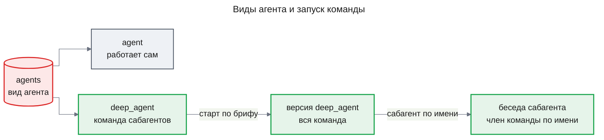

# ADR-0021 Вид записи `deep_agent`: глубокий агент — агент со своей командой изолированных сабагентов

## Status

Accepted (2026-11-22). Дополняет [ADR-0016](ADR-0016-library-records-and-visibility.md) и [ADR-0017](ADR-0017-run-snapshots-from-library.md), не заменяя их; [ADR-0004](ADR-0004-agent-framework-packages.md) не меняет.

## Decision

Длинную работу в библиотеке сегодня описывает workflow: координатор без своих инструментов раздаёт задания исполнителям и держит план в памяти модели. Решено: вид записи `workflow` удаляется, и его место занимает вид `deep_agent` — глубокий агент. Это агент со своим промптом, MCP-серверами и инструментами, своей командой от одного до десяти сабагентов и необязательным финальным сабагентом; сабагент — копия внутри записи, а не ссылка на агента библиотеки. Способности глубокого агента — список задач, поручение по списку — включаются полями его содержимого, а не новыми видами. Вместе с видом меняется хранимое содержимое агента; данные при этом не переносятся.

Схема показывает виды агента и то, на чём работает его команда.

### Связь с ADR-0004, ADR-0016 и ADR-0017

**ADR-0016** (записи в модуле `library`, одна процедура видимости) остаётся в силе. Глубокий агент встаёт по его правилу: новый вид добавляет значение вида и схему содержимого, а не свою таблицу и не свою аудиторию. Меняется только набор видов — `agent` и `deep_agent`; видимость, адресаты, копия, версия и аудит работают у глубокого агента так же.

**ADR-0017** (каждый старт через одну процедуру, беседа закреплена за неизменной версией) остаётся в силе. Беседа сабагента стоит на версии своего глубокого агента и называет члена команды по имени (`conversations.subagent`); его определение берётся из этой версии.

**ADR-0004** (пакеты по границам владения) не меняется. Раскладку пакетов ведёт Layer Map [code system](../code-system/README.md), а не ADR-0004.

## Context

Сегодня у библиотеки два вида записей: агент работает сам, а workflow состоит из координатора и исполнителей. Workflow запускается только из чата после того, как сотрудник подтвердил бриф, и ответом становится отчёт финального исполнителя. По этой схеме работает встроенный глубокий ресерч. Исполнитель хранит ссылку на агента библиотеки (`source`), чтобы форма могла предложить его новую версию.

Фича `deep-agents` даёт агенту список задач вне памяти модели, своих сабагентов в изолированном контексте и правку записей словами в чате ([prd.md](../features/deep-agents/prd.md), «Агент, глубокий агент и сабагенты»). Глубокий агент почти совпадает с workflow: ведущий, команда и финальный участник.

Варианты должны были выдержать три условия:

- Одна версия каждой вещи: проект — PoC без обратной совместимости, и старый формат заменяется, а не живёт рядом с новым (PRD, Constraints, «Без совместимости»).
- Правила видов разные. Агент хранит список агентов библиотеки, которых может запускать, и запускается инструментом `start_agent`. Глубокий агент хранит команду, финального сабагента и флажок самообучения и запускается только из чата через бриф.
- Следующие части строятся на той же записи: часть `task` поручает работу сабагентам команды, а способности включаются полями её содержимого (FR-18, FR-24).

**Почему это архитектурное решение.**

1. **Дорого откатить.** Меняется хранимый формат агентов, их версий и бесед; обратный ход — снова смена формата во всех частях, которые пишутся против нового содержимого, и пересоздание баз.
2. **Связывает за пределами фичи.** Части `task-list`, `task`, `notepad` и `memory`, самообучение и будущий редактор глубокого агента пишутся против этого содержимого.
3. **Были реальные варианты.** Они сравнены ниже.

## Options Considered

- **Отдельный вид `deep_agent`, который заменяет `workflow` (выбран)** — у каждого вида свои правила сохранения, запуска и показа, и каждое правило проверяет вид записи, а не то, заполнено ли необязательное поле. Глубокий агент берёт у workflow то, что уже работает: запуск через бриф, команду, финального участника и самообучение.
- **Один вид `agent` с необязательной командой** — проиграл. Кого агент может запускать, кто запускает его самого и есть ли у него флажок самообучения — всё зависело бы от того, заполнена ли команда. Эти условия расползлись бы по правилам сохранения, запуска и показа, и каждая следующая часть повторяла бы их.
- **Новый вид рядом с `workflow`** — исключён правилом проекта «одна версия всего». Две записи одной идеи дали бы два набора правил, две ветки снимка и два пути показа, а workflow-записи пришлось бы переносить или поддерживать.

## Consequences

- **Хранимый формат меняется.** CHECK вида записи допускает `agent` и `deep_agent`. Содержимое глубокого агента проверяет своя схема. Беседа сабагента ссылается на версию глубокого агента и называет члена команды.
- **Сабагент — копия.** Ссылки на агента библиотеки у него нет.
- **Данные не переносятся.** Базы разработки пересоздаются; встроенные агенты лежат в миграции встроенных строк ([ADR-0003](ADR-0003-drizzle-data-layer.md)). Продакшен-базы нет ([design-agent-types.md](../features/deep-agents/design-agent-types.md#data-model), Data Model).
- **Следующие потребители связаны новым контрактом.** Часть `task` поручает работу сабагентам команды, части `task-list`, `task`, `notepad` и `memory` добавляют флажки способностей в содержимое той же записи, а самообучение привязано к версии глубокого агента (серверы его уроков вычисляет `runDefinition`). Будущий редактор-форма глубокого агента будет править это же содержимое. Смена формы записи после них — снова правка всех этих частей.

## Implementation Guidance

- Набор видов записи — одно перечисление в `contracts` (`RecordKindSchema`); CHECK `agents.kind` и схемы маршрутов и инструментов берут его оттуда, поэтому удалённый вид не принимает ни один вход
- Поведение, которое различает агента и глубокого агента, решает вид записи, а не наличие полей
- Способность глубокого агента, такая как список задач, — поле его содержимого, а не новый вид
- Сабагент живёт копией внутри версии глубокого агента; его определение берётся из этой версии по имени
- Записи не переносятся; встроенные агенты лежат в миграции встроенных строк
- Поля содержимого — [Contract Definitions](../features/deep-agents/design-agent-types.md#contract-definitions)

## Related Information

- [design-agent-types.md](../features/deep-agents/design-agent-types.md) — KD-1, KD-2, Contract Definitions, Data Model
- [prd.md](../features/deep-agents/prd.md) — «Агент, глубокий агент и сабагенты», FR-01, FR-07, FR-18, FR-24, Constraints «PoC без совместимости»
- [ADR-0016](ADR-0016-library-records-and-visibility.md)
- [ADR-0017](ADR-0017-run-snapshots-from-library.md)
- [ADR-0004](ADR-0004-agent-framework-packages.md)