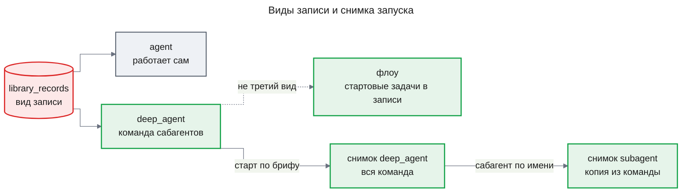

# ADR-0021 Вид записи `deep_agent` заменяет `workflow`: глубокий агент — агент со своей командой изолированных сабагентов и списком задач запуска, а флоу — глубокий агент со стартовыми задачами

## Status

Accepted (2026-11-22). Дополняет [ADR-0016](ADR-0016-library-records-and-visibility.md) и [ADR-0017](ADR-0017-run-snapshots-from-library.md), не заменяя их; [ADR-0004](ADR-0004-agent-framework-packages.md) не меняет.

## Decision

Длинную работу в библиотеке сегодня описывает workflow: координатор без своих инструментов раздаёт задания исполнителям и держит план в памяти модели. Решено: вид записи `workflow` удаляется, и его место занимает вид `deep_agent` — глубокий агент. Это агент со своим промптом, MCP-серверами и инструментами, своей командой от одного до десяти сабагентов, необязательным финальным сабагентом и списком задач запуска; сабагент — копия внутри записи, а не ссылка на агента библиотеки. Список задач принадлежит запуску, а не записи. Флоу — не третий вид, а глубокий агент, в записи которого есть стартовые задачи. Вместе с видом меняются хранимое содержимое записи и виды снимка запуска, а миграция переписывает встроенный глубокий ресерч на месте и удаляет workflow-записи сотрудников.

Схема показывает виды записи и снимка после решения.

### Связь с ADR-0004, ADR-0016 и ADR-0017

**ADR-0016** (записи в модуле `library`, одна процедура видимости) остаётся в силе. Глубокий агент встаёт по его правилу: новый вид добавляет значение вида и схему содержимого, а не свою таблицу и не свою аудиторию. Меняется только набор видов — `agent` и `deep_agent` вместо `agent` и `workflow`; видимость, адресаты, копия, версия и аудит работают у глубокого агента так же.

**ADR-0017** (каждый старт через `resolveStart`, дальше только снимок) остаётся в силе. Меняются виды снимка: `deep_agent` и `subagent` вместо `workflow` и `executor`. Правило «исполнитель workflow берёт снимок из снимка вызывающего» читается теперь так: сабагент берёт снимок из снимка своего глубокого агента. Тело снимка по-прежнему — содержимое записи в хранимой форме.

**ADR-0004** (пакеты по границам владения) не меняется. Пакет `packages/workflows` удаляется отдельным решением Design Doc ([design-agent-types.md](../features/deep-agents/design-agent-types.md), KD-2), а раскладку пакетов ведёт Layer Map [code system](../code-system/README.md), а не ADR-0004.

## Context

Сегодня у библиотеки два вида записей: агент работает сам, а workflow состоит из координатора и исполнителей. Workflow запускается только из чата после того, как сотрудник подтвердил бриф, и ответом становится отчёт финального исполнителя. По этой схеме работает встроенный глубокий ресерч. Исполнитель хранит ссылку на агента библиотеки (`source`), чтобы форма могла предложить его новую версию.

Фича `deep-agents` даёт агенту план вне памяти модели, своих сабагентов в изолированном контексте и правку записей словами в чате ([prd.md](../features/deep-agents/prd.md), «Агент, глубокий агент и флоу»). Глубокий агент почти совпадает с workflow: ведущий, команда и финальный участник.

Варианты должны были выдержать четыре условия:

- Одна версия каждой вещи: проект — PoC без обратной совместимости, и старый формат заменяется, а не живёт рядом с новым (PRD, Constraints, «Без совместимости»).
- Правила видов разные. Агент хранит список агентов библиотеки, которых может запускать, и запускается инструментом `start_agent`. Глубокий агент хранит команду, финального сабагента и флажок самообучения и запускается только из чата через бриф.
- Граф знаний встроенного ресерча висит на id записи с каскадом и должен пережить замену (AC-08.2).
- Следующие части строятся на той же записи: в части `tasks` исполнитель задачи — сабагент команды, в части `flows` флоу — стартовые задачи глубокого агента (FR-10, FR-21).

**Почему это архитектурное решение.**

1. **Дорого откатить.** Меняется хранимый формат записей, снимков и сессий, а миграция удаляет записи сотрудников; обратный ход — ещё одна миграция данных.
2. **Связывает за пределами фичи.** Части `tasks` и `flows`, самообучение и будущий редактор глубокого агента пишутся против этого содержимого.
3. **Были реальные варианты.** Они сравнены ниже.

## Options Considered

- **Отдельный вид `deep_agent`, который заменяет `workflow` (выбран)** — у каждого вида свои правила сохранения, запуска и показа, и каждое правило проверяет вид записи, а не то, заполнено ли необязательное поле. Глубокий агент берёт у workflow то, что уже работает: запуск через бриф, команду, финального участника и самообучение. Флоу ложится в ту же запись стартовыми задачами, поэтому третий вид не нужен.
- **Один вид `agent` с необязательной командой** — проиграл. Кого агент может запускать, кто запускает его самого и есть ли у него флажок самообучения — всё зависело бы от того, заполнена ли команда. Эти условия расползлись бы по правилам сохранения, запуска и показа, и каждая следующая часть повторяла бы их.
- **Новый вид рядом с `workflow`** — исключён правилом проекта «одна версия всего». Две записи одной идеи дали бы два набора правил, две ветки снимка и два пути показа, а workflow-записи пришлось бы переносить или поддерживать.

## Consequences

- **Хранимый формат меняется.** CHECK вида записи допускает `agent` и `deep_agent`. Содержимое глубокого агента проверяет новая схема вместо `WorkflowContentSchema`. Снимок получает виды `deep_agent` и `subagent`, а поле происхождения `executor` и столбец `agent_sessions.executor` переименовываются в `subagent`.
- **Сабагент — копия.** Ссылки на агента библиотеки у него нет, поэтому уходят состояние источников исполнителей и всё, что его показывает.
- **Workflow-записи сотрудников удаляются** вместе с их адресатами и графами знаний. Записи не переносятся (PRD, Constraints), а новый CHECK вида не встанет, пока в таблице есть строки `workflow` ([design-agent-types.md](../features/deep-agents/design-agent-types.md), KD-7).
- **Встроенный глубокий ресерч переписывается на месте**: тот же id, вид `deep_agent`, содержимое встроенной записи. Граф знаний остаётся. Если строку удалить и вставить заново, каскад сотрёт граф, поэтому владелец проверяет граф после миграции на базе разработки.
- **Старые запуски workflow открываются, но не продолжаются.** Их вход хранит снимок прежнего вида, а его читают только продолжение и перезапуск. Беседы открываются, потому что миграция переписывает `agent_sessions.record_kind` на `deep_agent` и ключ происхождения во входе задач на `subagent`.
- **Удаляется всё, что лишилось вызывающего**: вид `workflow`, его схема, форма и тексты, координатор, `start_workflow`, пакет `packages/workflows` и их тесты.
- **Следующие потребители связаны новым контрактом.** Часть `tasks` назначает задаче сабагента команды, часть `flows` добавляет стартовые задачи в содержимое той же записи, а самообучение привязано к снимку `deep_agent` (`learningRunOf`). Будущий редактор-форма глубокого агента будет править это же содержимое. Смена формы записи после них — снова миграция хранимых данных и правка всех этих частей.

## Implementation Guidance

- Набор видов записи — одно перечисление в `contracts` (`RecordKindSchema`); CHECK `library_records.kind` и схемы маршрутов и инструментов берут его оттуда, поэтому удалённый вид не принимает ни один вход
- Поведение, которое различает агента и глубокого агента, решает вид записи, а не наличие полей
- Разновидность глубокого агента, такая как флоу, — поле его содержимого, а не новый вид
- Сабагент живёт копией внутри записи; его снимок берётся из снимка глубокого агента по имени
- Миграция данных переписывает строку, на которую ссылаются каскадом, на месте и не удаляет её ради вставки заново
- Поля содержимого и снимка — [Contract Definitions](../features/deep-agents/design-agent-types.md#contract-definitions)

## Related Information

- [design-agent-types.md](../features/deep-agents/design-agent-types.md) — KD-1, KD-2, KD-7, Contract Definitions, Data Model, Risks and Mitigation
- [prd.md](../features/deep-agents/prd.md) — «Агент, глубокий агент и флоу», FR-01, FR-08, FR-10, FR-21, Constraints «Без совместимости»
- [ADR-0016](ADR-0016-library-records-and-visibility.md)
- [ADR-0017](ADR-0017-run-snapshots-from-library.md)
- [ADR-0004](ADR-0004-agent-framework-packages.md)
- [ADR-0002](ADR-0002-app-schema-migrations.md)
- [design-workflows.md](../features/agent-platform/design-workflows.md) — заменяемый workflow
