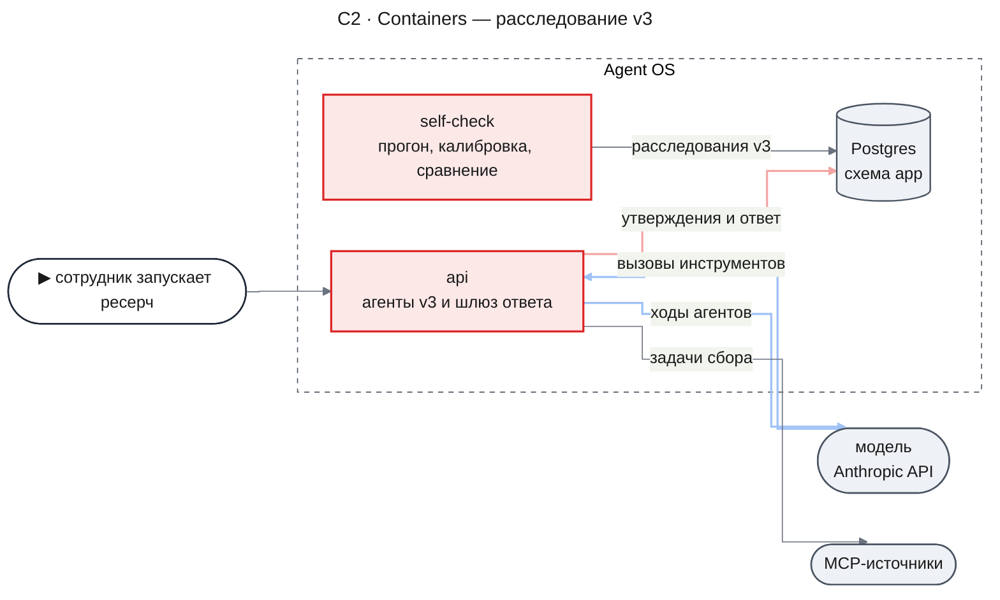
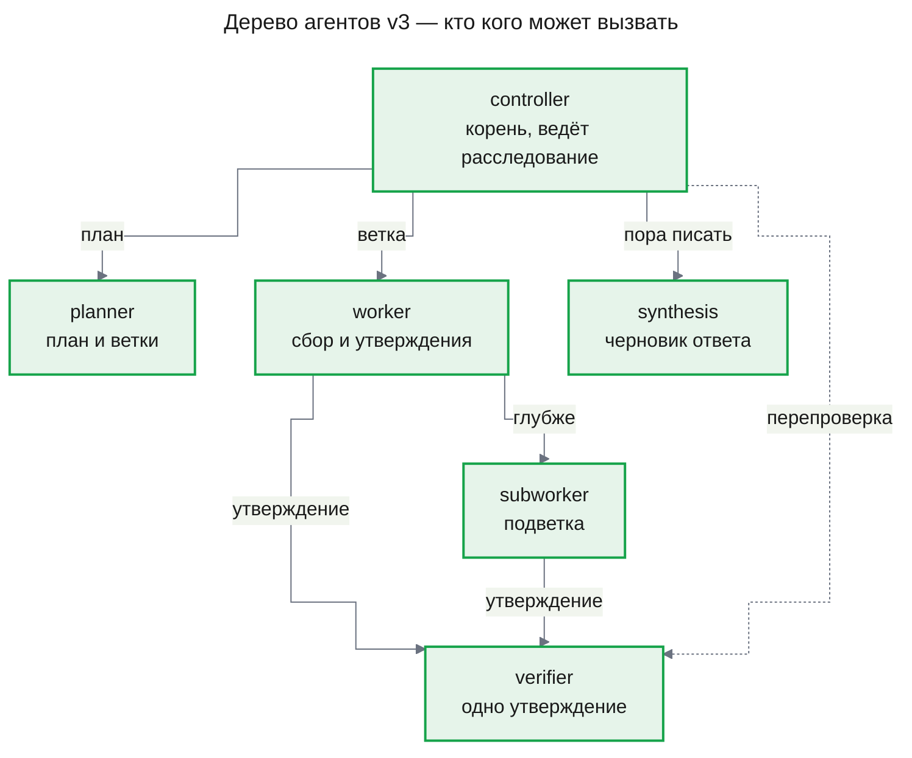
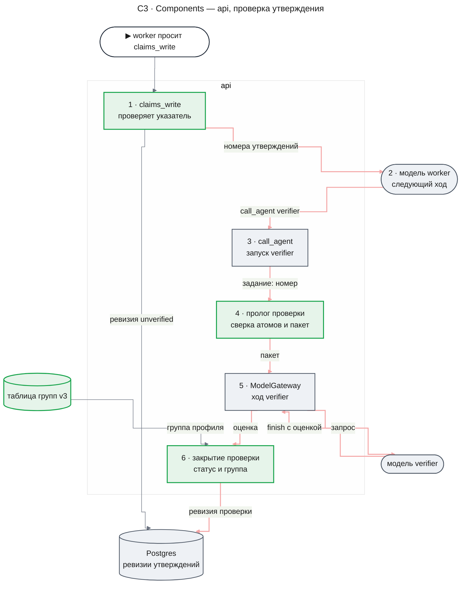
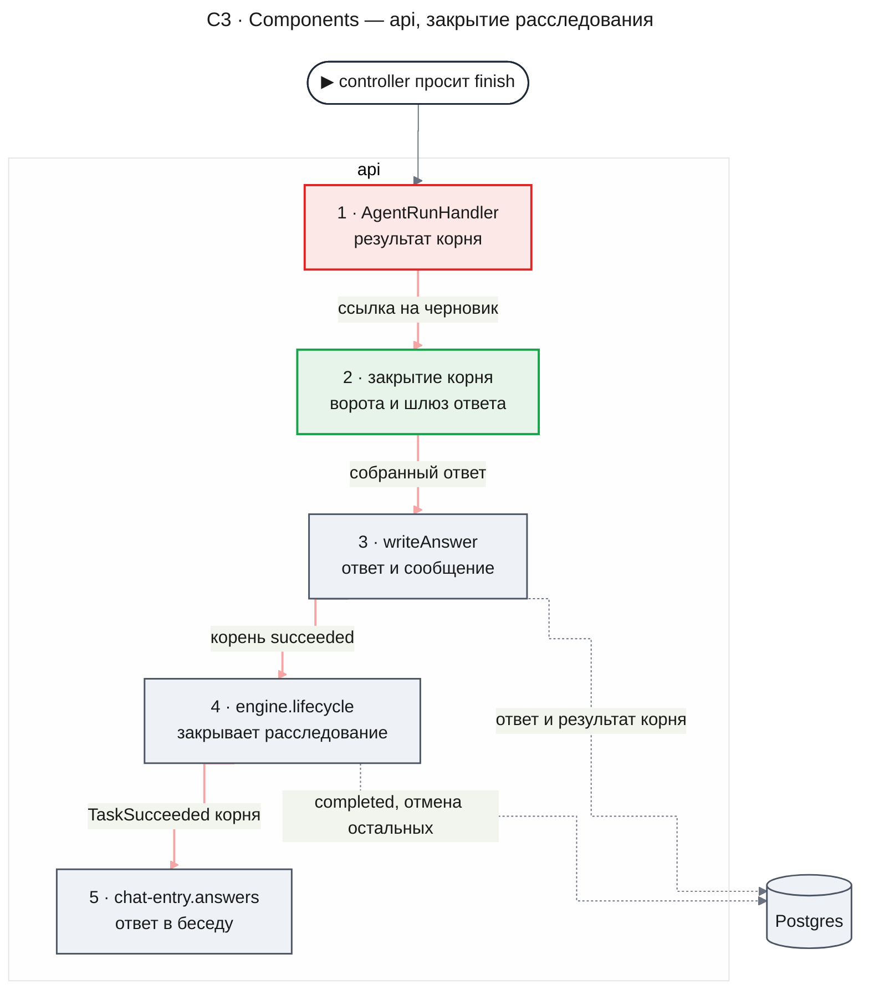
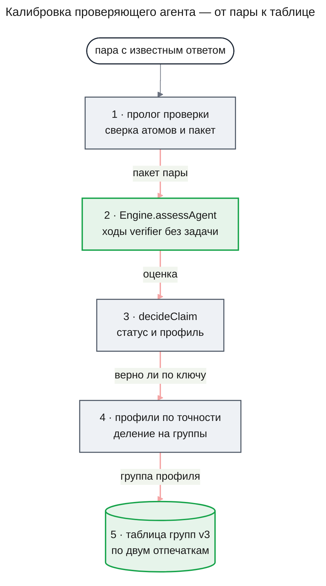
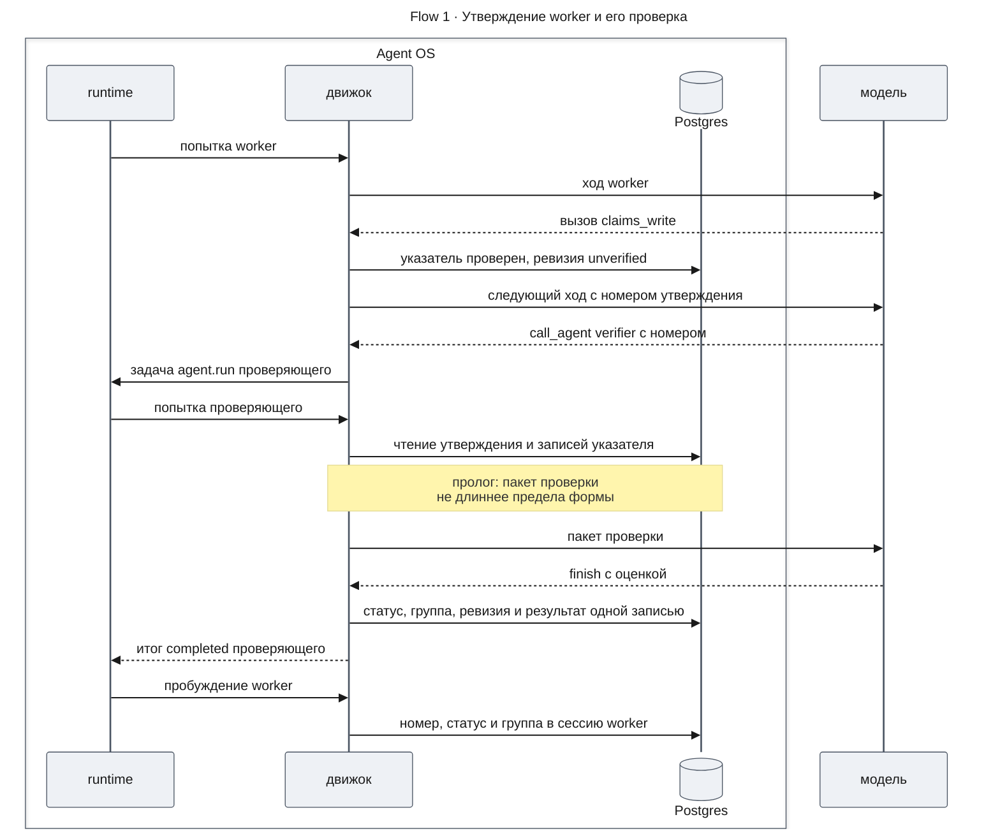
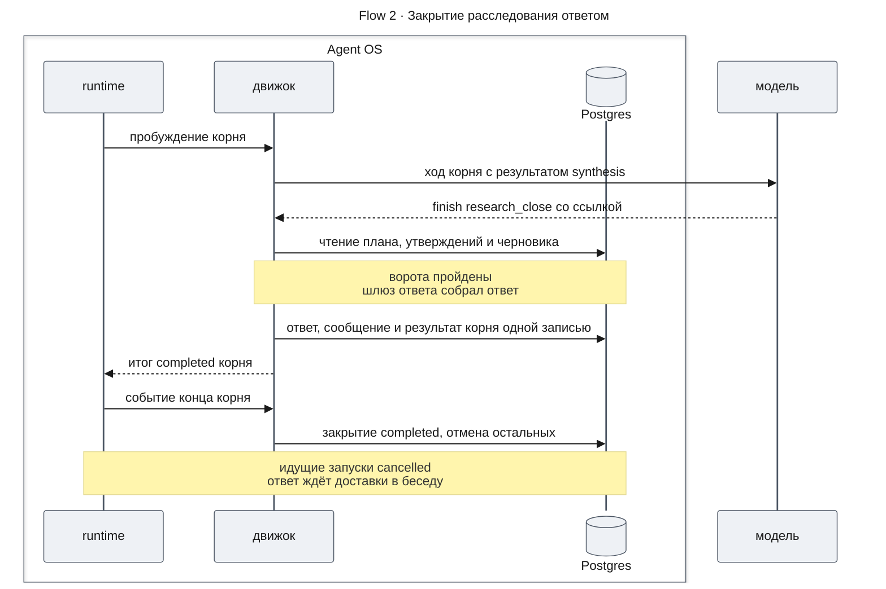
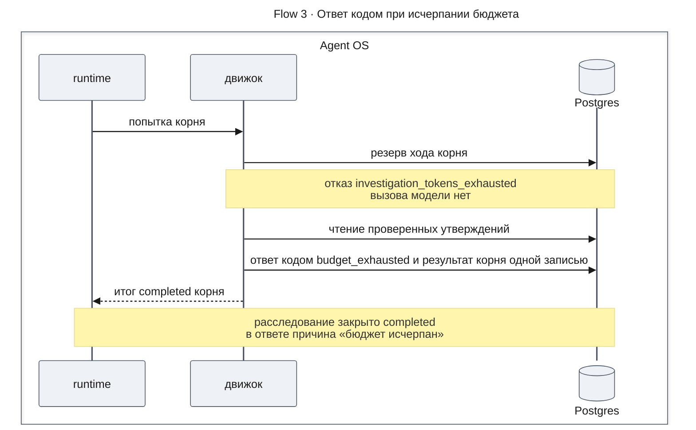
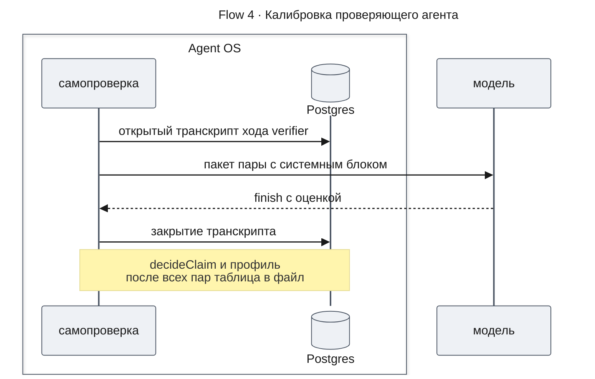

# Агенты как сущность платформы — Design Doc — research-flow

**Status:** На утверждении · **Date:** 2026-11-10 · **PRD:** [prd.md](./prd.md) · **UXRD:** нет — экран сотрудника не меняется · **Depends on:** [design-agent-core.md](./design-agent-core.md#contract-definitions)

## Snapshot

**Overview.** До этой части глубокое расследование вёл цикл в коде: модель-руководитель на каждом шаге выбирала одно действие из списка, а код его исполнял. Эта часть описывает новую версию процесса — v3, — в которой все пять стадий работают агентами: руководитель сам решает, кого и когда вызвать, а аналитик сам собирает записи, пишет утверждения и отдаёт каждое на проверку отдельному проверяющему агенту. Код по-прежнему решает всё, что не требует понимания текста: ведёт ли ссылка на записи этого расследования, прошёл ли ответ проверяющего закрытую форму, хватает ли бюджета, какой у утверждения статус и группа и что попадает в ответ. Сотрудник получает ответ того же вида и тем же путём, что и до v3. v3 — единственная версия процесса: код прежнего процесса удалён.

- **Не меняется**: ответ в беседе и его доставка; правила проверки утверждения, групп уверенности и шлюза ответа; таблицы данных.
- **Главный риск**: модели класса Haiku могут не удержать свободный цикл агента, а записанного прогона v3 на настоящей модели в этой части нет ([Risks and Mitigation](#risks-and-mitigation)).
- **Открытые вопросы**: нет.

### Key Decisions

#### KD-1: Корень дерева — controller-агент; пять стадий в шести определениях и правило «кто кого вызывает» задают форму расследования, а код держит те же ворота, что в v2

Расследование v3 начинается с запуска controller-агента. Он вызывает агента плана, раздаёт ветки worker-агентам, отдаёт утверждения на проверку и, когда готов, вызывает агента ответа. Worker может вызвать проверяющего и аналитика подветки `subworker`, чтобы копнуть глубже, не возвращаясь к controller (AC-12.2). Свобода агентов касается только того, что раньше выбирал controller: кого вызвать, что собрать и когда писать ответ. Указатель на записи, закрытую форму, бюджет, статус, группу, ссылки и сводку ответа решает код — по тем же функциям, что в v2 ([Что решает агент, а что код](#что-решает-агент-а-что-код)).

Не взяты: корень — агент плана (тогда руководитель становится дочерним запуском и теряет сессию между волнами работы); worker без `call_agent` (не выполняется AC-12.2, и «копни глубже» снова требует шага controller); инструмент сбора у controller (страницы записей занимают окно руководителя, а сбор — дело аналитика).

#### KD-2: Проверка утверждения — запуск проверяющего агента, у которого код делает всё до и после ответа модели

Утверждение проверяется вызовом агента `verifier` с номером утверждения в задании. До первого хода код процесса — пролог — читает утверждение и записи его указателя, сверяет атомы функцией `checkAtoms` и строит тот же пакет, что сейчас строит `buildClaimCheck`. Модель отвечает одним вызовом `finish` с оценкой закрытой формы. Закрытие проверки — тоже код — проверяет форму по правилам `decideClaim`, ставит статус и группу по таблице калибровки и пишет ревизию утверждения той же записью, что результат запуска. Поэтому статус от ответа модели, а не от её текста, и правило ADR-0008 действует без изменений.

Свои утверждения на проверку отдаёт worker: он видит статус сразу и может написать исправленное утверждение. Controller видит статусы в данных расследования и может перепроверить любое. Цель автопроверки KD-10 `design-engine.md` — каждое утверждение проходит проверку — держат ворота закрытия: корень не закрывает расследование ответом, пока у какого-то утверждения аналитика нет попытки проверки ([ворота 2](#как-корень-закрывает-расследование)).

Две другие заплатки v2 из того же документа — правило новизны KD-11 и запрос в наблюдениях controller KD-12 — в v3 не нужны. Их заменяют сессия агента, где видны все его прежние вызовы и число вернувшихся записей, повтор запроса без нового вызова источника (DC-11) и заметки `dead_end` в памяти. Код не отклоняет вызов за повтор или отсутствие новизны (AC-17.2).

Не взяты: автопроверка кодом при записи утверждения — инструмент тогда и пишет, и ставит задачи, а worker не успевает поправить утверждение до проверки; отдельный инструмент `verify_claim` вместо вызова агента — он ставил бы дочерний запуск мимо `call_agent`, и `agent-core` пришлось бы учить доли и пределы для второго пути; проверяющий с инструментом чтения пакета — лишний ход, и модель может ответить, не прочитав записи.

#### KD-3: Ответ пишет закрытие корня одной записью с результатом корня, а принудительный конец корня собирает ответ кодом

Controller кончает работу вызовом `finish` с результатом формы `research_close`: ссылкой на законченный запуск агента ответа или выводом «не выяснено». Закрытие этой формы проверяет ворота, прогоняет черновик через шлюз ответа (`screenDraft`, `composeAnswer`), строит сообщение (`buildResearchAnswer`) и пишет ответ (`writeAnswer`) в той же охраняемой записи, что результат корня. Корень кончается успехом. Потребитель `engine.lifecycle` закрывает расследование `completed` и тем же переходом отменяет запуски поддерева, которые ещё идут (AC-08.2). Потребитель беседы получает `TaskSucceeded` корня, как в v2 — событие задачи controller. Если корень не может продолжать — кончился бюджет, ходы, срок или модель недоступна, — тот же код собирает ответ из проверенного (`buildCodeAnswer`) с причиной остановки из списка v2, и корень тоже кончается успехом ([Причина остановки](#как-причина-остановки-получается-из-конца-корня)).

Код процесса у формы результата — пролог, закрытие в той же записи, что результат запуска, и принудительный конец — даёт `agent-core` ([design-agent-core.md](./design-agent-core.md#формы-результата-и-код-процесса), KD-8); эта часть добавляет в закрытый реестр форм три такие записи. Не взяты: инструмент записи ответа у агента ответа и потом `finish` корня — лишний ход корня, а принудительная остановка всё равно кончала бы корень сбоем без ответа; ответ кодом в потребителе `engine.lifecycle` после сбоя корня — потребитель беседы получил бы `TaskFailed` и показал бы «Не удался», а контракт `chat-entry` должен остаться прежним.

#### KD-4: Проверяющий агент калибруется на новом запуске на каждое утверждение с тем же входом, что у проверяющего вызова v2, а таблица групп ключуется отпечатком агента и его памяти определения (U-3)

Каждый вызов проверяющего — новый запуск с чистой сессией: в нём только системный блок определения и пакет одного утверждения. Других инструментов, кроме `finish`, у определения нет, поэтому ни память расследования, ни соседние утверждения, ни текст из логов вне пакета до модели не доходят. Калибровка строит пакет пары тем же прологом и гоняет определение операцией `agent-core` `Engine.assessAgent`: тот же вид сессии, те же схемы инструментов, то же замечание `invalid_result` и второй ход, что в расследовании, но без задачи runtime и без журнала вызовов (AC-16.3).

Таблица групп v3 записывает два отпечатка: `agentFingerprint` определения и отпечаток его записей памяти области `deployment`. Записи области `user` в память проверяющего не пишутся: форма `claim_assessment` запрещает память области `user`, `agent-core` отклоняет такую запись с `scope_not_allowed`, а снимок расследования её не содержит ([design-agent-core.md](./design-agent-core.md#acceptance-criteria), DC-24). Поэтому вход проверяющего одинаков у всех пользователей, а правило `self-correction` меняет проверяющего только вместе с новой калибровкой. Сервер не стартует без таблицы для текущей пары отпечатков (AC-16.1).

Текущие записи памяти лежат в базе (`agent_definition_memory`), а `createEngine` синхронна и базу не читает. Поэтому пару отпечатков при старте сверяет отдельная асинхронная операция `Engine.checkCalibration`: `EngineModule.onModuleInit` вызывает её сразу после создания движка, а отказ тот же — `calibration_missing` ([Операции движка](#операции-движка)). Не взято: сделать асинхронной саму `createEngine` — ждать её пришлось бы всем вызывающим, в том числе самопроверке, которой эта проверка не нужна.

Вариант (б) U-3 — одна сессия на круг проверки — не взят. Оценка одного утверждения видела бы оценки соседних, таблица значила бы разное при разной длине круга, а калибровке пришлось бы воспроизводить круги заданной длины. Не взят и прогон калибровки настоящим расследованием с исполнителями runtime: у определения нет инструментов с эффектом, поэтому задача, журнал и очередь ничего не добавляют к входу модели, а калибровка стала бы медленнее и зависела бы от очереди.

#### KD-5: Сервер загружает только v3, а старт без версии берёт наибольшую загруженную

`apps/api` передаёт `createEngine` одну поставляемую конфигурацию — v3 (`ENGINE_PROCESSES`). Старт без версии — запуск из беседы и все существующие вызовы — идёт по ней: `ProcessSet.resolve` без версии и раньше брал наибольшую загруженную, а `findDefinition` не меняется. Расследование доканчивается по своей замороженной конфигурации, поэтому правка поставляемых данных идущему расследованию не мешает (AC-14.2). Контракт `chat-entry` не меняется; пределы бюджета запуска сервис запуска ресерча берёт из поставляемой v3 (`investigationTokenLimits`) без аргумента версии и без чтения настройки при запуске.

Не взяты: настройка версии развёртывания с опцией `defaultVersions` у `createEngine` — вторая версия в продукте не поставляется, и настройка добавила бы только отказ `process_version_not_loaded`; передавать версию в `ResearchLaunchService` — каждому вызывающему пришлось бы знать номер единственной версии.

#### KD-6: Самопроверка на v3 считает отклонённые вызовы агентов вместо отклонённых решений controller

Сигнал «отклонённые решения controller» в v3 не сработал бы никогда: решений нет. Его место занимает сигнал «отклонённые вызовы» — вызовы инструментов и агентов любого запуска дерева, которые код отклонил, с причиной.

Не взято: считать только отказы controller-агента — неверные указатели и инструменты вне определения приходятся на worker и subworker, и такие отказы остались бы невидимы.

#### KD-7: В режиме без источников корень — агент ответа, без controller и без агента плана

Если в развёртывании не подключён ни один источник, движок ставит корнем определение, которое конфигурация называет для этого режима, — в v3 это `synthesis`. Агент ответа пишет черновик на знаниях модели, а закрытие его формы прогоняет черновик через шлюз ответа в режиме `model_knowledge`: все утверждения — в предположения с пометкой, исход `answered`. AC-25.4 PRD `deep-research` допускает в этом режиме вызовы плана и синтеза; v3 ставит только агента ответа, потому что синтез v2 план не читает — ему нужны вопрос, разделы ответа и режим. Корень по режиму выбирает ключ `modelKnowledgeRoot` формы агентов ([design-agent-core.md](./design-agent-core.md#acceptance-criteria), DC-22).

Не взяты: controller-агент с суженным набором инструментов — лишние вызовы модели на каждое расследование вопреки AC-25.4; агент плана перед агентом ответа — агенту ответа пришлось бы уметь вызывать агента плана и в режиме с источниками, а план в этом режиме ответа не меняет.

## Terms

Слова расследования и проверки — модель, роль, утверждение, атом, указатель, сверка атомов, проверяющий вызов, группа уверенности, калибровка, транскрипт, самопроверка — объяснены в [Terms PRD agent-quality](../agent-quality/prd.md#terms) и [Terms design-engine.md](../agent-quality/design-engine.md#terms); агент, ход, сессия, определение, запуск, память и данные расследования, вызов агента и отпечаток — в [Terms PRD](./prd.md#terms); корневой и дочерний запуск, класс эффекта, охраняемая запись и доля — в [Terms design-agent-core.md](./design-agent-core.md#terms). Ниже только слова этого дизайна.

- **Пролог** — код процесса, который строит первое сообщение запуска из его задания до первого вызова модели и может закончить запуск без вызова модели. Пример: пролог проверки строит пакет утверждения с записями.
- **Закрытие формы** — код процесса, который проверяет результат `finish` и пишет его следствие той же записью, что результат запуска. Пример: закрытие проверки пишет ревизию утверждения со статусом.
- **Принудительный конец** — код формы, который работает, когда запуск кончился бы сбоем с одним из кодов DC-21 `agent-core`: кончилась доля или бюджет, ходы, срок, модель недоступна или вход не помещается в окно. Чем закрытие формы отличается от закрытия расследования и резерва — в [Terms design-agent-core.md](./design-agent-core.md#terms), «Одно имя — одна сущность».
- **Ворота закрытия** — правила, без которых корень не закрывает расследование ответом: есть план, каждое непроверенное утверждение — аналитика или новое из черновика — отдано на проверку, черновик — законченный запуск агента ответа, новые утверждения черновика один раз записаны и отданы на проверку.
- **Повтор запроса** — сбор с тем же источником, инструментом, аргументами и срезом, что у уже сохранённой страницы записей.
- **v2** — прежний процесс на ролях: цикл controller в коде и задачи ролей. Эта часть удалила его из кода; слова «как в v2» называют поведение, которое v3 сохраняет.
- **Руководитель, `controller`** — корневой агент v3: вызывает агента плана, аналитиков, проверяющего и агента ответа и закрывает расследование формой `research_close`.
- **Агент плана, `planner`** — пишет план расследования инструментом `plan_write`.
- **Аналитик, `worker` и `subworker`** — агент стадии анализа: собирает записи, пишет утверждения и отдаёт их на проверку; `subworker` ведёт подветку `worker`.
- **Проверяющий агент, `verifier`** — оценивает одно утверждение закрытой формой `claim_assessment`.
- **Агент ответа, `synthesis`** — пишет черновик ответа формы `answer_draft`; в режиме без источников он корень.

## Part

- **Part**: `research-flow`
- **Covers**: FR-12, FR-13, FR-14, FR-15, FR-16, FR-17, FR-18, FR-19, FR-20; от `agent-core` — закрытие с готовым ответом, пока дочерние запуски работают (AC-08.2), и причина «бюджет исчерпан» в ответе по признаку `budgetExhausted` (DC-16 `agent-core`)
- **Depends on**: [design-agent-core.md, Contract Definitions](./design-agent-core.md#contract-definitions) — форма агентов `ProcessConfig`, реестр инструментов и базовые инструменты, операции движка, `agentFingerprint`, `readAgentTree`, роль `agent` в журнале и транскриптах, причины сбоя запуска; код процесса у формы результата (пролог, закрытие, принудительный конец), ключ `modelKnowledgeRoot`, правило памяти определения проверяющего, транскрипт хода вне задачи и поле шаблона `sources`
- **Prerequisite ADRs**: [ADR-0001](../../adr/ADR-0001-durable-runtime-owner.md) (runtime — единственный долговечный владелец), [ADR-0004](../../adr/ADR-0004-agent-framework-packages.md) (слои пакетов, самопроверка в `apps/api`), [ADR-0005](../../adr/ADR-0005-process-config-data-only.md) и [ADR-0009](../../adr/ADR-0009-agent-definitions-as-process-data.md) (процесс — данные; v3 — форма агентов, U-4 решён ADR-0009), [ADR-0010](../../adr/ADR-0010-result-form-process-code.md) (код процесса у формы результата: пролог, закрытие, принудительный конец), [ADR-0006](../../adr/ADR-0006-investigation-final-states.md) (закрытие и запрет вызова после него), [ADR-0008](../../adr/ADR-0008-claim-status-from-verifier-answer-and-universal-atoms.md) (статус от закрытого ответа проверяющего, атомы, таблица групп). От ADR-0008 v3 отступает в двух местах, оба — данные одной версии процесса: ключ таблицы групп — отпечаток агента и его памяти, а не модель и версия промпта (KD-4), и утверждение с неверным указателем не пишется, а не получает `insufficient` (DC-6)
- **Sibling parts**: `agent-core` (FR-01–FR-11, FR-21, FR-22) — агент, запуск, сессия, память, вызов агента, доли бюджета; здесь только его контракт.

**Out of scope**

- Чтение и перенос расследований старого формата: локальные базы разработки сброшены при удалении v2 (FR-19).
- Вердикт «не хуже» между двумя конфигурациями — фича `self-correction`; здесь `compare` сравнивает запуски v3 как есть.
- Механика агента — ходы, сессия, окно, доли, рестарт, отмена, аудит вызова — `agent-core`.
- Содержимое памяти определения: в этой части ни один агент в неё не пишет (AC-22.6).
- Что запускает каталог источников — подключённые источники или пустой каталог — решает дизайн `source-planning` ([Что меняется у соседей](#что-меняется-у-соседей)).
- Каталог источников как инструмент агента плана — `source-planning`.
- Экран ответа, карточка ресерча и кнопка «Остановить».

**Constraints**

- **v2 удалён.** Сервер и самопроверка запускают только v3, а общие функции проверки и ответа, которыми пользовался v2, v3 вызывает как есть ([Переход на v3 и удаление старого кода](#переход-на-v3-и-удаление-старого-кода)).
- **Модель оценивает, алгоритм решает.** Модель решает, подтверждают ли записи утверждение вместе с его именами, числами и временем и какого оно типа; алгоритм — указатель, закрытую форму, бюджет, статус по полям ответа и группу по таблице. Ворота закрытия и повтор запроса — правила над хранимыми строками, без чтения текста.
- **Контракт беседы не меняется.** Ответ пишется до конца корня, корень записан как задача controller расследования, а версию выбирает движок (KD-3, KD-5).
- **Процесс — данные** (ADR-0009). v3 — файл `deep-research.v3.json` формы агентов; инструменты и формы результата этой части — записи закрытого реестра движка.
- **Модель агента принимает принудительный выбор инструмента.** На последнем ходе `agent-core` оставляет модели только `finish` (DC-14 `agent-core`), и запрос требует этот вызов принудительным выбором инструмента (`tool_choice` вида `tool` или `any`). `claude-sonnet-5-5` такой запрос отклоняет ошибкой 400, в том числе при подсчёте токенов, который идёт перед ходом; по документации провайдера Claude Opus 5.5 и Claude Fable 5.1 отклоняют такой выбор так же. Такие модели не могут вести агентов v3, пока правило последнего хода не изменится. Поэтому все шесть определений работают на `anthropic/claude-haiku-5-5` ([Агенты v3](#агенты-v3-и-кто-кого-вызывает)).

## Building-block Inventory

В репозитории нет `docs/code-system/`, поэтому строки называют существующий код, который искали перед выбором.

| Building block | Status | Note |
|---|---|---|
| `checkAtoms`, `buildClaimCheck`, `decideClaim` | reused | пролог и закрытие проверки вызывают их так же, как `research.verify` v2 |
| `findGroupTable`, проверка `calibration_missing` при старте | extended | ключ v3 — два отпечатка; проверка — для наибольшей загруженной версии; таблицы — поставляемые и из каталога развёртывания (KD-4, KD-5) |
| `Engine.checkCalibration` | new | проверка формы агентов при старте; `createEngine` и `composeEngine` базу не читают, а другой проверки текущих записей памяти при старте нет (KD-4) |
| `screenDraft`, `composeAnswer`, `buildCodeAnswer`, `buildResearchAnswer`, `writeAnswer` | reused | закрытие корня и принудительный конец (KD-3) |
| `writePlanRevision`, запись утверждений `claims.writeTaskClaims` | reused | инструменты `plan_write` и `claims_write` |
| Спецификация задачи сбора `source.fetch` и её ключ | reused | инструмент `gather`; повтор запроса ищет сохранённую страницу |
| `createProcessSet.resolve` | reused | старт без версии берёт наибольшую загруженную (KD-5) |
| `investigationTokenLimits` (`apps/api`) | extended | пределы бюджета запуска — из поставляемой v3 (KD-5) |
| `Engine.assessAgent` (`agent-core`) | reused | калибровка и замер влияния гоняют проверяющего агента вне задачи |
| `engine.lifecycle`, `isControllerTask`, потребители `chat-entry` | reused | без изменений |
| Сигналы, этап первой ошибки, `RunRecord`, `run`, `replay`, `calibrate` | extended | KD-6, [Самопроверка на v3](#самопроверка-на-v3) |
| Инструменты `gather`, `claims_write`, `plan_write`; формы `research_close`, `answer_draft`, `claim_assessment` | new | записи реестра `agent-core`; аналогов в реестре нет |
| Обработчик controller, `DecisionGate`, `createCapabilityRegistry`, задачи `research.analyze`, `research.verify`, `research.synthesize` | removed | [удалены вместе с v2](#переход-на-v3-и-удаление-старого-кода) |

## Acceptance Criteria

### FR-12: Пять стадий — агенты версии v3

- From the PRD: AC-12.1, AC-12.2, AC-12.3, AC-12.4, AC-12.5
- Принудительный конец корня даёт ответ кодом и причину остановки по правилу [Как причина остановки получается из конца корня](#как-причина-остановки-получается-из-конца-корня); расследование закрывается `completed` (DC-1).
- Корень, который закрыл расследование ответом, пока запуски его поддерева ещё работают, кончается успехом, а расследование становится `completed` и тем же переходом отменяет эти запуски (DC-2).
- В режиме без источников корень — определение `modelKnowledgeRoot`, и журнал вызовов показывает только его ходы (DC-3).

### FR-13: Конфигурация v3 — данные

- From the PRD: AC-13.1
- Формы этой части объявляют ограничения размещения по DC-28 `agent-core`, а загрузка отклоняет конфигурацию, которая им не отвечает, и называет агента, форму и ограничение (DC-4):
  - `research_close` — `onlyOn` `rootAgent`;
  - `answer_draft` — `onlyOn` `modelKnowledgeRoot`, `toolsAllowed` только `finish`: форма стоит только у определения, которое конфигурация называет корнем режима без источников, а в режиме с источниками это же определение работает дочерним запуском;
  - `claim_assessment` — `maxDefinitions` 1, `toolsAllowed` только `finish`.

  Поэтому `research_close` у не корня, `answer_draft` у определения, которое не `modelKnowledgeRoot`, второй проверяющий, проверяющий и агент ответа с инструментами не загружаются. Конфигурацию формы агентов без определения с формой `claim_assessment` `createEngine` отклоняет: без проверяющего нет ни ключа таблицы групп, ни проверки. Что корень несёт `research_close`, корень режима без источников — `answer_draft`, а определение `claim_assessment` ровно одно, задаёт поставляемая конфигурация, и это проверяют UC-1 и UC-4.
- В поставляемой конфигурации v3 поле `{{sources}}` стоит только в шаблонах `worker` и `subworker`, и эти шаблоны не перечисляют пары источника и их аргументы текстом. Конфигурация с этим полем у `controller`, `planner`, `verifier` или `synthesis` не загружается (DC-14).

### FR-14: Одна поставляемая версия процесса

- From the PRD: AC-14.1, AC-14.2

### FR-15: Ответ v3 подчиняется тем же правилам

- From the PRD: AC-15.1, AC-15.2, AC-15.3 — по [воротам 2](#как-корень-закрывает-расследование)
- Если указатель хоть одного утверждения вызова ведёт не на записи этого расследования, на номер вне страницы или на больше чем 20 записей, `claims_write` не пишет ни одного утверждения и отвечает отказом `pointer_invalid` с порядковыми номерами таких утверждений (DC-6).
- Пакет проверки длиннее предела первого сообщения формы `claim_assessment` кончает запуск без вызова модели — пролог отвечает `end`, — а утверждение получает `insufficient` с причиной `needs_narrowing` (DC-7). Порог строже, чем у v2: v2 сравнивал посчитанный провайдером вход с окном роли, v3 — байты пакета с пределом пролога. Шесть утверждений UC-R1 укладываются: каждое вместе со всеми страницами — не больше 7 000 байт.
- Оценка не по форме даёт замечание `invalid_result` и второй ход; если и он не по форме, утверждение получает `insufficient` с причиной `invalid_assessment` (DC-8).
- Корень получает отказ `invalid_result` с причиной `plan_missing`, `unverified_claims` (с номерами утверждений), `draft_invalid` или `needs_verification` и не закрывает расследование, пока нарушено одно из ворот закрытия; отказ `needs_verification` показывает модели только номера новых утверждений (DC-9).

### FR-16: Калибровка проверяющего агента

- From the PRD: AC-16.1, AC-16.2, AC-16.3, AC-16.4 — таблицы каталога `RESEARCH_GROUP_TABLES_DIR`; вид входа по U-3 — KD-4.
- Самопроверка гоняет v3 без таблицы, и её установленные утверждения получают низшую группу (DC-10).

### FR-17: Без заплаток цикла

- From the PRD: AC-17.1, AC-17.2
- Повтор запроса отдаёт сохранённую страницу без нового вызова источника и без отказа; результат вызова говорит, что страница прежняя, и называет число её записей (DC-11).

### FR-18: Самопроверка на v3

- From the PRD: AC-18.1, AC-18.2, AC-18.3, AC-18.4 — `compare` без изменений ([Самопроверка на v3](#самопроверка-на-v3))
- Для непройденного сценария v3 отчёт называет этап первой ошибки и его роль — `controller`, `worker` (вместе с `subworker`), `verifier` или `synthesis` (DC-12).

### FR-19: Старый процесс удаляется из кода

- From the PRD: AC-19.1, AC-19.3; что удалено и что осталось — [Переход на v3 и удаление старого кода](#переход-на-v3-и-удаление-старого-кода).

### FR-20: Текст в памяти и результатах — данные

- From the PRD: AC-20.1; AC-20.2 — конверт данных `agent-core` ([Сообщения кода в сессии](./design-agent-core.md#реестр-инструментов))

## Design

### Как v3 встраивается в нынешний путь

В v2 запуск из беседы создавал расследование, где задача controller шагами ставила задачи сбора, анализа, проверки и ответа; когда ответ был записан, она кончалась, движок закрывал расследование, и ответ уходил в беседу. В v3 вместо задачи controller стоит корневой запуск агента, вместо задач анализа и проверки — запуски агентов, а запись ответа и закрытие расследования остались прежними. Рамку — запуск, ход, вызов инструмента, долю бюджета, отмену — даёт `agent-core`; эта часть добавляет определения v3, инструменты стадий, код форм результата и самопроверку.

### Architecture (C1–C4)

#### C2 · Containers

Контекст системы (C1) не меняется: сотрудник, модель и источники те же.

- `api` загружает только v3 и исполняет его агентов обработчиком `agent-core`; инструменты стадий и код форм результата — модуль процесса расследования в `@agent-os/engine`.
- `self-check` запускает v3, калибрует проверяющего агента и сравнивает два запуска.
- `Postgres` новых таблиц от этой части не получает: план, утверждения, страницы и ответ v3 лежат там же, где у v2, а запуски и сессии — в таблицах `agent-core`.

#### Агенты v3 и кто кого вызывает

Подветку worker отдаёт определению `subworker` — той же стадии анализа, с теми же инструментами и моделью, но вызвать оно может только проверяющего. Глубина дерева — `agentLimits.maxDepth` 3: корень — 0, worker — 1, subworker — 2, проверяющий под subworker — 3. Поэтому вызов проверяющего никогда не упирается в предел глубины.

Определения v3 — данные файла `deep-research.v3.json`.

| Агент | Инструменты, кроме `finish` | Вызывает | Форма результата | Ходов | Вызовов за ход | Дочерних |
|---|---|---|---|---|---|---|
| `controller` | `memory_read`, `memory_write`, `investigation_read`, `call_agent` | `planner`, `worker`, `verifier`, `synthesis` | `research_close` | 24 | 8 | 32 |
| `planner` | `investigation_read`, `memory_read`, `plan_write` | — | `text` | 4 | 2 | 0 |
| `worker` | `memory_read`, `memory_write`, `investigation_read`, `gather`, `claims_write`, `call_agent` | `subworker`, `verifier` | `text` | 16 | 8 | 16 |
| `subworker` | как у `worker` | `verifier` | `text` | 12 | 8 | 12 |
| `verifier` | нет | — | `claim_assessment` | 2 | 1 | 0 |
| `synthesis` | нет | — | `answer_draft` | 2 | 1 | 0 |

Модель всех шести определений — `anthropic/claude-haiku-5-5`: модели, которые отклоняют принудительный выбор инструмента на последнем ходе, агентов v3 вести не могут ([Constraints](#part)). Модель `verifier` та же, что при калибровке, поэтому таблица групп остаётся верной.

Окно, запас, потолок выхода, доля и срок каждого определения:

| Агент | Окно / запас / выход, токенов | Доля, токенов | Срок, мс |
|---|---|---|---|
| `controller` | 64 000 / 3 200 / 2 000 | весь бюджет | 3 600 000 |
| `planner` | 60 000 / 3 000 / 8 000 | 70 000 | 600 000 |
| `worker` | 96 000 / 4 800 / 8 000 | 300 000 | 1 800 000 |
| `subworker` | 96 000 / 4 800 / 8 000 | 150 000 | 1 200 000 |
| `verifier` | 64 000 / 3 200 / 4 000 | 70 000 | 300 000 |
| `synthesis` | 96 000 / 4 800 / 8 000 | 110 000 | 900 000 |

Потолки выхода — значения ролей v2. Окна больше, чем у ролей v2: загрузка `agent-core` отклоняет определение, чья оценка наименьшего вида в худшем случае не помещается в окно за вычетом запаса (DC-1 `agent-core`). Резерв хода — посчитанный вход плюс запас и выход, а не окно; посчитанный вход больше окна за вычетом запаса сжимает вид дальше, а на последней ступени кончает запуск кодом `context_overflow` (DC-30 `agent-core`). Но родитель выдаёт долю, только когда его свободный остаток не меньше одного хода дочернего — окна плюс выхода (KD-4 `agent-core`), поэтому окно определяет, сколько дочерних родитель держит одновременно.

Пролог строит первое сообщение `verifier` не длиннее 24 000 байт, а `synthesis` — не длиннее 32 000 байт (`firstMessageMaxBytes` их форм). Оценку наименьшего вида `agent-core` считает в байтах и делит на `BYTES_PER_TOKEN` = 3, а ответы модели прибавляет в токенах ([design-agent-core.md](./design-agent-core.md#что-модель-видит-из-сессии)). Делитель — оценка, а не верхняя граница: для пакета проверяющего он занижает вход, как показал [замер `agent-core`](./design-agent-core.md#что-модель-видит-из-сессии), а если посчитанный вход хода всё же больше окна, решает DC-30 `agent-core`. В байты вида входят:

- снимок памяти определения — 16 384 и преамбула о данных — 146, у всех одинаково;
- промпт: шаблон и, у всех, кроме `verifier`, подставленный `{{query}}` — запрос до 10 000 символов по 3 байта, 29 991 байт сверх шаблона; у `worker` и `subworker` столбец шаблона включает значение `{{sources}}` — около 2 750 байт на трёх инструментах источника `fixture`;
- схемы инструментов, включая `finish`, по JSON-схеме zod — это оценка; провайдер и счётчик входа получают их после преобразования Mastra ([Реестр инструментов `agent-core`](./design-agent-core.md#реестр-инструментов));
- первое сообщение: задание до 8000 символов по тем же 3 байта — 24 000, а у `verifier` и `synthesis` — предел первого сообщения формы;
- служебное по пределам кода: два конверта и обёртка неизменной части; заглушка каждого хода старше трёх последних — 1 152; у трёх последних ходов — обёртки ответов, у двух из них, кроме нового, заглушки результатов по 384 на вызов, место под обрезанные результаты нового хода по 640 на вызов и по два замечания по 384.

| Агент | Шаблон промпта | Схемы | Первое сообщение | Служебное | Байт всего | Байт ÷ 3 | Ответы, токенов | Оценка, токенов | Доступно |
|---|---|---|---|---|---|---|---|---|---|
| `controller` | 7 000 | 5 000 | 24 000 | 38 784 | 121 305 | 40 435 | 3 × 2 000 | 46 435 | 60 800 |
| `planner` | 400 | 4 000 | 24 000 | 7 296 | 82 217 | 27 406 | 3 × 8 000 | 51 406 | 57 000 |
| `worker` | 6 700 | 7 000 | 24 000 | 29 568 | 113 789 | 37 930 | 3 × 8 000 | 61 930 | 91 200 |
| `subworker` | 6 500 | 7 000 | 24 000 | 24 960 | 108 981 | 36 327 | 3 × 8 000 | 60 327 | 91 200 |
| `verifier` | 6 000 | 2 000 | 24 000 | 3 456 | 51 986 | 17 329 | 2 × 4 000 | 25 329 | 60 800 |
| `synthesis` | 8 000 | 3 000 | 32 000 | 3 456 | 92 977 | 30 993 | 2 × 8 000 | 46 993 | 91 200 |

«Доступно» — окно минус запас. Байты всего — сумма столбцов, снимка памяти, преамбулы и, у всех, кроме `verifier`, 29 991 байт запроса. Ответов в виде не больше трёх: столько последних ходов правило окна оставляет целиком. Самый малый зазор — у `planner`, 5 594 токена; при прежнем окне 48 000 доступно было бы 45 600, меньше оценки, поэтому его окно — 60 000. У `verifier` запас под замеренное занижение: даже если всю оценку 25 329 умножить на 1.8, выходит около 45 600 токенов при доступных 60 800; вид помещается, а остальное покрывает DC-30 `agent-core`. Поле `{{sources}}` окон не меняет: даже со значением на [пределе поля](./design-agent-core.md#поле-шаблона-sources) оценка `worker` — 63 727 токенов при доступных 91 200.

Каждый срок больше запаса `AGENT_DEADLINE_MARGIN_MS` плюс одного хода `AGENT_TURN_MS`: определение с не большим сроком загрузка отклоняет (DC-1 и DC-27 `agent-core`).

Бюджет расследования по умолчанию — `limits.investigationTokens` 800 000 при наибольшем 10 000 000. Все значения — начальные; их меняют правкой данных, а загрузка проверяет каждое изменение.

#### Как считается бюджет расследования v3

Доля и остаток считаются по правилу `agent-core` ([design-agent-core.md](./design-agent-core.md#как-считается-доля-бюджета)); расход хода в журнале — весь вход, включая прочитанное из кэша, плюс выход. Пример — путь UC-1, числа округлены:

1. Корень, два хода — 16 000; planner с долей 70 000 тратит 21 000.
2. Третий ход корня — 11 000 — даёт двум worker по 300 000; у корня остаётся 152 000.
3. Worker A — 282 000 из 300 000: свои восемь ходов 168 000, четыре проверки по 8 000 до вызова subworker, subworker с долей 150 000 и одной проверкой — 82 000. Проверки идут до subworker, потому что, пока subworker держит долю, у A свободно меньше хода проверяющего.
4. Worker B — 200 000: свои ходы 168 000 и четыре проверки.
5. Три хода корня — 51 000; synthesis с долей 110 000 тратит 19 000.
6. Закрывающий ход корня — 21 000.

Итого около 620 000 из 800 000. С бюджетом 300 000 второй worker не получил бы долю, и вызов был бы отказан `budget_exhausted`. Стоимость в деньгах ниже, чем в токенах бюджета: прочитанное из кэша стоит дешевле, а отчёт самопроверки считает стоимость в деньгах.

**Промпты — что меняется против v2.** Шаблоны берут поля `goal`, `query`, `sourceMode`, `answerSections`, а `worker` и `subworker` ещё и `{{sources}}` — инструменты источников своего запуска ([design-agent-core.md](./design-agent-core.md#поле-шаблона-sources)). Только у этих двух агентов есть `gather`, поэтому только им список и нужен. У `controller`, `planner`, `verifier` и `synthesis` нет инструмента, который читает источники запуска, и загрузка не примет у них это поле (DC-14). Эти шаблоны не перечисляют пары источника и их аргументы текстом; в них остаются совет, какой инструмент брать для примеров записей и какой для подсчётов, и правило, которого JSON-схема не выражает: `from` раньше `to`.

- **`controller`** — новый промпт. Первым вызвать агента плана; давать worker одну ветку с сервисом и окном времени; перед новой веткой читать данные и память; отдавать на проверку непроверенное; после `needs_verification` проверить названные утверждения и снова вызвать агента ответа; закончить `finish` формы `research_close`.
- **`planner`** — промпт плана v2, а план записывается инструментом `plan_write`; при повторном вызове сначала прочитать данные и память и назвать причину ревизии.
- **`worker`** — промпт worker v2, плюс: утверждения писать инструментом `claims_write` и отдавать каждое проверяющему; запрос с 0 записей не повторять, а оставить заметку `dead_end` и сначала узнать значения поля группировкой; подветку отдать `subworker`.
- **`subworker`** — как у `worker`, без указания про подветку.
- **`verifier`**, **`synthesis`** — промпты v2 ([design-engine.md](../agent-quality/design-engine.md#contract-definitions)) и указание ответить одним вызовом `finish`.

Поэтому вход `verifier` остаётся равным проверяющему вызову v2 и от источников не зависит. `agentFingerprint` считается от шаблона до подстановки, а шаблон `verifier` поле не берёт, поэтому таблица групп и калибровка (KD-4) работают как описано. Правка шаблонов `worker` и `subworker` меняет только их отпечатки, а по ним таблицы не ищут.

#### Что решает агент, а что код

Агент решает, кого вызвать, что собрать, какие утверждения написать, что отдать на проверку и когда писать ответ. Код решает то же, что в v2, и в тех же функциях:

- **указатель** — принадлежит ли страница расследованию, есть ли записи с такими номерами, не больше ли их 20 (`claims_write`, DC-6);
- **закрытая форма** — оценка проверяющего и черновик ответа проходят схему и правила формы `decideClaim` и шлюза (DC-8);
- **бюджет и пределы** — резерв перед каждым ходом, доли, глубина, ширина и число задач (`agent-core`);
- **статус и группа** — статус по полям оценки, группа по таблице калибровки (закрытие проверки);
- **ответ** — ссылки установленного вывода из основы проверки, сводка из принятых утверждений, ответ кодом при принудительной остановке (закрытие корня);
- **права** — каждый сбор проходит `ToolAccessPolicy` и allowlist задачи `source.fetch`.

Заметка в памяти и результат агента ничего из этого не меняют: в «Установлено» попадает только утверждение, чья последняя ревизия написана закрытием проверки со статусом `supported` (AC-15.2).

#### C3 · Components: api

**api — проверка утверждения**

- `claims_write` пишет ревизии worker со статусом `unverified` и возвращает их номера модели worker; что отдать на проверку, решает её следующий ход. Если указатель хоть одного утверждения неверен, вызов не пишет ни одного (DC-6), и worker может прислать исправленные.
- Пролог проверки читает последнюю ревизию утверждения по номеру из задания и записи его указателя, сверяет атомы функцией `checkAtoms` и строит пакет функцией `buildClaimCheck` — тот же текст, что получает проверяющий вызов v2. Пакет длиннее предела формы кончает запуск без вызова модели с `needs_narrowing` (DC-7); задание, которое не номер утверждения этого расследования, кончает его сбоем `prologue_refused` без ревизии.
- Закрытие проверки пересчитывает `checkAtoms` из входа пролога, применяет правила формы и `decideClaim`, берёт группу из таблицы, привязанной к форме, и пишет ревизию проверки — статус, тип, оценку, итог сверки, основу проверки и группу — той же записью, что результат запуска. Результат, который получает worker, — номер утверждения, статус и группа.

**api — закрытие расследования**

- `AgentRunHandler` (`agent-core`) вызывает код формы результата корня на `finish` и на принудительном конце ([design-agent-core.md](./design-agent-core.md#формы-результата-и-код-процесса), KD-8).
- Закрытие корня проверяет ворота, а затем делает то, что в v2 делает задача synthesis после черновика: шлюз ссылок, сборка ответа, сообщение для беседы и одна запись ответа. Ответ, результат корня и закрытие резервов идут одной охраняемой записью.
- `engine.lifecycle` и `chat-entry.answers` не меняются: первый узнаёт корень `agent.root` проверкой `isControllerTask`, второй — по `controller_task_id`, который `agent-core` записывает для корня.

#### Как корень закрывает расследование

Форма `research_close` — одно из двух: `answer` — номер законченного запуска агента ответа этого расследования, или `inconclusive` — вывод «не выяснено». Закрытие проверяет ворота по порядку и на первом нарушении отвечает замечанием `invalid_result` с причиной; корень продолжает работу следующим ходом. Для `answer` действуют все четыре ворот, для `inconclusive` — первые два: без черновика ворот 3 и 4 нет.

1. **План есть** — у расследования есть хоть одна ревизия плана, иначе `plan_missing`.
2. **Каждое непроверенное утверждение отдано на проверку.** Правило касается каждого утверждения, чья последняя ревизия `unverified` и написана запуском агента, в чьём определении есть инструмент `claims_write`, или самим корнем — закрытием на воротах 4. Имена агентов код не сверяет. У каждого такого утверждения должна быть попытка проверки — вызов проверяющего (`call_agent` агента с формой `claim_assessment`), в задании которого номер утверждения, и этот вызов:
   - кончился `done`, в том числе с `child_failed` — провалом запуска проверяющего;
   - или отклонён кодом с причиной `budget_exhausted`, `children_limit` или `task_limit`.

   Другие отказы — неверные аргументы, неизвестный агент, предел глубины — модель может исправить следующим вызовом, поэтому попыткой они не считаются, и корень должен вызвать проверяющего снова. Нет попытки — `unverified_claims` с номерами утверждений.
   - Вызовы закрытие читает шагом `collect` из строк `research_agent_tool_calls`, которые отдаёт чтение `collect` `agent-core` ([design-agent-core.md](./design-agent-core.md#формы-результата-и-код-процесса)): вызов `call_agent` проверяющего, его состояние и причину и номер утверждения в задании. Конец вызова оценивает функция `checkerCallEnd`: проверено, попытка без проверки или нет попытки.
   - Попытка без проверки — отказ из списка выше или `child_failed` — оставляет утверждение `unverified`, и оно идёт в «Предположения» с пометкой «не проверено», как в v2, когда кончался бюджет. Самопроверка считает такие утверждения той же функцией ([Самопроверка на v3](#самопроверка-на-v3)).
   - Предела глубины вызов проверяющего не встречает: `subworker` не вызывает аналитиков.
3. **Черновик годится** — у `answer` запуск — прямой дочерний запуск корня, кончился успехом, его определение имеет форму `answer_draft`, а результат проходит схему черновика; если в расследовании уже был отказ `needs_verification`, запуск вызван после этого отказа. Иначе `draft_invalid`. Если запуск агента ответа кончился прологом с признаком `overflow` — пакет длиннее предела, — закрытие не отказывает: оно собирает ответ кодом с причиной `context_overflow`, как v2, когда вход synthesis не помещался, и корень кончается успехом.
4. **Новые утверждения черновика записаны и отданы на проверку один раз.** Если в черновике есть утверждения без номера и отказа `needs_verification` в расследовании ещё не было, закрытие пишет их ревизиями `unverified` и отвечает `needs_verification` с их номерами. Модель видит в отказе только номера (`detail` с `claimIds`); тексты утверждений шаг `write` получает отдельным полем решения `newClaims`, и модели они не показываются. Корень проверяет их — иначе следующий `finish` получит `unverified_claims` по воротам 2 — и вызывает агента ответа снова; новый черновик ссылается на них по номерам. На следующих закрытиях утверждения без номера не пишутся, а идут в «Предположения» с пометкой «не проверено», как в v2 после последнего раунда проверки.

Когда ворота пройдены, `answer` идёт через шлюз ответа так же, как черновик synthesis в v2, а `inconclusive` — через `buildCodeAnswer` с признаком «завершено как не выяснено», как решение `concludeInconclusive` v2. Ворота конечны: каждое нарушение снимается вызовами, а ходы корня ограничены `maxTurns`.

#### Как причина остановки получается из конца корня

Если корень не может сделать следующий ход, код его формы собирает ответ из проверенного (`buildCodeAnswer`): исход `partial`, если хоть одно утверждение `supported`, иначе `inconclusive`, сводки нет. Ключи принудительного конца — коды сбоя `agent-core`; у `prologue_oversize` и `prologue_refused` принудительного конца нет, а `context_overflow` (DC-30 `agent-core`) — такой же ключ, как остальные. Причина остановки — из списка v2 (AC-12.3) и выбирается по одному правилу старшинства:

1. Ответ кодом при переполнении пакета агента ответа ([ворота 3](#как-корень-закрывает-расследование)) и принудительный конец по `context_overflow` — вход корня не поместился в окно и на последней ступени (DC-30 `agent-core`) — всегда `context_overflow`.
2. Принудительный конец по `run_tokens_exhausted` или `investigation_tokens_exhausted` — `budget_exhausted`; по `model_unavailable` — `model_unavailable`.
3. Принудительный конец по `not_after` или `turn_limit` — `budget_exhausted`, если в дереве уже был отказ по бюджету (признак `budgetExhausted`, который отдаёт чтение `collect`); иначе `deadline` для `not_after` и `step_limit` для `turn_limit`. Бюджет здесь — первопричина: ветки, оборванные бюджетом, и тратили ходы и время корня.
4. Закрытие `inconclusive` — `budget_exhausted` по тому же признаку, иначе без причины.
5. Ответ агента ответа причины не получает, как и черновик synthesis в v2.

Признак `budgetExhausted` шире исчерпания общего бюджета: его ставит и запуск, которому не хватило своей доли (`run_tokens_exhausted`). Дизайн принимает это: доля — часть одного бюджета расследования, и ветка, оборванная долей, тоже значит, что ответ ограничен бюджетом, а сотруднику важно именно это.

Срок каждого запуска считает правило DC-27 `agent-core`: каждый уровень оставляет родителю время на одну охраняемую запись, поэтому корень, который ждёт цепочку worker → subworker → проверяющий, просыпается раньше срока своей задачи, хода не начинает и собирает ответ кодом. Это обещание верно при свободном слоте диспетчера: если слоты заняты, когда корень просыпается к сроку, ответа может не быть ([design-agent-core.md](./design-agent-core.md#risks-and-mitigation), риск «Слоты диспетчера заняты, когда корень просыпается к сроку»). Запуск, которому до `notAfter` осталось меньше `AGENT_TURN_MS`, хода не начинает; проверяющий в таком случае кончается без ревизии, и утверждение остаётся `unverified`.

`controller_invalid` в v3 не возникает: ответ корня без вызова — замечание `no_tool_call` и засчитанный ход. Если runtime сам завершает корень — исчерпание повторов, внутренняя ошибка, а срок задачи только когда один ход занял весь запас, — ответа нет, и расследование закрывается `failed`, как в v2 (AC-20.4 PRD `deep-research`). Корень, чей посчитанный вход не поместился в окно и на последней ступени правила окна, к модели запроса не шлёт: его принудительный конец по `context_overflow` собирает ответ кодом с этой причиной, и расследование `completed`, как при других кодах принудительного конца (DC-30 `agent-core`). Дочерний запуск с этим кодом кончается сбоем: у его формы принудительный конец отвечает `none` или его нет, и родитель получает `child_failed` с причиной `failed` и продолжает.

#### Режим без источников

Режим записывается при старте, как в v2 ([deep-research/design-engine.md](../deep-research/design-engine.md#key-decisions), KD-8). В режиме `model_knowledge` движок ставит корнем определение `modelKnowledgeRoot` — в v3 `synthesis`. Пролог агента ответа строит тот же пакет, что получает synthesis v2: вопрос, разделы ответа, режим и пустой список утверждений. Когда это запуск корня, закрытие формы `answer_draft` прогоняет черновик через шлюз в режиме `model_knowledge` и пишет ответ: все утверждения в «Предположениях» с пометкой знаний модели, исход `answered`, предупреждение строит `buildResearchAnswer`. Принудительный конец такого корня даёт ответ кодом с исходом `inconclusive` и причиной (AC-25.5 PRD `deep-research`).

#### Калибровка проверяющего агента

Команда `calibrate` с конфигурацией формы агентов находит определение с формой `claim_assessment` и для каждой пары строит пакет тем же прологом, что в расследовании, но из записей пары, а не из базы. `Engine.assessAgent` делает ходы этого определения — системный блок, преамбулу о данных, схему `finish`, пакет, при оценке не по форме замечание и второй ход — и отдаёт результат `finish`. Дальше всё как в калибровке v2: `decideClaim`, профиль, деление ряда профилей на группы и отчёт ([design-engine.md](../agent-quality/design-engine.md#как-калибровка-ставит-таблицу-групп)). Ходы видят текущие записи памяти определения области `deployment`, как запуск в расследовании. Таблица записывает `agentFingerprint` определения, отпечаток этих записей, модель, набор пар и его отпечаток.

**Когда нужна новая калибровка.** Пара отпечатков меняется при смене модели, усилия, промпта, инструментов, формы результата и её версии или потолка выхода проверяющего и при любой записи или удалении в памяти области `deployment` его определения; тогда сервер не стартует (AC-16.1). Новая калибровка нужна и при смене набора пар; это видно по отпечатку набора в отчёте. Правка кода пролога, `checkAtoms` или `decideClaim` меняет отпечаток, только если вместе с ней поднята версия формы `claim_assessment` в реестре; правило — поднимать её при каждой такой правке ([Risks and Mitigation](#risks-and-mitigation)).

**Что исполняет калибровка.** `Engine.assessAgent` исполняет шаги пролога `build` и закрытия `evaluate`, включая замечание `invalid_result` и второй ход, поэтому правила формы `decideClaim` дают второй ход и в калибровке, как в расследовании. Вход пролога калибровка строит из записей пары, а не шагом `collect`, и ревизий не пишет. `evaluate` пересчитывает `checkAtoms` из входа. Под `Engine.assessAgent` таблица для калибруемого отпечатка — пометка «калибруемый», поэтому `evaluate` возвращает статус и профиль без группы: группу профилю даёт таблица, которую калибровка и строит (DC-25 `agent-core`).

**Где лежат таблицы.** Поставляемая таблица v3 построена для пустой памяти проверяющего. Таблицу для непустой памяти области `deployment` владелец строит командой `calibrate --out` в каталог из настройки `RESEARCH_GROUP_TABLES_DIR`; `createEngine` читает таблицы этого каталога вместе с поставляемыми. Так новое правило в памяти проверяющего требует новой калибровки и перезапуска, но не выпуска движка.

### Самопроверка на v3

Программа самопроверки работает с v3 теми же командами (FR-18):

- **`run`** запускает поставляемую конфигурацию; подмена модели — `--agent-model <агент>=<модель>`. Срок ожидания прогона — `limits.deadlineMs` корневого определения.
- **`replay`** повторяет расследование v3 по его замороженной конфигурации на том же срезе (AC-18.2) или, по выбору, по поставляемой. Подмена модели — тот же `--agent-model`, что у `run`.
- **`show`** показывает дерево агентов: у каждого запуска родитель, задание, результат или причина сбоя, расход и транскрипты ходов. Отдельными списками идут отклонённые вызовы с агентом, инструментом и причиной (AC-18.3) и утверждения, оставшиеся без проверки из-за отказа или провала вызова проверяющего.
- **`calibrate`** принимает конфигурацию формы агентов ([Калибровка проверяющего агента](#калибровка-проверяющего-агента)).
- **`compare`** сравнивает два запуска v3 и не меняется: вердикт «лучше», «хуже» или «неясно» идёт по порогу различия, который разработчик записал до прогона ([design-self-check.md](../agent-quality/design-self-check.md#как-сравниваются-два-запуска)).

**Сигналы сбоя v3.** Низкая оценка судьи, много отсеянных утверждений и причина остановки считаются так же. Вместо отклонённых решений controller — **отклонённые вызовы**: число вызовов с исходом `rejected` во всех запусках дерева не меньше порога `rejectedCalls` из настроек самопроверки (по умолчанию 3).

- Отказ `needs_verification` в сигнал не входит: это шаг протокола закрытия, а не ошибка агента. Остальные отказы кода, в том числе другие ворота закрытия и пределы, входят.
- Отказы `child_failed` не входят: это провал дочернего запуска, и он виден в дереве.
- Неверный указатель в v3 считается здесь, а не в доле отсеянных утверждений: `claims_write` отклоняет вызов, и утверждения `insufficient` не появляется.

**Утверждения без проверки из-за отказов.** Файл результата (`unverifiedByRefusal`) и `show` считают для каждого прогона утверждения, которые остались `unverified` после попытки, не давшей проверки, по [воротам 2](#как-корень-закрывает-расследование) — отказа по бюджету, по числу дочерних или задач или провала запуска. Счёт ведёт та же функция `checkerCallEnd`, что ворота 2. Это число не сигнал: оно объясняет, почему вывод стоит в «Предположениях», и показывает, хватает ли долей.

**Этап первой ошибки v3.** Алгоритм тот же ([design-self-check.md](../agent-quality/design-self-check.md#как-находится-этап-первой-ошибки)), меняется только, чьё это место (DC-12):

- записи ключа не собраны — `controller`: он раздаёт ветки и решает, какие окна и сервисы покрыть, как controller v2 решал сбор;
- анализ — `worker` или `subworker`, чей запуск написал утверждение;
- проверка — `verifier`, ответ — `synthesis`;
- утверждение без проверки — `controller`, который распоряжается бюджетом и временем.

Сводка запуска считает этапы по четырём ролям: `controller`, `worker` (вместе с `subworker`), `verifier`, `synthesis`.

**Отчёт запуска.** У сценария число вызовов модели вместо числа шагов (AC-18.1).

### Переход на v3 и удаление старого кода

Продукт ещё не работает у пользователей, поэтому две версии как продукт рядом не жили. Сервер перешёл на v3, как только появилась поставляемая таблица групп v3, а код v2 удалён в конце этой части; локальные базы разработки сброшены. Сервер и программа самопроверки загружают только v3, а расследования старого формата не читаются и не переносятся.

**Сервер.** Список `ENGINE_PROCESSES` в `apps/api` — `[v3]`, а `investigationTokenLimits` читает пределы поставляемой v3 (KD-5). Механизм `defaultVersions` удалён: опция `createEngine`, второй аргумент `createProcessSet`, ошибка `process_version_not_loaded` и её экспорт из `index`.

**Удаление v2** не ждало ни сценарного, ни платного прогона, ни качества ответов (FR-19). Сначала из файлов v2 вынесено то, что нужно v3 и общему коду, затем файлы удалены.

**Что вынесено из файлов v2 и осталось** — рядом с кодом, который этим пользуется:

- `controllerRepository` (`controller/decisions.repository`) — операции `readRun`, `insertPlanRevision` и `writeAnswer`, их вызывают `plan_write`, `answerRepository`, `answer-message` и `run-record`.
- `PlanOutputSchema` и `PlanContent` (`controller/plan-role`) — инструмент `plan_write`.
- `SynthesisOutputSchema` и `synthesisAssignment` (`answer/synthesize.handler`) — формы `answer_draft` и `research_close`.
- `taskDeadlineMs` и `MIN_TASK_DEADLINE_MS` (`capabilities/gather`), `gatherKeyFields` (`capabilities/gather-key`, файл перестаёт зависеть от типа `Decision`) — инструмент `gather`.
- `slotMessages` (`context/role-packets`) — форма `answer_draft`.
- `argsJsonSchema` и `FetchToolLine` (`capabilities/capability-registry`) — поле шаблона `{{sources}}`.
- `ProcessConfigRejection` (`config/process-config.schema`) — загрузка конфигурации формы агентов.
- Типы, которые выводились из `ProcessConfig`, в `model/model-gateway.ts`, `model/token-counter.ts`, `verify/claim-check.ts` и других остающихся модулях записаны без формы ролей.

Остальное в `src/verify/` и `src/answer/` — общий код v3. Осталось и `Engine.assess`: его вызывает судья самопроверки (`apps/api/src/self-check/judge/judge-call.ts`).

**Что удалено в `packages/engine/src`.**

- Цикл controller: `controller/controller.handler`, `decision-gate`, `decision-input`, `decision.schema`, `stop-rules`, `role-call`, а после выноса — `plan-role` и `decisions.repository`.
- Задачи ролей: `workers/analyze.handler`, `verify/verify.handler`, после выноса `answer/synthesize.handler`, а с ним `answerRepository.verifyRoundsUsed`, и `attempt/task-attempt`.
- Возможности: `capabilities/analyze`, `capabilities/synthesize`, `capabilities/proposed-tasks.repository`, а после выноса — `capabilities/gather`, `capabilities/verify`, `capabilities/capability-registry`.
- Сборка входа ролей: `context/context-builder` и в `context/role-packets` всё, кроме `slotMessages`, вместе с экранированием в `numberedRecords`.
- Внешние сигналы: `signals/`, `Engine.recordSignal` и опция `signalKinds`. Читать сигнал в v3 некому, а `apps/api` эту операцию только пробрасывает.
- Конфигурация: `config/process-config.schema`, `config/capabilities`, `processes/deep-research.v2.json`, `processes/group-table.deep-research-v2-verifier.json`.

Вместе с файлами удалены ветки, которые держали две формы конфигурации:

- второй список полей шаблона в `config/prompt-template.ts`;
- необязательный `promptVersion` и проверка двух ключей в `calibration/group-table.ts`;
- ветки по форме и `requireCalibration` в `create-engine.ts`;
- `isAgentsForm` и `hasAgentsKey`, а тип `AnyProcessConfig` сводится к форме агентов;
- в `apps/api` — `--role-model`, поле `steps`, сигнал `controllerRejections`, отказы формы ролей в `run-result.ts` и `replay-command.ts`, код отчётов и метрик, привязанный к ролям;
- поле `decisions` у `RunRecord` и поле `checkTaskId` у его утверждений.

**Тесты.** Удалены наборы, привязанные к ролям v2: в `packages/engine/test` — `deep-research-engine` (int и e2e), `agent-quality-engine` (int), `agent-quality-lifecycle` (int и e2e), `agent-quality-self-check` (int); в `apps/api/test` — `agent-quality-engine` (e2e), `agent-quality-self-check` (int и e2e). Строки, у которых не было аналога на v3, перенесены до удаления. Наборы и общие помощники, которые остались, но были собраны на данных или модулях v2, переведены на v3: `sources-wiring` (ждёт корень `agent.root` вместо задачи `research.controller`) и `deep-research-chat-entry`, `agent-runtime-agent-core` и `agent-runtime-research-flow`, помощники `test-configs`, `engineHarness`, `engineChildMain` и `testGroupTables`, модульные тесты `answer-message`, `role-agent`, `role-output-schemas` и `create-engine`. `test/fixtures/recorded-runs-20261108.json` и `recorded-runs.spec.ts` остались.

**Таблицы `research_decisions` и `research_signals` остаются без миграции.** После удаления их никто не пишет и не читает, а причин убрать их в коде нет: строки удаляются каскадом вместе с расследованием, внешних ключей из живых таблиц на них нет, а сброс локальных баз оставляет их пустыми. Миграция удаления потребовала бы правки схемы и проверки миграций ради таблиц, которые ничему не мешают. Убрать их — отдельная чистка схемы.

**ADR.** [ADR-0005](../../adr/ADR-0005-process-config-data-only.md) получил статус «Superseded by ADR-0009», а [ADR-0009](../../adr/ADR-0009-agent-definitions-as-process-data.md) — поправку 2026-11-10: схема конфигурации одна. ADR-0010 не меняется.

### Что меняется у соседей

- **`source-planning`.** Каталог источников станет инструментом `planner`. Что включает режим без источников при каталоге — пустой список подключённых источников (`connectedSources`, как сейчас) или пустой каталог пользователя — решает дизайн `source-planning`; здесь режим берётся при старте, как в v2.
- **`agent-quality`.** Для формы агентов ключ таблицы групп и проверку при старте задаёт этот дизайн, а не KD-3 `design-engine.md` и ADR-0008; самопроверка получает сигнал «отклонённые вызовы» и поля дерева агентов. Запись ответа v3 идёт охраняемой записью в режиме `requireActive` и после отмены отвечает `stopping`, как требует ADR-0006 и `design-lifecycle.md`.
- **`deep-research`.** В v3 путь режима без источников — только корень `modelKnowledgeRoot` (KD-8 `deep-research/design-engine.md`). FR-04 PRD `deep-research` (AC-04.1, AC-04.2) и его роль основы для `chat-steering` сняты вместе с v2: у v3 нет входа решения, а `Engine.recordSignal` и `signalKinds` удалены. Как `chat-steering` доставит сигнал агенту, решит её дизайн.

### Runtime Flows

Во всех потоках runtime и движок работают в одном процессе `api` (у самопроверки — в своём процессе), а модель — внешний провайдер.

#### Flow 1: worker пишет утверждение и отдаёт его на проверку

**Starts when:** модель worker просит `claims_write`, а следующим ходом — вызов `verifier` с номером записанного утверждения, for AC-15.1, AC-12.2, DC-6, DC-7, DC-8

**Outcome:** у утверждения две ревизии — worker и проверки; ревизия проверки хранит оценку, итог сверки, основу проверки и группу, а её задача — запуск проверяющего. В сессии worker — задание проверяющему и короткий результат, без пакета и без ответа модели проверяющего.

**Failure handling:**

- Указатель хоть одного утверждения неверен → `claims_write` отклоняет весь вызов с `pointer_invalid` и номерами таких утверждений, ревизий нет, worker может прислать исправленные (DC-6).
- Пакет длиннее предела пролога → пролог отвечает `end`, закрытие принимает его и пишет ревизию `insufficient` с `needs_narrowing`; вызова модели нет (DC-7).
- Оценка не по форме → замечание `invalid_result`, второй ход; снова не по форме → ревизия `insufficient` с `invalid_assessment`, запуск кончается успехом (DC-8).
- Доли проверяющего не хватило или модель недоступна → ревизия не пишется, утверждение остаётся `unverified`, worker получает `child_failed` с причиной; для ворот 2 это попытка проверки.
- Процесс упал после ответа модели проверяющего → повтор попытки исполняет `finish` по записанному ответу; ревизия и результат пишутся одной записью, поэтому второй ревизии нет.

#### Flow 2: корень закрывает расследование ответом

**Starts when:** корень просыпается после конца запуска агента ответа и просит `finish` с формой `research_close`, for AC-12.1, AC-15.1, AC-15.2, DC-2, DC-9

**Outcome:** расследование `completed`, ответ записан один раз, все резервы закрыты, запуски, которые ещё шли, отменены тем же переходом; цикл доставки беседы читает сообщение через `readAnswerMessage`, как для v2.

**Failure handling:**

- Ворота не пройдены → ответа нет, корень получает `invalid_result` с причиной и продолжает (DC-9).
- Процесс упал до записи ответа → повтор исполняет `finish` заново по записанному ответу хода; ответ и результат пишутся одной записью, поэтому ответ не появляется без результата корня и не пишется дважды.
- Пакет агента ответа длиннее предела пролога → агент ответа не вызывает модель и кончается с признаком `overflow`, закрытие корня собирает ответ кодом с `context_overflow`, расследование `completed`.
- Сотрудник остановил расследование до записи → охраняемая запись отвечает `stopping`, ответ не пишется, расследование `cancelled`.

#### Flow 3: бюджет кончился у корня

**Starts when:** резерв следующего хода корня отказывает, потому что бюджета расследования не хватает, for AC-12.3, AC-07.1, DC-1

**Outcome:** сотрудник получает ответ из уже проверенного с причиной «бюджет исчерпан», как в v2; ни один агент не начал вызов модели сверх бюджета.

**Failure handling:**

- Ходы корня кончились, срок прошёл или модель недоступна → тот же путь с причиной `step_limit`, `deadline` или `model_unavailable`.
- Срок корня наступил, пока он ждёт worker → worker завершается `not_after` раньше корня — на `RUNTIME_LEASE_MS`, — корень просыпается, хода не начинает и собирает ответ кодом с причиной по [правилу старшинства](#как-причина-остановки-получается-из-конца-корня) — `deadline` или `budget_exhausted`, если до этого был отказ по бюджету; расследование `completed`.
- Один ход корня занял весь запас до срока задачи → runtime завершает корень `failed`, ответа нет, расследование `failed`.

#### Flow 4: калибровка проверяющего агента

**Starts when:** разработчик запускает `calibrate` с конфигурацией v3, for AC-16.2, AC-16.3

**Outcome:** таблица групп v3 в файле `--out` с двумя отпечатками проверяющего, моделью и отпечатком набора пар; отчёт калибровки в консоли того же вида, что для v2. Транскрипт каждого хода привязан к идентификатору запуска самопроверки; журнала вызовов и задач нет.

**Failure handling:**

- Оценка пары не по форме и после второго хода → пара неверна и стоит в отчёте отдельным списком, как в v2.
- У определения есть инструменты, кроме `finish`, или у закрытия его формы есть шаг `collect` → отказ `agent_not_detachable` до первого вызова; у `claim_assessment` такого шага нет.
- Пакет пары длиннее предела пролога → исход `ended` с `needs_narrowing`, вызова модели нет; пара считается неверной и стоит в отчёте отдельным списком.
- Оценка вида не помещается в окно и на ступени 4 → исход `failed` с кодом `context_overflow`, вызова модели нет; пара считается неверной и стоит в отчёте отдельным списком, как при сбое провайдера на паре в v2.

### Contract Definitions

#### Конфигурация `deep-research` v3

Файл `deep-research.v3.json` в `@agent-os/engine` — конфигурация формы агентов ([design-agent-core.md](./design-agent-core.md#конфигурация-процесса-формы-агентов)) с `processId` `deep-research`, `version` 3, теми же `goal`, `sources` и `answer.sections`, что у v2, и `rootAgent` `controller`. Определения и их пределы — в таблице [Агенты v3](#агенты-v3-и-кто-кого-вызывает); `limits.maxTasks` 300 и `limits.maxToolCalls` 3000 — как у v2, `limits.investigationTokens` — по умолчанию 800 000, наибольший 10 000 000, `agentLimits.maxDepth` 3, `modelKnowledgeRoot` `synthesis`.

#### Инструменты возможностей

Схема аргументов каждого инструмента ниже — один объект с `type: object` в корне, по правилу [реестра `agent-core`](./design-agent-core.md#реестр-инструментов); подсчёт входа хода и запрос к провайдеру берут одну и ту же схему (DC-30 `agent-core`).

- **`gather`** (`task`) — сбор записей: `sourceId` и `toolName` из источников запуска, `args` по схеме инструмента источника, `completeness` `all` или `sample`. Пары и схемы модель читает в поле `{{sources}}`; запись реестра `gather` несёт признак чтения источников запуска, который это поле разрешает. Ставит задачу `source.fetch` со срезом источника, как ставил `proposeGather` v2, под `ToolAccessPolicy` и allowlist. Результат — номер страницы, нормализованный запрос, число вернувшихся записей и признак усечения. Повтор запроса задачи не ставит и сразу отдаёт сохранённую страницу с пометкой `repeat` (DC-11). Сбор, чья задача с тем же запросом ещё идёт, ждёт эту задачу и получает её страницу с той же пометкой; источник вызывается один раз. Отказы: `access_denied`, `invalid_arguments` и пределы `agent-core`; провал задачи сбора — результат с причиной `source_unavailable`. Тот же результат получает вызов, которому нужна новая задача, когда до `notAfter` запуска осталось не больше 1 с (`MIN_TASK_DEADLINE_MS`, как у `taskDeadlineMs` v2): задача не ставится, потому что у вызова инструмента нет исхода `deadline`, который есть у решения v2. Повтор и ожидание идущей задачи это правило не затрагивает.
- **`claims_write`** (`write`) — от 1 до 20 утверждений: `text`, `atoms` (`text`, `number`, `time`) и `pointer` — по формату вывода worker v2. Пишет ревизии worker со статусом `unverified` и возвращает их номера в порядке вызова. Если указатель хоть одного утверждения неверен, вызов отклонён `pointer_invalid` с порядковыми номерами таких утверждений, и ни одно не записано.
- **`plan_write`** (`write`) — критерии готовности и ветки по форме плана v2 и причина. Пишет новую ревизию плана и возвращает её номер.

#### Формы результата и код процесса

Каждая форма — запись закрытого реестра форм результата с версией, которая входит в `agentFingerprint`. Реестр собирает внутренняя сборка движка `composeEngine`; `createEngine` форм не принимает, а `apps/api` в реестр ничего не добавляет. Код формы следует KD-8 [design-agent-core.md](./design-agent-core.md#формы-результата-и-код-процесса) и ADR-0010:

- пролог — `collect`, затем `build` с исходом `start` или `end`; закрытие — необязательный `collect`, `evaluate` с исходом `accept` или `refuse`, затем `write`; принудительный конец — необязательный `collect`, `decide` с исходом `result` или `none`, затем `write` (`none` ничего не пишет);
- закрытие атомарно с результатом запуска (DC-20 `agent-core`), конец пролога `end` проходит то же закрытие (DC-26 `agent-core`), повтор после рестарта ничего не делает дважды (DC-23 `agent-core`);
- принудительный конец бывает только для кодов DC-21 `agent-core`;
- предел формы на первое сообщение действует только на исходе `start`; хранимый вход пролога не больше 64 KiB, и это проверяется сразу после `collect` с тем же отказом `prologue_oversize` (DC-19 `agent-core`). Поэтому `collect` этой части, увидев, что пакет выйдет длиннее предела, возвращает короткий вход — номера и признак превышения, — и `build` отвечает `end`;
- `composeEngine` привязывает к форме неизменяемые данные — у `claim_assessment` это таблицы групп, поставляемые и из `RESEARCH_GROUP_TABLES_DIR` (DC-25 `agent-core`);
- чтение `collect` отдаёт строки `research_agent_tool_calls` — с исходом, причиной, родительским запуском и номером вызова, — признаки дерева, в том числе `budgetExhausted`, и строку расследования движка с отпечатком снимка памяти.

**`claim_assessment`** — оценка `ClaimAssessment` v2: `support`, `claimType`, `records`. Объявления: `maxDefinitions` 1, `toolsAllowed` только `finish` (DC-28 `agent-core`), признак «память области `user` запрещена» — запись туда отклоняется, а снимок расследования её не содержит (DC-24 `agent-core`). Привязка неизменяемых данных — вида «таблица по паре отпечатков определения»: таблицы групп по `agentFingerprint` и `definitionMemoryFingerprint`; это единственный вид, который `Engine.assessAgent` заменяет пометкой «калибруемый» (DC-25 `agent-core`). Предел первого сообщения `firstMessageMaxBytes` — 24 000 байт.

- Пролог: `collect` читает последнюю ревизию утверждения по номеру из задания, записи её указателя, `definitionMemoryFingerprint` снимка и `agentFingerprint` определения. Если пакет выйдет длиннее предела, вход — номер утверждения, указатель, оба отпечатка и признак превышения. `build` сверяет атомы функцией `checkAtoms`, строит пакет функцией `buildClaimCheck` и отвечает `start`; при признаке превышения — `end` с `needs_narrowing`, при задании, которое не номер утверждения этого расследования, — `end` с `not_a_claim`.
- Закрытие без шага `collect`: `evaluate` читает только результат и вход пролога и пересчитывает из него `checkAtoms`. На `finish` нарушение правил формы `decideClaim` — `refuse` с `invalid_result`, иначе `accept` со статусом, профилем и группой из привязанной таблицы по `agentFingerprint` и `definitionMemoryFingerprint` входа; под `Engine.assessAgent` — статус и профиль без группы. На `end` с `needs_narrowing` — `accept` с ревизией `insufficient`; на `end` с `not_a_claim` — `refuse`, и запуск кончается `prologue_refused`. `write` пишет ревизию проверки.
- Принудительный конец: `turn_limit` — `result` с ревизией `insufficient`/`invalid_assessment`, и запуск кончается успехом; остальные коды — `none`, утверждение остаётся `unverified`.
- Результат запуска — номер утверждения, статус и группа.

**`answer_draft`** — черновик synthesis v2: `outcome`, `summaryClaimIds`, `claims`. Объявления: `onlyOn` `modelKnowledgeRoot`, `toolsAllowed` только `finish` (DC-28 `agent-core`). Предел первого сообщения `firstMessageMaxBytes` — 32 000 байт.

- Пролог: `collect` читает последние ревизии утверждений, разделы ответа и режим; если пакет выйдет длиннее предела, вход — число утверждений и признак превышения. `build` строит пакет synthesis v2, после него — задание вызывающего в конверте данных, и отвечает `start`; при признаке превышения — `end` с признаком `overflow`.
- Форма узнаёт корень по глубине запуска 0. Закрытие у дочернего запуска — `evaluate` схемы и `accept` без записи; `end` с `overflow` принимается результатом `overflow`. У корня в режиме `model_knowledge` — `collect` сведений о страницах, `evaluate` шлюза ответа и `write` ответа.
- Принудительный конец корня — ответ кодом с причиной по [правилу](#как-причина-остановки-получается-из-конца-корня); у дочернего запуска — `none`.

**`research_close`** — `answer` с номером запуска агента ответа или `inconclusive`. Объявление: `onlyOn` `rootAgent` (DC-28 `agent-core`).

- Закрытие: `collect` плана, последних ревизий утверждений, строк вызовов проверяющего с исходом и номером утверждения, результата запуска агента ответа и признака `budgetExhausted`; `evaluate` — [ворота и шлюз ответа](#как-корень-закрывает-расследование); `write` — ответ, сообщение и результат корня. Отказы `unverified_claims` и `needs_verification` несут номера утверждений в `detail` решения `refuse` ([контракт закрытия](./design-agent-core.md#формы-результата-и-код-процесса)); у `needs_verification` решение ещё несёт `newClaims` — утверждения, которые пишет `write`, — а модель видит только `detail`. `collect` позднейшего закрытия узнаёт отклонённый `finish` по его строке вызова, где причина формы и `detail` лежат в исходе: так ворота 3 и 4 видят, был ли уже отказ `needs_verification`.
- Принудительный конец: `collect` проверенных утверждений и признака `budgetExhausted`; `decide` — `result` с [ответом кодом и причиной](#как-причина-остановки-получается-из-конца-корня); `write` — ответ.

#### Операции движка

- **`Engine.assessAgent`** — операция `agent-core`: ходы определения с одним `finish` вне расследования, её исходы и отказы — в [Операциях движка `agent-core`](./design-agent-core.md#операции-движка) (DC-25 `agent-core`). Эта часть вызывает её в `calibrate` и в замере влияния текста для определения с формой `claim_assessment`, передавая данные пары для его пролога и идентификатор запуска самопроверки; в журнал вызовов и бюджет расследования вызов не входит.
- **`createEngine`** — старт без версии идёт по наибольшей загруженной конфигурации, как сейчас. Операция синхронна и базу не читает. Конфигурацию формы агентов проверяет `Engine.checkCalibration`. Таблицы — поставляемые и прочитанные из каталога `RESEARCH_GROUP_TABLES_DIR`, если он задан; `composeEngine` привязывает их к форме `claim_assessment`.
- **`Engine.checkCalibration`** — асинхронная проверка таблицы групп при старте сервера. Аргументов и результата у неё нет. Операция проверяет наибольшую загруженную версию каждого процесса.
  - Ключ — `agentFingerprint` определения с формой `claim_assessment` и `definitionMemoryFingerprint` его текущих записей области `deployment`, которые операция читает из `agent_definition_memory`. Таблицу она ищет среди тех, что получила `createEngine`.
  - Вызывает её только `EngineModule.onModuleInit`: сразу после `createEngine` и до запуска обработчиков задач. Самопроверка её не вызывает, поэтому гоняет v3 без таблицы (DC-10).
  - Отказ — `calibration_missing` с процессом, версией и обоими отпечатками. Отказ и сбой чтения базы останавливают старт сервера.
- **`Engine.startInvestigation`** — без изменений для вызывающего; без `version` берёт наибольшую загруженную версию.

**Таблица групп v3** — файл `group-table.deep-research-v3-verifier.json` в пакете движка для пустой памяти проверяющего и файлы, которые `calibrate --out` пишет в каталог развёртывания: те же поля, что у таблицы v2 ([design-engine.md](../agent-quality/design-engine.md#contract-definitions)), но ключ — `agentFingerprint` проверяющего агента и `definitionMemoryFingerprint` снимка расследования, а модель записана для чтения. Расследование v3 без таблицы для своей пары отпечатков — например, начатое после записи в память проверяющего на работающем сервере — даёт установленным утверждениям низшую группу (DC-10).

#### Самопроверка

- **`run`** — подмена модели аргументом `--agent-model <агент>=<модель>`, повторяемым; аргумент `--role-model` удалён. Аргумента версии нет.
- **`replay`** — тот же `--agent-model`. Аргумента версии нет: поставляемая конфигурация — наибольшая загруженная.
- **`RunRecord`** — поля дерева: `agentTree` — запуски дерева из `readAgentTree` с отклонёнными вызовами и причинами; у `calls[]` — `agentName` и `agentRunId`; `usage.byAgentAndModel`. Поле `decisions` удалено вместе с v2.
- **`RunResult`** — `processVersion`, версия конфигурации прогона; по каждому определению модель и отпечаток; `modelCalls` — число вызовов модели (поле `steps` удалено) и `unverifiedByRefusal` — число утверждений с попыткой проверки без проверки по воротам 2; счёт этапов первой ошибки по четырём ролям.
- **Настройки самопроверки** — порог `rejectedCalls`, по умолчанию 3.
- **`injectionInfluence`** — без изменений ([design-engine.md](../agent-quality/design-engine.md#contract-definitions)); для v3 пары проверяются через `Engine.assessAgent`.
- **`injectionInBasis`** — новая метрика с допустимым уровнем: доля сценариев с текстом, обращённым к модели, в ответе которых основа проверки хоть одного установленного утверждения содержит запись трассы из `injectionTraceIds`. Знаменатель — такие сценарии, чьи прогоны кончились ответом. Допустимый уровень — тот же `injectionInfluenceMax`: U-6 задаёт одну допустимую долю для AC-20.1.

#### Runtime Settings

- `RESEARCH_GROUP_TABLES_DIR` — по умолчанию пусто; каталог таблиц групп развёртывания, которые `createEngine` читает вместе с поставляемыми.

### Data Model

Новых хранилищ и миграций у этой части нет. Утверждения, план, страницы и ответ v3 лежат в тех же таблицах, что у v2: ревизию worker пишет задача его запуска, ревизию проверки — задача запуска проверяющего, ответ — строка расследования движка. Таблица групп v3 — файл данных в пакете движка или в каталоге развёртывания `RESEARCH_GROUP_TABLES_DIR`. Таблицы `research_decisions` и `research_signals` после удаления v2 остаются пустыми ([почему](#переход-на-v3-и-удаление-старого-кода)).

### State Transitions and Invariants

Новых состояний нет: утверждение проходит те же статусы, что в v2, запуск — состояния своей задачи runtime, расследование — состояния ADR-0006.

**Invariants**

1. Ревизию проверки v3 пишет только закрытие формы `claim_assessment`, и её статус следует только из полей оценки.
2. В «Установлено» стоит только утверждение, чья последняя ревизия — ревизия проверки со статусом `supported`.
3. Ответ расследования v3 пишется одной записью вместе с результатом корня.
4. Пока последняя ревизия какого-то утверждения, написанная агентом с `claims_write` или воротами 4, `unverified` и попытки проверки по воротам 2 для него нет, корень не закрывает расследование.
5. Расследование доканчивается по версии своей замороженной конфигурации.

## Test Strategy

Сценарии идут на поставляемой конфигурации v3, а модель каждого агента отвечает по сценарию вызовами инструментов.

### Main Use Cases

- **UC-1: Расследование v3 от вопроса до ответа** — covers AC-12.1, AC-12.5, AC-14.1, AC-15.1, AC-17.1, AC-17.2
  - Given: сценарий с известной причиной; controller вызывает planner, двух worker и synthesis; worker пишут утверждения и проверяют их
  - When: вопрос приходит на собранный сервер сообщением в беседе
  - Then: в беседе ответ с разделами, группами и сводкой; в дереве есть запуски агентов всех пяти стадий — `planner`, `controller`, `worker`, `verifier`, `synthesis`; у каждого установленного утверждения ревизия проверки от запуска `verifier`; в сессии controller по порядку видны все его вызовы и результаты; ни одного отказа за повтор или новизну
- **UC-2: Worker копает глубже сам** — covers AC-12.2
  - Given: worker по сценарию вызывает `subworker` посреди задания
  - When: подветка кончилась
  - Then: вызов исполнен, его результат в сессии первого worker; между ними нет хода controller
- **UC-3: Принудительные остановки** — covers AC-12.3, AC-07.1, DC-1
  - Given: семь прогонов — бюджет меньше требуемого; `maxTurns` корня исчерпан; модель корня недоступна; срок корня прошёл; срок корня наступает, пока он ждёт worker, который ждёт subworker, который ждёт проверяющего; `maxTurns` корня исчерпан после отказа вызова worker по бюджету; двойник счётчика токенов считает вход хода корня больше окна за вычетом запаса на каждой ступени, включая ступень 4
  - When: корень не может сделать ход
  - Then: ответ кодом с причиной `budget_exhausted`, `step_limit`, `model_unavailable`, `deadline`, `deadline`, `budget_exhausted` и `context_overflow`, расследование `completed`, сводки нет; в седьмом прогоне у хода корня нет ни резерва, ни вызова модели, а ответ кодом записал принудительный конец по `context_overflow` (DC-30 `agent-core`); в пятом прогоне `notAfter` проверяющего, subworker и worker — каждый не позже `notAfter` родителя минус `RUNTIME_LEASE_MS`; они завершены `not_after` раньше корня, а корень пишет ответ раньше срока своей задачи; ни одного вызова модели сверх бюджета
- **UC-4: Режим без источников на v3** — covers AC-12.4, DC-3
  - Given: ни одного подключённого источника
  - When: расследование завершено
  - Then: каждое утверждение помечено знаниями модели, ответ открывается предупреждением, исход `answered`; в журнале только ходы `synthesis`
- **UC-5: Конфигурации загружаются строго** — covers AC-13.1, DC-4, DC-14
  - Given: v3 с неизвестным ключом, с формой `research_close` у не корня, с формой `answer_draft` у определения, которое не `modelKnowledgeRoot`, с двумя определениями `claim_assessment`, без определения `claim_assessment`, с инструментом у проверяющего, с `{{sources}}` в шаблоне `verifier` и `controller`
  - When: движок загружает каждую
  - Then: каждый вариант отклонён с агентом и полем
- **UC-7: Вывод из памяти не становится установленным** — covers AC-15.2
  - Given: worker пишет в память и в результат вывод, которого нет среди проверенных утверждений
  - When: ответ записан
  - Then: в «Установлено» и в сводке этого вывода нет
- **UC-8: Калибровка v3** — covers AC-16.1, AC-16.2, AC-16.3, AC-16.4, DC-10
  - Given: набор калибровочных пар; промпт проверяющего изменён; в память области `deployment` проверяющего добавлена запись
  - When: разработчик запускает `calibrate` с v3, затем сервер без новой таблицы; затем владелец кладёт таблицу из `calibrate --out` в каталог `RESEARCH_GROUP_TABLES_DIR` и снова запускает сервер
  - Then: отчёт показывает доли совпадений по видам пар, сравнение с правилом «значение не нашлось — не установлено» и доли верных по группам; пакет пары равен пакету пролога для утверждения с теми же записями; сервер без таблицы не стартует с `calibration_missing` и обоими отпечатками, а с таблицей в каталоге стартует; самопроверка, прогнавшая v3 без новой таблицы, ставит установленные утверждения в низшую группу
- **UC-9: Самопроверка на v3** — covers AC-18.1, AC-18.3, DC-12
  - Given: набор прогнан на v3; в одном прогоне worker просил инструмент вне определения
  - When: разработчик читает отчёт и `show` прогона
  - Then: у сценариев вердикт, число вызовов модели и стоимость; в `show` дерево с транскриптами и отклонённый вызов с агентом и причиной `tool_not_in_definition`; у непройденного сценария этап первой ошибки назван одной из четырёх ролей, а утверждения без проверки из-за отказов посчитаны
- **UC-10: Повтор расследования v3** — covers AC-18.2
  - Given: сохранённое расследование v3
  - When: `replay`
  - Then: новое расследование идёт по v3 на том же срезе
- **UC-12: Текст в логах, обращённый к модели** — covers AC-20.1, AC-20.2
  - Given: сценарии с такими записями, прогнанные на v3, и файл порогов с `injectionInfluenceMax`; в одном сценарии worker по сценарию пишет такой текст в заметку и в свой результат
  - When: запуск завершён
  - Then: отчёт показывает `injectionInfluence` — долю сценариев, где текст изменил оценку проверяющего агента, — и `injectionInBasis` — долю сценариев, где запись с таким текстом попала в основу установленного утверждения, — и сравнивает каждую с допустимой; в транскриптах ходов, где другой агент получил эту заметку или результат worker, текст стоит в конверте данных, а не в системном блоке
- **UC-13: Worker берёт источники из поля шаблона** — covers DC-14
  - Given: поставляемая конфигурация v3 и подключённый источник `fixture`; worker по сценарию делает `gather` с парой и аргументами из своего системного блока, затем `claims_write` и вызов `verifier`
  - When: расследование запущено
  - Then: в системном блоке хода worker по одной строке на `search_logs`, `aggregate_logs` и `get_trace` с `sourceId` `fixture` и схемой аргументов из описания источника, а текста с перечнем пар нет; `gather` принят; системный блок `verifier` не содержит ни одной такой строки
- **UC-14: Расследование доканчивается по замороженной конфигурации** — covers AC-14.2
  - Given: идёт расследование v3; поставляемая конфигурация изменилась, и сервер перезапущен
  - When: расследование продолжается
  - Then: его запуски идут по определениям, замороженным при старте, и расследование кончается ответом
- **UC-15: Только v3 после удаления старого кода** — covers AC-19.1, AC-19.3
  - Given: код v2 удалён, локальная база разработки сброшена и получила миграции; есть файл конфигурации формы ролей
  - When: сервер запущен, расследование запущено из беседы, программа самопроверки прогоняет набор, а файл формы ролей подан на загрузку
  - Then: сервер работает; расследований старого формата в базе нет; и сервер, и самопроверка запускают только v3; файл формы ролей отклонён загрузкой; модулей из [списка удаления](#переход-на-v3-и-удаление-старого-кода) в исходниках нет
- **UC-16: Сравнение двух запусков v3** — covers AC-18.4
  - Given: два запуска набора на двух конфигурациях v3 и порог различия, записанный до прогона
  - When: разработчик запускает `compare`
  - Then: по каждому числу сравнения видны оба значения и вердикт «лучше», «хуже» или «неясно» по порогу

### Error and Edge Use Cases

- **UC-E1: Неверный указатель** — covers DC-6
  - Given: worker пишет утверждение со ссылкой на страницу другого расследования
  - When: `claims_write`
  - Then: отказ `pointer_invalid` с номером утверждения, ревизий нет
- **UC-E2: Пакет не помещается и оценка не по форме** — covers DC-7, DC-8
  - Given: утверждение с 20 большими записями; модель проверяющего дважды отвечает не по форме
  - When: проверка
  - Then: в первом случае модель не вызвана, ревизия `insufficient`/`needs_narrowing`; во втором — два хода, ревизия `insufficient`/`invalid_assessment`
- **UC-E3: Ворота закрытия** — covers AC-15.3, DC-9
  - Given: controller пытается закрыть без плана, с непроверенным утверждением worker и с черновиком, где есть новое утверждение
  - When: `finish` с формой `research_close`
  - Then: по очереди `plan_missing`, `unverified_claims` с номером, `needs_verification` с номером нового утверждения; повторный `finish` с тем же черновиком или новый черновик без проверки утверждений из `needs_verification` — `unverified_claims` с их номерами, потому что ворота 2 идут раньше ворот 3; после их проверки тот же черновик — `draft_invalid`; после проверки и нового черновика закрытие проходит. Во втором прогоне controller закрывает `inconclusive`: без плана — `plan_missing`, с непроверенным утверждением worker — `unverified_claims`; когда оба выполнены, закрытие проходит без проверки черновика, и ответ собирает код. В третьем прогоне единственный вызов проверяющего для утверждения отклонён с `invalid_arguments` — закрытие отвечает `unverified_claims`; после вызова, отклонённого с `budget_exhausted`, ворота 2 пройдены, а утверждение стоит в «Предположениях» с пометкой «не проверено»
- **UC-E4: Повтор запроса** — covers DC-11, AC-17.2
  - Given: два worker просят один и тот же сбор
  - When: второй вызов `gather`
  - Then: источник вызван один раз, второй получает ту же страницу с пометкой `repeat`, отказа нет
- **UC-E5: Рестарт посреди закрытия** — covers DC-8, DC-2
  - Given: процесс убит после ответа модели проверяющего до его закрытия; во втором прогоне — после ответа модели корня до записи ответа
  - When: сервер поднимается
  - Then: у утверждения одна ревизия проверки; ответ записан один раз, расследование `completed`, в беседе одно сообщение ответа
- **UC-E6: Остановка во время проверок** — covers AC-08.1, DC-2
  - Given: три запуска проверяющего идут одновременно; во втором прогоне корень закрывает ответом, пока подветка worker, чей родитель уже провалился, ещё работает
  - When: сотрудник нажал «Остановить»; во втором прогоне — `finish` корня
  - Then: в первом прогоне ни одной новой ревизии и ни одного нового вызова модели после остановки, расследование `cancelled`; во втором — расследование `completed`, подветка `cancelled` тем же переходом
- **UC-E7: Две проверки одного утверждения одновременно** — covers AC-15.1
  - Given: worker и controller одновременно вызывают проверяющего на одно утверждение
  - When: оба кончились
  - Then: у утверждения две ревизии проверки, ответ берёт последнюю; ворота закрытия пройдены
- **UC-E8: Черновику не хватает места** — covers DC-9, AC-12.3
  - Given: проверенных утверждений столько, что пакет агента ответа длиннее 32 000 байт
  - When: корень вызывает агента ответа и закрывает расследование
  - Then: у агента ответа нет вызова модели; ответ кодом с причиной `context_overflow`, расследование `completed`

### Regression on Recorded Runs

- **UC-R1 на v3** — covers AC-15.1. Шесть записанных утверждений на группах подсчёта с оценками проверяющего из первых четырёх расследований v2 на настоящих моделях ([design-engine.md](../agent-quality/design-engine.md#regression-on-recorded-runs), UC-R1) проходят пролог и закрытие формы `claim_assessment` и дают те же статусы, что `checkAtoms` и `decideClaim` в v2.
- **Записанного дерева v3 нет.** Ответов настоящей модели для v3 не записано, поэтому проигрывать нечего. AC-12.1 и AC-15.1 покрывают сценарии UC-1 и UC-E7. Расхождение между вызовами в сценариях и вызовами настоящей модели эта часть не ловит ([Risks and Mitigation](#risks-and-mitigation)).

## Security Considerations

- **Authentication & Authorization**: новых маршрутов нет. Каждый `gather` любым агентом проверяет `ToolAccessPolicy` от имени владельца расследования и allowlist `source.fetch`; дочерний запуск получает не больше источников, чем родитель (`agent-core`, DC-12). Записи указателя читаются для владельца, а страница чужого расследования делает указатель неверным.
- **Input Validation**: внешний вход — аргументы вызовов от модели и результаты `finish`. Их проверяют схемы инструментов и форм, правила указателя и формы оценки, ворота закрытия; нарушение даёт отказ или «не установлено», но никогда «подтверждено».
- **Prompt injection**: заметки памяти, результаты дочерних агентов и данные расследования приходят моделям в конверте данных `agent-core`. У проверяющего и агента ответа нет инструментов памяти и данных: до них доходит только пакет, который строит код. Ни одно решение кода не читает текст заметки или результата, а статус ставит только закрытие проверки по полям оценки. Долю влияния меряют `injectionInfluence` и `injectionInBasis` (AC-20.1).
- **Sensitive Data Handling**: записи логов уходят только к провайдеру моделей определения, как сейчас. Аудит каждого вызова инструмента — одна строка факта вызова от `agent-core`; калибровка и замер влияния пишут только транскрипты своего запуска самопроверки.

## Risks and Mitigation

- **Haiku не удерживает свободный цикл агента** — высокое влияние, вероятность средняя. Записанного прогона v3 на настоящей модели в этой части нет. О работе v3 на настоящем провайдере известны только калибровка проверяющего на 176 парах и два ограничения провайдера — принудительный выбор инструмента и корень схемы аргументов ([Constraints](#part), [реестр `agent-core`](./design-agent-core.md#реестр-инструментов)). Сценарии тестов проверяют код, но не то, как настоящая модель ведёт дерево, а вернуться к старому коду можно только через git. Правка промптов и пределов — данные.
- **Модель агента меняют на ту, что отклоняет принудительный выбор инструмента** — высокое влияние, вероятность низкая. Правка `model` в данных или `--agent-model` с `claude-sonnet-5-5` ломает последний ход агента: провайдер отвечает ошибкой 400. Тот же отказ даёт бесплатный запрос подсчёта токенов с теми же инструментами и выбором, поэтому новую модель проверяют им до платного прогона.
- **Расследование обходится дорого** — высокое влияние, вероятность высокая. Проверяющий на каждое утверждение, ходы worker и сессии стоят токенов: пример бюджета тратит около 620 000. Стоимость решённого сценария в деньгах видна в отчёте самопроверки; кэш начала сессии её снижает, а доли ограничивают каждую ветку. Повтор запроса не тратит вызов источника.
- **Доли не хватает, и утверждения остаются без проверки** — среднее влияние, вероятность средняя. Отказ вызова проверяющего по бюджету, по числу дочерних или задач проходит ворота 2, и утверждение идёт в «Предположения» с пометкой «не проверено». Так же кончается проверяющий, начатый ближе чем за `AGENT_TURN_MS` до своего `notAfter`: хода он не делает. Самопроверка считает такие утверждения (`unverifiedByRefusal`) и показывает их в `show`; при росте этого числа меняют доли и `maxChildren` в данных.
- **Ворота закрытия тратят ходы корня** — среднее влияние, вероятность средняя. Каждое нарушение называет утверждения, которые нужно отдать на проверку; если ходы кончились, ответ собирает код с причиной по [правилу старшинства](#как-причина-остановки-получается-из-конца-корня) — `step_limit` или `budget_exhausted`, если до этого был отказ по бюджету.
- **Правка кода пролога или `decideClaim` без новой калибровки** — среднее влияние, вероятность низкая. Отпечаток видит такую правку только через версию формы `claim_assessment`; если версию забыли поднять, сервер стартует со старой таблицей. План связывает такие правки с подъёмом версии и прогоном `calibrate`.
- **Срок задачи корня истекает посреди хода** — низкое влияние, вероятность низкая. Правило срока DC-27 `agent-core` даёт ответ кодом до срока задачи корня и при цепочке из трёх уровней под ним ([Как причина остановки получается из конца корня](#как-причина-остановки-получается-из-конца-корня)), но только при свободном слоте диспетчера: если все слоты заняты, проснувшийся корень ждёт слота и может не успеть. Снижают это `RUNTIME_CONCURRENCY` выше числа одновременных запусков дерева или больший `AGENT_DEADLINE_MARGIN_MS`. Ответа нет, если корень не получил слот до срока задачи или один его ход длится дольше запаса.
- **С кодом v2 ушло поведение, которое проверяли только тесты v2** — среднее влияние, вероятность средняя. Строки удалённых наборов без аналога на v3 перенесены, оставшиеся наборы и помощники переведены на v3, а записанные прогоны `recorded-runs-20261108.json` сохранены.

## Appendix: Fact Disposition

| Fact | Disposition | Handled in |
|------|-------------|------------|
| Старт без версии берёт наибольшую загруженную; API версию не передаёт (FA-7, F-B5, F-D2) | keep | сервер загружает только v3 — KD-5 |
| Код читает `config.roles` при сборке и в самопроверке; таблица по модели и промпту роли `verifier` (FA-7, F-B5) | transform | форма агентов только в новых путях; ключ `agentFingerprint` — KD-4 |
| Заплатки цикла: новизна, отклонённые попытки, 12 причин отказа (FA-9, F-B7) | transform | удалены вместе с v2; в v3 их цели — сессия, память, ворота — KD-2 |
| Режим без источников: код принимает `proposeAnswer`, модель controller не вызывается (FA-9) | transform | корень `modelKnowledgeRoot` — KD-7 |
| Причины остановки — шесть значений `STOP_REASONS` (F-B7) | transform | v3 даёт часть из них по концу корня и по переполнению пакета агента ответа |
| Закрытие, ответ в беседу и «Остановить» привязаны к задаче controller (FA-10, F-B9) | out-of-scope | `agent-core` записывает корень как задачу controller; здесь ответ до конца корня — KD-3 |
| Проверяющий — задача `research.verify` с одним вызовом и повтором; калибровка одним `Engine.assess` (FA-11, F-B11) | transform | запуск проверяющего с прологом и закрытием, `Engine.assessAgent` — KD-2, KD-4 |
| Ответ строится из последних ревизий утверждений, `supported` даёт только проверка (F-B10) | out-of-scope | сохраняется; инвариант 2 |
| Самопроверка: подмена модели по `roles`, срок по `research.controller`, сигнал `controllerRejections`, этап по ролям, `decisions` (FA-12, F-D3) | transform | [Самопроверка на v3](#самопроверка-на-v3) — KD-6 |
| Сбор — задача `source.fetch`, allowlist по типу задачи; аудита вызовов нет (FA-13, F-D4) | transform | `gather` ставит ту же задачу; аудит — `agent-core` |
| Двойник узнаёт роль по схеме выхода и не умеет вызовов инструментов (FA-14, F-F1) | transform | двойник по агентам — план; записанного дерева v3 нет — риск «Haiku не удерживает свободный цикл агента» |

The design preserves: запись ответа одной транзакцией и закрытие резервов (F-B4), резерв перед каждым вызовом (F-B3), отмену по расследованию (F-A8), формы ответов worker, verifier и synthesis v2 и их функции (F-B6, F-B11), промежуточные данные в существующих таблицах (F-C1). Факты FA-1–FA-6 и FA-8 — механика агента — разобраны в [design-agent-core.md](./design-agent-core.md#appendix-fact-disposition).

## Update History

| Version | Date | Change |
|---------|------|--------|
| 1.0 | 2026-11-08 | Первая версия |
| 1.1 | 2026-11-08 | Расширения `agent-core` и вариант (а) U-3 приняты: ссылки на KD-8, DC-22, DC-24 и `Engine.assessAgent` `agent-core` вместо открытых вопросов, признак запрета памяти `user` у формы `claim_assessment`; ключ таблицы групп — отпечаток агента и памяти области `deployment`; пороги сравнения — условие переключения; `subworker`, окна по проверке загрузки, сроки и вызовы за ход; ворота после `needs_verification`; `claims_write` целиком; сокращены повторы |
| 1.2 | 2026-11-08 | Свой бюджет v3 и пример расчёта долей; ворота 2 и для новых утверждений черновика, ворота для `inconclusive`; таблицы групп из каталога развёртывания; `--agent-model` у `replay`; проверка форм корней при загрузке; `injectionInfluence` без изменений и новая метрика `injectionInBasis`; причина `budget_exhausted` по признаку `budgetExhausted`; этап «записи не собраны» — controller, сводка по четырём ролям; неверный указатель — в отклонённых вызовах; число утверждений без проверки из-за отказов; изменения у соседей; запас срока корня по DC-27; пределы первого сообщения прологов, окна `verifier` и `synthesis`; шаги кода форм по KD-8 и ADR-0010, закрытие проверки без `collect`; `context_overflow` при переполнении пакета агента ответа; принудительный конец по кодам сбоя |
| 1.3 | 2026-11-08 | Короткий вход пролога с признаком превышения; таблицы групп, привязанные к форме, и пересчёт `checkAtoms` в закрытии; закрытие корня читает строки вызовов и `budgetExhausted`; объявления размещения форм по DC-28 вместо отдельного правила загрузки, ссылки на DC-19, DC-25, DC-28 и чтение `collect` `agent-core`; одно правило старшинства причины остановки; запас срока по цепочке запусков; пределы бюджета запуска из версии по умолчанию; `task_limit` и `not_after` проверяющего в воротах 2; ворота для `inconclusive` в сценариях; цели KD-10–KD-12 — в KD-2; сокращён пример бюджета; ровно одно определение `claim_assessment` и отказ без него, `toolsAllowed` у `answer_draft`, отпечаток агента во входе пролога, ссылки на правило старшинства, допущение о свободном слоте диспетчера и риск `agent-core` о занятых слотах в правиле срока; вид привязки «таблица по паре отпечатков определения» у `claim_assessment`; утверждён владельцем 2026-11-08 |
| 1.3.1 | 2026-11-08 | Решение владельца: оценка наименьшего вида пересчитана в токенах — байты, делённые на `BYTES_PER_TOKEN` `agent-core`, с `{{query}}`, преамбулой, конвертами, заглушками и замечаниями для каждого определения, задание и `{{query}}` — по 3 байта на символ; у `planner` окно 60 000, запас 3 000, доля 70 000, в примере бюджета меняется только его доля; пределы первого сообщения `claim_assessment` и `answer_draft` — `firstMessageMaxBytes` в байтах; `context_overflow` по DC-30 `agent-core` — ключ принудительного конца: корень отвечает кодом с этой причиной, расследование `completed`, дочерний кончается сбоем; седьмой прогон UC-3 — вход корня не помещается и на ступени 4 |
| 1.3.2 | 2026-11-08 | Замер делителя `agent-core` (DC-1 там): 1.67 байта на токен для пакета проверяющего, густого от UUID, — посчитанный вход `verifier` примерно в 1.8 раза больше оценки; запас окна `verifier` — около 45 600 токенов при доступных 60 800, остальное покрывает DC-30 `agent-core` |
| 1.3.3 | 2026-11-08 | Решения владельца: проверка калибровки формы агентов при старте — асинхронная операция `Engine.checkCalibration`; `gather` при нехватке срока до `notAfter` — результат `source_unavailable` без задачи; исключение из неизменности v2 — экранирование `<` и `>` в `numberedRecords` |
| 1.3.4 | 2026-11-09 | Решения владельца: отказы `unverified_claims` и `needs_verification` несут номера утверждений в `detail`, позднейшее закрытие узнаёт отклонённый `finish` по строке вызова; правило `gather` о нехватке срока — только для вызова, которому нужна новая задача, порог 1 с (`MIN_TASK_DEADLINE_MS`); `context_overflow` в кодах `failed` у `Engine.assessAgent` и в сбоях калибровки; UC-E3 — порядок ворот при повторном `finish`; UC-8 — запись в памяти проверяющего и оба отпечатка; в Constraints `numberedRecords` объяснено словами вместо пути к файлу |
| 1.3.5 | 2026-11-09 | Закрытие `research_close`: отклонённый `finish` узнаётся по его строке вызова, причина формы и `detail` лежат в её исходе, как в шаге чтения `collect` `design-agent-core.md` |
| 1.3.6 | 2026-11-09 | Решение владельца: поле шаблона `sources` у `worker` и `subworker` вместо перечня источников в промпте (DC-14, UC-5, UC-13); оценки наименьшего вида `worker` и `subworker` и пример бюджета пересчитаны с фактическим шаблоном и значением поля, окна не меняются; `verifier` поля не берёт, калибровка прежняя |
| 1.3.7 | 2026-11-09 | Пример бюджета: Worker A — 282 000 с одной проверкой у subworker, чтобы последний ход проходил правило резерва; итог около 620 000 |
| 1.4 | 2026-11-09 | Решения владельца: одна версия процесса v3. KD-5 — сервер загружает только v3, старт берёт наибольшую загруженную, настройки версии и `defaultVersions` нет; KD-6 — только сигнал «отклонённые вызовы», без режима «не хуже»; новый раздел о переходе сервера и безусловном удалении кода v2 — что выносится, что удаляется, тесты, таблицы `research_decisions` и `research_signals`, ADR; DC-5 и DC-13, UC-6 и UC-11 убраны, добавлены UC-14 и UC-15; ссылки на AC-13.2, AC-14.3, AC-19.2 сняты, добавлен AC-12.5; снятие FR-04 `deep-research` вместе с `Engine.recordSignal` записано у соседей |
| 1.4.1 | 2026-11-10 | По первому прогону v3 на настоящем провайдере и бесплатным запросам подсчёта токенов: `claude-sonnet-5-5` отклоняет принудительный выбор инструмента на последнем ходе — решение владельца, все шесть определений на `anthropic/claude-haiku-5-5` (`controller`, `planner`, `synthesis` уходят с Sonnet, `verifier` и его калибровка не меняются), ограничение в Constraints; схема аргументов инструмента — объект без `oneOf`/`anyOf`/`allOf` в корне, `investigation_read` — один объект, подсчитанная и отправленная схема одна (DC-30 `agent-core`); владелец пропустил платный прогон и запись фикстуры — UC-R3 снят, риски переписаны, добавлен риск смены модели |
| 1.4.2 | 2026-11-10 | Сверка с кодом после удаления v2; решение владельца о попытке проверки в воротах 2; ворота 3 — прямой дочерний корня; роли в Terms; согласовано с PRD 1.4 (UC-16) |
