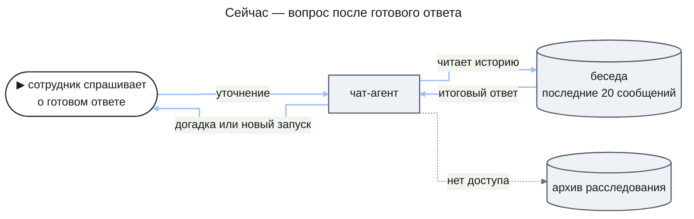
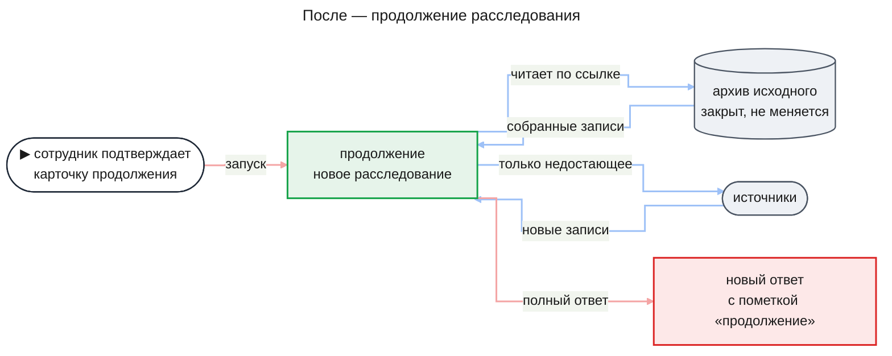

# PRD: Вопросы и продолжение по законченному расследованию (research-followup)

| Status | Date | Depth | UXRD | Designs |
|---|---|---|---|---|
| Approved | 2026-11-14 | full | не нужен: уточнения — обычные сообщения чата. Продолжение вносит небольшие видимые правки в сегодняшние карточку предложения и ответ расследования: карточка называет вид запуска и показывает, что устарела, ответ продолжения несёт пометку «продолжение» и ссылку на исходный ответ. Эти правки и их тексты принадлежат части `continuation` и её дизайну | — |

## Snapshot

**Overview.** Сейчас после глубокого расследования в беседу возвращается только итоговый ответ. Всё, что расследование собрало и решило по пути, лежит в базе, но чат-агент этого не видит. На вопрос «покажи строки логов для пункта 2» он либо угадывает, либо предлагает новое платное расследование, хотя данные уже собраны. Фича даёт чат-агенту доступ на чтение к архиву законченных расследований своей беседы. Агент отвечает на уточнения из архива по цене обычного сообщения. Если в архиве ответа нет, а вопрос дополняет законченное расследование, агент предлагает продолжение: новое расследование, которое берёт уже собранное и собирает только недостающее. Вопрос на новую тему запускает обычное расследование, как сегодня.

- **Для кого**: сотрудник, который запустил расследование и хочет разобраться в ответе или копнуть дальше.
- **Что не меняется**: законченное расследование не возобновляется и не меняется; ни продолжение, ни новое расследование не стартуют без подтверждения карточки или явного выбора ресерча сотрудником; права на источники проверяются при каждом новом обращении к источнику.
- **Части**: `archive-read` → `continuation`.
- **Не входит**: вопросы из другой беседы, уточнения по остановленному или упавшему расследованию, проверка ссылок кодом в ответах на уточнения, поиск по словам в архиве.
- **Главный риск**: в ответе на уточнение модель может сослаться на запись, которая утверждение не подтверждает; такой риск принят ([Risks](#risks)).
- **Открытые вопросы**: нет.

## Terms

Пример везде один: сотрудник спросил в чате «почему вчера вечером не прошли оплаты заказов?», и расследование ответило, что с 19:40 до 20:15 `payment-api` отвечал ошибками timeout.

- **Расследование** — глубокое исследование, которое чат запускает по вопросу сотрудника; его ведут агенты в фоне, а ответ приходит в беседу отдельным сообщением ([deep-research/prd.md](../deep-research/prd.md)).
- **Законченное расследование** — расследование в статусе «завершено»: оно дало ответ с любым исходом — «отвечено», «частично» или «нет вывода». Остановленное сотрудником и упавшее расследования законченными не считаются ([ADR-0006](../../adr/ADR-0006-investigation-final-states.md)).
- **Запись** — то, что расследование получило из источника, например строка лога `payment-api` в 19:41 с ошибкой timeout. У записи сохранено происхождение: источник, инструмент, параметры запроса и время сбора.
- **Утверждение** — короткий вывод расследования со ссылками на записи, например «`payment-api` отвечал timeout с 19:40 до 20:15». Проверяющий агент оценивает каждое утверждение — подтверждено, опровергнуто, данных не хватило или причинное (причинное проверкой не устанавливается) — и отмечает, какие записи его подтверждают, а какие ему противоречат.
- **Controller-агент** — главный агент расследования, который на каждом шаге решает, что делать дальше: какую ветку плана взять, что проверить, когда писать ответ.
- **Архив расследования** — всё, что законченное расследование сохранило: план и его ревизии, утверждения с оценками, решения controller-агента, в том числе отклонённые, с причинами, память расследования и записи.
- **Память расследования** — заметки агентов одного расследования: что выяснено, что пробовали, что не сработало ([agent-runtime/prd.md](../agent-runtime/prd.md#terms)).
- **Уточнение** — вопрос сотрудника о законченном расследовании в той же беседе: «покажи строки», «почему отброшена версия про деплой», «перепиши короче».
- **Продолжение** — новое расследование, связанное с законченным: оно читает собранные тем записи и собирает только то, чего не хватает. Законченное расследование при этом остаётся закрытым.
- **Цепочка** — законченное исходное расследование и все его продолжения, включая продолжения продолжений.
- **Карточка предложения** — сообщение чат-агента с целью и оценкой бюджета, которое запускает расследование только после подтверждения сотрудника (deep-research FR-19).
- **Явный режим ресерча** — сотрудник сам выбрал глубокое исследование для сообщения, и расследование стартует сразу, без карточки (deep-research FR-19).
- **Режим знаний модели** — расследование без источников: каталог сотрудника пуст, и утверждения ответа опираются на знания модели, а не на записи (deep-research FR-25, source-planning FR-09).

## Background

### Как это работает сейчас

Сотрудник задаёт вопрос, расследование идёт в фоне, ответ приходит в беседу. Дальше чат-агент знает только текст беседы, и то последние 20 сообщений. Архив расследования для него закрыт.

У чат-агента сейчас два инструмента: предложить расследование и остановить его. В сообщении с ответом нет ни опровергнутых утверждений, ни причин, по которым версии отброшены, ни строк логов — только сноски на источники. Поэтому уточнение «почему не деплой?» агент либо пересказывает своими словами, либо превращает в новое расследование. Новое расследование стоит денег и времени и заново собирает данные, которые уже лежат в архиве.

### Что изменится

Чат-агент получает инструменты, которые только читают архив законченных расследований этой беседы. Ответ на уточнение он ищет по порядку: сначала в беседе, затем в архиве. Только если ответа нет и там, агент показывает карточку продолжения.

```mermaid
---
title: "После — уточнение из архива"
config:
  theme: base
  look: classic
  themeVariables:
    primaryColor: "#eef1f5"
    primaryBorderColor: "#4b5563"
    primaryTextColor: "#1a1a1a"
    lineColor: "#6b7280"
  flowchart:
    curve: step
  themeCSS: |
    @keyframes litr_arch{0%,15%{stroke:#1d4ed8;stroke-width:6px}16.67%,100%{stroke:#9ec1f7;stroke-width:2px}}
---
flowchart LR
    entry(["▶ сотрудник спрашивает<br/>о готовом ответе"])
    chat["чат-агент"]
    tools["чтение архива<br/>только чтение, порциями"]
    archive[("архив расследования")]
    card["карточка продолжения"]
    entry e1@-->|"уточнение"| chat
    chat e2@-->|"запрос с фильтром"| tools
    tools e3@-->|"читает"| archive
    archive e4@-->|"записи, решения"| tools
    tools e5@-->|"одна порция"| chat
    chat e6@-->|"ответ с датой сбора"| entry
    chat -.->|"в архиве нет"| card
    classDef entry fill:#ffffff,stroke:#1f2937,stroke-width:1.5px,color:#1a1a1a
    classDef changed fill:#fde8e8,stroke:#dc2626,stroke-width:2px,color:#1a1a1a
    classDef new fill:#e6f4ea,stroke:#16a34a,stroke-width:2px,color:#1a1a1a
    classDef unchanged fill:#eef1f5,stroke:#4b5563,stroke-width:1.5px,color:#1a1a1a
    class entry entry
    class chat,card changed
    class tools new
    class archive unchanged
    classDef r1 stroke:#9ec1f7,stroke-width:2px,animation:litr_arch 7.2s linear 0s infinite
    classDef r2 stroke:#9ec1f7,stroke-width:2px,animation:litr_arch 7.2s linear 1.2s infinite
    classDef r3 stroke:#9ec1f7,stroke-width:2px,animation:litr_arch 7.2s linear 2.4s infinite
    classDef r4 stroke:#9ec1f7,stroke-width:2px,animation:litr_arch 7.2s linear 3.6s infinite
    classDef r5 stroke:#9ec1f7,stroke-width:2px,animation:litr_arch 7.2s linear 4.8s infinite
    classDef r6 stroke:#9ec1f7,stroke-width:2px,animation:litr_arch 7.2s linear 6s infinite
    class e1 r1
    class e2 r2
    class e3 r3
    class e4 r4
    class e5 r5
    class e6 r6
```

Решает, хватает ли архива, модель: она читает порции, просит следующие и оценивает, есть ли ответ. Код задаёт границы: какие расследования агенту видны, сколько данных приходит за одно чтение и что ничего не запускается без подтверждения карточки или явного выбора ресерча.

Продолжение — отдельное расследование. Законченное расследование окончательно и не возобновляется ([ADR-0006](../../adr/ADR-0006-investigation-final-states.md)), поэтому сотрудник подтверждает карточку, и стартует новое расследование со ссылкой на исходное.

Продолжение запускается только для дополнения. Когда нужен новый сбор, модель оценивает, дополняет ли вопрос законченное расследование беседы или открывает новую тему. Дополнение идёт в цепочку исходного расследования, а новая тема запускает обычное расследование без связи; карточка говорит, что из двух она запустит. Так же решается и в явном режиме ресерча, где карточки нет.

Новый ответ приходит в беседу отдельным сообщением рядом с исходным, а исходное сообщение остаётся как было. Продолжение строит ответ от утверждений, которые исходное расследование уже подтвердило, а не пишет его с нуля.

### Как это выглядит в беседе

1. Сотрудник: «Покажи строки логов, на которых основан пункт 2». Агент отвечает строками из архива в блоке кода, называет источник, номер сноски исходного ответа и время сбора: «собрано вчера в 21:05».
2. Сотрудник: «Почему ты решил, что дело не в деплое?». Агент опирается на сохранённое: утверждение «деплой `payment-api` шёл в 19:30» проверяющий агент опроверг, потому что запись деплоя говорит о 18:10, за полтора часа до первой ошибки. Саму причинную версию «ошибки из-за деплоя» проверка не подтверждает и не опровергает, и агент говорит это прямо. Если в архиве нет ничего о версии, агент так и говорит и уточняет, что именно интересует сотрудника.
3. Сотрудник: «А что в это время было в бэк-офисе с заказами?». Бэк-офис расследование не читало. Агент говорит об этом прямо и показывает карточку с целью и оценкой бюджета, где запуск назван продолжением расследования об оплатах. После подтверждения приходит новый полный ответ с пометкой «продолжение».
4. Сотрудник: «Теперь разберись, почему тормозит поиск по каталогу». Это новая тема: карточка называет запуск новым расследованием, без связи с расследованием об оплатах.

### Почему сейчас

Расследование тратит основные деньги на сбор и проверку данных, а после ответа эти данные никак не используются. Исследования 2026 года показывают, что агент, который переписывает отчёт целиком в ответ на уточнение, теряет 16–27 % ранее покрытого содержания (Mr Dre, ACL 2026). Агент, который правит только затронутые места и ищет только для них, выигрывает и у переписи, и у нового исследования с нуля (ScaffoldAgent, 2026). Публично ни один продукт deep research не описывает, как уточнения переиспользуют собранные данные; подробности и источники — в [research_followup_study.md](../../side_reserch/research_followup_study.md), разделы 1–2.

## Users and Use Cases

### Users

- **Сотрудник, запустивший расследование** — аналитик, SRE или менеджер. Ему важно понять, на чём основан ответ, и не платить второй раз за уже собранные данные.

### Use Cases

- **UC-1**: Сотрудник просит показать записи, на которых основано утверждение ответа → получает строки из архива с источником и временем сбора, без нового расследования, так что может проверить вывод сам. Covers FR-01, FR-02, FR-04.
- **UC-2**: Сотрудник спрашивает, почему версия отброшена, каким был план или что расследование пробовало → получает записи, которые противоречат версии, и сохранённые решения о ней, а если их нет — честное «в архиве этого нет» и встречный вопрос, так что не принимает догадку модели за факт. Covers FR-02.
- **UC-3**: Сотрудник просит переписать ответ короче или под другим углом → получает новый текст из уже проверенных утверждений, так что может переслать его коллегам без нового запуска. Covers FR-03.
- **UC-4**: Сотрудник спрашивает о том, чего расследование не собирало → агент говорит, чего нет в архиве, и предлагает продолжение карточкой; после подтверждения сотрудник получает полный обновлённый ответ, за который заплачено только недостающим сбором. Covers FR-05, FR-08–FR-12.
- **UC-5**: Сотрудник задаёт уточнение по расследованию в режиме знаний модели → получает ответ из сохранённых утверждений и плана с пометкой «знания модели» и узнаёт, что строк логов нет. Covers FR-06.
- **UC-6**: Сотрудник в той же беседе спрашивает о новой теме → карточка называет запуск новым расследованием, а не продолжением, так что сотрудник знает, что данные прежних расследований не переиспользуются и предел продолжений не тратится. Covers FR-08.

## Functional Requirements

### Must Have (MVP)

- **FR-01. Уточнения по законченным расследованиям своей беседы.** Чат-агент видит список законченных расследований той беседы, в которой идёт разговор, и читает их архив. Чужие беседы и чужие расследования ему недоступны. Ответ на уточнение — обычное сообщение чата: он не запускает расследование, не обращается к источникам и стоит как обычное сообщение.
  - AC-01.1: Given в беседе есть законченное расследование, а его ответ вышел за пределы последних 20 сообщений, When сотрудник спрашивает о нём, Then агент находит это расследование и отвечает из его архива.
  - AC-01.2: Given агент ответил на уточнение из архива, Then у беседы не появилось нового расследования, в аудите нет новых вызовов источников, а расход записан как у обычного сообщения чата.
  - AC-01.3: Given расследование запущено в другой беседе этого же сотрудника или принадлежит другому сотруднику, When агент пытается прочитать его архив, Then чтение отказано и никаких данных этого расследования агент не получает.
- **FR-02. Ответ из архива.** По уточнению агент показывает то, что расследование сохранило: записи под утверждением с их источником и временем сбора, опровергнутые утверждения с записями, которые им противоречат, план и его ревизии, решения controller-агента с причинами отклонения и память расследования. Строки логов агент приводит в блоке кода и ссылается на номера источников исходного ответа. Архив только читается: ни уточнение, ни поправка сотрудника не меняют утверждения и исходный ответ.
  - AC-02.1: Given у утверждения ответа есть записи, When сотрудник просит их показать, Then агент приводит строки этих записей, их источник и время сбора.
  - AC-02.2: Given утверждение опровергнуто, When сотрудник спрашивает, почему версия отброшена, Then агент называет записи, которые утверждению противоречат, и решения controller-агента об этой версии с их причинами, если они сохранены.
  - AC-02.3: Given версия не проверялась как утверждение и в решениях controller-агента о ней ничего нет, When сотрудник о ней спрашивает, Then агент говорит, что в архиве этого нет, и переспрашивает, а не придумывает причину.
  - AC-02.4: Given сотрудник оспаривает утверждение («деплой был в 14:00, а не в 15:00»), Then утверждения архива и исходный ответ не меняются, а агент отвечает по данным архива и, если их не хватает, предлагает продолжение (FR-05).
  - AC-02.5: Given право сотрудника на источник отозвано после сбора записей, When он просит показать эти записи, Then агент их показывает: собранное в этой беседе остаётся доступным в ней.
  - AC-02.6: Given ответ на уточнение опирается на записи архива, Then в ответе названа дата их сбора.
- **FR-03. Переоформление ответа.** Сотрудник может попросить ответ короче, в другом виде или с другим фокусом. Агент собирает новый текст из сохранённых утверждений расследования и присылает его сообщением чата.
  - AC-03.1: Given законченное расследование в беседе, When сотрудник просит «перепиши короче, только про причину», Then приходит новое сообщение из утверждений этого расследования, исходное сообщение с ответом не меняется, а новое расследование не запускается.
- **FR-04. Чтение порциями и по полям.** Одно чтение архива возвращает ограниченную порцию. Если подходящих данных больше, агент видит это и сам просит следующую порцию. Агент сужает выборку только по полям и идентификаторам: источник, страница записей, записи под утверждением, интервал времени. Поиска по словам в архиве нет.
  - AC-04.1: Given под условие подходит больше записей, чем входит в одну порцию, When агент читает архив, Then он получает первую порцию и признак, что есть продолжение, а следующее чтение возвращает следующую порцию без повторов.
  - AC-04.2: Given сотрудник просит «покажи ещё», When агент показал часть строк, Then следующие строки приходят следующим сообщением без повтора уже показанных.
- **FR-05. Предложение продолжения, когда архива не хватает.** Если ответа нет ни в беседе, ни в архиве, агент говорит, что именно расследование не собирало, и показывает карточку предложения с целью и оценкой бюджета. Без подтверждения ничего не запускается.
  - AC-05.1: Given расследование не читало бэк-офис, When сотрудник спрашивает о заказах в бэк-офисе, Then агент говорит, что бэк-офис в этом расследовании не читали, и показывает карточку с целью и оценкой бюджета, а расследования не появляется, пока сотрудник её не подтвердил.
- **FR-06. Уточнения по расследованию в режиме знаний модели.** По такому расследованию агент отвечает из сохранённых утверждений, плана и решений и помечает их как знания модели. На просьбу показать записи агент отвечает, что записей нет: расследование шло без источников.
  - AC-06.1: Given законченное расследование в режиме знаний модели, When сотрудник просит показать строки логов, Then агент отвечает, что записей нет, потому что расследование шло без источников, и не выдаёт ничего за записи.
  - AC-06.2: Given то же расследование, When сотрудник спрашивает, почему сделан вывод, Then агент отвечает из сохранённых утверждений и плана с пометкой «знания модели».
- **FR-07. Только законченные расследования.** Уточнения и продолжения принимает только законченное расследование, с любым исходом ответа. Идущее, остановленное и упавшее расследования архив для уточнений не открывают.
  - AC-07.1: Given расследование остановлено сотрудником или упало, When сотрудник просит показать его записи, Then агент получает отказ и говорит, что уточнения по остановленному или упавшему расследованию не поддерживаются.
  - AC-07.2: Given расследование закончилось с исходом «нет вывода», When сотрудник спрашивает, что успели проверить, Then агент отвечает из архива, как по любому законченному расследованию.
- **FR-08. Дополнение — в продолжение, новая тема — в новое расследование.** Когда для ответа нужен новый сбор, чат-агент оценивает, дополняет ли вопрос законченное расследование этой беседы или открывает новую тему. Дополнение запускает продолжение — новое расследование со ссылкой на законченное, в его цепочке. Новая тема запускает обычное расследование без связи, как сегодня (deep-research FR-19), и в предел продолжений не входит. Карточка предложения называет, что из двух она запустит; в явном режиме ресерча действует та же оценка, только запуск идёт без карточки. Оценивает модель, а правила цепочки (FR-11) проверяет код. Сегодня у карточки один заголовок для любого запуска; теперь она называет вид запуска — продолжение или новое расследование — и показывает, что устарела (FR-12).

  Законченное расследование остаётся закрытым, а его архив и ответ не меняются. Продолжение идёт как обычное расследование: беседа показывает, что оно идёт, его можно остановить, у него свой бюджет, показанный на карточке, и свой каталог источников, собранный при запуске по текущим правам сотрудника.
  - AC-08.1: Given карточка продолжения показана, When сотрудник её подтверждает, Then стартует новое расследование, связанное с исходным, в пределах показанного бюджета, а статус, архив и ответ исходного расследования не меняются.
  - AC-08.2: Given после исходного расследования у сотрудника отозвано право на источник, When идёт продолжение, Then продолжение к этому источнику не обращается, а записи, собранные из него исходным расследованием, читает и использует как остальные.
  - AC-08.3: Given исходное расследование шло в режиме знаний модели, а теперь у сотрудника есть разрешённые источники, When он подтверждает продолжение, Then продолжение собирает каталог при запуске и идёт по источникам.
  - AC-08.4: Given в беседе законченное расследование об оплатах, When сотрудник спрашивает, что в тот же вечер было с заказами в бэк-офисе, Then карточка называет запуск продолжением этого расследования.
  - AC-08.5: Given сотрудник спрашивает о теме, которую законченные расследования беседы не дополняют, Then карточка называет запуск новым расследованием, а после подтверждения стартует расследование без связи с прежними, и счётчик продолжений ни одной цепочки не растёт.
  - AC-08.6: Given сотрудник явно выбрал ресерч и спросил то, что дополняет законченное расследование беседы, When он отправил сообщение, Then стартует связанное продолжение этого расследования, а не расследование без связи.
- **FR-09. Продолжение берёт уже собранное.** Продолжение видит записи всей цепочки — исходного расследования и прежних продолжений, в том числе остановленных и упавших, — и может опереться на них в ответе. Уточнения по самому остановленному или упавшему продолжению при этом закрыты (FR-07). Что собрать заново, а что взять из собранного, решают агенты продолжения; насколько хорошо они избегают повторов, проверяется ручными прогонами ([Success Criteria](#success-criteria)).
  - AC-09.1: Given исходное расследование собрало логи `payment-api` за 19:40–20:15, When идёт продолжение о бэк-офисе за тот же вечер, Then агенты продолжения могут прочитать эти записи, а ответ продолжения ссылается на них с их временем сбора.
  - AC-09.2: Given прежнее продолжение цепочки собрало записи и было остановлено сотрудником или упало, When идёт следующее продолжение этой цепочки, Then его агенты могут прочитать эти записи.
- **FR-10. Полный обновлённый ответ новым сообщением.** Продолжение присылает в беседу полный ответ отдельным сообщением с пометкой «продолжение» и ссылкой на исходный ответ; сегодняшнее сообщение с ответом расследования ни пометки, ни такой ссылки не показывает. Ответ продолжения подчиняется тем же правилам ссылок на записи, что и любой ответ расследования. Продолжение строит его от утверждений, которые цепочка уже подтвердила, и не теряет их.
  - AC-10.1: Given продолжение закончилось, Then в беседе появилось новое сообщение с ответом, помеченное «продолжение» и связанное с исходным ответом, а исходное сообщение не изменилось.
  - AC-10.2: Given ответ расследования, которое продолжают, содержал подтверждённые утверждения, которые цепочка после него не опровергла, Then каждое из них есть среди подтверждённых в ответе продолжения.
- **FR-11. Цепочка: одно продолжение за раз и не больше четырёх.** Пока продолжение цепочки идёт, агент не предлагает новое продолжение этой цепочки и говорит, что нужно дождаться его ответа. В предел четырёх входит каждое запущенное продолжение цепочки, в том числе остановленное и упавшее: они уже потратили бюджет. После четвёртого агент новых продолжений по цепочке не предлагает и говорит, что предел достигнут. В явном режиме ресерча правила те же: связанное продолжение не стартует, а агент называет причину.
  - AC-11.1: Given у исходного расследования уже четыре продолжения, When сотрудник спрашивает то, что дополняет эту цепочку, и архива не хватает для ответа, Then агент говорит, что предел продолжений достигнут, и карточку продолжения не показывает.
  - AC-11.2: Given у исходного расследования четыре продолжения, одно из них остановлено сотрудником, а другое упало, When сотрудник спрашивает то, что дополняет эту цепочку, и архива не хватает для ответа, Then агент говорит, что предел достигнут, и карточку продолжения не показывает.
  - AC-11.3: Given продолжение цепочки идёт, When сотрудник спрашивает то, что дополняет эту цепочку и требует нового сбора, Then агент говорит дождаться ответа идущего продолжения и карточку продолжения не показывает.
  - AC-11.4: Given продолжение цепочки идёт или предел цепочки достигнут, When сотрудник явно выбрал ресерч и отправил вопрос, дополняющий эту цепочку, Then продолжение не стартует, а агент говорит почему.
- **FR-12. Подтверждение действует для своей версии карточки.** Подтверждение запускает ровно то, что показала карточка. Если после её показа у цепочки появилось новое продолжение, старая карточка уже ничего не запускает; новую карточку агент предлагает, когда это продолжение закончится (FR-11).
  - AC-12.1: Given карточка продолжения показана, а после этого по той же цепочке запущено другое продолжение, When сотрудник подтверждает старую карточку, Then по ней ничего не запускается, а агент говорит, что карточка устарела.
  - AC-12.2: Given карточка продолжения уже подтверждена, When сотрудник подтверждает её повторно, Then второе продолжение не запускается.

### Should Have

Нет: всё, что нужно сотруднику в этой фиче, входит в Must Have.

### Could Have

Нет.

### Won't Have

- Уточнения из другой беседы или по ссылке на расследование — не эта фича: тогда пришлось бы решать, кто ещё может читать собранные данные. Удаление беседы удаляет её расследования целиком, как сегодня.
- Уточнения и продолжения по остановленному или упавшему расследованию — не эта фича: у них нет ответа, от которого можно продолжить.
- Добавить работу в идущее расследование или продолжение — не эта фича, а `chat-steering`: пока продолжение цепочки идёт, агент просит дождаться его ответа (FR-11).
- Возврат законченного расследования в работу — никогда: законченное расследование окончательно ([ADR-0006](../../adr/ADR-0006-investigation-final-states.md)); продолжение — всегда новое расследование.
- Проверка кодом ссылок и чисел в ответе на уточнение — не эта фича: ответ на уточнение — свободный текст чата, а гарантия ссылок на записи остаётся у ответов расследования. Риск принят ([Risks](#risks)).
- Повторная проверка прав при чтении уже собранных записей — не эта фича: права проверяются при обращении к источнику (source-planning FR-08), а собранное в беседе остаётся доступным в ней.
- Поиск по словам и поисковый указатель над архивом — позже: в этой фиче достаточно фильтров по полям.
- Проверка, изменились ли данные в источнике после сбора, и предложение пересобрать — позже: агент называет дату сбора, а решение пересобрать остаётся за сотрудником.
- Раздел «отброшено» в ответе расследования — не нужен: отброшенное агент показывает по вопросу.
- Отдельная запись «гипотеза» — не нужна: на «почему отброшено» агент отвечает по оценкам утверждений и решениям controller-агента.
- Новые экраны, отчёт как документ с версиями, блок «что изменилось» — позже: продолжение использует сегодняшние карточку и ответ с небольшими правками (FR-08, FR-10, FR-12).
- Отдельная модель для уточнений — позже: на уточнения отвечает обычная модель чата.
- Учёт расхода уточнений в счёт расследования — не нужен: уточнение стоит как обычное сообщение чата.

## Non-Functional Requirements

### Security

- **NFR-01**: Сотрудник читает архив только своих расследований из той беседы, где они запущены. Как проверить: e2e-тест с двумя сотрудниками и двумя беседами одного сотрудника — 0 случаев, когда агент получил данные чужого расследования или расследования другой беседы (бизнес-ограничение 2).

### Performance

- Требований сверх общих для проекта нет; размер одного чтения архива задан в [Constraints](#constraints).

## Delivery Parts

| Part | Covers | Cut along | Depends on | Rationale |
|------|--------|-----------|------------|-----------|
| `archive-read` | FR-01, FR-02, FR-03, FR-04, FR-05, FR-06, FR-07 | domain | — | Чат получает доступ на чтение к данным движка: новый шов между беседой и расследованием без запуска задач. |
| `continuation` | FR-08, FR-09, FR-10, FR-11, FR-12 | domain | `archive-read` | Продолжение меняет жизнь расследования — связь с исходным, чтение чужих записей, ответ от прежних утверждений — и опирается на чтение архива и карточку из первой части. Сюда же входят правки сегодняшних карточки и ответа в вебе: вид запуска, состояние устаревшей карточки, пометка «продолжение» со ссылкой на исходный ответ. |

Пока строится только `archive-read`, подтверждённая карточка из FR-05 запускает обычное новое расследование, как сегодня. Связь с исходным и переиспользование собранного добавляет `continuation`.

## Success Criteria

- Новые расследования ради уточнений, на которые отвечает архив, — 0 из всех уточнений, которые владелец задаёт вручную на законченных расследованиях; читается по списку расследований беседы после прогона.
- Стоимость продолжения меньше стоимости нового расследования по тому же расширенному вопросу; сравнивается по журналу токенов движка на ручных прогонах, где владелец запускает оба варианта.
- Продолжение не запрашивает из источника заново то, что цепочка уже собрала тем же инструментом с теми же параметрами, — 0 таких повторов на ручных прогонах; читается по аудиту вызовов продолжения.

## Constraints and Risks

### Constraints

- Проект — прототип: одна версия всего, без обратной совместимости и без миграций существующих записей.
- Законченное расследование окончательно; продолжение — новое расследование со ссылкой на исходное ([ADR-0006](../../adr/ADR-0006-investigation-final-states.md)).
- Продолжение читает записи цепочки по ссылке и не копирует их.
- Одно чтение архива возвращает не больше 16 KiB, дальше — по курсору следующей порции; это тот же предел, что у инструмента чтения данных расследования у агентов.
- Сужение выборки — только фильтрами по полям и идентификаторам; поиска по словам в коде нет. Принцип: модель оценивает, алгоритм решает.
- На уточнения отвечает обычная модель чата.
- Права на собранные записи при чтении не проверяются заново (source-planning FR-08); продолжение собирает свой каталог при запуске по текущим правам, как любое расследование (source-planning FR-04).
- Для режима знаний модели ничего специального не добавляется: чего нет в каталоге, того нет (source-planning, Constraints).

### Assumptions

- `source-planning` с каталогом источников и правами попадёт в `main` раньше, чем начнётся дизайн `continuation`; сейчас фича в ветке `feat/source-planning` (PR #7). Проверяется перед дизайном `continuation`.
- Модель чата умеет листать порции архива и выбирать фильтры, а не бросает выдачу на первой странице. Проверяется ручными прогонами `archive-read` на нескольких законченных расследованиях.

### Risks

| Risk | Impact | Probability | Mitigation |
|------|--------|-------------|------------|
| В ответе на уточнение модель ссылается на запись, которая утверждение не подтверждает: у deep research точность цитат 40–80 % (DeepTRACE, ICLR 2026) | Medium | High | Принят. Строки агент приводит из архива как есть, с источником и датой; гарантия ссылок остаётся у ответов расследования, включая продолжение |
| Ответ продолжения теряет то, что было в исходном: перепись отчёта теряет 16–27 % содержания | High | Medium | Продолжение строит ответ от подтверждённых утверждений цепочки (AC-10.2) |
| Модель рано решает, что в архиве ответа нет, и предлагает лишнее платное продолжение | Medium | Medium | Порция сообщает, что есть ещё данные; запуск только после подтверждения карточки с бюджетом |
| Модель путает дополнение и новую тему: продолжение не берёт нужное собранное или тратит предел цепочки на чужую тему | Medium | Medium | Карточка называет, что она запустит, и сотрудник может её отклонить |
| Запись из источника содержит текст-инструкцию для модели (prompt injection) | Medium | Low | Инструменты архива только читают; любой запуск требует подтверждения сотрудника |
| Данные устарели: логи догрузились или изменились после сбора | Low | Medium | Агент всегда называет дату сбора, а пересобрать решает сотрудник |

### Расхождения с соседними документами

Эти документы описывают продолжение и доступ к архиву иначе; действует этот PRD.

- [agent-runtime/prd.md](../agent-runtime/prd.md), FR-03: «память видна только агентам этого расследования». Законченное расследование открывает свою память на чтение чат-агенту своей беседы (FR-02).
- [agent-quality/design-overview.md](../agent-quality/design-overview.md), этап Д: «сигнал будит завершённое расследование». Законченное расследование не будится, а продолжение — новое расследование; этап Д для этой фичи не нужен.
- [research_followup_study.md](../../side_reserch/research_followup_study.md), решения 6 и 10: «то же расследование, новый раунд» и общий механизм с `chat-steering`. Заменено новым связанным расследованием.
- Там же, решение 3: порция «~200 строк или ~4 тыс. токенов». Заменено пределом в 16 KiB.
- Там же, решения 4 и 15: расход уточнений в счёт расследования и проверка ссылок в пересказе. Не принято: уточнение стоит как сообщение чата, ссылки в нём кодом не проверяются.
- Там же, раздел 5.5: «в режиме знаний модели продолжения нет». Заменено: продолжение — обычное связанное расследование со своим каталогом.
- [deep-research/prd.md](../deep-research/prd.md), Won't Have: «продолжение законченного расследования — следующая фича». Это и есть эта фича.

## Update History

| Version | Date | Change |
|---------|------|--------|
| 1.0 | 2026-11-13 | Первая версия |
| 1.1 | 2026-11-14 | Дополнение или новая тема — оценка модели, в том числе в явном режиме ресерча; правила цепочки: одно продолжение за раз, остановленные и упавшие входят в предел, записи всей цепочки доступны; открытые вопросы закрыты |
| 1.2 | 2026-11-14 | Правки карточки и ответа в вебе отнесены к `continuation`; предел цепочки — только для дополняющих вопросов; AC-10.2 опирается на расследование, которое продолжают; расхождение с agent-runtime FR-03 о памяти |
| 1.3 | 2026-11-14 | Утверждён владельцем: версия 1.2 вместе с Delivery Parts (`archive-read` → `continuation`), текст не менялся |
