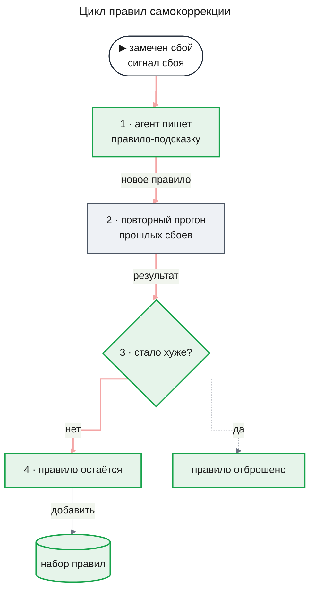

# self-correction: цикл правил самокоррекции — что показала работа Self-Healing Harness и что нужно Agent OS

Дата: 2026-11-06. Материал для будущего PRD фичи `self-correction`. Связанный документ — PRD фичи `agent-quality` ([prd.md](../features/agent-quality/prd.md)): эта фича берёт из той же работы повторный прогон и сигналы сбоя, а сам цикл правил не строит.

Маркировка: **[И]** — утверждение из работы (номер в списке источников); **[В]** — наш вывод, работой не подтверждён; **[Р]** — факт из документов репозитория.

---

## 0 Коротко

1. **Что предлагает работа.** Агент после замеченного сбоя сам пишет себе правило-подсказку. Правило проверяют повторным прогоном прошлых сбоев и оставляют, если ничего не ухудшилось [И 1].
2. **Что работа измерила.** Прирост мал и для claude-haiku-4.5 не отличим от шума; расходы на модели выше в 1,72 раза; набор правил с ростом может начать вредить; вклад самой проверки правил не выделен [И 1]. Числа — в разделе 2.
3. **Наш главный вывод.** Без проверки, отдельной от судьи, цикл учится угождать собственному судье [В].
4. **Что уже берёт `agent-quality`.** Повторный прогон и сигналы сбоя: они работают без эталона [Р].
5. **Когда цикл правил имеет смысл.** Когда есть внешняя проверка, отдельная от судьи, и базовая линия качества и цены. И то и другое даёт часть `self-check` фичи `agent-quality` [Р], [В].

---

## Простыми словами: как устроен цикл

### Слова, которые понадобятся

- **Агент** — модель плюс код вокруг неё, который даёт ей инструменты и решает, что делать с её ответом. В Agent OS расследование по логам ведут несколько таких ролей.
- **Сбой** — расследование, которое кончилось плохо: неверный вывод, остановка без ответа, отсеянная большая часть утверждений.
- **Сигнал сбоя** — признак сбоя, видимый без правильного ответа. Пример: судья поставил низкую оценку, или controller (роль «руководитель расследования») раз за разом выбирал недопустимое действие.
- **Правило-подсказка** — короткая инструкция, которую агент пишет сам себе после сбоя. Пример, придуманный нами: «прежде чем назвать причину, посмотри записи соседнего сервиса».
- **Повторный прогон (replay)** — сохранённое расследование запускается заново на тех же данных. Модель каждый раз отвечает немного по-разному, поэтому повтор — новый прогон, а не воспроизведение старого.
- **Судья** — отдельный вызов модели, который оценивает результат агента.
- **Внешняя проверка** — способ узнать правильный ответ, который не зависит от судьи. В Agent OS это ключ ответа: генератор сценариев сам закладывает в учебные логи причину и знает, какой ответ верный.
- **Базовая линия** — замер качества и цены текущей системы до изменения. От неё отсчитывают, стало лучше или хуже.

### Цикл по шагам

Цикл запускается от сбоя и кончается тем, что правило остаётся в наборе или отбрасывается.

Серое звено — то, что уже строит `agent-quality`: повторный прогон. Сигналы сбоя, от которых цикл запускается, тоже даёт она. Зелёное — то, что добавила бы фича `self-correction`: запись правила, решение оставить его и сам набор правил.

Слабое место видно на шаге 3. Кто-то должен решить, «стало ли хуже». Если это решает тот же судья, по оценкам которого замечен сбой, цикл подбирает правила под вкус судьи, а не под правильный ответ.

---

## 1 Что делает работа

Работа [Self-Healing Harness](https://arxiv.org/abs/2609.24130) [И 1] описывает обвязку агента, которая чинит себя сама. После замеченного сбоя агент пишет правило-подсказку. Правило проверяют повторным прогоном прошлых сбоев, и оно остаётся, только если ничего не ухудшилось. Набор правил растёт от сбоя к сбою.

Повторный прогон и сигналы сбоя в этой обвязке работают без эталона, то есть без заранее известного правильного ответа. Но чтобы узнать, помогает ли изменение вообще, авторы мерили результат отдельными проверками, а не тем судьёй, что вёл систему [И 1].

Работа прочитана целиком по оригиналу.

---

## 2 Что работа измерила [И 1]

Все числа ниже — измерения из работы.

- **Прирост мал.** Авторы прогоняли несколько моделей на нескольких наборах задач; каждая пара «модель × набор задач» — одна модель на одном наборе. Из 16 таких пар только в двух интервал прироста не включает ноль, то есть прирост отличим от шума. Для claude-haiku-4.5 — ни в одной из четырёх.
- **Цена высока.** Расходы на модели — в 1,72 раза больше, время — в 1,7–7 раз.
- **Правила копятся и могут вредить.** В одной конфигурации эффект снижался с ростом набора с 13 до 70 правил и в конце стал отрицательным, хотя каждое правило прошло проверку по отдельности.
- **Вклад самой проверки правил не выделен.** Сравнение с вариантом без неё авторы спроектировали, но не запускали.

---

## 3 Что вывод работы, а что наш

**Вывод работы [И 1].** Цикл правил даёт малый прирост за заметную цену. Набор правил, каждое из которых по отдельности прошло проверку, вместе может ухудшать результат. Пользу изменения авторы мерили отдельными проверками, не тем судьёй, что вёл систему.

**Наши выводы [В].**

- **Нужна внешняя мерка.** Без проверки, отдельной от судьи, цикл учится угождать собственному судье. Это следует из устройства работы, сами авторы такого опыта не ставили.
- **Для наших ролей прирост под вопросом.** Роли Agent OS работают на моделях Claude Sonnet и Haiku [Р], а для claude-haiku-4.5 работа не нашла прироста, отличимого от шума.
- **Сначала мерка, потом цикл.** Цикл правил не входит в `agent-quality` и становится следующей фичей `self-correction` [Р]. Её стоит начинать, когда в Agent OS уже есть внешняя проверка и базовая линия.

---

## 4 Что `agent-quality` берёт из работы уже сейчас [Р]

`agent-quality` берёт то, что работает без эталона.

- **Повторный прогон.** Сохранённое расследование запускается заново на том же срезе учебных логов, с той же конфигурацией или с другой моделью в одной роли (FR-02 в PRD `agent-quality`).
- **Сигналы сбоя.** На расследованиях без ключа разработчик видит низкую оценку судьи, долю отсеянных утверждений, отклонённые решения controller и причину остановки (FR-07 там же).

Сверх этого `agent-quality` строит то, чего в цикле правил не хватает: ключ ответа от генератора сценариев и сравнение с ключом алгоритмом, без судьи там, где хватает идентификаторов (FR-03, FR-04 там же).

---

## 5 Что нужно фиче `self-correction` до старта

### Условие входа (источник — эта заметка)

Фича `self-correction` начинается, когда выполнены три условия:

1. Часть `self-check` фичи `agent-quality` выпущена.
2. Сценариев с заложенным ответом хватает на защищённый набор.
3. Есть базовая линия качества и стоимости текущей конфигурации.

**Защищённый набор** [В] — сценарии, которые цикл правил не видит, пока пишет и отбирает правила. На них только меряют, помогает ли набор правил. Так правило не может подстроиться под ту самую проверку, которой его оценивают.

### Внешняя проверка, отдельная от судьи [В]

Решение «стало хуже или нет» на шаге 3 цикла должно опираться на ключ ответа, а не на оценку судьи. В Agent OS такой ключ даёт генератор сценариев: он сам закладывает причину в учебные логи и знает верный ответ. Исход ответа и идентификаторы записей с ключом сравнивает алгоритм, без модели.

### Базовая линия от самопроверки [Р]

Самопроверка `agent-quality` после выпуска называет для текущей конфигурации долю решённых сценариев, долю честных отказов, стоимость решённого сценария и роль, которая чаще ошибается первой. От этой линии `self-correction` отсчитывает, помогает ли цикл и сколько он стоит.

### Что проверить в первую очередь [В]

Эти вопросы следуют из того, что работа измерила, и ждут PRD фичи `self-correction`.

- **Вклад проверки правил.** Сравнить цикл с вариантом, где правила оставляют без повторного прогона. В работе такое сравнение спроектировано, но не запущено.
- **Рост набора правил.** Следить за эффектом по мере роста набора и решить, как набор чистится. В работе эффект стал отрицательным при росте с 13 до 70 правил.
- **Цена.** Сравнить прирост с ростом расходов относительно базовой линии. В работе расходы на модели выросли в 1,72 раза.

---

## 6 Источники

1. Self-Healing Harness — https://arxiv.org/abs/2609.24130 (прочитана целиком по оригиналу)
