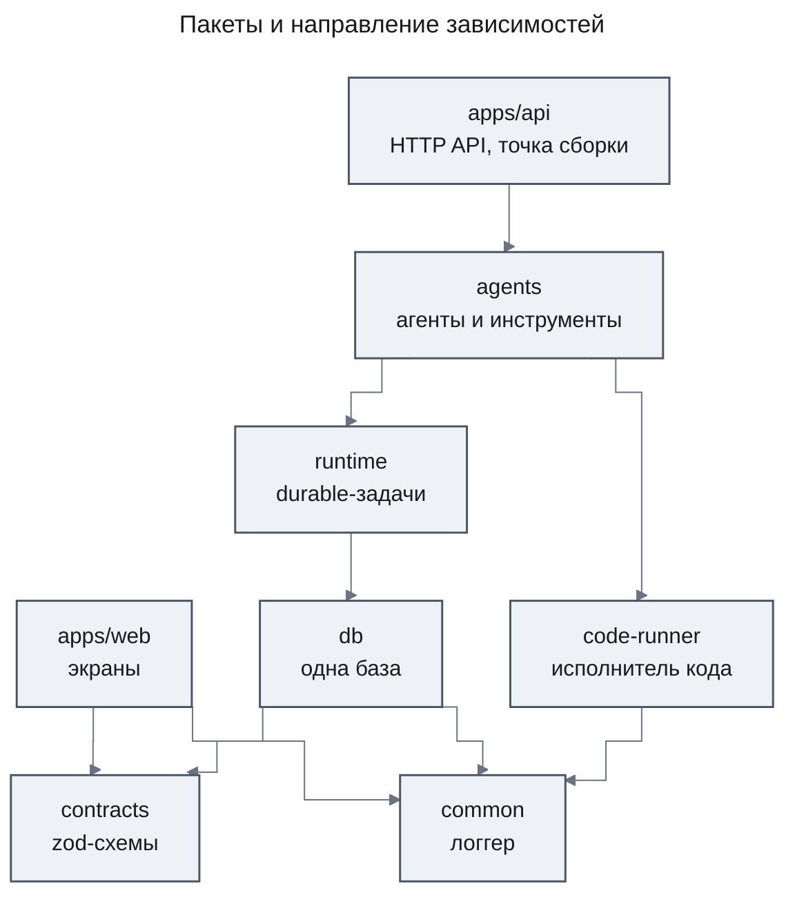

# Code System

Карта кода Agent OS: из чего состоит система, какие правила действуют везде и где искать подробности. Начните с этого файла, затем откройте файл пакета, в котором работаете, и паттерн своей задачи.

## Source

| Source | Link | Covers |
|---|---|---|
| Выведено из кода | `packages/*`, `apps/api`, `apps/web`, прочитаны 2026-11-22 | слои, раскладка пакетов, репозиторий и сервис, модули NestJS |
| Решения владельца | [agent-platform/prd.md](../features/agent-platform/prd.md), Constraints; [CLAUDE.md](../../CLAUDE.md), Code rules и Logging | слои `runtime ← agents ← приложения`, общий пакет `common`, логирование |
| ADR | [ADR-0001](../adr/ADR-0001-durable-runtime-owner.md), [ADR-0003](../adr/ADR-0003-drizzle-data-layer.md), [ADR-0004](../adr/ADR-0004-agent-framework-packages.md), [ADR-0022](../adr/ADR-0022-one-database-and-nestjs-modules.md) | runtime — владелец состояния задач; Drizzle и миграции; правила приватных пакетов; одна база и модули NestJS |
| Design Docs | раздел Used In каждого паттерна | паттерны каталога |

## Style

Самый простой код, который делает работу, и одно место для каждой логики и каждого значения. Пакет — граница логики: правила своей области он держит в своих сервисах и отдаёт их через свой модуль NestJS. Данные лежат в одной базе, и все запросы к ней — в `packages/db`. Состояние живёт в Postgres, а не в памяти процесса, поэтому любой экземпляр сервера продолжает любую работу. Новая абстракция, опция или слой появляются, когда есть второе реальное использование. Прежде чем писать новое, ищем, что уже есть, и расширяем это.

## Layer Map

Стрелка значит «зависит от». Пакет может зависеть от любого пакета ниже себя по стрелкам; `apps/web` — только от `contracts` и `common`.

| Слой | Что держит | Где | NestJS |
|---|---|---|---|
| Приложения | HTTP API, вход, права, библиотека записей, аудит, чат; экраны | `apps/api`, `apps/web` | `apps/api` — да; `apps/web` — Next |
| Агенты | агенты и глубокие агенты, инструменты, MCP, провайдеры моделей, знания | `packages/agents` | да |
| Исполнитель кода | процесс QuickJS на один скрипт | `packages/code-runner` | нет |
| Runtime | durable-задачи шагами, сообщения, решения, трекеры, события, журнал токенов | `packages/runtime` | да |
| Данные | пул, схема `app`, миграции, репозитории всех таблиц | `packages/db` | да |
| Контракты | zod-схемы данных, пересекающих границу, и наборы значений для CHECK | `packages/contracts` | нет |
| Общее | логгер и маска секретов | `packages/common` | нет |

## Правила для всего кода

1. **Зависимость идёт только вниз** и объявлена в `package.json`. Цикл отвергает turbo, необъявленный импорт отмечает knip.
2. **У пакета один вход `.`**, а подпути закрыты; вход `./testing` допустим только для тестовых двойников. Пакеты потребляются исходным TypeScript ([ADR-0004](../adr/ADR-0004-agent-framework-packages.md), Implementation Guidance).
3. **Одна база.** Схема `app` и все репозитории лежат в `packages/db`. Любой модуль бэкенда внедряет любой репозиторий; запросов к таблицам вне `packages/db` нет ([packages/db.md](./packages/db.md)).
4. **Репозиторий — запросы, сервис — логика.** Репозиторий только читает и пишет строки в транзакции вызывающего. Сервис держит правила, открывает транзакцию и превращает строки в объекты домена ([repository-over-transaction.md](./patterns/repository-over-transaction.md)).
5. **Правило области живёт в одном месте** — в сервисе или чистой функции ([pure-decision.md](./patterns/pure-decision.md)). Другой код зовёт этот сервис и не повторяет его запрос с тем же условием: видимость записи, переход задачи, право сотрудника.
6. **Бэкенд связан через NestJS DI.** `db`, `runtime`, `agents` и `apps/api` — модули NestJS, и потребитель внедряет сервис, который зовёт. `common`, `contracts` и `code-runner` обходятся без NestJS, и lint запрещает им `@nestjs/*` ([composition-root.md](./patterns/composition-root.md)).
7. **Чужой домен приходит портом.** Пакет объявляет интерфейс порта и токен внедрения, а `apps/api` привязывает токен к своему сервису. Пакеты не импортируют `apps/api` ([composition-root.md](./patterns/composition-root.md)).
8. **Окружение читает только `apps/api`.** Пакет получает настройки из фабрики своего `forRootAsync`.
9. **Лог пишет только обёртка из `common`**, она отправляет запись в консоль и Sentry ([logging.md](./patterns/logging.md)). Sentry импортируют только приложения.
10. **Mastra объявляет только `agents`.** Корневой `.oxlintrc.json` запрещает импорт `@mastra/*` остальным пакетам и `apps/api`.

## Module Boundaries

| Модуль | Отдаёт | Кто зовёт |
|---|---|---|
| `db` | `DbModule`: клиент базы, все репозитории и типы строк, типы `Transaction` и `Executor`, функции миграций | все модули бэкенда |
| `runtime` | `RuntimeModule`: сервисы задач, сообщений, решений, трекеров, событий, журнала токенов и контракт обработчика шага | `agents`, `apps/api` |
| `agents` | `AgentsModule`: сервисы сессий агентов, реестра MCP, провайдеров моделей, эмбеддингов и знаний; интерфейсы портов, которые реализует `apps/api` | `apps/api` |
| `code-runner` | `createCodeRunner` и операция `CodeRunner.run` | только `agents` |
| `common` | логгер, токен `LOGGER`, маска и память секретов | все |
| `contracts` | zod-схемы и наборы значений | все, включая `apps/web` |
| `apps/api` | маршруты `/api/...` | `apps/web` через клиент API |

Как устроен каждый модуль внутри и какие правила действуют на его границе — в файле пакета.

## Index

### Пакеты

| Файл | О чём |
|---|---|
| [packages/db.md](./packages/db.md) | схема, репозитории, миграции, `DbModule` |
| [packages/runtime.md](./packages/runtime.md) | задачи и шаги, сообщения, события, воркеры, `RuntimeModule` |
| [packages/agents.md](./packages/agents.md) | классы агентов, шаг агента, инструменты, MCP, провайдеры, знания |
| [packages/base.md](./packages/base.md) | нижние пакеты без NestJS: `common`, `contracts`, `code-runner` |
| [packages/api.md](./packages/api.md) | модули `apps/api`: вход, права, библиотека, аудит, чат, связывание пакетов |
| [packages/web.md](./packages/web.md) | устройство `apps/web`: оболочка, клиент API, сторы, текст |

### Паттерны

**Сборка и границы**

| Pattern | Problem | Spec |
|---|---|---|
| Модуль пакета | как пакет встраивается в DI, получает настройки и порты и стартует вместе с сервером | [composition-root.md](./patterns/composition-root.md) |
| Модуль порта и модуль маршрутов | как модуль `apps/api` реализует порт для `AgentsModule` и при этом зовёт его сервисы из своих маршрутов | [port-module-split.md](./patterns/port-module-split.md) |
| Граница аутентификации API | как маршрут узнаёт сотрудника и не открывается по забывчивости | [auth-boundary.md](./patterns/auth-boundary.md) |
| Логирование через `common` | как любой код пишет лог в консоль и Sentry, не утекая секретами | [logging.md](./patterns/logging.md) |

**Данные**

| Pattern | Problem | Spec |
|---|---|---|
| Репозиторий над транзакцией | где лежат запросы к таблицам и кто открывает транзакцию | [repository-over-transaction.md](./patterns/repository-over-transaction.md) |
| Строка настроек | где живут значения, которые администратор меняет в панели для всей платформы | [settings-row.md](./patterns/settings-row.md) |
| Секрет только на запись | как администратор задаёт секрет чужой системы, который никто не может прочитать обратно | [write-only-secret.md](./patterns/write-only-secret.md) |
| Встроенная запись | как запись, которую поставляет код, попадает в базу и как до базы доходит её новое содержимое | [builtin-record.md](./patterns/builtin-record.md) |
| Снимок запуска | как идущая работа не замечает правки и удаления записи, с которой стартовала | [run-snapshot.md](./patterns/run-snapshot.md) |

**Логика и durable-работа**

| Pattern | Problem | Spec |
|---|---|---|
| Чистая функция решения | где живёт правило, которое по данным решает «можно ли» или «какой статус» | [pure-decision.md](./patterns/pure-decision.md) |
| Обработчик шага | как долгая работа переживает рестарт и продолжается на любом экземпляре | [step-handler.md](./patterns/step-handler.md) |
| Журнал событий с доставкой | как изменение становится видно потребителям и наблюдателям без потерь | [transactional-outbox.md](./patterns/transactional-outbox.md) |

**Агенты**

| Pattern | Problem | Spec |
|---|---|---|
| Объявление инструментов | как сессия агента получает свой набор инструментов: внешние — по правам сотрудника, системные — по объявлению агента | [tool-declaration.md](./patterns/tool-declaration.md) |
| Блок промпта шага | как модель на каждом шаге видит живое состояние из таблиц, которое переживает сжатие истории | [step-prompt-block.md](./patterns/step-prompt-block.md) |
| Структурный ответ модели | как код получает от модели данные заданной формы и проверяет их сам | [tool-call-answer.md](./patterns/tool-call-answer.md) |

**Веб**

| Pattern | Problem | Spec |
|---|---|---|
| Экран в оболочке по адресу | как новый экран веба встаёт в оболочку чата, не перезапуская её | [shell-route.md](./patterns/shell-route.md) |
| Клиент API веба | как код веба зовёт API и получает разобранный ответ или типизированную ошибку | [web-api-client.md](./patterns/web-api-client.md) |
| Чтение при открытии | как экран веба читает свои данные, показывает загрузку и ошибку и перечитывает их после изменения | [read-on-open.md](./patterns/read-on-open.md) |
| Стор оболочки | как значение, которое кладёт один экран веба, видят другие экраны оболочки после перехода | [shell-store.md](./patterns/shell-store.md) |
| Текст интерфейса | как код веба показывает текст, дату и число на языке сотрудника и как язык доходит до каждой страницы | [interface-text.md](./patterns/interface-text.md) |
