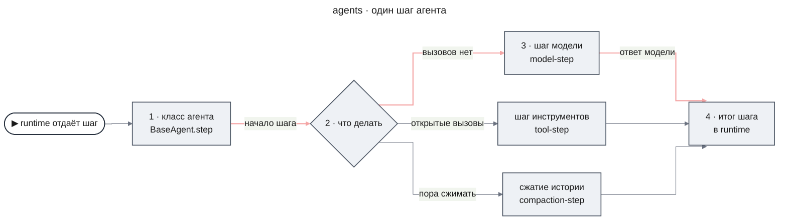

# Пакет `agents`

Агенты платформы. Каждый чат, агент и глубокий агент — отдельный объект своего класса, один на задачу runtime: runtime держит его в памяти между шагами и зовёт его `step` на каждый шаг ([ADR-0023](../../adr/ADR-0023-live-task-objects-one-stepping-process.md)). Кроме шага агента, пакет держит библиотеку инструментов, процедуру старта по снимку, реестр MCP-серверов и аккаунты сотрудников, провайдеров моделей и эмбеддинги, знания глубоких агентов и операции, которые зовёт `apps/api`. Mastra импортирует только этот пакет.

Метод `step` в `agent/base-agent.ts` задаёт порядок: начало шага (`prelude.ts`), затем одна из трёх стадий. Есть открытые вызовы инструментов — шаг инструментов; история подошла к пределу — сжатие; иначе — вызов модели. Каждая стадия лежит в своём файле и возвращает runtime итог шага ([step-handler.md](../patterns/step-handler.md)).

## Классы агентов

| Класс | Тип задачи | Кто это |
|---|---|---|
| `Agent` (`agent/agent.ts`) | `agent` | агент из записи библиотеки и сабагент глубокого агента |
| `ChatAgent` (`agent/chat-agent.ts`) | `chat` | корень беседы: инструменты корня, список задач всегда, живой список записей сотрудника в описаниях инструментов; новый ход на каждое сообщение сотрудника, ход кончается ожиданием |
| `DeepAgent` (`deep/deep-agent.ts`) | `deep_agent` | глубокий агент: делегирование через `task`, ответ финального сабагента, строка запуска самообучения |

Все три — наследники абстрактного `BaseAgent`. Наследник переопределяет только то, чем отличается: признак корня и объявление инструментов, счётчик ходов после доставки сообщений, конец хода, вектор вопроса, что добавить к новой сессии, какие вызовы инструментов раздать детям и ждать трекер, как закрыть такие вызовы и чей ответ завершает запуск.

Класс выбирают один раз, когда создают задачу: корень беседы — в `operations/start-operations.ts`, остальных — по виду снимка запуска (`childTypeOf`). Что запуск отдаёт модели — промпт, инструменты, флажки, — считает чистая функция `snapshotDefinition` в `start/` ([run-snapshot.md](../patterns/run-snapshot.md)).

### Объект агента

Объекты делает `AgentFactory` (`agent/agent-factory.ts`). Тот, кто создаёт задачу агента, строит её объект в той же транзакции (`createIn`) и после коммита отдаёт его runtime: `StartOperations` — через `LiveTasks.adopt`, инструмент старта — через `StepEffects.adopt` в коммите шага. Задаче, для которой у runtime объекта нет, фабрика строит его из базы (`restore`).

Объект держит то, что не меняется у задачи: её данные, разобранный вход, определение снимка и объявление инструментов (`declaration`). Ещё он держит состояние сессии (`agent/agent-state.ts`): строку сессии, записи истории после последнего сжатия и состояния вызовов. Шаг состояние только читает, его записи уходят в коммит, а меняется состояние в одном месте — в `absorb()` после успешного коммита. То, от чего зависят права, объект не хранит и читает на каждом шаге: набор инструментов сессии, список записей чата, блок знаний, список задач.

## Каталоги

| Путь | Что там |
|---|---|
| `src/agent/` | `BaseAgent`, `Agent`, `ChatAgent`, `AgentFactory`, состояние объекта (`agent-state.ts`) и стадии шага: `prelude.ts`, `tool-step.ts`, `compaction-step.ts`, `model-step.ts`; чистые правила `turn-rules.ts`, `repeat-rule.ts`, `continuation.ts` |
| `src/deep/` | `DeepAgent` и всё, что есть только у глубокого агента: инструменты `task` и `start_deep_agent`, бриф, промпт и команда, вид запуска |
| `src/tools/` | ядро библиотеки инструментов: контракт и объявление (`tool.ts`), реестр с `toolsFor` (`tool-registry.ts`), исполнитель (`tool-runner.ts`) с проверкой вызова и прав (`call-check.ts`), исходом и отправкой на сервер MCP (`tool-execution.ts`) и вызовом из кода (`code-call.ts`); большие результаты |
| `src/tools/system/` | системные инструменты: старт, остановка, сообщения и список агентов, список задач, чтение результатов, проверка старта |
| `src/tools/external/` | `run_code` и проверка его вызовов |
| `src/start/` | процедура старта `resolveStart`, снимок, `snapshotDefinition`, порт `RecordLibrary` |
| `src/operations/` | операции для `apps/api`: `StartOperations` — старт и перезапуск, `ControlOperations` — сообщение, прерывание, остановка, подтверждение и правка беседы, `ViewOperations` — чтение; типы запросов и ответов в `agent-sessions.ts` |
| `src/store/` | `Sessions`, `History`, `CallRecords` — сервисы над репозиториями сессий, истории и вызовов |
| `src/history/` | записи истории агента |
| `src/model/` | `ModelClient` — вызов модели над Mastra, повторы, оценка токенов |
| `src/providers/` | реестр провайдеров моделей и адаптеры видов над пакетами AI SDK |
| `src/embeddings/` | служба эмбеддингов |
| `src/mcp/` | реестр MCP-серверов, аккаунты сотрудников, OAuth, клиент MCP по HTTP |
| `src/knowledge/` | граф знаний глубокого агента, задача `knowledge.extract`, блок знаний в промпте |
| `src/events/` | потребители событий runtime |
| `src/` | порты `AccessGate` и `AccessAudit` (`access-gate.ts`), разбор настроек `parseAgentsConfig` (`config.ts`), чистые правила вида агента и списка чата |

Запросы к таблицам `agent_*` лежат в `packages/db/src/repositories/agent-*.repository.ts` ([packages/db.md](./db.md)).

## Правила

- **Инструменты агент не выбирает, а объявляет**: поле `BaseAgent.declaration` держит объявление, и его вместе с владельцем задачи получает единственный вход библиотеки — `toolsFor` реестра ([tool-declaration.md](../patterns/tool-declaration.md)). Ядро `tools/` и `tools/external/` не импортируют `agent/`, `deep/`, `operations/` и `knowledge/`.
- **Регистрации** идут в `onModuleInit` (`agents-registration.ts`): три класса агентов как живые типы задач `chat`, `agent`, `deep_agent` (`registerLive` с `restore` фабрики), обработчики `knowledge.extract` и `knowledge.embed`, потребители событий, системные инструменты. Инструменты записей регистрирует `apps/api` ([packages/api.md](./api.md)). Реестр инструментов закрывается (`seal`) в `onApplicationBootstrap`.
- **Модуль** `AgentsModule` (`agents.module.ts`) не глобальный; токены настроек, логгера, портов и швов лежат в `agents.tokens.ts`. Модули выше внедряют `StartOperations`, `ControlOperations`, `ViewOperations`, `AgentsMcp`, `AgentsProviders`, `AgentsEmbeddings`, `AgentsKnowledge`, `AgentsToolResults`, `ToolRegistry` и `ModelClient`.
- **Порты** `AccessGate` (права, квоты, каталог моделей), `AccessAudit` (запись аудита отказа) и `RecordLibrary` (записи библиотеки для старта) пакет объявляет, а реализует `apps/api` ([composition-root.md](../patterns/composition-root.md)).
- **Пишущая операция реестра** — MCP-серверов, провайдеров, настроек знаний — возвращает «было» и «стало», и аудит по ним пишет `apps/api` после неё. Секрет в «было» и «стало» заменён меткой ([write-only-secret.md](../patterns/write-only-secret.md)).
- **MCP** ([ADR-0014](../../adr/ADR-0014-mcp-registry-owned-by-agents.md)): адрес возврата OAuth `apps/api` передаёт в операцию подключения параметром. Перед удалением сервера `apps/api` удаляет права на него. Токен сотрудника уходит из пакета только в заголовке запроса к серверу.
- **Провайдеры моделей** ([ADR-0019](../../adr/ADR-0019-model-provider-registry-in-agents.md)): провайдера называет первая часть id модели ([ADR-0018](../../adr/ADR-0018-model-id-provider-prefix.md)), и каталог моделей в `apps/api` ссылается на провайдера этим текстом, без внешнего ключа. `ModelClient` читает строку провайдера на каждом вызове, без кэша. Ключ уходит из пакета только в запросе к провайдеру.
- **Знания**: шаг агента и задача `knowledge.extract` читают и пишут граф сами. Маршруты графа в `apps/api` сначала проверяют доступ через `LibraryService.knowledgeTarget`.
- **Исполнитель кода** пакет зовёт только из `run_code` и сам проверяет каждую просьбу скрипта ([packages/base.md](./base.md)).
