# Приложение `apps/api`

HTTP API платформы на NestJS и точка сборки бэкенда. `AppModule` собирает модули пакетов (`DbModule`, `RuntimeModule`, `AgentsModule`) и модули приложения, читает окружение и держит то, что знает о сотрудниках и людях: вход и сеансы, права и квоты, библиотеку записей, аудит и чат.

```mermaid
---
title: "api · путь запроса на чтение"
config:
  theme: base
  look: classic
  themeVariables:
    primaryColor: "#eef1f5"
    primaryBorderColor: "#4b5563"
    primaryTextColor: "#1a1a1a"
    lineColor: "#6b7280"
  flowchart:
    curve: step
  themeCSS: |
    @keyframes litr_api{0%,12.85%{stroke:#1d4ed8;stroke-width:6px}14.28%,100%{stroke:#9ec1f7;stroke-width:2px}}
---
flowchart LR
    entry(["▶ запрос /api/..."])
    guard["1 · SessionGuard<br/>сотрудник в req.user"]
    ctrl["2 · контроллер<br/>владелец из req.user"]
    svc["3 · сервис модуля<br/>правила и транзакция"]
    repo["4 · репозиторий<br/>packages/db"]
    pg[("Postgres")]
    entry --> guard
    guard e1@-->|"запрос"| ctrl
    ctrl e2@-->|"операция"| svc
    svc e3@-->|"транзакция"| repo
    repo e4@-->|"запрос"| pg
    pg e5@-->|"строки"| repo
    repo e6@-->|"строки"| svc
    svc e7@-->|"объект домена"| ctrl
    classDef r1 stroke:#9ec1f7,stroke-width:2px,animation:litr_api 8.4s linear 0s infinite
    classDef r2 stroke:#9ec1f7,stroke-width:2px,animation:litr_api 8.4s linear 1.2s infinite
    classDef r3 stroke:#9ec1f7,stroke-width:2px,animation:litr_api 8.4s linear 2.4s infinite
    classDef r4 stroke:#9ec1f7,stroke-width:2px,animation:litr_api 8.4s linear 3.6s infinite
    classDef r5 stroke:#9ec1f7,stroke-width:2px,animation:litr_api 8.4s linear 4.8s infinite
    classDef r6 stroke:#9ec1f7,stroke-width:2px,animation:litr_api 8.4s linear 6s infinite
    classDef r7 stroke:#9ec1f7,stroke-width:2px,animation:litr_api 8.4s linear 7.2s infinite
    class e1 r1
    class e2 r2
    class e3 r3
    class e4 r4
    class e5 r5
    class e6 r6
    class e7 r7
    classDef entry fill:#ffffff,stroke:#1f2937,stroke-width:1.5px,color:#1a1a1a
    classDef unchanged fill:#eef1f5,stroke:#4b5563,stroke-width:1.5px,color:#1a1a1a
    class entry entry
    class guard,ctrl,svc,repo,pg unchanged
```

`SessionGuard` стоит на всём API ([auth-boundary.md](../patterns/auth-boundary.md)). Контроллер берёт владельца из `req.user` и зовёт сервис своего модуля или сервис пакета `agents`. Сервис проверяет правила, открывает транзакцию и читает строки через репозитории `packages/db` ([repository-over-transaction.md](../patterns/repository-over-transaction.md)).

## Модули

| Каталог | Модуль | Что держит |
|---|---|---|
| `src/identity/` | `IdentityModule` | сотрудники и пароли, роли, провайдеры входа, запросы входа, сеансы, настройки входа; `SessionGuard`, `IdentityDirectory` |
| `src/audit/` | `AuditModule` | журнал `audit_events` и `AuditLog` |
| `src/access/` | `AccessModule`, `AccessAdminModule` | каталог моделей с ценами, модели по умолчанию, права, запреты и квоты; `AccessService` реализует порт `AccessGate` |
| `src/library/` | `LibraryModule`, `LibraryApiModule` | записи библиотеки и их аудитория; встроенные записи и инструменты записей главного чата |
| `src/agents/` | `AgentsModule` | связывание пакета `agents`: порты, шов модели, контроллеры реестра MCP, провайдеров моделей и больших результатов |
| `src/knowledge/` | `KnowledgeApiModule` | маршруты графа знаний и его настроек |
| `src/chat/` | `ChatModule` | маршруты `/api/threads`, `/api/agents`, `/api/decisions`, `/api/events`, затраты, заголовок беседы |
| `src/runtime/` | `ApiRuntimeModule` | настройки runtime из окружения и проверка миграций при старте |
| `src/logging/` | `LoggingModule` | логгер приложения под токеном `LOGGER`; логгер Nest пишет через него |
| `src/common/` | — | общее для HTTP: тело ошибки API, проверка тела схемой zod, лог маршрута |
| `src/cli/` | — | команды: миграции, засев доступа и MCP, супер-админ |

Модуль, который реализует порт для `AgentsModule` и при этом зовёт его сервисы из своих маршрутов, делится на два — [port-module-split.md](../patterns/port-module-split.md).

## Правила областей

- **Вход.** Пакеты о сеансе не знают и получают только строку владельца. Чужой объект отвечает так же, как отсутствующий ([design-identity.md](../../features/enterprise-access/design-identity.md)).
- **Права и квоты** ([ADR-0015](../../adr/ADR-0015-access-gate-and-model-catalogue.md)). Пакеты спрашивают только порт `AccessGate`: включён ли сотрудник, разрешены ли инструмент и вызов модели, с ценой и квотой. Правила прав живут в `AccessService` и чистой функции `effectiveAccess`.
- **Библиотека** ([ADR-0016](../../adr/ADR-0016-library-records-and-visibility.md)). Записи читают и пишут три сервиса над общими правилами сохранения: `LibraryService` — маршруты сотрудника `/api/library` и порт `RecordLibrary` для старта; `LibraryPanelService` — маршруты панели `/api/admin/library`; `LibraryChatService` — пять инструментов записей главного чата, которые модуль регистрирует в реестре инструментов `agents`. Чтения сотрудника и старта идут через одно условие видимости, чтения панели — через условие панели, которое не находит личных записей. Доступ к графу знаний записи проверяет `LibraryService.knowledgeTarget`.
- **Сохранение из чата.** Инструмент записи получает транзакцию шага от `agents` и передаёт её в `LibraryChatService`. Запись и её аудит пишутся в точке сохранения внутри этой транзакции, поэтому одобренная карточка сохраняет запись не больше одного раза и одним коммитом с результатом вызова ([design-agent-types.md](../../features/deep-agents/design-agent-types.md), KD-3).
- **Аудит изменений пакета.** Когда пишущая операция живёт в пакете (реестр MCP, провайдеры, настройки знаний), она возвращает «было» и «стало», а `apps/api` пишет аудит после неё.
- **Беседа.** Своих таблиц у чата нет: беседа — корневая сессия агента `chat` в `agent_sessions`, её id — id корня, и появляется она с первым сообщением. `apps/api` читает, меняет и удаляет беседу операциями `AgentSessions` (`root`, `roots`, `renameRoot`, `touchRoot`, `titleRootIfEmpty`, `start` с id беседы, `deleteRoot`). `deleteRoot` в одной транзакции зовёт `TaskControl.deleteTree`, который останавливает дерево и ставит `deleted_at` каждой его задаче, и помечает корневую сессию. Строки не стираются.
