# Приложение `apps/api`

HTTP API платформы на NestJS и точка сборки бэкенда. `AppModule` собирает модули пакетов (`DbModule`, `RuntimeModule`, `AgentsModule`) и модули приложения, читает окружение и держит то, что знает о сотрудниках и людях: вход и сеансы, права и квоты, библиотеку записей, аудит и чат.

```mermaid
---
title: "api · путь запроса на чтение"
config:
  theme: base
  look: classic
  themeVariables:
    primaryColor: "#eef1f5"
    primaryBorderColor: "#4b5563"
    primaryTextColor: "#1a1a1a"
    lineColor: "#6b7280"
  flowchart:
    curve: step
  themeCSS: |
    @keyframes litr_api{0%,12.85%{stroke:#1d4ed8;stroke-width:6px}14.28%,100%{stroke:#9ec1f7;stroke-width:2px}}
---
flowchart LR
    entry(["▶ запрос /api/..."])
    guard["1 · SessionGuard<br/>сотрудник в req.user"]
    ctrl["2 · контроллер<br/>владелец из req.user"]
    svc["3 · сервис модуля<br/>правила"]
    repo["4 · репозиторий<br/>packages/db"]
    pg[("Postgres")]
    entry --> guard
    guard e1@-->|"запрос"| ctrl
    ctrl e2@-->|"операция"| svc
    svc e3@-->|"чтение"| repo
    repo e4@-->|"запрос"| pg
    pg e5@-->|"строки"| repo
    repo e6@-->|"строки"| svc
    svc e7@-->|"объект домена"| ctrl
    classDef r1 stroke:#9ec1f7,stroke-width:2px,animation:litr_api 8.4s linear 0s infinite
    classDef r2 stroke:#9ec1f7,stroke-width:2px,animation:litr_api 8.4s linear 1.2s infinite
    classDef r3 stroke:#9ec1f7,stroke-width:2px,animation:litr_api 8.4s linear 2.4s infinite
    classDef r4 stroke:#9ec1f7,stroke-width:2px,animation:litr_api 8.4s linear 3.6s infinite
    classDef r5 stroke:#9ec1f7,stroke-width:2px,animation:litr_api 8.4s linear 4.8s infinite
    classDef r6 stroke:#9ec1f7,stroke-width:2px,animation:litr_api 8.4s linear 6s infinite
    classDef r7 stroke:#9ec1f7,stroke-width:2px,animation:litr_api 8.4s linear 7.2s infinite
    class e1 r1
    class e2 r2
    class e3 r3
    class e4 r4
    class e5 r5
    class e6 r6
    class e7 r7
    classDef entry fill:#ffffff,stroke:#1f2937,stroke-width:1.5px,color:#1a1a1a
    classDef unchanged fill:#eef1f5,stroke:#4b5563,stroke-width:1.5px,color:#1a1a1a
    class entry entry
    class guard,ctrl,svc,repo,pg unchanged
```

`SessionGuard` стоит на всём API ([auth-boundary.md](../patterns/auth-boundary.md)). Контроллер берёт владельца из `req.user` и зовёт сервис своего модуля или сервис пакета `agents`. Сервис проверяет правила и читает строки через репозитории `packages/db`; несколько записей вместе он оборачивает в `db.transaction` ([repository-over-transaction.md](../patterns/repository-over-transaction.md)). Сервисы над репозиториями приложения — например `AuditLog` (`src/audit/audit-log.ts`), `SessionStore` (`src/identity/session.store.ts`), `LibraryRecords` и `LibrarySave` (`src/library/`).

Из пакета `agents` приложение внедряет `StartOperations`, `ControlOperations`, `ViewOperations`, `AgentsMcp`, `AgentsProviders`, `ToolRegistry` и `ModelClient`. Порты пакета привязывает `AgentsPortsModule` (`src/agents/agents-ports.module.ts`).

## Модули

| Каталог | Модуль | Что держит |
|---|---|---|
| `src/identity/` | `IdentityModule` | сотрудники и пароли, роли, провайдеры входа, запросы входа, сеансы, настройки входа; `SessionGuard`, `IdentityDirectory` |
| `src/audit/` | `AuditModule` | журнал `audit_events` и `AuditLog` |
| `src/access/` | `AccessModule`, `AccessAdminModule` | каталог моделей с ценами, модели по умолчанию, права, запреты и квоты; `AccessService` реализует порт `AccessGate` |
| `src/library/` | `LibraryModule`, `LibraryApiModule` | агенты каталога, их версии и аудитория; инструменты записей главного чата |
| `src/settings/` | `SettingsModule` | таблица `settings`: `SettingsService` — единственный писатель ключей настроек ([keyed-settings.md](../patterns/keyed-settings.md)) |
| `src/agents/` | `AgentsModule`, `AgentsPortsModule` | `AgentsModule` импортирует модуль пакета `agents` с настройками из окружения и держит контроллеры реестра MCP, провайдеров моделей и больших результатов; `AgentsPortsModule` привязывает порты `AccessGate`, `AccessAudit`, `RecordLibrary` и приёмник частей текста |
| `src/memory/` | `MemoryApiModule` | память глубоких агентов: экран памяти агента, «Моя память», история записи, возврат версии и стирание записи с историей ([design-memory-hygiene.md](../../features/schedules-search-memory/design-memory-hygiene.md)); ключ `self_learning_settings` |
| `src/training/` | `TrainingApiModule` | маршруты обучения `/api/library/:id/training`: состояние для карточки, старт, результат, активация; одно правило права `canTrain` (`training-rules.ts`) — автор с правом обучать своих или владелец права обучать любых у агента панели |
| `src/chat/` | `ChatModule` | маршруты `/api/threads`, `/api/agents`, `/api/decisions`, `/api/events`, затраты, заголовок беседы; поиск по беседам `GET /api/search` — `SearchController` и `ConversationSearchService` ([design-conversation-search.md](../../features/schedules-search-memory/design-conversation-search.md)) |
| `src/schedules/` | `SchedulesModule` | маршруты `/api/schedules` и проход расписаний, зарегистрированный фоновым проходом runtime; чистые правила сроков, решения срока и статуса запуска; `ChatModule` зовёт его при удалении беседы ([design-schedules.md](../../features/schedules-search-memory/design-schedules.md)) |
| `src/runtime/` | `ApiRuntimeModule` | настройки runtime из окружения и проверка миграций при старте |
| `src/logging/` | `LoggingModule` | логгер приложения под токеном `LOGGER`; логгер Nest пишет через него |
| `src/common/` | — | общее для HTTP: тело ошибки API, проверка тела схемой zod, лог маршрута, проверка uuid, непрозрачный курсор страниц (`opaque-cursor.ts`) |
| `src/cli/` | — | команды: миграции, засев доступа и MCP, супер-админ |

Модуль, который реализует порт для `AgentsModule` и при этом зовёт его сервисы из своих маршрутов, делится на два — [port-module-split.md](../patterns/port-module-split.md).

## Правила областей

- **Вход.** Пакеты о сеансе не знают и получают только строку владельца. Чужой объект отвечает так же, как отсутствующий ([design-identity.md](../../features/enterprise-access/design-identity.md)).
- **Права и квоты** ([ADR-0015](../../adr/ADR-0015-access-gate-and-model-catalogue.md)). Пакеты спрашивают только порт `AccessGate`: включён ли сотрудник, разрешены ли инструмент и вызов модели, с ценой и квотой. Правила прав живут в `AccessService` и чистой функции `effectiveAccess`.
- **Библиотека** ([ADR-0016](../../adr/ADR-0016-library-records-and-visibility.md)). Записи читают и пишут три сервиса над двумя общими: `LibraryRecords` — чтения по условиям видимости, удаление, событие аудита; `LibrarySave` — единственный путь сохранения. Три сервиса: `LibraryService` — маршруты сотрудника `/api/library` и порт `RecordLibrary` для старта; `LibraryPanelService` — маршруты панели `/api/admin/library`; `LibraryChatService` — пять инструментов записей главного чата, которые модуль регистрирует в реестре инструментов `agents`. Чтения сотрудника и старта идут через одно условие видимости, чтения панели — через условие панели, которое не находит личных записей. Доступ к памяти агента проверяет `LibraryService.memoryTarget`.
- **Сохранение из чата.** Инструмент записи исполняется в коммите шага (`mode: 'in_commit'`) и транзакции не получает: он зовёт `LibraryChatService`, а `LibrarySave` пишет запись и её аудит в точке сохранения (`db.savepoint`) внутри открытой транзакции коммита. Поэтому одобренная карточка сохраняет запись не больше одного раза и одним коммитом с результатом вызова ([design-agent-types.md](../../features/deep-agents/design-agent-types.md), KD-3).
- **Аудит изменений пакета.** Когда пишущая операция живёт в пакете (реестр MCP, провайдеры), она возвращает «было» и «стало», а `apps/api` пишет аудит после неё.
- **Беседа.** Своих таблиц у чата нет: беседа сотрудника — строка `conversations` агента `chat` без родителя (`parent_id` пуст), её id — id корневой задачи, и появляется она с первым сообщением. `apps/api` читает беседу операциями `ViewOperations` (`root`, `roots`), начинает — `StartOperations.start` с id беседы, меняет и удаляет — операциями `ControlOperations` (`renameRoot`, `touchRoot`, `titleRootIfEmpty`, `deleteRoot`). `deleteRoot` в одной транзакции зовёт `TaskControl.deleteTree(rootId, ownerId)`, который останавливает дерево и ставит `deleted_at` каждой его задаче. Своей отметки у беседы нет: запросы бесед соединяют беседу с её задачей и отбрасывают удалённые. Строки не стираются.
- **Блокнот** ([design-notepad.md](../../features/self-learning/design-notepad.md)). Документы всех запусков беседы отдают два маршрута `ThreadsController` — `GET /api/threads/:threadId/documents` и `.../documents/:documentId`. `ConversationsService` проверяет беседу так же, как остальные маршруты бесед, и читает строки через `DocumentsRepository`; документ не из запусков беседы отвечает 404 `DOCUMENT_NOT_FOUND`. Пишут документы только инструменты пакета `agents`.
- **Настройки.** Каждая группа настроек — ключ таблицы `settings`. Сервис группы (`IdentitySettings`, `LibrarySettingsService`, модели по умолчанию в `AccessService`; большие результаты — `AdminToolResultsController`, самообучение — `AdminSelfLearningSettingsController`) читает и пишет через `SettingsService`, а тот пишет `admin_change` в транзакции записи ([keyed-settings.md](../patterns/keyed-settings.md)).
