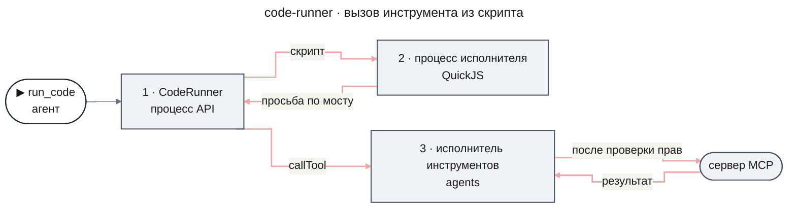

# Нижние пакеты: `common`, `contracts`, `code-runner`

Три пакета без NestJS: lint запрещает им `@nestjs/*`, а их код — обычные функции и классы. В DI их значения попадают через провайдер того модуля, которому они нужны ([composition-root.md](../patterns/composition-root.md)).

## `common`

Логгер и маска секретов. Пакет не зависит ни от одного пакета workspace и ни от одного SDK; его используют все пакеты и оба приложения.

| Файл | Что там |
|---|---|
| `src/logger.ts` | `createLogger`, тип `Logger`, токен `LOGGER`, маска `createSecretMasker` и память секретов `rememberSecret` |
| `src/sinks.ts` | приёмники: консоль и Sentry; SDK Sentry им передаёт приложение |
| `src/testing.ts` | приёмник в памяти `memorySink` для тестов |

Как писать лог — [logging.md](../patterns/logging.md).

## `contracts`

zod-схемы данных, которые пересекают границу: тела запросов и ответов API, вход и выход задач runtime, содержимое записей библиотеки, наборы значений для CHECK. Файл на область (`library.ts`, `access.ts`, `runtime.ts` и другие). Пакет зависит только от zod, и его импортирует и бэкенд, и `apps/web`. Здесь же функции, которые нужны обеим сторонам, например `modelProvider` — провайдер по id модели ([ADR-0018](../../adr/ADR-0018-model-id-provider-prefix.md)).

## `code-runner`

Исполнитель кода для `run_code` и скриптов агента ([ADR-0011](../../adr/ADR-0011-code-runner-quickjs-process.md)): отдельный процесс Node на один скрипт с QuickJS внутри, мост с процессом API, пределы и убийство процесса. Об агентах пакет не знает, таблиц у него нет.

Процесс исполнителя ничего не решает сам: он только присылает просьбы вызвать инструмент или прочитать результат. Каждую просьбу проверяет процесс API той же проверкой, что вызов агента, и сам ходит к серверу MCP.

| Путь | Что там |
|---|---|
| `src/code-runner.ts` | `createCodeRunner` и `CodeRunner.run`: запуск процесса, мост, пределы |
| `src/executor/` | вход процесса исполнителя; Node исполняет его сам, импорты через `#executor/*` |

- Процесс запускается только с флагами модели разрешений Node и читает только каталог своего входа (`dist/executor` в сборке `apps/api`, `src/executor` пакета в тестах) и QuickJS из каталогов, где ни одна ссылка не ведёт наружу.
- Пакет зовёт только `agents`. Правила вызовов держит вызывающий, а не пакет ([design-code-execution.md](../../features/code-execution/design-code-execution.md), KD-1, KD-2).
