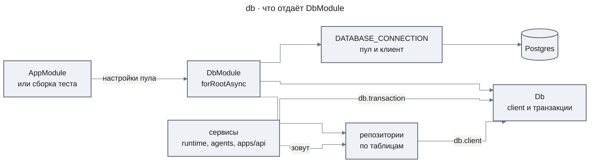

# Пакет `db`

Одна база процесса: пул `pg`, клиент Drizzle, `Db` — вход в базу с транзакциями, модель схемы `app` всех таблиц, миграции и репозитории всех таблиц. Других мест с запросами к таблицам в коде нет ([ADR-0022](../../adr/ADR-0022-one-database-and-nestjs-modules.md)); выбор Drizzle и схемы `app` — [ADR-0003](../../adr/ADR-0003-drizzle-data-layer.md).

`DbModule` глобальный: его провайдеры видит каждый модуль без импорта. Настройки пула приходят из фабрики `forRootAsync`. Ошибки клиентов пула модуль пишет через `LOGGER`, а пул закрывает в `onApplicationShutdown`, после остановки воркеров ([composition-root.md](../patterns/composition-root.md)).

`Db` помнит транзакцию, открытую в текущем асинхронном контексте. Репозиторий шлёт запрос через `db.client` и поэтому сам входит в транзакцию, которую открыл любой сервис выше по вызову ([repository-over-transaction.md](../patterns/repository-over-transaction.md)).

## Каталоги

| Путь | Что там |
|---|---|
| `src/schema/` | модель схемы `app`: файл на таблицу, имя файла — имя таблицы (`runtime-tasks.ts`); `index.ts` собирает все таблицы, а саму схему `app` не экспортирует: её создаёт мигратор, и генератор не пишет `CREATE SCHEMA` |
| `src/repositories/` | репозитории всех таблиц, плоско: файл на таблицу или группу таблиц, имя по префиксу таблицы (`runtime-tasks.repository.ts`); `index.ts` экспортирует классы и список `REPOSITORIES`, который `DbModule` отдаёт целиком |
| `src/migrations/` | исходный набор миграций: `0000_schema.sql` (сгенерирована drizzle-kit), `0001_builtin_rows.sql` (custom, встроенные строки) |
| `src/db.ts` | `Db`: `client`, `transaction`, `savepoint` |
| `src/database.ts` | пул и клиент Drizzle (`createDatabase`), тип `Database` |
| `src/db.module.ts`, `src/db.tokens.ts` | `DbModule` и токены `DATABASE_CONNECTION`, `DATABASE` |
| `src/migrate.ts`, `src/pending-migrations.ts` | применение миграций и проверка, что неприменённых нет |

## Правила

- **Новая таблица** — файл в `src/schema/`, миграция генерируется здесь же, запросы к ней — в репозитории `src/repositories/`. Сгенерированный SQL руками не правят. Что генератор не выражает, лежит в custom-миграции (`drizzle-kit generate --custom`), которую пишут руками. Строки данных лежат только в миграции встроенных строк ([builtin-record.md](../patterns/builtin-record.md)).
- **Имя** таблицы говорит, что в ней лежит (`conversations`, `messages`, `mcp_servers`, `agent_versions`); файл схемы, символ таблицы, файл и класс репозитория и типы строк называются по таблице (`ConversationsRepository`, `ConversationRow`).
- **Настройки** платформы — одна таблица `settings`, строка на ключ, и `SettingsRepository` ([keyed-settings.md](../patterns/keyed-settings.md)).
- **Репозиторий** — класс, который получает `Db` в конструкторе; в нём только запросы и типы строк, без параметра транзакции и без блокировок строк ([repository-over-transaction.md](../patterns/repository-over-transaction.md)). Новый класс добавляется в `REPOSITORIES`.
- **Типы строк** (`RuntimeTaskRow` и подобные) экспортирует `@agent-os/db`, и пакеты выше работают с ними, а не объявляют свои.
- **Миграции** применяет команда `apps/api/src/cli/migrate-cli.ts`. Сервер при старте только проверяет, что неприменённых миграций нет (`assertNoPendingMigrations`), и сам их не применяет.
- Пакет зависит от `contracts`, `common`, `drizzle-orm`, `pg`, `zod`, `@nestjs/common` и `reflect-metadata`.
