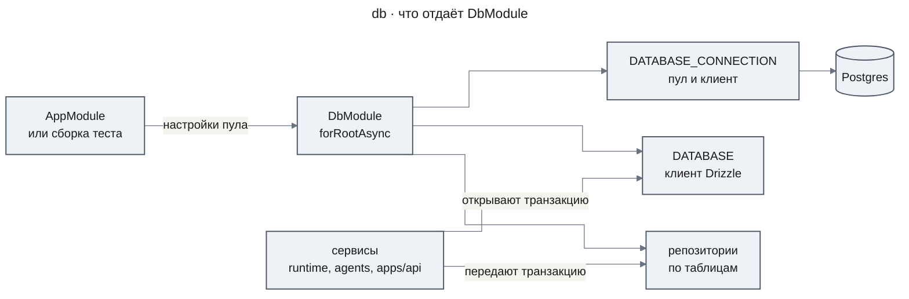

# Пакет `db`

Одна база процесса: пул `pg`, клиент Drizzle, модель схемы `app` всех таблиц, миграции и репозитории всех таблиц. Других мест с запросами к таблицам в коде нет ([ADR-0022](../../adr/ADR-0022-one-database-and-nestjs-modules.md)); выбор Drizzle и схемы `app` — [ADR-0003](../../adr/ADR-0003-drizzle-data-layer.md).

`DbModule` глобальный: его провайдеры видит каждый модуль без импорта. Настройки пула приходят из фабрики `forRootAsync`. Ошибки клиентов пула модуль пишет через `LOGGER`, а пул закрывает в `onApplicationShutdown`, после остановки воркеров ([composition-root.md](../patterns/composition-root.md)).

## Каталоги

| Путь | Что там |
|---|---|
| `src/schema/` | модель схемы `app`: файл на таблицу, имя файла — имя таблицы (`runtime-tasks.ts`); `index.ts` собирает все |
| `src/repositories/` | репозитории всех таблиц, плоско: файл на таблицу или группу таблиц, имя по префиксу таблицы (`runtime-tasks.repository.ts`); `index.ts` экспортирует классы и список `REPOSITORIES`, который `DbModule` отдаёт целиком |
| `src/migrations/` | SQL-миграции, которые генерирует drizzle-kit |
| `src/database.ts` | пул и клиент; типы `Database`, `Transaction` и `Executor` (клиент или транзакция) |
| `src/db.module.ts` | `DbModule` и токены `DATABASE_CONNECTION`, `DATABASE` |
| `src/migrate.ts`, `src/pending-migrations.ts` | применение миграций и проверка, что неприменённых нет |

## Правила

- **Новая таблица** — файл в `src/schema/`, миграция генерируется здесь же, запросы к ней — в репозитории `src/repositories/`. Миграция меняет только схему, строк данных в ней нет.
- **Репозиторий** — класс без состояния, в нём только запросы и типы строк ([repository-over-transaction.md](../patterns/repository-over-transaction.md)). Новый класс добавляется в `REPOSITORIES`.
- **Типы строк** (`RuntimeTrackerRow` и подобные) экспортирует `@agent-os/db`, и пакеты выше работают с ними, а не объявляют свои.
- **Миграции** применяет команда `apps/api/src/cli/migrate-cli.ts`. Сервер при старте только проверяет, что неприменённых миграций нет (`assertNoPendingMigrations`), и сам их не применяет.
- Пакет зависит только от `contracts`, `common`, drizzle и `@nestjs/common`.
