# Пакет `runtime`

Durable-владелец работы ([ADR-0001](../../adr/ADR-0001-durable-runtime-owner.md)): задачи, которые идут шагами и переживают рестарт сервера, очередь сообщений задачам, запросы решений человека, трекеры дочерних задач, журнал событий с доставкой, журнал токенов и возврат брошенных задач. Об агентах и беседах пакет не знает: работу шага делает обработчик верхнего слоя или живой объект задачи, зарегистрированные по типу задачи. Шаги исполняет один процесс, и объекты задач он держит в памяти между шагами ([ADR-0023](../../adr/ADR-0023-live-task-objects-one-stepping-process.md)). Контракт — [design-runtime.md](../../features/agent-platform/design-runtime.md#contract-definitions).

```mermaid
---
title: "runtime · путь одного шага"
config:
  theme: base
  look: classic
  themeVariables:
    primaryColor: "#eef1f5"
    primaryBorderColor: "#4b5563"
    primaryTextColor: "#1a1a1a"
    lineColor: "#6b7280"
  flowchart:
    curve: step
  themeCSS: |
    @keyframes lit_rt{0%,18%{stroke:#991b1b;stroke-width:6px}20%,100%{stroke:#f4a5a5;stroke-width:2px}}
---
flowchart LR
    entry(["▶ шаг готов"])
    disp["1 · Dispatcher<br/>захватывает шаг"]
    handler["2 · объект задачи<br/>или обработчик типа"]
    commit["3 · StepCommitter<br/>итог одной транзакцией"]
    pg[("Postgres")]
    relay["4 · OutboxRelay<br/>доставка событий"]
    consumer["5 · потребитель<br/>события"]
    entry --> disp
    disp e1@-->|"контекст шага"| handler
    handler e2@-->|"итог шага"| commit
    commit e3@-->|"задача, сообщения, события"| pg
    pg e4@-->|"строки доставки"| relay
    relay e5@-->|"событие"| consumer
    classDef w1 stroke:#f4a5a5,stroke-width:2px,animation:lit_rt 6s linear 0s infinite
    classDef w2 stroke:#f4a5a5,stroke-width:2px,animation:lit_rt 6s linear 1.2s infinite
    classDef w3 stroke:#f4a5a5,stroke-width:2px,animation:lit_rt 6s linear 2.4s infinite
    classDef w4 stroke:#f4a5a5,stroke-width:2px,animation:lit_rt 6s linear 3.6s infinite
    classDef w5 stroke:#f4a5a5,stroke-width:2px,animation:lit_rt 6s linear 4.8s infinite
    class e1 w1
    class e2 w2
    class e3 w3
    class e4 w4
    class e5 w5
    classDef entry fill:#ffffff,stroke:#1f2937,stroke-width:1.5px,color:#1a1a1a
    classDef unchanged fill:#eef1f5,stroke:#4b5563,stroke-width:1.5px,color:#1a1a1a
    class entry entry
    class disp,handler,commit,pg,relay,consumer unchanged
```

`Dispatcher` захватывает шаг и берёт у `LiveTasks` то, что его исполнит: объект задачи живого типа (хранимый или восстановленный из базы) или обработчик типа без состояния из `HandlerRegistry`. Тот делает внешнюю работу вне транзакции и возвращает итог. `StepCommitter` одной транзакцией пишет новый статус задачи, записи обработчика, доставку сообщений и события; после успешного коммита объект задачи забирает закоммиченное состояние (`committed`). `OutboxRelay` доставляет события зарегистрированным потребителям. Как писать обработчик и живой объект — [step-handler.md](../patterns/step-handler.md), потребителя событий — [transactional-outbox.md](../patterns/transactional-outbox.md).

## Каталоги

| Путь | Что там |
|---|---|
| `src/tasks/` | `Tasks` — строки задач и охраняемые переходы статуса; `TaskControl` — команды над задачей (создать, прервать, остановить, удалить дерево); конец задачи; `Trackers` — трекеры дочерних задач; `RunningTaskRegistry` (`running-task.registry.ts`) — шаги, которые идут в этом процессе |
| `src/steps/` | контракт шага (`TaskHandler`, `LiveTask`, `LiveTaskType`, `StepContext`, `StepResult`, `StepEffects`) в `step-contract.ts`, `HandlerRegistry`, `LiveTasks` — объекты задач в памяти, `Dispatcher`, `StepCommitter` |
| `src/messaging/` | `Inbox` — очередь сообщений задаче; `Decisions` — запросы решений человека |
| `src/events/` | `EventLog` — журнал событий; `EventConsumerRegistry` — потребители; `OutboxRelay` — доставка |
| `src/workers/` | `WorkerLoop` — цикл фонового воркера (`worker-loop.ts`); `RecoverySweeper` (`recovery.sweeper.ts`) — возврат задач в `running`, шага которых нет в `RunningTaskRegistry`; `RuntimeWorkers` (`runtime-workers.ts`) — старт и остановка всех воркеров |
| `src/ledger/` | `TokenLedger` — журнал токенов и цена вызова модели |
| `src/` | `RuntimeModule`, токены (`runtime.tokens.ts`), разбор настроек `parseRuntimeConfig`, часы, ошибки |

Запросы к таблицам `runtime_*` лежат в `packages/db/src/repositories/runtime-*.repository.ts`, а сервисы этого пакета работают поверх них ([repository-over-transaction.md](../patterns/repository-over-transaction.md)).

## Модуль

`RuntimeModule` глобальный. Он отдаёт сервисы, которые внедряют модули выше: `HandlerRegistry`, `EventConsumerRegistry`, `TaskControl`, `Inbox`, `Decisions`, `Trackers`, `EventLog`, `TokenLedger`, `RuntimeWorkers`, `LiveTasks` и часы `CLOCK`. Верхние модули регистрируют обработчики, живые типы и потребителей в своём `onModuleInit`. `RuntimeWorkers` запускает воркеры в `onApplicationBootstrap`, там же начинает прогрев объектов задач и останавливает воркеры в `beforeApplicationShutdown` ([composition-root.md](../patterns/composition-root.md)).

## Правила

- Статус задачи меняют только сервисы этого пакета — итогом шага и командами `TaskControl`: правила переходов живут в них.
- Транзакция идёт к обработчику, а не от него: `StepCommitter` открывает транзакцию итога шага и зовёт в ней `commit(effects)` итога. Репозитории и сервисы, которые обработчик зовёт там, сами входят в эту транзакцию. Охраняемую запись посреди шага обработчик делает через `StepContext.guard(work)`: `work` идёт в короткой отдельной транзакции.
- Шаги исполняет один процесс. `Dispatcher` заносит шаг в `RunningTaskRegistry` (`src/tasks/running-task.registry.ts`) ещё в транзакции захвата. Команда (прерывание, остановка, удаление дерева) после своей транзакции обрывает идущий шаг в этом же процессе: `TaskControl.cutOff` (`src/tasks/task-control.ts`) подаёт сигнал шага через `RunningTaskRegistry.abortTask` и отпускает объект задачи через `LiveTasks.evict`. Задачу в `running`, шага которой нет в реестре, `RecoverySweeper` (`src/workers/recovery.sweeper.ts`) возвращает в очередь при старте и затем раз в `RUNTIME_REAPER_MS` ([ADR-0023](../../adr/ADR-0023-live-task-objects-one-stepping-process.md)).
- Объект задачи — кэш над базой: `LiveTasks` держит его после закоммиченного шага и отпускает при любом другом конце шага, после 15 минут простоя и сверх 500 объектов. Задаче без объекта новый строит `restore` её типа.
- Чужой домен пакет не знает: проверку владельца, удаление беседы и цены моделей ему передают верхние слои параметрами или портом.
