# Пакет `runtime`

Durable-владелец работы ([ADR-0001](../../adr/ADR-0001-durable-runtime-owner.md)): задачи, которые идут шагами и переживают рестарт сервера, очередь сообщений задачам, запросы решений человека, трекеры дочерних задач, журнал событий с доставкой, журнал токенов и возврат потерянных шагов. Об агентах и беседах пакет не знает: работу шага делает обработчик верхнего слоя, зарегистрированный по типу задачи. Контракт — [design-runtime.md](../../features/agent-platform/design-runtime.md#contract-definitions).

```mermaid
---
title: "runtime · путь одного шага"
config:
  theme: base
  look: classic
  themeVariables:
    primaryColor: "#eef1f5"
    primaryBorderColor: "#4b5563"
    primaryTextColor: "#1a1a1a"
    lineColor: "#6b7280"
  flowchart:
    curve: step
  themeCSS: |
    @keyframes lit_rt{0%,18%{stroke:#991b1b;stroke-width:6px}20%,100%{stroke:#f4a5a5;stroke-width:2px}}
---
flowchart LR
    entry(["▶ шаг готов"])
    disp["1 · Dispatcher<br/>захватывает шаг"]
    handler["2 · обработчик<br/>по типу задачи"]
    commit["3 · StepCommitter<br/>итог одной транзакцией"]
    pg[("Postgres")]
    relay["4 · OutboxRelay<br/>доставка событий"]
    consumer["5 · потребитель<br/>события"]
    entry --> disp
    disp e1@-->|"контекст шага"| handler
    handler e2@-->|"итог шага"| commit
    commit e3@-->|"задача, сообщения, события"| pg
    pg e4@-->|"строки доставки"| relay
    relay e5@-->|"событие"| consumer
    classDef w1 stroke:#f4a5a5,stroke-width:2px,animation:lit_rt 6s linear 0s infinite
    classDef w2 stroke:#f4a5a5,stroke-width:2px,animation:lit_rt 6s linear 1.2s infinite
    classDef w3 stroke:#f4a5a5,stroke-width:2px,animation:lit_rt 6s linear 2.4s infinite
    classDef w4 stroke:#f4a5a5,stroke-width:2px,animation:lit_rt 6s linear 3.6s infinite
    classDef w5 stroke:#f4a5a5,stroke-width:2px,animation:lit_rt 6s linear 4.8s infinite
    class e1 w1
    class e2 w2
    class e3 w3
    class e4 w4
    class e5 w5
    classDef entry fill:#ffffff,stroke:#1f2937,stroke-width:1.5px,color:#1a1a1a
    classDef unchanged fill:#eef1f5,stroke:#4b5563,stroke-width:1.5px,color:#1a1a1a
    class entry entry
    class disp,handler,commit,pg,relay,consumer unchanged
```

`Dispatcher` находит обработчик в `HandlerRegistry` по типу задачи и отдаёт ему контекст шага. Обработчик делает внешнюю работу вне транзакции и возвращает итог. `StepCommitter` одной транзакцией пишет новый статус задачи, записи обработчика, доставку сообщений и события. `OutboxRelay` доставляет события зарегистрированным потребителям. Как писать обработчик — [step-handler.md](../patterns/step-handler.md), потребителя событий — [transactional-outbox.md](../patterns/transactional-outbox.md).

## Каталоги

| Путь | Что там |
|---|---|
| `src/tasks/` | `Tasks` — строки задач и охраняемые переходы статуса; `TaskControl` — команды над задачей (создать, прервать, остановить, удалить дерево); конец задачи; `Trackers` — трекеры дочерних задач; реестр задач, которые идут в этом процессе |
| `src/steps/` | контракт шага (`TaskHandler`, `StepContext`, `StepResult`), `HandlerRegistry`, `Dispatcher`, `Heartbeat`, `StepCommitter` |
| `src/messaging/` | `Inbox` — очередь сообщений задаче; `Decisions` — запросы решений человека |
| `src/events/` | `EventLog` — журнал событий; `EventConsumerRegistry` — потребители; `OutboxRelay` — доставка |
| `src/workers/` | `WorkerLoop` — цикл фонового воркера; `RecoverySweeper` — возврат потерянных шагов; `RuntimeWorkers` — старт и остановка всех воркеров |
| `src/ledger/` | `TokenLedger` — журнал токенов и цена вызова модели |
| `src/` | `RuntimeModule`, токены (`runtime.tokens.ts`), разбор настроек `parseRuntimeConfig`, часы, ошибки, `retryingTransaction` — транзакция с повтором при deadlock |

Запросы к таблицам `runtime_*` лежат в `packages/db/src/repositories/runtime-*.repository.ts`, а сервисы этого пакета работают поверх них ([repository-over-transaction.md](../patterns/repository-over-transaction.md)).

## Модуль

`RuntimeModule` глобальный. Он отдаёт сервисы, которые внедряют модули выше: `HandlerRegistry`, `EventConsumerRegistry`, `TaskControl`, `Inbox`, `Decisions`, `Trackers`, `EventLog`, `TokenLedger`, `RuntimeWorkers` и часы `CLOCK`. Верхние модули регистрируют обработчики и потребителей в своём `onModuleInit`; `RuntimeWorkers` запускает воркеры в `onApplicationBootstrap` и останавливает в `beforeApplicationShutdown` ([composition-root.md](../patterns/composition-root.md)).

## Правила

- Статус задачи меняют только сервисы этого пакета — итогом шага и командами `TaskControl`: правила переходов живут в них.
- Транзакция идёт к обработчику, а не от него: `StepCommitter` открывает транзакцию итога шага и зовёт в ней `commit` итога, где обработчик пишет свои строки. Охраняемую запись посреди шага обработчик делает через `StepContext.guard`, который тоже даёт ему транзакцию.
- Чужой домен пакет не знает: проверку владельца, удаление беседы и цены моделей ему передают верхние слои параметрами или портом.
