# Приложение `apps/web`

Веб-интерфейс на Next: оболочка чата с беседами и агентами, библиотека записей, аккаунт сотрудника, панель администратора и вход. Веб зависит только от `contracts` и `common`. Данные читает браузер; сервер Next к API за данными не ходит, а только пересылает браузерные запросы `/api`.

```mermaid
---
title: "web · экран читает данные"
config:
  theme: base
  look: classic
  themeVariables:
    primaryColor: "#eef1f5"
    primaryBorderColor: "#4b5563"
    primaryTextColor: "#1a1a1a"
    lineColor: "#6b7280"
  flowchart:
    curve: step
  themeCSS: |
    @keyframes litr_web{0%,12.85%{stroke:#1d4ed8;stroke-width:6px}14.28%,100%{stroke:#9ec1f7;stroke-width:2px}}
---
flowchart LR
    entry(["▶ экран открыт"])
    comp["1 · компонент<br/>useResource или стор"]
    area["2 · модуль области<br/>lib/область"]
    core["3 · apiRequest<br/>lib/api"]
    next["4 · сервер Next<br/>пересылает /api"]
    api(["apps/api"])
    entry --> comp
    comp e1@-->|"операция"| area
    area e2@-->|"путь и схема"| core
    core e3@-->|"/api на адресе веба"| next
    next e4@-->|"запрос с cookie"| api
    api e5@-->|"JSON"| next
    next e6@-->|"JSON"| core
    core e7@-->|"разобрано схемой"| comp
    classDef r1 stroke:#9ec1f7,stroke-width:2px,animation:litr_web 8.4s linear 0s infinite
    classDef r2 stroke:#9ec1f7,stroke-width:2px,animation:litr_web 8.4s linear 1.2s infinite
    classDef r3 stroke:#9ec1f7,stroke-width:2px,animation:litr_web 8.4s linear 2.4s infinite
    classDef r4 stroke:#9ec1f7,stroke-width:2px,animation:litr_web 8.4s linear 3.6s infinite
    classDef r5 stroke:#9ec1f7,stroke-width:2px,animation:litr_web 8.4s linear 4.8s infinite
    classDef r6 stroke:#9ec1f7,stroke-width:2px,animation:litr_web 8.4s linear 6s infinite
    classDef r7 stroke:#9ec1f7,stroke-width:2px,animation:litr_web 8.4s linear 7.2s infinite
    class e1 r1
    class e2 r2
    class e3 r3
    class e4 r4
    class e5 r5
    class e6 r6
    class e7 r7
    classDef entry fill:#ffffff,stroke:#1f2937,stroke-width:1.5px,color:#1a1a1a
    classDef unchanged fill:#eef1f5,stroke:#4b5563,stroke-width:1.5px,color:#1a1a1a
    class entry entry
    class comp,area,core,next,api unchanged
```

Компонент зовёт функцию модуля своей области, а та — ядро `apiRequest`, единственное место с `fetch` к API ([web-api-client.md](../patterns/web-api-client.md)). Отдельно `fetch` зовёт только `src/components/image.tsx`: копируя картинку в буфер обмена, он читает её байты по адресу картинки, мимо клиента API. Экран, которому данные нужны только пока он открыт, читает их хуком `useResource` ([read-on-open.md](../patterns/read-on-open.md)); данные, которые видят несколько экранов оболочки, держит стор ([shell-store.md](../patterns/shell-store.md)). Живые обновления приходят потоком `GET /api/events` в стор `lib/live`.

## Каталоги

| Путь | Что там |
|---|---|
| `src/app/` | адреса: группа `(chat)`, чья раскладка монтирует оболочку один раз, а страницы под ней пусты ([shell-route.md](../patterns/shell-route.md)); страница входа `login` |
| `src/components/shell/` | оболочка: `ChatShell`, `MainView`, `AppSidebar`, `ChatHeader`; поле поиска по беседам и строка совпадения (`conversation-search.tsx`, `search-result.tsx`) |
| `src/components/<область>/` | экраны областей: `agents`, `library` (в том числе диалог истории записи памяти `memory-history-dialog.tsx`), `account`, `admin`, `auth`, `schedules` — диалог и страницы расписаний |
| `src/components/ui/`, `src/components/assistant-ui/` | базовые компоненты и элементы ленты сообщений; `search-target.tsx` — атрибуты `data-seq` и `data-call-id`, по которым лента находит и отмечает цель совпадения поиска |
| `src/hooks/` | общие хуки, в том числе `useResource` и `usePagedResource` |
| `src/lib/api/` | ядро запроса `apiRequest` |
| `src/lib/<область>/` | модули областей клиента API и сторы: `threads` (в том числе `ShellServices`), `agents`, `library`, `admin`, `access`, `mcp`, `auth`, `schedules`; `search` — стор поиска с совпадениями и целью открытого совпадения |
| `src/lib/live/` | поток событий и стор живых данных |
| `src/lib/feed/` | лента одной беседы |
| `src/lib/theme.ts` | id тем, тема по умолчанию, cookie `aos_theme` и `chooseTheme`; значения тем — блоки `globals.css` по атрибуту `data-theme`. Настройка, видная на пустой странице (тема), ставится до первой отрисовки скриптом в `<head>` корневого layout из cookie; настройку, от которой зависит разметка (язык, сайдбар), сервер читает из cookie внутри `<Suspense>` ([design-engine.md](../../features/theming/design-engine.md), KD-3) |
| `src/lib/shell-route.ts` | вид маршрута по адресу и функции адресов |
| `src/lib/logger.ts` | логгер веба на сервере Next и в браузере ([logging.md](../patterns/logging.md)) |
| `src/i18n/` | код текста интерфейса: языковой корень, выбор языка, форматы; переводы — файл на язык и область, `translations/<язык>/<область>.json` ([interface-text.md](../patterns/interface-text.md)) |
| `src/test/` | помощники тестов |
