# Репозиторий над транзакцией

## Problem

Код читает или пишет таблицы схемы `app`, и часть записей должна лечь в одну транзакцию с записями другого модуля — например, история агента вместе с итогом шага runtime. Признак: запрос к таблице или новая операция, которая меняет несколько строк вместе.

## Shape

```mermaid
---
title: "Сервис и репозиторий"
config:
  theme: base
  look: classic
  themeVariables:
    primaryColor: "#eef1f5"
    primaryBorderColor: "#4b5563"
    primaryTextColor: "#1a1a1a"
    lineColor: "#6b7280"
  flowchart:
    curve: step
  themeCSS: |
    @keyframes lit_repo{0%,18%{stroke:#991b1b;stroke-width:6px}20%,100%{stroke:#f4a5a5;stroke-width:2px}}
---
flowchart LR
    entry(["▶ операция"])
    svc["1 · сервис<br/>логика, открывает транзакцию"]
    repo["2 · репозиторий<br/>packages/db, только запросы"]
    pg[("Postgres")]
    entry --> svc
    svc e1@-->|"tx и параметры"| repo
    repo e2@-->|"запрос"| pg
    pg e3@-->|"строки"| repo
    repo e4@-->|"типы строк"| svc
    svc e5@-->|"объект домена"| entry
    classDef w1 stroke:#f4a5a5,stroke-width:2px,animation:lit_repo 6s linear 0s infinite
    classDef w2 stroke:#f4a5a5,stroke-width:2px,animation:lit_repo 6s linear 1.2s infinite
    classDef w3 stroke:#f4a5a5,stroke-width:2px,animation:lit_repo 6s linear 2.4s infinite
    classDef w4 stroke:#f4a5a5,stroke-width:2px,animation:lit_repo 6s linear 3.6s infinite
    classDef w5 stroke:#f4a5a5,stroke-width:2px,animation:lit_repo 6s linear 4.8s infinite
    class e1 w1
    class e2 w2
    class e3 w3
    class e4 w4
    class e5 w5
    classDef entry fill:#ffffff,stroke:#1f2937,stroke-width:1.5px,color:#1a1a1a
    classDef unchanged fill:#eef1f5,stroke:#4b5563,stroke-width:1.5px,color:#1a1a1a
    class entry entry
    class svc,repo,pg unchanged
```

- **Где лежит запрос.** Каждый запрос к таблице — select, insert, update, delete, сырой SQL — лежит в репозитории в `packages/db/src/repositories/`. Вне репозиториев запросов к таблицам нет; исключение — тестовый код. Раскладка и имена файлов — [packages/db.md](../packages/db.md).
- **Репозиторий** — класс `@Injectable` без состояния. В нём только запросы и типы строк (`typeof table.$inferSelect`); соединение таблиц, которые читаются вместе, тоже здесь. Каждый метод первым параметром принимает транзакцию или клиент вызывающего. Репозиторий не открывает транзакцию, не держит логики домена, не превращает строки в объекты домена. Кроме `Injectable` из `@nestjs/common` он импортирует только drizzle, схему, типы базы пакета и `@agent-os/contracts`. Запросы строит drizzle-orm ([ADR-0003](../../adr/ADR-0003-drizzle-data-layer.md)).
- **Тип первого параметра**, из `@agent-os/db`: `Transaction` — запись, которая обязана лечь в транзакцию вызывающего; `Executor` (`Database | Transaction`) — запрос, который можно выполнить и без транзакции. Своих псевдонимов модули не объявляют.
- **Сервис** (сервис модуля, обработчик шага, фоновый воркер) внедряет репозитории и клиент `DATABASE`. Он держит правила, открывает транзакцию, когда операция начинается в нём, отдаёт её репозиториям и превращает строки в объекты домена. Транзакцию с повтором при deadlock даёт обычная функция `retryingTransaction` из `@agent-os/runtime`.
- **Транзакция идёт вниз параметром.** Сервис, которого зовут внутри чужой операции, получает её транзакцию параметром и не открывает свою: runtime отдаёт транзакцию шага обработчику верхнего слоя, и тот пишет в ней. Транзакцию не держат через вызов модели или внешней системы.
- **Любой модуль бэкенда** может внедрить любой репозиторий. Правило области при этом остаётся в одном сервисе: другой код зовёт сервис, а не повторяет его запрос с тем же условием.

## Reference

- `packages/db/src/repositories/runtime-inbox.repository.ts` — репозиторий
- `packages/runtime/src/messaging/inbox.ts` — сервис `Inbox` над ним: `retryingTransaction`, транзакция вызывающего, превращение строк

## Not For

| Looks like | Use instead |
|---|---|
| правило по уже прочитанным строкам | чистая функция в сервисе ([pure-decision.md](./pure-decision.md)) |
| SQL без таблицы: `pg_notify`, `LISTEN`, `set_config` транзакции | остаётся в коде, которому он нужен |
| хранилище Mastra или Memory | запрещено: всё состояние — в своих таблицах через этот паттерн |

## Used In

- [design-runtime.md](../../features/agent-platform/design-runtime.md) — таблицы `runtime_*`, запись обработчика в итоге шага
- [design-agents.md](../../features/agent-platform/design-agents.md) — таблицы `agent_*` в транзакции итога шага
- [design-runtime.md](../../features/custom-agents/design-runtime.md) — беседа — корневая сессия в `agent_sessions`, и `apps/api` читает и меняет её операциями `AgentSessions`
- [design-identity.md](../../features/enterprise-access/design-identity.md) — таблицы `identity_*` и `audit_events`
- [design-mcp-connect.md](../../features/enterprise-access/design-mcp-connect.md) — таблицы `agent_mcp_*`; внешний вызов вне транзакции (KD-1)
- [design-library.md](../../features/custom-agents/design-library.md) — таблицы `library_*` и событие аудита в транзакции изменения
- [design-task-list.md](../../features/deep-agents/design-task-list.md) — таблица `agent_session_tasks` и счётчик сессии в транзакции коммита шага (KD-1, KD-3)
