# Репозиторий над `Db`

## Problem

Код читает или пишет таблицы схемы `app`, и часть записей должна лечь в одну транзакцию, иногда с записями другого модуля — например, история агента вместе с итогом шага runtime. Признак: запрос к таблице или новая операция, которая меняет несколько строк вместе.

## Shape

```mermaid
---
title: "Сервис, репозиторий и Db"
config:
  theme: base
  look: classic
  themeVariables:
    primaryColor: "#eef1f5"
    primaryBorderColor: "#4b5563"
    primaryTextColor: "#1a1a1a"
    lineColor: "#6b7280"
  flowchart:
    curve: step
  themeCSS: |
    @keyframes lit_repo{0%,15%{stroke:#991b1b;stroke-width:6px}16.67%,100%{stroke:#f4a5a5;stroke-width:2px}}
---
flowchart LR
    entry(["▶ операция"])
    svc["1 · сервис<br/>логика, db.transaction"]
    repo["2 · репозиторий<br/>packages/db, только запросы"]
    db["3 · Db.client<br/>открытая транзакция или база"]
    pg[("Postgres")]
    entry --> svc
    svc e1@-->|"параметры"| repo
    repo e2@-->|"запрос"| db
    db e3@-->|"SQL"| pg
    pg e4@-->|"строки"| repo
    repo e5@-->|"типы строк"| svc
    svc e6@-->|"объект домена"| entry
    classDef w1 stroke:#f4a5a5,stroke-width:2px,animation:lit_repo 7.2s linear 0s infinite
    classDef w2 stroke:#f4a5a5,stroke-width:2px,animation:lit_repo 7.2s linear 1.2s infinite
    classDef w3 stroke:#f4a5a5,stroke-width:2px,animation:lit_repo 7.2s linear 2.4s infinite
    classDef w4 stroke:#f4a5a5,stroke-width:2px,animation:lit_repo 7.2s linear 3.6s infinite
    classDef w5 stroke:#f4a5a5,stroke-width:2px,animation:lit_repo 7.2s linear 4.8s infinite
    classDef w6 stroke:#f4a5a5,stroke-width:2px,animation:lit_repo 7.2s linear 6s infinite
    class e1 w1
    class e2 w2
    class e3 w3
    class e4 w4
    class e5 w5
    class e6 w6
    classDef entry fill:#ffffff,stroke:#1f2937,stroke-width:1.5px,color:#1a1a1a
    classDef unchanged fill:#eef1f5,stroke:#4b5563,stroke-width:1.5px,color:#1a1a1a
    class entry entry
    class svc,repo,db,pg unchanged
```

- **Где лежит запрос.** Каждый запрос к таблице — select, insert, update, delete, сырой SQL — лежит в репозитории в `packages/db/src/repositories/`. Вне репозиториев запросов к таблицам нет; исключение — тестовый код. Раскладка и имена файлов — [packages/db.md](../packages/db.md).
- **`Db`** (`packages/db/src/db.ts`) — единственный вход в базу. `client` отдаёт транзакцию, открытую в текущем асинхронном контексте, а если её нет — саму базу. `transaction(fn)` открывает транзакцию или входит в уже открытую. `savepoint(fn)` делает точку сохранения внутри открытой транзакции: сбой `fn` откатывает только её записи.
- **Репозиторий** — обычный класс без декораторов, который получает `Db` в конструкторе и шлёт каждый запрос через `db.client`. Создаёт его `DbModule` провайдером-фабрикой, поэтому новый класс нужно только добавить в список `REPOSITORIES`. В нём только запросы и типы строк (`typeof table.$inferSelect`); соединение таблиц, которые читаются вместе, тоже здесь. Транзакцию репозиторий не открывает и не принимает параметром: вызванный внутри чужой транзакции, он сам в неё входит. Логики домена в нём нет, строки в объекты домена он не превращает. Он импортирует только drizzle, схему, `Db` и `@agent-os/contracts`, но не NestJS. Запросы строит drizzle-orm ([ADR-0003](../../adr/ADR-0003-drizzle-data-layer.md)).
- **Без блокировок строк.** Репозитории не берут `FOR UPDATE`, `SKIP LOCKED`, `FOR KEY SHARE` и advisory-блокировок. Шаги задач исполняет один процесс, и порядок записей держит он ([ADR-0023](../../adr/ADR-0023-live-task-objects-one-stepping-process.md)).
- **Сервис** (сервис модуля, обработчик шага, фоновый воркер) внедряет репозитории и зовёт их прямо. Несколько записей, которые должны лечь вместе, он оборачивает в `db.transaction(async () => …)`. Он держит правила и превращает строки в объекты домена. Сервис, который только читает, `Db` не внедряет.
- **Чужая транзакция не передаётся параметром.** Сервис, которого зовут внутри чужой операции, просто зовёт свои репозитории, и они входят в открытую транзакцию. Так runtime открывает транзакцию итога шага и зовёт в ней `commit(effects)` обработчика, а потребитель событий пишет в транзакции доставки. Транзакцию не держат через вызов модели или внешней системы.
- **Любой модуль бэкенда** может внедрить любой репозиторий. Правило области при этом остаётся в одном сервисе: другой код зовёт сервис, а не повторяет его запрос с тем же условием.

## Reference

- `packages/db/src/db.ts` — `Db`: `client`, `transaction`, `savepoint`
- `packages/db/src/repositories/runtime-inbox.repository.ts` — репозиторий
- `packages/runtime/src/messaging/inbox.ts` — сервис `Inbox` над ним: своя транзакция через `db.transaction` или вход в транзакцию вызывающего, превращение строк
- `apps/api/src/library/library-save.ts` — `db.savepoint`: сохранение записи внутри транзакции коммита шага

## Not For

| Looks like | Use instead |
|---|---|
| правило по уже прочитанным строкам | чистая функция в сервисе ([pure-decision.md](./pure-decision.md)) |
| `pg_notify` в открытой транзакции | метод репозитория `RuntimeEventsRepository.notify` |
| SQL без таблицы на отдельном соединении пула: `LISTEN`, `pg_notify` частей текста вне транзакции | остаётся в коде, которому он нужен |
| хранилище Mastra или Memory | запрещено: всё состояние — в своих таблицах через этот паттерн |

## Used In

- [design-runtime.md](../../features/agent-platform/design-runtime.md) — таблицы `runtime_*`, запись обработчика в итоге шага
- [design-agents.md](../../features/agent-platform/design-agents.md) — таблицы бесед и истории в транзакции итога шага
- [design-runtime.md](../../features/custom-agents/design-runtime.md) — беседа — строка `conversations` без родителя, и `apps/api` читает и меняет её операциями пакета `agents`
- [design-identity.md](../../features/enterprise-access/design-identity.md) — таблицы `identity_*` и `audit_events`
- [design-mcp-connect.md](../../features/enterprise-access/design-mcp-connect.md) — таблицы `mcp_servers` и `mcp_accounts`; внешний вызов вне транзакции (KD-1)
- [design-library.md](../../features/custom-agents/design-library.md) — таблицы каталога и событие аудита в транзакции изменения
- [design-task-list.md](../../features/deep-agents/design-task-list.md) — таблица `conversation_tasks` и счётчик сессии в транзакции коммита шага (KD-1, KD-3)
- [design-schema.md](../../features/data-model/design-schema.md) — SQL задач строит `RuntimeTasksRepository` по закрытому набору значений, `pg_notify` — `RuntimeEventsRepository.notify` (KD-6); запросы бесед соединяются с задачей (KD-2)
- [design-agents.md](../../features/data-model/design-agents.md) — `AgentsRepository`: версия и указатель в одной точке сохранения (KD-2)
- [design-notepad.md](../../features/self-learning/design-notepad.md) — `DocumentsRepository`: строки документов в транзакции коммита шага, запись только поверх прочитанного текста (KD-1, Data Model)
- [design-conversation-search.md](../../features/schedules-search-memory/design-conversation-search.md) — `ConversationSearchRepository`: одно чтение по индексам-выражениям, выражение индекса и запроса определено один раз (KD-1, Data Model)
- [design-schedules.md](../../features/schedules-search-memory/design-schedules.md) — `SchedulesRepository`; транзакцию захвата срока держит служба: сдвиг расписания, отправка чата и строка срабатывания (KD-1, KD-2)
- [design-memory-hygiene.md](../../features/schedules-search-memory/design-memory-hygiene.md) — `MemoriesRepository` с `memory_versions`; служба `MemoryRecords` правит запись в транзакции вызывающего — коммите шага или сервиса памяти (KD-3)
