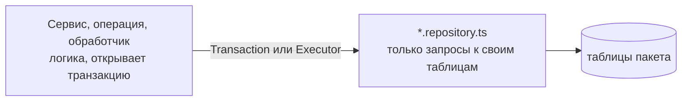

# Репозиторий над транзакцией

## Problem

Пакет читает и пишет свои таблицы, и часть записей должна лечь в одну транзакцию с записями другого пакета — например, история агента вместе с итогом шага runtime. Признак: запрос к таблицам схемы `app` из кода пакета.

## Shape

- **Правило**: каждый запрос к таблице — select, insert, update, delete, сырой SQL — лежит в файле `*.repository.ts` пакета, который владеет таблицей. Вне репозиториев запросов к таблицам нет. Исключение — тестовый код и сам `packages/db` (схема, миграции).
- **Репозиторий** только читает и пишет таблицы своего пакета и приводит свои строки к виду, который отдаёт; соединение с другой таблицей того же пакета остаётся в репозитории главной таблицы. Транзакцию или клиент базы он получает первым параметром и сам транзакцию не открывает. Запросы строит drizzle-orm ([ADR-0003](../../adr/ADR-0003-drizzle-data-layer.md)).
- **Тип транзакции один**, из `@agent-os/db`: `Transaction` — запись, которая обязана лечь в транзакцию вызывающего; `Executor` (`Database | Transaction`) — запрос, который можно выполнить и без транзакции. Своих псевдонимов пакеты не объявляют.
- **Сервис** (операция, обработчик шага, фоновый воркер) держит логику, открывает транзакцию, когда операция начинается в нём, и передаёт её репозиториям.
- **Форма репозитория** — своя у каждого пакета: в `runtime` — класс без состояния, в `agents` и `apps/api` — функции модуля.
- **Чужая транзакция** приходит параметром: runtime отдаёт транзакцию шага обработчику верхнего слоя, и репозиторий этого слоя пишет в ней. Репозиторий не открывает вложенную транзакцию и не держит транзакцию через вызов модели или внешней системы.
- Таблицы и их ограничения объявлены в модели схемы `app` в `@agent-os/db`; пакет импортирует оттуда только свои таблицы.

## Reference

- `packages/runtime/src/tasks/task.repository.ts` — репозиторий; `packages/runtime/src/messaging/inbox.ts` — сервис над `inbox.repository.ts`

## Not For

| Looks like | Use instead |
|---|---|
| чтение данных другого пакета | операция этого пакета из его функции сборки |
| SQL без таблицы: `pg_notify`, `LISTEN`, `set_config` транзакции | остаётся в коде, которому он нужен |
| хранилище Mastra или Memory | запрещено: всё состояние — в своих таблицах через этот паттерн |

## Used In

- [design-runtime.md](../../features/agent-platform/design-runtime.md) — таблицы `runtime_*`, запись обработчика в итоге шага
- [design-agents.md](../../features/agent-platform/design-agents.md) — таблицы `agent_*` в транзакции итога шага
- [design-runtime.md](../../features/custom-agents/design-runtime.md) — беседа — корневая сессия в `agent_sessions`, и `apps/api` читает и меняет её операциями `Agents.sessions`
- [design-identity.md](../../features/enterprise-access/design-identity.md) — таблицы `identity_*` и `audit_events` в `apps/api`
- [design-mcp-connect.md](../../features/enterprise-access/design-mcp-connect.md) — таблицы `agent_mcp_*`; внешний вызов вне транзакции (KD-1)
- [design-library.md](../../features/custom-agents/design-library.md) — таблицы `library_*` и событие аудита в транзакции изменения
- [design-task-list.md](../../features/deep-agents/design-task-list.md) — таблица `agent_session_tasks` и счётчик сессии в транзакции коммита шага (KD-1, KD-3)
