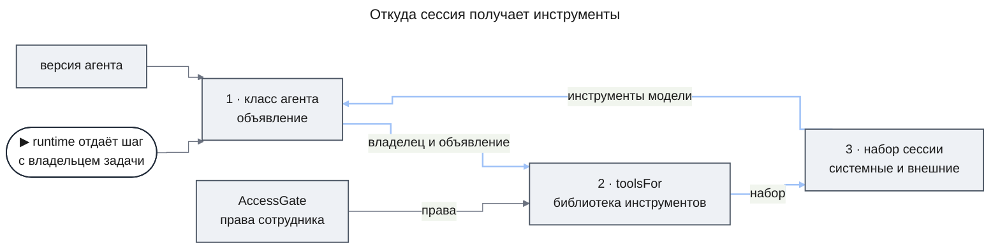

# Объявление инструментов

## Problem

Сессии агента нужен набор инструментов для модели. Его части решают разные стороны: внешние инструменты (MCP, `run_code`) ограничены правами сотрудника, от чьего имени идёт задача, а системные (старт агентов, `task`, список задач) зависят от того, какой это агент. Признак: код, который собирает набор, начинает ветвиться по виду агента или знать инструменты по именам.

## Shape

- **Один вход** — `toolsFor(ownerId, declaration)` реестра. Владельца даёт runtime в контексте шага, объявление — класс агента. Ответ — набор инструментов сессии; между шагами он не хранится.
- **Объявление** — простые данные (`ToolDeclaration`): серверы MCP агента, имена его системных инструментов по порядку, признак корня беседы и то, из чего инструменты строят свои описания: строки «кого можно запустить», флажки `taskList` и `listDelegation`. Его собирает конструктор `BaseAgent` из определения версии (`runDefinition`) в поле `declaration`; `ChatAgent` для вызова модели добавляет живой список записей сотрудника.
- **Внешние инструменты** выбирает только библиотека: `run_code` — каждой сессии, инструменты MCP — по правам владельца (`AccessGate.tools`) и его аккаунтам, суженные объявленными серверами. Вид агента в это решение не входит.
- **Системные инструменты** добавляются по объявлению. Библиотека не знает ни одного по имени: каждый регистрируется снаружи (`register`). Инструмент, чьё описание или схема зависят от агента, несёт в регистрации функцию `describe(declaration)`. Два флажка регистрации закрывают случаи, когда агент не может назвать инструмент сам: `rootOnly` — инструмент получает только корень беседы (инструменты записей из `apps/api`), `everySession` — каждая сессия.
- **Системный или внешний** — свойство инструмента в наборе: `kind` равен `system` или `external`. В историю и ответы API оно не попадает.
- **Исполнение** идёт через ту же библиотеку: вызов сверяют с набором без фильтра прав (`checkTools`), а исполнитель перед каждым вызовом заново спрашивает права.

## Reference

- `packages/agents/src/tools/tool.ts` — `ToolDeclaration`, контракт инструмента с `describe`
- `packages/agents/src/tools/tool-registry.ts` — `toolsFor`, `checkTools`, регистрация
- `packages/agents/src/agent/base-agent.ts` — `declaration` и `offeredDeclaration`; `agent/chat-agent.ts` — объявление корня
- `packages/agents/src/tools/system/index.ts` — набор системных инструментов; `apps/api/src/library/record-tools.ts` — инструменты записей

## Not For

| Looks like | Use instead |
|---|---|
| право сотрудника на сервер или инструмент | `AccessGate` в `apps/api`; библиотека только спрашивает его |
| правило, можно ли запустить запись или агента | чистая функция решения ([pure-decision.md](./pure-decision.md)) |
| определение агента: промпт, модель, флажки | версия агента ([immutable-versions.md](./immutable-versions.md)) |

## Used In

- [design-agents.md](../../features/agent-platform/design-agents.md) — инструменты сессии и их проверка
- [design-task.md](../../features/deep-agents/design-task.md) — описание и схема `task` по флажкам глубокого агента (DC-6)
