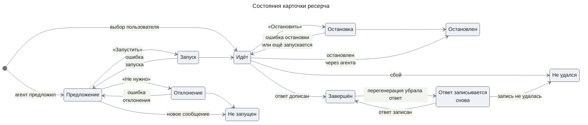
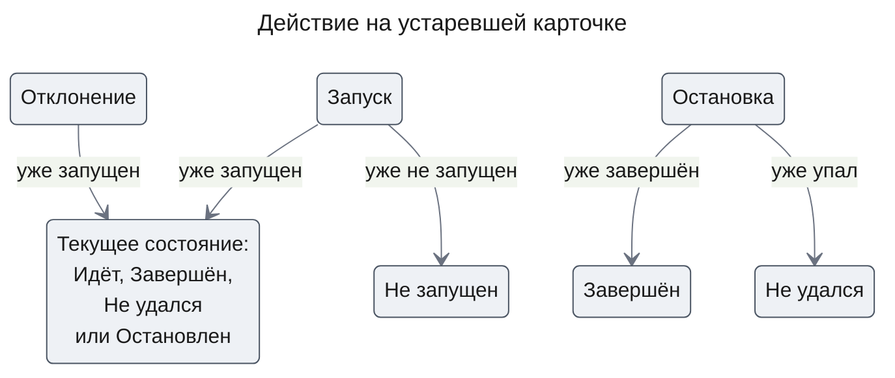

# Карточка ресерча

## Purpose

Карточка показывает одно расследование в ленте беседы весь его срок: от предложения агента до итога. На ней пользователь подтверждает или отклоняет запуск и останавливает идущее расследование. Подробный ход (шаги, воркеры, evidence) карточка не показывает — это экран `investigation-ui`. Решение с кнопок «Запустить» и «Не нужно» уходит агенту ходом решения, которого лента не показывает (deep-research UXRD, Primary Flow, шаг 3). Подтверждённая «Остановить» вызывает операцию остановки напрямую, без хода решения и без модели (agent-quality UXRD, KD-5).

## Anatomy

```
┌────────────────────────────────────────────────────┐
│ ✋ Ждёт подтверждения                    14:32     │  1 строка статуса · 2 время
│ Запустить глубокий ресерч?                         │  3 заголовок (только предложение)
│ Цель    Найти, почему с 14:00 выросли ошибки       │  4 цель
│         платежей в сервисе payments                │
│ Бюджет  до 400 000 токенов                         │  5 бюджет
│ ⚠ Источники данных не подключены — ответ будет     │  6 предупреждение (без источников)
│   из знаний модели.                                │
│ ⓧ Не удалось запустить ресерч. Попробуйте ещё раз. │  7 строка ошибки (по состоянию)
│ [ Запустить ]  [ Не нужно ]                        │  8 ряд действий
└────────────────────────────────────────────────────┘
```

1. **Строка статуса** — иконка статуса 14 px и метка статуса (Caption) цветом основы статуса.
2. **Время** — справа в строке статуса: время предложения или запуска, Caption, `--muted-foreground`, табличные цифры.
3. **Заголовок** — Heading; есть только в предложении.
4. **Цель** — подпись «Цель» (Caption, `--muted-foreground`) и вопрос, как его понял агент (UI, `--foreground`), целиком, без усечения.
5. **Бюджет** — подпись «Бюджет» и предел в токенах, табличные цифры.
6. **Предупреждение** — только в варианте «Без источников»: иконка `TriangleAlert` 14 px цветом `--warning` и текст (UI, `--foreground`, deep-research UXRD, MC-31). Своей подложки и рамки у строки нет: она стоит на подложке карточки в любом состоянии, в том числе на подложке предложения.
7. **Строка ошибки** — иконка `CircleX` цветом `--destructive` и текст `--foreground`; появляется только после неудачного действия. На том же месте в состоянии «Ещё запускается» стоит строка пояснения: иконка `Info` цветом `--info` и текст `--foreground` (agent-quality UXRD, MC-4).
8. **Ряд действий** — кнопки shadcn `button` размера `sm`, слева направо: основное, затем второстепенное.

Карточка не шире прозы ленты (chat-shell UXRD, D-01). Радиус lg, рамка 1 px, без тени ([foundations → Shape & Elevation](../foundations.md#shape--elevation)); внутренний отступ 12 px, промежуток между частями 8 px; плотность комфортная.

## Variants & Sizes

| Вариант | Когда | Чем отличается |
|---|---|---|
| По предложению | Агент предложил ресерч, пользователь его не выбирал | Начинается с состояния «Предложение» |
| По выбору | Пользователь сам включил режим ресерча для сообщения | Начинается с «Идёт»; заголовка и решения нет |
| Без источников | В развёртывании не подключён ни один источник данных | Строка предупреждения под бюджетом во всех состояниях; сочетается с обоими вариантами выше |

На предложении строка предупреждения отражает источники, подключённые сейчас, а после запуска — режим, в котором ресерч действительно идёт.

Размер один. При грубом указателе кнопки вырастают до 44 px.

## States

Смена состояния — перекрёстное растворение иконки и цвета за 150 ms, без вспышки ([foundations → Motion](../foundations.md#motion)). Подложку и рамку в каждой строке задают роли [foundations → Color](../foundations.md#color).

| Состояние | Как выглядит | Как ведёт себя |
|---|---|---|
| Предложение | Подложка `--approval-subtle`, рамка `--approval-border`; иконка `Hand` и метка «Ждёт подтверждения» цветом `--approval`; кнопки «Запустить» (`default`) и «Не нужно» (`outline`) | Ждёт решения, пока пользователь не нажмёт кнопку или не отправит следующее сообщение. Нажатие кнопки на другой карточке следующим сообщением не считается |
| Запуск | Как «Предложение»; обе кнопки неактивны, в «Запустить» вместо подписи — вращающаяся `LoaderCircle` и подпись состояния «Запуск» (deep-research UXRD, MC-7) | Длится весь ход решения. Повторное нажатие ничего не делает. Если ресерч уже запущен (другая вкладка), карточка переходит в его текущее состояние: «Идёт», «Завершён», «Не удался» или «Остановлен». Если от предложения уже отказались или беседа продолжилась без него — в «Не запущен» с этой причиной; строки ошибки нет |
| Ошибка запуска | «Предложение» и строка ошибки (deep-research UXRD, MC-15) | Ресерч не стартовал, ход решения упал или пользователь прервал его из композера. Кнопки снова активны; повтор — та же «Запустить» |
| Отклонение | Как «Предложение»; обе кнопки неактивны, в «Не нужно» вместо подписи — вращающаяся `LoaderCircle` и подпись состояния «Отклонение» (deep-research UXRD, MC-7) | Длится весь ход решения, как «Запуск». Если ресерч по этому предложению уже запущен, карточка переходит в его текущее состояние: «Идёт», «Завершён», «Не удался» или «Остановлен», без строки ошибки |
| Ошибка отклонения | «Предложение» и строка ошибки (deep-research UXRD, MC-29) | Ход решения упал или прерван из композера. Кнопки снова активны |
| Идёт | Подложка `--card`, рамка `--border`; иконка `LoaderCircle` цветом `--info`, метка «Ресерч идёт»; цель и бюджет; кнопка «Остановить» (`outline`) | Иконка вращается всё время, пока ресерч идёт; подпись не мерцает. Несколько карточек «Идёт» в ленте вращаются в одной фазе. «Остановить» открывает подтверждение остановки |
| Подтверждение остановки | Ряд действий заменён вопросом (UI, `--foreground`) и кнопками «Остановить» (сплошная `--destructive`) и «Продолжить» (`outline`) | «Продолжить» и Esc возвращают ряд действий; «Остановить» — в «Остановка» |
| Остановка | Иконка статична (`CircleDashed`, `--muted-foreground`), метка состояния «Остановка» (deep-research UXRD, MC-9); кнопок нет | Длится, пока операция остановки не ответит; композер и другие карточки при этом не меняются (agent-quality UXRD, KD-5). Если ресерч уже завершился, упал или остановлен, карточка переходит в это состояние без строки ошибки |
| Ошибка остановки | «Идёт» и строка ошибки (deep-research UXRD, MC-16) | Операция остановки, вызванная кнопкой, отказала или не ответила. «Остановить» снова доступна |
| Ещё запускается | «Идёт» и строка пояснения (agent-quality UXRD, MC-4) | Операция остановки ответила, но ресерч ещё стартовал и не остановлен; «Остановить» доступна. Строка уходит при следующей смене состояния или следующем нажатии «Остановить» (agent-quality UXRD, KD-6) |
| Решение недоступно | Текущее состояние; «Запустить» и «Не нужно» — в виде неактивной кнопки | Пока во вкладке стримится ответ агента, в том числе ход решения другой карточки, эти кнопки не нажимаются (deep-research UXRD, KD-8). Оба «Остановить», «Продолжить», Esc и «К ответу» работают (agent-quality UXRD, KD-5). Кнопки оживают, когда ответ закончился |
| Завершён | Подложка `--card`; иконка `CircleCheck` цветом `--success`, метка «Ресерч завершён»; вместо кнопок — ссылка «К ответу» цветом `--primary` | Ссылка прокручивает ленту к ответу ресерча и переводит на него фокус |
| Ответ записывается снова | Как «Завершён», но без ссылки «К ответу» | Перегенерация убрала ответ вместе с хвостом беседы, и он встанет снова в её конец. Ссылка появляется, когда ответ записан; если записать его не удалось — «Не удался» |
| Не удался | Подложка `--card`; иконка `CircleX` цветом `--destructive`, метка «Ресерч не удался» и пояснение (UI, `--foreground`) | Кнопок нет: новый запуск — новым сообщением. То же, когда ответ не удалось записать |
| Остановлен | Подложка `--card`; иконка `CircleStop` и метка «Ресерч остановлен» цветом `--muted-foreground`; пояснение «Ответа не будет.» | Кнопок нет |
| Не запущен | Подложка `--card`; иконка `CircleMinus` и метка «Ресерч не запущен» цветом `--muted-foreground`; причина: отказ или продолжение беседы | Кнопок нет; цель и бюджет остаются видны как запись того, что предлагалось |
| Focus | Кольцо фокуса `--ring` у кнопок и ссылки; у карточки — когда на неё переведён фокус после решения | Фокус на карточке не выделяет её подложкой |

Остановка, о которой попросили агента, строку ошибки не показывает: карточка сразу не меняется, а что вышло, говорит реплика агента (agent-quality UXRD, Error Flows).

Под `prefers-reduced-motion` вращение `LoaderCircle` заменяет статичная `CircleDashed`, смена состояния — мгновенная.



Судьба ресерча могла решиться в другой вкладке или без пользователя. Тогда действие на старой карточке ведёт не по основному пути, а к уже решённому состоянию, без строки ошибки и, как любое решение, без нового сообщения в ленте.



## Content Rules

- Метки статуса — короткое предложение без точки: «Ресерч идёт». Пояснения — полные предложения с точкой.
- Цель — вопрос, как его понял агент, без усечения: пользователь подтверждает именно этот текст.
- Предупреждение без источников не усекается и переносится по словам.
- Бюджет — «до {N} токенов», число с разделителем разрядов (неразрывный узкий пробел).
- Время — «ЧЧ:ММ» за сегодня, иначе «30 окт., ЧЧ:ММ».
- Подписи кнопок — глагол или короткая фраза, без иконок, кроме индикатора в «Запуск» и «Отклонение».

## Accessibility

| Аспект | Правило |
|---|---|
| Роль | `group` внутри реплики ассистента |
| Доступное имя | «Ресерч: {цель}»; метка статуса — часть содержимого и читается первой; предупреждение без источников читается после бюджета как обычный текст |
| Клавиатура | Tab по кнопкам и ссылке в порядке ряда; Enter и Space нажимают; Esc в подтверждении остановки равен «Продолжить». Неактивная кнопка решения остаётся в порядке Tab, сообщает о недоступности (`aria-disabled`) и читает описание (deep-research UXRD, MC-30); нажатие ничего не делает |
| Фокус | При нажатии «Запустить», «Не нужно» и подтверждённой «Остановить» фокус сразу переходит на карточку (программный фокус на контейнер). После «Запустить» и «Не нужно» кнопки неактивны до конца хода решения и затем исчезают; после подтверждённой «Остановить» ряд действий исчезает сразу. «Остановить» в ряду действий переводит фокус на «Продолжить»; «Продолжить» возвращает его на «Остановить» |
| Объявления | Карточка сама не объявляет смену состояния — это делает экран (deep-research UXRD, Accessibility) |
| Цвет | Статус всегда передают иконка и текстовая метка; подложка `--approval-subtle` — дополнительный признак. Предупреждение передаёт текст, иконка — дополнительный признак |

## Used In

- [docs/features/deep-research/uxrd.md](../../features/deep-research/uxrd.md) — элемент DR-03 в ленте беседы.
- [docs/features/agent-quality/uxrd.md](../../features/agent-quality/uxrd.md) — остановка прямой операцией, без хода решения.
