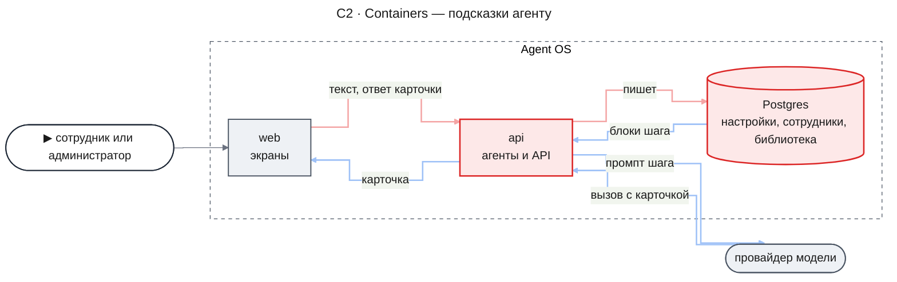
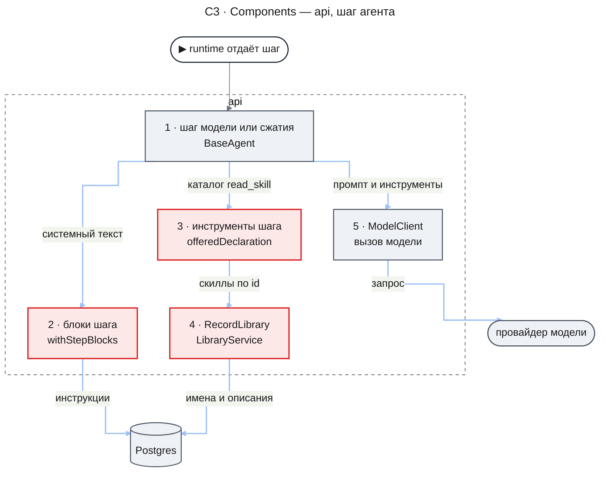
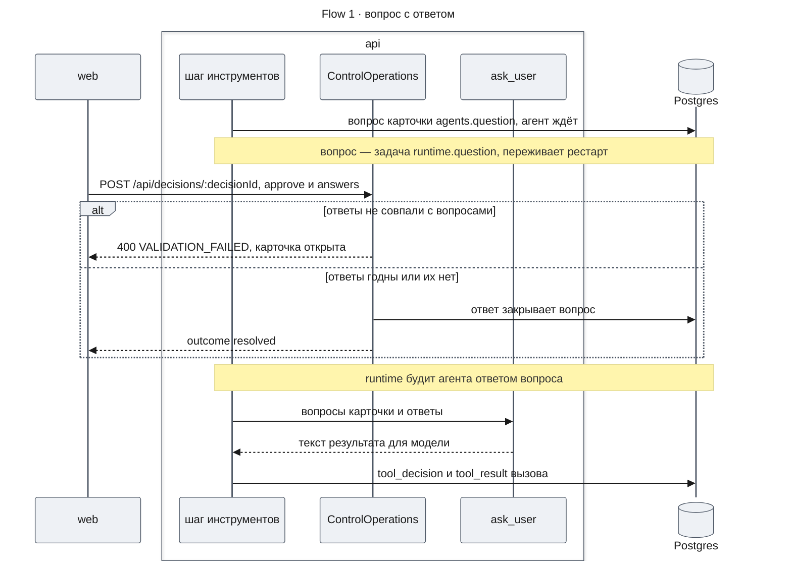
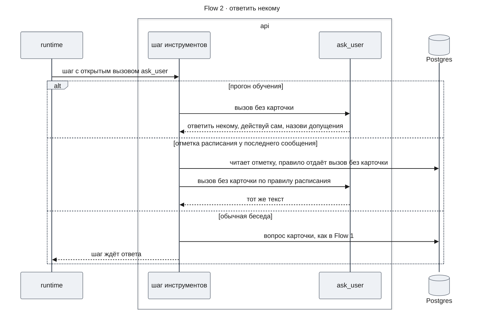
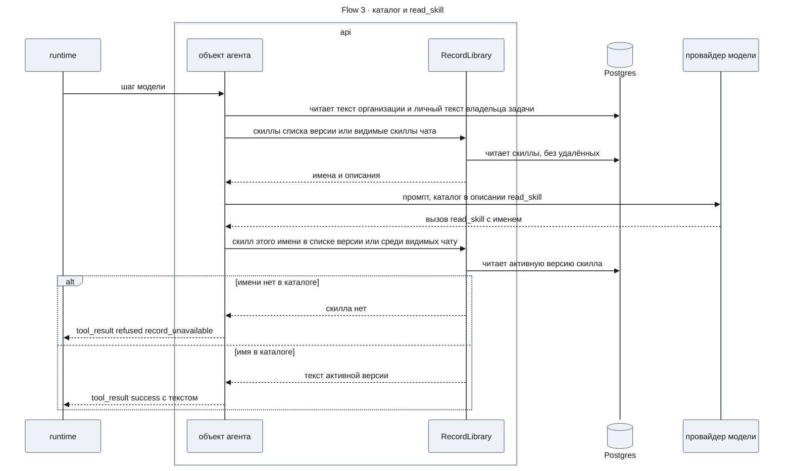
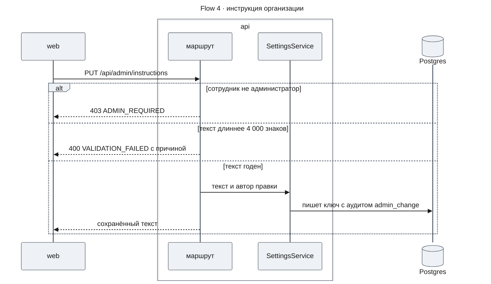
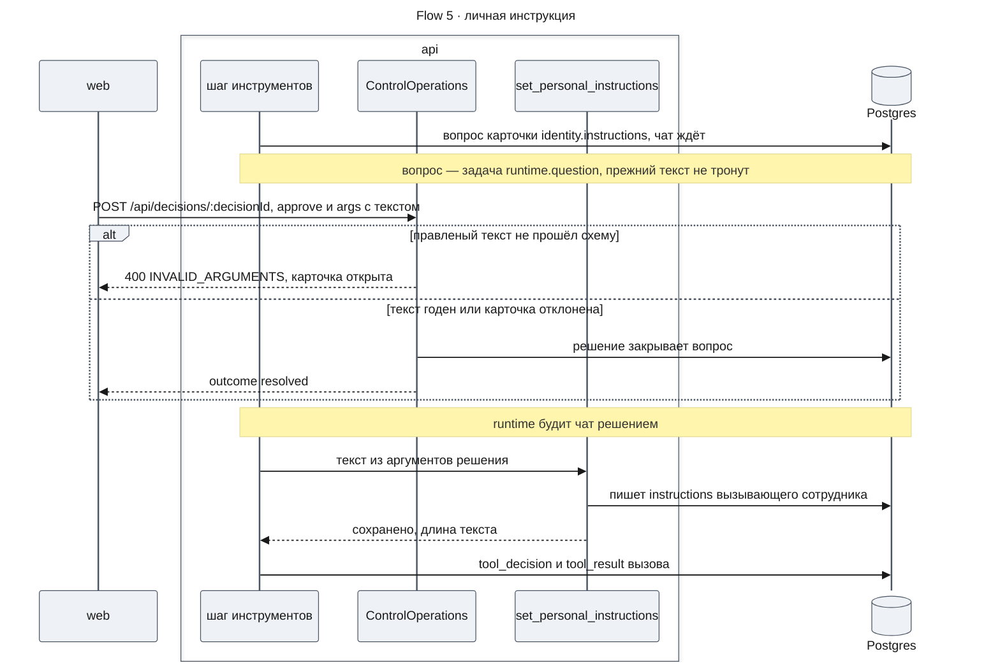

# Подсказки агенту — вопрос, инструкции, скиллы — Design Document — server

**Status:** На утверждении · **Date:** 2026-11-28 · **PRD:** [prd.md](./prd.md) · **UXRD:** [uxrd.md](./uxrd.md) · **Depends on:** нет

## Snapshot

**Overview.** Агент на слабой модели угадывает там, где ответ знает человек. Эта часть даёт ему три подсказки. Первая — инструмент `ask_user`: агент задаёт сотруднику до четырёх вопросов с вариантами, карточка ждёт ответа тем же путём, что подтверждение изменяющего вызова, а ответы приходят модели результатом вызова; когда ответить некому (расписание, обучение), вызов сразу возвращает «действуй сам». Вторая — два текста, которые шаг агента читает заново перед каждым вызовом модели и ставит в системный промпт: инструкция организации от администратора и личная инструкция сотрудника, от чьего имени идёт запуск. Личный текст меняет только главный чат инструментом `set_personal_instructions`: карточка показывает итоговый текст, сотрудник правит его и подтверждает, и только тогда текст сохраняется. Третья — скилл, новый вид записи библиотеки с текстом процедуры: версия агента хранит список скиллов, их имена и описания стоят в описании инструмента `read_skill`, как список агентов в описании `start_agent`, а текст модель читает этим инструментом.

- **Не меняется**: механизм ожидания человека (вопрос — задача `runtime.question`), права по ролям, правило хода расписания для изменяющих вызовов, видимость записей библиотеки, бюджет списка главного чата, судья обучения.
- **Главный риск**: текст коллеги в промпте может увести агента не туда; код от этого не зависит — права и карточки решает он ([Risks](#risks-and-mitigation)).
- **Открытые вопросы**: предложение владельцу про сжатие истории ([Open Questions](#open-questions)).

### Key Decisions

#### KD-1: `ask_user` — встроенный инструмент со своей карточкой на пути подтверждения, ответы идут новым полем решения

Карточка вопроса — ещё один вид карточки, `agents.question`, рядом с подтверждением, брифом и записью библиотеки. `ask_user` объявляет у себя подтверждение этого вида, а содержимое карточки — вопросы из аргументов вызова. Дальше работает готовый путь: шаг инструментов задаёт вопрос через `effects.ask`, агент ждёт, вопрос переживает рестарт и виден в дереве корня, беседа стоит в «ждёт вас». Ответ сотрудника — тело `POST /api/decisions/:decisionId` с `approve: true` и новым полем `answers`; после ответа инструмент получает ответы вместе с вопросами и возвращает модели текст результата. Пропуск — то же решение без `answers`: каждый вопрос остаётся без ответа, и модель узнаёт, на что сотрудник не ответил (AC-01.3). Новых статусов, маршрутов и полей для пропуска нет. Ответы как правленые `args` отвергнуты: схема аргументов, которую видит модель, предлагала бы ей самой заполнить ответы. Пропуск как `approve: false` отвергнут: отклонённый вызов модель видит одной меткой `[rejected]`. Отдельный маршрут вопросов отвергнут ограничением PRD «один механизм ожидания человека».

#### KD-2: Когда ответить некому, `ask_user` исполняется без вопроса и сам говорит «действуй сам»

`ask_user` объявляет каждый вид агента, кроме тренера: тренер в диалоге создания и проверки говорит с сотрудником концом хода, и инструмента вопроса у него нет ([design-trainer-dialog.md](../create-and-test/design-trainer-dialog.md), KD-2). В дереве обучения шаг инструментов уже исполняет любой не-MCP вызов с карточкой без вопроса (`sendUnasked`), поэтому прогоны обучения получают поведение без новой проверки `caller.training`. В ходе расписания правило вызова `callRule` отправляет без карточки бриф глубокого агента; карточка вопроса встаёт в то же исключение. В обоих случаях инструмент получает вызов без карточки и возвращает модели одну фразу: ответить некому, действуй по лучшему суждению и перечисли допущения в ответе (AC-02.1, AC-02.2). Владелец, написавший в беседу расписания, снимает отметку хода со следующего вызова, и карточка появляется, как в обычной беседе (AC-02.3). Отказ `unattended` отвергнут: его текст говорит «нужно разрешение владельца», а в обучении исход был бы другим, чем в расписании. `ask_user` у тренера с ответом «ответить некому» отвергнут: в диалоге сотрудник рядом, и такой ответ был бы неправдой. Шестая проверка признака обучения внутри инструмента отвергнута правилом пакета `agents`: признак читают ровно пять мест.

#### KD-3: Порядок блоков промпта — от самого постоянного к самому живому; инструкции без конверта

Системный текст шага: промпт определения, инструкция организации, личная инструкция, оглавление памяти, список задач. Порядок от редко меняющегося к часто меняющемуся держит начало текста одинаковым дольше всего, а это кэш промпта. Обе инструкции идут как есть, после строки, которая называет автора: текст администратора для всех агентов и текст сотрудника, на которого работает агент. Это инструкции по смыслу, а конверт `<data>` по общей преамбуле — материал, «никогда не инструкции». Шаг сжатия истории строит свой системный текст той же функцией, но без двух блоков инструкций, как требует PRD: сжатие не работает на сотрудника. Ценой этого вызов сжатия теряет кэш промпта с места первой инструкции ([Open Questions](#open-questions)). Судья обучения и заголовок беседы строят свой текст сами и не получают ни одного блока.

#### KD-4: Текст организации — ключ настроек, личный текст — поле сотрудника; оба читаются на каждом шаге

Инструкция организации — новый ключ `organisation_instructions` в таблице настроек, строка по умолчанию с пустым текстом ([keyed-settings.md](../../code-system/patterns/keyed-settings.md)). Её пишет администратор маршрутом панели, с обычной записью аудита `admin_change`. Личная инструкция — новое поле `instructions` строки сотрудника в `identity_users`. Пишет её только инструмент главного чата после карточки (KD-8); ни один маршрут, кроме чтения собственной беседы сотрудника с его карточкой, этот текст не отдаёт, а лог пишет только длину (AC-04.3). Шаг читает оба текста перед каждым вызовом модели: ключ — по таблице настроек, личный — по владельцу задачи. Владелец задачи — сотрудник, чей это запуск, а не автор версии агента, поэтому агент, которым поделилась Аня, у Бориса получает текст Бориса (AC-04.2). Кэш текстов отвергнут: правка должна доходить до работающего агента со следующего шага (AC-03.1), а чтение строки по ключу дешевле, чем сброс кэша.

#### KD-5: Скилл — третий вид записи библиотеки, который нельзя запустить

`RecordKind` получает значение `skill`, а версия скилла — содержимое из одного текста процедуры. Имя, описание, аудитория, «предлагать в главном чате», копия, версии, удаление и аудит — те же, что у агента (ADR-0016). Скилл никогда не стартует: каждый путь, который берёт агента, — процедура старта, вызов по имени, фишка сообщения, расписание, память, обучение и инструменты записей главного чата — принимает только `agent` и `deep_agent`, а скилл для него — как отсутствующая запись (PRD, Won't Have). Поле `skills` чату не показывается, как `selfLearning` и скрипты: создание из чата даёт пустой список, а правка берёт его из сохранённой версии ([immutable-versions.md](../../code-system/patterns/immutable-versions.md)). Отдельная таблица скиллов отвергнута: она повторила бы аудиторию, версии, копию и аудит, которые PRD требует такими же, как у агента.

#### KD-6: Версия агента хранит id скиллов; каталог — строки в описании `read_skill`, как список агентов в описании `start_agent`

У содержимого `agent` и `deep_agent` новое поле `skills` — список id записей-скиллов, до 20, без повторов, по умолчанию пустой. Ссылка идёт на запись, а не на версию: текст читается из активной версии в момент чтения (AC-06.2). Каталог — строки «имя (чей) — описание» в описании `read_skill`. Их строит `offeredDeclaration` на каждом шаге тем же путём и той же функцией строки, какими агент и чат строят строки `start_agent`. Разница между видами агента — только в том, откуда берётся список скиллов:

| Вид агента | Список скиллов каталога |
|---|---|
| агент и глубокий агент, сабагент, прогон обучения | скиллы списка своей версии, в его порядке, без видимости запускающего и без удалённых (AC-06.4, AC-06.5, AC-06.6) |
| главный чат | видимые владельцу скиллы, которые чат предлагает по правилу `inRootLaunchSet`: свои всегда, чужие с «предлагать в главном чате» (AC-07.1, AC-07.2, KD-7) |
| тренер | каталога и `read_skill` нет: `agent_definition` отдаёт имя, описание и текст каждого скилла обучаемой версии (FR-08) |

`read_skill` ищет имя заново в момент вызова: главный чат — `resolveByName` среди видимых скиллов с тем же правилом `inRootLaunchSet`, остальные — в списке своей версии, первый скилл этого имени по порядку списка. Ветка по `ToolCaller.root` — та же, что у `start_agent`. Скиллы версии читаются без видимости запускающего: PRD требует, чтобы скиллы приходили вместе с агентом. Список id — часть неизменной версии, а имена, описания и тексты скиллов — живые данные рядом с ней.

Отвергнуто:

- Каталог отдельным блоком системного промпта — он требовал бы пятого блока, своей строки правила и своего правила по видам агента, а описание инструмента уже несёт списки агентов у чата и у агента.
- Ссылка на версию скилла — правка скилла не доходила бы до агентов.
- `read_skill` у тренера — тренеру понадобился бы свой каталог по обучаемой версии, а `agent_definition` эту версию уже читает.

Обучение список не меняет: предложенная версия переносит его из базовой, а инструменты тренера его не правят (AC-08.1).

#### KD-7: Скиллы главного чата — в общем списке чата, под тем же бюджетом и тем же правилом

Строки скиллов входят в `chatListing` рядом со строками агентов и глубоких агентов: тот же бюджет `CHAT_LISTING_BUDGET` и тот же порядок, в котором пропадают описания (`custom-agents` AC-15.3). Описание теряет сначала запись, с которой сотрудник начал меньше всего бесед, при равенстве — по имени. Скилл бесед не начинает, поэтому скиллы теряют описания раньше агентов, которых сотрудник запускал; имена остаются все. Отдельный бюджет каталога со счётом чтений `read_skill` отвергнут: ради порядка, который не проверяет ни один AC, он добавил бы второй бюджет и чтение журнала вызовов на шаге.

#### KD-8: Личную инструкцию пишет инструмент главного чата с правимой карточкой на готовом пути подтверждения

`set_personal_instructions` — встроенный инструмент, который `apps/api` регистрирует так же, как инструменты записей библиотеки ([record-tools.ts](../../../apps/api/src/library/record-tools.ts)). Аргумент один — `text`, итоговый текст целиком. Инструмент объявляет подтверждение вида `identity.instructions`: карточка показывает `{text}`, а сотрудник может его править. Правленые аргументы возвращаются с решением и проходят схему инструмента, как бриф `start_deep_agent`. После подтверждения `execute` пишет текст из аргументов решения в поле `instructions` вызывающего сотрудника через `UsersService`. Каждая часть — самый простой вариант, который ещё выполняет PRD:

- Инструмент вместо маршрута формы: PRD v1.2 меняет текст только через главный чат (FR-04), второй путь записи остался бы без потребителя.
- `rootOnly`: инструмент получает только `ChatAgent` — корень беседы. Агенты, сабагенты, тренер и прогоны обучения его не получают, и путь `sendUnasked` без карточки до него не доходит.
- Инструмента чтения нет: текущий текст уже стоит блоком в системном тексте каждого шага чата (KD-3). Описание инструмента говорит, что текст там, что его отсутствие значит пустой текст и что вызов передаёт весь итоговый текст (AC-04.7).
- `editableArgs: true` вместо готового текста без правки: AC-04.6 сохраняет текст вместе с правками сотрудника.
- Свой вид карточки вместо `agents.tool_confirmation`: общая карточка показывает аргументы как есть, а FR-10 требует поле текста со счётчиком знаков, и `web` различает карточки по `kind`.
- Ни аргумента сотрудника, ни `review`: инструмент пишет только `caller.ownerId` (AC-04.8), а длину проверяет схема аргументов до карточки (AC-04.4).
- Своей проверки хода расписания нет: `callRule` уже отказывает `unattended` без карточки каждому встроенному вызову, кроме брифа (AC-04.9).
- `loggedArgs` с длиной вместо аргументов целиком: лог уходит в Sentry, а текст видит только сам сотрудник (AC-04.3).

## Terms

- **Блок шага** — кусок системного промпта, который шаг агента читает из таблиц перед каждым вызовом модели и не пишет в историю ([step-prompt-block.md](../../code-system/patterns/step-prompt-block.md)).
- **Карточка** — вопрос сотруднику в беседе; технически дочерняя задача агента типа `runtime.question`, которую закрывает решение по `POST /api/decisions/:decisionId`.
- **Конверт** — обёртка `<data source author>` вокруг текста, который модель читает как материал, а не как инструкцию; в ней приходит результат любого инструмента.
- **Отметка расписания** — поле `schedule` последнего сообщения корня беседы; по ней шаг инструментов узнаёт ход расписания.
- **Дерево обучения** — задачи под корнем `trainer`: сам тренер и прогоны прошлых задач.
- **Каталог скиллов** — строки с именами и описаниями скиллов в описании инструмента `read_skill`.

## Part

- **Prerequisite ADRs**: [ADR-0016](../../adr/ADR-0016-library-records-and-visibility.md) (записи библиотеки и видимость), [ADR-0017](../../adr/ADR-0017-run-snapshots-from-library.md) (запуск на неизменной версии), [ADR-0021](../../adr/ADR-0021-deep-agent-record-kind.md) (виды записей), [ADR-0023](../../adr/ADR-0023-live-task-objects-one-stepping-process.md) (живые объекты, чтение прав на каждом шаге), [ADR-0024](../../adr/ADR-0024-every-reference-is-a-foreign-key.md) (id в списке внутри определения — без внешнего ключа), [ADR-0025](../../adr/ADR-0025-settings-key-table.md) (таблица настроек по ключу).

**Out of scope**

- Runtime не меняется: вопрос — та же задача `runtime.question` с той же формой входа, один вопрос на коммит.
- Правило хода расписания для MCP-вызовов, скриптов, `run_code` и записей библиотеки остаётся прежним: вне разрешения — отказ `unattended`.
- Судья обучения и заголовок беседы не меняются.
- Главный чат не создаёт, не правит и не удаляет скиллы (KD-5).
- Экраны карточек вопроса и личной инструкции, поля инструкции организации и скиллов в библиотеке — часть `web`; она берёт контракты ниже.

**Constraints**

- Модель судит, алгоритм решает: ни один код не читает текст инструкций и скиллов; права, карточки и отказы решают те же проверки, что сейчас (NFR-01).
- Настройки в базе: инструкция организации — ключ настроек, личная — строка сотрудника; переменных окружения и файлов нет.
- Изоляция: личный текст читают только сам сотрудник и шаги его задач; скилл с ограниченной аудиторией виден в библиотеке только аудитории, а в запуске — только через список версии агента (NFR-02). Новые маршруты и `set_personal_instructions` покрыты e2e с двумя сотрудниками.
- Время до первого токена (NFR-03): шаг добавляет два чтения по ключу, а агент со скиллами — одно чтение записей по списку id; главный чат берёт скиллы из заголовков, которые уже читает для своего списка.
- PoC: схема меняется без переноса данных, миграции генерируются заново, база разработки пересоздаётся.

## Building-block Inventory

Follows the [code system](../../code-system/README.md).

| Building block | Pattern | Status | Note |
|---|---|---|---|
| `withStepBlocks` и чтение блоков шага | [step-prompt-block.md](../../code-system/patterns/step-prompt-block.md) | extended | два новых блока в порядке KD-3; одно чтение блоков для шага модели и шага сжатия, у сжатия без инструкций |
| ключ `organisation_instructions` и маршрут панели | [keyed-settings.md](../../code-system/patterns/keyed-settings.md) | extended | новый ключ, строка по умолчанию, маршрут по образцу `AdminSelfLearningSettingsController` |
| `instructions` в `identity_users`, `UsersService` | [repository-over-transaction.md](../../code-system/patterns/repository-over-transaction.md) | extended | новое поле и запись текста вызывающего сотрудника по подтверждённой карточке |
| `set_personal_instructions` | [tool-declaration.md](../../code-system/patterns/tool-declaration.md) | reused | встроенный `rootOnly` инструмент из `apps/api` по образцу инструментов записей, подтверждение вида `identity.instructions` с правкой аргументов (KD-8) |
| `ask_user` | [tool-declaration.md](../../code-system/patterns/tool-declaration.md) | reused | системный инструмент в объявлении каждого вида агента, кроме тренера, с подтверждением вида `agents.question`; ответы сотрудника доходят до инструмента рядом с содержимым карточки |
| `read_skill` и `ToolDeclaration` | [tool-declaration.md](../../code-system/patterns/tool-declaration.md) | reused | системный инструмент версии со скиллами и главного чата; строки каталога приходят в объявлении, как `startable`, и попадают в описание через `describe` |
| `callRule` | [pure-decision.md](../../code-system/patterns/pure-decision.md) | extended | карточка вопроса в ходе расписания уходит без вопроса, как бриф |
| `offeredDeclaration` у `BaseAgent` и `ChatAgent` | [step-handler.md](../../code-system/patterns/step-handler.md) | extended | строки скиллов: у версии — по её списку, у чата — из `chatListing` (KD-6) |
| `chatListing` | [pure-decision.md](../../code-system/patterns/pure-decision.md) | extended | строки скиллов в том же бюджете и том же порядке отбрасывания описаний (KD-7) |
| порт `RecordLibrary` и `LibraryService` | [composition-root.md](../../code-system/patterns/composition-root.md) | extended | одно новое чтение: скиллы по списку id с текстом активной версии, без видимости и без удалённых |
| `agent_definition` тренера | [tool-declaration.md](../../code-system/patterns/tool-declaration.md) | extended | рядом с содержимым версии — имя, описание и текст каждого её скилла |
| вид записи и содержимое версии | [immutable-versions.md](../../code-system/patterns/immutable-versions.md) | extended | вид `skill`, поле `skills` с пустым списком по умолчанию |
| правила сохранения и копии записи | [pure-decision.md](../../code-system/patterns/pure-decision.md) | extended | поле `skills` проходит те же правила, что поле `agents`: добавленный должен быть виден автору, копия теряет невидимые копирующему |

## Acceptance Criteria

### FR-01: Вопрос с вариантами

- From the PRD: AC-01.1, AC-01.2, AC-01.3, AC-01.4, AC-01.5, AC-01.6.
- Решение по карточке вопроса с `answers`, которые не совпадают с вопросами карточки, отклоняется с 400 `VALIDATION_FAILED`, и карточка остаётся открытой (DC-1).

### FR-02: Вопрос, когда ответить некому

- From the PRD: AC-02.1, AC-02.3.
- AC-02.2 держится для прогонов обучения; у тренера `ask_user` нет, и обучение его вопросами не ждёт (KD-2, DC-2).

### FR-03: Инструкция организации

- From the PRD: AC-03.1, AC-03.2, AC-03.3, AC-03.4, AC-03.5.

### FR-04: Личная инструкция

- From the PRD: AC-04.1, AC-04.2, AC-04.3, AC-04.4, AC-04.5, AC-04.6, AC-04.7, AC-04.8, AC-04.9.

### FR-05: Скилл в библиотеке

- From the PRD: AC-05.1, AC-05.2, AC-05.3.
- Скилл нельзя запустить: `start_agent` с именем скилла, фишка, расписание и перезапуск с id скилла отвечают, как для отсутствующего агента (DC-3).

### FR-06: Скиллы агента

- From the PRD: AC-06.1, AC-06.2, AC-06.3, AC-06.4, AC-06.5, AC-06.6, AC-06.7, AC-06.8.
- Сохранение агента с добавленным скиллом, которого автор не видит, отклоняется с 422 `RECORD_REJECTED`, причиной `skill_not_visible` и путём `skills`; скилл, который уже стоял в списке, не проверяется (DC-4).

### FR-07: Скиллы в главном чате

- From the PRD: AC-07.1, AC-07.2.

### FR-08: Обучение и скиллы

- From the PRD: AC-08.1.
- `agent_definition` тренера отдаёт имя, описание и текст каждого скилла обучаемой версии (DC-5).

## Design

### Architecture (C1–C4)

#### C2 · Containers

Вся часть живёт в `api`: в пакетах `agents`, `contracts`, `db` и в модулях приложения. В Postgres меняются схема настроек, строка сотрудника и содержимое записей библиотеки; `web` — отдельная часть, которая берёт контракты ниже.

#### C3 · Components: api

**api — шаг агента собирает промпт и инструменты**

Блоки шага читает одно место для шага модели и шага сжатия: ключ `organisation_instructions`, поле `instructions` владельца задачи, память и задачи; шаг сжатия берёт их без двух инструкций. Пустой текст блока не даёт (AC-03.2). `ModelClient` по-прежнему дописывает к тексту преамбулу о конвертах и правило кода. `offeredDeclaration` агента читает скиллы своей версии через `RecordLibrary` без проверки видимости, но без удалённых; `offeredDeclaration` чата берёт строки скиллов из `chatListing`, которому отдаёт заголовки, уже прочитанные для списка агентов. Пустой каталог — `read_skill` не объявлен.

### Runtime Flows

#### Flow 1: Вопрос с ответом сотрудника

**Starts when:** модель любого агента обычной беседы вызвала `ask_user`, for AC-01.1, AC-01.2, AC-01.3, AC-01.5, AC-01.6, AC-02.3

Результат вызова называет каждый вопрос и его ответ: выбранные варианты, текст сотрудника из «Другое» или «нет ответа». Если хоть один вопрос остался без ответа, результат добавляет указание действовать по лучшему суждению и назвать допущения (AC-01.3). Модель читает его в конверте, как результат любого инструмента. Записи `tool_decision` и `tool_result` — аудит вызова, как у любого инструмента: аргументы с вопросами, ответы в тексте результата, исход (AC-01.6). Стоп агента закрывает вопрос без ответа, как любую карточку.

#### Flow 2: Вопрос, когда ответить некому

**Starts when:** `ask_user` вызван в прогоне обучения или в ходе расписания, for AC-02.1, AC-02.2

В первых двух ветках шаг закрывает вызов в своём коммите с исходом `success`, ход не ждёт; в ходе расписания запись `tool_decision` несёт разрешение расписания, как у брифа. Признак дерева обучения шаг уже знает до правила расписания, поэтому прогоны обучения не читают отметку. Вызов без карточки инструмент отличает от пропуска по тому, что содержимого подтверждённой карточки у него нет.

#### Flow 3: Шаг агента со скиллами и чтение скилла

**Starts when:** runtime отдаёт шаг агенту, у которого есть каталог, а модель зовёт `read_skill`, for AC-03.1, AC-04.1, AC-04.2, AC-06.1, AC-06.2, AC-06.3, AC-06.5, AC-06.6, AC-07.1

Шаг вызова модели и шаг инструментов — два разных шага runtime; на схеме они слиты в одну линию. Имя ищется заново в момент вызова `read_skill`, поэтому скилл, удалённый после шага модели, уже не читается (AC-06.6). Блоки и каталог не пишутся в историю, журнал и лог: лог шага несёт длины и число скиллов.

#### Flow 4: Сохранение инструкции организации

**Starts when:** администратор сохраняет текст организации, for AC-03.3, AC-03.4

Отказ ничего не пишет, прежний текст остаётся. Текст организации попадает в аудит `admin_change` и в лог целиком, как значение любого ключа настроек: PRD называет его несекретным.

#### Flow 5: Личная инструкция через карточку главного чата

**Starts when:** модель главного чата обычной беседы вызвала `set_personal_instructions`, for AC-04.4, AC-04.5, AC-04.6, AC-04.7, AC-04.8

Шаг вызывает инструмент только после `approve: true`. Отклонённую карточку шаг закрывает без него: модель читает `[rejected]`, а текст не меняется (AC-04.6). Текст длиннее 4 000 знаков в аргументах модели отклоняет схема до карточки: вызов закрыт `invalid_arguments` с причиной, карточки нет (AC-04.4). В ходе расписания `callRule` отказывает `unattended` до карточки, и инструмент не вызывается (AC-04.9). Со следующего шага блок KD-3 несёт сохранённый текст; пустой текст блока не даёт (AC-04.7). Аудит вызова — `tool_result` и лог — текста не несёт: результат и лог называют исход и длину. Карточка и правленые аргументы лежат в истории беседы сотрудника, как у любой карточки, и видны только ему (AC-04.3).

### Contract Definitions

**Инструменты модели**

- **`ask_user`** — спросить сотрудника. Аргумент `questions` — от одного до четырёх вопросов формы «Вопрос» ниже. Вызов вне этих пределов отклоняется `invalid_arguments` с текстом, какое поле не так, и карточки нет (AC-01.4). После ответа или пропуска возвращает `success` с текстом из Flow 1; без того, кто ответит, — `success` с текстом KD-2. Есть у каждого вида агента, кроме тренера; из кода `run_code` не вызывается.
- **`read_skill`** — прочитать скилл каталога. Описание инструмента говорит, что скилл — процедура, которую коллеги написали для вида задач, что по её шагам делается задача сотрудника и что она не меняет инструментов, прав и карточек; ниже идут строки каталога (KD-6). Аргумент `name` — имя скилла, как его показывает каталог. Возвращает `success` с текстом активной версии. Имя вне каталога этого агента в момент вызова — `refused` с причиной `record_unavailable` и текстом, что такого скилла в каталоге нет (AC-06.3).
- **`set_personal_instructions`** — заменить личную инструкцию вызывающего сотрудника. Есть только у главного чата. Аргумент `text` — итоговый текст целиком, 0–4 000 знаков; пустой текст убирает инструкцию. Текст длиннее — `invalid_arguments` с причиной, карточки нет (AC-04.4). После подтверждения возвращает `success` с текстом «сохранено» и длиной; отклонение — `[rejected]`; в ходе расписания — `refused` с причиной `unattended`.

**Решение по карточке**

- **`POST /api/decisions/:decisionId`** — тело получает необязательное поле `answers`. Карточку вида `agents.question` закрывает `approve: true`. С `answers` — по одному ответу на каждый вопрос в их порядке; без `answers` каждый вопрос остаётся без ответа, и так `web` пропускает карточку. Ответ возвращает `{outcome: 'resolved'}`, повтор после закрытия — `'already_resolved'`. `answers`, которые не совпадают с вопросами карточки, — 400 `VALIDATION_FAILED` с причиной, и карточка не меняется (DC-1); карточка другого вида вопросов не имеет, поэтому `answers` на ней тоже не совпадают. `approve: false`, `args` и `allowInConversation` на карточке вопроса работают, как на любой не-MCP карточке без правки аргументов: `approve: false` отклоняет вызов, модель читает `[rejected]`, поэтому `web` его не шлёт. Карточку вида `identity.instructions` закрывает `approve: true` с `args: {text}` — текстом из поля карточки, правленым или нет — или `approve: false`. Текст, который не прошёл схему инструмента, — 400 `INVALID_ARGUMENTS`, и карточка остаётся открытой (AC-04.4). Остальные виды карточек работают как раньше.
- **`Confirmation`** в любом виде беседы, который отдаёт карточки, — `kind` принимает `agents.question`; `content` и `args` такой карточки — `{questions}` формы «Вопрос»; `server` — `null`; `resolution` закрытой карточки вопроса несёт `answers`, если сотрудник ответил, а у пропущенной поля нет. Спросивший агент — те же `agentId`, `description` и `origin`, что у любой карточки (FR-09 части `web`).
- **`Confirmation` вида `identity.instructions`** — `tool` — `set_personal_instructions`, `server` — `null`; `content` и `args` — `{text}`, итоговый текст, который предложил чат. `resolution` закрытой карточки — `approve` и `args: {text}`: у подтверждённой — сохранённый текст, у отклонённой — предложенный. Предел для счётчика знаков — константа 4 000 знаков из `contracts`, та же, что в схеме аргументов (FR-10 части `web`).

**Вопрос** (элемент `questions`)

- `question` — текст вопроса, 1–500 знаков.
- `options` — от двух до четырёх вариантов; у варианта `label` (1–80 знаков, без повтора в одном вопросе) и `description` (1–300 знаков).
- `multiSelect` — можно ли выбрать несколько вариантов; по умолчанию `false`.

**Ответ** (элемент `answers`)

- `selected` — подписи выбранных вариантов этого вопроса; без `multiSelect` — не больше одной.
- `other` — свой текст сотрудника из «Другое», 1–2 000 знаков, или `null`; без `multiSelect` вместе с выбранным вариантом не допускается.
- Вопрос без ответа — пустой `selected` и `other: null`.

**Инструкции**

- **`GET /api/admin/instructions`** — текст организации. Возвращает `{text, updatedAt}`, `updatedAt: null`, пока стоит строка по умолчанию. Не администратору — 403 `ADMIN_REQUIRED`.
- **`PUT /api/admin/instructions`** — тело `{text}`, 0–4 000 знаков; пустой текст очищает инструкцию. Возвращает то же, что GET. Не администратору — 403 `ADMIN_REQUIRED`, текст длиннее — 400 `VALIDATION_FAILED`.
- Маршрута личного текста нет: его меняет только `set_personal_instructions`, а читает только шаг задач сотрудника (KD-8).

**Библиотека**

- **Вид `skill`** во всех маршрутах записей `/api/library` и `/api/admin/library`: создание, правка, чтение, аудитория, копия, удаление. Содержимое скилла — `{text}`, 1–20 000 знаков; описание — до 300 знаков, как у агента (AC-05.3).
- **Поле `skills`** в содержимом `agent` и `deep_agent` — id записей-скиллов, 0–20, без повторов. Отказ сохранения — 422 `RECORD_REJECTED` с новым значением причины `skill_not_visible`, путём `skills` и id невидимых скиллов (DC-4). Системному агенту доступны системные скиллы панели.
- **`connectedSkills`** в ответе чтения записи `agent` и `deep_agent` — `{id, name, description}` каждого неудалённого скилла списка, в порядке списка, кому бы запись ни показывалась; текст скилла этот ответ не несёт (AC-06.7). Текст отдаёт только чтение самого скилла, и невидимый скилл отвечает 404 `RECORD_NOT_FOUND`.
- **`removedSkills`** в ответе копии — id скиллов, которые копия потеряла: копирующий их не видит или они удалены (AC-06.8). Имена для экрана берутся из `connectedSkills` исходной записи.
- Выбор скиллов в редакторе — скиллы из списка библиотеки сотрудника (`GET /api/library`); отдельного маршрута нет (AC-13.2 части `web`).

### Data Model

- Таблица настроек получает ключ `organisation_instructions` со значением `{text}`; строка по умолчанию с пустым текстом лежит в строках встроенных записей, как у остальных ключей.
- Строка сотрудника `identity_users` получает обязательное поле `instructions`, по умолчанию пустое.
- Проверка вида записи `agents.kind` принимает `skill`. Имя скилла уникально у владельца среди записей всех видов, как имя агента.
- Содержимое версии скилла — `{text}`; содержимое `agent` и `deep_agent` — новое поле `skills` со значением по умолчанию `[]`, поэтому встроенные строки остаются без изменений. Id в списке — элемент JSON внутри определения, без внешнего ключа (ADR-0024, первая причина); удаление скилла ставит отметку, а версии агентов ссылку хранят.
- Пределы — 4 000 знаков инструкции, 300 знаков описания, 20 000 знаков текста скилла, 20 скиллов у версии — константы схем в `contracts`; ключей настроек для них нет.

Данные не переносятся: миграция генерируется заново, а база разработки пересоздаётся.

## Security Considerations

- **Authentication & Authorization**: маршрут текста организации закрыт `@AdminOnly`; `set_personal_instructions` есть только у корня беседы и пишет только текст `caller.ownerId` — аргумента сотрудника у него нет (AC-04.8). Скилл в библиотеке виден по правилам записи (ADR-0016); вне аудитории — только имя и описание на странице агента и текст в запусках этого агента (NFR-02, AC-06.5). Добавить к своему агенту можно только видимый себе скилл (DC-4): иначе любой, кто узнал id из `connectedSkills`, читал бы личный скилл коллеги своим агентом и после того, как коллега закрыл доступ. `ask_user` и `read_skill` проходят ту же проверку шага, что любой системный инструмент.
- **Input Validation**: тела маршрутов проверяет zod-схема из `contracts` до записи. Ответы карточки сверяет с вопросами карточки `ControlOperations` до ответа на вопрос. Аргументы инструментов проверяет схема инструмента в шаге, правленые аргументы карточки — та же схема в `ControlOperations`. Текст инструкций и скиллов код не разбирает: что из него следует, решает модель, а права, карточки и правило расписания он не меняет (NFR-01). Строки каталога проходят ту же функцию строки, что строки агентов: перевод строки в имени или описании не даёт поддельной строки.
- **Sensitive Data Handling**: личный текст не уходит в `tool_result`, лог, ответы маршрутов, кроме беседы самого сотрудника, и историю обучения; лог пишет его длину. Он лежит только в беседе самого сотрудника — в вызове модели и в карточке (Flow 5). Блоки промпта не пишутся в историю и журнал вызовов модели. Текст организации несекретен по PRD и пишется в аудит и лог целиком.

## Risks and Mitigation

- **Текст коллеги — инструкция организации или скилл — уводит агента не туда** — вероятно на слабой модели. Описание `read_skill` говорит, что скилл не меняет прав и карточек, права и карточки решает код, каждый вызов `read_skill` в аудите.
- **Haiku спрашивает слишком часто или не спрашивает** — проверяется руками (PRD, Success Criteria). Меру задаёт описание `ask_user`; правило повтора вызова не даёт задать один вопрос в третий раз.
- **Сабагенты открывают много карточек сразу** — каждая карточка — свой вопрос, сотрудник отвечает по одной; правка — промпт глубокого агента.
- **Сжатие без инструкций теряет кэш промпта и пишет сводку без привычек сотрудника** — сжатие редкое, потеря — один вызов без кэша. Сводка в конверте не меняет того, что следующий шаг модели снова получает обе инструкции ([Open Questions](#open-questions)).
- **У главного чата скиллы теряют описания раньше агентов** — скилл бесед не начинает, а бюджет списка общий (KD-7). Имена остаются, и модель читает скилл по имени; если чату не хватает описаний, правится бюджет списка.
- **Дописывая личную инструкцию, модель теряет прежние строки** — карточка показывает итоговый текст целиком, и сотрудник правит его до сохранения (KD-8).
- **Длинные инструкции и каталог отнимают окно** — пределы длины (FR-03–FR-06) и бюджет списка главного чата (KD-7).

## Open Questions

- Дать ли сжатию истории тот же системный текст, что шагу модели, вместе с инструкциями? Так сжатие сохранит кэш промпта, а сводка — язык и привычки сотрудника; для этого PRD снимает сжатие из FR-03 и Won't Have, а KD-3 убирает исключение. До решения дизайн следует PRD: сжатие инструкций не получает. Решает владелец.

## Update History

| Version | Date | Change |
|---------|------|--------|
| 1.0 | 2026-11-28 | Первая версия |
| 1.1 | 2026-11-28 | Упрощение по ревью владельца: каталог скиллов — строки в описании `read_skill`, а не блок промпта; у чата — в общем списке и бюджете `chatListing` без счёта чтений; тренер читает скиллы через `agent_definition`; пропуск карточки — решение без `answers`; убраны отдельные отказы `approve: false` и `answers` на чужой карточке |
| 1.2 | 2026-11-28 | PRD v1.2: личный текст меняет только инструмент главного чата `set_personal_instructions` с правимой карточкой `identity.instructions` (KD-8, Flow 5); маршруты `/api/auth/me/instructions` убраны |
