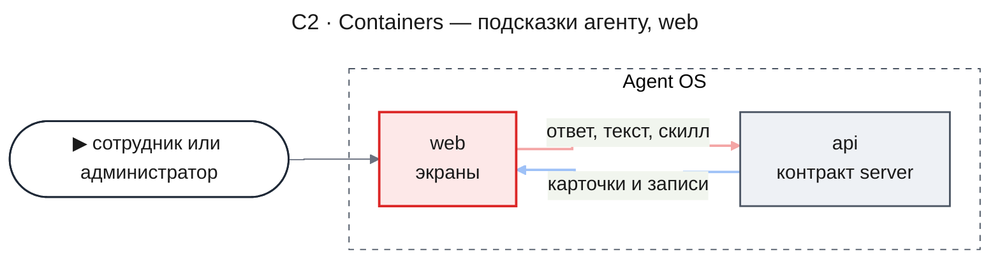
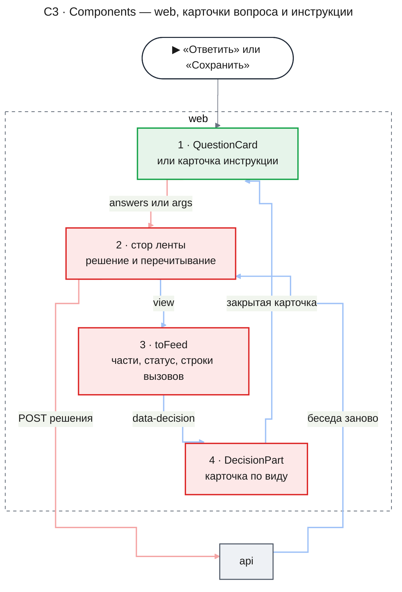
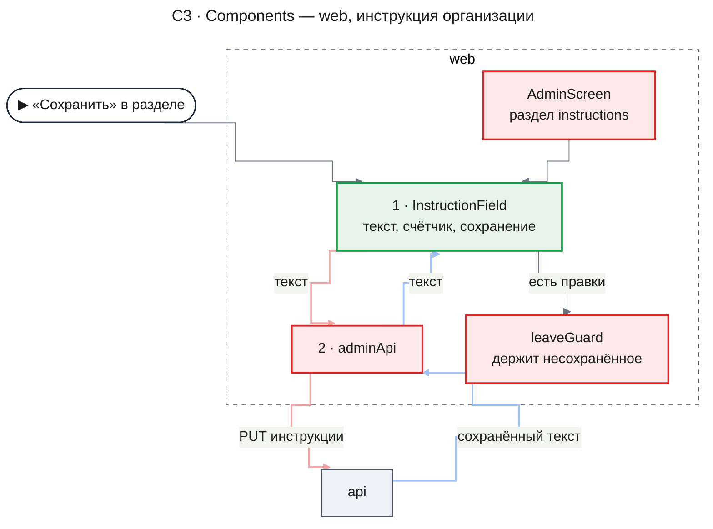
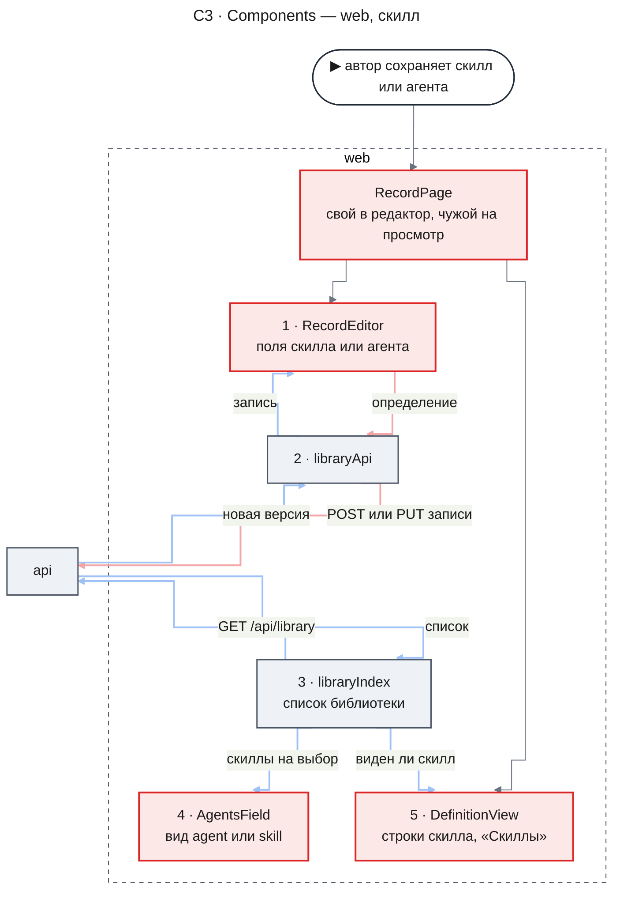
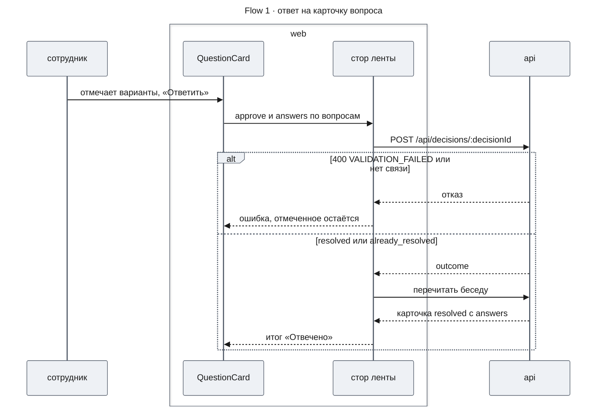
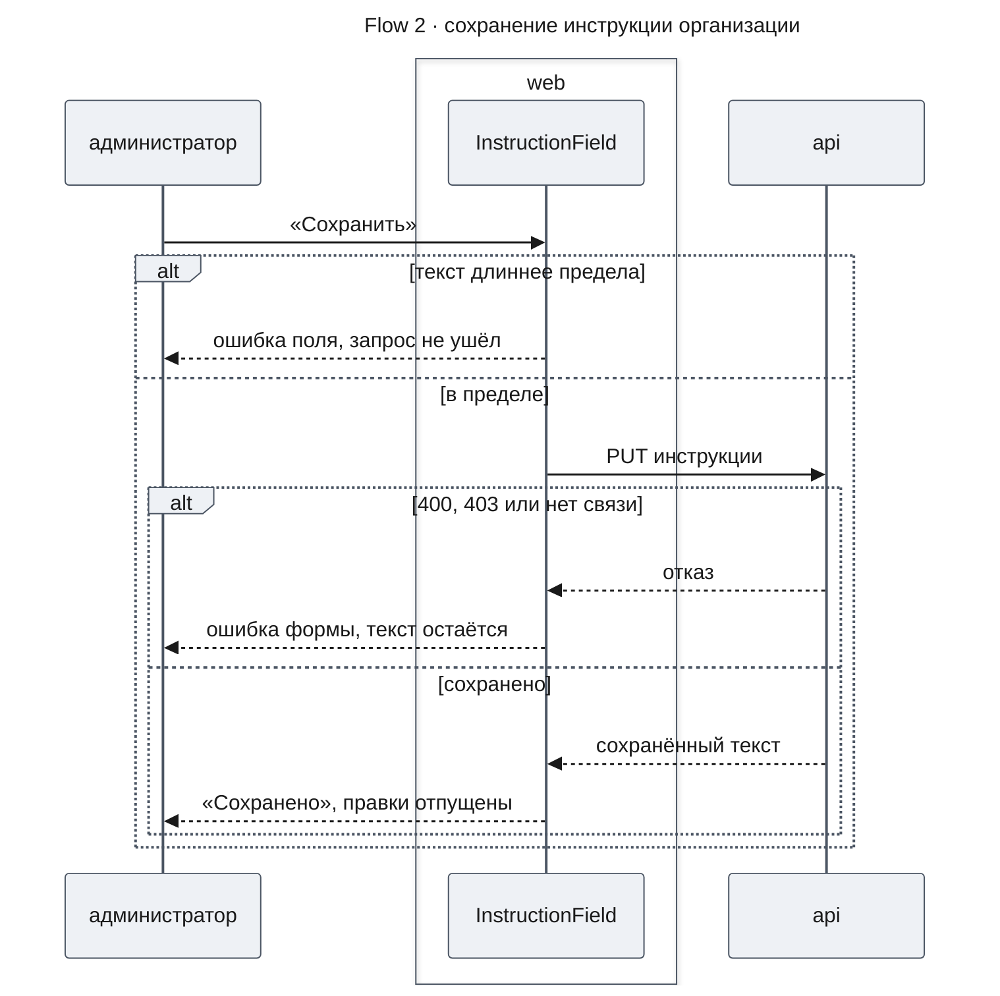
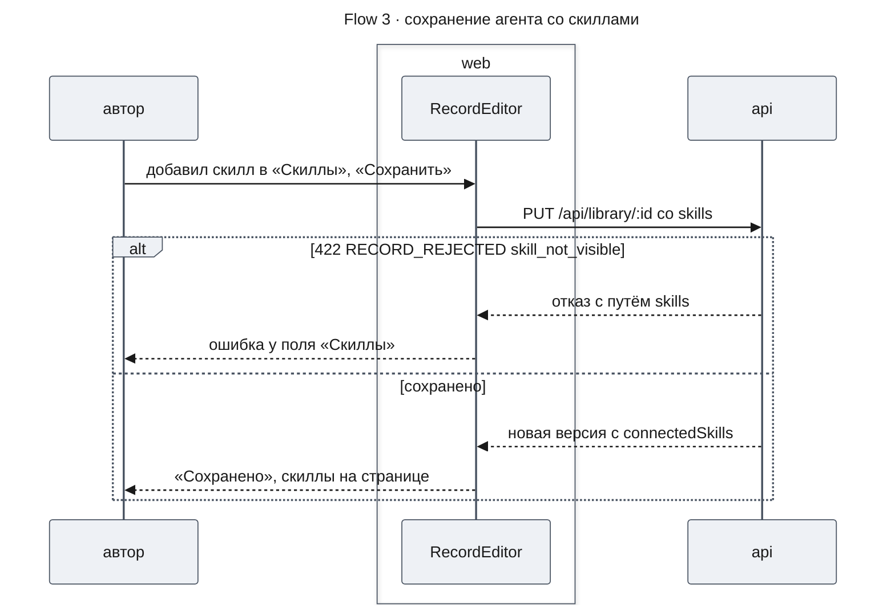
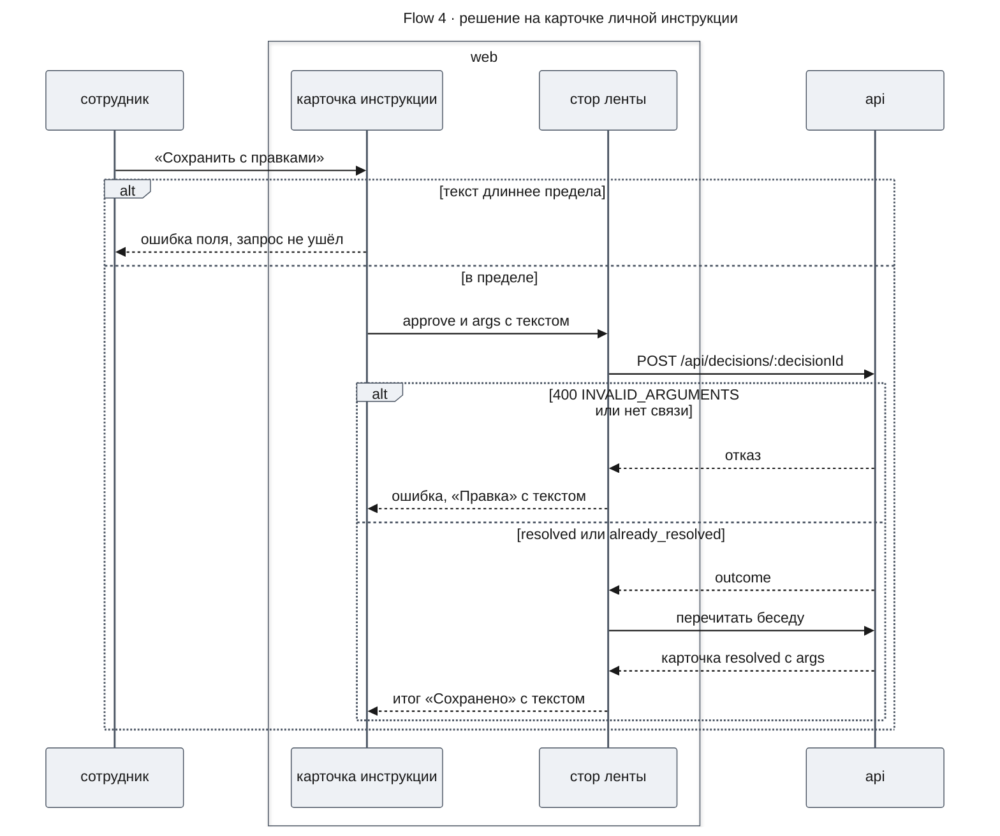
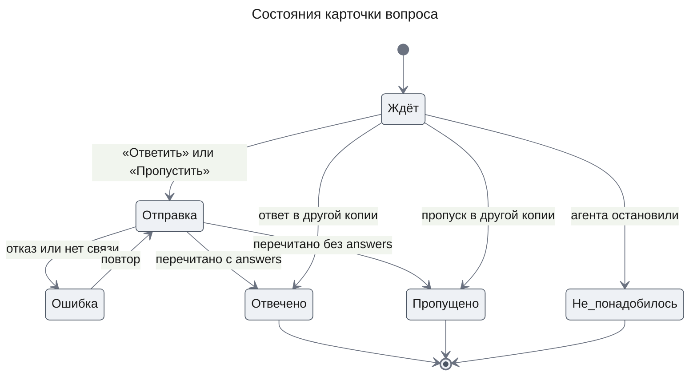

# Подсказки агенту — вопрос, инструкции, скиллы — Design Document — web

**Status:** Draft · **Date:** 2026-11-28 · **PRD:** [prd.md](./prd.md) · **UXRD:** [uxrd.md](./uxrd.md) · **Depends on:** [design-server.md#contract-definitions](./design-server.md#contract-definitions)

## Snapshot

**Overview.** Часть `server` уже умеет задать вопрос карточкой, хранить две инструкции и держать скилл записью библиотеки; эта часть показывает всё это в вебе, опираясь на экраны, которые уже работают. Вопрос приходит в ленту так же, как любая карточка решения, и для него рядом с карточкой решения встаёт новая карточка вопроса: рамку, шапку и строку ошибки она берёт у карточки решения, а выбирает её место ленты, которое сегодня монтирует карточку решения. Личная инструкция приходит в ленту главного чата так же — карточкой своего вида: новая карточка показывает текст, который предложил чат, и правит его тем же кодом правки, что задание глубокого агента. Счётчик знаков ей и разделу панели даёт одно новое поле инструкции; в панели оно само читает и пишет текст организации и держит несохранённые правки через уже готовую защиту ухода. Скилл — третий вид записи в тех же экранах библиотеки: редактор записи показывает поля скилла вместо полей агента, страница читателя — строки скилла. Поле «Скиллы» в редакторе агента и в окне глубокого агента — то же поле, что «Может запускать», с видом записи «скилл»; «Может запускать» остаётся как есть.

- **Не меняется**: карточка решения и её варианты, лоток очереди (он уже держит любую открытую карточку), контракт части `server`, состояние «Ждёт вас» в списке бесед.
- **Главный риск**: экран, до которого доходит скилл, назовёт его «глубоким агентом», если в его сообщении нет случая вида `skill` (KD-6).
- **Открытые вопросы**: форма поля «Скиллы» и статус в списке агентов сайдбара ([Open Questions](#open-questions)).

### Key Decisions

#### KD-1: Карточка вопроса — отдельный компонент рядом с `DecisionCard`, общие части экспортируются из файла как есть

`DecisionPart` монтирует сегодня `DecisionCard` для каждой карточки ленты, а карточка неизвестного вида попадает в ветку действия с кнопками «Разрешить» и «Отклонить». Теперь `DecisionPart` по виду `agents.question` монтирует `QuestionCard`, а для остальных видов — `DecisionCard`, как раньше. Новая карточка берёт у файла `decision-card.tsx` шапку `CardHeader`, строку ошибки `ErrorLine`, рамку `frameClass` и тип итога: они экспортируются без изменения поведения. Шапка получает слово статуса, которое показывает, пока карточка открыта: карточка решения передаёт «Ждёт подтверждения», карточка вопроса — «Ждёт ответа». Строки источника («Агент «…» спрашивает:» со ссылкой и подписью записи) выносятся из ветки действия в экспортируемый компонент, которому каждая карточка передаёт свои фразы. Отправку и фокус после итога карточка вопроса берёт у общего хука отправки (KD-8).

Отвергнуто: новая ветка внутри `DecisionCard`. Файл в 1 411 строк уже ведёт три вида карточек одной цепочкой условий, а тело вопроса не делит с ними ничего, кроме рамки. Отвергнута и общая база для всех карточек: у неё был бы один новый потребитель.

#### KD-2: Строку вызова `ask_user` лента прячет, когда рядом стоит карточка вопроса того же агента с теми же вопросами

UXRD требует: пока карточка показана, строки вызова нет; без карточки (вызов отклонён, ответить некому) строка есть (UXRD KD-2, QC-04). Правило `isDrawnCall` прячет сегодня только вызовы старта агента и только по исходу. По одному имени `ask_user` строку прятать нельзя: когда ответить некому, вызов тоже заканчивается `success`, а строка нужна. Карточка не несёт id вызова, поэтому правило ищет пару по содержимому: среди карточек ленты — карточку вида `agents.question` того же агента, чьи `questions` совпадают с аргументами вызова. Совпадение по времени, как у `recordSaveOf`, отвергнуто: у вопроса нет результата, который можно привязать ко времени карточки, а совпадение вопросов точнее.

#### KD-3: «Ждёт ответа» выбирает одна чистая функция над открытыми карточками ленты; список агентов сайдбара остаётся «Ждёт подтверждения»

Контракт знает один статус ожидания человека — `awaiting_confirmation`, а вид ожидания видно только по открытым карточкам `view.decisions`. Функция в `lib/feed` получает статус строки и id агентов, за которых строка стоит, и отдаёт веб-значение `awaiting_answer`, когда статус — `awaiting_confirmation` и все открытые карточки этих агентов — вопросы. Если среди них есть подтверждение или открытой карточки нет, остаётся `awaiting_confirmation`. `AgentStatus` принимает `awaiting_answer` с той же иконкой и цветом и словом «Ждёт ответа» (UXRD MC-5).

Функцию зовут места, у которых есть лента: полоса агентов (за строкой — поддерево, как сегодня у `stripAgents`), карточка запуска и её шаги, шапка и сводка страницы агента, список задач сессии. Дерево агентов в сайдбаре читает статус из стора списка агентов, где карточек нет, и показывает «Ждёт подтверждения» ([Open Questions](#open-questions)). Подсказка поля ввода страницы агента получает статус контракта: её текст для ожидания тот же, что для работы. Проверка в каждом компоненте отдельно отвергнута: у ленты одно место, где карточки уже сводятся с агентами (`to-feed.ts`).

#### KD-4: Поле инструкции — один компонент `InstructionField` с вариантами «Организация» и «В карточке»; несохранённое в панели держит `leaveGuard` новым видом предмета

Вариант «Организация» получает заголовок, пояснение, предупреждение, функцию чтения и функцию записи. Текст он читает при монтировании хуком `useResource` ([read-on-open.md](../../code-system/patterns/read-on-open.md)), а после сохранения берёт текст из ответа `PUT`. Ошибку формы и предупреждение он показывает готовыми `FormError` и `FormWarning`, поле — `Textarea` с ошибкой поля, как у `AdminTextField`. Счётчик считает длину строки так же, как схема `contracts`, из которой берётся предел, поэтому счётчик и сервер не расходятся.

Вариант «В карточке» — только текст или поле и счётчик (instruction-field.md, Variants): текст, черновик и ошибку поля ему передаёт карточка личной инструкции (KD-8), а чтения, ряда сохранения и `leaveGuard` у него нет. Голый `Textarea` в карточке отвергнут: счёт знаков и слова «Осталось» и «Больше предела» разошлись бы в двух местах.

`AdminForm` отвергнута: после сохранения она показывает уведомление и переводит фокус на заголовок страницы, а у неё нет состояния «Изменено», «Отменить правки» и защиты ухода. Спецификация поля требует обратного: «Сохранено» в ряду на 4 s и фокус на «Сохранить» (instruction-field.md, States). Защита ухода — это `leaveGuard`, которым уже пользуются редактор записи и уровни доступа: он спрашивает при ссылке, «Назад» и закрытии вкладки. Предмет удержания получает третий вид, «инструкция» с заголовком секции, и диалог показывает для него текст MC-9.

#### KD-5: Скилл открывается тем же `RecordEditor`, у которого поля скилла стоят вместо полей агента

Путь сохранения редактора от вида не зависит: создание, сохранение с версией, конфликт с «Сохранить мои правки» и «Взять сохранённое», передача «Сохранено» новой странице и `leaveGuard`. От вида зависят только поля, проверка перед отправкой и действия чата. Поэтому форма редактора (`useRecordForm`) хранит определение агента или скилла, `definitionOf` и `changedFields` получают ветку скилла с полем «Шаги», а `agentOf` пропускает оба вида. Тело формы показывает поля скилла (имя, «Когда применять», «Шаги» со счётчиками), проверку берёт по виду. У скилла нет «Использовать в чате», а под шапкой сохранённого скилла стоит подсказка MC-11 вместо подсказки запуска.

Отдельный редактор скилла отвергнут: он повторил бы около ста строк сохранения и конфликта, а отличие — один блок полей. Общий редактор с параметрами для каждого вида отвергнут тоже: вид у записи один на всю жизнь, и одной ветки по нему достаточно.

#### KD-6: Слово вида — случай `skill` в каждом сообщении, до экрана которого доходит скилл; запуск исключает `canUseInChat`

Около 45 сообщений в каждом языке выбирают слово вида ICU-конструкцией `select` со случаями `agent` и `other`, где `other` — глубокий агент. Без нового случая скилл молча назвался бы глубоким агентом. Сообщения не ссылаются друг на друга, поэтому каждое, до экрана которого доходит скилл, получает случай `skill`. Это строка и меню библиотеки, таблицы панели, редактор и его уведомления, страница читателя, «Поделиться», копия, удаление и ошибки сохранения и доступа. Сообщения о запуске, чате, ходе и странице агента скилл не видит: он не запускается (часть `server`, KD-5), и они остаются как есть. `RECORD_KIND_ICON` получает свиток: тип отображения требует значение для каждого вида.

`canUseInChat` получает вид записи и отвечает «нет» для скилла. Через неё одну скилл уходит из «Использовать в чате» строки и редактора, из меню «+» поля ввода, из списка `@` и из выбора записи расписания. Общее слово вида, подставляемое значением в каждое сообщение, отвергнуто: это переписало бы все 45 сообщений, а не только те, что видят скилл.

#### KD-7: Поле «Скиллы» — `AgentsField` с видом записи; скрытые скиллы — по `connectedSkills` против списка библиотеки

`AgentsField` уже делает то, что требуют AC-13.1 и AC-13.2: ищет по записям, которые автор видит в `libraryIndex`, показывает выбранные чипами подписи записи и оставляет до удаления выбранную запись, которой в списке больше нет. Поле получает вид записи, который выбирает кандидатов и подписи; виды `agent` и `skill` — два реальных потребителя. Предел в 20 скиллов проверяется перед отправкой, как остальные поля, с текстом MC-14. Глубокий агент формы не имеет, поэтому у владельца на его карточке под строкой «Скиллы» стоит «Изменить»: окно с тем же полем сохраняет список через `saveContent` карточки, как другие её поля (SP-02).

Строка «Скиллы» на странице агента и в карточке глубокого агента строится из `connectedSkills` ответа чтения. Скилл виден смотрящему, когда он есть в `libraryIndex`: тогда имя — ссылка на его страницу, иначе имя без ссылки и метка «текст вам не виден» (AC-06.7). Тем же сравнением окно копии называет скиллы, которые копия потеряет, рядом с выпавшими системами, а уведомление после копии называет `removedSkills` ответа по именам из `connectedSkills` (AC-06.8). Строка библиотеки несёт только сводку без `connectedSkills`, поэтому копия агента или глубокого агента, начатая со строки, сначала читает запись (`GET /api/library/:id`), как планирование копии уже читает запись компании. Отдельный компонент списка из спецификации отвергнут в пользу этого поля до ответа владельца UXRD ([Open Questions](#open-questions)).

#### KD-8: Карточка личной инструкции — свой файл рядом с `QuestionCard`; правку и отправку она берёт у `DecisionCard` общими хуками

`DecisionPart` по виду `identity.instructions` монтирует карточку личной инструкции из её собственного файла, как `QuestionCard` по виду `agents.question` (KD-1); ветка внутри `DecisionCard` отвергнута по той же причине. Рамку, шапку, строку ошибки и тип итога она берёт у `decision-card.tsx`, как карточка вопроса, а кнопки — `DecisionButton`, который для этого экспортируется: у него уже есть индикатор «Отправки». Открытая карточка показывает `content.text`, закрытая — `resolution.args.text`, как бриф показывает текст, с которым запустился. Итоги — фразы MC-6 с иконками и тонами итогов карточки решения. «Сохранено» карточка показывает по `resolution` сразу после перечитывания. Если вызов после подтверждения закончился не `success`, итог сменяется на «Не сохранено: {причина}»: правило `recordSaveOf` в `toFeed` принимает этот вид наравне с карточкой записи. Общий итог «Подтверждено» до результата вызова, как у записи, отвергнут: у MC-6 нет такой фразы, а сбой записи текста редок.

Из `decision-card.tsx` выносятся два хука, у каждого больше одного потребителя:

- **Правка карточки** — `useBriefEdit` без полей брифа: черновик любого вида (`null` вне «Правки»), «Изменить» с фокусом в поле, «Отмена» и Esc с фокусом обратно на «Изменить». Фокус и Esc сегодня лежат в теле `DecisionCard` и переезжают в хук. Проверку черновика каждая карточка делает сама: пустой вопрос у брифа, предел у инструкции. Потребители — бриф и карточка инструкции; карточка расписания из chat-scheduling будет третьим. Хук, который знает поля брифа, пришлось бы копировать в каждую карточку вместе с фокусом и Esc.
- **Отправка решения** — нажатая кнопка, флаг сбоя и фокус на карточку после итога, полученного здесь. Потребители — `DecisionCard`, `QuestionCard` и карточка инструкции; без общего хука получились бы три копии двух состояний и эффекта.

Поля брифа, его заголовок, строка самообучения и сборка аргументов брифа остаются в `DecisionCard`.

Строку вызова `set_personal_instructions` лента прячет так же, как строку `start_deep_agent`: инструмент встаёт в `SHOWN_ELSEWHERE`, и строка остаётся только при исходе, кроме `success` и `rejected`. Так она видна ровно тогда, когда карточки нет или сохранение не прошло: `invalid_arguments` у длинного текста и `refused` в ходе расписания. Сравнение по содержимому, как в KD-2, здесь не нужно: у карточки инструкции исход вызова уже различает эти случаи.

## Terms

- **`DecisionPart`** — место ленты, которое монтирует карточку для каждой части `data-decision`; такую часть `toFeed` строит из каждой карточки беседы.
- **`libraryIndex`** — стор оболочки со списком библиотеки сотрудника (`GET /api/library`): все записи, которые он видит.
- **`leaveGuard`** — служба оболочки, которая держит несохранённые правки экрана и спрашивает перед уходом.
- **Предмет удержания** — то, что `leaveGuard` называет в вопросе: запись по имени, уровни доступа по числу правок, теперь секция инструкции по заголовку.

## Part

- **Prerequisite ADRs**: [ADR-0016](../../adr/ADR-0016-library-records-and-visibility.md) (записи библиотеки и видимость), [ADR-0020](../../adr/ADR-0020-next-intl-client-layer.md) (тексты через каталоги next-intl), [ADR-0021](../../adr/ADR-0021-deep-agent-record-kind.md) (виды записей).

**Out of scope**

- Вариант «Правка» строки «Скиллы» с метками «новый» и «Убрано»: чат не правит скиллы агента (часть `server`, KD-5), обучение их не меняет, поэтому карточка правки записи и сравнение обучения скиллов не показывают.
- Статус в дереве агентов сайдбара остаётся «Ждёт подтверждения» (KD-3).
- Вызов скилла из поля сообщения — PRD, Won't Have.
- Подсказка поля ввода страницы агента: её текст при ожидании совпадает с текстом при работе.

**Constraints**

- Контракт `server` берётся как есть: «Пропустить» — решение `approve: true` без `answers`, а `approve: false` карточка вопроса не шлёт.
- Пределы длины — константы схем `contracts`; веб их не повторяет, а импортирует.
- Тексты en и ru под одинаковыми ключами, в областях их экранов ([interface-text.md](../../code-system/patterns/interface-text.md)); подписи `ask_user`, `read_skill` и `set_personal_instructions` («Личная инструкция») в строке вызова — в `tools.json`, как у остальных встроенных инструментов.
- Без обратной совместимости: раздел панели «Агенты и глубокие агенты» переименовывается в «Библиотеку» на месте.

## Building-block Inventory

Follows the [code system](../../code-system/README.md) и [web.md](../../code-system/packages/web.md). Искали в `components/agents`, `components/library`, `components/account`, `components/admin` и `components/ui` карточку с вопросами, длинное поле со счётчиком и выбор записей.

| Building block | Pattern | Status | Note |
|---|---|---|---|
| `QuestionCard` | — | new | у карточки решения тело — одно действие с кнопками, вопросов с вариантами нет нигде (KD-1) |
| карточка личной инструкции | — | new | тело — одно поле со счётчиком, а ветка в `DecisionCard` удлинила бы файл в 1 411 строк (KD-8) |
| правка и отправка из `decision-card.tsx` | — | extended | `useBriefEdit` теряет поля брифа, фокус и Esc уходят в него из тела карточки; отправка выносится в хук (KD-8) |
| функция статуса «Ждёт ответа» в `lib/feed` | — | new | одно место над `view.decisions` (KD-3) |
| `InstructionField` | [read-on-open.md](../../code-system/patterns/read-on-open.md) | new | `AdminForm` не держит «Изменено» и уход, а `TextField` редактора записи считает «N / предел» и закрыт в своём файле; вариант «В карточке» — для карточки инструкции (KD-4) |
| раздел панели `instructions` | [shell-route.md](../../code-system/patterns/shell-route.md) | extended | новый id раздела без страниц записей |
| адрес `/library/new/skill` и `/admin/library/new/skill` | [shell-route.md](../../code-system/patterns/shell-route.md) | extended | новая страница записи по виду |
| `adminApi`, `libraryApi` | [web-api-client.md](../../code-system/patterns/web-api-client.md) | extended | маршрут инструкции организации; вид `skill` и `answers` приходят из схем `contracts` |
| каталоги текста | [interface-text.md](../../code-system/patterns/interface-text.md) | extended | MC-1 – MC-16 UXRD, случаи `skill` (KD-6) |

## Acceptance Criteria

### FR-09: Карточка вопроса

- From the PRD: AC-09.1, AC-09.2, AC-09.3.
- «Ответить» отправляет по одному ответу на каждый вопрос в их порядке: выбранные подписи и текст «Другое»; вопрос без ответа уходит с пустым `selected` и `other: null`. «Пропустить» отправляет решение без `answers`, и карточка показывает итог «Пропущено» (DC-1).
- Ответ не ушёл: карточка открыта с отмеченным и введённым и показывает строку ошибки MC-3 (DC-2).
- Карточка, закрытая в другой копии или вкладке, после перечитывания показывает итог без строки ошибки (DC-3).
- Пока карточка вопроса стоит в ленте, строки вызова `ask_user` нет; при отказе вызова и когда ответить некому строка «Вопрос сотруднику» есть (DC-4).
- Агент, все открытые карточки которого — вопросы, читается «Ждёт ответа» в полосе агентов, карточке запуска, шапке страницы агента и списке задач сессии (DC-5).
- «К запросу» лотка и строка полосы агентов ведут к карточке вопроса, как к карточке решения (DC-6).

### FR-10: Карточка личной инструкции

- From the PRD: AC-10.1, AC-10.2.
- «Сохранить с правками» с текстом длиннее предела решения не отправляет: счётчик и ошибка поля называют, на сколько сократить, фокус в поле, карточка остаётся в «Правке» (DC-7).
- «Сохранить» отправляет `approve: true` с `args: {text}` — текстом карточки или правки; «Отклонить» — `approve: false`. 400 `INVALID_ARGUMENTS` или сбой связи: карточка остаётся открытой с введённым текстом и строкой ошибки (DC-12).
- Пока карточка ждёт, отклонена или сохранила текст, строки вызова нет; строка «Личная инструкция» видна без карточки — длинный текст от чата или ход расписания — и при итоге «Не сохранено» (DC-13).

### FR-11: Инструкция организации в панели

- From the PRD: AC-11.1 — раздел стоит только в панели, которую `AdminGate` уже не открывает сотруднику без права администратора.
- Текст длиннее предела не отправляется: счётчик и ошибка поля называют, на сколько сократить (DC-14).
- Уход из раздела ссылкой, «Назад» или закрытием вкладки при несохранённых правках спрашивает «Уйти без сохранения?» (DC-8).

### FR-12: Скиллы в библиотеке

- From the PRD: AC-12.1.
- Скилла нет в «Использовать в чате», в меню «+» поля ввода, в списке `@` и в выборе записи расписания (DC-9).
- Строка, редактор, уведомления, «Поделиться», копия и удаление называют вид словом «скилл» (DC-10).

### FR-13: Выбор скиллов в редакторе агента

- From the PRD: AC-13.1, AC-13.2.
- Страница агента показывает скилл, которого смотрящий не видит, именем и описанием с меткой «текст вам не виден», а окно копии называет такие скиллы (AC-06.7, AC-06.8 части `server`; DC-11).

## Design

### Architecture (C1–C4)

Акторы и внешние системы не меняются, поэтому C1 не нарисован.

#### C2 · Containers

Веб зовёт только маршруты, которые описывает часть `server`; новых связей между контейнерами нет. Карточки вопросов веб читает в том же ответе беседы, что и карточки решений, а о новой карточке узнаёт из того же потока событий.

#### C3 · Components: web

**web — решение на карточке вопроса или личной инструкции**

`QuestionCard` держит отмеченное в своём состоянии и отправляет решение через `decide` стора ленты, как карточка решения; итог берётся только из перечитанной карточки, а не из нажатой кнопки. Стор ленты объявляет каждую новую карточку вопроса своей фразой MC-5, по одной на карточку, и тогда, когда за одно перечитывание открылось несколько: общая фраза с числом карточек скрыла бы, кто спрашивает (UXRD, Accessibility). Остальные карточки объявляются, как сейчас. `toFeed` ставит карточку в ленту, как любую карточку, прячет строку её вызова (KD-2) и выбирает статус строк агентов (KD-3). Карточка несёт `data-decision-id`, поэтому «К запросу» лотка и полоса агентов находят её без изменений: лоток уже берёт первую открытую карточку владельца, какого бы вида она ни была. Та же часть ленты стоит на странице спросившего агента, поэтому копия в его истории получается без отдельного кода (QC-03).

Карточка личной инструкции идёт тем же путём: `decide` с `args: {text}` или отказом, итог — из перечитанной карточки (KD-8). Она стоит только в ленте главного чата: инструмент есть только у корня беседы.

**web — инструкция организации**

Панель получает раздел `instructions` после «Библиотеки»: id в списке разделов `shell-route.ts` без страниц записей, иконку в `admin-sections.ts`, ветку в `AdminScreen` и тексты `admin.section.instructions`. В разделе стоит поле в варианте «Организация» с функциями `adminApi` и предупреждением MC-7. Пока чтение идёт или упало, поле показывает скелетон или ошибку с «Повторить» только в своей секции; пустого поля до ответа нет (instruction-field.md, States).

**web — скилл в библиотеке и у агента**

- `RecordPage` открывает свой скилл в `RecordEditor`, как агента, а чужой — на просмотр; глубокий агент по-прежнему идёт на свою карточку. Адрес `/library/new/skill` открывает редактор с пустым скиллом, и меню «Создать» получает пункт «Новый скилл» (MC-10); в панели «Создать» на «Системных» предлагает агента и скилл.
- `DefinitionView` показывает у скилла «Когда применять» строкой и «Шаги» длинным текстом с раскрытием, как промпт агента, а у агента и глубокого агента — строку «Скиллы» после «Системы» (KD-7). Текст скилла выводится как текст, с переносами строк, без разметки.
- `AgentsField` с видом `skill` стоит в редакторе агента сразу после «Системы», не под «Дополнительно» (UXRD KD-7).
- `libraryIndex` перечитывается после каждого сохранения, как сейчас, поэтому новый скилл сразу появляется в поиске поля «Скиллы».

### Runtime Flows

#### Flow 1: Ответ на карточку вопроса

**Starts when:** сотрудник нажал «Ответить» или «Пропустить» на открытой карточке, for AC-09.1, AC-09.2, AC-09.3

«Пропустить» идёт тем же путём без `answers`, и итог — «Пропущено». Итог карточка выбирает по перечитанной карточке: `resolution` с `answers` — «Отвечено» с ответами под вопросами, без них — «Пропущено», `cancelled` — «Не понадобилось». Отмеченное не сохраняется нигде, кроме состояния карточки, поэтому после перезагрузки карточка снова пуста. Ответ в другой копии приходит в эту ленту перечитыванием по потоку событий, и карточка переходит в итог без строки ошибки.

#### Flow 2: Сохранение инструкции организации

**Starts when:** администратор нажал «Сохранить» или Ctrl+S в разделе «Инструкция для агентов», for AC-11.1

Сохранённый текст из ответа становится основой сравнения, и `leaveGuard` отпускает секцию. Стёртый и сохранённый текст — пустая инструкция (AC-03.2 части `server`).

#### Flow 3: Сохранение агента со скиллами

**Starts when:** автор нажал «Сохранить» в редакторе агента или в окне скиллов глубокого агента, for AC-13.1, AC-13.2

Отказ `skill_not_visible` возможен, только если автор скилла сузил аудиторию между чтением списка и сохранением: поиск поля предлагает лишь видимые скиллы. Веб показывает его у поля «Скиллы» тем же запасным текстом, что `agent_not_visible` у поля «Может запускать». Окно глубокого агента сохраняет через `saveContent` и при успехе закрывается с уведомлением «Скиллы сохранены» (MC-16).

#### Flow 4: Решение на карточке личной инструкции

**Starts when:** сотрудник нажал «Сохранить с правками» на карточке личной инструкции в «Правке», for AC-10.1

«Сохранить» без правки идёт тем же путём с текстом, который предложил чат, «Отклонить» — с `approve: false` и итогом «Отклонено». Черновик живёт только в состоянии карточки, пока она в «Правке», как у брифа. Если вызов после подтверждения закончился не `success`, «Сохранено» сменяется на «Не сохранено» с причиной (KD-8).

### Contract Definitions

Часть не отдаёт контрактов другим частям. Она берёт [контракт `server`](./design-server.md#contract-definitions) как есть; ниже — как веб показывает каждый его ответ.

- **`POST /api/decisions/:decisionId`** на карточке вопроса — `approve: true` с `answers` или без них. `resolved` и `already_resolved` ведут к перечитыванию и итогу. 400 и сбой связи — строка ошибки MC-3, отмеченное остаётся.
- **`POST /api/decisions/:decisionId`** на карточке `identity.instructions` — `approve: true` с `args: {text}` или `approve: false`. 400 `INVALID_ARGUMENTS` и сбой связи — строка ошибки, карточка открыта с введённым текстом. Открытая карточка показывает `content.text`, закрытая — `resolution.args.text`; предел счётчика — константа 4 000 знаков из `contracts`.
- **`GET` и `PUT /api/admin/instructions`** — ошибка чтения — состояние «Ошибка загрузки» с «Повторить»; отказ записи — ошибка формы MC-8 с причиной или «нет связи с сервером». 403 на маршрутах панели виден только сотруднику, у которого отняли право при открытой панели, и показывается той же ошибкой формы.
- **Записи вида `skill`** в `/api/library` и `/api/admin/library` — отказы сохранения показывает редактор записи: пустые и длинные поля — у своих полей (MC-12), занятое имя — MC-12, `skill_not_visible` — у поля «Скиллы».
- **`connectedSkills`** — строка «Скиллы» страницы и карточки и имена в окне копии (KD-7). **`removedSkills`** — имена в уведомлении после копии.

### State Transitions and Invariants

**Invariants**

1. Итог карточки следует только из перечитанной карточки сервера, никогда из нажатой кнопки.
2. Отмеченное и введённое живут только в состоянии карточки; отказ сервера их не трогает, а перезагрузка их теряет.
3. Закрытая карточка не меняется и не шлёт решений.

## Test Strategy

Тесты — только там, где ошибка испортит данные, которые получает модель, или откроет запуск скилла.

- **Ответы карточки** — чистое преобразование отмеченного в `answers`: один ответ, несколько, «Другое» вместо варианта и вопрос без ответа; covers AC-09.2 и через сервер AC-01.1 – AC-01.3.
- **Строка вызова `ask_user`** — строки нет при карточке с теми же вопросами и есть без карточки; таблица случаев в тесте `toFeed`.
- **Статус «Ждёт ответа»** — только вопросы, вопрос и подтверждение, нет открытых карточек; одна таблица у чистой функции.
- **`canUseInChat`** — для скилла «нет»; строка в таблице существующего теста правил.
- **Поле инструкции** — текст длиннее предела не уходит, а несохранённые правки держит `leaveGuard`.
- **Карточка личной инструкции** — «Сохранить с правками» отправляет `args: {text}` с правленым текстом, а за пределом не отправляет ничего; covers AC-10.1 и через сервер AC-04.6.

Тесты, которые перечисляют разделы панели, виды записей и адреса библиотеки, обновляются вместе с кодом.

### Проверка в браузере

jsdom не показывает раскладку, фокус и уход со страницы, поэтому экраны проверяют на `next build && next start` против настоящего API по навыку `browser-check`, на 360 px, 768 px и 1280 px в обоих режимах.

| Сценарий | Шаги | Что должно быть видно |
|---|---|---|
| Вопрос чата | Попросить чат о неоднозначном отчёте; ответить вариантом и «Другое» | Карточка «Ждёт ответа», строки вызова нет; после ответа итог с ответами, фокус на карточке; в Network одно `POST /api/decisions/…` с `answers` |
| Два вопроса сабагентов | Запустить глубокий агент, чьи сабагенты спрашивают; ответить на одну карточку | Две карточки с именами сабагентов; вторая открыта; в полосе агентов «Ждёт ответа» |
| Пропуск и другая копия | Пропустить карточку; другую ответить на странице сабагента | «Пропущено» без вопросов-ответов; в беседе итог без строки ошибки |
| Ответить некому | Ход расписания, где агент спрашивает | Карточки нет, строка «Вопрос сотруднику» с ответом платформы |
| Личная инструкция | Написать чату «отвечай коротко и по-русски»; «Изменить», ввести текст больше предела, затем в пределе, «Сохранить с правками»; снова попросить и «Отклонить» | Карточка с текстом и счётчиком, строки вызова нет; за пределом ошибка поля и запроса нет; итог «Сохранено» с правкой, в Network одно `POST /api/decisions/…` с `args.text`; новая карточка и итог «Отклонено» |
| Инструкция без карточки | Ход расписания, где чат меняет инструкцию | Карточки нет, строка «Личная инструкция» с отказом |
| Инструкция организации | Ввести текст больше предела, затем в пределе; уйти ссылкой, «Назад», закрыть вкладку | Счётчик за пределом, запроса нет; «Сохранено» в ряду; вопрос «Уйти без сохранения?» в каждом случае |
| Раздел панели | Открыть панель администратором и сотрудником | Раздел седьмым после «Библиотеки», фокус на заголовке; сотрудник панели не видит |
| Слово вида | Создать, поделиться, скопировать и удалить скилл; открыть таблицу панели | Везде «скилл», нигде «глубокий агент»; нет «Использовать в чате», скилла нет в «+», `@` и расписании |
| Скиллы агента | Подключить два скилла и сохранить; открыть агента вторым сотрудником без доступа к личному скиллу | Новая версия, оба скилла на странице; у второго — имя, описание и «текст вам не виден»; окно копии называет скилл |

## Security Considerations

- **Authentication & Authorization**: новых маршрутов веб не вводит. Раздел инструкции организации стоит в панели, которую уже закрывает `AdminGate`; личный текст веб видит только в карточке беседы самого сотрудника и пишет только её решением.
- **Input Validation**: вопросы, варианты, имена и тексты скиллов пишут модель и коллеги, поэтому веб выводит их как текст, без разметки и HTML. Длину инструкции и полей скилла веб проверяет по константам `contracts`, но решает сервер.
- **Sensitive Data Handling**: лог веба не пишет текст инструкций, ответов карточки и скиллов — только id карточки, вид и исход запроса.

## Risks and Mitigation

- **Скилл назван «глубоким агентом» на экране, где сообщение без случая `skill`** — среднее влияние, ошибка видна только глазами. Список экранов в KD-6 и строка «Слово вида» проверки в браузере.
- **Строка вызова спрятана не у того вопроса** — низкая вероятность: нужны два одинаковых вопроса одного агента, на один из которых ответить некому. Последствие — нет строки у второго вызова; ответ модели в ленте остаётся.
- **«Ждёт подтверждения» в дереве агентов сайдбара при вопросе** — несогласованное слово в одном месте ([Open Questions](#open-questions)).
- **Поле «Скиллы» короче спецификации** — без описаний в чипах и без отдельного состояния предела ([Open Questions](#open-questions)).

## Open Questions

- Поле «Скиллы» строится как `AgentsField` с видом записи (KD-7) и выполняет AC-13.1 и AC-13.2. От [skill-picker.md](../../design-system/components/skill-picker.md) оно отличается: в чипах нет описания, потерянный скилл показан чипом «недоступен» без имени, кнопки «Добавить скилл» и её состояния «Предел» нет (предел проверяется при сохранении), строка поиска не показывает описание и ссылку «Создать скилл». Принять поле как есть и упростить спецификацию или строить список по спецификации? Блокирует окончательную форму поля «Скиллы»; решает `ux-designer` вместе с владельцем.
- Дерево агентов сайдбара не знает вида ожидания (KD-3). Показывать там «Ждёт подтверждения», как сейчас, или часть `server` отдаёт отдельный статус ожидания ответа? Блокирует слово статуса в сайдбаре; решает владелец.

## Update History

| Version | Date | Change |
|---------|------|--------|
| 1.0 | 2026-11-28 | Первая версия |
| 1.1 | 2026-11-28 | PRD v1.2, UXRD v1.1, `server` v1.2: личная инструкция — карточка `identity.instructions` в ленте главного чата на общих хуках правки и отправки (KD-8, Flow 4); секция на «Мой доступ» и маршруты `/api/auth/me/instructions` убраны |
