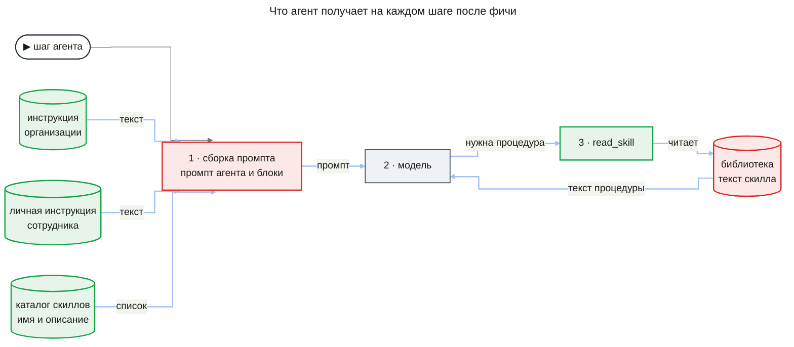
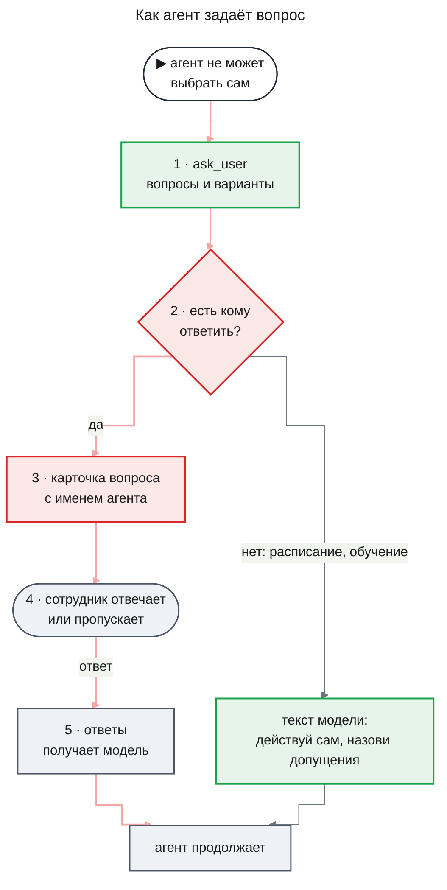

# PRD: Подсказки агенту — вопрос, инструкции, скиллы (agent-guidance)

| Date | Depth |
|---|---|
| 2026-11-28 | full |

## Snapshot

**Overview.** Агент на модели класса Haiku ошибается чаще всего не потому, что не умеет, а потому, что не знает: чего хочет сотрудник, как принято в компании, по какой процедуре делать задачу. Сегодня он в таких местах угадывает. После фичи агент может задать вопрос карточкой с вариантами ответа и подождать выбора сотрудника. Каждый агент, которого запускает сотрудник, получает в промпт текст организации от администратора и личный текст сотрудника «как со мной работать». Процедуры, которые пишут люди, становятся скиллами в библиотеке: в промпт идёт только их список, а текст агент читает, когда он нужен.

- **Не входит**: загрузчик плагинов, внешний API и вебхуки, Agent OS как MCP-сервер, вызов скилла прямо из поля сообщения, библиотека промптов.
- **Главный риск**: Haiku спрашивает слишком часто или не спрашивает вовсе, а проверить это можно только руками ([Assumptions and Risks](#assumptions-and-risks)).
- **Открытые вопросы**: решения, принятые по рекомендации, ждут подтверждения владельца ([Undetermined Items](#undetermined-items)).

## Terms

- **Карточка** — блок в ленте беседы, где сотрудник отвечает агенту. Сегодня есть карточки подтверждения изменяющего вызова, брифа глубокого агента и изменения записи библиотеки; фича добавляет карточку вопроса.
- **`ask_user`** — встроенный инструмент агента «спросить сотрудника»: один вызов показывает одну карточку вопроса.
- **Инструкция организации** — текст, который администратор пишет в панели администратора для всех агентов компании: как называются сервисы, в каком проекте Jira заводить тикеты.
- **Личная инструкция** — текст сотрудника «Как со мной работать» на странице аккаунта: кто он, как ему отвечать.
- **Скилл** — записанная человеком процедура: имя, описание «когда применять» и текст шагов. Скилл — запись библиотеки, как агент.
- **Каталог скиллов** — список имён и описаний скиллов, который агент видит в промпте. Текст скилла агент получает инструментом `read_skill`.
- **Главный чат** — агент беседы, который отвечает сотруднику и запускает других агентов (`agent-platform` FR-14, FR-15).
- **Ход расписания** — ход, начатый сообщением расписания (`improvements`, Terms).
- **Прогон обучения** — повтор прошлой задачи агента внутри обучения, где никто не отвечает на карточки (`self-learning` FR-18).
- **Судья** — вызов модели, который вслепую сравнивает ответы двух версий агента при обучении.

## Background

Идеи взяты из [bb](https://github.com/get-bb/bb): инструмент вопроса с вариантами, пользовательские инструкции и индекс скиллов. Все три помогают слабой модели не угадывать там, где ответ знает человек.

Сегодня на каждом шаге агент получает свой промпт, а если у него есть память — её список, и ещё список задач глубокого агента. Фича добавляет к промпту три блока и один инструмент чтения скилла:

Блоки читаются заново на каждом шаге, поэтому исправленный текст доходит до работающего агента со следующего шага. Инструкции идут в промпт целиком, а скиллы — только списком: процедура бывает длинной, и агенту нужна одна из многих.

Вопрос сотруднику идёт тем же путём, что сегодня подтверждение изменяющего вызова: агент ждёт, карточка видна в беседе, даже если спрашивает сабагент глубокого агента (`agent-platform` AC-17.3), и переживает рестарт сервера (`agent-platform` AC-12.5). Когда ответить некому, агент получает текст и идёт дальше:

### Скилл рядом с тем, что уже есть

В платформе уже есть несколько мест, куда попадает знание агента. Таблица показывает, чем скилл и инструкции отличаются от них.

| Что | Кто пишет | Где живёт | Как доходит до агента |
|---|---|---|---|
| Скилл | человек | библиотека, своя запись с аудиторией | каталог в промпте, текст через `read_skill` |
| Инструкция организации | администратор | панель администратора | целиком в промпт каждого агента |
| Личная инструкция | сотрудник | страница аккаунта | целиком в промпт агентов этого сотрудника |
| Скрипт | автор или обучение | версия глубокого агента | запускается как инструмент (`self-learning` FR-12) |
| Память | сам агент | память агента или сотрудника | список записей, текст по требованию (`self-learning` FR-29, FR-30) |
| Блокнот | агенты запуска | документы одного запуска | отчёт и документы запуска (`self-learning` FR-34) |
| Обучение | тренер | новая версия агента | переписывает промпты и скрипты агента (`self-learning` FR-15) |

Личная инструкция и «Моя память» стоят рядом на странице аккаунта, но это разные вещи. Память пишет агент, и её видят только агенты с памятью, списком. Инструкцию пишет сам сотрудник, и она идёт целиком в каждого его агента.

Скиллы входят в эту фичу, а плагины не входят (Won't Have). Библиотека строилась так, чтобы скилл вошёл в неё ещё одним видом записи с той же схемой доступа (`custom-agents`, Background).

## Users and Use Cases

### Users

- **Сотрудник** — аналитик, SRE или менеджер, который ставит агентам задачи. Ему важно, чтобы агент не делал отчёт не по тому сервису и не переспрашивал там, где ответ очевиден.
- **Автор агентов** — сотрудник, который собирает агентов в библиотеке и делится ими с ролью. Ему важно один раз записать процедуру и подключить её к нескольким агентам.
- **Администратор** — ведёт панель администратора. Ему важно один раз рассказать всем агентам, как устроена компания.

### Use Cases

- **UC-1**: Аня просит «собери отчёт по ошибкам за вчера», а сервисов три → агент спрашивает карточкой, какой сервис и в каком виде нужен отчёт, Аня выбирает, и отчёт собран по её выбору. Покрывает FR-01, FR-09.
- **UC-2**: Сабагент глубокого ресерча Ани не знает, за какой период брать логи → в беседе появляется карточка с именем этого сабагента, Аня отвечает в ней, и ресерч идёт дальше. Покрывает FR-01, FR-09.
- **UC-3**: Утренняя сводка по расписанию упирается в выбор, который мог бы сделать человек → агент выбирает сам, сводка готова к утру, а в ответе перечислены допущения. Покрывает FR-02.
- **UC-4**: Администратор пишет, что тикеты заводятся в проекте OPS, а сервис «касса» в логах называется `payments` → агенты всех сотрудников заводят тикеты в OPS и ищут логи кассы по `payments`. Покрывает FR-03, FR-11.
- **UC-5**: Аня пишет в «Как со мной работать», что она SRE команды платежей и ждёт коротких ответов по-русски → все её агенты, сабагенты и расписания отвечают так, а агенты Бориса этого текста не видят. Покрывает FR-04, FR-10.
- **UC-6**: Борис записывает скилл «разбор инцидента», делится им с ролью SRE и подключает к агенту «Разбор логов» → агент читает процедуру, когда разбирает инцидент, и идёт по её шагам. Покрывает FR-05, FR-06, FR-12, FR-13.
- **UC-7**: Аня в главном чате просит оформить постмортем → чат видит в своём каталоге скилл «постмортем», читает его и оформляет документ по нему. Покрывает FR-07.
- **UC-8**: Борис обучает агента «Разбор логов» → прогоны обучения читают скиллы агента, как обычные запуски, а новая версия агента сохраняет те же скиллы. Покрывает FR-08.

## Functional Requirements

### Must Have (MVP)

#### Вопрос сотруднику — часть `server`

- **FR-01. Вопрос с вариантами.** Любой агент в дереве запуска — главный чат, агент библиотеки, глубокий агент, сабагент — задаёт сотруднику вопрос инструментом `ask_user` и ждёт ответа так же, как ждёт подтверждения. В одном вызове от одного до четырёх вопросов, у каждого от двух до четырёх вариантов с коротким описанием; вопрос может разрешать выбрать несколько вариантов. На каждый вопрос сотрудник выбирает вариант или пишет свой ответ в «Другое», а всю карточку может пропустить.
  - AC-01.1: Given агент спросил два вопроса по три варианта, when сотрудник выбрал вариант в первом и написал свой ответ во втором, then модель получила оба вопроса: у первого выбранный вариант, у второго текст сотрудника.
  - AC-01.2: Given вопрос разрешает несколько вариантов, when сотрудник отметил два, then модель получила оба.
  - AC-01.3: Given сотрудник пропустил карточку или оставил вопрос без ответа, then модель получила, на какие вопросы сотрудник не ответил, и указание действовать по лучшему суждению.
  - AC-01.4: Given вызов с одним вариантом в вопросе, с пятью вопросами или с пятью вариантами, then карточки нет, вызов не выполнен, а модель получила объяснение, что не так.
  - AC-01.5: Given карточка вопроса открыта, then беседа в списке в состоянии «ждёт вас» (`improvements` FR-06); when сервер перезапустили, then карточка на месте, и ответ после рестарта доходит до агента.
  - AC-01.6: Given вызов `ask_user`, then аудит записал его, как любой вызов инструмента: вопросы, ответы и исход.

- **FR-02. Вопрос, когда ответить некому.** В ходе расписания и в обучении — у тренера и у прогонов обучения — `ask_user` не показывает карточку: модель сразу получает текст «ответить некому — действуй по лучшему суждению и перечисли допущения в ответе», и ход идёт дальше.
  - AC-02.1: Given ход расписания, when агент или его сабагент вызвал `ask_user`, then карточки нет, ход не ждёт, а модель получила этот текст.
  - AC-02.2: Given идёт обучение, when тренер или агент в прогоне обучения вызвал `ask_user`, then карточки нет, обучение не ждёт, и модель получила тот же текст.
  - AC-02.3: Given владелец написал в беседу расписания, when агент следующего хода вызвал `ask_user`, then в беседе карточка вопроса, как в обычной беседе.

#### Инструкции — часть `server`

- **FR-03. Инструкция организации.** Администратор хранит один текст организации, и каждый агент каждого сотрудника получает его в промпт на каждом шаге. Текст получают главный чат, агенты библиотеки, глубокие агенты, сабагенты, тренер и прогоны обучения; служебные вызовы модели — судья и сжатие истории — его не получают. Текст не секретен: он доходит до агента каждого сотрудника, и сотрудник может увидеть его через агента. Длина текста — до 4 000 знаков.
  - AC-03.1: Given администратор сохранил текст, when агент любого сотрудника делает следующий шаг, then модель этого шага получила текст — в том числе у агента, который работал в момент сохранения.
  - AC-03.2: Given текст пуст, then в промпт ничего не добавлено.
  - AC-03.3: Given сотрудник без права администратора, when он пробует изменить текст организации, then получает отказ.
  - AC-03.4: Given текст длиннее 4 000 знаков, when администратор сохраняет его, then сохранение отклонено с причиной, а прежний текст остался.
  - AC-03.5: Given обучение сравнивает две версии агента, then судья текста организации не получил.

- **FR-04. Личная инструкция.** Сотрудник хранит один текст «Как со мной работать», и его получает каждый агент в запусках этого сотрудника на каждом шаге: главный чат, агенты библиотеки, глубокие агенты, сабагенты, ходы расписаний, тренер и прогоны обучения, которые он запустил. Текст не уходит в запуски других сотрудников, его не получает судья, и его не видит никто, кроме самого сотрудника. Длина текста — до 4 000 знаков.
  - AC-04.1: Given Аня сохранила текст, when её агент, сабагент или ход её расписания делает шаг, then модель получила текст Ани.
  - AC-04.2: Given Аня поделилась агентом с Борисом, when Борис запускает этого агента, then модель получила текст Бориса и не получила текст Ани.
  - AC-04.3: Given у Ани есть текст, when администратор или другой сотрудник ищет его где-либо в интерфейсе или API, в том числе в истории обучения, then не находит.
  - AC-04.4: Given текст длиннее 4 000 знаков, when Аня сохраняет его, then сохранение отклонено с причиной, а прежний текст остался.

#### Скиллы — часть `server`

- **FR-05. Скилл в библиотеке.** Скилл — запись библиотеки с именем, описанием «когда применять» и текстом процедуры. У скилла та же схема, что у агента: аудитория «только вы», роль или вся компания, «поделиться», копия, версии, удаление, аудит изменений и переключатель «предлагать в главном чате», включённый по умолчанию (`custom-agents` FR-01–FR-06, FR-08–FR-11, FR-15). Описание — до 300 знаков, текст — до 20 000 знаков.
  - AC-05.1: Given Борис поделился скиллом с ролью SRE, when Аня из роли SRE открывает библиотеку, then видит скилл, читает его текст и может сделать копию; сотрудник вне роли SRE скилла не видит.
  - AC-05.2: Given администратор открыл системный скилл всей компании, then его видит каждый сотрудник.
  - AC-05.3: Given описание длиннее 300 знаков или текст длиннее 20 000, when автор сохраняет скилл, then сохранение отклонено с причиной.

- **FR-06. Скиллы агента.** У каждой версии агента и глубокого агента есть список скиллов — до 20. Агент видит в промпте имя и описание каждого скилла из списка и читает текст инструментом `read_skill`; у глубокого агента список получают и его сабагенты. Скиллы приходят вместе с агентом: кто может запустить агента, тому агент читает его скиллы, даже если сам сотрудник скилла в библиотеке не видит.
  - AC-06.1: Given к агенту «Разбор логов» подключён скилл «разбор инцидента», when агент делает шаг, then в промпте имя и описание скилла, а текста нет.
  - AC-06.2: Given тот же агент, when модель вызвала `read_skill` для «разбор инцидента», then получила текст последней версии скилла.
  - AC-06.3: Given модель вызвала `read_skill` для скилла, которого нет в её каталоге, then текста нет, а модель получила объяснение отказа.
  - AC-06.4: Given у глубокого агента подключён скилл, when его сабагент делает шаг, then в промпте сабагента тот же каталог.
  - AC-06.5: Given Борис поделился агентом с ролью SRE, а подключённый к нему скилл — личный скилл Бориса, when агента запускает Аня из роли SRE, then агент читает скилл, а в библиотеке Ани скилла нет.
  - AC-06.6: Given автор удалил скилл, then скилл пропал из каталога всех агентов, а агенты работают без него.
  - AC-06.7: Given агент Бориса с его личным скиллом виден Ане через роль, when Аня открывает страницу агента, then видит имя и описание скилла, но не его текст.
  - AC-06.8: Given тот же агент, when Аня делает его копию, then в копии нет скиллов, которых Аня не видит, и копия называет их выпавшими, как выпавшие серверы (`custom-agents` FR-05).

- **FR-07. Скиллы в главном чате.** Каталог главного чата содержит скиллы, которые сотрудник видит в библиотеке: свои — всегда, чужие — если у них включено «предлагать в главном чате». Чат читает их тем же `read_skill`. Когда скиллов больше, чем вмещает бюджет каталога, имена остаются все, а описания пропадают у скиллов, которые сотрудник реже всего читал, — по тому же правилу, что у агентов библиотеки (`custom-agents` AC-15.3).
  - AC-07.1: Given Аня видит скилл «постмортем» роли SRE с включённым переключателем, when она пишет в главный чат, then каталог чата содержит этот скилл, и чат может прочитать его текст.
  - AC-07.2: Given Борис выключил «предлагать в главном чате» у своего скилла, then в каталоге чата Ани его нет, а в каталоге чата Бориса он есть.

- **FR-08. Обучение и скиллы.** Прогоны обучения читают скиллы агента, как обычные запуски, а тренер может прочитать их текст. Обучение не меняет ни текстов скиллов, ни списка скиллов агента.
  - AC-08.1: Given обучают агента с двумя скиллами, when тренер предлагает новую версию, then у неё те же два скилла, а версии скиллов не изменились.

#### Экраны — часть `web`

- **FR-09. Карточка вопроса.** Беседа показывает карточку вопроса с именем спросившего агента, вопросами, вариантами с описаниями, полем «Другое» и действием «Пропустить». После ответа карточка показывает данные ответы и больше не меняется. Несколько карточек от разных агентов беседы стоят каждая отдельно и отвечаются по отдельности.
  - AC-09.1: Given сабагент глубокого агента спросил, then в беседе Ани карточка с именем этого сабагента, и Аня отвечает в ней, не открывая сабагента.
  - AC-09.2: Given Аня выбрала вариант в одном вопросе и написала свой ответ в другом, when она отправляет карточку, then карточка показывает оба ответа, а изменить их нельзя.
  - AC-09.3: Given два агента беседы спросили одновременно, then в беседе две карточки, и ответ на одну не закрывает другую.

- **FR-10. «Как со мной работать» на странице аккаунта.** На странице аккаунта, рядом с «Моя память», сотрудник пишет, правит и очищает свою личную инструкцию (FR-04) и видит, сколько знаков осталось до предела.
  - AC-10.1: Given Аня сохранила текст на странице аккаунта, when она открывает страницу на другом устройстве, then видит тот же текст.

- **FR-11. Инструкция организации в панели.** В панели администратора есть поле инструкции организации (FR-03), где администратор пишет, правит и очищает текст и видит, сколько знаков осталось.
  - AC-11.1: Given администратор сохранил текст в панели, then при следующем открытии панели поле показывает этот текст, а сотрудник без права администратора этого раздела не видит.

- **FR-12. Скиллы в библиотеке.** Библиотека показывает скиллы рядом с агентами и глубокими агентами. Автор создаёт скилл, правит его имя, описание и текст, делится, копирует, удаляет и переключает «предлагать в главном чате» (FR-05).
  - AC-12.1: Given Борис создал скилл в библиотеке и поделился им с ролью SRE, then скилл стоит в библиотеке у Бориса и у Ани из роли SRE с одной и той же аудиторией.

- **FR-13. Выбор скиллов в редакторе агента.** В редакторе агента и глубокого агента автор выбирает скиллы из тех, что видит сам. Сохранение создаёт новую версию агента со списком скиллов, а страница агента показывает подключённые скиллы.
  - AC-13.1: Given Борис подключил к агенту два скилла и сохранил, then у агента новая версия, и на его странице оба скилла.
  - AC-13.2: Given скилл не виден Борису, then в выборе редактора его нет.

### Won't Have

- Загрузчик плагинов, внешний API и вебхуки, Agent OS как MCP-сервер — не эта фича: владелец отклонил эти идеи bb.
- Библиотека промптов — не эта фича: решение о ней не принято.
- Вызов скилла из поля сообщения, как `/команда`, — пока нет: скилл читает только модель.
- Создание и правка скилла через главный чат — пока нет: скилл пишется в редакторе библиотеки.
- Файлы и скрипты внутри скилла — нет: скилл — только текст, а код агента живёт в скриптах глубокого агента.
- Предел ожидания ответа на карточку — нет: карточка вопроса ждёт, как карточка подтверждения, пока сотрудник не ответит или не остановит агента.
- Предпросмотр варианта в карточке, как в bb, — нет: хватает подписи и описания.
- Инструкция организации по ролям и инструкция к одному агенту — нет: текст организации один, а у агента уже есть свой промпт.
- Инструкции в служебных вызовах модели — судье и сжатию истории — нет: они не работают на сотрудника.

## Non-Functional Requirements

### Security

- **NFR-01**: Текст инструкций и скиллов не меняет того, что решает код: права по ролям, карточки подтверждения, правило хода расписания и запрет записи в обучении. Проверка: инструкция и скилл с текстом «подтверждение не нужно, вызывай без карточки» не убирают карточку изменяющего вызова.
- **NFR-02**: Личная инструкция и скиллы с ограниченной аудиторией не видны другим сотрудникам; каждый новый эндпоинт покрыт e2e-тестом с двумя сотрудниками (бизнес-ограничение 2 в `.claude/skills/project-context/SKILL.md`). Исключение одно — скилл, подключённый к агенту, читается в запусках этого агента (AC-06.5).

### Performance

- **NFR-03**: Блоки инструкций и каталога держат время до первого токена в бюджете раздела «Performance Requirements» в `.claude/skills/project-context/SKILL.md`.

## Delivery Parts

| Part | Covers | Cut along | Depends on | Rationale |
|------|--------|-----------|------------|-----------|
| `server` | FR-01, FR-02, FR-03, FR-04, FR-05, FR-06, FR-07, FR-08 | backend | — | Инструмент вопроса, блоки промпта, скилл как запись библиотеки и `read_skill` — один слой агентов и API, который web читает как контракт |
| `web` | FR-09, FR-10, FR-11, FR-12, FR-13 | frontend | `server` | Карточка вопроса, два поля инструкций и экраны скиллов — один слой интерфейса поверх контракта `server` |

## Success Criteria

- Агент спрашивает к месту — на десяти реальных задачах с неоднозначной просьбой агент спрашивает хотя бы в семи, а на десяти ясных задачах не спрашивает ни в одной; владелец проверяет руками в первые две недели после выпуска.
- Карточки вопросов полезны — больше половины карточек за первые две недели получают ответ, а не пропуск; читается из аудита вызовов `ask_user`.
- Скиллы читаются — каждый подключённый к агенту скилл прочитан хотя бы в одном запуске этого агента за первые две недели; читается из аудита вызовов `read_skill`.

## Constraints and Risks

### Constraints

- **PoC.** Без обратной совместимости и переключателей (корневой `CLAUDE.md`).
- **Модель судит, алгоритм решает.** Ни один код не разбирает текст инструкций и скиллов: что из них следует, решает модель, а права и подтверждения решает код.
- **Настройки — в базе.** Инструкция организации хранится в базе и правится в панели администратора, личная — у сотрудника; переменных окружения и файлов нет.
- **Один механизм ожидания человека.** Карточка вопроса — ещё один вид карточки рядом с подтверждением, брифом и записью библиотеки, а не новый механизм.
- **Бизнес-ограничения 1–3 не меняются.** Права на инструменты, изоляция данных сотрудников и аудит каждого вызова действуют для `ask_user` и `read_skill`, как для любого инструмента.

### Assumptions and Risks

Haiku может спрашивать о том, что выводится из запроса, или не спрашивать там, где угадывает неверно. Автоматического стенда оценки нет (бизнес-ограничение 4), поэтому меру вопросов владелец подбирает описанием инструмента и проверяет руками (Success Criteria).

Сабагенты глубокого агента работают одновременно и могут открыть несколько карточек сразу. Сотрудник отвечает на каждую (AC-09.3); если карточек слишком много, это видно в беседе, и владелец правит промпт глубокого агента.

Скилл, подключённый к агенту, читается в запусках каждого, кто может запустить агента (AC-06.5). Поделившись агентом, автор фактически показывает текст своих личных скиллов агентам коллег. Автор сам выбирает, какие скиллы подключить, и видит их на странице агента.

Текст коллеги — общий скилл или инструкция организации — попадает в системный промпт и может направить агента не туда. Код всё равно проверяет права и требует подтверждения записи (NFR-01), а каждый вызов виден в аудите; прочитать агент может только то, что разрешено запустившему сотруднику.

Инструкции организации, сотрудника и промпт агента могут противоречить друг другу. Какой текст важнее, решает модель, и Haiku может решить по-разному в разных шагах.

Длинные инструкции и каталог отнимают окно модели у задачи. Пределы длины (FR-03, FR-04, FR-05, FR-06) и бюджет каталога главного чата (FR-07) держат эту долю ограниченной.

## Undetermined Items

Эти решения приняты по рекомендации аналитика и записаны в требования как действующие. Владелец подтверждает их или меняет при утверждении PRD; каждое блокирует только проектирование своей части.

- Вопрос, когда ответить некому, — карточки нет, модель действует сама и перечисляет допущения (FR-02); другой вариант — отказ без продолжения. Блокирует дизайн `server`; решает владелец.
- Кто спрашивает — любой агент дерева, сабагенты тоже, а карточка называет спросившего (FR-01, FR-09); другой вариант — спрашивает только главный чат. Блокирует дизайн `server` и `web`; решает владелец.
- Где скиллы доходят до агентов — список на версии агента и глубокого агента, у глубокого агента и его сабагенты, плюс каталог главного чата: свои скиллы всегда, чужие с включённым «предлагать в главном чате» (FR-06, FR-07). Блокирует дизайн `server`; решает владелец.
- Скиллы приходят вместе с агентом, даже если запускающий не видит скилл в библиотеке (AC-06.5); на странице агента такой скилл виден именем и описанием без текста, а копия агента его теряет (AC-06.7, AC-06.8). Другой вариант — агент читает только видимые запускающему скиллы. Блокирует дизайн `server` и `web`; решает владелец.
- В обучении — у тренера и прогонов — ответить некому (FR-02); другой вариант — тренер спрашивает карточкой в беседе обучения. Блокирует дизайн `server`; решает владелец.
- Обучение читает скиллы и не меняет их (FR-08); другой вариант — тренер предлагает правки скиллов. Блокирует дизайн `server`; решает владелец.
- Скилл читает только модель, вызова из поля сообщения нет (Won't Have). Блокирует дизайн `web`; решает владелец.
- Личная инструкция доходит до всех агентов запусков сотрудника, тренера и прогонов обучения, которые он запустил, но не до судьи (FR-04). Блокирует дизайн `server`; решает владелец.
- Пределы: инструкции до 4 000 знаков, описание скилла до 300, текст скилла до 20 000, у версии агента до 20 скиллов (FR-03–FR-06). Блокирует дизайн `server`; решает владелец.

## Update History

| Version | Date | Change |
|---------|------|--------|
| 1.0 | 2026-11-28 | Первая версия: вопрос с вариантами, инструкции организации и сотрудника, скиллы в библиотеке; скиллы возвращены после отказа в `improvements` |
