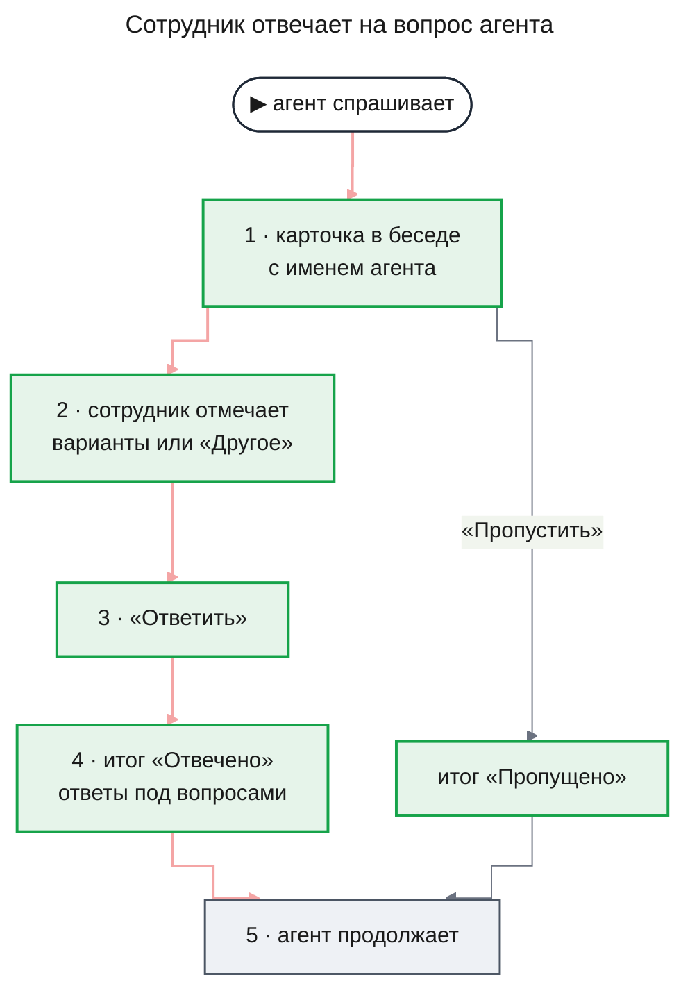

# UXRD: Подсказки агенту — вопрос, инструкции, скиллы (agent-guidance)

| Date | PRD |
|---|---|
| 2026-11-28 | [prd.md](./prd.md) |

## Snapshot

**Overview.** Агент, который не может выбрать сам, задаёт вопрос карточкой прямо в беседе: варианты с описаниями, своё «Другое», одна кнопка «Ответить» и «Пропустить». Карточка называет спросившего, даже если это сабагент глубокого агента, и несколько карточек от разных агентов отвечаются по отдельности. Сотрудник рассказывает главному чату своими словами, как с ним работать, и сохраняет итоговый текст, подтвердив карточку в ленте. Администратор пишет текст для агентов всей компании в новом разделе панели. Скиллы — процедуры, которые пишут люди, — встают в библиотеку рядом с агентами, а автор подключает их к агенту в его редакторе и к глубокому агенту на его карточке.

- **Не меняется**: состояния и кнопки карточки решения, экран «Моя память», вызов скилла из поля сообщения (его нет).
- **Главный UX-риск**: сабагенты глубокого агента открывают несколько карточек сразу, и беседа превращается в анкету. Каждая карточка компактна, итог занимает две строки на вопрос, а владелец правит промпт, если карточек слишком много (PRD, Assumptions and Risks).

### Key Decisions

| ID | Decision | Why |
|---|---|---|
| KD-1 | Карточка вопроса — отдельный компонент рядом с карточкой решения: та же рамка, шапка, источник и итог, но тело — вопросы. Все вопросы карточки видны сразу, одной формой, без вкладок и шагов; ответ уходит одной кнопкой | Claude Code и bb показывают вопрос вариантами с описанием и сами добавляют «Другое»; в вебе четыре вопроса помещаются на экран, и сотрудник видит всё, о чём его спросили, до того как ответить |
| KD-2 | Карточка стоит в беседе на месте вопроса для агента любой глубины и в истории спросившего агента; ответ в одной копии закрывает обе. Строки вызова инструмента у показанной карточки нет — она появляется, только когда карточки нет: вызов отклонён или ответить некому | Сотрудник отвечает там, где работает, не открывая сабагента (AC-09.1). Две записи об одном вопросе подряд — шум |
| KD-3 | «Ответить» отправляет то, что отмечено; вопрос без ответа агент получает как пропущенный, а сводка над кнопками заранее говорит, какие вопросы останутся без ответа. «Пропустить» закрывает всю карточку без подтверждения | Агент и так действует по своему суждению там, где ответа нет (AC-01.3); лишний диалог тормозит, а сводка не даёт пропустить вопрос незаметно |
| KD-4 | Агент, который ждёт сотрудника, везде читается одним статусом «Ждёт вас» — и при подтверждении, и при вопросе, тем же словом, что беседа в списке бесед. Эта метка действует и там, где agent-platform UXRD, MC-3, называет статус ожидания. Отдельного статуса для вопроса нет | Сотруднику важно одно: агент ждёт его. Что именно нужно, говорит сама карточка, а слово «подтверждения» при вопросе заставило бы искать действие, которое надо одобрить |
| KD-5 | Личная инструкция — ещё один вид карточки решения в ленте главного чата: итоговый текст целиком, кнопки и «Правка» как у задания глубокого агента, в «Правке» — поле со счётчиком оставшихся знаков. Решённая карточка не меняется, следующее изменение приходит новой карточкой. Инструкция организации — отдельный раздел панели «Инструкция для агентов» с одним полем, счётчиком и своей кнопкой «Сохранить»; очистить — стереть текст и сохранить | Сотрудник настраивает чат словами там, где работает, и до сохранения видит весь текст: если чат потерял прежние строки, это видно в карточке. Текст организации длинный и правится редко: явное сохранение не отправит полуфразу всем агентам |
| KD-6 | Скилл — запись библиотеки вида «скилл» в тех же группах «Мои», «От коллег», «От компании». «Использовать в чате» у скилла нет: следующий шаг после сохранения — подсказка, как скилл доходит до чата и агентов. Раздел панели «Агенты и глубокие агенты» называется «Библиотека» и показывает скиллы тоже | Скилл не запускают, его читает агент; кнопка запуска обещала бы то, чего нет. Одна библиотека — одно место, где искать всё, что написали люди |
| KD-7 | Скиллы агента выбирают полем «Скиллы» — тем же полем, что «Может запускать», с видом «скилл» — сразу после «Системы», не под «Дополнительно»; у глубокого агента, у которого нет формы, — окном «Скиллы» на его карточке. Скилл, текст которого смотрящему не открыт, показан именем и описанием без ссылки и с меткой «текст вам не виден», а копия агента называет такие скиллы выпавшими | Процедуры — главное, что автор настраивает в агенте, им не место среди редких настроек. Коллега видит, по каким процедурам работает агент, но текст чужого личного скилла остаётся закрытым (AC-06.7, AC-06.8) |

## Terms

- **Источник** — строка карточки, которая называет, кто спрашивает: чат или агент с его описанием.
- **Потерянный скилл** — скилл, подключённый к агенту, которого автор агента больше не видит в библиотеке: автор скилла сузил аудиторию.
- **Скрытый скилл** — скилл, который приходит вместе с агентом, но смотрящему в библиотеке не виден (AC-06.5).

## Design System

Follows the [design system](../../design-system/README.md).

### Component Inventory

| Component | Spec | Status | Note |
|---|---|---|---|
| Карточка вопроса | [question-card.md](../../design-system/components/question-card.md) | new | Карточка решения ждёт одного решения кнопкой, а здесь — выбор по нескольким вопросам; общие части — рамка, шапка, источник, итог — взяты из неё ссылками |
| Карточка решения | [decision-card.md](../../design-system/components/decision-card.md) | reused | Рамка, источник и итог для карточки вопроса; кнопки, «Правка» и итоги варианта «Бриф» — для карточки личной инструкции (PI-01) |
| Статус агента | [agent-status.md](../../design-system/components/agent-status.md) | extended | Метка статуса ожидания — «Ждёт вас», для подтверждения и для вопроса; у поручения так же (KD-4, MC-5) |
| Вызов инструмента | [tool-call.md](../../design-system/components/tool-call.md) | reused | Вызов `ask_user` без карточки и вызов `read_skill` |
| Лоток очереди | [message-queue.md](../../design-system/components/message-queue.md) | extended | «Заблокирован решением» держит и карточка вопроса; «К запросу» ведёт к самой ранней открытой карточке решения или вопроса (QC-02) |
| Поле инструкции | [instruction-field.md](../../design-system/components/instruction-field.md) | new | Форма настроек не знает длинного текста со счётчиком и защиты несохранённого, а редактор записи несёт версии, аудиторию и конфликт, которых у инструкции нет. В карточке личной инструкции — только поле и счётчик |
| Форма настроек | [settings-form.md](../../design-system/components/settings-form.md) | reused | Предупреждение и ошибки в поле инструкции |
| Скилл в библиотеке | [skill-record.md](../../design-system/components/skill-record.md) | new | Строка, редактор и страница скилла — отличия от агента; остальное ссылками на строку библиотеки и редактор записи |
| Строка библиотеки | [library-row.md](../../design-system/components/library-row.md) | reused | Строка скилла |
| Редактор записи | [record-editor.md](../../design-system/components/record-editor.md) | reused | Редактор скилла; поле «Может запускать» — основа поля «Скиллы» |
| Определение записи | [definition-view.md](../../design-system/components/definition-view.md) | reused | Страница скилла; строка «Может запускать» — основа строки «Скиллы» |
| Окно «Поделиться» | [share-dialog.md](../../design-system/components/share-dialog.md) | reused | Аудитория скилла и «Их чат читает скилл» |
| Подпись записи | [record-label.md](../../design-system/components/record-label.md) | reused | Имя, автор и аудитория скилла |
| Поле «Скиллы» | [skill-picker.md](../../design-system/components/skill-picker.md) | extended | Вариант поля и строки «Может запускать» с видом «скилл»: место после «Системы», подсказка, предел, окно глубокого агента, скрытый скилл в просмотре |
| Таблица данных | [data-table.md](../../design-system/components/data-table.md) | reused | Скиллы компании в панели |

## User Flows

### Primary User Flow

**Implements:** UC-1, UC-2; AC-01.1, AC-01.2, AC-01.3, AC-09.1, AC-09.2



Если чат сам ждёт ответа, сообщение из поля ввода уходит в лоток, а «К запросу» ведёт к карточке, как при подтверждении (QC-02).

### Alternative Flows

**Несколько карточек сразу** (UC-2; AC-09.3). Два сабагента спросили одновременно — в беседе две карточки, каждая на месте своего вопроса. Ответ на одну не трогает другую; беседа в списке остаётся «Ждёт вас», пока открыта хоть одна (AC-01.5).

**Ответ в другой копии**. Сотрудник ответил на странице сабагента — карточка в беседе переходит в тот же итог без строки ошибки, а отмеченное в ней пропадает.

**Ответить некому** (UC-3; AC-02.1, AC-02.2). В ходе расписания и при обучении карточки нет: в ленте стоит строка вызова «Вопрос сотруднику» с ответом платформы, и агент идёт дальше (QC-04). Когда владелец сам пишет в беседу расписания, следующий вопрос приходит карточкой (AC-02.3).

**Скилл от автора до агента** (UC-6; AC-05.1, AC-06.7, AC-12.1, AC-13.1):

```mermaid
---
title: "Борис пишет скилл, Аня видит его на странице агента"
config:
  theme: base
  look: classic
  themeVariables:
    primaryColor: "#eef1f5"
    primaryBorderColor: "#4b5563"
    primaryTextColor: "#1a1a1a"
    lineColor: "#6b7280"
  flowchart:
    curve: step
  themeCSS: |
    @keyframes lit_qf2{0%,22.5%{stroke:#991b1b;stroke-width:6px}25%,100%{stroke:#f4a5a5;stroke-width:2px}}
---
flowchart LR
    entry(["▶ Борис: «Новый скилл»"])
    edit["1 · редактор скилла<br/>имя, когда применять, шаги"]
    share["2 · «Кто видит: SRE»"]
    agent["3 · редактор агента<br/>поле «Скиллы»"]
    page["4 · страница агента<br/>строка «Скиллы»"]
    anya(["Аня из роли SRE"])
    entry --> edit
    edit e1@-->|"сохранил"| share
    share e2@-->|"поделился"| agent
    agent e3@-->|"новая версия"| page
    page e4@-->|"открывает"| anya
    classDef entry fill:#ffffff,stroke:#1f2937,stroke-width:1.5px,color:#1a1a1a
    classDef changed fill:#fde8e8,stroke:#dc2626,stroke-width:2px,color:#1a1a1a
    classDef new fill:#e6f4ea,stroke:#16a34a,stroke-width:2px,color:#1a1a1a
    classDef unchanged fill:#eef1f5,stroke:#4b5563,stroke-width:1.5px,color:#1a1a1a
    classDef w1 stroke:#f4a5a5,stroke-width:2px,animation:lit_qf2 4.8s linear 0s infinite
    classDef w2 stroke:#f4a5a5,stroke-width:2px,animation:lit_qf2 4.8s linear 1.2s infinite
    classDef w3 stroke:#f4a5a5,stroke-width:2px,animation:lit_qf2 4.8s linear 2.4s infinite
    classDef w4 stroke:#f4a5a5,stroke-width:2px,animation:lit_qf2 4.8s linear 3.6s infinite
    class entry,anya entry
    class edit new
    class share unchanged
    class agent,page changed
    class e1 w1
    class e2 w2
    class e3 w3
    class e4 w4
```



Аня видит скилл и на странице агента, и в своей библиотеке, потому что он открыт её роли. Если бы скилл был личным у Бориса, на странице агента стояли бы только имя и описание с меткой «текст вам не виден», а в библиотеке Ани скилла не было бы (AC-06.5, AC-06.7).

**Личная инструкция** (UC-5; AC-04.5, AC-04.6, AC-04.7, AC-10.1, AC-10.2). Сотрудник пишет главному чату, как с ним работать, и в ленте появляется карточка с итоговым текстом целиком. Если текст не тот, сотрудник нажимает «Изменить», правит его в поле и сохраняет, а может и отклонить карточку. Решённая карточка больше не меняется: чтобы снова поменять текст, сотрудник опять пишет чату и получает новую карточку. Чтобы убрать инструкцию, он просит чат об этом и сохраняет карточку с пустым текстом.

**Инструкция организации** (UC-4; AC-11.1). Администратор открывает раздел панели, пишет текст, нажимает «Сохранить» и видит «Сохранено». Тот же текст стоит в поле на любом устройстве.

### Error Flows

- **Ответ не ушёл**. Карточка остаётся открытой с отмеченным, строка ошибки MC-3; повтор — та же кнопка.
- **Агента остановили**, пока вопрос ждал, — итог «Не понадобилось» (MC-4).
- **Вызов вне пределов** (AC-01.4) — карточки нет; строка вызова показывает отказ, как любой отклонённый вызов инструмента.
- **Текст длиннее предела** — инструкция или скилл не сохраняются, счётчик и ошибка поля называют, сколько сократить (AC-03.4, AC-04.4, AC-05.3; MC-8, MC-12).
- **Сохранение отклонено сервером** — в панели ошибка формы «Не удалось сохранить: {причина}», введённое остаётся (MC-8). Карточка личной инструкции переходит в итог «Не сохранено: {причина}», прежний текст остаётся (MC-6).
- **Чат прислал слишком длинный текст или вызвал инструмент в ходе расписания** (AC-04.4, AC-04.9) — карточки нет; строка вызова «Личная инструкция» показывает отказ, как любой отклонённый вызов инструмента.

## Screens

### Screen 1: Беседа — карточка вопроса

```
┌ Лента беседы ─────────────────────────────────────────┐
│ Ассистент: Нашёл три сервиса с ошибками за вчера.     │
│ ▸ Сбор логов · работает                               │  карточка хода
│ ┌ ✋ Ждёт вас ────────────────────────────── 14:36 ┐ │
│ │ Агент «Сбор логов» спрашивает:                     │ │  QC-01
│ │ 1. За какой период брать логи?                     │ │
│ │ ( ) Вчера целиком   ( ) Последние 6 часов  …       │ │
│ │ [ Ответить ]  [ Пропустить ]                       │ │
│ └────────────────────────────────────────────────────┘ │
│ ┌ ✋ Ждёт вас ────────────────────────────── 14:36 ┐ │
│ │ Агент «Сбор метрик» спрашивает: …                  │ │  QC-02
│ └────────────────────────────────────────────────────┘ │
├───────────────────────────────────────────────────────┤
│ [ Сообщение…                                   ] (↑)  │
└───────────────────────────────────────────────────────┘
```

**QC-01. Карточка вопроса** — [карточка вопроса](../../design-system/components/question-card.md) в колонке ленты, на месте вопроса в ходе спросившего агента. Источник называет агента так же, как карточка решения: чат — «Чат спрашивает:», агент или сабагент — по своему описанию со ссылкой на свою страницу (AC-09.1; MC-1).

**QC-02. Несколько карточек** — каждая на своём месте в ленте, в порядке вопросов; ответ на одну другие не меняет (AC-09.3). Если вопрос задал сам чат, лоток очереди показывает подсказку «К запросу», и она ведёт к самой ранней открытой карточке чата.

**QC-03. Копия в истории агента** — та же карточка стоит на странице спросившего агента. Ответ в любой копии закрывает обе (KD-2).

**QC-04. Строка вызова без карточки** — [вызов инструмента](../../design-system/components/tool-call.md), встроенный: подпись «Вопрос сотруднику», ответ платформы — исход вызова (MC-5). Показана только при отказе (AC-01.4) и когда ответить некому (AC-02.1, AC-02.2). Вызов `read_skill` — та же строка с подписью «Чтение скилла» и именем скилла во второй строке.

**Screen states**:

| State | What shows | AC |
|---|---|---|
| Вопрос ждёт | Карточка, статус агента и беседа в списке — «Ждёт вас» | AC-01.5 |
| После рестарта | Карточка на месте, ответ доходит до агента; отмеченное до перезагрузки не сохраняется | AC-01.5 |
| Отвечено | Итог с ответами под вопросами, без кнопок | AC-09.2 |

### Screen 2: Беседа — карточка «Как со мной работать»

```
┌ Лента главного чата ──────────────────────────────────┐
│ Вы: Я SRE платежей, отвечай мне коротко и по-русски.  │
│ ┌ ✋ Ждёт вас ────────────────────────────── 14:36 ┐ │
│ │ Как со мной работать                               │ │  PI-01
│ │ Ваши агенты читают этот текст на каждом шаге…      │ │
│ │ Я SRE команды платежей. Отвечайте коротко и        │ │
│ │ по-русски, команды давайте для bash.               │ │
│ │                          Осталось 3 912 знаков     │ │
│ │ [ Сохранить ]  [ Изменить ]  [ Отклонить ]         │ │
│ └────────────────────────────────────────────────────┘ │
├───────────────────────────────────────────────────────┤
│ [ Сообщение…                                   ] (↑)  │
└───────────────────────────────────────────────────────┘
```

**PI-01. Карточка «Как со мной работать»** — [карточка решения](../../design-system/components/decision-card.md) в ленте главного чата, на месте вызова инструмента личной инструкции (KD-5). Кнопки, «Правка» и итоги у неё как у варианта «Бриф», а тело — заголовок, пояснение и [поле инструкции](../../design-system/components/instruction-field.md), вариант «В карточке». Пока карточка ждёт, агенты сотрудника получают прежний текст (AC-04.5). Тексты MC-6, MC-8.

| State | What shows | AC |
|---|---|---|
| Ждёт | Итоговый текст целиком и счётчик; «Сохранить», «Изменить», «Отклонить» | AC-04.5 |
| Пустой текст | Вместо текста — строка о том, что агенты не получат инструкцию; «Сохранить» её убирает | AC-04.7 |
| Правка | Поле с текстом и счётчиком; «Сохранить с правками» и «Отмена»; Esc равен «Отмена» | AC-04.6 |
| Больше предела | Счётчик и ошибка поля; запрос не уходит, карточка остаётся в «Правке» | AC-04.4 |
| Сохранено | Итог «Сохранено» и сохранённый текст вместе с правками; кнопок нет | AC-04.6, AC-10.1 |
| Отклонено | Итог «Отклонено» и предложенный текст; кнопок нет | AC-04.6, AC-10.2 |
| Не сохранено | Итог с причиной, которую назвал сервер; прежний текст не изменился; кнопок нет | AC-04.4 |

### Screen 3: Панель — «Инструкция для агентов»

```
┌ Панель ─────────┬─────────────────────────────────────┐
│ Сотрудники      │ Инструкция для агентов              │  OI-01
│ Роли            │ Этот текст получают все агенты…      │
│ Авторизация     │ ⚠ Сотрудник может увидеть этот текст │
│ MCP-серверы     │ [ Тикеты заводите в проекте OPS… ]  │
│ Модели          │                 Осталось 3 800 знаков│
│ Библиотека      │                         [Сохранить] │
│ Инструкция ◀    │                                     │
└─────────────────┴─────────────────────────────────────┘
```

**OI-01. Раздел «Инструкция для агентов»** — седьмой пункт сайдбара панели, после «Библиотеки»; в разделе одно [поле инструкции](../../design-system/components/instruction-field.md), вариант «Организация». Сотрудник без права администратора панели не видит, поэтому и раздела тоже (AC-03.3, AC-11.1). Тексты MC-7 – MC-9.

| State | What shows | AC |
|---|---|---|
| Сохранено | При следующем открытии в поле сохранённый текст | AC-11.1 |
| Больше предела | Счётчик и ошибка поля; прежний текст остаётся сохранённым | AC-03.4 |

### Screen 4: Библиотека — скиллы

```
┌ Библиотека ──────────────────────────────── [＋ ▾] ──┐
│ Мои · 3                                  │ Создать в чате│
│ ⌬ Разбор оплат        агент · …          │ Форма агента  │
│ ▤ Разбор инцидента    скилл · Когда…     │ Новый скилл   │  SK-01
│ От коллег · 1                                         │
│ ▤ Постмортем · Аня Ли  SRE  скилл · …                  │
└───────────────────────────────────────────────────────┘
```

**SK-01. Скилл в списке** — [строка скилла](../../design-system/components/skill-record.md) в той же группе, что агенты: «Мои», «От коллег» или «От компании» (KD-6). Меню «Создать» получает пункт «Новый скилл» (MC-10). Скилл, открытый роли SRE, стоит у Бориса и у Ани с одной и той же аудиторией (AC-05.1, AC-12.1).

**SK-02. Редактор скилла** — `/library/new/skill` и страница своего скилла; поля MC-11, ошибки MC-12. После первого сохранения под шапкой появляется подсказка, как скилл доходит до чата и агентов: это следующий шаг (KD-6).

**SK-03. Страница для читателя** — скилл коллеги или компании: подпись записи, пояснение получателю, «Когда применять» и «Шаги» целиком по раскрытию, действие «Скопировать себе» (AC-05.1, AC-05.2; MC-13). У скилла, открытого только для чтения, пояснение говорит, что чат смотрящего его не читает.

**SK-04. Поделиться, копия, удаление** — как у агента, с текстами скилла (MC-13). Способ получения «Только в библиотеке» убирает скилл из чата коллег (AC-07.2). Окно удаления добавляет фразу о том, что агенты, к которым подключён скилл, будут работать без него (AC-06.6).

**SK-05. Панель — «Библиотека»** — раздел «Агенты и глубокие агенты» называется «Библиотека», и его таблицы показывают скиллы с видом «скилл». На вкладке «Системные» «Создать» предлагает и скилл; редактор — вариант «Системный» (AC-05.2; MC-13).

| State | What shows | AC |
|---|---|---|
| Ошибка поля | Пустое имя, описание или шаги; описание или шаги длиннее предела | AC-05.3 |
| Скилл удалён | Строка уходит; у агентов скилл пропадает из строки «Скиллы» без пометки | AC-06.6 |

### Screen 5: Скиллы агента и глубокого агента

```
Редактор агента                         Карточка глубокого агента
Системы   ☑ Sentry  ☑ Jira               Системы   Confluence
Скиллы    Агент читает скилл, когда…     Скиллы    Разбор инцидента · Борис
          [ Найти скилл…        ]                  [Изменить]            SP-02
          [Разбор инцидента · Борис ✕]   Сабагенты · 3 …
          [⊖ скилл недоступен ✕]  SP-01
▸ Дополнительно: …
```

**SP-01. Поле «Скиллы» в редакторе агента** — [поле «Скиллы»](../../design-system/components/skill-picker.md), то есть поле «Может запускать» с видом «скилл», сразу после «Системы» (KD-7). Поиск предлагает только скиллы, которые автор видит в библиотеке (AC-13.2). «Сохранить» создаёт новую версию агента, и на его странице стоят подключённые скиллы (AC-13.1). Тексты MC-14, MC-15.

**SP-02. Скиллы глубокого агента** — на карточке глубокого агента строка «Скиллы» в определении, а у владельца под ней «Изменить»: окно «Скиллы «{имя}»» с тем же полем. «Сохранить» создаёт новую версию глубокого агента, закрывает окно и показывает уведомление (MC-16).

**SP-03. Строка «Скиллы» на странице агента и копия** — [строка «Скиллы»](../../design-system/components/skill-picker.md#строка-скиллы-в-просмотре) после «Системы» в определении записи. Видимый скилл ведёт на свою страницу; скрытый показан именем, описанием и меткой «текст вам не виден» (AC-06.7). Окно копии называет скрытые скиллы, которые в копию не войдут, рядом с выпавшими системами (AC-06.8; MC-16).

| State | What shows | AC |
|---|---|---|
| Потерянный скилл в редакторе | Чип «скилл недоступен»; убрать можно, вернуть нельзя | AC-13.2 |
| Скиллов нет | В поле только поиск; в просмотре строки нет | — |

## Accessibility

- **Появление карточки вопроса** фокус не забирает: сотрудник может печатать в поле ввода. Экран объявляет карточку `polite` фразой MC-5; две карточки сразу — две фразы по очереди.
- **Фокус после ответа** стоит на ответившей карточке; к следующей открытой карточке сотрудник идёт Tab или «К запросу».
- **Раздел панели «Инструкция для агентов»** — при переходе фокус на заголовок раздела, как у остальных разделов панели.

## Responsive Behavior

| Экран | < 480 px (в том числе 360 px) | 480–1023 px | ≥ 1024 px |
|---|---|---|---|
| Карточка вопроса (QC-01) | Карточка во всю колонку с полями экрана 16 px; описание варианта под подписью; «Другое» — поле под подписью во всю ширину; «Ответить» и «Пропустить» столбцом во всю ширину; строки вариантов от 44 px при касании | Как на десктопе | Колонка ленты |
| Карточка «Как со мной работать» (PI-01) | Кнопки столбцом во всю ширину; высота поля — по [полю инструкции](../../design-system/components/instruction-field.md) | Как на десктопе | Колонка ленты |
| Инструкция организации (OI-01) | Высота поля — по [полю инструкции](../../design-system/components/instruction-field.md); кнопки ряда — во всю ширину, состояние над ними | Как на десктопе | Как в спецификации |
| Редактор скилла (SK-02) | Как редактор агента на узкой ширине; счётчики под подписью | Как на десктопе | Колонка до 720 px |
| Поле «Скиллы» (SP-01, SP-02) | По [полю «Скиллы»](../../design-system/components/skill-picker.md#поле); окно глубокого агента — на весь экран | По полю «Скиллы» | По полю «Скиллы» |
| Строка «Скиллы» (SP-03) | По определению записи; у скрытого скилла описание под именем | По определению записи | По определению записи |

## Content and Microcopy

| ID | Where (screen / component / state) | Text |
|---|---|---|
| MC-1 | Карточка вопроса — источник | «Чат спрашивает:»; «Агент «{описание}» спрашивает:»; после ответа — «Чат спрашивал:», «Агент «{описание}» спрашивал:»; скринридер группы — «Вопрос от чата», «Вопрос от агента «{описание}»» |
| MC-2 | Карточка вопроса — вопросы | «можно несколько»; «Другое»; подсказка поля «Свой ответ…»; скринридер поля «Свой ответ на вопрос {N}»; сводка — «Без ответа: вопрос {N} — агент решит сам», «Без ответа: вопросы {N} и {M} — агент решит сам», «Без ответа: вопросы {N}, {M} и {K} — агент решит сам» |
| MC-3 | Карточка вопроса — действия | «Ответить», «Пропустить»; причина недоступной «Ответить» — «Выберите ответ хотя бы на один вопрос или нажмите «Пропустить»»; ошибка — «Не удалось отправить ответ. Попробуйте ещё раз.» |
| MC-4 | Карточка вопроса — итог | «Отвечено · {время}»; «Пропущено · {время}»; «Не понадобилось»; ответ — подписи вариантов через запятую, «Свой ответ: {текст}», «Без ответа» |
| MC-5 | Статус, вызов, объявление | Статус агента, который ждёт сотрудника, и шапка карточек вопроса и решения — «Ждёт вас»; строка вызова — «Вопрос сотруднику», «Чтение скилла»; объявление — «Новый вопрос от чата», «Новый вопрос от агента «{описание}»» |
| MC-6 | Карточка «Как со мной работать» (PI-01) | Заголовок «Как со мной работать»; «Ваши агенты читают этот текст на каждом шаге — в чате, в расписаниях и при обучении. Его видите только вы.»; пустой текст — «Пусто: агенты не получат личную инструкцию»; пример в пустом поле — «Например: я SRE команды платежей. Отвечайте коротко и по-русски, команды давайте для bash.»; кнопки «Сохранить», «Изменить», «Отклонить», в правке «Сохранить с правками», «Отмена»; итоги «Сохранено · {время}», «Отклонено · {время}», «Не сохранено: {причина}», «Не понадобилось»; скринридер группы — «Нужно решение: Как со мной работать»; строка вызова без карточки — «Личная инструкция» |
| MC-7 | Инструкция для агентов (OI-01) | Пункт и заголовок «Инструкция для агентов»; вкладка «Инструкция для агентов — Панель — Agent OS»; «Этот текст получают агенты всех сотрудников на каждом шаге.»; предупреждение — «Сотрудник может увидеть этот текст через своего агента. Не пишите сюда пароли, токены и другие секреты.»; пример — «Например: тикеты заводите в проекте OPS. Сервис «касса» в логах называется payments.» |
| MC-8 | Поле инструкции — общее | «Осталось {N} знаков»; «Больше предела на {N} знаков»; ошибка поля — «Сократите текст на {N} знаков»; «Есть несохранённые изменения»; «Отменить правки»; «Сохранить», «Сохраняем…», «Сохранено»; «Не удалось сохранить: {причина}», «Не удалось сохранить: нет связи с сервером»; «Не удалось загрузить» + «Повторить» |
| MC-9 | Поле инструкции — уход | «Уйти без сохранения?» / «Изменения в «{заголовок секции}» не сохранены и пропадут.» / «Остаться», «Уйти без сохранения» |
| MC-10 | Библиотека — скилл (SK-01) | Вид — «скилл»; пункт меню «Создать» — «Новый скилл»; меню строки — «Открыть», «Поделиться», «Скопировать себе», «Удалить»; «Скилл создан», «Скилл удалён» |
| MC-11 | Редактор скилла (SK-02) | «Новый скилл»; вкладка «{имя} — Библиотека — Agent OS»; «Имя»; «Когда применять», «По этому тексту агент решает, читать ли скилл. Начните с «Когда…»»; «Шаги», «Процедура, по которой агент идёт, когда прочитал скилл.»; счётчики «{N} / {предел}»; подсказка после сохранения — «Ваш чат читает скилл сам, когда задача подходит. Чтобы его читал агент, подключите скилл в редакторе агента.»; «Создать», «Сохранить», «Отменить изменения» |
| MC-12 | Редактор скилла — ошибки | «Введите имя»; «Введите описание»; «Описание длиннее {предел} знаков»; «Введите шаги»; «Шаги длиннее {предел} знаков»; «У вас уже есть скилл «{имя}»»; «Не удалось сохранить: {причина}» |
| MC-13 | Скилл — поделиться, страница, удаление, панель (SK-03 – SK-05) | «Как коллеги получают «{имя}»»: «Их чат читает скилл», «Только в библиотеке — прочитать и скопировать»; пояснение получателю — «Автор — {автор}. Скилл открыт вашей роли {роли}.» / «Ваш чат читает его, когда задача подходит.», а у скилла «Только в библиотеке» вместо второй фразы — «Автор открыл скилл только для чтения: ваш чат его не читает. Чтобы чат читал его, скопируйте себе.»; удаление — «Удалить «{имя}»?» и после текста о видимости «Агенты, к которым он подключён, будут работать без него.»; панель — раздел «Библиотека», вкладка «Библиотека — Панель — Agent OS», колонка «Название», «Создать» — «Агент», «Скилл» |
| MC-14 | Поле «Скиллы» (SP-01, SP-02) | «Скиллы»; «Агент читает скилл, когда задача подходит под его описание.»; «Найти скилл…»; «Скиллов не нашли»; «Убрать: {имя}»; ошибка предела — «Можно подключить не больше {предел} скиллов» |
| MC-15 | Метки скиллов | «скилл недоступен»; «текст вам не виден» |
| MC-16 | Глубокий агент и копия (SP-02, SP-03) | «Изменить»; окно «Скиллы «{имя}»», «Отмена», «Сохранить»; уведомление «Скиллы сохранены»; копия — «Не войдут скиллы, которых вы не видите: {имена}» |

## Update History

| Version | Date | Change |
|---------|------|--------|
| 1.0 | 2026-11-28 | Первая версия: карточка вопроса, «Как со мной работать», инструкция для агентов в панели, скиллы в библиотеке и у агентов |
| 1.1 | 2026-11-28 | Личная инструкция — карточка решения в ленте главного чата вместо секции на «Мой доступ» |
| 1.2 | 2026-11-28 | Одно слово «Ждёт вас» для любого ожидания сотрудника; поле «Скиллы» — вариант «Может запускать» |
