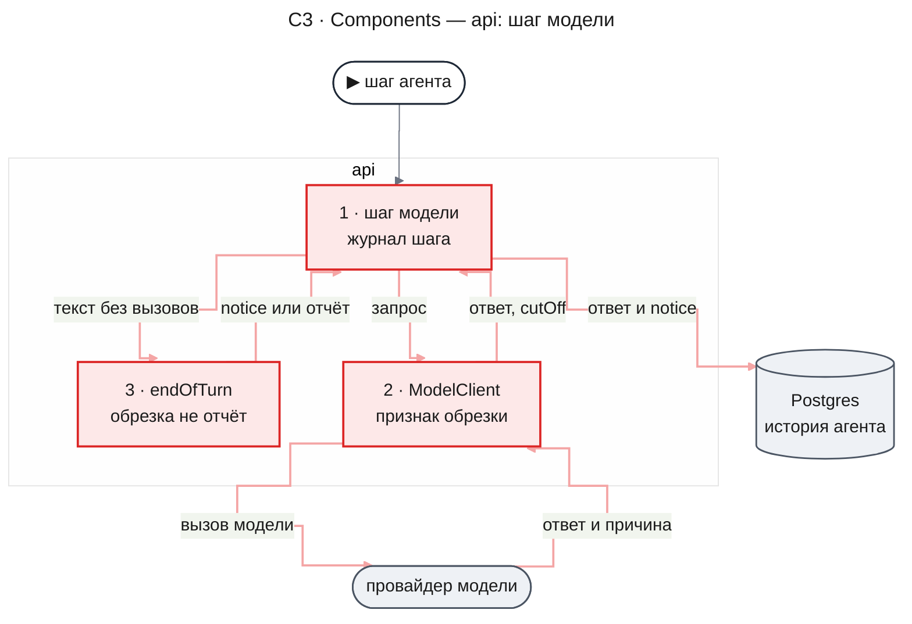
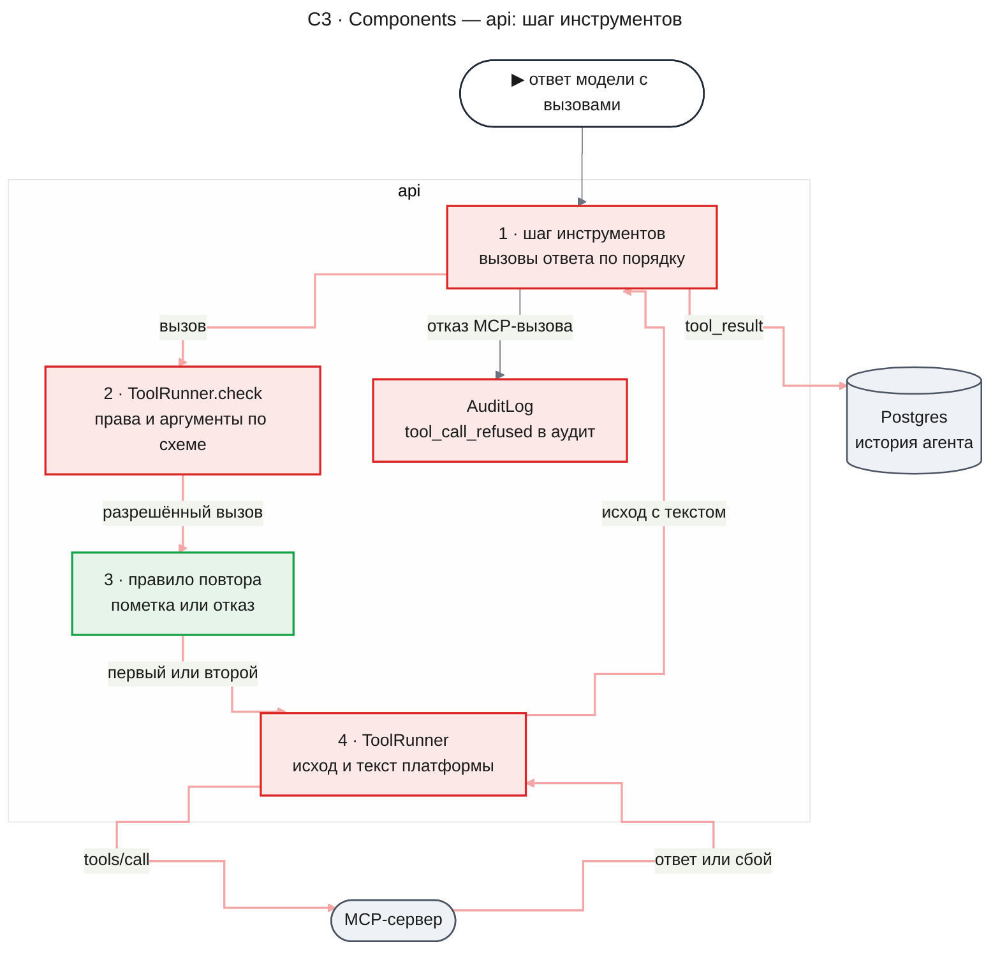
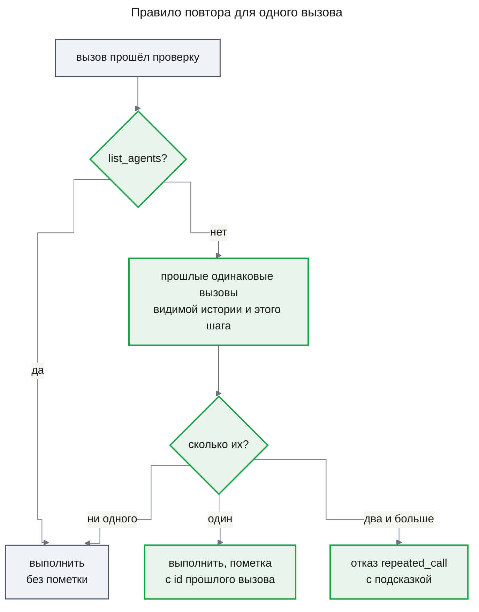
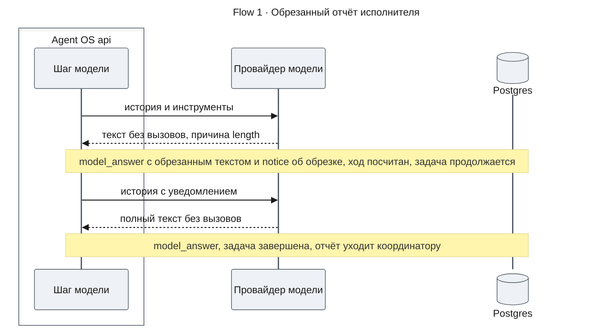
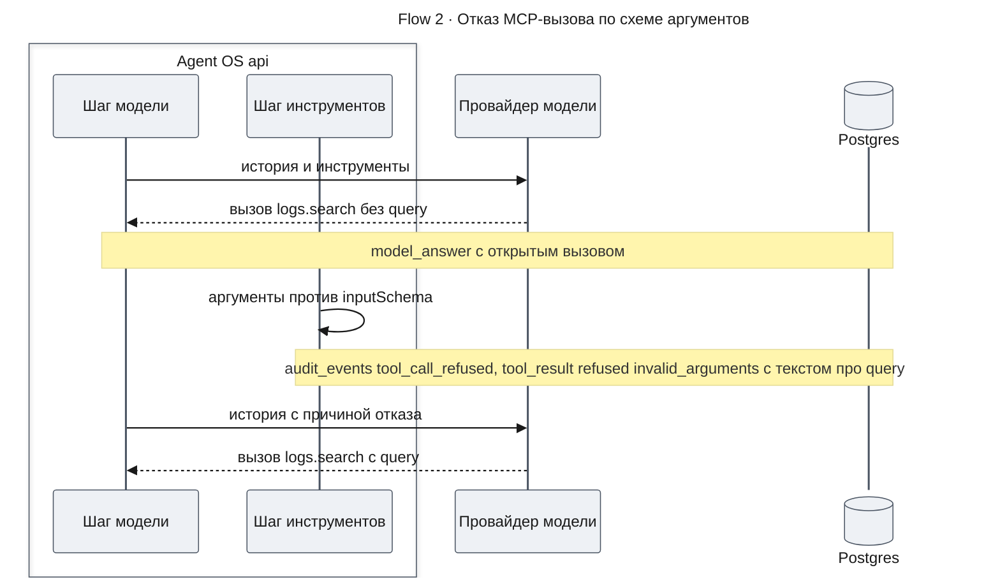
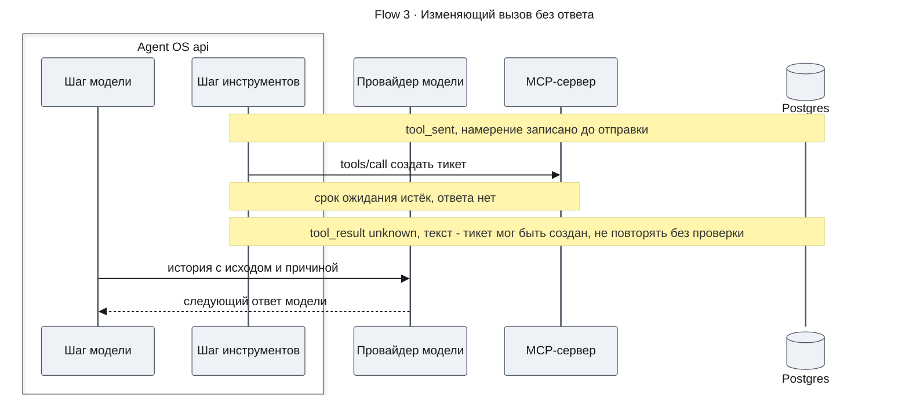
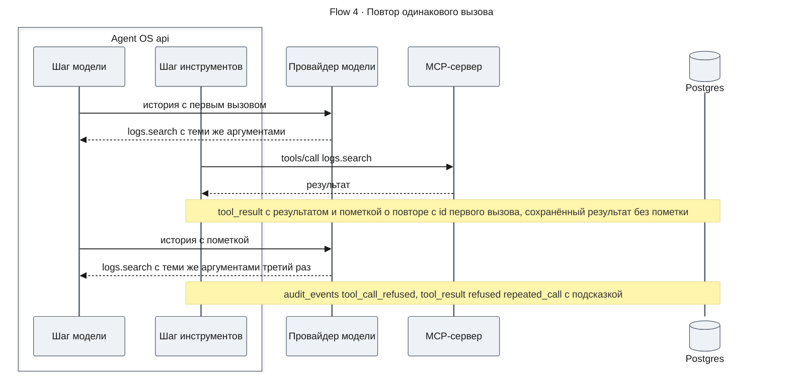
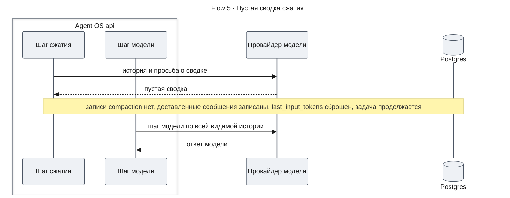

# Харнесс для малых моделей — Design Document — core

**Status:** Draft · **Date:** 2026-11-21 · **PRD:** [prd.md](./prd.md) · **UXRD:** нет · **Depends on:** ничего — первая часть

## Snapshot

**Overview.** Агент на малой модели часто ошибается мелко: путает аргументы, упирается в предел длины ответа, повторяет один и тот же запрос. Сегодня цикл агента в пакете `agents` в таких случаях молчит: модель видит голый отказ или голый сбой, обрезанный текст становится отчётом, а пустая сводка сжатия роняет задачу. Эта часть меняет только цикл агента. Каждое объяснение платформа пишет в текст результата вызова или в уведомление, которые модель уже читает. Проверка вызова сверяет аргументы MCP-вызова со схемой инструмента до отправки, а отдельное правило по истории сессии останавливает третий одинаковый вызов. Обрезанный ответ и пустая сводка дают агенту ещё один шаг, а журнал шага модели пишет, какие инструменты модель видела и какие выбрала.

- **Не меняется**: конец хода главного агента беседы — его обрезанный ответ остаётся ответом; история и её виды записей, сохранённые результаты вызовов, веб.
- **Главный риск**: проверка по схеме отклонит аргументы, которые сервер принял бы (ложный отказ); его смягчают текст ошибки и пропуск непроверяемых схем.
- **Открытые вопросы**: нет.

### Key Decisions

#### KD-1: Модель узнаёт причину неудачи из текста записи `tool_result` или из записи `notice`; новых видов записей и полей нет

Всё, что модель видит из истории, строит одна функция `toolResultOf`: для неуспешного вызова она пишет `[<исход>: <причина>]` и с новой строки текст записи. Сегодня у отказа и у сбоя транспорта этот текст пустой, поэтому модель читает только `[refused: invalid_arguments]` или `[transport_failure]`. Эта часть заполняет текст: ошибку аргументов, причину сбоя, предупреждение о неизвестном исходе, подсказку при повторе и пометку о повторе после результата. Канал уже есть, рендер не меняется, и данных записывать иначе не нужно. Обрезанный ответ объясняется записью `notice`, как сегодня объясняется отказ координатору закончить работу. Полный сохранённый результат вызова в `agent_tool_results` текст платформы не получает никогда: часть `evidence` ищет цитаты именно там.

Отвергнуты: отдельное структурированное поле подробности в `tool_result` — его пришлось бы добавить в две схемы записи и научить `toolResultOf` его показывать, а модель всё равно прочла бы тот же текст. Поле `refusalDetail` занято подробностью отказа модели и имеет её форму.

#### KD-2: Аргументы MCP-вызова проверяет `ToolRunner.check` валидатором JSON Schema, который уже лежит в клиенте MCP (`@modelcontextprotocol/client/validators/ajv`)

Схема аргументов MCP-инструмента — произвольная JSON Schema, которую сервер прислал в `tools/list`, а платформа сохранила в `agent_mcp_servers.tools`. Сегодня `check` проверяет у MCP-вызова только то, что аргументы — объект. Клиент MCP 2.4.0, который пакет `agents` уже объявляет, отдаёт подпутём `validators/ajv` класс `AjvJsonSchemaValidator` со своей копией ajv 8.18 и форматами. Он понимает JSON Schema 2020-12, 2019-09, draft-07 и draft-06 и возвращает текст ошибки, который называет аргумент и ожидание (прочитано в `dist` пакета, не запускалось). Новой зависимости нет. Схема с неизвестным диалектом или схема, которая не компилируется, вызывает исключение при сборке валидатора. Тогда `check` пропускает вызов без проверки и сообщает вызывающему, почему, а вызывающий пишет это в журнал (AC-02.3).

Схему реестр каждый шаг читает из базы заново, а ajv кэширует скомпилированное по объекту схемы. Поэтому скомпилированный валидатор не живёт дольше одного набора инструментов шага: долгоживущий экземпляр рос бы с каждым шагом. Встроенные инструменты проверяются своими zod-схемами, как сегодня, и текст ошибки строится из их issues.

Отвергнуты: `z.fromJSONSchema` из zod 4.6.7 — помечен как полуэкспериментальный и переводит в zod не каждую конструкцию. `ajv` отдельной зависимостью — вторая копия того, что уже приходит с клиентом MCP.

#### KD-3: Обрезку видит `ModelClient` по причине завершения `length`, а правило «обрезанный текст не отчёт» живёт в `endOfTurn` только там, где текст стал бы отчётом

Причину завершения провайдер уже отдаёт, но `ModelClient.call` её только логирует. Ответ модели получает признак `cutOff`: AI SDK приводит причину завершения каждого провайдера к общему набору, и упор в предел длины в нём — `length`. Это проверено для Anthropic, где `max_tokens` даёт `length`; для Google и OpenAI-совместимых провайдеров это допущение, его проверяет план. `endOfTurn` получает этот признак и меняет одну ветку: у агента без исполнителя ответа текст стал бы отчётом, и для обрезанного ответа он возвращает `notice`. Корень беседы ждёт, как сегодня (Won't Have PRD). Агент с незаконченными потомками тоже ждёт: его текст сейчас не отчёт, а уведомление разбудило бы его раньше потомков. Текст координатора с исполнителем ответа отчётом не становится, поэтому для него ничего не меняется. Ход считается и тратит расход как обычно, поэтому бесконечно обрезающийся ответ упирается в обычный предел ходов.

Отвергнуты: признаки обрезки в самом тексте (нет точки в конце, незакрытый блок) — это эвристика, которая ошибается в обе стороны.

#### KD-4: Изменяющий MCP-вызов без ответа получает исход `unknown` в `toOutcome`, одном месте для прямых вызовов и вызовов из скрипта

`toOutcome` превращает ответ сервера или сбой в исход вызова и теперь знает, помечен ли инструмент «только чтение» (`readOnly`). Изменяющий вызов получает `unknown`, если запрос мог дойти до сервера и выполниться: истёк срок (`timeout`), оборвалось соединение (`connection_lost`) или пришёл ответ не по протоколу (`protocol_error`). При `unauthorized` и `client_error` запрос до выполнения не дошёл, и исход остаётся сбоем транспорта. Вызов «только чтение» без ответа всегда остаётся сбоем транспорта. Причина сбоя сохраняется у обоих исходов, а текст для модели пишет `toOutcome` (KD-1). Вызовы из скрипта `run_code` проходят через ту же функцию, поэтому изменяющий вызов в скрипте класса `write` тоже получает `unknown` с причиной.

Отвергнуты: только `timeout`, как в AC-04.1, — оборванное соединение тоже бывает после доставленного запроса, а лишнее «неизвестно» безопасно: модель только проверит. Решение в шаге инструментов — там нет `readOnly`, и вызовы из скрипта его не проходят.

#### KD-5: Правило повтора — чистая функция, которую шаг инструментов зовёт после проверки вызова, по вызовам видимой истории и уже прошедшим вызовам того же ответа

`check` синхронна и истории не видит, поэтому повтор решает отдельная функция по [pure-decision.md](../../code-system/patterns/pure-decision.md). Шаг инструментов получает от обработчика все вызовы истории, которую обработчик уже прочитал для шага, а не только открытые: это расширение типа `ToolStep` без нового чтения базы. Счёт ведётся по вызовам с того же инструмента и сервера с теми же аргументами. Аргументы сравниваются без учёта порядка ключей, потому что `jsonb` порядок не хранит. Считаются вызовы с любым исходом, кроме `refused`: отклонённый проверкой вызов до инструмента не дошёл. Отказ сотрудника считается: трижды спросить его об одном и том же — тоже петля.

Видимая история начинается с последнего сжатия, поэтому вызовы до него не считаются, как модель их и не видит. Вызовы родителя ответвления тоже не считаются, хотя до своего первого сжатия ответвление их видит: шаг инструментов читает только записи своей сессии. Вызовы из скрипта `run_code` под правило не попадают: их ограничивает предел вызовов прогона. `list_agents` под правило не попадает, остальные встроенные инструменты и все MCP-инструменты попадают. Пороги — пометка со второго вызова и отказ с третьего (FR-06) — константы кода рядом с функцией.

Отвергнуты: проверка в `check` — пришлось бы передать в неё историю и сделать её решением о сессии, а не о вызове. Отдельный запрос всей истории сессии через сжатие — лишнее чтение на каждом шаге ради петли, которую сжатие и так прерывает редко.

#### KD-6: Отказы MCP-вызовов по аргументам и по повтору пишутся в аудит новым видом `tool_call_refused` через тот же порт `AccessAudit`

Сегодня в аудит из пакета `agents` попадает только отказ по правам, `access_denied`. Ошибка модели — не нарушение прав, и проект уже держит их порознь: тест `model-providers` проверяет, что отказ провайдера не пишет `access_denied`, чтобы не засорять отчёт о нарушениях прав. Поэтому порт принимает вторую запись того же устройства с видом `tool_call_refused` и причиной `invalid_arguments` или `repeated_call`. Таблица `audit_events` видов не ограничивает, хук в `apps/api` пишет запись как есть. Пишутся отказы только MCP-вызовов, как и `no_access`: аудит Business Constraint 3 касается внешних систем. Вызов из скрипта пишет такую же запись при отказе по аргументам.

Отвергнуты: вид `access_denied` с новой причиной — смешал бы ошибки модели с нарушениями прав.

#### KD-7: Пустая сводка не пишет сжатие: шаг фиксирует доставленное, сбрасывает `lastInputTokens` и продолжает, следующим идёт шаг модели

Сегодня шаг сжатия бросает исключение, и runtime роняет задачу с `handler_error`. Это расходится и с [step-handler.md](../../code-system/patterns/step-handler.md), где неудача шага — итог, а не исключение. Теперь шаг возвращает `continue` с коммитом без записи `compaction`. Коммит пишет то, что шаг и так должен записать, — начало продолжения и доставленные сообщения — и сбрасывает `lastInputTokens`, как при удачном сжатии. Поэтому следующий шаг — шаг модели по всей истории. Новое сжатие начнётся, только когда этот вызов модели снова покажет вход выше порога. Если история уже не помещается в окно, шаг модели упадёт с ошибкой модели и её причиной, как требует FR-05.

Отвергнуты: повторить сжатие сразу — `lastInputTokens` остался бы выше порога, и агент крутился бы на пустых сводках, оплачивая вызовы, которые не считаются ходами.

## Terms

- **Обрезанный ответ, одинаковый вызов, изменяющий вызов, сохранённый результат, сжатие истории** — как в [PRD, Terms](./prd.md#terms).
- **Текст платформы** — строка, которую пишет платформа, а не сервер или модель, в поле `text` записи `tool_result`: ошибка аргументов, причина сбоя, подсказка.
- **Видимая история** — записи своей сессии с последнего сжатия, которые обработчик читает на каждом шаге. Модель видит их же, а ответвление до первого сжатия видит ещё и записи родителя.
- **Пометка о повторе** — строка, которую платформа дописывает после результата второго одинакового вызова, с id прошлого вызова.

## Part

- **Part**: `core`
- **Covers**: FR-01 – FR-07
- **Depends on**: ничего — первая часть
- **Prerequisite ADRs**: [ADR-0002](../../adr/ADR-0002-app-schema-migrations.md), [ADR-0003](../../adr/ADR-0003-drizzle-data-layer.md), [ADR-0004](../../adr/ADR-0004-agent-framework-packages.md), [ADR-0014](../../adr/ADR-0014-mcp-registry-owned-by-agents.md), [ADR-0015](../../adr/ADR-0015-access-gate-and-model-catalogue.md)

**Out of scope**

- Главный агент беседы: его обрезанный ответ остаётся ответом (Won't Have PRD).
- Вызовы, которые закрываются `unknown` после потерянного шага или прерывания: они остаются без текста, как сегодня.
- Проверка ответов MCP-серверов по `outputSchema` (Won't Have PRD).
- Веб: отказ он по-прежнему показывает без текста результата и по коду причины. У `repeated_call` нет своего текста в каталоге веба, и веб показывает общий текст отказа с кодом. Текст платформы у сбоя транспорта веб показывает как есть, по-английски.
- Проход выписок и всё, что касается агента ответа, — часть `evidence`.

**Constraints**

- Без совместимости: старое поведение заменяется, существующие записи не переносятся. Новая причина отказа меняет CHECK одной миграцией, сгенерированной из схемы ([Data Model](#data-model)).
- Пороги повтора и предел длины текста ошибки — константы кода, без настроек и переменных окружения (KD-5).
- Журнал пишется через логгер `common` ([logging.md](../../code-system/patterns/logging.md)). Новые записи и поля этой части не несут значений аргументов, текстов результатов и секретов (NFR-01) — [Записи журнала](#contract-definitions).
- Валидатор берётся из уже установленной зависимости (KD-2).
- Тестов мало, по одному на нижнем уровне, который ловит дефект ([Test Strategy](#test-strategy)).

**Что меняется в поведении, описанном в соседних документах**

- [design-agents.md](../agent-platform/design-agents.md): KD-2 и правило конца хода — обрезанный ответ агента, которого запустил агент или workflow, отчётом не становится. KD-7 — пустая сводка больше не роняет задачу. Contract Definitions — MCP-сервер больше не единственный, кто проверяет аргументы. Исход `unknown` теперь бывает и у изменяющего вызова без ответа, а не только после потерянного шага. Отказ и сбой транспорта несут текст. Добавлена причина отказа `repeated_call`.
- [design-access.md](../enterprise-access/design-access.md), KD-6: хук аудита пишет не только `access_denied`, но и `tool_call_refused`.
- [design-code-execution.md](../code-execution/design-code-execution.md): текст отказа вызова из скрипта несёт ошибку аргументов, а изменяющий вызов без ответа в прогоне `write` получает `unknown`.

## Building-block Inventory

Follows the [code system](../../code-system/README.md).

| Building block | Pattern | Status | Note |
|---|---|---|---|
| `endOfTurn` | [pure-decision.md](../../code-system/patterns/pure-decision.md) | extended | вход «ответ обрезан» (KD-3) |
| `ModelClient.call` | — | extended | признак `cutOff` в ответе (KD-3) |
| Шаг модели | [step-handler.md](../../code-system/patterns/step-handler.md), [logging.md](../../code-system/patterns/logging.md) | extended | поля журнала шага (FR-07) |
| `ToolRunner.check` | — | extended | проверка MCP-аргументов по схеме, текст ошибки (KD-2) |
| `AjvJsonSchemaValidator` | — | reused | из `@modelcontextprotocol/client/validators/ajv`; в коде проекта валидатора JSON Schema нет (KD-2) |
| `toOutcome`, `McpOutcome`, `ToolExecution` | — | extended | `unknown`, текст сбоя (KD-4) |
| Правило повтора | [pure-decision.md](../../code-system/patterns/pure-decision.md) | new | в `packages/agents/src` искали повтор вызовов и сравнение аргументов: есть только повтор операций знаний в `check-operations.ts`, по другим данным (KD-5) |
| Шаг инструментов, `ToolStep` | [step-handler.md](../../code-system/patterns/step-handler.md) | extended | вызовы истории на входе, правило повтора, пометка, аудит отказов (KD-5, KD-6) |
| Порт `AccessAudit`, хук в `apps/api` | [composition-root.md](../../code-system/patterns/composition-root.md) | extended | вторая запись `tool_call_refused` (KD-6) |
| Шаг сжатия | [step-handler.md](../../code-system/patterns/step-handler.md) | extended | пустая сводка — итог шага, а не исключение (KD-7) |
| `ToolRefusalReasonSchema` | — | extended | значение `repeated_call` и миграция CHECK |

`check` остаётся замыканием внутри `createToolRunner`, а не отдельной функцией решения. Расхождение с [pure-decision.md](../../code-system/patterns/pure-decision.md) уже есть, и эта часть его не трогает: правило повтора, которое ей нужно, она выносит в свой файл.

## Acceptance Criteria

### FR-01: Обрезанный ответ не становится отчётом

- From the PRD: AC-01.1, AC-01.2
- Обрезанный ответ агента, у которого есть незаконченные потомки, ждёт, как сегодня, и уведомления не получает (DC-1).
- Обрезанный ответ, в котором есть вызовы инструментов, идёт путём вызовов, как сегодня. Допущение: Mastra отдаёт обрезанный вызов среди вызовов ответа с неразобранными аргументами, и тогда он получает отказ с ошибкой аргументов (FR-02); план проверяет это на Anthropic.

### FR-02: Отказ по аргументам называет ошибку

- From the PRD: AC-02.2, AC-02.3
- AC-02.1 держится с уточнением: одна запись аудита — `tool_call_refused`. Если шаг потерян между записью аудита и своим коммитом, повтор шага пишет вторую запись, как сегодня у `access_denied` ([design-access.md](../enterprise-access/design-access.md), DC-4).
- Скрипт `run_code`, чей вызов отклонён по аргументам, получает ту же ошибку в тексте отказа (DC-2).

### FR-03: Модель знает, почему сервер не ответил

- From the PRD: AC-03.1, AC-03.2
- Модель видит и остальные причины: ответ не по протоколу, отказ учётных данных платформы, ошибку клиента (DC-3).

### FR-04: Изменяющий вызов без ответа — исход неизвестен

- From the PRD: AC-04.2
- AC-04.1 держится с уточнением: исход вызова записывает его запись `tool_result`, отдельной записи в `audit_events` на вызов пакет не пишет ни сегодня, ни после этой части.
- Изменяющий вызов, у которого оборвалось соединение или пришёл ответ не по протоколу, тоже получает `unknown` (DC-4).
- Изменяющий вызов из скрипта класса `write` без ответа получает `unknown` с причиной (DC-5).

### FR-05: Пустая сводка сжатия не роняет задачу

- From the PRD: AC-05.1
- После пустой сводки следующий шаг — шаг модели, а не новое сжатие (DC-6).

### FR-06: Петля одинаковых вызовов останавливается

- From the PRD: AC-06.1, AC-06.2, AC-06.3
- FR-06 держится с уточнением: прошлые вызовы считаются по видимой истории своей сессии. После сжатия счёт начинается заново, а вызовы родителя ответвления в счёт не входят (KD-5).
- `list_agents` под правило не попадает (DC-7).
- Второй одинаковый вызов в том же ответе модели тоже получает пометку, а третий — отказ (DC-8).
- Вызов, отклонённый проверкой, в счёт не входит (DC-9).

### FR-07: Журнал шага показывает, где модель ошиблась

- From the PRD: AC-07.1, AC-07.2
- Число вызовов «через `run_code`» — это число вызовов `run_code` в ответе. Вызовы изнутри скрипта журнал шага модели не считает: их пишет журнал прогона (DC-10).

## Design

### Architecture (C1–C4)

Контейнеры и их связи не меняются: вся работа идёт внутри процесса `apps/api`, в пакете `agents` и в хуке аудита. Поэтому схемы начинаются с уровня C3 — шаг модели и шаг инструментов.

#### C3 · Components: api

**api — шаг модели**

Шаг модели после ответа пишет в журнал, какие инструменты он показал модели и какие она выбрала (FR-07). `endOfTurn` по-прежнему ничего не читает и не пишет: признак обрезки ему передаёт шаг.

**api — шаг инструментов**

Порядок проверок вызова: инструмент есть в наборе, права, аргументы, затем повтор. Поэтому повтор решается только для вызова, который прошёл бы к инструменту, и до запроса подтверждения у сотрудника: третий одинаковый изменяющий вызов сотруднику не показывается. `ToolRunner` для встроенного инструмента идёт без MCP-сервера, как сегодня. Отказ в аудит пишет шаг инструментов до коммита, как сегодня пишет `access_denied`; хук живёт в модуле агентов `apps/api`, а `AuditLog` пишет запись в таблицу `audit_events` той же базы.

#### Как работает правило повтора

«Одинаковый» значит тот же инструмент и сервер и те же аргументы без учёта порядка ключей. Прошлые вызовы — это вызовы видимой истории с любым исходом, кроме `refused`, и вызовы того же ответа, которые этот шаг уже пропустил к инструменту, но ещё не записал. Аргументы прошлого вызова берутся такими, какими их знает история, то есть отправленными, если сотрудник их правил. Шаг, который ждал подтверждения и продолжился по решению сотрудника, получает для того же вызова тот же ответ правила: прошлые вызовы за это время не меняются.

### Runtime Flows

#### Flow 1: Обрезанный отчёт исполнителя

**Starts when:** исполнитель, которого запустил координатор, отвечает текстом без вызовов, и ответ обрывается на пределе длины, для AC-01.1, AC-01.2

Обрезанный текст остаётся в истории ответом модели, и следующий шаг видит его вместе с уведомлением. Координатор получает только второй, полный текст.

#### Flow 2: Отказ MCP-вызова по схеме аргументов

**Starts when:** модель вызывает MCP-инструмент без обязательного аргумента, для AC-02.1, AC-02.3

MCP-сервер в этом потоке не вызывается. Если схему инструмента собрать нельзя, вызов уходит на сервер, как сегодня, а журнал получает запись «аргументы не проверены» с сервером, инструментом и причиной (AC-02.3).

#### Flow 3: Изменяющий вызов без ответа

**Starts when:** сотрудник подтвердил создание тикета, а MCP-сервер не ответил в срок `MCP_CALL_TIMEOUT_MS`, для AC-03.1, AC-04.1, AC-04.2

Тот же поток для вызова «только чтение» записывает `transport_failure` с текстом «таймаут» (AC-04.2). Оборванное соединение даёт тот же результат с текстом «соединение потеряно» (AC-03.2, DC-4).

#### Flow 4: Повтор одинакового вызова

**Starts when:** исполнитель второй и третий раз вызывает `logs.search` с теми же аргументами, для AC-06.1, AC-06.2

Третий вызов до сервера не доходит. Вызов того же инструмента с другими аргументами идёт без пометки (AC-06.3).

#### Flow 5: Пустая сводка сжатия

**Starts when:** вход последнего вызова модели дошёл до порога сжатия, а модель вернула пустую сводку, для AC-05.1

Шаг сжатия пишет в журнал предупреждение о пустой сводке с id агента и шага. Вызов сжатия оплачен и записан в журнал токенов, как сегодня, но ходом не считается.

### Contract Definitions

Часть `evidence` зовёт модель и читает историю исполнителя через те же операции, поэтому опирается на следующее.

**Ответ модели**

- **`ModelClient.call`** — как сегодня, а ответ (`kind: 'answer'`) несёт признак `cutOff`: `true`, когда провайдер закончил ответ по пределу длины (причина завершения `length`). Признак есть у каждого вызова — шага модели, шага сжатия и любого другого вызывающего. Что делать с обрезанным ответом, решает вызывающий; ошибкой модели обрезка не считается.
- **`endOfTurn`** — получает признак обрезки. У агента, который не корень беседы и у которого нет исполнителя ответа, обрезанный текст без вызовов даёт `notice` вместо `complete`, если агент не ждёт потомков. Отчётом, то есть итогом `complete`, становится только ответ без обрезки. Остальные ветки не меняются.

**Что модель видит об исходе вызова**

- Объяснение исхода — текст записи `tool_result`, который модель читает после строки `[<исход>: <причина>]` (KD-1). Видов записей истории и полей в них не прибавляется.
- `refused` с причиной `invalid_arguments` — текст называет каждый неверный аргумент по его пути и что ожидалось. Длина текста ограничена константой кода.
- `refused` с причиной `repeated_call` — текст называет id прошлых одинаковых вызовов и советует изменить аргументы или закончить работу.
- `transport_failure` — текст называет причину: таймаут, соединение потеряно, ответ не по протоколу, сервер отклонил учётные данные платформы, ошибка клиента.
- `unknown` у изменяющего вызова без ответа — текст говорит, что действие могло выполниться и повторять его без проверки нельзя, и называет причину.
- Второй одинаковый вызов — к его тексту, каким бы ни был исход, дописывается пометка о повторе с id прошлого вызова.
- Обрезанный ответ — запись `notice` после ответа модели, которая говорит, что ответ обрезан и отчётом не принят.
- Текст платформы никогда не попадает в сохранённый результат вызова (`agent_tool_results`): там остаётся только ответ сервера.

**Исход MCP-вызова**

- `toOutcome` и `ToolExecution` знают исход `unknown`: его получает вызов инструмента без `readOnly`, у которого истёк срок, оборвалось соединение или пришёл ответ не по протоколу. Причина сбоя (`failureReason`) есть у исходов `transport_failure` и `unknown`.
- Скрипт `run_code` получает исход `unknown` вместе с причиной и текстом платформы. Текст платформы у `transport_failure` скрипт не видит, как сегодня не видит текста сервера: ему достаточно причины.

**Причина отказа**

- `ToolRefusalReasonSchema` получает значение `repeated_call`. Его дают только прямые вызовы. Значение попадает в CHECK `agent_code_calls.refusal_reason`, потому что CHECK строится из того же набора.
- Отказ вызова из скрипта по аргументам несёт в тексте отказа ту же ошибку аргументов, что и прямой вызов.

**Запись аудита `tool_call_refused` (порт `AccessAudit`)**

- Порт принимает, кроме `access_denied`, запись вида `tool_call_refused`: сотрудник, тип объекта `tool`, объект `<server>/<tool>`, исход `rejected`, причина `invalid_arguments` или `repeated_call`.
- Её пишет каждый отказ MCP-вызова по этим причинам, одна запись на отказ, когда отказ решён и до коммита шага. Отказ встроенного инструмента в аудит не пишется.
- Сбой записи ведёт себя как у `access_denied`: хук пишет ошибку в журнал и бросает её, и runtime повторяет шаг.

**Записи журнала**

- `agent step finished` шага модели после ответа модели получает поля: `toolsShown` — сколько инструментов видела модель, `toolNamesShown` — их имена, `toolsChosen` — имена инструментов вызовов ответа по порядку, `directCalls` — сколько вызовов не `run_code`, `runCodeCalls` — сколько вызовов `run_code`, `cutOff` — обрезан ли ответ. Имя MCP-инструмента пишется так, как его видит модель: `mcp__<server>__<tool>`.
- `tool call finished` прямого вызова получает поле `resultChars` — длину текста, который читает модель. У обёрнутого результата это длина обёртки, а полная длина остаётся в записи `tool result wrapped`.
- `tool arguments not checked` (warn) — сервер, инструмент и причина, по которой схему не удалось собрать, без аргументов.
- `compaction returned an empty summary` (warn) — id агента, номер шага, модель.
- Значения аргументов, тексты результатов и текст ошибки аргументов в эти записи и поля не попадают (NFR-01).

### Data Model

Новых таблиц и столбцов нет. Значение `repeated_call` меняет CHECK `agent_code_calls.refusal_reason`. Миграцию генерирует `db:generate` из схемы `packages/db`, как по [ADR-0002](../../adr/ADR-0002-app-schema-migrations.md). В `agent_messages` причина отказа лежит в `jsonb` без CHECK, и миграции не требует. Таблица `audit_events` видов записей не ограничивает. Строки, записанные до этой части, не меняются.

## Test Strategy

- **UC-1: Конец хода с обрезанным ответом** — covers AC-01.1, DC-1
  - Given: ответы без вызовов — обрезанный и полный — у агента без исполнителя ответа, у агента с незаконченными потомками, у корня и у координатора с исполнителем ответа
  - When: `endOfTurn` решает исход
  - Then: обрезанный ответ агента без исполнителя ответа даёт `notice`, полный — `complete`; остальные дают те же исходы, что без обрезки
- **UC-2: Исполнитель дописывает отчёт после обрезки** — covers AC-01.1, AC-01.2, AC-07.1
  - Given: workflow, где модель исполнителя сначала отвечает обрезанным текстом, затем полным
  - When: исполнитель работает до конца
  - Then: в его истории после первого ответа есть `notice`, координатор получает отчётом второй текст. Запись журнала каждого шага модели несёт число и имена показанных инструментов, имена выбранных и число прямых вызовов и вызовов `run_code`
- **UC-3: Проверка аргументов** — covers AC-02.2, AC-02.3
  - Given: MCP-инструмент со схемой, где `query` обязателен; встроенный инструмент с аргументом числом; MCP-инструмент со схемой неизвестного диалекта
  - When: `check` проверяет вызов без `query`, вызов с аргументом не того типа и вызов к инструменту с непроверяемой схемой
  - Then: первые два — отказ `invalid_arguments` с текстом, где есть имя аргумента и ожидание; третий — разрешён с отметкой, что аргументы не проверены, и причиной
- **UC-4: Отказ по схеме не доходит до сервера** — covers AC-02.1
  - Given: MCP-инструмент, у которого обязателен аргумент
  - When: модель вызывает его без аргумента
  - Then: сервер вызова не получил, в `audit_events` одна запись `tool_call_refused`, а модель на следующем шаге видит текст, где назван аргумент
- **UC-5: Исход вызова без ответа** — covers AC-03.1, AC-03.2, AC-04.2, DC-3, DC-4
  - Given: каждая причина сбоя у инструмента «только чтение» и у изменяющего инструмента
  - When: `toOutcome` переводит сбой в исход
  - Then: «только чтение» — `transport_failure` с текстом причины; изменяющий — `unknown` при таймауте, оборванном соединении и ответе не по протоколу и `transport_failure` при остальных, всегда с причиной
- **UC-6: Тикет без ответа сервера** — covers AC-04.1
  - Given: изменяющий MCP-инструмент, сервер которого не отвечает в срок
  - When: сотрудник подтверждает вызов
  - Then: `tool_result` вызова — `unknown` с текстом, что действие могло выполниться; модель на следующем шаге видит этот текст
- **UC-7: Правило повтора** — covers AC-06.3, DC-7, DC-8, DC-9
  - Given: прошлые вызовы — ни одного одинакового; один; два; один с другим порядком ключей; два отклонённых проверкой; один в том же ответе; два у `list_agents`
  - When: функция правила решает новый вызов
  - Then: выполнить; пометка с id прошлого; отказ; пометка; выполнить; пометка; выполнить
- **UC-8: Петля в исполнителе** — covers AC-06.1, AC-06.2
  - Given: модель исполнителя трижды подряд вызывает `logs.search` с одинаковыми аргументами
  - When: шаги инструментов исполняют вызовы
  - Then: сервер получил два вызова; текст второго результата несёт пометку с id первого, а сохранённый результат второго — нет; третий — отказ `repeated_call` с подсказкой и одна запись `tool_call_refused`
- **UC-9: Пустая сводка** — covers AC-05.1, DC-6
  - Given: сессия с входом выше порога сжатия, а модель отвечает на просьбу о сводке пустым текстом
  - When: агент делает шаги
  - Then: задача не упала, записи `compaction` нет, следующий шаг — вызов модели по всей истории, доставленные шагом сжатия сообщения есть в истории
- **UC-10: Журнал без значений** — covers AC-07.2, NFR-01
  - Given: секрет в аргументах MCP-вызова и в его результате, короткий результат, который платформа не оборачивает
  - When: агент вызывает инструмент и следующим шагом читает результат
  - Then: запись `tool call finished` несёт `resultChars`, а ни одна запись журнала этой части — шага модели, `tool arguments not checked`, `tool call finished` в новых полях — не содержит секрета

DC-2 (текст отказа вызова из скрипта) и DC-5 (`unknown` в прогоне `write`) отдельных тестов не получают: скрипт получает исход и текст из тех же `check` и `toOutcome`, которые проверяют UC-3 и UC-5. DC-10 следует из полей UC-2.

## Security Considerations

- **Authentication & Authorization**: новых точек входа нет. Проверка аргументов и правило повтора стоят после проверки прав, поэтому вызов без права по-прежнему получает `no_access` и `access_denied`, а не ошибку аргументов.
- **Input Validation**: аргументы модели теперь проверяются у нас по схеме сервера (KD-2). Схема — данные MCP-сервера, которого подключил администратор. ajv считает схему доверенной, как код приложения, а враждебная схема может дать долгую проверку через регулярное выражение в `pattern` или `format` или переполнение стека при сборке ([ajv: Security considerations](https://ajv.js.org/security.html)). Худший исход — отказ в обслуживании одного шага, а не выполнение кода. Копия ajv в клиенте — 8.18, где исправлена CVE-2025-69873, а опция `$data`, которая её открывала, не включена ([NVD CVE-2025-69873](https://nvd.nist.gov/vuln/detail/CVE-2025-69873)). Тот же валидатор SDK по умолчанию применяет к схемам серверов при проверке результатов.
- **Sensitive Data Handling**: новые записи журнала несут имена, числа, исходы и id (NFR-01). Текст ошибки аргументов идёт модели и в историю, но не в журнал: ошибки ajv и zod называют путь и ожидание, но в редких случаях, например в своём сообщении из `superRefine`, могут повторить значение. Текст сбоя транспорта пишет платформа, а не сервер, поэтому секретов сервера в нём нет.

## Risks and Mitigation

- **Ложный отказ по схеме** — наша проверка строже сервера: формат, который сервер не проверяет, или устаревшая схема после обновления сервера; вероятность средняя. Текст ошибки даёт модели исправить вызов, непроверяемые схемы пропускаются, а администратор обновляет список инструментов сервера в панели.
- **Повтор шага пишет вторую запись аудита** — шаг, потерянный между записью аудита и коммитом, при повторе пишет отказ ещё раз; вероятность низкая. Принято, как у `access_denied` ([design-access.md](../enterprise-access/design-access.md), DC-4).
- **Петля через сжатие или ответвление** — после сжатия счёт повторов начинается заново, а ответвление не считает вызовов родителя (KD-5); вероятность низкая, сжатие редкое. Аудит покажет повторяющиеся `repeated_call`, и тогда правило можно расширить.
- **Законный опрос под правилом** — третий одинаковый вызов инструмента, чей ответ меняется со временем, получит отказ; влияние — модель должна изменить аргументы. Принято для всех инструментов, кроме `list_agents` (KD-5).
- **Другой провайдер иначе сообщает обрезку** — если провайдер не отдаёт `length`, обрезанный ответ снова станет отчётом; вероятность низкая, AI SDK приводит причины к общему набору. Признак `cutOff` в журнале шага показывает, видит ли платформа обрезку на каждом провайдере; план проверяет сопоставление у Google и OpenAI-совместимого провайдера.
- **Цена валидатора на каждый вызов** — схема собирается заново хотя бы раз за шаг; это миллисекунды против сотен миллисекунд MCP-вызова. Мера не нужна.

## Update History

| Version | Date | Change |
|---------|------|--------|
| 1.0 | 2026-11-21 | Первая версия |
