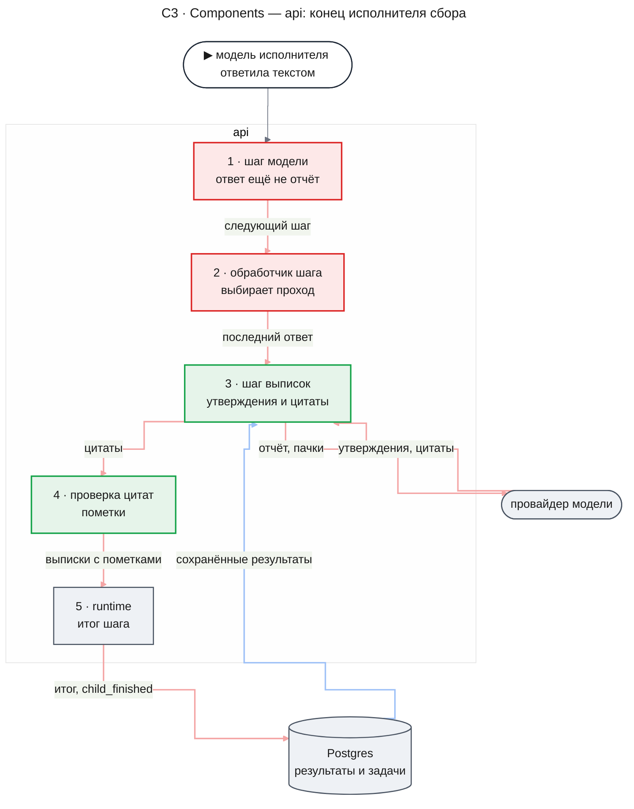
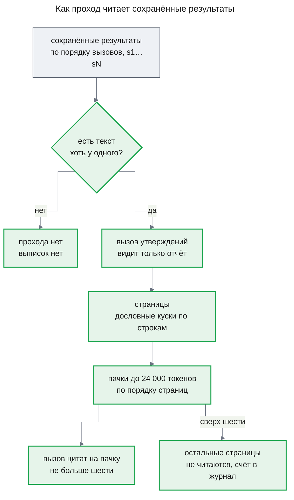
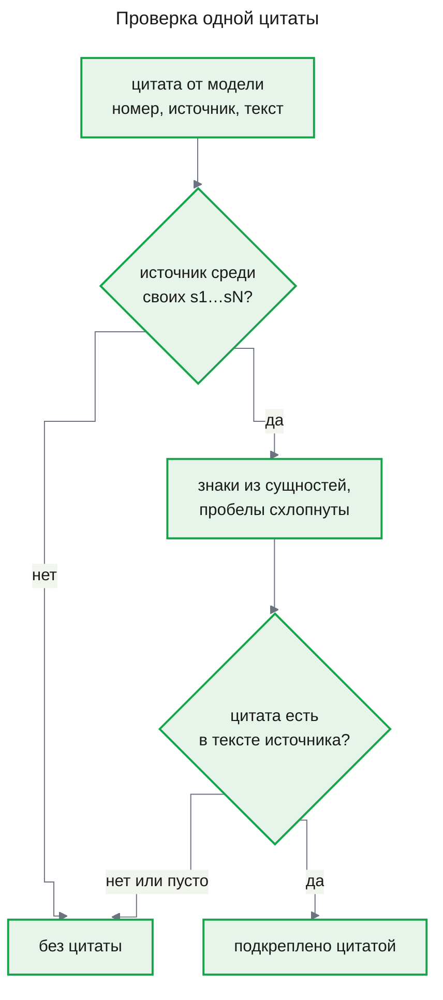
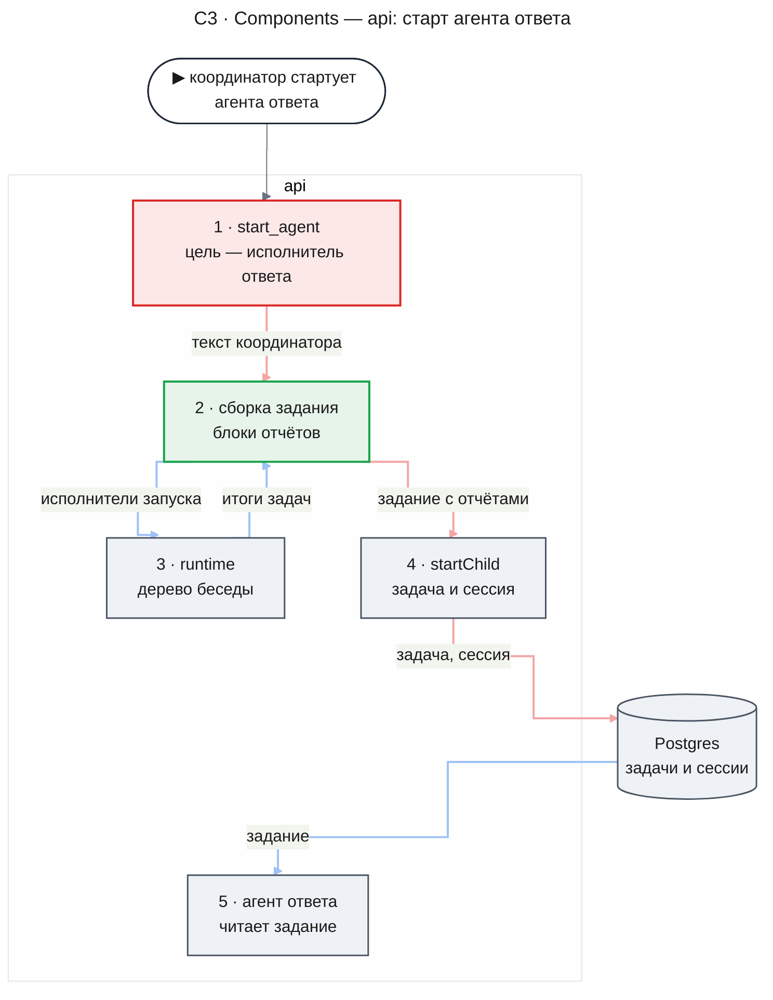
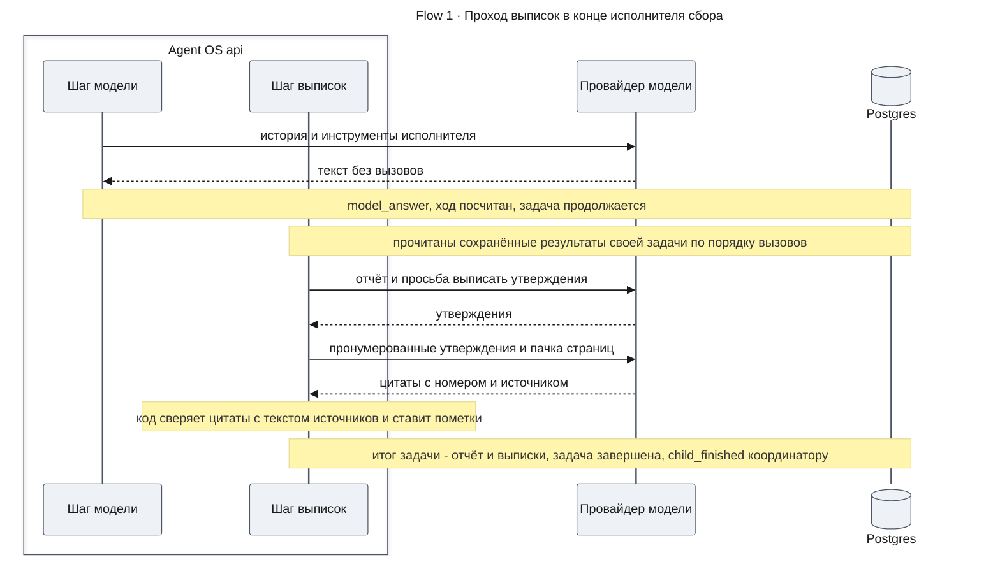
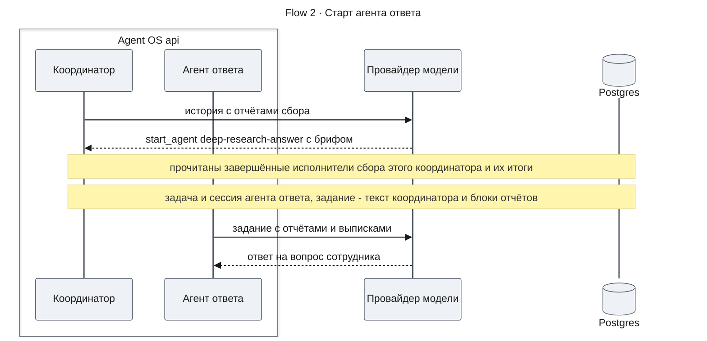
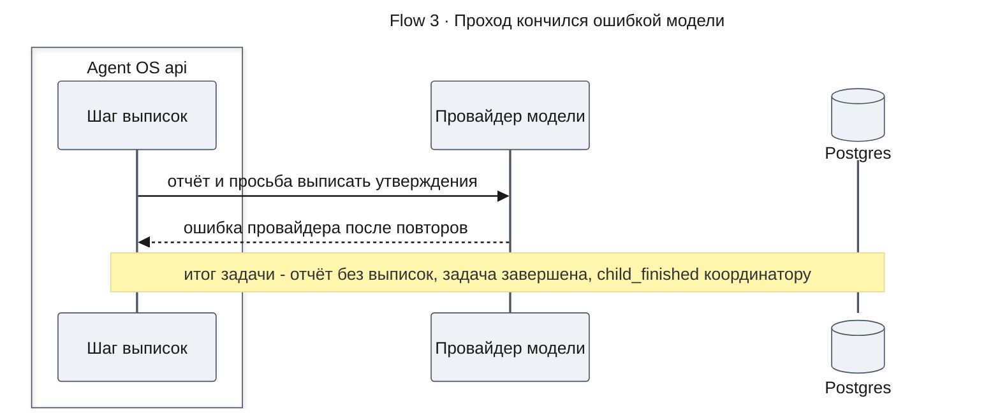
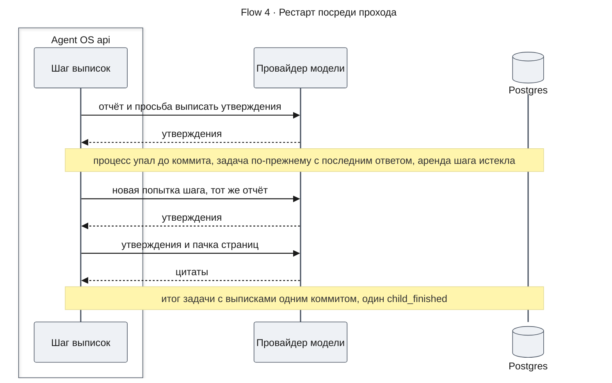

# Харнесс для малых моделей — Design Document — evidence

**Status:** Draft · **Date:** 2026-11-21 · **PRD:** [prd.md](./prd.md) · **UXRD:** нет · **Depends on:** [design-core.md](./design-core.md#contract-definitions)

## Snapshot

**Overview.** В глубоком ресерче агент ответа сегодня пишет ответ по пересказу: исполнители сбора пишут отчёты, координатор переписывает их в задание агенту ответа, и числа и времена по дороге искажаются. Эта часть добавляет в конец работы исполнителя сбора отдельный шаг — проход выписок. Модель с чистым контекстом сначала выписывает утверждения отчёта, потом по пачкам сохранённых результатов вызовов этого исполнителя находит к ним дословные цитаты. Код сверяет каждую цитату с текстом результата, ставит пометку и кладёт выписки в итог задачи исполнителя рядом с отчётом, в той же транзакции, которая завершает задачу. Когда координатор стартует агента ответа, код дописывает к его заданию отчёты всех исполнителей сбора этого запуска с их выписками, каждый отчёт в конверте данных.

- **Не меняется**: исполнитель работает как сегодня и заканчивает ход текстом; код не удаляет и не отклоняет утверждения; веб; новых таблиц и миграций нет.
- **Главный риск**: цитата может дословно быть в источнике и не подтверждать утверждение, а короткая цитата вроде одного числа находится почти везде.
- **Открытые вопросы**: один — [Open Questions](#open-questions).

### Key Decisions

#### KD-1: Проход — отдельный шаг задачи самого исполнителя, между его последним ответом и концом задачи

Координатор узнаёт, что исполнитель закончил, только из сообщения `child_finished`. Runtime пишет его в той же транзакции, которая завершает задачу ([design-runtime.md](../agent-platform/design-runtime.md#contract-definitions)). Если выписки готовы до этого коммита, они упорядочены перед координатором, а значит и перед агентом ответа, без нового механизма ожидания. Шаг — единица работы, которая переживает рестарт ([step-handler.md](../../code-system/patterns/step-handler.md)): упавший посреди прохода шаг не зафиксирован, и следующая попытка снова выбирает проход.

В цикл агента проход встаёт так. Шаг модели исполнителя с проходом, получив текст, который стал бы отчётом, пишет ответ модели и возвращает «продолжить» вместо «завершить». Следующий шаг обработчик отдаёт шагу выписок, если последняя запись видимой истории — ответ модели без вызовов, а новых сообщений нет; это проверяется раньше сжатия. Шаг выписок, как и шаг сжатия, ходом не считается, а заканчивает задачу итогом «завершить» с отчётом — текстом того же ответа.

Отвергнуты: проход при старте агента ответа, в `prepare` инструмента `start_agent`. Там вызовы модели шли бы внутри шага координатора без сигнала отмены, по всем исполнителям сразу в пределе одного шага, на счёт задачи координатора и заново при каждом старте агента ответа. Порядок был бы только «до агента ответа», а координатор успевал бы прочитать отчёт без выписок. Проход в том же шаге модели сразу после ответа — потерянный шаг повторял бы ещё и последний вызов модели исполнителя.

#### KD-2: Выписки лежат в итоге задачи исполнителя рядом с отчётом; новой таблицы нет

Итог задачи (`runtime_tasks.result`) — то, чем задача закончилась; у исполнителя сегодня это `{ report }`. Итог исполнителя с проходом получает второе поле — выписки. Его пишет тот же коммит, что завершает задачу, поэтому выписки есть ровно у задачи, закончившейся отчётом, и не появляются дважды (NFR-03). Жизненный цикл тот же, что у отчёта: появляются с концом задачи и уходят вместе с деревом.

Runtime содержимое итога не читает. Агенты читают итоги задач операцией `tasks.listTree(rootId, ownerId)`, которая отдаёт задачи дерева сотрудника в порядке создания вместе с `result`. Итог копируется и в сообщение `child_finished` координатору, но `ChildFinishedPayloadSchema` при разборе берёт из него только отчёт, так что координатор выписок не видит; вид беседы в `apps/api` итога не читает вовсе. Число утверждений и длина цитаты ограничены константами (KD-3), поэтому итог остаётся много ниже `INBOX_PAYLOAD_MAX_BYTES`.

Отвергнуты: своя таблица `agent_*` — миграция, репозиторий и своё удаление ради данных, у которых уже есть хозяин с тем же жизненным циклом. Новый вид записи истории — миграция CHECK, ветки в сборке сообщений модели и в ленте веба, а веб не должен показывать нового. Столбец в `agent_sessions` — строка сессии держит только то, что читают виды и счётчики ([run-snapshot.md](../../code-system/patterns/run-snapshot.md)).

#### KD-3: Проход читает источники страницами в пачках с бюджетом на вызов: один вызов выписывает утверждения, затем вызовы цитат идут по пачкам, и их число ограничено

Окна модели код не знает: в каталоге моделей его нет, а порог сжатия `AGENT_COMPACT_AT_TOKENS` общий для всех и окном малой модели не является. Длинный вход к тому же снижает точность малой модели, а отдельный проход по коротким входам после ответа держит и правильность ответа, и качество цитат ([LongBench-Cite](https://arxiv.org/html/2409.02897v3)). Поэтому проход идёт от грубого к точному: сначала утверждение, потом источник, потом строка в нём.

1. Первый вызов видит только отчёт и возвращает список утверждений. Код нумерует их и берёт не больше 100.
2. Код берёт сохранённые результаты исполнителя с непустым текстом по порядку вызовов и нумерует их `s1`…`sN`. Текст каждого режется на страницы — дословные куски по строкам, как режет `linesOf` из `large-result.ts`, — и страницы складываются в пачки не больше 24 000 токенов по оценке «байты / 4».
3. Каждый вызов цитат видит пронумерованные утверждения и одну пачку и возвращает цитаты с номером утверждения и id источника. Вызовов цитат не больше шести. Страницы сверх них не читаются, и журнал их считает.

Так проход стоит не больше одного короткого вызова по отчёту и шести вызовов примерно по 24 000 токенов входа: каждый байт результатов он читает не больше одного раза, тогда как исполнитель перечитывает свою историю на каждом ходе. Выход каждого вызова ограничен общим `AGENT_MAX_OUTPUT_TOKENS`. Цитата длиннее 500 знаков обрезается до проверки — её начало остаётся дословным куском источника.

Отвергнуты: один вызов со всеми результатами — без известного окна у него нет границы. Вызов на каждый результат — число вызовов растёт с числом вызовов исполнителя, а утверждения пришлось бы сводить между вызовами. Результаты, урезанные до 2 000 байт, как во входе извлечения знаний, — цитаты дальше начала не нашлись бы, а пересказы теряют качество цитирования ([ALCE](https://ar5iv.labs.arxiv.org/html/2305.14627)).

#### KD-4: Каждый вызов прохода отвечает одним вызовом инструмента; общий раунд «вызов, разбор, одна повторная попытка» выносится из извлечения знаний

Извлечение знаний уже получает от модели структурный ответ так: один инструмент со схемой, свободный разбор аргументов, при неразборчивом ответе одна повторная попытка с ошибкой в ответ модели ([design-core.md](../self-learning/design-core.md), KD-4). Проход — второе место с тем же раундом, поэтому разбор вызова, сообщения повторной попытки и сам цикл из двух попыток переезжают из `extract.handler.ts` в общий модуль пакета `agents`, и обоим местам он служит одинаково. Раунд записан как паттерн [tool-call-answer.md](../../code-system/patterns/tool-call-answer.md). Ответ, обрезанный на пределе длины (признак `cutOff`), считается неразборчивым.

Вызов утверждений видит только отчёт, без данных инструментов, поэтому утверждения приходят только из отчёта. Вызов цитат может лишь привязать цитату к номеру уже записанного утверждения и к id своего источника. Так текст чужой системы в источнике не может добавить утверждение.

Любая неудача вызова прохода — отказ `AccessGate`, ошибка модели, два неразборчивых ответа подряд — кончает проход без выписок, а задача всё равно завершается отчётом (AC-08.4). Частичные выписки после сбоя не сохраняются: оборванный проход не знает, какие пачки модель успела прочесть, тогда как страницы сверх предела вызовов журнал считает явно (DC-3). Отказ `AccessGate` пишется в аудит так же, как отказ шага модели.

Отвергнуты: копия раунда в проходе — второй экземпляр той же логики. Ответ JSON-текстом — у него нет схемы, которую видит модель.

#### KD-5: Цитату сверяет чистая функция: источник должен быть своим, пробелы и экранирование не считаются, утверждение не удаляется никогда

Функция получает пронумерованные утверждения, предложенные цитаты и карту `s1`…`sN` → вызов исполнителя с его текстом и инструментом ([pure-decision.md](../../code-system/patterns/pure-decision.md)). Карту строит шаг из сохранённых результатов, прочитанных по id своей задачи и владельцу. Вызов другого исполнителя в ней не может оказаться, поэтому id не из карты — пометка «без цитаты» (AC-09.3). Ближайший прецедент — `checkEvidence` в `check-operations.ts`, который так же не доверяет номеру вызова от модели, но проверяет номер, а не текст.

Модель прохода видит страницы в конверте данных, где `&`, `<`, `>` и `"` экранированы. Поэтому перед сравнением функция возвращает эти четыре знака из сущностей; цитата, где модель написала знаки как есть, тоже проходит. Любая последовательность пробельных знаков с обеих сторон сравнивается как один пробел. Всё остальное сравнивается точно, и изменённая цифра проверку проваливает (AC-09.2).

К одному утверждению в силе первая подкреплённая цитата. Утверждение без неё получает «без цитаты» и остаётся в выписках.

#### KD-6: Отчёты в задание агента ответа добавляет код при старте; координатор их больше не переписывает

Это заменяет поведение, описанное в [design-workflows.md](../agent-platform/design-workflows.md), KD-4: там отчёты сбора в задание агента ответа копирует координатор. Теперь `start_agent`, когда цель — исполнитель ответа workflow, до транзакции читает дерево беседы через `tasks.listTree(rootId, ownerId)`. Он берёт потомков этого координатора, которые завершены и у которых в снимке включён проход, в порядке создания, и дописывает к тексту координатора по блоку на отчёт. Блок — конверт данных с описанием старта, отчётом и строками выписок с пометками.

Задание хранится как сегодня: во входе задачи, в `agent_sessions.prompt` и в записи `task`, поэтому перезапуск агента ответа получает тот же текст. Беседа, продолженная новым сообщением, даёт агенту ответа отчёты всех ходов, а не только последнего. Исполнитель, который упал или остановлен, блока не получает: его направление по-прежнему называет координатор.

Правило координатора «start deep-research-answer with the brief and the full reports» во встроенной записи заменяется правилом «с брифом и направлениями без данных». Промпт агента ответа получает правило о пометках (Contract Definitions).

Отвергнуты: добавлять отчёты в шаге модели агента ответа при каждом вызове — агент ответа не знает, что он последний, перечитывал бы дерево на каждом шаге, а перезапуск видел бы другое задание. Записи `child_report` в истории агента ответа — веб показал бы их карточками отчётов.

#### KD-7: Проход включает поле исполнителя в записи workflow; снимок несёт его в запуск, а правки записи его не теряют

`ExecutorSchema` получает логическое поле `excerptPass` со значением по умолчанию `false`, как `selfLearning` у workflow: содержимое, сохранённое раньше, читается с выключенным проходом. Снимок копирует исполнителя целиком, поэтому поле видят и снимок координатора (сборка задания в `start_agent`), и снимок самого исполнителя (шаг модели и обработчик шага). Во встроенной записи `deep-research` оно включено у `deep-research-gather` и выключено у `deep-research-plan` и `deep-research-answer`.

В редакторе поля нет (Won't Have PRD), поэтому правки его сохраняют. Инструмент чата `draft_record` берёт значение у исполнителя с тем же именем из правимой версии, как берёт `selfLearning`: модель флаг не ставит. Веб-редактор правит исполнителя копией загруженного объекта, так что поле уходит обратно как было. Новый исполнитель получает `false`.

Отвергнуты: ветка кода по имени workflow или исполнителя — так включать проход запрещает решение владельца (PRD, Constraints). Флаг на весь workflow — проход шёл бы и у исполнителя плана.

## Terms

- **Проход выписок, утверждение, выписка, пометка, сохранённый результат, агент ответа, исполнитель сбора** — как в [PRD, Terms](./prd.md#terms).
- **Итог задачи** — значение, с которым задача runtime завершилась (`runtime_tasks.result`); у исполнителя это отчёт, у исполнителя с проходом — отчёт и выписки.
- **Источник `sN`** — короткий id сохранённого результата, который видят модели прохода; код переводит его обратно в id вызова.
- **Страница** — дословный кусок текста одного источника по границам строк.
- **Пачка** — страницы одного вызова цитат, не больше бюджета вызова.
- **Блок отчёта** — отчёт одного исполнителя сбора с его выписками в конверте данных, который код дописывает к заданию агента ответа.
- **Конверт данных** — обёртка `<data …>` функции `envelope`, внутри которой текст экранирован; инструкции модели говорят, что это данные, а не указания (`DATA_PREAMBLE`).

## Part

- **Part**: `evidence`
- **Covers**: FR-08 – FR-11, и NFR-01 – NFR-03 в той части, что касается выписок
- **Depends on**: `core` — признак обрезки `cutOff` в ответе `ModelClient.call` и правило «в сохранённом результате нет текста платформы» ([design-core.md](./design-core.md#contract-definitions)); оба используются как есть
- **Prerequisite ADRs**: [ADR-0001](../../adr/ADR-0001-durable-runtime-owner.md), [ADR-0004](../../adr/ADR-0004-agent-framework-packages.md), [ADR-0015](../../adr/ADR-0015-access-gate-and-model-catalogue.md), [ADR-0016](../../adr/ADR-0016-library-records-and-visibility.md), [ADR-0017](../../adr/ADR-0017-run-snapshots-from-library.md)

**Out of scope**

- Исполнитель: его промпт, инструменты и конец хода текстом ([design-agents.md](../agent-platform/design-agents.md), KD-2).
- Веб: новых элементов нет. Задание агента ответа веб показывает как любое задание — целиком, вместе с добавленными блоками.
- Вызовы из `run_code`, встроенных инструментов и ошибки инструментов: они не хранятся и источниками не бывают.
- Модель-судья и встроенные цитаты провайдера (Won't Have PRD).
- Поле прохода в редакторе записей и проход у пользовательских workflow через редактор (Won't Have PRD).
- Предел `maxRuns` агента ответа, который считается на всю беседу (Risks).

**Constraints**

- Без совместимости и переноса записей: старое содержимое читается с выключенным проходом, новых таблиц, столбцов и миграций нет (KD-2, KD-7). Как изменённая встроенная запись попадает в уже существующую базу, решает открытый вопрос.
- Бюджет пачки, число вызовов, предел утверждений и длины цитаты — константы кода (KD-3).
- Проход идёт на модели исполнителя (`session.model`), а его расход пишется на запускающего сотрудника под задачей исполнителя, как расход самого исполнителя.
- Журнал — через логгер `common` ([logging.md](../../code-system/patterns/logging.md)); записи прохода не несут текстов утверждений, цитат и результатов (NFR-01).
- Тестов мало, по одному на нижнем уровне, который ловит дефект ([Test Strategy](#test-strategy)).

**Что меняется в поведении, описанном в соседних документах**

- [design-workflows.md](../agent-platform/design-workflows.md), KD-4: отчёты сбора в задание агента ответа добавляет код, а не координатор (KD-6).
- [design-agents.md](../agent-platform/design-agents.md), конец хода: исполнитель с проходом завершается на один шаг позже — после шага выписок; отчёт — тот же текст последнего ответа (KD-1).
- [design-runtime.md](../custom-agents/design-runtime.md), `start_agent`: задание исполнителя ответа workflow получает блоки отчётов (KD-6).

## Building-block Inventory

Follows the [code system](../../code-system/README.md).

| Building block | Pattern | Status | Note |
|---|---|---|---|
| Обработчик шага агента | [step-handler.md](../../code-system/patterns/step-handler.md) | extended | выбирает шаг выписок до сжатия (KD-1) |
| Шаг модели | [step-handler.md](../../code-system/patterns/step-handler.md) | extended | ответ исполнителя с проходом — «продолжить» (KD-1) |
| Шаг выписок | [step-handler.md](../../code-system/patterns/step-handler.md) | new | ближайший — шаг сжатия, но он не завершает задачу (KD-1) |
| Раунд структурного ответа | [tool-call-answer.md](../../code-system/patterns/tool-call-answer.md) | extended | вынесен из `extract.handler.ts` (KD-4) |
| Страницы и пачки источников | — | new | страницы режет `linesOf` из `large-result.ts`; пачек в коде нет (KD-3) |
| Проверка цитат | [pure-decision.md](../../code-system/patterns/pure-decision.md) | new | `checkEvidence` проверяет номер вызова, а не текст (KD-5) |
| Чтение сохранённых результатов | [repository-over-transaction.md](../../code-system/patterns/repository-over-transaction.md) | extended | список своей задачи по порядку вызовов, с проверкой владельца (KD-5) |
| `envelope`, `DATA_PREAMBLE` | — | reused | страницы источников и блоки отчётов |
| `ModelClient.call` | — | extended | ответ несёт цену вызова `costUsd` (FR-11) |
| `start_agent` | — | extended | блоки отчётов в задании исполнителя ответа (KD-6) |
| `ExecutorSchema` | [run-snapshot.md](../../code-system/patterns/run-snapshot.md) | extended | поле `excerptPass` (KD-7) |
| `draft_record` | — | extended | сохраняет `excerptPass` при правке (KD-7) |
| Встроенная запись `deep-research` | — | extended | флаг у сбора, правило координатора, правило о пометках (KD-6, KD-7) |

## Acceptance Criteria

### FR-08: Проход выписок после исполнителя

- From the PRD: AC-08.1, AC-08.2, AC-08.3, AC-08.4
- Отказ `AccessGate` и ответ, который дважды не удалось разобрать, ведут себя как ошибка модели: задача завершается отчётом без выписок, запуск продолжается. Отказ пишется в аудит, как отказ шага модели (DC-1).
- Если после ответа исполнителя пришло сообщение, прохода по этому ответу нет: шаг модели отвечает на сообщение, и проход идёт по новому ответу (DC-2).
- Страницы сверх шести вызовов цитат не читаются. Утверждения, цитаты которых могли быть там, получают «без цитаты», а запись журнала считает непрочитанные страницы (DC-3).
- Повтор потерянного шага повторяет вызовы прохода и их расход, а выписки в итоге задачи остаются одни (DC-4).

### FR-09: Код проверяет, что цитата есть в источнике

- From the PRD: AC-09.1, AC-09.2, AC-09.3
- Цитата, где кавычки и угловые скобки записаны сущностями конверта (`&quot;`), проверяется как исходный текст (DC-5).
- Из нескольких цитат к одному утверждению в силе первая подкреплённая (DC-6).

### FR-10: Агент ответа получает выписки

- From the PRD: AC-10.1, AC-10.2, AC-10.3
- Блоки получают завершённые исполнители с проходом этого координатора за всю беседу, в порядке старта: на продолжении запуска агент ответа получает и прежние отчёты (DC-7).
- Исполнитель сбора, который упал или остановлен, блока не получает (DC-8).
- Правка записи через чат сохраняет флаг прохода у исполнителя с тем же именем, новый исполнитель получает выключенный (DC-9).

### FR-11: Журнал прохода выписок

- From the PRD: AC-11.1
- Запись пишется и для исполнителя с проходом, у которого выписок не вышло, с исходом и нулевыми счётчиками (DC-10).

## Design

### Architecture (C1–C4)

Контейнеры и их связи не меняются: работа идёт внутри процесса `apps/api`, в пакете `agents` и в runtime, данные лежат в Postgres, вызовы уходят провайдеру модели. Где проход встаёт в глубокий ресерч целиком, показывает схема в [PRD, Background](./prd.md#background). Поэтому схемы начинаются с уровня C3: конец исполнителя сбора и старт агента ответа.

#### C3 · Components: api

**api — конец исполнителя сбора**

Шаг модели исполнителя с проходом пишет ответ без вызовов в историю как обычный `model_answer`, считает ход и возвращает «продолжить». Обработчик шага на следующем шаге видит этот ответ последним и отдаёт работу шагу выписок, а пришедшее сообщение отдаёт работу шагу модели (DC-2). Шаг выписок читает сохранённые результаты своей задачи вне транзакции, вызывает модель через `ModelClient.call` без потоковой выдачи текста и возвращает runtime итог «завершить»; runtime фиксирует итог задачи, событие и `child_finished` одной транзакцией.

#### Как проход читает источники

Каждая страница идёт модели в конверте данных с id источника и именем инструмента — так же, как исполнитель видел результаты своих вызовов. Источник с пустым текстом в нумерацию не попадает. Утверждения повторяются в каждом вызове цитат, поэтому номер утверждения один на весь проход. Вызовы идут подряд в одном шаге; при пределе шага `RUNTIME_STEP_MS` в 15 минут семь вызовов укладываются с запасом.

#### Как код проверяет цитату

Цитата с номером утверждения, которого нет, в счёт не идёт. Утверждение без подкреплённой цитаты получает «без цитаты»: проверка не удаляет утверждений и не отказывает им. Сравниваются только текст цитаты и текст источника; что цитата говорит о том же, что утверждение, код не решает (Risks).

#### C3 · Components: api — старт агента ответа

`start_agent` собирает блоки только для цели, которая названа исполнителем ответа (`finalExecutor`) в снимке координатора. Дерево читается в `prepare`, до транзакции шага, по владельцу задачи координатора: другого сотрудника в нём нет (NFR-02). Исполнитель, закончивший работу между чтением и коммитом, в задание не попадает — его отчёта не видел и координатор. Агент ответа читает задание как обычную запись `task`, а его промпт во встроенной записи получает правило о пометках.

### Runtime Flows

#### Flow 1: Проход выписок в конце исполнителя сбора

**Starts when:** модель исполнителя сбора с проходом отвечает текстом без вызовов, а у исполнителя есть сохранённые результаты, для AC-08.1, AC-09.1, AC-11.1

Каждый вызов прохода оплачен и записан в журнал токенов под задачей исполнителя, на его владельца. В истории исполнителя проход записей не оставляет; его след — итог задачи и запись журнала прохода. Если сохранённых результатов с текстом нет, шаг выписок завершает задачу с отчётом без выписок (`excerpts` — `null`) без вызова модели (AC-08.3).

#### Flow 2: Старт агента ответа

**Starts when:** координатор после отчётов сбора вызывает `start_agent` с исполнителем ответа, для AC-10.1, AC-10.2, NFR-02

Отчёт, текст координатора и блоки ложатся в одно задание, а не в отдельные записи истории. Агент ответа может стартовать в беседе не больше `maxRuns` раз; второй старт после падения тоже получает свежие блоки, потому что код читает итоги заново при каждом старте.

#### Flow 3: Проход кончился ошибкой модели

**Starts when:** провайдер модели не отвечает на вызов прохода и после повторов, для AC-08.4, DC-1

Так же кончаются отказ `AccessGate` и второй неразборчивый ответ, на любом из вызовов прохода. Отказ дополнительно пишет `access_denied` в аудит, кроме отказа `owner_disabled`, как у шага модели. Агент ответа получает этот отчёт с отметкой `[no excerpts]`.

#### Flow 4: Рестарт посреди прохода

**Starts when:** процесс падает, пока шаг выписок ждёт модель, для NFR-03, DC-4

Первая попытка ничего не записала, кроме строк журнала токенов: они пишутся вне транзакции шага, как у шага сжатия. Если зависшая первая попытка всё же дойдёт до коммита, runtime отклонит его как коммит устаревшей попытки.

### Contract Definitions

**Принимаемое от части `core`**

- Признак обрезки `cutOff` в ответе `ModelClient.call` ([design-core.md](./design-core.md#contract-definitions), «Ответ модели»): обрезанный ответ вызова прохода считается неразборчивым (KD-4).
- В сохранённом результате (`agent_tool_results`) нет текста платформы ([design-core.md](./design-core.md#contract-definitions), «Что модель видит об исходе вызова»): источники прохода — только ответ сервера, и цитата не может опереться на пометку о повторе или текст ошибки.

**Флаг прохода в записи workflow**

- `excerptPass` — логическое поле исполнителя в содержимом workflow (`WorkflowContentSchema`, `executors[]`), по умолчанию `false`. Читается только из снимка запуска. Ни редактор, ни описание инструмента `draft_record` его не показывают; правка записи сохраняет значение у исполнителя с тем же именем.

**Итог задачи исполнителя с проходом**

- `report` — текст последнего ответа модели исполнителя, как сегодня.
- `excerpts` — `null`, когда выписок нет (нет источников, проход не удался); иначе список выписок в порядке утверждений, возможно пустой.
- Выписка: `claim` — текст утверждения, до 500 знаков; `mark` — `supported` или `unsupported`; у `supported` ещё `quote` — цитата, до 500 знаков, `callId` — id вызова исполнителя и `tool` — `<server>/<tool>` этого вызова.
- Выписок в итоге не больше 100. Координатору из итога по-прежнему доходит только `report`.

**Блок отчёта в задании агента ответа**

- `start_agent` дописывает блоки после текста координатора, только когда цель — `finalExecutor` workflow, и только для потомков этого координатора, завершённых и с `excerptPass` в снимке.
- Блок — `envelope` с описанием старта исполнителя; внутри — отчёт и строки выписок. Строка выписки начинается с пометки: `[supported by quote]` с утверждением, цитатой и инструментом или `[no quote]` с утверждением. Блок, у которого `excerpts` — `null` или пустой список, несёт одну строку `[no excerpts]`.
- Эти три пометки — договор между кодом и промптом агента ответа во встроенной записи: промпт говорит, что утверждение с `[no quote]` не подкреплено источником и ответ не выдаёт его за подтверждённое.

**Ответ модели**

- `ModelClient.call` — ответ (`kind: 'answer'`) несёт ещё `costUsd`: цену вызова, которую уже считает журнал токенов, или `null`, если у модели нет цены. Признак есть у каждого вызова; остальное в ответе не меняется.

**Записи журнала**

- `excerpt pass finished` — одна на конец каждого исполнителя с проходом (info, а при неудаче прохода warn): `agentId` исполнителя, `parentId` — задача координатора, то есть запуск, `rootId`, `ownerId`, `stepNo`, `model`, `outcome` (`done`, `no_sources`, `refused`, `model_error`, `invalid_answer`), `claims`, `supported`, `mismatched` (цитата есть, но не найдена), `unquoted` (цитаты нет), `supportedShare`, `unsupportedShare`, `sources`, `pagesRead`, `pagesLeftOut`, `modelCalls`, `inputTokens`, `outputTokens`, `costUsd`, `durationMs`. При отказе — ещё `reason` вердикта, при ошибке модели — `reason`, `provider`, `statusCode`.
- `agent step finished` шага выписок — как у других шагов, со значением `stepKind` `excerpts`.
- `answer reports added` — при старте исполнителя ответа: `agentId` координатора, `rootId`, `ownerId`, число блоков, из них с выписками и без, размер добавленного текста в байтах.
- Тексты утверждений, цитат, отчётов и результатов, значения аргументов в эти записи не попадают (NFR-01).

### Data Model

Новых таблиц, столбцов и миграций нет. Меняется форма двух значений `jsonb`: содержимое записи workflow получает поле исполнителя `excerptPass`, а итог задачи исполнителя с проходом в `runtime_tasks.result` — поле `excerpts`. Записи, сохранённые раньше, читаются с выключенным проходом и не меняются. Сохранённые результаты в `agent_tool_results` проход только читает.

## Test Strategy

- **UC-1: Проверка цитаты** — covers AC-09.1, AC-09.2, AC-09.3, DC-5, DC-6
  - Given: источник `s1` своей задачи с переносами строк; утверждения 1–3; цитаты — текст `s1` с другими пробелами, тот же текст с одной изменённой цифрой, цитата с id вызова не из карты, цитата с `&quot;`, пустая цитата, две подходящие цитаты к одному утверждению
  - When: функция проверки ставит пометки
  - Then: подкреплено; без цитаты, утверждение в списке; без цитаты; подкреплено; без цитаты; в силе первая
- **UC-2: Пачки источников** — covers DC-3
  - Given: три источника разной длины, один из них длиннее пачки, и предел вызовов меньше числа пачек
  - When: код режет источники на страницы и пачки
  - Then: страницы одного источника склеиваются в его текст без потерь, ни одна пачка не больше бюджета, лишние страницы посчитаны как непрочитанные
- **UC-3: Глубокий ресерч с выписками** — covers AC-08.1, AC-08.2, AC-10.1, AC-10.2, AC-11.1, NFR-01
  - Given: workflow с исполнителем плана без прохода, двумя исполнителями сбора с проходом и исполнителем ответа; секрет в результате MCP-вызова; модель отвечает по сценарию
  - When: запуск доходит до агента ответа
  - Then: у исполнителя плана вызова прохода нет; задание агента ответа содержит оба отчёта с выписками и пометками, хотя текст координатора их не содержал; в журнале по записи `excerpt pass finished` на каждого исполнителя сбора, и ни одна запись журнала не несёт секрета и текста цитаты
- **UC-4: Отчёт без выписок** — covers AC-08.3, AC-08.4, DC-1
  - Given: исполнитель сбора, который вызывал инструменты только через `run_code`, и исполнитель сбора, чей вызов прохода получает ошибку провайдера
  - When: оба заканчивают работу и стартует агент ответа
  - Then: у первого вызова прохода нет; оба отчёта стоят в задании с `[no excerpts]`; запуск не упал
- **UC-5: Рестарт посреди прохода** — covers NFR-03, DC-4
  - Given: шаг выписок ждёт ответа модели, и аренда его шага истекает
  - When: другой обработчик повторяет шаг
  - Then: координатор получил один отчёт, задание агента ответа содержит выписки этого исполнителя один раз, а журнал токенов показывает вызовы прохода обеих попыток
- **UC-6: Чтение только своих результатов** — covers NFR-02
  - Given: сохранённые результаты двух задач двух сотрудников
  - When: проход читает результаты своей задачи от имени её владельца и от имени другого сотрудника
  - Then: в первом случае только свои строки по порядку вызовов, во втором ничего
- **UC-7: Какие отчёты получают блоки** — covers DC-7, DC-8
  - Given: дерево беседы с исполнителями сбора двух ходов, упавшим исполнителем сбора, исполнителем плана и исполнителями другого координатора
  - When: код собирает блоки для старта агента ответа
  - Then: блоки только у завершённых исполнителей с проходом этого координатора, в порядке старта, включая первый ход
- **UC-8: Правка записи сохраняет флаг** — covers DC-9
  - Given: личный workflow, где у исполнителя сбора включён проход
  - When: модель чата правит запись через `draft_record`, не упоминая флаг, и добавляет нового исполнителя
  - Then: у исполнителя сбора проход включён, у нового выключен

AC-10.3 проверяет владелец вручную по ответам. DC-2 и DC-10 отдельных тестов не получают: выбор шага по сообщению — та же ветка обработчика, что уже выбирает шаг модели при сообщении, а запись журнала при неудаче видна в UC-4.

## Security Considerations

- **Authentication & Authorization**: новых точек входа нет. Проход читает сохранённые результаты только своей задачи и только при совпадении владельца, как `findForRun` (NFR-02). Блоки отчётов код собирает из дерева беседы, прочитанного по владельцу задачи координатора, и только из потомков этого координатора.
- **Input Validation**: тексты источников — данные чужих систем. Модель прохода видит их в конверте данных, у вызовов прохода нет инструментов с последствиями, утверждения приходят только из отчёта, а цитата может лишь сослаться на номер утверждения и свой источник; ответ модели разбирается по схеме, и код проверяет каждую цитату (KD-4, KD-5). В задании агента ответа отчёты и цитаты стоят в конвертах данных, а текст координатора — без конверта, как сегодня.
- **Sensitive Data Handling**: сохранённые результаты уже очищены от известных секретов (`maskSecrets`), поэтому цитаты известных секретов не несут. Утверждения и цитаты лежат в итоге задачи и в задании агента ответа — там же, где сегодня лежат отчёты. Журнал получает только счётчики, доли, исходы, id и цену (NFR-01).

## Risks and Mitigation

- **Совпадение не значит подтверждение** — цитата из одного числа или общего слова находится почти в любом результате; вероятность средняя. Промпт вызова цитат просит самую короткую целую строку или предложение со значениями утверждения, а журнал показывает доли `supported` и `mismatched` по запускам; модель-судья исключена (Won't Have PRD).
- **Экранирование внутри JSON** — текст результата часто JSON, где перенос строки записан как `\n`; модель может переписать его настоящим переносом, и цитата не найдётся; вероятность средняя. Утверждение остаётся с «без цитаты», рост `mismatched` в журнале покажет проблему.
- **Непрочитанные страницы** — у исполнителя с очень большими результатами часть страниц не попадёт в шесть вызовов; влияние — доля подкреплённых ниже настоящей. Журнал считает `pagesLeftOut`, а константы меняются в коде.
- **Повтор потерянного шага оплачивается дважды** — вызовы прохода повторяются вместе с расходом; вероятность низкая. Принято, как у шага сжатия; журнал токенов показывает обе попытки.
- **Предел запусков агента ответа на всю беседу** — `maxRuns` у `deep-research-answer` равен 2 и считается по всей истории координатора, поэтому третий ответ в продолженной беседе получит отказ `run_limit`. Это поведение существует сегодня; эта часть его не меняет.
- **Вектор вопроса агента ответа** — в самообучающемся workflow вектор вопроса агента ответа строится по его заданию, а теперь в задании стоят и блоки отчётов; выбор знаний для агента ответа станет менее точным. Самообучение у `deep-research` выключено по умолчанию.
- **Растущее задание агента ответа** — отчёты всех ходов беседы удлиняют вход агента ответа (PRD, Risks). Отчёт сбора ограничен 500 словами, а выписки — 100 строками по 500 знаков.
- **Правило работы с кодом в каждом вызове** — `ModelClient` добавляет к инструкциям любого вызова правило про `run_code` и `read_tool_result`, и вызовы прохода его тоже получают; влияние — лишний текст в инструкциях. Принято, как у извлечения знаний.

## Open Questions

- **Как изменённая встроенная запись `deep-research` попадает в существующую базу.** Сидер добавляет встроенную запись, только если её нет, и оставляет существующую как есть, а в редакторе поля прохода нет. В базе, где запись уже лежит, проход не включится, а координатор продолжит переписывать отчёты — то есть всё останется как сегодня. Варианты: (а) сидер при старте переписывает содержимое встроенных записей из кода, и правки администратора во встроенных записях теряются; (б) существующие базы остаются как есть, проход работает только на новой базе. Рекомендуемый — (а): владелец будет смотреть первые запуски на своей базе. Блокирует включение прохода на существующих базах, но не сборку; решает владелец.

## Update History

| Version | Date | Change |
|---------|------|--------|
| 1.0 | 2026-11-21 | Первая версия |
