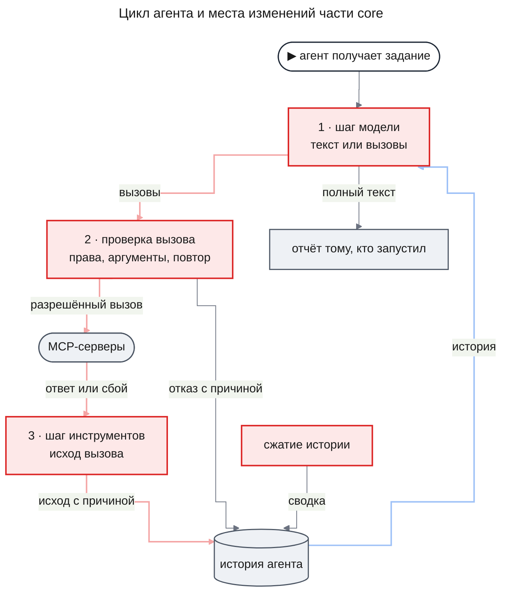
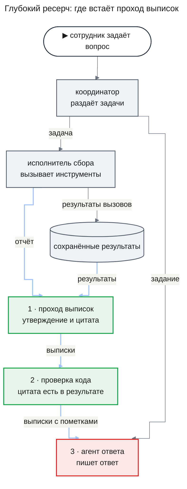
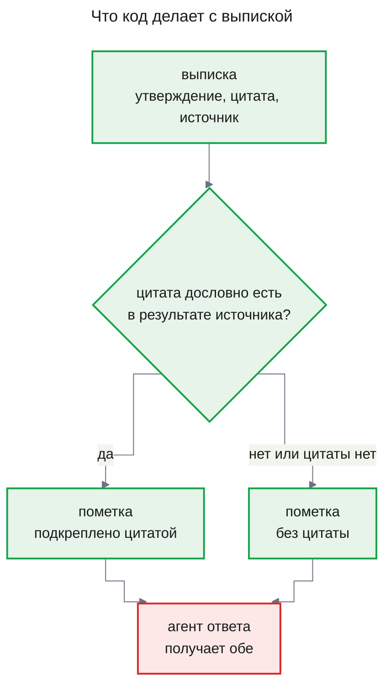

# PRD: Харнесс для малых моделей (agent-harness)

| Status | Date | Depth | Designs |
|---|---|---|---|
| Draft | 2026-11-21 | full | — |

## Snapshot

**Overview.** Agent OS работает на моделях класса Haiku и добирает качество кодом вокруг модели — харнессом, а не моделью покрупнее. Сегодня харнесс в нескольких местах превращает мелкую ошибку модели в сломанный запуск или молча принимает брак: обрезанный ответ становится отчётом, отказ по аргументам и сбой сервера приходят модели без причины, одна пустая сводка роняет всю задачу, а одинаковый вызов можно повторять без конца. Фича называет модели причину каждой неудачи, не принимает обрезанный ответ, останавливает петли одинаковых вызовов и пишет в журнал, где именно модель ошибается. В глубоком ресерче после каждого исполнителя сбора отдельный проход модели выписывает к каждому утверждению его отчёта дословную цитату из результата инструмента, код проверяет, что цитата там действительно есть, и передаёт утверждения с пометками агенту ответа.

- **Для**: сотрудники, которые запускают глубокий ресерч и агентов; владелец платформы, который разбирает запуски по журналу.
- **Не входит**: показ источников в вебе, модель-судья «подтверждает ли цитата утверждение», большие идеи харнесса — типизированный план, сборщик контекста, эскалация модели.
- **Не меняется**: исполнитель работает как сегодня и заканчивает ход текстом; код не удаляет и не отклоняет утверждения.
- **Части**: `core` → `evidence`.
- **Главный риск**: дословное совпадение доказывает, что цитата есть в источнике, но не что она подтверждает утверждение.
- **Открытые вопросы**: два, [Undetermined Items](#undetermined-items).

## Terms

- **Харнесс** — код вокруг модели: он собирает её контекст, проверяет и выполняет вызовы инструментов, решает, когда работа агента закончена.
- **Шаг модели** — один вызов модели агента. Модель отвечает текстом или просит вызвать инструменты.
- **Отчёт** — последний текст агента без вызовов инструментов. Он уходит тому, кто запустил агента: координатору, другому агенту или беседе ([design-agents.md](../agent-platform/design-agents.md), KD-2).
- **Координатор, исполнитель** — в workflow координатор раздаёт задачи исполнителям, а исполнители вызывают инструменты и пишут отчёты ([custom-agents](../custom-agents/prd.md)).
- **Агент ответа** — исполнитель, чей отчёт становится ответом workflow (`finalExecutor`). В глубоком ресерче это `deep-research-answer`; его задание сегодня пишет модель координатора.
- **Исполнитель сбора** — исполнитель глубокого ресерча `deep-research-gather`: собирает данные по одному направлению.
- **Обрезанный ответ** — ответ, который модель не дописала, потому что упёрлась в предел длины ответа.
- **Изменяющий вызов** — вызов инструмента, не помеченного «только чтение»: создаёт тикет, отправляет письмо, меняет запись.
- **Сжатие истории** — шаг, в котором модель заменяет старую часть длинной истории агента сводкой.
- **Одинаковый вызов** — вызов того же инструмента с теми же аргументами в одной сессии агента.
- **`run_code`** — встроенный инструмент: модель пишет скрипт, и вызовы инструментов идут из него, а не прямо из шага модели ([code-execution](../code-execution/prd.md)).
- **Сохранённый результат** — полный результат прямого MCP-вызова, который платформа уже хранит по id вызова. Результаты вызовов из `run_code`, встроенных инструментов и ошибки инструментов не хранятся.
- **Утверждение** — одна проверяемая мысль отчёта: «в 14:02 у `billing-api` было 340 ошибок 502».
- **Выписка** — утверждение отчёта, дословная цитата из сохранённого результата, на которой оно стоит, и id вызова, давшего этот результат (источник).
- **Проход выписок** — отдельный вызов модели с чистым контекстом после исполнителя: он читает отчёт и сохранённые результаты вызовов исполнителя и пишет выписки.
- **Пометка** — итог проверки выписки кодом: «подкреплено цитатой» или «без цитаты».

## Background

Ставка проекта — модели класса Haiku в рабочих ролях (project-context, бизнес-ограничение 6). Малая модель ошибается чаще большой: путает аргументы, упирается в предел длины, повторяет один и тот же запрос. Такая ошибка поправима, если харнесс сказал модели, что пошло не так. Сегодня он часто молчит: модель получает голый отказ `invalid_arguments`, причина сбоя MCP-сервера остаётся только в журнале, а обрезанный по пределу текст принимается за готовый отчёт.

Так устроен цикл агента и вот где в него встают изменения части `core`.

Шаг модели перестаёт принимать обрезанный текст за отчёт (FR-01) и пишет в журнал, что модель видела и что выбрала (FR-07). Проверка вызова объясняет отказ по аргументам и проверяет аргументы MCP-вызова до отправки (FR-02), а также останавливает петлю одинаковых вызовов (FR-06). Шаг инструментов передаёт модели причину сбоя сервера (FR-03) и не выдаёт изменяющий вызов без ответа за обычный сбой (FR-04). Пустая сводка сжатия больше не роняет задачу (FR-05).

Вторая половина фичи — глубокий ресерч. Сегодня исполнители сбора пишут отчёты, координатор переписывает их в задание агенту ответа, а агент ответа пишет ответ только по этому заданию. Каждый пересказ теряет точность: в исследованиях сводки теряют качество цитирования ([ALCE](https://ar5iv.labs.arxiv.org/html/2305.14627)), а у deep-research-агентов доля подтверждённых утверждений падает с глубиной цепочки вызовов ([arXiv 2605.06635](https://arxiv.org/html/2605.06635v1)).

Исполнитель не меняется: цитаты пишет не он, а отдельный проход после него. Малые модели плохо цитируют по ходу генерации и при этом отвечают хуже: в LongBench-Cite F1 цитирования у Llama-3.1-8B — 19,7, у GLM-4-9B — 27,2 против 65,6 у GPT-4o, а правильность ответа падает до 86–88% от уровня без цитат. Варианты, где цитаты подбирают после ответа, правильность сохраняют ([LongBench-Cite](https://arxiv.org/html/2409.02897v3)); подход «сначала цитата, потом утверждение» тоже держит качество ([arXiv 2403.17104](https://arxiv.org/abs/2403.17104)).

Код проверяет только одно: цитата дословно есть в результате, на который она ссылается.

Утверждение без подтверждённой цитаты остаётся в задании агента ответа с пометкой и никогда не выбрасывается. Так проект учёл свою историю: в прежнем движке код сверял значения утверждений с записями и молча отбрасывал верные утверждения, и первые четыре настоящих расследования не установили ни одного вывода ([ADR-0008](../../archive/adr/ADR-0008-claim-status-from-verifier-answer-and-universal-atoms.md)). Модель-судья «подтверждает ли отрывок утверждение» тоже не выход: у моделей любого размера она верна примерно в 75–80% случаев ([LLM-AggreFact](https://llm-aggrefact.github.io/)), то есть служит фильтром, а не гарантией.

## Users and Use Cases

### Users

- **Сотрудник** — запускает глубокий ресерч и агентов из чата. Ему важно, чтобы запуск доходил до ответа, а факты ответа совпадали с тем, что вернули инструменты.
- **Владелец платформы** — разбирает запуски по журналу и правит промпты и записи. Ему важно видеть, на каком шаге и почему малая модель ошиблась, и сколько стоит каждая новая проверка.

### Use Cases

- **UC-1**: Исполнитель на Haiku ошибся в аргументах или не дождался ответа сервера → он видит причину, чинит вызов сам, и запуск доходит до ответа, так что сотрудник не перезапускает ресерч.
- **UC-2**: Сотрудник подтвердил создание тикета, а сервер не ответил в срок → агент знает, что тикет мог быть создан, и не создаёт его второй раз вслепую, так что в Jira нет дубликата.
- **UC-3**: Исполнитель застрял и раз за разом шлёт один и тот же запрос → третий такой вызов не выполняется, и исполнитель меняет запрос или заканчивает, так что запуск не тратит ходы и деньги впустую.
- **UC-4**: Сотрудник получает ответ глубокого ресерча → агент ответа писал его по дословным выпискам из результатов инструментов, а не только по пересказу координатора, так что числа и времена в ответе меньше искажены.
- **UC-5**: Владелец разбирает неудачный запуск → по журналу видит, какие инструменты модель видела на каждом шаге, что выбрала, напрямую или через `run_code`, и сколько получила, так что знает, какой промпт или запись править.
- **UC-6**: Владелец сравнивает запуски глубокого ресерча → видит долю утверждений, подкреплённых цитатой, и стоимость прохода выписок, так что решает, оставить ли проход и что менять в его промпте.

## Functional Requirements

### Must Have (MVP)

#### Цикл агента — часть `core`

- **FR-01. Обрезанный ответ не становится отчётом.** Когда модель агента, которого запустил другой агент или workflow, отвечает без вызовов инструментов, но ответ оборвался на пределе длины, платформа не принимает этот текст за отчёт. Модель получает уведомление, что ответ обрезан, и делает следующий шаг; ходы и расход считаются как обычно.
  - AC-01.1: Given исполнитель пишет отчёт и ответ модели оборвался на пределе длины без вызовов инструментов, when шаг модели заканчивается, then исполнитель не завершён, координатор отчёта не получил, а в истории исполнителя есть уведомление об обрезке.
  - AC-01.2: Given ответ модели был обрезан, when следующий её ответ заканчивается нормально, then отчётом становится этот ответ.

- **FR-02. Отказ по аргументам называет ошибку.** Когда платформа отказывает в вызове из-за неверных аргументов, модель видит, какой аргумент не так и что ожидалось, а не голый отказ. Аргументы MCP-вызова платформа проверяет по схеме аргументов инструмента до отправки: вызов с неверными аргументами до сервера не доходит. Если схему инструмента платформа проверить не может, вызов уходит на сервер без проверки, как сегодня, а журнал отмечает, что аргументы не проверены.
  - AC-02.1: Given MCP-инструмент требует аргумент `query`, when модель вызывает его без `query`, then сервер не вызывается, аудит записывает ровно одну запись с отказом, а модель видит, что не хватает `query`.
  - AC-02.2: Given встроенный инструмент получил аргумент не того типа, when модель получает отказ, then она видит имя аргумента и ожидаемый тип.
  - AC-02.3: Given схему аргументов инструмента платформа проверить не может, when модель вызывает этот инструмент, then вызов уходит на сервер, а журнал отмечает, что аргументы не проверены.

- **FR-03. Модель знает, почему сервер не ответил.** Когда MCP-вызов не получил ответа, модель видит причину: истёк срок ожидания, соединение потеряно, сервер ответил не по протоколу, сервер отклонил учётные данные платформы. Сегодня причина есть только в журнале.
  - AC-03.1: Given MCP-сервер не ответил в срок, when модель получает исход вызова, then она видит, что вызов не удался из-за таймаута.
  - AC-03.2: Given соединение с сервером оборвалось, when модель получает исход вызова, then она видит, что соединение потеряно.

- **FR-04. Изменяющий вызов без ответа — исход неизвестен.** Когда изменяющий вызов не получил ответа в срок, платформа записывает его исход в аудит и историю агента как «неизвестно», а не как сбой транспорта: вызов мог дойти до сервера и выполниться. Модель видит, что действие могло произойти и повторять его без проверки нельзя. Вызов «только чтение» без ответа остаётся сбоем транспорта с причиной (FR-03): его повтор безопасен.
  - AC-04.1: Given сотрудник подтвердил вызов, создающий тикет, when сервер не ответил в срок, then аудит записывает исход «неизвестно», а модель видит, что тикет мог быть создан и что повторять вызов без проверки нельзя.
  - AC-04.2: Given вызов инструмента «только чтение» не получил ответа в срок, then исход — сбой транспорта, и модель видит причину «таймаут».

- **FR-05. Пустая сводка сжатия не роняет задачу.** Сегодня пустая сводка при сжатии истории завершает всю задачу агента ошибкой. После фичи агент продолжает работу с целой историей, а журнал записывает пустую сводку. Если работа так и не может продолжиться, задача кончается по обычным пределам ходов и расхода или по ошибке модели, с их причиной.
  - AC-05.1: Given модель вернула пустую сводку при сжатии истории, then задача агента не завершена ошибкой, история агента не потеряна, журнал записывает пустую сводку, и агент делает следующий шаг.

- **FR-06. Петля одинаковых вызовов останавливается.** Второй одинаковый вызов в сессии агента выполняется, но к его результату добавлена пометка, что он повторяет более ранний вызов, с id того вызова. Третий и каждый следующий одинаковый вызов платформа отклоняет с причиной `repeated_call` и подсказкой изменить аргументы или закончить работу. Какие инструменты под правило не попадают, решает открытый вопрос ([Undetermined Items](#undetermined-items)).
  - AC-06.1: Given исполнитель уже вызвал `logs.search` с аргументами A, when он вызывает `logs.search` с A второй раз, then вызов выполняется, а модель видит в результате пометку о повторе и id первого вызова.
  - AC-06.2: Given исполнитель вызвал `logs.search` с аргументами A дважды, when он вызывает его с A третий раз, then сервер не вызывается, аудит записывает ровно одну запись с отказом `repeated_call`, а модель видит подсказку.
  - AC-06.3: Given исполнитель вызвал `logs.search` с аргументами A дважды, when он вызывает `logs.search` с другими аргументами, then вызов выполняется без пометки о повторе.

- **FR-07. Журнал шага показывает, где модель ошиблась.** На каждый шаг модели журнал записывает, сколько инструментов видела модель и какие, какие инструменты она выбрала и сколько вызовов пошло напрямую, а сколько через `run_code`. Для результата прямого вызова, который платформа не обернула ссылкой на сохранённый результат, журнал записывает его размер; размер обёрнутого уже записывается. Значения аргументов в эти записи не попадают (NFR-01).
  - AC-07.1: Given агенту доступны 12 инструментов, when модель выбирает два из них, then запись журнала о шаге содержит число 12, имена показанных инструментов, имена двух выбранных и сколько вызовов прямых, а сколько через `run_code`.
  - AC-07.2: Given результат прямого вызова не обёрнут, then журнал записывает его размер.

#### Выписки глубокого ресерча — часть `evidence`

- **FR-08. Проход выписок после исполнителя.** Когда исполнитель, у которого проход включён, закончил работу отчётом, отдельный вызов модели с чистым контекстом читает этот отчёт и сохранённые результаты вызовов этого исполнителя. Для каждого утверждения отчёта он пишет выписку: дословную цитату из результата, на котором утверждение стоит, и id этого вызова. Проход включает запись workflow в библиотеке у конкретного исполнителя. В этой фиче проход включён только у исполнителя сбора глубокого ресерча. Сам исполнитель работает как сегодня. Проход идёт на модели этого исполнителя, а его расход записывается на запускающего сотрудника, как расход самого исполнителя (`agent-platform` FR-29). Если у исполнителя нет ни одного сохранённого результата, прохода нет. Если проход кончился ошибкой модели, запуск продолжается без выписок этого отчёта.
  - AC-08.1: Given исполнитель сбора закончил работу отчётом и у него есть сохранённые результаты, when проход выписок выполнен, then для каждого утверждения отчёта есть выписка с цитатой и id вызова или с пометкой, что цитаты нет.
  - AC-08.2: Given у исполнителя проход не включён, например у исполнителя плана, when исполнитель закончил работу, then прохода нет и всё идёт как сегодня.
  - AC-08.3: Given исполнитель сбора делал вызовы только через `run_code`, when он закончил работу, then прохода нет, а агент ответа получает его отчёт с отметкой, что выписок нет.
  - AC-08.4: Given проход выписок кончился ошибкой модели, when начинается агент ответа, then он получает отчёт этого исполнителя с отметкой, что выписок нет, а запуск не падает.

- **FR-09. Код проверяет, что цитата есть в источнике.** Код проверяет одно: цитата дословно встречается в сохранённом результате вызова, названного источником, и этот вызов сделал тот же исполнитель. Различия в пробелах и переносах строк проверку не проваливают. Выписка, прошедшая проверку, получает пометку «подкреплено цитатой». Выписка, чья цитата не нашлась, у которой цитаты нет или источник указывает на чужой или несохранённый вызов, получает пометку «без цитаты». Код никогда не удаляет утверждение и не отклоняет его.
  - AC-09.1: Given цитата совпадает с текстом результата, кроме переносов строк и пробелов, when код проверяет выписку, then она получает пометку «подкреплено цитатой».
  - AC-09.2: Given в цитате изменено одно число против текста результата, when код проверяет выписку, then она получает пометку «без цитаты», а утверждение остаётся в выписках.
  - AC-09.3: Given источник выписки — вызов другого исполнителя, when код проверяет выписку, then она получает пометку «без цитаты».

- **FR-10. Агент ответа получает выписки.** Когда стартует агент ответа, код добавляет к его заданию отчёты исполнителей с проходом и их выписки с пометками. Координатору больше не нужно переписывать отчёты в задание: его указание делать это убирается из записи глубокого ресерча, а своё задание — вопрос, границы, направления без данных — он пишет как сегодня. Инструкция агента ответа говорит, что утверждение с пометкой «без цитаты» не подкреплено источником, и ответ не выдаёт его за подтверждённое. Веб ничего нового не показывает. Какие отчёты получает агент ответа, когда сотрудник продолжает запуск новым сообщением, решает открытый вопрос ([Undetermined Items](#undetermined-items)).
  - AC-10.1: Given два исполнителя сбора закончили работу и их проходы выполнены, when стартует агент ответа, then его задание содержит оба отчёта и выписки обоих с пометками, хотя координатор их в задание не писал.
  - AC-10.2: Given у утверждения пометка «без цитаты», when стартует агент ответа, then это утверждение есть в его задании вместе с пометкой.
  - AC-10.3: Given в задании есть утверждение с пометкой «без цитаты», when агент ответа пишет ответ, then ответ не выдаёт это утверждение за подтверждённое источником. Проверяет владелец вручную.

- **FR-11. Журнал прохода выписок.** На каждый проход журнал записывает число утверждений, долю выписок с пометкой «подкреплено цитатой», долю утверждений без цитаты и стоимость прохода. Тексты утверждений и цитат в журнал не попадают (NFR-01).
  - AC-11.1: Given проход выписок выполнен, then журнал содержит одну запись с числом утверждений, обеими долями и стоимостью прохода, с id запуска и исполнителя.

### Won't Have

- Типизированный план с состояниями и зависимостями шагов и перепланирование части плана — не эта фича: сначала нужен измеренный результат малого среза.
- Структурированное рабочее состояние агента и снимок при сжатии — не эта фича, по той же причине.
- Сборщик контекста с бюджетами токенов по частям промпта — не эта фича.
- Переход на модель покрупнее, когда малая не справляется, — не эта фича: цель — поднять качество малой модели харнессом.
- Реестр готовых процедур, просмотр вперёд перед шагом, автоматический подбор настроек харнесса — не эта фича.
- Выбор кодом, вызывать инструмент напрямую или через `run_code`, — не эта фича: журнал шага (FR-07) сначала покажет, нужен ли он.
- Проверка ответов MCP-серверов по `outputSchema` — нет: она выключена намеренно ([design-core.md](../tool-output-shapes/design-core.md), KD-5).
- Отдельная модель-судья, решающая, подтверждает ли цитата утверждение, — нет: такая проверка верна в 75–80% случаев и стала бы вето с ложными срабатываниями.
- Встроенные цитаты провайдера (блоки `search_result` и citations у Anthropic) — не сейчас: они есть только у Claude, и нынешняя сборка сообщений их не передаёт. Возможное улучшение позже.
- Показ источников и пометок сотруднику в вебе — не эта фича: сначала нужно увидеть по журналу, что выписки работают.
- Инструмент «закончить работу» или форма результата для агентов — нет: ход по-прежнему кончается текстом ([design-agents.md](../agent-platform/design-agents.md), KD-2).
- Проход выписок у пользовательских workflow через редактор — не эта фича: включение — данные записи, а в редакторе нового поля нет.
- Отказ принимать обрезанный ответ главного агента беседы — не эта фича: этот ответ сотрудник уже видит по мере генерации и может попросить продолжить.
- Переключатель совместимости, старый путь рядом с новым, перенос существующих записей — нет: проект — PoC с одной версией всего.

## Non-Functional Requirements

### Security

- **NFR-01**: Записи журнала этой фичи не содержат значений аргументов, текстов утверждений и цитат, секретов и токенов — только имена, числа, исходы и id. Проверка — запуск с секретом в аргументах и в результате инструмента, после которого журнал не содержит ни того, ни другого.
- **NFR-02**: Проход выписок читает только сохранённые результаты вызовов своего исполнителя, сделанных по правам запускающего, а агент ответа получает выписки только из своего запуска. Проверка — тест с двумя сотрудниками: выписки одного не попадают в задание агента ответа другого.

### Reliability

- **NFR-03**: Рестарт процесса посреди прохода выписок не теряет проход и не дублирует его: агент ответа получает выписки каждого отчёта ровно один раз. Проверка — рестарт посреди прохода, после которого задание агента ответа содержит выписки этого отчёта один раз.

## Delivery Parts

| Part | Covers | Cut along | Depends on | Rationale |
|------|--------|-----------|------------|-----------|
| `core` | FR-01 – FR-07 | domain | — | Общий цикл агента в пакете агентов: каждое изменение работает для любого агента и любого workflow |
| `evidence` | FR-08 – FR-11 | domain | `core` | Срез только для глубокого ресерча, включаемый данными записи; его вызов модели опирается на правила обрезки и журнал шага из `core` |

## Success Criteria

Владелец смотрит первые десять запусков глубокого ресерча после выпуска, с исполнителями на Haiku, и сравнивает их с десятью запусками до выпуска (бизнес-ограничения 6 и 7).

- Обрезанные отчёты — ни одного отчёта исполнителя, принятого обрезанным. Читается из журнала шагов модели.
- Самопочинка вызовов — доля отказов по аргументам и сбоев сервера, после которых следующий вызов того же инструмента прошёл, выше, чем до выпуска. Читается из истории вызовов агентов: там есть исход и причина отказа каждого вызова до выпуска и после.
- Петли — ни одного запуска, где агент выполнил одинаковый вызов больше двух раз. Читается из аудита вызовов.
- Подкреплённые утверждения — не меньше 70% утверждений в среднем по десяти запускам получают пометку «подкреплено цитатой». Доля ниже — повод менять промпт прохода, а не отбрасывать утверждения. Читается из журнала прохода (FR-11).
- Стоимость прохода — не больше 20% стоимости запуска в среднем по десяти запускам. Читается из журнала токенов.
- Ответ — владелец читает десять ответов: ни одного утверждения с пометкой «без цитаты», выданного за подтверждённое, и меньше чисел и времён, искажённых против отчётов исполнителей, чем в десяти ответах до выпуска.
- Журнал шага — по каждому запуску, который не дошёл до ответа, владелец называет шаг и причину ошибки по журналу, не открывая код.

## Constraints and Risks

### Constraints

- **Решение владельца: аргументы MCP-вызова проверяются у нас**, по схеме аргументов инструмента, до отправки на сервер. Для этого проекту нужна проверка JSON Schema, которой сегодня нет.
- **Решение владельца: выписки пишет модель**, а не форма результата, которую исполнитель заполняет сам. Код только сверяет цитату с источником и ставит пометку.
- **Решение владельца: проход выписок включают данные** — запись workflow, а не ветка кода по имени workflow.
- **Ход агента кончается текстом** ([design-agents.md](../agent-platform/design-agents.md), KD-2): фича не вводит ни инструмента завершения, ни формы результата.
- **Бизнес-ограничение 5 (provenance)**: фича приближается к нему, но не выполняет его. Утверждения ответа опираются на проверенные цитаты, но сотрудник источников не видит, а утверждения без цитаты в ответ попадать могут.
- **Частичный разворот `agent-platform`**: Won't Have в [prd.md](../agent-platform/prd.md) убирал привязку утверждений к записям-источникам; для глубокого ресерча фича её частично возвращает, без вето.
- **Бизнес-ограничение 1 (RBAC)**: проход читает только то, что исполнитель уже получил по правам запускающего (NFR-02). Отказы по схеме аргументов и `repeated_call` пишутся в аудит (бизнес-ограничение 3); сегодня в аудит попадает только отказ по правам, поэтому это новое поведение.
- **Правила проекта**: PoC без совместимости — старое поведение заменяется сразу; пороги повтора — константы кода, без новых настроек и переменных окружения; журнал идёт через обёртку логгера `packages/common`.

### Assumptions

- Модель класса Haiku умеет по готовому отчёту найти дословную цитату в результатах. Опубликованного исследования «сначала цитата» на моделях 3B–8B без дообучения нет, поэтому это проверяют журнал прохода (FR-11) и ручные запуски владельца: автоматического стенда оценки в проекте нет.
- Исполнители сбора делают основную часть вызовов напрямую, а не через `run_code`. Иначе большинство утверждений получит пометку «без цитаты». Проверка — журнал шага (FR-07).

### Risks

- **Совпадение не значит подтверждение.** Цитата может дословно быть в результате, но говорить о другом. Пометка «подкреплено цитатой» означает только «цитата найдена»; модель-судья исключена намеренно (Won't Have).
- **Известные пробелы источников.** Результаты вызовов из `run_code`, встроенных инструментов и ошибки инструментов не хранятся, поэтому утверждения на них всегда получают пометку «без цитаты». Влияние — доля подкреплённых ниже настоящей; это видно в журнале прохода.
- **Длинные результаты.** Сохранённые результаты исполнителя могут не поместиться в окно модели прохода, а длинный контекст снижает точность малых моделей. Как проход их читает, решает дизайн части `evidence`.
- **Ложные отказы по схеме.** Наша проверка может отклонить аргументы, которые сервер принял бы. Влияние смягчают подробная причина отказа (FR-02) и пропуск схем, которые платформа проверить не может.
- **Законный опрос под правилом повтора.** Ответ части инструментов меняется со временем, и третий одинаковый вызов может быть осмысленным (открытый вопрос).
- **Растущее задание агента ответа.** Отчёты и выписки всех исполнителей сбора удлиняют его контекст. Проверка — стоимость и качество ответа в критериях успеха.

## Undetermined Items

- **Правило повтора и инструменты, чей ответ меняется со временем.** Вызов `list_agents` или чтение логов «за последние 5 минут» с теми же аргументами может вернуть новое. Варианты: правило для всех инструментов; или встроенные инструменты состояния агентов (`list_agents`) под правило не попадают, а MCP-инструменты попадают. Рекомендуемый — второй. Блокирует охват FR-06; решает владелец.
- **Какие отчёты получает агент ответа, когда сотрудник продолжает запуск новым сообщением.** Варианты: все отчёты запуска с выписками; или только отчёты после прошлого ответа. Рекомендуемый — все: новый вопрос может касаться прежних данных, а цена — более длинное задание. Блокирует охват FR-10; решает владелец.
## Update History

| Version | Date | Change |
|---------|------|--------|
| 1.0 | 2026-11-21 | Initial version |
