# Платформа агентов — Design Document — agents

**Status:** Approved · **Date:** 2026-11-14 · **PRD:** [prd.md](./prd.md) · **UXRD:** [uxrd.md](./uxrd.md) · **Depends on:** [design-runtime.md](./design-runtime.md#contract-definitions)

## Snapshot

**Overview.** Эта часть делает агента: модель с промптом и инструментами, у которой есть своя сессия в базе и родитель. Агент — задача runtime типа `agent`, и каждый его шаг делает одно из двух: вызывает модель один раз или исполняет инструменты, которые модель попросила в последнем ответе; после каждого шага история агента сохранена. Поэтому сообщение работающему агенту встаёт в историю сразу после результата инструмента, прерывание отменяет только текущий шаг, а рестарт теряет не больше одного шага. Агент запускает агента встроенным инструментом и сразу получает его id; ребёнок заканчивает, когда отвечает текстом без вызовов, и этот текст уходит родителю как отчёт через очередь runtime. Инструменты внешних систем приходят с MCP-серверов развёртывания; читающий исполняется сразу, а любой другой ждёт подтверждения сотрудника через запрос решения runtime.

- **Не меняется**: контракты runtime — часть их только потребляет. Чат остаётся на Mastra Memory до части `chat`.
- **Biggest risk**: Haiku не удерживает цикл агента и плохо делегирует ([Risks and Mitigation](#risks-and-mitigation)).
- **Open questions**: нет.

### Key Decisions

#### KD-1: Шаг агента — либо один вызов модели, либо исполнение вызовов одного ответа

Шаг модели собирает историю, вызывает модель и сохраняет ответ вместе с открытыми вызовами инструментов. Следующий шаг исполняет эти вызовы по порядку и сохраняет их результаты. Ответ модели сохранён до того, как начались инструменты, поэтому прерванный или потерянный шаг инструментов оставляет в истории видимые открытые вызовы, а не пропавший ответ. Сообщения, которые runtime отдаёт в начале шага, шаг модели ставит в историю перед вызовом модели, а шаг инструментов — после результатов своих вызовов. Так сообщение всегда стоит сразу за результатом инструмента (AC-07.1). Шаг, который не закрыл все вызовы ответа (остановился на подтверждении или исполнил подтверждённый вызов, а следующие ещё открыты), тоже пишет сообщения после своих результатов; `ModelClient`, собирая сообщения провайдера, ставит такие сообщения после последнего результата этого ответа, поэтому пара «вызов — результат», которую требует провайдер, не разрывается. Шаг сжатия пишет сообщения после сводки, а шаг, который падает по пределу ходов, — перед событием сбоя: модель увидит их после продолжения.

Не взяты: модель и инструменты в одном шаге — прерывание теряло бы ответ модели вместе с вызовами; прежний длинный цикл `run` — нарушает [step-handler.md](../../code-system/patterns/step-handler.md).

#### KD-2: Ход кончается ответом без вызовов инструментов, как в Claude Code

Если модель ответила текстом без вызовов, ход окончен. Корневая сессия (беседа) после этого ждёт сообщений. Дочерний агент без незаконченных детей завершается, и этот текст становится его отчётом. Дочерний агент, у которого дети ещё работают, ждёт их уведомлений, а его текст остаётся промежуточной репликой. Отдельного инструмента «finish» и форм результата нет: их процессный код уходит вместе с движком, а Haiku надёжнее заканчивает ход текстом, чем вызовом формы.

#### KD-3: Прерывание всегда приходит агенту сообщением `interrupt`

Операция прерывания вызывает `tasks.interrupt` runtime всегда с сообщением вида `interrupt`, в котором есть текст сотрудника или его нет. По контракту runtime `tasks.interrupt` принимает необязательное сообщение с теми же полями, что `inbox.enqueue` ([design-runtime.md](./design-runtime.md#contract-definitions)). Шаг, который получил такое сообщение, закрывает все открытые вызовы с исходом «прервано» (вызов в `sending` — «исход неизвестен»), затем ставит текст в историю и вызывает модель, а без текста ставит сессии отметку «прерван» и ждёт. Только так шаг отличает прерывание от рестарта: после рестарта открытые читающие вызовы исполняются заново, а после прерывания — нет. Статус «Прерван» виден сразу после команды: пока шаг не взял сообщение, его выводят из ждущего сообщения `interrupt` без текста, а потом — из отметки. Отметку снимает первый шаг, который доставил сообщение другого вида.

Не взято: прерывание runtime без сообщения — следующий шаг видит только признак потерянной попытки и не знает, что это было.

#### KD-4: Инструмент с подтверждением ждёт запроса решения runtime, а перед отправкой пишет намерение

MCP-инструмент читающий, только если сервер в `tools/list` пометил его `readOnlyHint: true`; любой другой изменяющий (FR-11). MCP разрешает это поле, по умолчанию оно `false`, и считать его можно только у доверенного сервера — список серверов задаёт развёртывание, поэтому его серверы доверенные ([MCP — Tools](https://modelcontextprotocol.io/specification/2025-06-18/server/tools), [MCP — ToolAnnotations](https://modelcontextprotocol.io/specification/2025-06-18/schema#toolannotations); поле есть в установленном `@modelcontextprotocol/client` 2.4.0). Изменяющий вызов останавливает шаг исходом `await_decision`; после подтверждения следующий шаг через `guard` пишет намерение «отправляется» и только потом зовёт сервер. Потерянный после намерения шаг даёт вызову исход «исход неизвестен», и вызов не повторяется (AC-01.2). Тот же механизм «инструмент с подтверждением» открыт для инструментов верхних частей: бриф workflow в части `workflows` — это подтверждение с правкой аргументов.

#### KD-5: MCP-инструменты вызываются прямо из шага клиентом, перенесённым из `packages/sources`

Шаг инструментов зовёт MCP-сервер сам, вне транзакции, через перенесённый `McpSourceClient`: он получает `listTools`, общий список серверов из файла развёртывания и переменные окружения сервера из этого файла. Транспорт только stdio: единственный сервер развёртывания — фикстура, а HTTP добавится в том же клиенте с первым реальным сервером. Таблица доступа «сотрудник → серверы» — прежний `SourceAccessTable` с ключом-сервером, и проверяет её одна функция доступа и при сборке списка инструментов, и при вызове.

Не взяты: адаптер источника с evidence, страницами и снимками — его хранилище удаляет runtime, а агенту нужен только результат вызова; вызов MCP дочерней задачей — лишний шаг и лишнее ожидание ради действия, которое и так идёт вне транзакции.

#### KD-6: Обёртка модели — перенесённые `role-agent` и политика повторов, без счёта токенов до вызова

`ModelClient` строит на каждый вызов новый Mastra `Agent` без памяти и хранилища и зовёт `generate` с `maxSteps: 1`; инструменты передаются через `createTool` без `execute`, поэтому Mastra их не исполняет. MCP-схемы входят как JSON Schema: тип `inputSchema` у `createTool` в установленном `@mastra/core` 1.80 принимает `JSONSchema7` (`@mastra/schema-compat` 1.3.17, `dist/schema.types.d.ts`). Метки кеша, сигнал отмены и два повтора с паузами 1000 и 3000 мс переходят как есть. Вызов `count_tokens` перед каждым ходом уходит: он был основой резервирования и ступеней окна, которых больше нет, а сжатие (KD-7) берёт размер из `usage` прошлого вызова. Сразу после ответа обёртка пишет вызов в журнал токенов runtime.

#### KD-7: Ответвление ссылается на историю родителя, а сжатие — запись-сводка в той же истории

Ответвление хранит ссылку «сессия родителя и номер последней записи до вызова запуска»: история родителя только дописывается, поэтому ссылка не устаревает, и копии нет (FR-25). Сжатие (FR-27) — шаг, который вызывает модель с просьбой о сводке и пишет запись `compaction`; модель дальше видит сводку и записи после неё, а сотрудник читает всю историю. Сжатие запускается, когда входные токены прошлого вызова модели достигли `AGENT_COMPACT_AT_TOKENS`.

## Terms

- **Шаг модели** и **шаг инструментов** — два вида шага агента (KD-1).
- **Открытый вызов** — вызов инструмента из ответа модели, у которого ещё нет результата.
- **Намерение** — запись «отправляется» перед изменяющим вызовом, сделанная через `guard` runtime.
- **Инструмент с подтверждением** — инструмент, который исполняется только после решения сотрудника: изменяющий MCP-инструмент или инструмент верхней части, например запуск workflow.
- **Событие истории** — запись в истории о смене состояния без реплики модели: прерван, остановлен, продолжен, сжат, сбой.
- **Ограничения вызывающего** — пределы, с которыми верхняя часть запускает агента: каких агентов он может запустить, сколько раз, и чей отчёт должен быть последним.
- **Каталог определений** — определения агентов, которые поставляют `agents`, `workflows` и `chat`; живёт в памяти процесса и проверяется при старте.

## Part

- **Part**: `agents` — вторая часть Delivery Parts в PRD.
- **Covers**: FR-03–FR-13, FR-25, FR-27; NFR-01 и NFR-04 в доле агента; NFR-06 и NFR-07.
- **Depends on**: [design-runtime.md, Contract Definitions](./design-runtime.md#contract-definitions) — `createRuntime`, `TaskHandler`, `StepContext`, `StepResult`, `tasks`, `inbox`, `decisions`, `events`, `eventConsumers`, `ledger`, логгер `packages/common`.
- **Prerequisite ADRs**: [ADR-0001](../../adr/ADR-0001-durable-runtime-owner.md) (Postgres — единственный владелец состояния, Mastra без durability), [ADR-0003](../../adr/ADR-0003-drizzle-data-layer.md) (Drizzle, миграции вперёд), [ADR-0004](../../adr/ADR-0004-agent-framework-packages.md) в части правил пакетов. ADR-0009 и ADR-0010 описывают удалённый движок и не применяются.
- **Sibling parts**: `workflows` (шаблоны, координатор, бриф, инструмент запуска workflow), `chat` (беседа как корневая сессия, определение главного чата, стриминг, API для веба), `web`.

**Out of scope**

- Определение главного чата, его стриминг по токенам и HTTP API для веба — часть `chat`. Эта часть даёт корневую сессию, которая ведёт себя как агент, и единственное место вызова модели, куда `chat` добавит стриминг.
- Шаблоны, бриф и инструмент `start_workflow` — часть `workflows`; здесь только механизм регистрации инструмента с подтверждением и ограничения вызывающего.
- Ограничение расхода, роли, HTTP-транспорт MCP, свой список серверов у пользователя.

**Constraints**

- PoC: таблицы, настройки и код движка не переносятся; часть берёт из git только то, что названо в [Building-block Inventory](#building-block-inventory).
- Слои: `packages/agents` зависит только от `runtime`, `db`, `contracts`, `common`; Mastra объявляет он и, до части `chat`, `apps/api` ([code system](../../code-system/README.md)).
- Всё состояние агента в своих таблицах `agent_*`, после каждого шага; в памяти процесса только каталог определений, список MCP-инструментов и процессы MCP-серверов. Один вызов модели на шаг, без памяти, хранилища и цикла инструментов Mastra (KD-1, KD-6); каждый вызов — строка журнала токенов runtime, бюджетов нет.
- Логирование через логгер `common`: каждый шаг, вызов модели и вызов инструмента с идентификаторами, без секретов ([logging.md](../../code-system/patterns/logging.md)).
- Тесты — немного и только критичное, модель подменяется на границе обёртки ([Test Strategy](#test-strategy)).

## Building-block Inventory

Follows the [code system](../../code-system/README.md). «Из git» — файл на `HEAD`, который часть `runtime` удаляет вместе с движком.

| Building block | Pattern | Status | Note |
|---|---|---|---|
| `createAgents`, `parseAgentsConfig`, `AgentsModule` в `apps/api` | [composition-root.md](../../code-system/patterns/composition-root.md) | new | вместо `createEngine`; настройки разбирает пакет, а не `apps/api` |
| `AgentStepHandler` — обработчик задачи `agent` | [step-handler.md](../../code-system/patterns/step-handler.md) | new — KD-1 | идеи из `agent-run.handler.ts` (всё читать заново из базы каждый шаг), код новый |
| Репозитории `agent_sessions`, `agent_messages`, `agent_tool_calls` | [repository-over-transaction.md](../../code-system/patterns/repository-over-transaction.md) | new | состояния вызова — из `tool-calls.repository.ts` с изменениями; запись в транзакции шага |
| `ModelClient` над Mastra | — | из git с изменениями — KD-6 | `role-agent.ts` (вызов хода, метки кеша), `retry-policy.ts` как есть; `model-gateway.ts` — только повтор и отмена; `createResolveModel` переезжает из `apps/api` |
| Конверт данных `<data>` против инъекций | — | из git как есть | `DATA_PREAMBLE` и `envelope` из `session-window.ts`; ступени окна не переносятся |
| `McpClients` | — | из git с изменениями — KD-5 | `McpSourceClient` и классификатор ошибок MCP; добавлены `listTools` и сервер из файла |
| `ToolAccess` | — | из git с изменениями — KD-5 | `SourceAccessTable` и порт `ToolAccessPolicy`, ключ — сервер, проверка в пакете |
| Встроенные инструменты и реестр инструментов | — | new | вместо `call_agent`, `memory_*`, `investigation_read`, `finish`; проверка глубины — из `decideCallAgent` |
| Каталог определений | — | new | искали в движке: определение жило только внутри `ProcessConfig` расследования, без заголовка и MCP |
| Изменяющий инструмент фикстуры | — | extended | `packages/mcp-fixture` получает `create_incident_note` |
| `token-counter.ts`, `anthropic-token-counter.ts`, резервирование, доли, формы результата, память агентов, транскрипты, `packages/sources` кроме клиента | — | не переносятся | бюджетов и окна по ступеням нет; evidence удалено |

## Acceptance Criteria

### FR-03: Определение агента

- From the PRD: AC-03.1, AC-03.2.
- Предел ходов считает вызовы модели с начала задания, кроме вызова сжатия, и обнуляется, когда агент закончил ход: сдал отчёт, упал, остановлен или прерван без текста; в корневой сессии он обнуляется ещё и с каждым доставленным сообщением сотрудника (DC-1).

### FR-04: Модель агента

- From the PRD: AC-04.1, AC-04.2, AC-04.3. Запуск с моделью без цены в журнале токенов отклоняется до создания агента (DC-2).

### FR-05, FR-06, FR-10: Запуск в фоне, отчёт, агент запускает агента

- From the PRD: AC-05.1, AC-05.2, AC-05.3, AC-06.1, AC-06.2, AC-06.3, AC-10.1, AC-10.2, AC-10.3.
- Дочерний агент завершается ответом без вызовов только без незаконченных детей; с ними он ждёт их уведомлений (DC-3).
- Агент с ограничениями вызывающего не запускает агента вне списка или сверх числа и получает отказ; если задан агент последнего шага, попытка закончить без его отчёта получает отказ, а отчётом сессии становится отчёт этого агента (DC-4).

### FR-07: Сообщение работающему агенту

- From the PRD: AC-07.1, AC-07.2, AC-07.3.

### FR-08, FR-09: Прерывание, остановка, продолжение, запуск с нуля

- From the PRD: AC-08.1, AC-08.2, AC-08.3, AC-08.4, AC-09.1, AC-09.2.
- После рестарта открытые читающие вызовы исполняются один раз заново, изменяющий вызов с намерением без результата получает исход «исход неизвестен» (DC-5).

### FR-11, FR-12: MCP и подтверждение

- From the PRD: AC-11.1, AC-11.2, AC-11.3, AC-12.1, AC-12.2, AC-12.3, AC-12.4, AC-12.5; AC-01.2 в доле агента.
- Вызов, которому отказано, не доходит до MCP-сервера, а в истории у него исход «отказ» и причина (DC-6).

### FR-13: История агента

- From the PRD: AC-13.1, AC-13.2, AC-13.3.

### FR-25, FR-27: Ответвление и сжатие

- From the PRD: AC-25.1, AC-27.1.

## Design

### Architecture (C1–C4)

#### C2 · Containers

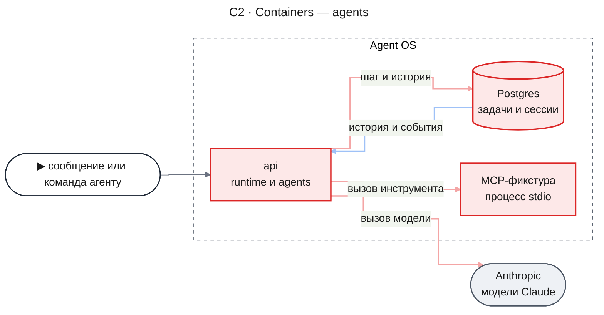

- `api` собирает `packages/agents` в `AgentsModule` и регистрирует обработчик `agent` в runtime до старта воркеров. HTTP-входов эта часть не добавляет: их даёт часть `chat`.
- `Postgres` получает таблицы `agent_*` одной миграцией вперёд.
- `MCP-фикстура` запускается процессом `api` по файлу серверов и получает изменяющий инструмент `create_incident_note`.

#### C3 · Components: api

**api — шаг агента**

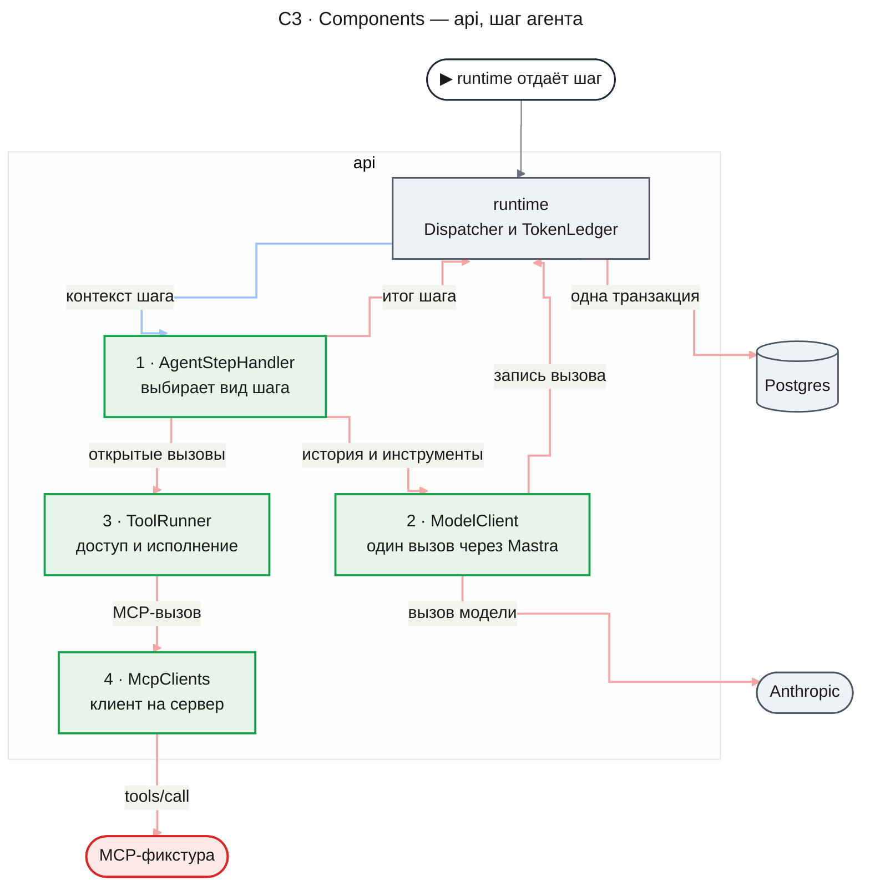

- `AgentStepHandler` читает сессию из своих таблиц, выбирает вид шага по правилу ниже и возвращает runtime итог с записями истории. Между шагами он ничего не держит в памяти.
- `ModelClient` превращает историю в сообщения провайдера, оборачивает данные инструментов, детей и родителя в конверт `<data>`, вызывает модель через Mastra и пишет строку журнала токенов через `ledger.record` (KD-6).
- `ToolRunner` проверяет вызов (инструмент в наборе, доступ к серверу, аргументы встроенного инструмента), решает, нужно ли подтверждение, и исполняет его: MCP и остановку агента — вне транзакции, запуск агента и сообщение агенту — в транзакции итога шага через `effects`.
- `McpClients` держит по одному долгоживущему процессу на сервер, читает список инструментов при старте и после переподключения и закрывает процессы при остановке сервера.

#### Как шаг выбирает работу

Шаг сначала доставляет сообщения из контекста. Сообщение `interrupt` закрывает открытые вызовы исходом «прервано» (KD-3). Затем шаг идёт по схеме.

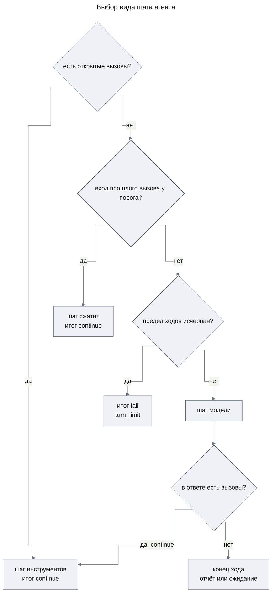

Конец хода (KD-2) выбирает итог так:

- корневая сессия — `wait`;
- у агента есть незаконченные дети — `wait`, уведомление ребёнка его разбудит;
- задан агент последнего шага, а его отчёта ещё нет — в историю пишется уведомление кода об отказе, итог `continue`, и это считается ходом;
- иначе — `complete` с отчётом: текстом ответа или, при агенте последнего шага, его последним отчётом.

Шаг инструментов исполняет открытые вызовы по порядку. Если очередной вызов требует подтверждения, а решения в контексте нет, шаг фиксирует уже готовые результаты и возвращает `await_decision`; остальные вызовы ждут следующего шага.

### Runtime Flows

Во всех потоках `agents` и `runtime` — пакеты внутри `api`; Postgres пишет только runtime в транзакции итога шага или своей операции.

#### Flow 1: Один ход агента

**Starts when:** задача агента готова к шагу, а последняя запись истории — доставленное сообщение или результат инструмента; for AC-03.1, AC-12.1, AC-13.1, AC-04.1.

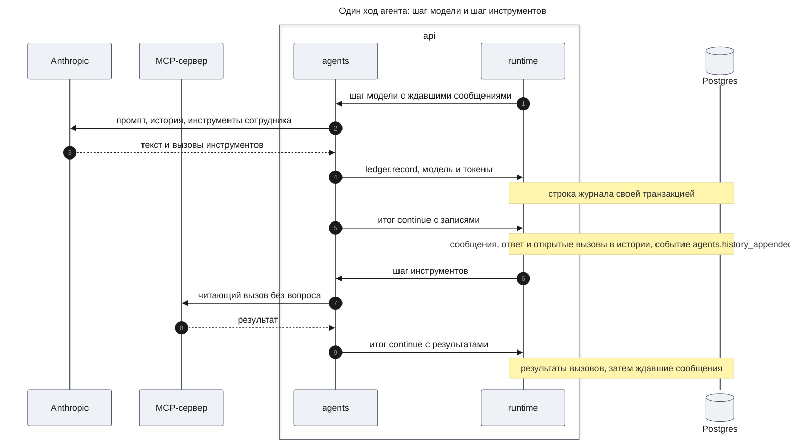

**Outcome:** в истории ответ модели и по записи результата на каждый вызов с временем, аргументами и исходом; у ответа ссылка на строку журнала токенов; модель вызова — модель сессии.

**Failure handling:**

- Инструмент вне набора, сервер не разрешён сотруднику или аргументы встроенного инструмента не прошли схему → результат с исходом «отказ» и причиной (`tool_not_in_definition`, `no_access`, `invalid_arguments`); сервер не вызывается (AC-03.1, AC-11.3).
- MCP вернул `isError` → исход «ошибка инструмента»; пустой результат → «пустой результат»; обрыв, таймаут `MCP_CALL_TIMEOUT_MS` или ошибка протокола → «сбой связи»; агент продолжает (AC-11.2).
- Результат длиннее `AGENT_TOOL_RESULT_MAX_BYTES` → обрезан с пометкой о числе байт.
- Провайдер ответил ошибкой → два повтора; после них итог `fail` с причиной `model_error`.
- Шаг потерян или отсечён → строка журнала остаётся, ответ модели не записан, и шаг выполняется заново (Flow 2 в `design-runtime.md`).

#### Flow 2: Запуск в фоне и отчёт родителю

**Starts when:** модель агента или беседы вызвала `start_agent`; for AC-05.1, AC-05.2, AC-05.3, AC-06.1, AC-06.2, AC-06.3, AC-10.1.

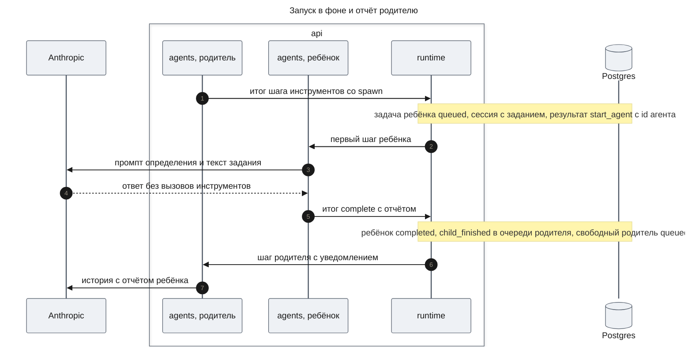

**Outcome:** родитель получил результат `start_agent` с id агента в том же шаге и продолжил работу; история ребёнка начинается с задания; в истории родителя — запись отчёта с описанием агента, статусом, причиной, числом вызовов инструментов и длительностью.

**Failure handling:**

- Агента нет в списке, который разрешает определение или ограничения вызывающего, или число запусков исчерпано → отказ `not_allowed`, задача не создаётся (AC-10.2, DC-4).
- Глубина ребёнка больше `AGENT_MAX_DEPTH` → отказ `depth_limit` (AC-10.3).
- Модель без цены → отказ `unknown_model` (DC-2).
- Родитель занят → уведомление ждёт в его очереди и доставляется в начале следующего шага (AC-06.2); родитель ждёт решения → уведомление доставляется после решения.
- Ребёнок упал или остановлен → уведомление runtime со статусом и причиной; агент отображает его родителю той же записью отчёта без текста (AC-06.3).
- Агент упал, а его дети ещё работают → потребитель событий `agents` на `task.failed` агента вызывает для каждого незаконченного ребёнка тот же `tasks.stop`, что в Flow 7, и поддерево останавливается.

#### Flow 3: Сообщение занятому агенту

**Starts when:** сотрудник или родитель пишет агенту, пока тот исполняет инструмент; for AC-07.1, AC-07.2, AC-01.3.

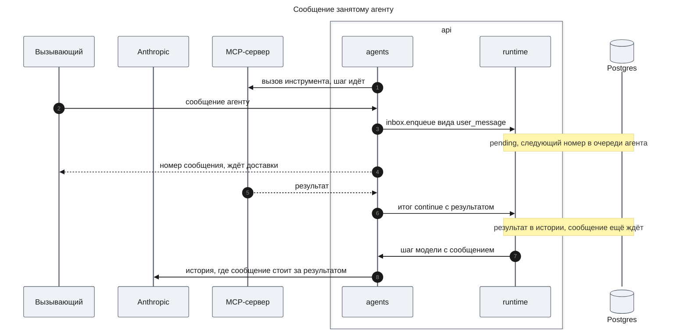

**Outcome:** в истории результат инструмента, сразу за ним сообщение, затем следующий ответ модели; несколько сообщений встают по порядку номеров. Ответ без вызовов (AC-07.3) — тот же путь: сообщение будит ждущую беседу или доставляется в начале следующего шага.

**Failure handling:**

- Агент ждёт подтверждения → сообщение ждёт до решения; модель видит его после последнего результата ответа (KD-1).
- Шаг потерян → сообщение не отмечено доставленным и придёт в повторном шаге один раз (runtime, Invariant 4).

#### Flow 4: Прерывание

**Starts when:** сотрудник прерывает агента с текстом или без; for AC-08.1, AC-08.2, NFR-01.

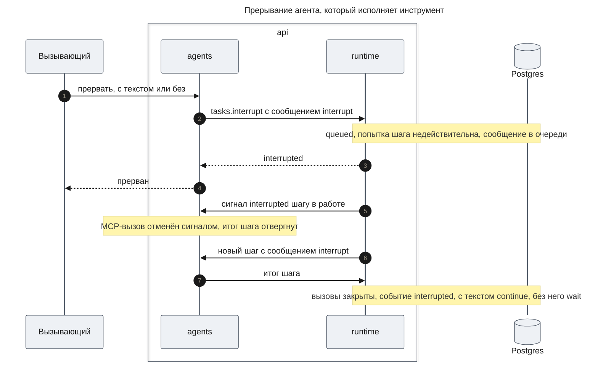

**Outcome:** с текстом агент сразу продолжает: текст стоит в истории после закрытых вызовов, и вызов модели идёт тем же шагом. Без текста статус «Прерван» виден сразу после команды, а после шага у сессии отметка «прерван», и задача ждёт сообщений.

**Failure handling:**

- Агент закончен или ждёт подтверждения → `not_active`, ничего не меняется; подтверждение решают кнопки запроса.
- Отсечённый шаг успел записать намерение изменяющего вызова → при закрытии такой вызов получает исход «исход неизвестен», а не «прервано».
- Отсечённый шаг модели успел зафиксироваться раньше прерывания → его новые вызовы открыты, и шаг с `interrupt` закрывает их исходом «прервано».

#### Flow 5: Изменяющее MCP-действие с подтверждением

**Starts when:** шаг инструментов дошёл до вызова инструмента с подтверждением; for AC-12.2, AC-12.3, AC-12.4, AC-12.5, AC-01.2, NFR-07.

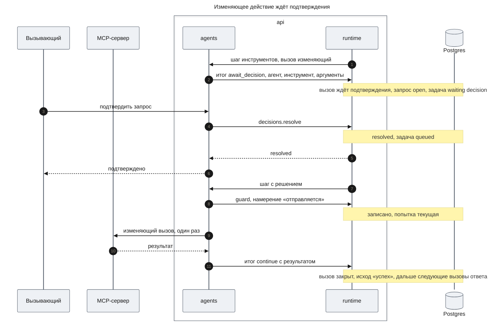

**Outcome:** до подтверждения MCP-сервер не получил ни одного вызова; после подтверждения он получил ровно один; агент продолжает. Беседа видит запрос агента любой глубины через `pendingConfirmations` (AC-17.3 части `chat`).

**Failure handling:**

- Сотрудник отклонил → вызов закрыт исходом «отклонено пользователем», сервер не вызывается, шаг идёт к следующему вызову (AC-12.4).
- Рестарт, пока запрос открыт → запрос и вызов ждут, подтвердить можно как раньше (AC-12.5).
- Шаг потерян после намерения → повторный шаг видит признак потери и намерение без результата и закрывает вызов исходом «исход неизвестен» без повтора (AC-01.2).
- `guard` ответил `fenced` (агента прервали или остановили) → вызов не отправляется.
- Агента остановили, пока запрос открыт → runtime отменяет запрос, вызов закрыт исходом «прервано» (Flow 7).
- Повторное решение → `already_resolved`.

#### Flow 6: Продолжение законченного агента

**Starts when:** сотрудник или родитель пишет агенту в статусе «Завершён», «Сбой» или «Остановлен»; for AC-09.1, DC-1.

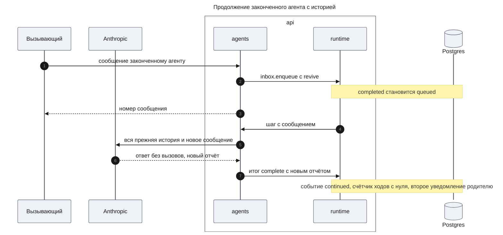

**Outcome:** тот же id и та же сессия; история продолжается после прежнего отчёта; родитель получает второй отчёт.

**Failure handling:**

- Сообщение с `revive` пришло, пока агент делал последний шаг → по контракту runtime итог `complete` или `fail` всё равно заканчивает задачу: конечный статус, одно уведомление родителю. Затем задача возвращается в `queued` с этим сообщением, с тем же id и историей ([design-runtime.md](./design-runtime.md#contract-definitions)).

#### Flow 7: Остановка с потомками

**Starts when:** сотрудник или родитель останавливает агента; for AC-08.3, AC-08.4, AC-06.3.

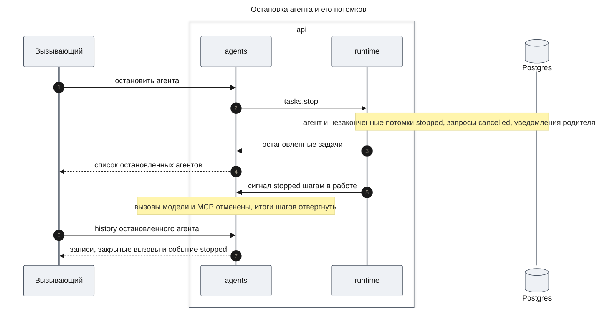

**Outcome:** агент и все его незаконченные потомки остановлены одной командой runtime; новых вызовов модели и инструментов у них нет; родитель каждого получил уведомление со статусом. `agents` в этой операции ничего не пишет. Для остановленного агента `history` добавляет к сохранённым записям его открытые вызовы как закрытые и событие `stopped` — `stopped_with_parent`, если родителя остановила та же команда (у них одно время конца). Первый шаг после продолжения записывает эти записи в историю по-настоящему, с событием `agents.history_appended`.

**Failure handling:**

- Вызов был в `sending`, когда агента остановили → он показан и записан с исходом «исход неизвестен», а не «прервано»: действие могло дойти до сервера.
- Агент ждал подтверждения → runtime отменил запрос, вызов закрыт исходом «прервано».
- Агент уже закончен → пустой список, ничего не меняется.

### Contract Definitions

Все операции принимают владельца (`ownerId`). Агент чужого владельца отвечает так же, как несуществующий: `AGENT_NOT_FOUND`. Владельца проверяет runtime в каждой операции, которую `agents` вызывает первой.

**Сборка**

- **`createAgents(options)`** — собирает пакет из базы, `Runtime`, логгера `common` и разобранных настроек `AgentsConfig`. Сразу регистрирует обработчик задачи типа `agent` в `runtime.handlers`. Возвращает `Agents` с сервисами `definitions`, `tools` и операциями ниже, а также `start()` и `stop()`.
- **`parseAgentsConfig(variables)`** — проверяет переменные из `Runtime settings`, файл серверов и таблицу доступа; неверное значение, неизвестный сервер в таблице доступа или файл без серверов останавливают старт с именем переменной.
- **`start()`** — проверяет каталог: имена уникальны, инструменты и агенты, на которые ссылаются определения, существуют, модели есть в `ledger.pricedModels()`. Затем запускает MCP-серверы и читает их инструменты. Сервер, который не ответил, логируется, а его инструменты не предлагаются, пока он не ответит на следующем шаге. Вызывается до старта воркеров runtime.
- **`stop()`** — закрывает процессы MCP-серверов.

**Определения (`definitions`)**

- **`register(definition)`** — добавляет определение в каталог до `start()`. Пакет сам регистрирует `general-purpose`; `workflows` и `chat` регистрируют свои.
- **`list()`** — заголовки всех определений: имя и описание.

**AgentDefinition** — определение данными.

- `name` — уникальное имя, kebab-case; `description` — когда использовать агента; вместе они — заголовок.
- `prompt` — системный промпт.
- `tools` — имена встроенных и зарегистрированных инструментов.
- `mcpServers` — id серверов развёртывания или `*` для всех.
- `agents` — имена определений, которые агент может запустить через `start_agent`; их заголовки попадают в описание этого инструмента.
- `model` — необязательная модель вида `anthropic/claude-haiku-5-5`.
- `maxTurns` — предел ходов на задание, от 1 до 200.

Определение `general-purpose`: все встроенные инструменты пакета, `mcpServers` `*`, `agents` — `general-purpose`, `maxTurns` 40, без модели.

**Инструменты (`tools`)**

- **`register(tool)`** — добавляет инструмент верхней части до `start()`. Инструмент задаёт `name`, `description`, zod-схему аргументов и один из двух способов исполнения: внутри транзакции итога шага (получает транзакцию, `effects` и помощник запуска дочернего агента, внешних вызовов не делает) или вне транзакции (может звать внешнюю систему, получает сигнал отмены). По желанию инструмент объявляет подтверждение: вид запроса, содержимое для сотрудника и признак, можно ли править аргументы при подтверждении.
- Встроенные инструменты пакета, имена для модели:
  - `start_agent` — аргументы `description` (несколько слов для списка и карточки), `agent` (имя определения или `fork`), `prompt`, `model` (необязательно). Запускает ребёнка в транзакции итога и возвращает `agentId` сразу. С `fork` ребёнок получает определение и модель вызывающего и ссылку на его историю до текущего ответа (KD-7).
  - `message_agent` — `agentId`, `message`: кладёт сообщение потомку с `revive`, поэтому законченный потомок продолжает работу.
  - `list_agents` — потомки вызывающего: id, описание, определение, модель, статус.
  - `stop_agent` — `agentId`: останавливает потомка и его потомков.
  - Цель `message_agent` и `stop_agent` — только потомок вызывающего; иначе отказ `unknown_agent`.
- MCP-инструмент виден модели под именем `mcp__<server>__<tool>`, с описанием и схемой сервера.

**Операции агентов**

- **`start({ ownerId, parentId?, definition, prompt, description, model?, limits? })`** — создаёт агента через `tasks.create`; без `parentId` — корневую сессию, например беседу. Модель: `model`, иначе модель определения, иначе `AGENT_DEFAULT_MODEL`; модель без цены в файле цен развёртывания (`ledger.pricedModels()`) отклоняется `UNKNOWN_MODEL` до `tasks.create`. Возвращает `agentId`. Ошибки: `UNKNOWN_DEFINITION`, `UNKNOWN_MODEL`, `DEPTH_LIMIT`, `AGENT_NOT_FOUND` для родителя, `PARENT_FINISHED`.
- **`send({ agentId, ownerId, text })`** — сообщение сотрудника, вид `user_message`, с `revive`. Возвращает `messageId`. Ошибки: `AGENT_NOT_FOUND`, `PAYLOAD_TOO_LARGE`.
- **`interrupt({ agentId, ownerId, text? })`** — прерывание по KD-3. Возвращает `interrupted` или `not_active`.
- **`stop({ agentId, ownerId })`** — `tasks.stop` и ничего больше. Возвращает список остановленных `agentId`, пустой для законченного агента. Закрытые вызовы и событие остановки показывает `history` (Flow 7).
- **`restart({ agentId, ownerId })`** — запуск с нуля законченного агента: новый агент с тем же определением, заданием, моделью, ограничениями и родителем (AC-09.2). Возвращает новый `agentId`. Ошибки: `AGENT_NOT_FOUND`, `NOT_FINISHED`, `PARENT_FINISHED`.
- **`get(agentId, ownerId)`** — `AgentView`.
- **`list(rootId, ownerId)`** — все агенты дерева как `AgentView` в порядке создания; корень дерева тоже в списке.
- **`history({ agentId, ownerId, afterSeq?, limit })`** — записи истории с номером больше `afterSeq` по порядку, не больше `limit` (до 500); у остановленного агента — с выведенными записями остановки (Flow 7).
- **`pendingConfirmations(rootId, ownerId)`** — открытые запросы подтверждения дерева: `decisionId`, `agentId`, описание агента, вид запроса, инструмент, сервер, аргументы, время. Строится из `decisions.listOpen`.
- **`resolveConfirmation({ decisionId, ownerId, approve, args? })`** — решение сотрудника. `args` принимаются, только если инструмент разрешает правку. Возвращает `resolved` или `already_resolved`; ошибки `DECISION_NOT_FOUND`, `INVALID_ARGUMENTS`.

**SessionLimits** — ограничения вызывающего, задаются при `start`.

- `agents` — имена определений и сколько раз каждое можно запустить; заменяет поле `agents` определения. Запуск вне списка или сверх числа получает отказ `not_allowed`.
- `finalAgent` — имя определения, чей отчёт должен быть последним; см. «Конец хода».

**AgentView**

- `agentId`, `parentId`, `rootId`, `depth`, `definition`, `description`, `model`, `createdAt`, `finishedAt`.
- `status` — `working`, `awaiting_confirmation`, `interrupted`, `completed`, `failed`, `stopped` (метки MC-3, отображение — в State Transitions).
- `failureReason` — при `failed`: `turn_limit`, `model_error` или причина runtime (`handler_error`, `step_timeout`, `recovery_exhausted`, `invalid_step_result`).
- `forkedFrom` — при ответвлении: `agentId` родителя и `throughSeq`; историю до этого номера читают у родителя.

**HistoryEntry** — запись истории: `seq`, `kind`, `createdAt` и содержимое вида.

- `task` — текст задания; первая собственная запись.
- `user_message` — текст сотрудника; `agent_message` — текст и `agentId` родителя.
- `child_report` — `agentId`, описание, статус, причина, текст отчёта или его нет, число вызовов инструментов, длительность.
- `model_answer` — текст и вызовы инструментов этого ответа.
- `tool_result` — результат одного вызова: `callId`, инструмент, сервер, аргументы, исход, причина отказа, текст результата, время начала и конца.
- `notice` — сообщение кода модели, например отказ закончить без агента последнего шага.
- `event` — `interrupted`, `stopped`, `stopped_with_parent`, `continued`, `failed` с причиной, `compacted`.
- `compaction` — сводка и номер последней записи, которую она заменяет для модели.

Исходы вызова (`ToolOutcome`): `success`, `empty`, `tool_error`, `transport_failure`, `refused`, `rejected`, `interrupted`, `unknown`. Открытый вызов в `model_answer` несёт состояние `requested`, `awaiting_confirmation` или `sending`.

**Сообщения и события**

- Виды сообщений очереди: `user_message` (сотрудник), `agent_message` (родитель), `interrupt` (прерывание, текст по желанию) и `child_finished` runtime. В историю они встают с тегом источника; данные родителя и детей модель видит в конверте `<data>`.
- Вид запроса решения: `agents.tool_confirmation`; вид запроса инструмента верхней части задаёт сама часть.
- Событие `agents.history_appended` с `agentId` и номером последней записи пишется в каждой транзакции, которая дописала историю ([transactional-outbox.md](../../code-system/patterns/transactional-outbox.md)). Статусы приходят событиями `task.*` runtime.

**Error handling**

- `AGENT_NOT_FOUND` — агента нет или он чужой.
- `UNKNOWN_DEFINITION`, `UNKNOWN_MODEL` — нет определения или цены модели.
- `DEPTH_LIMIT` — глубина нового агента больше `AGENT_MAX_DEPTH`.
- `not_active` — исход runtime: прерывание законченного агента или агента, который ждёт подтверждения.
- `NOT_FINISHED` — запуск с нуля работающего агента.
- `PARENT_FINISHED`, `PAYLOAD_TOO_LARGE`, `DECISION_NOT_FOUND` — из runtime без изменений.
- Причины отказа в результате вызова: `tool_not_in_definition`, `no_access`, `not_allowed`, `depth_limit`, `unknown_model`, `unknown_agent`, `invalid_arguments`.

**Runtime settings**

Переменные читает `apps/api` и передаёт в `parseAgentsConfig`.

- `AGENT_DEFAULT_MODEL` — default `anthropic/claude-haiku-5-5`; модель, когда её не задали ни запуск, ни определение.
- `ANTHROPIC_API_KEY` — ключ провайдера; передаётся логгеру как секрет.
- `AGENTS_ANTHROPIC_BASE_URL` — default `https://api.anthropic.com`; заменяет `RESEARCH_ANTHROPIC_BASE_URL`.
- `AGENT_MAX_OUTPUT_TOKENS` — default `16000`; предел ответа модели.
- `AGENT_MAX_DEPTH` — default `3`; наибольшая глубина агента, у беседы 0.
- `AGENT_TOOL_RESULT_MAX_BYTES` — default `16384`; длиннее результат обрезается.
- `AGENT_COMPACT_AT_TOKENS` — default `200000`; порог сжатия по входным токенам прошлого вызова.
- `MCP_SERVERS_FILE` — default `config/mcp-servers.json` в `apps/api`; список серверов: `id`, команда, аргументы, переменные окружения. Поставляется с фикстурой `logs` и `backoffice`. Значения переменных передаются логгеру как секреты.
- `MCP_ACCESS_TABLE` — JSON «id сотрудника → id серверов»; пусто значит, что серверов нет ни у кого. Заменяет `SOURCE_ACCESS_TABLE`.
- `MCP_CALL_TIMEOUT_MS` — default `60000`; предел одного MCP-вызова.

### Data Model

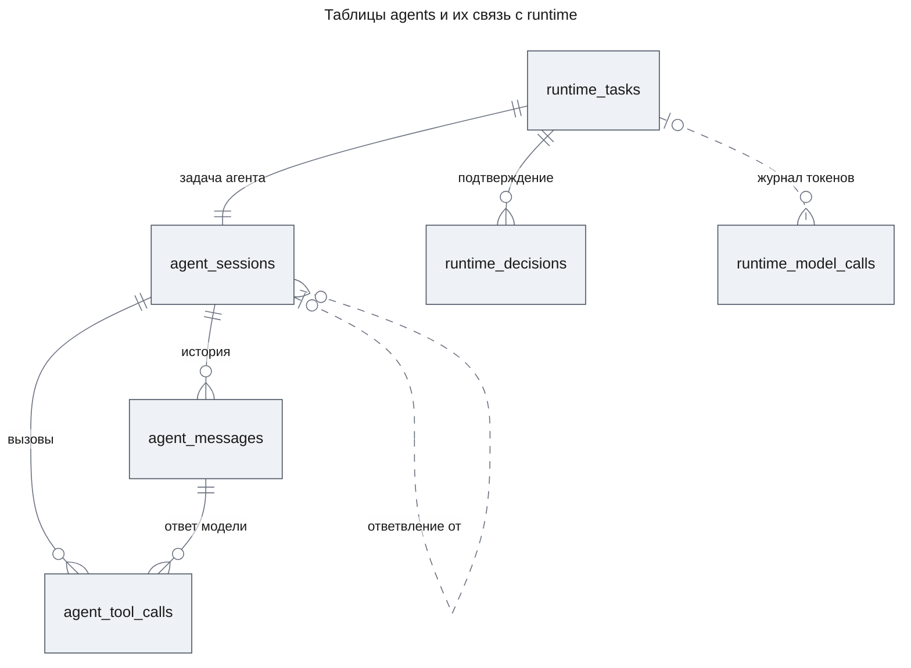

- `agent_sessions` — одна строка на агента; ключ — id задачи runtime, внешний ключ с каскадом, поэтому `deleteTree` удаляет и сессии. Здесь определение, описание, модель после выбора, ограничения вызывающего, ссылка ответвления, счётчик ходов и отметка «прерван». Родителя, корень, глубину, владельца и статус хранит только runtime.
- `agent_messages` — история: номер растёт в пределах сессии, записи только дописываются. У `model_answer` ссылка на строку журнала токенов без внешнего ключа.
- `agent_tool_calls` — строка на вызов: инструмент, сервер, аргументы, состояние, исход, причина, время, `agentId` ребёнка у `start_agent`. Строка — запись аудита: на каждый вызов ровно одна (бизнес-ограничение 3); сотрудник — владелец задачи.
- Определения не хранятся в базе: сессия помнит имя, а определение берётся из каталога текущего процесса. Запросы подтверждения хранит runtime (`runtime_decisions`).

Сессию создаёт транзакция итога родителя вместе с `spawn` или операция `start` сразу после `tasks.create`; если процесс умер между ними, первый шаг агента создаёт строку из входа задачи.

### State Transitions and Invariants

Статус агента для сотрудника выводится из статуса задачи runtime и отметки сессии:

| Статус задачи runtime | Статус агента | Метка MC-3 |
|---|---|---|
| `queued`, `running`, `waiting` с причиной `messages` — без признаков ниже | `working` | «Работает» |
| `waiting` с причиной `decision` | `awaiting_confirmation` | «Ждёт подтверждения» |
| `queued` или `running` с ждущим сообщением `interrupt` без текста; `waiting` с отметкой «прерван» | `interrupted` | «Прерван» |
| `completed` | `completed` | «Завершён» |
| `failed` | `failed` | «Сбой» |
| `stopped` | `stopped` | «Остановлен» |

Вызов инструмента проходит состояния:

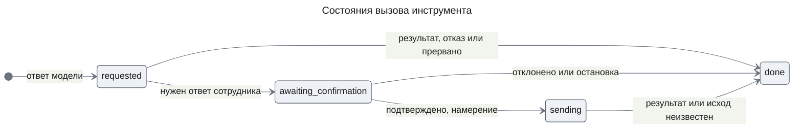

**Invariants**

1. У каждого вызова ровно одна запись результата, и до неё в истории нет ответа модели новее этого вызова.
2. Инструмент с подтверждением не вызывается без записанного решения «подтверждено» и намерения `sending`; вызов в `sending` после потери шага не повторяется.
3. Доставленное сообщение стоит в истории после всех результатов, записанных тем же шагом, а в сообщениях провайдера — после последнего результата своего ответа и до следующего ответа модели.
4. Дочерний агент не завершается, пока у него есть незаконченные дети.
5. История только дописывается; ответвление и сжатие не меняют записей родителя и прежних записей.
6. Модель всех вызовов одной сессии — модель, выбранная при запуске.

## Test Strategy

Тесты пишутся с задачами и запускаются один раз в конце части. Модель подменяется на границе `ModelClient` сценарием ответов; MCP — настоящий процесс фикстуры, а её журнал вызовов показывает, что дошло до сервера. Ревью тестов — для рестартов, прерывания и подтверждений.

### Main Use Cases

- **UC-1: Фоновые агенты и их отчёты** — covers AC-05.1, AC-05.2, AC-05.3, AC-06.1, AC-06.2, AC-10.1, AC-02.1, DC-3
  - Given: корневая сессия, чей сценарий запускает двух агентов `general-purpose`; первый ребёнок отвечает отчётом после одного читающего вызова, второй запускает внука, отвечает текстом, пока внук работает, и отчитывается после отчёта внука.
  - When: воркеры работают, а корень в это время исполняет медленный вызов.
  - Then: результаты `start_agent` записаны в одном шаге с двумя `agentId`; дети работали одновременно; история каждого начинается с задания без записей родителя; второй ребёнок после первого текста остался `working` и завершился только после отчёта внука, который получил он, а не корень; отчёт, пришедший во время медленного вызова, доставлен корню на следующем шаге; свободный корень проснулся сам, и его вызов модели видит оба отчёта; на каждый вызов модели одна строка журнала с задачей сессии и моделью.
- **UC-2: Сообщения занятому агенту** — covers AC-07.1, AC-07.2, AC-07.3, NFR-04
  - Given: агент исполняет вызов, который фикстура задерживает; отдельно — корень, который ответил текстом и ждёт.
  - When: агенту отправляют два сообщения, корню — одно.
  - Then: у агента — результат, затем оба сообщения по порядку, затем ответ модели, чей вход их содержит; корень проснулся и начал ход с сообщения.
- **UC-3: Изменяющее действие** — covers AC-12.1, AC-12.2, AC-12.3, AC-12.4, AC-12.5, NFR-07
  - Given: агент, сценарий которого вызывает `create_incident_note`, затем читающий инструмент; варианты строками: подтвердить, отклонить, перезапустить сервер до решения и подтвердить.
  - When: шаги идут до запроса, затем выполняется вариант.
  - Then: читающий вызов прошёл без запроса; до решения в журнале фикстуры нет вызова `create_incident_note`; запрос содержит агента, инструмент и аргументы; подтверждение — один вызов и исход «успех»; отклонение — ноль вызовов и исход «отклонено»; после рестарта запрос открыт и подтверждается.
- **UC-4: Продолжение и запуск с нуля** — covers AC-09.1, AC-09.2, DC-1
  - Given: агент, который упал по пределу ходов, и агент, который завершился.
  - When: первому пишут сообщение, второго запускают с нуля.
  - Then: первый работает в той же сессии с полным пределом ходов и сдаёт отчёт, родитель получил второе уведомление; второй — новый `agentId` с тем же определением, заданием и родителем, история с задания, прежний в списке.
- **UC-5: Ограничения вызывающего** — covers DC-4
  - Given: агент с ограничениями «`planner` один раз», агент последнего шага `answer`.
  - When: сценарий запускает `planner` дважды, `gatherer` один раз, затем отвечает текстом, затем запускает `answer` и после его отчёта отвечает текстом.
  - Then: второй `planner` и `gatherer` — отказ `not_allowed`; первый текст — уведомление об отказе и новый ход; отчёт сессии родителю — отчёт `answer`.

### Error and Edge Use Cases

- **UC-E1: Прерывание** — covers AC-08.1, AC-08.2, NFR-01
  - Given: агент ждёт долгого читающего вызова; строки: с текстом и без.
  - When: агента прерывают.
  - Then: `get` показывает `interrupted` не позже чем через 5 с после команды; открытый вызов — «прервано»; с текстом текст стоит за ним и следующий вызов модели его видит; без текста новых вызовов модели нет до сообщения.
- **UC-E2: Остановка с потомками** — covers AC-08.3, AC-08.4, AC-06.3
  - Given: агент с ребёнком и внуком, у ребёнка открыт запрос подтверждения.
  - When: агента останавливают.
  - Then: все трое `stopped`, вызов ребёнка «прервано», в `history` у агента событие `stopped`, у ребёнка и внука — `stopped_with_parent`; после этого сценарий модели не получил вызовов; родитель агента получил уведомление со статусом `stopped`.
- **UC-E3: Предел ходов** — covers AC-03.2
  - Given: определение с `maxTurns` 2, сценарий всегда просит инструмент.
  - When: агент работает.
  - Then: два вызова модели, агент `failed` с `turn_limit`, родитель получил уведомление с причиной.
- **UC-E4: Отказы до сервера** — covers AC-03.1, AC-10.2, AC-10.3, AC-11.3, DC-6
  - Given: правило проверки вызова; строки: инструмент вне набора, `start_agent` без инструмента в определении, глубина больше предела, сервер не в таблице доступа, сервер разрешён.
  - When: проверяют вызов.
  - Then: причины `tool_not_in_definition`, `tool_not_in_definition`, `depth_limit`, `no_access` и «разрешено»; одна строка интеграционно: вызов неразрешённого сервера даёт отказ в истории, а журнал фикстуры пуст.
- **UC-E5: Доступ к серверам и сервер недоступен** — covers AC-11.1, AC-11.2
  - Given: таблица доступа даёт сотруднику А сервер `logs`, сотруднику Б — ничего; процесс `logs` падает перед вызовом.
  - When: сценарии обоих просят инструмент `logs`.
  - Then: модель А видит инструменты `logs`, модель Б — нет; вызов А — «сбой связи», агент продолжает.
- **UC-E6: Рестарт посреди шага инструментов** — covers AC-01.1, AC-01.2, AC-01.3, DC-5, NFR-04
  - Given: агент с открытыми читающим вызовом и подтверждённым изменяющим с записанным намерением и ждущим сообщением, процесс убит в шаге.
  - When: второй экземпляр продолжает.
  - Then: читающий вызов исполнен ровно один раз и записан один раз; сообщение в истории один раз; изменяющий — «исход неизвестен», в журнале фикстуры не больше одного его вызова; агент сдал отчёт.
- **UC-E7: Чужой агент** — covers AC-13.3, NFR-06
  - Given: агент сотрудника А.
  - When: от имени Б вызывают `get`, `history`, `send`, `interrupt`, `stop`, `restart`, `resolveConfirmation`.
  - Then: каждый ответ `AGENT_NOT_FOUND` или `DECISION_NOT_FOUND`, ничего не изменилось.
- **UC-E8: Выбор модели** — covers AC-04.1, AC-04.2, AC-04.3, AC-13.2, DC-2
  - Given: правило выбора модели; строки: модель запуска, модель определения, ничего, модель без цены.
  - When: агента запускают.
  - Then: модели запуска, определения, `AGENT_DEFAULT_MODEL` и `UNKNOWN_MODEL`; `get` показывает выбранную модель без токенов и стоимости.
- **UC-E9: История вызова** — covers AC-13.1
  - Given: агент сделал читающий вызов, вызов с ошибкой инструмента и вызов, которому отказано.
  - When: читают историю.
  - Then: у каждого вызова время, инструмент, аргументы и исход `success`, `tool_error`, `refused`; на каждый вызов одна строка `agent_tool_calls`.
- **UC-E10: Ответвление** — covers AC-25.1
  - Given: корень с историей из трёх реплик.
  - When: сценарий корня вызывает `start_agent` с `fork`.
  - Then: первый вызов модели ответвления содержит реплики корня до этого вызова и задание; история корня не изменилась.
- **UC-E11: Сжатие** — covers AC-27.1
  - Given: сценарий отчитывается о входных токенах выше `AGENT_COMPACT_AT_TOKENS`.
  - When: агент делает следующий ход.
  - Then: в истории запись сводки и событие `compacted`; следующий вызов модели получает сводку вместо старых записей; `history` по-прежнему отдаёт все записи.

## Security Considerations

- **Authentication & Authorization**: часть не принимает внешних запросов; владельца передаёт `apps/api`. Каждая операция начинается с операции runtime, которая проверяет владельца. Инструменты сотрудника фильтрует и проверяет одна функция доступа по таблице `MCP_ACCESS_TABLE`; агенты наследуют владельца дерева. Встроенные инструменты действуют только на потомков вызывающего.
- **Input Validation**: аргументы встроенных инструментов проверяет zod, аргументы MCP — сервер. Ответ модели, результаты инструментов, отчёты детей и сообщения родителя модель видит в конверте `<data>` с экранированием разделителей. Изменяющее действие исполняется только после решения сотрудника (Invariant 2).
- **Sensitive Data Handling**: ключ провайдера и переменные окружения MCP-серверов передаются логгеру как секреты; процесс сервера получает только свои переменные из файла. Логи содержат аргументы и результаты вызовов, как требует CLAUDE.md, обрезанные логгером. Токены и стоимость не попадают в историю (AC-13.2).

## Risks and Mitigation

- **Haiku не удерживает цикл агента и плохо делегирует** — высокое влияние, средняя вероятность. Предел ходов, модель в определении или при запуске, ограничения вызывающего для координатора; проверка ручным прогоном после части `chat` (PRD, Assumptions).
- **Шаг с сообщением `interrupt` ждёт свободного слота воркера, и открытые вызовы ещё показаны как исполняемые** — малое влияние, низкая вероятность. Статус «Прерван» виден из ждущего сообщения сразу после команды (KD-3); шаг закрытия вызовов не вызывает модель и занимает миллисекунды.
- **MCP-схемы в JSON Schema поведут себя у провайдера иначе, чем zod** — среднее влияние, низкая вероятность. Тип проверен по установленному Mastra; поведение на проводе — допущение, которое первая задача плана проверяет пробой с инструментом фикстуры.

## Open Questions

Нет.

## Appendix: Fact Disposition

| Fact | Disposition | Handled in |
|------|-------------|------------|
| Долгий цикл ходов в одной попытке с `yield` и охраняемыми записями (`packages/engine/src/agents/agent-run.handler.ts:createAgentRunHandlers`) | transform | шаг модели и шаг инструментов (KD-1, «Как шаг выбирает работу») |
| Mastra-обёртка хода: новый `Agent` на вызов, `maxSteps: 1`, инструменты без `execute`, метки кеша (`packages/engine/src/model/role-agent.ts:mastraAgentTurnClient`) | transform | `ModelClient` с JSON Schema MCP, без счёта токенов (KD-6) |
| `ModelGateway`: повторы и отмена общие, резерв, ожидание и ступени окна привязаны к бюджету (`packages/engine/src/model/model-gateway.ts:createModelGateway`) | transform | остаются повтор и отмена; запись в `ledger.record` (KD-6) |
| Журнал токенов движка без владельца, цены в коде (`packages/engine/src/model/ledger.ts:postgresCallLedger`) | remove | журнал runtime; модель проверяется по `pricedModels` при запуске (DC-2) |
| Цепочка проверок вызова, классы эффекта, одна строка аудита на вызов (`packages/engine/src/agents/tool-executor.ts:createToolExecutor`) | transform | `ToolRunner`, причины отказа, `agent_tool_calls` как аудит (Contract Definitions, Data Model) |
| Синхронный `call_agent` с долями и ожиданием ребёнка (`packages/engine/src/agents/tools/call-agent.ts:decideCallAgent`) | transform | `start_agent` в фоне, отчёт через очередь (Flow 2) |
| История в `research_agent_messages`, конверт `<data>`, нет видов сообщений очереди (`packages/engine/src/agents/run-session.ts:toRunSession`) | transform | `agent_messages` с видами и тегом источника; конверт сохранён (HistoryEntry) |
| Таблицы `research_agent_*`, `agent_tool_audit`, память агентов и определений (`packages/db/src/schema.ts:researchAgentRuns`) | remove | таблицы `agent_*` (Data Model); память не нужна ни одному требованию |
| Предел ходов на весь запуск, принудительный `finish` на последнем ходу (`packages/engine/src/agents/turn-rules.ts:decideNextTurn`) | transform | предел на задание со сбросом, `fail` с `turn_limit` (DC-1, AC-03.2) |
| Определение внутри `ProcessConfig` без заголовка и MCP, формы результата (`packages/engine/src/config/agent-config.schema.ts:AgentDefinitionSchema`) | transform | `AgentDefinition` и каталог (Contract Definitions); формы удалены (KD-2) |
| Две дороги выбора модели, `ASSISTANT_MODEL` у чата (`apps/api/src/engine/resolve-model.ts:createResolveModel`) | transform | выбор модели и `AGENT_DEFAULT_MODEL`; `ASSISTANT_MODEL` убирает часть `chat` |
| MCP-клиент stdio без `listTools`, `readOnly` объявлен в коде, нет изменяющего инструмента (`packages/sources/src/mcp/mcp-source-client.ts:McpSourceClient`) | transform | `McpClients`, `readOnlyHint`, `create_incident_note` (KD-4, KD-5) |
| Таблица доступа по источникам в `apps/api` (`apps/api/src/sources/source-access-table.ts:SourceAccessTable`) | transform | `MCP_ACCESS_TABLE` по серверам, одна функция доступа в пакете (KD-5) |
| Ступени окна по `count_tokens`, держатся по транскриптам (`packages/engine/src/agents/session-window.ts:buildSessionView`) | transform | сжатие сводкой по `usage` (KD-7) |
| Расследование, claims, assess, verify, калибровка, групповые таблицы в сборке движка (`packages/engine/src/create-engine.ts:composeEngine`) | remove | не переносятся (Building-block Inventory) |
| Отмена только целым расследованием (`packages/runtime/src/investigation.service.ts:cancel`) | transform | `interrupt` и `stop` агента поверх runtime (KD-3, Flow 4) |
| Отклонения от code system: долгий `run`, свой `EngineLogger`, настройки в `apps/api`, чтение чужих таблиц, репозиторий открывает транзакцию (`conformance.deviations`) | remove | шаг, логгер `common`, `parseAgentsConfig`, только `agent_*`, транзакция шага ([code system](../../code-system/README.md)) |

Дизайн сохраняет идею «каждый шаг перечитывает состояние из базы», состояния вызова с охраняемым переходом и «закрытый вызов не исполняется снова» (`tool-calls.repository.ts`), политику повторов провайдера (`retry-policy.ts`), конверт `<data>` (`session-window.ts`) и реестр по имени для инструментов и определений (`conformance.uncatalogued`) — как модуль пакета, без нового паттерна.

## Update History

| Version | Date | Change |
|---------|------|--------|
| 1.0 | 2026-11-14 | Первая версия |
| 1.1 | 2026-11-14 | Утверждён оркестратором по поручению владельца. Закрыт вопрос к `runtime`: сообщение с `revive`, пришедшее во время последнего шага, оживляет задачу после её конца (Flow 6), а `tasks.interrupt` принимает сообщение в форме `inbox.enqueue` (KD-3). Исходы runtime записаны как в `design-runtime.md`: `not_active`, `already_resolved`. Упавший агент останавливает незаконченных детей (Flow 2); `start` отклоняет модель без цены `UNKNOWN_MODEL`. |
