# Платформа агентов — Design Document — agents

**Status:** Approved · **Date:** 2026-11-14 · **PRD:** [prd.md](./prd.md) · **UXRD:** [uxrd.md](./uxrd.md) · **Depends on:** [design-runtime.md](./design-runtime.md#contract-definitions)

## Snapshot

**Overview.** Эта часть делает агента: модель с промптом и инструментами, у которой есть своя сессия в базе и родитель. Агент — задача runtime типа `agent`, и каждый его шаг делает одно из двух: вызывает модель один раз или исполняет инструменты, которые модель попросила в последнем ответе; после каждого шага история агента сохранена. Поэтому сообщение работающему агенту встаёт в историю сразу после результата инструмента, прерывание отменяет только текущий шаг, а рестарт теряет не больше одного шага. Агент запускает агента встроенным инструментом и сразу получает его id; ребёнок заканчивает, когда отвечает текстом без вызовов, и этот текст уходит родителю как отчёт через очередь runtime. Инструменты внешних систем приходят с MCP-серверов, которых администратор зарегистрировал в реестре; читающий исполняется сразу, а любой другой ждёт подтверждения сотрудника через запрос решения runtime. Что запускается, задаёт запись библиотеки: запуск хранит её снимок во входе своей задачи ([custom-agents/design-runtime.md](../custom-agents/design-runtime.md), KD-1).

- **Не меняется**: контракты runtime — часть их только потребляет. Беседа — корневая сессия этой части ([design-chat.md](./design-chat.md), KD-1).
- **Biggest risk**: Haiku не удерживает цикл агента и плохо делегирует ([Risks and Mitigation](#risks-and-mitigation)).
- **Open questions**: нет.

### Key Decisions

#### KD-1: Шаг агента — либо один вызов модели, либо исполнение вызовов одного ответа

Шаг модели собирает историю, вызывает модель и сохраняет ответ вместе с открытыми вызовами инструментов. Следующий шаг исполняет эти вызовы по порядку и сохраняет их результаты. Ответ модели сохранён до того, как начались инструменты, поэтому прерванный или потерянный шаг инструментов оставляет в истории видимые открытые вызовы, а не пропавший ответ. Сообщения, которые runtime отдаёт в начале шага, шаг модели ставит в историю перед вызовом модели, а шаг инструментов — после результатов своих вызовов. Так сообщение всегда стоит сразу за результатом инструмента (AC-07.1). Шаг, который не закрыл все вызовы ответа (остановился на подтверждении или исполнил подтверждённый вызов, а следующие ещё открыты), тоже пишет сообщения после своих результатов; `ModelClient`, собирая сообщения провайдера, ставит такие сообщения после последнего результата этого ответа, поэтому пара «вызов — результат», которую требует провайдер, не разрывается. Шаг сжатия пишет сообщения после сводки, а шаг, который падает по пределу ходов, — перед событием сбоя: модель увидит их после продолжения.

Не взяты: модель и инструменты в одном шаге — прерывание теряло бы ответ модели вместе с вызовами; прежний длинный цикл `run` — нарушает [step-handler.md](../../code-system/patterns/step-handler.md).

#### KD-2: Ход кончается ответом без вызовов инструментов, как в Claude Code

Если модель ответила текстом без вызовов, ход окончен. Корневая сессия (беседа) после этого ждёт сообщений. Дочерний агент без незаконченных детей завершается, и этот текст становится его отчётом. Дочерний агент, у которого дети ещё работают, ждёт их уведомлений, а его текст остаётся промежуточной репликой. Отдельного инструмента «finish» и форм результата нет: их процессный код уходит вместе с движком, а Haiku надёжнее заканчивает ход текстом, чем вызовом формы.

#### KD-3: Прерывание всегда приходит агенту сообщением `interrupt`

Операция прерывания вызывает `tasks.interrupt` runtime всегда с сообщением вида `interrupt` с пустыми данными. По контракту runtime `tasks.interrupt` принимает необязательное сообщение с теми же полями, что `inbox.enqueue` ([design-runtime.md](./design-runtime.md#contract-definitions)). Шаг, который получил такое сообщение, закрывает все открытые вызовы с исходом «прервано» (вызов в `sending` — «исход неизвестен») и пишет событие `interrupted`. Модель из-за прерывания не вызывается: если в шаге нет других сообщений, шаг ставит сессии отметку «прерван» и ждёт, а сообщения, которые уже стояли в очереди, шаг берёт вместе с `interrupt` и продолжает с ними. Новое сообщение сотрудника, пока агент работает, идёт обычным `send`. Только так шаг отличает прерывание от рестарта: после рестарта открытые читающие вызовы исполняются заново, а после прерывания — нет. Статус «Прерван» виден сразу после команды: пока шаг не взял сообщение, его выводят из ждущего сообщения `interrupt`, а потом — из отметки. Отметку снимает первый шаг, который доставил сообщение другого вида.

Не взято: прерывание runtime без сообщения — следующий шаг видит только признак потерянной попытки и не знает, что это было.

#### KD-4: Инструмент с подтверждением ждёт запроса решения runtime, а перед отправкой пишет намерение

MCP-инструмент читающий, только если сервер в `tools/list` пометил его `readOnlyHint: true`; любой другой изменяющий (FR-11). MCP разрешает это поле, по умолчанию оно `false`, и считать его можно только у доверенного сервера — серверы регистрирует администратор в реестре, поэтому они доверенные ([design-mcp-connect.md](../enterprise-access/design-mcp-connect.md), KD-1; [MCP — Tools](https://modelcontextprotocol.io/specification/2025-06-18/server/tools), [MCP — ToolAnnotations](https://modelcontextprotocol.io/specification/2025-06-18/schema#toolannotations); поле есть в установленном `@modelcontextprotocol/client` 2.4.0). Изменяющий вызов останавливает шаг исходом `await_decision`, и тот же коммит дописывает в историю запись `tool_confirmation`. После подтверждения следующий шаг дописывает решение и намерение `tool_sent`, коммитит их через `guard` и только потом зовёт сервер. Потерянный после намерения шаг даёт вызову исход «исход неизвестен», и вызов не повторяется (AC-01.2). Тот же механизм «инструмент с подтверждением» открыт для инструментов верхних частей: бриф workflow в части `workflows` — это подтверждение с правкой аргументов. Инструмент может решать по аргументам, нужно ли подтверждение: так изменяющий запуск `run_code` ждёт решения, а читающий — нет ([design-code-execution.md](../code-execution/design-code-execution.md), KD-4).

#### KD-5: MCP-инструменты вызываются прямо из шага, вне транзакции

Шаг инструментов зовёт MCP-сервер сам, вне транзакции: вызов MCP дочерней задачей был бы лишним шагом и лишним ожиданием.

Заменено: клиент stdio, файл серверов развёртывания и таблица доступа «сотрудник → серверы». Серверы и их списки инструментов лежат в реестре в базе, каждый вызов открывает своё соединение Streamable HTTP с общим токеном сервера или токеном аккаунта сотрудника ([design-mcp-connect.md](../enterprise-access/design-mcp-connect.md), KD-1–KD-3, KD-5). Права на пару «сервер — инструмент» отвечает порт `AccessGate` и при сборке набора инструментов, и перед каждым вызовом ([design-access.md](../enterprise-access/design-access.md), KD-1, KD-2).

#### KD-6: Обёртка модели — перенесённые `role-agent` и политика повторов, без счёта токенов до вызова

`ModelClient` строит на каждый вызов новый Mastra `Agent` без памяти и хранилища и зовёт `stream` с `maxSteps: 1`; инструменты передаются через `createTool` без `execute`, поэтому Mastra их не исполняет. MCP-схемы входят как JSON Schema: тип `inputSchema` у `createTool` в установленном `@mastra/core` 1.80 принимает `JSONSchema7` (`@mastra/schema-compat` 1.3.17, `dist/schema.types.d.ts`). Сигнал отмены и два повтора с паузами 1000 и 3000 мс переходят как есть. Вызов `count_tokens` перед каждым ходом уходит: он был основой резервирования и ступеней окна, которых больше нет, а сжатие (KD-7) берёт размер из `usage` прошлого вызова. Каждая оплачиваемая попытка — строка журнала токенов runtime.

Модель, метку кеша и подключение обёртка берёт у адаптера вида провайдера и из реестра провайдеров в базе ([model-providers/design-core.md](../model-providers/design-core.md), KD-2, KD-3; [ADR-0019](../../adr/ADR-0019-model-provider-registry-in-agents.md)), id модели — `<провайдер>/<модель>` ([ADR-0018](../../adr/ADR-0018-model-id-provider-prefix.md)). Перед первой попыткой она спрашивает `AccessGate.model`; цена строки журнала приходит с разрешением ([design-access.md](../enterprise-access/design-access.md), KD-3, KD-4).

#### KD-7: Ответвление ссылается на историю родителя, а сжатие — запись-сводка в той же истории

Ответвление хранит ссылку «сессия родителя и номер последней записи до вызова запуска»: история родителя только дописывается, поэтому ссылка не устаревает, и копии нет (FR-25). Сжатие (FR-27) — шаг, который вызывает модель с просьбой о сводке и пишет запись `compaction`; модель дальше видит сводку и записи после неё, а сотрудник читает всю историю. Сжатие запускается, когда входные токены прошлого вызова модели достигли `AGENT_COMPACT_AT_TOKENS`.

## Terms

- **Шаг модели** и **шаг инструментов** — два вида шага агента (KD-1).
- **Открытый вызов** — вызов инструмента из ответа модели, у которого ещё нет результата.
- **Записи вызова** — записи истории о судьбе одного вызова с его `callId`: запрос подтверждения, решение сотрудника, намерение, попытка `run_code` и закрывающий результат. Состояние вызова нигде не хранится — его выводят из этих записей.
- **Намерение** — запись `tool_sent` перед вызовом с подтверждением; через `guard` runtime она коммитится до отправки.
- **Инструмент с подтверждением** — инструмент, который исполняется только после решения сотрудника: изменяющий MCP-инструмент, изменяющий запуск `run_code` или инструмент верхней части, например запуск workflow.
- **Событие истории** — запись в истории о смене состояния без реплики модели: прерван, остановлен, продолжен, сжат, сбой.
- **Снимок** — копия записи библиотеки, с которой стартовал запуск: промпт, инструменты, серверы, кого он может запустить, модель и предел ходов. Снимок лежит во входе задачи, и шаги читают только его ([custom-agents/design-runtime.md](../custom-agents/design-runtime.md), KD-1; [run-snapshot.md](../../code-system/patterns/run-snapshot.md)).
- **Набор запуска** — кого сессия может запустить: у корня — записи, которые чат может предложить, у агента — записи из его `agents`, у координатора workflow — исполнители его команды, каждый не больше своего предела вызовов ([custom-agents/design-runtime.md](../custom-agents/design-runtime.md), KD-5).

## Part

- **Part**: `agents` — вторая часть Delivery Parts в PRD.
- **Covers**: FR-03–FR-13, FR-25, FR-27; NFR-01 и NFR-04 в доле агента; NFR-06 и NFR-07.
- **Depends on**: [design-runtime.md, Contract Definitions](./design-runtime.md#contract-definitions) — `createRuntime`, `TaskHandler`, `StepContext`, `StepResult`, `tasks`, `inbox`, `decisions`, `events`, `eventConsumers`, `ledger`, логгер `packages/common`.
- **Prerequisite ADRs**: [ADR-0001](../../adr/ADR-0001-durable-runtime-owner.md) (Postgres — единственный владелец состояния, Mastra без durability), [ADR-0003](../../adr/ADR-0003-drizzle-data-layer.md) (Drizzle, миграции вперёд), [ADR-0004](../../adr/ADR-0004-agent-framework-packages.md) в части правил пакетов. Код следует и более поздним решениям: [ADR-0014](../../adr/ADR-0014-mcp-registry-owned-by-agents.md) (реестр MCP), [ADR-0015](../../adr/ADR-0015-access-gate-and-model-catalogue.md) (`AccessGate` и каталог моделей), [ADR-0017](../../adr/ADR-0017-run-snapshots-from-library.md) (снимок запуска), [ADR-0018](../../adr/ADR-0018-model-id-provider-prefix.md) и [ADR-0019](../../adr/ADR-0019-model-provider-registry-in-agents.md) (id модели и реестр провайдеров). ADR-0010 описывает удалённый движок и не применяется; ADR-0009 заменён ADR-0017.
- **Sibling parts**: `workflows` (бриф, инструмент запуска workflow), `chat` (беседа как корневая сессия, стриминг, API для веба), `web`.

**Out of scope**

- Стриминг по токенам и HTTP API для веба — часть `chat`. Эта часть даёт корневую сессию, которая ведёт себя как агент, и единственное место вызова модели, куда `chat` добавил стриминг. Главный чат — встроенная запись библиотеки `chat` ([custom-agents/design-runtime.md](../custom-agents/design-runtime.md), KD-7).
- Бриф и инструмент `start_workflow` — часть `workflows`; здесь только механизм регистрации инструмента с подтверждением.
- Записи библиотеки, снимок и набор запуска — фича `custom-agents`; права, роли и квоты — [design-access.md](../enterprise-access/design-access.md); реестр MCP-серверов, транспорт и аккаунты сотрудников — [design-mcp-connect.md](../enterprise-access/design-mcp-connect.md); провайдеры моделей и эмбеддинги — [model-providers/design-core.md](../model-providers/design-core.md); `run_code` — [design-code-execution.md](../code-execution/design-code-execution.md); знания самообучения — [self-learning/design-core.md](../self-learning/design-core.md).

**Constraints**

- PoC: таблицы, настройки и код движка не переносятся; часть берёт из git только то, что названо в [Building-block Inventory](#building-block-inventory).
- Слои: `packages/agents` зависит только от `runtime`, `db`, `contracts`, `common` и `code-runner`; Mastra и пакеты AI SDK объявляет только он ([code system](../../code-system/README.md)).
- Всё состояние агента в своих таблицах `agent_*`, после каждого шага; в памяти процесса только реестр инструментов, открытые запросы подключения MCP-аккаунтов и обновления токенов в работе. Один вызов модели на шаг, без памяти, хранилища и цикла инструментов Mastra (KD-1, KD-6); каждый оплачиваемый вызов — строка журнала токенов runtime, месячные квоты проверяет `AccessGate` ([design-access.md](../enterprise-access/design-access.md), KD-5).
- Логирование через логгер `common`: каждый шаг, вызов модели и вызов инструмента с идентификаторами, без секретов ([logging.md](../../code-system/patterns/logging.md)).
- Тесты — немного и только критичное, модель подменяется на границе обёртки ([Test Strategy](#test-strategy)).

## Building-block Inventory

Follows the [code system](../../code-system/README.md). «Из git» — файл на `HEAD`, который часть `runtime` удаляет вместе с движком.

| Building block | Pattern | Status | Note |
|---|---|---|---|
| `createAgents`, `parseAgentsConfig`, `AgentsModule` в `apps/api` | [composition-root.md](../../code-system/patterns/composition-root.md) | new | вместо `createEngine`; настройки разбирает пакет, а не `apps/api` |
| `AgentStepHandler` — обработчик задачи `agent` | [step-handler.md](../../code-system/patterns/step-handler.md) | new — KD-1 | идеи из `agent-run.handler.ts` (всё читать заново из базы каждый шаг), код новый |
| Репозитории `agent_sessions`, `agent_messages` и записей вызова | [repository-over-transaction.md](../../code-system/patterns/repository-over-transaction.md) | new | вызов — элемент `model_answer`; состояние выводит чистая функция `foldCalls` из записей вызова; запись в транзакции шага |
| `ModelClient` над Mastra | — | из git с изменениями — KD-6 | `role-agent.ts` (вызов хода), `retry-policy.ts` как есть; `model-gateway.ts` — только повтор и отмена; модель и подключение — адаптеры и реестр провайдеров ([model-providers/design-core.md](../model-providers/design-core.md), KD-2, KD-3) |
| Конверт данных `<data>` против инъекций | — | из git как есть | `DATA_PREAMBLE` и `envelope` из `session-window.ts`; ступени окна не переносятся |
| `McpClient` | — | заменено — KD-5 | соединение Streamable HTTP на вызов и реестр в базе ([design-mcp-connect.md](../enterprise-access/design-mcp-connect.md), KD-1–KD-3) |
| Проверка доступа к инструментам | — | заменено — KD-5 | права на пару «сервер — инструмент» отвечает `AccessGate.tools` ([design-access.md](../enterprise-access/design-access.md), KD-1) |
| Встроенные инструменты и реестр инструментов | — | new | вместо `call_agent`, `memory_*`, `investigation_read`, `finish`; проверка глубины — из `decideCallAgent` |
| Каталог определений | — | заменено | снимок записи библиотеки во входе задачи ([custom-agents/design-runtime.md](../custom-agents/design-runtime.md), KD-1) |
| Изменяющий инструмент фикстуры | — | extended | `packages/mcp-fixture` получает `create_incident_note`; фикстура — HTTP-процесс ([design-mcp-connect.md](../enterprise-access/design-mcp-connect.md), KD-7) |
| `token-counter.ts`, `anthropic-token-counter.ts`, резервирование, доли, формы результата, память агентов, транскрипты, `packages/sources` кроме клиента | — | не переносятся | резервирования токенов и окна по ступеням нет; evidence удалено |

## Acceptance Criteria

### FR-03: Определение агента

- From the PRD: AC-03.1, AC-03.2. Определение агента — запись библиотеки, и запуск работает на её снимке ([custom-agents/prd.md](../custom-agents/prd.md) FR-12, FR-13; [design-runtime.md](../custom-agents/design-runtime.md), KD-1).
- Предел ходов считает вызовы модели с начала задания, кроме вызова сжатия, и обнуляется, когда агент закончил ход: сдал отчёт, упал, остановлен или прерван и ждёт сообщений; в корневой сессии он обнуляется ещё и с каждым доставленным сообщением сотрудника (DC-1).

### FR-04: Модель агента

- From the PRD: AC-04.1, AC-04.2, AC-04.3. Модель запуска — модель снимка. Запуск отклоняется до создания агента, если модель сотруднику не подключена или не разрешена или её провайдер не готов (DC-2); правило старта — [custom-agents/design-runtime.md](../custom-agents/design-runtime.md), KD-2.

### FR-05, FR-06, FR-10: Запуск в фоне, отчёт, агент запускает агента

- From the PRD: AC-05.1, AC-05.2, AC-05.3, AC-06.1, AC-06.2, AC-06.3, AC-10.1, AC-10.2, AC-10.3.
- Дочерний агент завершается ответом без вызовов только без незаконченных детей; с ними он ждёт их уведомлений (DC-3).
- Агент не запускает запись вне своего набора запуска (`not_allowed`), а координатор — исполнителя сверх его предела (`run_limit`); если у координатора задан исполнитель последнего шага, попытка закончить без его отчёта получает отказ, а отчётом сессии становится отчёт этого исполнителя (DC-4; [custom-agents/design-runtime.md](../custom-agents/design-runtime.md), KD-5).

### FR-07: Сообщение работающему агенту

- From the PRD: AC-07.1, AC-07.2, AC-07.3.

### FR-08, FR-09: Прерывание, остановка, продолжение, запуск с нуля

- From the PRD: AC-08.1, AC-08.2, AC-08.3, AC-08.4, AC-09.1, AC-09.2.
- После рестарта открытые читающие вызовы исполняются один раз заново, изменяющий вызов с намерением без результата получает исход «исход неизвестен» (DC-5).

### FR-11, FR-12: MCP и подтверждение

- From the PRD: AC-11.1, AC-11.2, AC-11.3, AC-12.1, AC-12.2, AC-12.3, AC-12.4, AC-12.5; AC-01.2 в доле агента. Права на серверы и инструменты задаёт фича `enterprise-access` ([enterprise-access/prd.md](../enterprise-access/prd.md) FR-16–FR-18; [design-access.md](../enterprise-access/design-access.md), KD-1, KD-2).
- Вызов, которому отказано, не доходит до MCP-сервера, а в истории у него исход «отказ» и причина (DC-6).

### FR-13: История агента

- From the PRD: AC-13.1, AC-13.2, AC-13.3.

### FR-25, FR-27: Ответвление и сжатие

- From the PRD: AC-25.1, AC-27.1.

## Design

### Architecture (C1–C4)

#### C2 · Containers

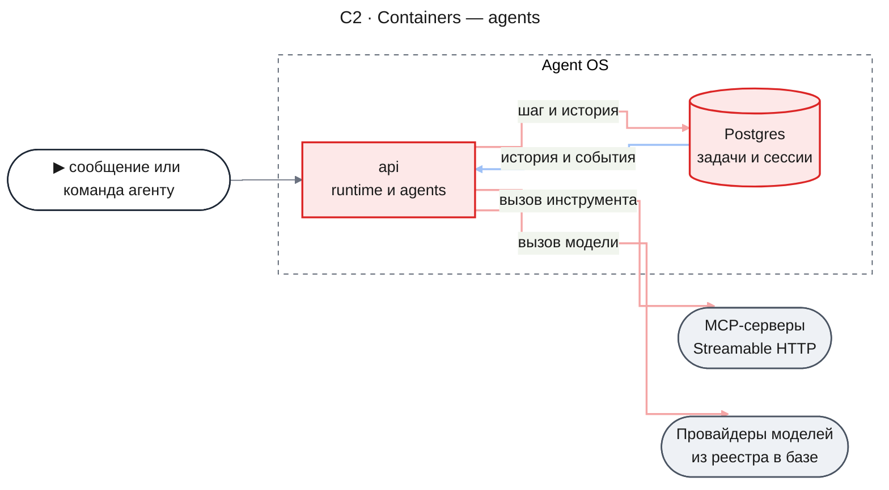

- `api` собирает `packages/agents` в `AgentsModule` и регистрирует обработчик `agent` в runtime до старта воркеров. HTTP-входов эта часть не добавляет: их даёт часть `chat`.
- `Postgres` хранит таблицы `agent_*`; схему создаёт базовая миграция пакета `db`.
- `MCP-серверы` зарегистрированы в реестре; каждый вызов открывает своё соединение ([design-mcp-connect.md](../enterprise-access/design-mcp-connect.md), KD-3). Тестовая фикстура — отдельный HTTP-процесс с изменяющим инструментом `create_incident_note`.
- Провайдеры моделей, их ключи и модели по умолчанию лежат в базе ([model-providers/design-core.md](../model-providers/design-core.md), KD-1, KD-5).

#### C3 · Components: api

**api — шаг агента**

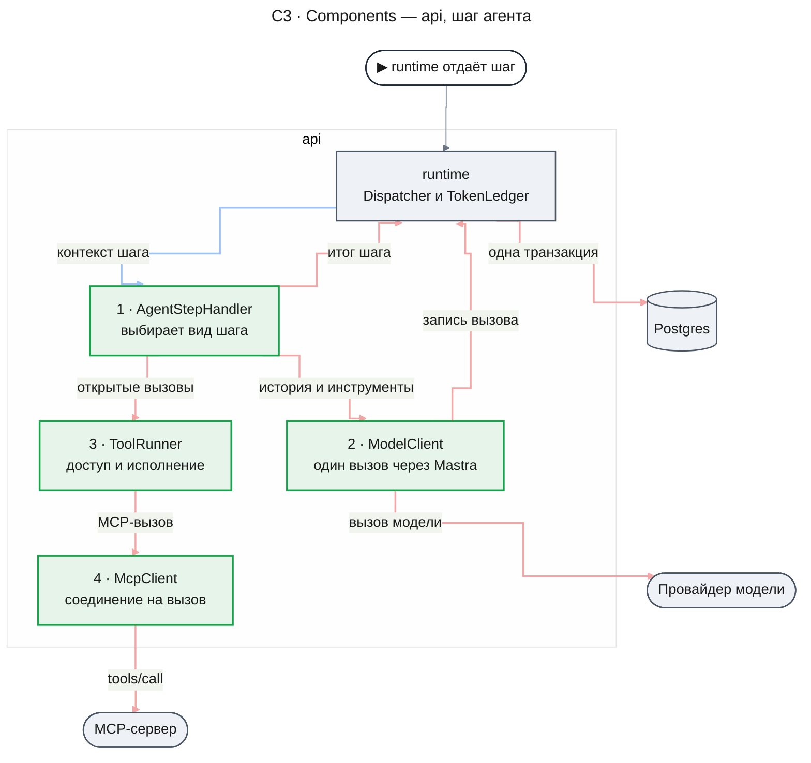

- `AgentStepHandler` читает сессию из своих таблиц и снимок из входа задачи, выбирает вид шага по правилу ниже и возвращает runtime итог с записями истории. Между шагами он ничего не держит в памяти. У запуска, который учится, шаг считает вектор вопроса и добавляет к промпту блок знаний ([self-learning/design-core.md](../self-learning/design-core.md), KD-6).
- `ModelClient` превращает историю в сообщения провайдера, оборачивает данные инструментов, детей и родителя в конверт `<data>`, спрашивает `AccessGate.model`, вызывает модель через Mastra и пишет строку журнала токенов через `ledger.record` (KD-6).
- `ToolRunner` проверяет вызов (инструмент в наборе, право на пару «сервер — инструмент» у `AccessGate`, аргументы встроенного инструмента), решает, нужно ли подтверждение, и исполняет его: MCP, `run_code`, `list_agents` и `stop_agent` — вне транзакции, `start_agent` и `message_agent` — в транзакции итога шага через `effects`.
- `McpClient` на каждый вызов открывает соединение Streamable HTTP с токеном вызова и закрывает его после ответа; список инструментов сервера лежит в реестре в базе ([design-mcp-connect.md](../enterprise-access/design-mcp-connect.md), KD-2, KD-3).

#### Как шаг выбирает работу

Шаг сначала доставляет сообщения из контекста. Сообщение `interrupt` закрывает открытые вызовы исходом «прервано» (KD-3). Затем шаг идёт по схеме.

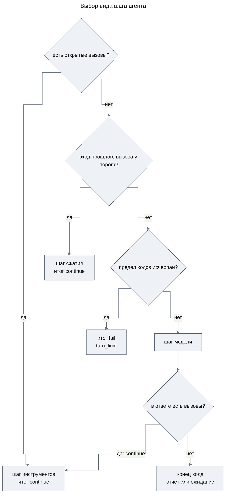

Конец хода (KD-2) выбирает итог так:

- корневая сессия — `wait`;
- у агента есть незаконченные дети или недоставленное уведомление ребёнка — `wait`, уведомление его разбудит;
- в снимке координатора задан исполнитель последнего шага (`finalExecutor`), а его отчёта со статусом `completed` ещё нет — в историю пишется уведомление кода об отказе, итог `continue`, и это считается ходом;
- иначе — `complete` с отчётом: текстом ответа или, при исполнителе последнего шага, его последним отчётом.

Шаг инструментов исполняет открытые вызовы по порядку. Если очередной вызов требует подтверждения, а решения в контексте нет, шаг фиксирует уже готовые результаты и возвращает `await_decision`; остальные вызовы ждут следующего шага.

### Runtime Flows

Во всех потоках `agents` и `runtime` — пакеты внутри `api`; Postgres пишет только runtime в транзакции итога шага или своей операции.

#### Flow 1: Один ход агента

**Starts when:** задача агента готова к шагу, а последняя запись истории — доставленное сообщение или результат инструмента; for AC-03.1, AC-12.1, AC-13.1, AC-04.1.

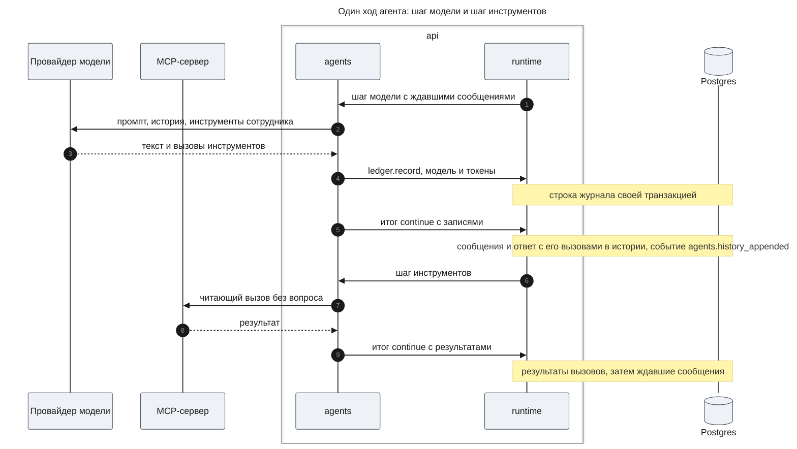

**Outcome:** в истории ответ модели и по записи результата на каждый вызов с временем, аргументами и исходом; у ответа ссылка на строку журнала токенов; модель вызова — модель сессии.

**Failure handling:**

- Инструмент вне набора, пара «сервер — инструмент» не разрешена сотруднику или аргументы встроенного инструмента не прошли схему → результат с исходом «отказ» и причиной (`tool_not_in_definition`, `no_access`, `invalid_arguments`); сервер не вызывается (AC-03.1, AC-11.3). У сервера с личным OAuth без аккаунта сотрудника вызов получает исход `auth_required` ([design-mcp-connect.md](../enterprise-access/design-mcp-connect.md), KD-5).
- MCP вернул `isError` → исход «ошибка инструмента»; пустой результат → «пустой результат»; обрыв, таймаут `MCP_CALL_TIMEOUT_MS` или ошибка протокола → «сбой связи»; агент продолжает (AC-11.2).
- Успешный результат MCP длиннее порога из настроек `agent_tool_result_settings` → модель получает обёртку с размером, `callId` и превью, а весь текст лежит в `agent_tool_results`; дочитать его модель может инструментами `read_tool_result` и `search_tool_result`. Каждый текст MCP, который получает модель, замаскирован ([план tool-result-reading](../tool-result-reading/core/20261120-feature-tool-result-reading-core.md)).
- Провайдер ответил ошибкой → два повтора; после них итог `fail` с причиной `model_error` или названной причиной провайдера `provider_*` ([model-providers/design-core.md](../model-providers/design-core.md), KD-2).
- `AccessGate` отказал в вызове модели (квота, модель не разрешена, сотрудник выключен) → модель не вызывается, итог `fail` с причиной отказа ([design-access.md](../enterprise-access/design-access.md), KD-5).
- Шаг потерян или отсечён → строка журнала остаётся, ответ модели не записан, и шаг выполняется заново (Flow 2 в `design-runtime.md`).

#### Flow 2: Запуск в фоне и отчёт родителю

**Starts when:** модель агента или беседы вызвала `start_agent`; for AC-05.1, AC-05.2, AC-05.3, AC-06.1, AC-06.2, AC-06.3, AC-10.1.

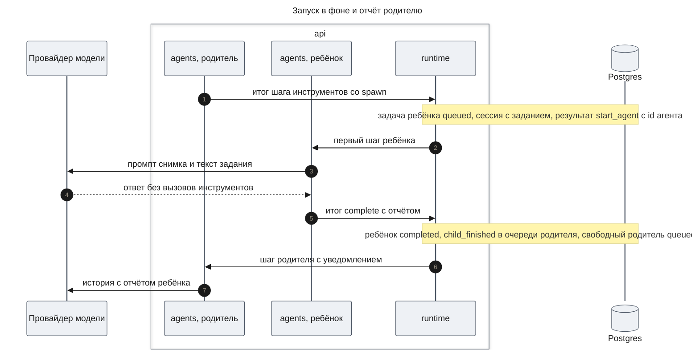

**Outcome:** родитель получил результат `start_agent` с id агента в том же шаге и продолжил работу; история ребёнка начинается с задания; в истории родителя — запись отчёта с описанием агента, статусом, причиной, числом вызовов инструментов и длительностью.

**Failure handling:**

- Запись не видна запускающему → отказ `record_unavailable`; запись вне набора запуска → `not_allowed`; исполнитель сверх своего предела → `run_limit`; задача не создаётся (AC-10.2, DC-4; [custom-agents/design-runtime.md](../custom-agents/design-runtime.md), KD-2, KD-5).
- Глубина ребёнка больше `AGENT_MAX_DEPTH` → отказ `depth_limit` (AC-10.3).
- Модель снимка не подключена или не разрешена запускающему, её провайдер не готов или модель по умолчанию не выбрана → отказ `model_not_connected`, `model_not_allowed`, `provider_*` или `model_not_configured` (DC-2; [model-providers/design-core.md](../model-providers/design-core.md), KD-2, KD-5).
- Родитель занят → уведомление ждёт в его очереди и доставляется в начале следующего шага (AC-06.2); родитель ждёт решения → уведомление доставляется после решения.
- Ребёнок упал или остановлен → уведомление runtime со статусом и причиной; агент отображает его родителю той же записью отчёта без текста (AC-06.3).
- Агент упал, а его дети ещё работают → потребитель событий `agents` на `task.failed` агента вызывает для каждого незаконченного ребёнка тот же `tasks.stop`, что в Flow 7, и поддерево останавливается.

#### Flow 3: Сообщение занятому агенту

**Starts when:** сотрудник или родитель пишет агенту, пока тот исполняет инструмент; for AC-07.1, AC-07.2, AC-01.3.

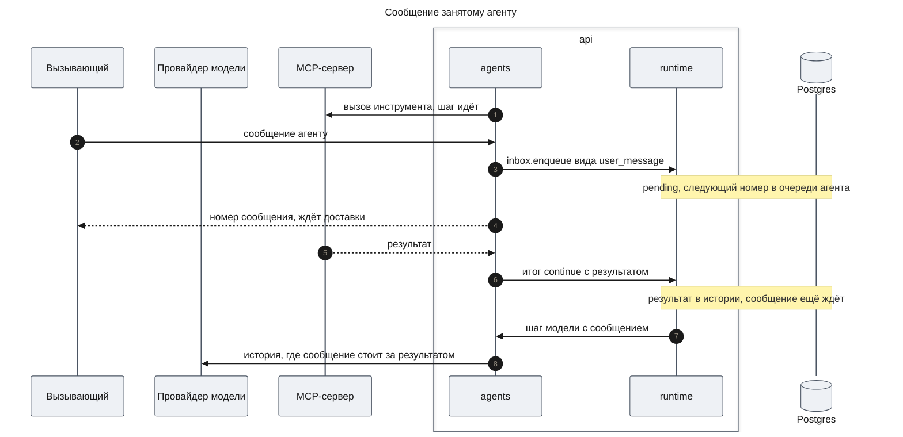

**Outcome:** в истории результат инструмента, сразу за ним сообщение, затем следующий ответ модели; несколько сообщений встают по порядку номеров. Ответ без вызовов (AC-07.3) — тот же путь: сообщение будит ждущую беседу или доставляется в начале следующего шага.

**Failure handling:**

- Агент ждёт подтверждения → сообщение ждёт до решения; модель видит его после последнего результата ответа (KD-1).
- Шаг потерян → сообщение не отмечено доставленным и придёт в повторном шаге один раз (runtime, Invariant 4).

#### Flow 4: Прерывание

**Starts when:** сотрудник прерывает агента; for AC-08.1, AC-08.2, NFR-01.

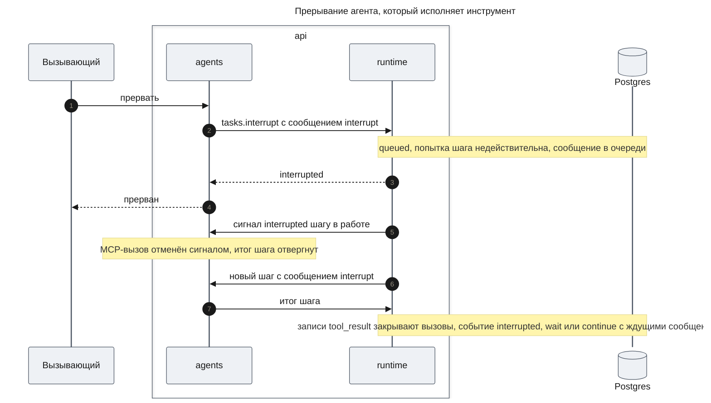

**Outcome:** статус «Прерван» виден сразу после команды. При пустой очереди после шага у сессии отметка «прерван», и задача ждёт сообщений. Если в очереди уже ждали сообщения, шаг берёт их вместе с `interrupt`: они стоят в истории после закрытых вызовов, и вызов модели идёт тем же шагом (AC-08.1). Новое сообщение во время работы агента идёт обычным `send` (Flow 3).

**Failure handling:**

- Агент закончен, ждёт подтверждения или свободен и ждёт сообщений → `not_active`, ничего не меняется; подтверждение решают кнопки запроса.
- Отсечённый шаг успел записать намерение изменяющего вызова → при закрытии такой вызов получает исход «исход неизвестен», а не «прервано».
- Отсечённый шаг модели успел зафиксироваться раньше прерывания → его новые вызовы открыты, и шаг с `interrupt` закрывает их исходом «прервано».

#### Flow 5: Изменяющее MCP-действие с подтверждением

**Starts when:** шаг инструментов дошёл до вызова инструмента с подтверждением; for AC-12.2, AC-12.3, AC-12.4, AC-12.5, AC-01.2, NFR-07.

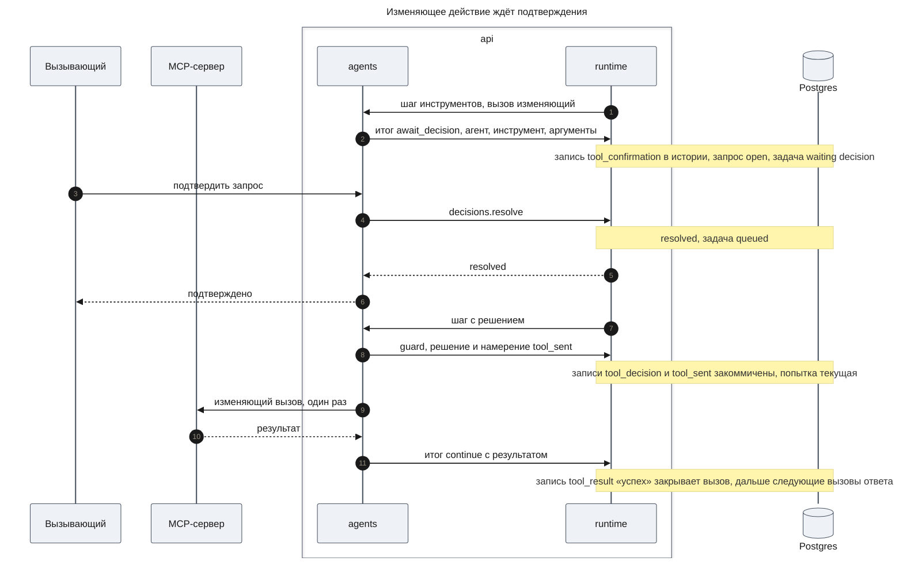

**Outcome:** до подтверждения MCP-сервер не получил ни одного вызова; после подтверждения он получил ровно один; агент продолжает. Беседа видит запрос агента любой глубины через `confirmations` (AC-17.3 части `chat`).

**Failure handling:**

- Сотрудник отклонил → вызов закрыт исходом «отклонено пользователем», сервер не вызывается, шаг идёт к следующему вызову (AC-12.4).
- Рестарт, пока запрос открыт → запрос и вызов ждут, подтвердить можно как раньше (AC-12.5).
- Шаг потерян после намерения → повторный шаг видит признак потери и намерение без результата и закрывает вызов исходом «исход неизвестен» без повтора (AC-01.2).
- `guard` ответил `fenced` (агента прервали или остановили) → вызов не отправляется.
- Право на пару «сервер — инструмент» отняли, пока запрос ждал → перед отправкой `AccessGate` отвечает отказом, и вызов закрыт исходом «отказ» с причиной `no_access` ([design-access.md](../enterprise-access/design-access.md), KD-1).
- Агента остановили, пока запрос открыт → runtime отменяет запрос, вызов закрыт исходом «прервано» (Flow 7).
- Повторное решение → `already_resolved`.

#### Flow 6: Продолжение законченного агента

**Starts when:** сотрудник или родитель пишет агенту в статусе «Завершён», «Сбой» или «Остановлен»; for AC-09.1, DC-1.

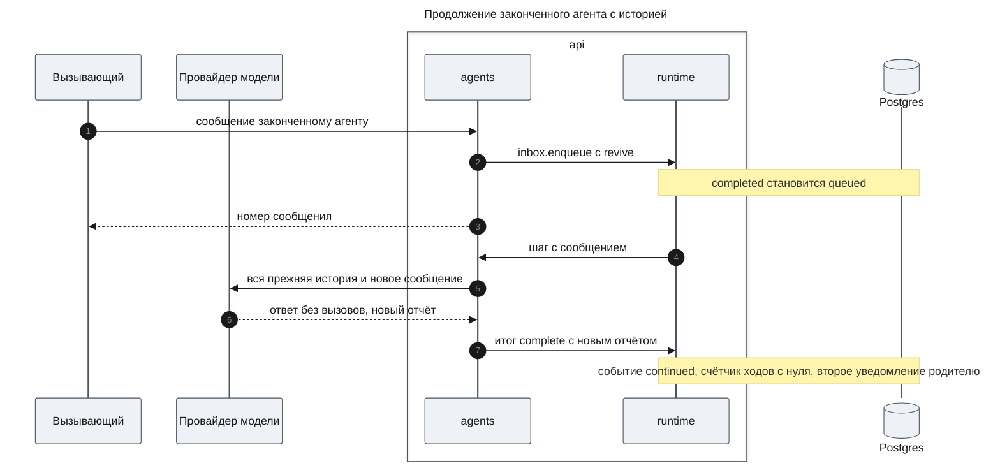

**Outcome:** тот же id и та же сессия; история продолжается после прежнего отчёта; родитель получает второй отчёт.

**Failure handling:**

- Сообщение с `revive` пришло, пока агент делал последний шаг → по контракту runtime итог `complete` или `fail` всё равно заканчивает задачу: конечный статус, одно уведомление родителю. Затем задача возвращается в `queued` с этим сообщением, с тем же id и историей ([design-runtime.md](./design-runtime.md#contract-definitions)).

#### Flow 7: Остановка с потомками

**Starts when:** сотрудник или родитель останавливает агента; for AC-08.3, AC-08.4, AC-06.3.

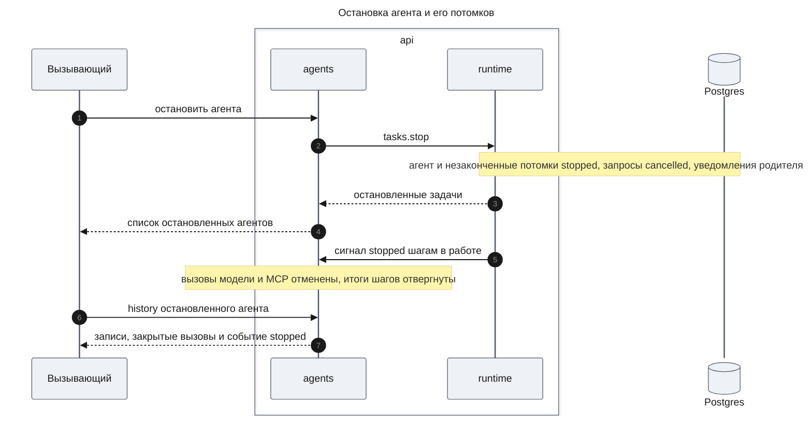

**Outcome:** агент и все его незаконченные потомки остановлены одной командой runtime; новых вызовов модели и инструментов у них нет; родитель каждого получил уведомление со статусом. `agents` в этой операции ничего не пишет. Для остановленного агента `history` добавляет к сохранённым записям его открытые вызовы как закрытые и событие `stopped` — `stopped_with_parent`, если родителя остановила та же команда (у них одно время конца). Первый шаг после продолжения записывает эти записи в историю по-настоящему, с событием `agents.history_appended`.

**Failure handling:**

- Вызов был в `sending`, когда агента остановили → он показан и записан с исходом «исход неизвестен», а не «прервано»: действие могло дойти до сервера.
- Агент ждал подтверждения → runtime отменил запрос, вызов закрыт исходом «прервано».
- Агент уже закончен → пустой список, ничего не меняется.

### Contract Definitions

Все операции принимают владельца (`ownerId`). Агент чужого владельца отвечает так же, как несуществующий: `AGENT_NOT_FOUND`. Владельца проверяет runtime в каждой операции, которую `agents` вызывает первой.

**Сборка**

- **`createAgents(options)`** — собирает пакет из базы, `Runtime`, логгера `common`, разобранных настроек `AgentsConfig`, шва модели, порта `AccessGate` с хуком аудита и порта библиотеки `RecordLibrary`. Сразу регистрирует в runtime обработчики задач `agent`, `knowledge.extract` и `knowledge.embed` и потребителей событий. Возвращает `Agents`: `tools`, операции `sessions` ниже, `start()` и `stop()`, а также входы более поздних фич — `resolveStart`, `auditStartRefusal` и `rootMayStart` ([custom-agents/design-runtime.md](../custom-agents/design-runtime.md#contract-definitions)), `mcp` ([design-mcp-connect.md](../enterprise-access/design-mcp-connect.md#contract-definitions)), `providers`, `embeddings` и `completeText` ([model-providers/design-core.md](../model-providers/design-core.md#contract-definitions)), `knowledge` ([self-learning/design-core.md](../self-learning/design-core.md#contract-definitions)), `toolResults` ([план tool-result-reading](../tool-result-reading/core/20261120-feature-tool-result-reading-core.md)).
- **`parseAgentsConfig(variables)`** — проверяет переменные из `Runtime settings`; неверное значение останавливает старт с именем переменной.
- **`start()`** — закрывает регистрацию инструментов. Записи и их модели проверяет каждый старт, MCP-соединений `start()` не открывает. Вызывается до старта воркеров runtime.
- **`stop()`** — только пишет лог: соединение MCP живёт один вызов, закрывать нечего.

**Определения агентов**

Заменено: каталог определений, `definitions.register` и `AgentDefinition` удалены. Запуск берёт запись библиотеки на имя запускающего и работает на её снимке; поля записи агента — `AgentContent` ([custom-agents/design-runtime.md](../custom-agents/design-runtime.md), KD-1, KD-2; [ADR-0017](../../adr/ADR-0017-run-snapshots-from-library.md)). `general-purpose` и главный чат — встроенные записи библиотеки (там же, KD-7).

**Инструменты (`tools`)**

- **`register(tool)`** — добавляет инструмент верхней части до `start()`. Инструмент задаёт `name`, `description`, zod-схему аргументов и один из двух способов исполнения. Внутри транзакции итога шага он получает транзакцию, `effects` и помощник запуска дочернего агента и внешних вызовов не делает; запросы, которые нельзя делать при открытой транзакции, он делает в необязательном `prepare` до неё. Помощник берёт снимок, задание, описание и ссылку ответвления, а владельца и родителя — от вызывающего агента, и возвращает `agentId` ([custom-agents/design-runtime.md](../custom-agents/design-runtime.md#contract-definitions)). Вне транзакции инструмент может звать внешнюю систему и получает сигнал отмены и `guard` шага. По желанию инструмент объявляет подтверждение: вид запроса, содержимое для сотрудника, признак, можно ли править аргументы, и условие, нужно ли подтверждение этому вызову. Признак `rootOnly` даёт инструмент только корню, `everySession` — каждой сессии.
- Встроенные инструменты пакета, имена для модели:
  - `start_agent` — аргументы `description` (несколько слов для списка и карточки), `agent`, `prompt`; `agent` — номер записи, `fork` или у координатора имя исполнителя ([custom-agents/design-runtime.md](../custom-agents/design-runtime.md#contract-definitions)). Запускает ребёнка в транзакции итога и возвращает `agentId` сразу. С `fork` ребёнок получает снимок вызывающего и ссылку на его историю до текущего ответа (KD-7).
  - `message_agent` — `agentId`, `message`: кладёт сообщение потомку с `revive`, поэтому законченный потомок продолжает работу.
  - `list_agents` — потомки вызывающего: id, описание, имя запуска, модель, статус.
  - `stop_agent` — `agentId`: останавливает потомка и его потомков.
  - `read_tool_result` и `search_tool_result` есть в каждой сессии: страница и поиск по большому результату MCP своей сессии и своего владельца ([план tool-result-reading](../tool-result-reading/core/20261120-feature-tool-result-reading-core.md)).
  - `run_code` есть в каждой сессии ([design-code-execution.md](../code-execution/design-code-execution.md), KD-3).
  - Цель `message_agent` и `stop_agent` — только потомок вызывающего; иначе отказ `unknown_agent`.
- Только корень получает инструменты `start_workflow` и `draft_record` ([custom-agents/design-runtime.md](../custom-agents/design-runtime.md), KD-6).
- MCP-инструмент виден модели под именем `mcp__<server>__<tool>`, с описанием и схемой сервера. В набор попадают инструменты включённых серверов снимка, чью пару «сервер — инструмент» `AccessGate` разрешает владельцу; у сервера с личным OAuth — только при аккаунте владельца ([design-mcp-connect.md](../enterprise-access/design-mcp-connect.md), KD-2).

**Операции агентов** (`Agents.sessions`)

- **`start({ agentId?, ownerId, prompt, description, record? })`** — создаёт корень беседы из встроенной записи `chat`: задачу и сессию одной транзакцией. Детей создаёт только помощник запуска в транзакции итога шага. Возвращает `agentId`. Ошибки: `START_REFUSED` с причиной и моделью ([custom-agents/design-runtime.md](../custom-agents/design-runtime.md#contract-definitions)), `TASK_EXISTS` runtime для занятого `agentId`.
- **`send({ agentId, ownerId, text, record? })`** — сообщение сотрудника, вид `user_message`, с `revive`; `record` — чип сообщения. Возвращает `messageId`. Ошибки: `AGENT_NOT_FOUND`, `PAYLOAD_TOO_LARGE`.
- **`interrupt({ agentId, ownerId })`** — прерывание по KD-3. Возвращает `interrupted` или `not_active`; свободный агент, который ждёт сообщений, тоже `not_active`.
- **`stop({ agentId, ownerId })`** — `tasks.stop` и ничего больше. Возвращает список остановленных `agentId`, пустой для законченного агента. Закрытые вызовы и событие остановки показывает `history` (Flow 7).
- **`restart({ agentId, ownerId })`** — запуск с нуля законченного агента: новый агент с тем же заданием и родителем на снимке, который заново строит процедура старта (AC-09.2; [custom-agents/design-runtime.md](../custom-agents/design-runtime.md), KD-2). Возвращает новый `agentId`. Ошибки: `AGENT_NOT_FOUND`, `NOT_FINISHED`, `START_REFUSED`, `PARENT_FINISHED`.
- **`get(agentId, ownerId)`** — `AgentView`.
- **`list(rootId, ownerId)`** — все агенты дерева как `AgentView` в порядке создания; корень дерева тоже в списке.
- **`history({ agentId, ownerId, afterSeq?, limit })`** — записи истории с номером больше `afterSeq` по порядку, не больше `limit` (до 500); у остановленного агента — с выведенными записями остановки (Flow 7).
- **`confirmations(rootId, ownerId)`** — запросы подтверждения дерева в любом статусе: `decisionId`, `agentId`, описание агента, вид запроса, инструмент, сервер, аргументы, содержимое карточки, статус, решение, время. Строится из `decisions.listTree` ([design-chat.md](./design-chat.md), KD-1).
- **`resolveConfirmation({ decisionId, ownerId, approve, args? })`** — решение сотрудника. `args` принимаются, только если инструмент разрешает правку. Возвращает `resolved` или `already_resolved`; ошибки `DECISION_NOT_FOUND`, `INVALID_ARGUMENTS`.
- `snapshot` и операции корневой сессии `root`, `rootOwner`, `roots`, `touchRoot`, `renameRoot`, `titleRootIfEmpty` описаны в [custom-agents/design-runtime.md](../custom-agents/design-runtime.md#contract-definitions) и [design-chat.md](./design-chat.md) (KD-1).

**Ограничения вызывающего**

Заменено: `SessionLimits` и `limits` у `start` удалены. Команда workflow, предел вызовов каждого исполнителя (`run_limit`) и исполнитель последнего шага `finalExecutor` лежат в снимке координатора ([custom-agents/design-runtime.md](../custom-agents/design-runtime.md), KD-5). Ответвление у координатора получает `not_allowed`.

**AgentView**

- `agentId`, `parentId`, `rootId`, `depth`, `description`, `model`, `createdAt`, `finishedAt`.
- `name`, `origin` и `firstRun` — имя запуска из снимка, запись, с которой он стартовал, и признак первого запуска этой записи ([custom-agents/design-runtime.md](../custom-agents/design-runtime.md#contract-definitions)).
- `status` — `working`, `awaiting_confirmation`, `interrupted`, `completed`, `failed`, `stopped` (метки MC-3, отображение — в State Transitions).
- `failureReason` — при `failed`: значение `AgentFailureReasonSchema` (`turn_limit`, `model_error`, причины провайдера `provider_*` и отказы `AccessGate`) или причина runtime (`handler_error`, `step_timeout`, `recovery_exhausted`, `invalid_step_result`).
- `forkedFrom` — при ответвлении: `agentId` родителя и `throughSeq`; историю до этого номера читают у родителя.

**HistoryEntry** — запись истории: `seq`, `kind`, `createdAt` и содержимое вида.

- `task` — текст задания; первая собственная запись.
- `user_message` — текст сотрудника; `agent_message` — текст и `agentId` родителя. У `task` корня и у `user_message` есть чип записи `record` ([custom-agents/design-runtime.md](../custom-agents/design-runtime.md#contract-definitions)).
- `child_report` — `agentId`, описание, статус, причина, текст отчёта или его нет, число вызовов инструментов, длительность.
- `model_answer` — текст и вызовы инструментов этого ответа.
- `tool_result` — результат одного вызова: `callId`, инструмент, сервер, аргументы, исход, причина отказа, модель отказа `refusalDetail`, текст результата, время начала и конца; у `run_code` ещё вывод скрипта ([design-code-execution.md](../code-execution/design-code-execution.md#contract-definitions)).
- `notice` — сообщение кода модели, например отказ закончить без отчёта исполнителя последнего шага.
- `event` — `interrupted`, `stopped`, `stopped_with_parent`, `continued`, `failed` с причиной, `compacted`.
- `compaction` — сводка и номер последней записи, которую она заменяет для модели.

Исходы вызова (`ToolOutcome`): `success`, `empty`, `tool_error`, `transport_failure`, `refused`, `rejected`, `interrupted`, `unknown`, `auth_required` (у сервера с личным OAuth нет аккаунта сотрудника или токен отвергнут — [design-mcp-connect.md](../enterprise-access/design-mcp-connect.md), KD-5). Каждый вызов в `model_answer` несёт состояние: открытый — `requested`, `awaiting_confirmation` или `sending`, закрытый — `done`. `history` выводит состояние из записей вызова, а сами записи `tool_confirmation`, `tool_decision`, `tool_sent` и `run_attempt` в страницы не попадают.

**Сообщения и события**

- Виды сообщений очереди: `user_message` (сотрудник), `agent_message` (родитель), `interrupt` (прерывание, без данных) и `child_finished` runtime. В историю они встают с тегом источника; данные родителя и детей модель видит в конверте `<data>`.
- Вид запроса решения: `agents.tool_confirmation`; вид запроса инструмента верхней части задаёт сама часть.
- Событие `agents.history_appended` с `agentId` и номером последней записи пишется в каждой транзакции, которая дописала историю ([transactional-outbox.md](../../code-system/patterns/transactional-outbox.md)). Статусы приходят событиями `task.*` runtime.

**Error handling**

- `AGENT_NOT_FOUND` — агента нет или он чужой.
- `START_REFUSED` — процедура старта отказала записи; причина и модель — в [custom-agents/design-runtime.md](../custom-agents/design-runtime.md#contract-definitions). Выключенный владелец даёт `OwnerDisabledError`.
- `DEPTH_LIMIT` — помощник запуска получил ребёнка глубже `AGENT_MAX_DEPTH`; `start_agent` отказывает раньше причиной `depth_limit`.
- `not_active` — прерывание законченного агента, агента, который ждёт подтверждения, или свободного агента, который ждёт сообщений.
- `NOT_FINISHED` — запуск с нуля работающего агента.
- `INVALID_ARGUMENTS` — правка аргументов, которую инструмент не разрешает или которая не прошла его схему.
- `PARENT_FINISHED`, `PAYLOAD_TOO_LARGE`, `DECISION_NOT_FOUND`, `TASK_EXISTS` — из runtime без изменений.
- Причины отказа в результате вызова — `ToolRefusalReasonSchema`. Этой части принадлежат `tool_not_in_definition`, `no_access`, `not_allowed`, `depth_limit`, `unknown_agent`, `invalid_arguments`. Остальные добавили более поздние фичи: `record_unavailable`, `run_limit`, `read_only`, `shared` и отказы старта по модели и провайдеру — [custom-agents/design-runtime.md](../custom-agents/design-runtime.md#contract-definitions) и [model-providers/design-core.md](../model-providers/design-core.md); `not_callable_from_code`, `changing_in_read_run`, `not_in_confirmed_script` — [design-code-execution.md](../code-execution/design-code-execution.md).

**Runtime settings**

Переменные читает `apps/api` и передаёт в `parseAgentsConfig`. Провайдеры моделей, их ключи и модели по умолчанию, реестр MCP-серверов и права живут в базе и в панели администратора, а не в окружении ([model-providers/design-core.md](../model-providers/design-core.md), KD-1, KD-5; [design-mcp-connect.md](../enterprise-access/design-mcp-connect.md), KD-1; [design-access.md](../enterprise-access/design-access.md), KD-1). Пороги больших результатов инструментов — строка `agent_tool_result_settings` ([план tool-result-reading](../tool-result-reading/core/20261120-feature-tool-result-reading-core.md)).

- `AGENT_MAX_OUTPUT_TOKENS` — default `16000`; предел ответа модели.
- `AGENT_MAX_DEPTH` — default `3`; наибольшая глубина агента, у беседы 0.
- `AGENT_COMPACT_AT_TOKENS` — default `200000`; порог сжатия по входным токенам прошлого вызова.
- `MCP_CALL_TIMEOUT_MS` — default `60000`; предел одного MCP-вызова вместе с рукопожатием.
- `NODE_ENV` — всё, кроме `production`, разрешает адреса `http` у MCP-серверов и серверов авторизации ([design-mcp-connect.md](../enterprise-access/design-mcp-connect.md)).
- `CODE_RUN_TIMEOUT_MS`, `CODE_RUN_MEMORY_MB`, `CODE_RUN_MAX_TOOL_CALLS`, `CODE_RUN_MAX_CONCURRENT`, `CODE_RUN_MAX_CONCURRENT_PER_USER` — пределы `run_code` ([design-code-execution.md](../code-execution/design-code-execution.md)).

### Data Model

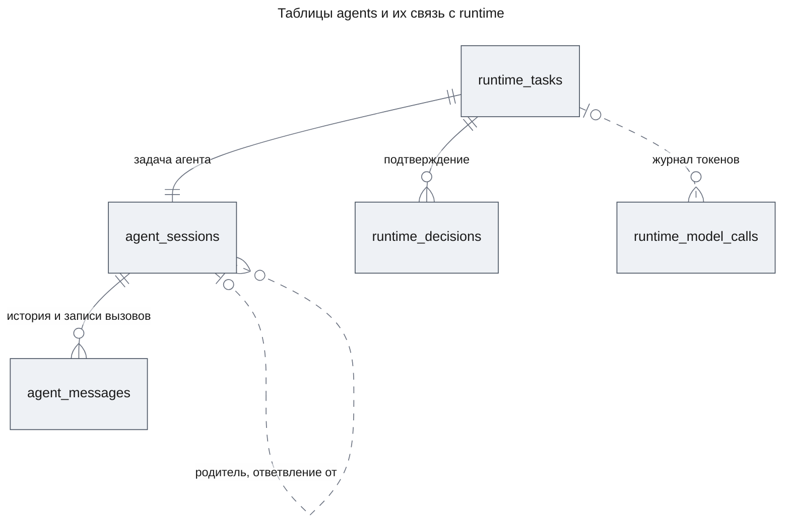

- `agent_sessions` — одна строка на агента; ключ — id задачи runtime, внешний ключ с каскадом, поэтому `deleteTree` удаляет и сессии. Здесь имя и происхождение запуска ([custom-agents/design-runtime.md](../custom-agents/design-runtime.md), KD-3), описание, задание, модель, ссылка ответвления, счётчик ходов и отметка «прерван». Родителя, корень и владельца строка копирует из задачи runtime без внешнего ключа, чтобы цепочку читать из этой таблицы; глубину и статус хранит только runtime. Корень — сессия без родителя: беседа и есть корневая сессия, и только у неё есть заголовок и время последнего изменения.
- `agent_messages` — история: номер растёт в пределах сессии, записи только дописываются, ни одна не меняется. У `model_answer` ссылка на строку журнала токенов без внешнего ключа и вызовы ответа — `callId`, инструмент, сервер, аргументы; место в списке — позиция вызова.
- Записи вызова в той же истории говорят, что стало с вызовом: `tool_confirmation` — вызов поставлен перед сотрудником; `tool_decision` — решение и правленые аргументы; `tool_sent` — намерение; `run_attempt` — попытка читающего прогона `run_code`, не больше двух; `tool_result` — закрывающий результат, у `start_agent` с id задачи ребёнка. Каждого вида, кроме `run_attempt`, у вызова не больше одной записи: это держит частичный уникальный индекс `agent_messages_call_once_idx`. Правленые аргументы модель видит как свой вызов.
- `callId` записи вызова и время конца `tool_result` лежат в своих столбцах, поэтому вызовы читают из истории запросом, не разбирая содержимое записей: так считают число вызовов в отчёте ребёнка и строят страницы `history`. Шаг читает историю один раз, начиная со сводки последнего сжатия. Записи вызова — аудит вызова; сотрудник — владелец задачи.
- Снимок записи лежит только во входе задачи runtime; сессия хранит имя запуска и его происхождение ([custom-agents/design-runtime.md](../custom-agents/design-runtime.md), KD-3). Запросы подтверждения хранит runtime (`runtime_decisions`).
- Остальные таблицы `agent_*` принадлежат более поздним фичам: `agent_tool_results` и `agent_code_calls` — [design-code-execution.md](../code-execution/design-code-execution.md) (KD-5, KD-6), `agent_tool_result_settings` — [план tool-result-reading](../tool-result-reading/core/20261120-feature-tool-result-reading-core.md), `agent_mcp_servers` и `agent_mcp_accounts` — [design-mcp-connect.md](../enterprise-access/design-mcp-connect.md) (KD-1), `agent_model_providers` — [model-providers/design-core.md](../model-providers/design-core.md) (KD-1), `agent_knowledge_*` — [self-learning/design-core.md](../self-learning/design-core.md) (KD-1).

Корень создаёт операция `start`: задачу и сессию одной транзакцией. Ребёнка создаёт транзакция итога родителя вместе со `spawn`. Запуск с нуля дочернего агента создаёт задачу, а затем сессию своей транзакцией; если процесс умер между ними, первый шаг агента создаёт строку из снимка во входе задачи.

### State Transitions and Invariants

Статус агента для сотрудника выводится из статуса задачи runtime и отметки сессии:

| Статус задачи runtime | Статус агента | Метка MC-3 |
|---|---|---|
| `queued`, `running`, `waiting` с причиной `messages` — без признаков ниже | `working` | «Работает» |
| `waiting` с причиной `decision` | `awaiting_confirmation` | «Ждёт подтверждения» |
| `queued` или `running` с ждущим сообщением `interrupt`; `waiting` с отметкой «прерван» | `interrupted` | «Прерван» |
| `completed` | `completed` | «Завершён» |
| `failed` | `failed` | «Сбой» |
| `stopped` | `stopped` | «Остановлен» |

Вызов инструмента проходит состояния. Состояние нигде не хранится: чистая функция `foldCalls` выводит его из записей вызова, и каждый переход — новая запись в истории, а не правка строки.

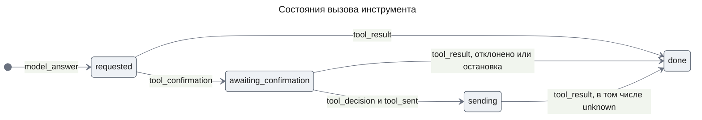

**Invariants**

1. У каждого закрытого вызова ровно одна запись `tool_result`: вторую не пустит уникальный индекс по вызову и виду записи (Data Model). До неё в истории нет ответа модели новее этого вызова.
2. Инструмент с подтверждением не вызывается без записей `tool_decision` «подтверждено» и `tool_sent`, закоммиченных до отправки; вызов с `tool_sent` и без результата после потери шага не повторяется.
3. Доставленное сообщение стоит в истории после всех результатов, записанных тем же шагом, а в сообщениях провайдера — после последнего результата своего ответа и до следующего ответа модели.
4. Дочерний агент не завершается, пока у него есть незаконченные дети.
5. История только дописывается; ответвление и сжатие не меняют записей родителя и прежних записей.
6. Модель всех вызовов одной сессии — модель, выбранная при запуске.

## Test Strategy

Тесты пишутся с задачами и запускаются один раз в конце части. Модель подменяется на границе `ModelClient` сценарием ответов; MCP — настоящий процесс фикстуры, а её журнал вызовов показывает, что дошло до сервера. Ревью тестов — для рестартов, прерывания и подтверждений.

### Main Use Cases

- **UC-1: Фоновые агенты и их отчёты** — covers AC-05.1, AC-05.2, AC-05.3, AC-06.1, AC-06.2, AC-10.1, AC-02.1, DC-3
  - Given: корневая сессия, чей сценарий запускает двух агентов `general-purpose`; первый ребёнок отвечает отчётом после одного читающего вызова, второй запускает внука, отвечает текстом, пока внук работает, и отчитывается после отчёта внука.
  - When: воркеры работают, а корень в это время исполняет медленный вызов.
  - Then: результаты `start_agent` записаны в одном шаге с двумя `agentId`; дети работали одновременно; история каждого начинается с задания без записей родителя; второй ребёнок после первого текста остался `working` и завершился только после отчёта внука, который получил он, а не корень; отчёт, пришедший во время медленного вызова, доставлен корню на следующем шаге; свободный корень проснулся сам, и его вызов модели видит оба отчёта; на каждый вызов модели одна строка журнала с задачей сессии и моделью.
- **UC-2: Сообщения занятому агенту** — covers AC-07.1, AC-07.2, AC-07.3, NFR-04
  - Given: агент исполняет вызов, который фикстура задерживает; отдельно — корень, который ответил текстом и ждёт.
  - When: агенту отправляют два сообщения, корню — одно.
  - Then: у агента — результат, затем оба сообщения по порядку, затем ответ модели, чей вход их содержит; корень проснулся и начал ход с сообщения.
- **UC-3: Изменяющее действие** — covers AC-12.1, AC-12.2, AC-12.3, AC-12.4, AC-12.5, NFR-07
  - Given: агент, сценарий которого вызывает `create_incident_note`, затем читающий инструмент; варианты строками: подтвердить, отклонить, перезапустить сервер до решения и подтвердить.
  - When: шаги идут до запроса, затем выполняется вариант.
  - Then: читающий вызов прошёл без запроса; до решения в журнале фикстуры нет вызова `create_incident_note`; запрос содержит агента, инструмент и аргументы; подтверждение — один вызов и исход «успех»; отклонение — ноль вызовов и исход «отклонено»; после рестарта запрос открыт и подтверждается.
- **UC-4: Продолжение и запуск с нуля** — covers AC-09.1, AC-09.2, DC-1
  - Given: агент, который упал по пределу ходов, и агент, который завершился.
  - When: первому пишут сообщение, второго запускают с нуля.
  - Then: первый работает в той же сессии с полным пределом ходов и сдаёт отчёт, родитель получил второе уведомление; второй — новый `agentId` с той же записью, заданием и родителем, история с задания, прежний в списке.
- **UC-5: Команда координатора** — covers DC-4
  - Given: координатор, в команде которого `planner` до одного вызова и `answer` — исполнитель последнего шага.
  - When: сценарий запускает `planner` дважды, `gatherer` один раз, затем отвечает текстом, затем запускает `answer` и после его отчёта отвечает текстом.
  - Then: второй `planner` — отказ `run_limit`, `gatherer` — `not_allowed`; первый текст — уведомление об отказе и новый ход; отчёт сессии родителю — отчёт `answer`.

### Error and Edge Use Cases

- **UC-E1: Прерывание** — covers AC-08.1, AC-08.2, NFR-01
  - Given: агент ждёт долгого читающего вызова; строки: в очереди ждёт сообщение, отправленное `send`, и очередь пуста.
  - When: агента прерывают.
  - Then: `get` показывает `interrupted` не позже чем через 5 с после команды; открытый вызов — «прервано»; ждавшее сообщение стоит за ним и следующий вызов модели его видит; при пустой очереди новых вызовов модели нет до сообщения.
- **UC-E2: Остановка с потомками** — covers AC-08.3, AC-08.4, AC-06.3
  - Given: агент с ребёнком и внуком, у ребёнка открыт запрос подтверждения.
  - When: агента останавливают.
  - Then: все трое `stopped`, вызов ребёнка «прервано», в `history` у агента событие `stopped`, у ребёнка и внука — `stopped_with_parent`; после этого сценарий модели не получил вызовов; родитель агента получил уведомление со статусом `stopped`.
- **UC-E3: Предел ходов** — covers AC-03.2
  - Given: запись агента с `maxTurns` 2, сценарий всегда просит инструмент.
  - When: агент работает.
  - Then: два вызова модели, агент `failed` с `turn_limit`, родитель получил уведомление с причиной.
- **UC-E4: Отказы до сервера** — covers AC-03.1, AC-10.2, AC-10.3, AC-11.3, DC-6
  - Given: правило проверки вызова; строки: инструмент вне набора, `start_agent` без инструмента в записи, глубина больше предела, пара «сервер — инструмент» не разрешена, пара разрешена.
  - When: проверяют вызов.
  - Then: причины `tool_not_in_definition`, `tool_not_in_definition`, `depth_limit`, `no_access` и «разрешено»; одна строка интеграционно: вызов неразрешённой пары даёт отказ в истории, а журнал фикстуры пуст.
- **UC-E5: Доступ к серверам и сервер недоступен** — covers AC-11.1, AC-11.2
  - Given: права дают сотруднику А инструменты сервера `logs`, сотруднику Б — ничего; сервер `logs` недоступен в момент вызова.
  - When: сценарии обоих просят инструмент `logs`.
  - Then: модель А видит инструменты `logs`, модель Б — нет; вызов А — «сбой связи», агент продолжает.
- **UC-E6: Рестарт посреди шага инструментов** — covers AC-01.1, AC-01.2, AC-01.3, DC-5, NFR-04
  - Given: агент с открытыми читающим вызовом и подтверждённым изменяющим с записанным намерением и ждущим сообщением, процесс убит в шаге.
  - When: второй экземпляр продолжает.
  - Then: читающий вызов исполнен ровно один раз и записан один раз; сообщение в истории один раз; изменяющий — «исход неизвестен», в журнале фикстуры не больше одного его вызова; агент сдал отчёт.
- **UC-E7: Чужой агент** — covers AC-13.3, NFR-06
  - Given: агент сотрудника А.
  - When: от имени Б вызывают `get`, `history`, `send`, `interrupt`, `stop`, `restart`, `resolveConfirmation`.
  - Then: каждый ответ `AGENT_NOT_FOUND` или `DECISION_NOT_FOUND`, ничего не изменилось.
- **UC-E8: Выбор модели** — covers AC-04.1, AC-04.2, AC-04.3, AC-13.2, DC-2
  - Given: процедура старта; строки: запись с моделью, запись без модели, запись с моделью, которую сотруднику не разрешили.
  - When: агента запускают.
  - Then: модель записи, модель чата по умолчанию и отказ `model_not_allowed` до создания агента; `get` показывает модель снимка без токенов и стоимости. Остальные отказы старта проверяют тесты [custom-agents/design-runtime.md](../custom-agents/design-runtime.md) и [model-providers/design-core.md](../model-providers/design-core.md).
- **UC-E9: История вызова** — covers AC-13.1
  - Given: агент сделал читающий вызов, вызов с ошибкой инструмента и вызов, которому отказано.
  - When: читают историю.
  - Then: у каждого вызова время, инструмент, аргументы и исход `success`, `tool_error`, `refused`; на каждый вызов одна запись `tool_result`.
- **UC-E10: Ответвление** — covers AC-25.1
  - Given: корень с историей из трёх реплик.
  - When: сценарий корня вызывает `start_agent` с `fork`.
  - Then: первый вызов модели ответвления содержит реплики корня до этого вызова и задание; история корня не изменилась.
- **UC-E11: Сжатие** — covers AC-27.1
  - Given: сценарий отчитывается о входных токенах выше `AGENT_COMPACT_AT_TOKENS`.
  - When: агент делает следующий ход.
  - Then: в истории запись сводки и событие `compacted`; следующий вызов модели получает сводку вместо старых записей; `history` по-прежнему отдаёт все записи.

## Security Considerations

- **Authentication & Authorization**: часть не принимает внешних запросов; владельца передаёт `apps/api`. Каждая операция начинается с операции runtime, которая проверяет владельца. Инструменты и модели сотрудника фильтрует и проверяет порт `AccessGate` и при сборке набора, и перед каждым вызовом ([design-access.md](../enterprise-access/design-access.md), KD-1, KD-4); агенты наследуют владельца дерева. Встроенные инструменты действуют только на потомков вызывающего.
- **Input Validation**: аргументы встроенных инструментов проверяет zod, аргументы MCP — сервер. Ответ модели, результаты инструментов, отчёты детей и сообщения родителя модель видит в конверте `<data>` с экранированием разделителей. Изменяющее действие исполняется только после решения сотрудника (Invariant 2).
- **Sensitive Data Handling**: ключи провайдеров логгер узнаёт из общей памяти секретов процесса и маскирует ([model-providers/design-core.md](../model-providers/design-core.md), KD-7); токен MCP читается перед вызовом и уходит только на сервер этого вызова ([design-mcp-connect.md](../enterprise-access/design-mcp-connect.md), KD-3, KD-5). Логи содержат аргументы и результаты вызовов, как требует CLAUDE.md, обрезанные логгером. Токены и стоимость не попадают в историю (AC-13.2).

## Risks and Mitigation

- **Haiku не удерживает цикл агента и плохо делегирует** — высокое влияние, средняя вероятность. Предел ходов и модель в записи, команда с пределами для координатора; проверка ручным прогоном после части `chat` (PRD, Assumptions).
- **Шаг с сообщением `interrupt` ждёт свободного слота воркера, и открытые вызовы ещё показаны как исполняемые** — малое влияние, низкая вероятность. Статус «Прерван» виден из ждущего сообщения сразу после команды (KD-3); шаг закрытия вызовов не вызывает модель и занимает миллисекунды.
- **MCP-схемы в JSON Schema поведут себя у провайдера иначе, чем zod** — среднее влияние, низкая вероятность. Тип проверен по установленному Mastra; поведение на проводе — допущение, которое первая задача плана проверяет пробой с инструментом фикстуры.

## Open Questions

Нет.

## Appendix: Fact Disposition

| Fact | Disposition | Handled in |
|------|-------------|------------|
| Долгий цикл ходов в одной попытке с `yield` и охраняемыми записями (`packages/engine/src/agents/agent-run.handler.ts:createAgentRunHandlers`) | transform | шаг модели и шаг инструментов (KD-1, «Как шаг выбирает работу») |
| Mastra-обёртка хода: новый `Agent` на вызов, `maxSteps: 1`, инструменты без `execute`, метки кеша (`packages/engine/src/model/role-agent.ts:mastraAgentTurnClient`) | transform | `ModelClient` с JSON Schema MCP, без счёта токенов (KD-6) |
| `ModelGateway`: повторы и отмена общие, резерв, ожидание и ступени окна привязаны к бюджету (`packages/engine/src/model/model-gateway.ts:createModelGateway`) | transform | остаются повтор и отмена; запись в `ledger.record` (KD-6) |
| Журнал токенов движка без владельца, цены в коде (`packages/engine/src/model/ledger.ts:postgresCallLedger`) | remove | журнал runtime; цена приходит с разрешением `AccessGate` ([design-access.md](../enterprise-access/design-access.md), KD-3) |
| Цепочка проверок вызова, классы эффекта, одна строка аудита на вызов (`packages/engine/src/agents/tool-executor.ts:createToolExecutor`) | transform | `ToolRunner`, причины отказа, записи вызова в истории как аудит (Contract Definitions, Data Model) |
| Синхронный `call_agent` с долями и ожиданием ребёнка (`packages/engine/src/agents/tools/call-agent.ts:decideCallAgent`) | transform | `start_agent` в фоне, отчёт через очередь (Flow 2) |
| История в `research_agent_messages`, конверт `<data>`, нет видов сообщений очереди (`packages/engine/src/agents/run-session.ts:toRunSession`) | transform | `agent_messages` с видами и тегом источника; конверт сохранён (HistoryEntry) |
| Таблицы `research_agent_*`, `agent_tool_audit`, память агентов и определений (`packages/db/src/schema.ts:researchAgentRuns`) | remove | таблицы `agent_*` (Data Model); память не нужна ни одному требованию |
| Предел ходов на весь запуск, принудительный `finish` на последнем ходу (`packages/engine/src/agents/turn-rules.ts:decideNextTurn`) | transform | предел на задание со сбросом, `fail` с `turn_limit` (DC-1, AC-03.2) |
| Определение внутри `ProcessConfig` без заголовка и MCP, формы результата (`packages/engine/src/config/agent-config.schema.ts:AgentDefinitionSchema`) | transform | позже заменено снимком записи библиотеки ([custom-agents/design-runtime.md](../custom-agents/design-runtime.md), KD-1); формы удалены (KD-2) |
| Две дороги выбора модели, `ASSISTANT_MODEL` у чата (`apps/api/src/engine/resolve-model.ts:createResolveModel`) | transform | модель снимка; модель по умолчанию — в базе ([model-providers/design-core.md](../model-providers/design-core.md), KD-5) |
| MCP-клиент stdio без `listTools`, `readOnly` объявлен в коде, нет изменяющего инструмента (`packages/sources/src/mcp/mcp-source-client.ts:McpSourceClient`) | transform | `readOnlyHint`, `create_incident_note` (KD-4); клиент позже заменён на `McpClient` по HTTP (KD-5) |
| Таблица доступа по источникам в `apps/api` (`apps/api/src/sources/source-access-table.ts:SourceAccessTable`) | transform | позже заменено правами `AccessGate` на пару «сервер — инструмент» (KD-5) |
| Ступени окна по `count_tokens`, держатся по транскриптам (`packages/engine/src/agents/session-window.ts:buildSessionView`) | transform | сжатие сводкой по `usage` (KD-7) |
| Расследование, claims, assess, verify, калибровка, групповые таблицы в сборке движка (`packages/engine/src/create-engine.ts:composeEngine`) | remove | не переносятся (Building-block Inventory) |
| Отмена только целым расследованием (`packages/runtime/src/investigation.service.ts:cancel`) | transform | `interrupt` и `stop` агента поверх runtime (KD-3, Flow 4) |
| Отклонения от code system: долгий `run`, свой `EngineLogger`, настройки в `apps/api`, чтение чужих таблиц, репозиторий открывает транзакцию (`conformance.deviations`) | remove | шаг, логгер `common`, `parseAgentsConfig`, только `agent_*`, транзакция шага ([code system](../../code-system/README.md)) |

Дизайн сохраняет идею «каждый шаг перечитывает состояние из базы», «закрытый вызов не исполняется снова» (`tool-calls.repository.ts` движка; здесь состояние вызова выводится из записей истории, а не хранится в строке), политику повторов провайдера (`retry-policy.ts`), конверт `<data>` (`session-window.ts`) и реестр инструментов по имени (`conformance.uncatalogued`) — как модуль пакета, без нового паттерна.

## Update History

| Version | Date | Change |
|---------|------|--------|
| 1.0 | 2026-11-14 | Первая версия |
| 1.1 | 2026-11-14 | Утверждён оркестратором по поручению владельца. Закрыт вопрос к `runtime`: сообщение с `revive`, пришедшее во время последнего шага, оживляет задачу после её конца (Flow 6), а `tasks.interrupt` принимает сообщение в форме `inbox.enqueue` (KD-3). Исходы runtime записаны как в `design-runtime.md`: `not_active`, `already_resolved`. Упавший агент останавливает незаконченных детей (Flow 2); `start` отклоняет модель без цены `UNKNOWN_MODEL`. |
| 1.2 | 2026-11-14 | Закрыты четыре замечания из `design-workflows.md`: отчётом `finalAgent` считается только `completed`, упавший или остановленный агент последнего шага сессию не заканчивает (SessionLimits); поля помощника запуска в `tools.register`; собственные агенты шаблона не входят в `agents` чужих определений — правило контракта без проверки в коде (AgentDefinition); `fork` под `limits` получает `not_allowed`. |
| 1.3 | 2026-11-21 | Сверка с кодом. Вызовы инструментов перешли в историю, которая только дописывается: таблицы `agent_tool_calls` нет, состояние вызова выводится из записей вызова, а одна запись результата на вызов держится индексом (KD-4, Terms, Building-block, Flow 1, 4, 5, HistoryEntry, Data Model, инварианты 1–2, UC-E9, Fact Disposition). Сессия хранит родителя и корень, беседа — корневая сессия (Data Model). Большой результат MCP модель получает ссылкой, а не срезом: `AGENT_TOOL_RESULT_MAX_BYTES` удалён, инструменты чтения есть в каждой сессии (Flow 1, Инструменты, Runtime settings). |
| 1.4 | 2026-11-21 | Сверка с фичами, построенными позже: определения агентов и `SessionLimits` заменены снимком записи библиотеки и командой координатора (`custom-agents`); MCP — реестр в базе, соединение HTTP на вызов и права `AccessGate` на пару «сервер — инструмент» (`enterprise-access`); провайдеры, ключи и модели по умолчанию — в базе (`model-providers`); `run_code`, блок знаний и квоты отмечены ссылками. Удалены `AGENT_DEFAULT_MODEL`, `ANTHROPIC_API_KEY`, `AGENTS_ANTHROPIC_BASE_URL`, `MCP_SERVERS_FILE`, `MCP_ACCESS_TABLE`; добавлены `NODE_ENV` и `CODE_RUN_*`. Исправлены Snapshot, KD-4–KD-6, Terms, Part, Building-block, FR-03, FR-04, FR-05, FR-11, C2 и C3, «Конец хода», Flow 1, 2, 4, 5, Contract Definitions, Data Model, Test Strategy, Security, Risks, Fact Disposition. |
