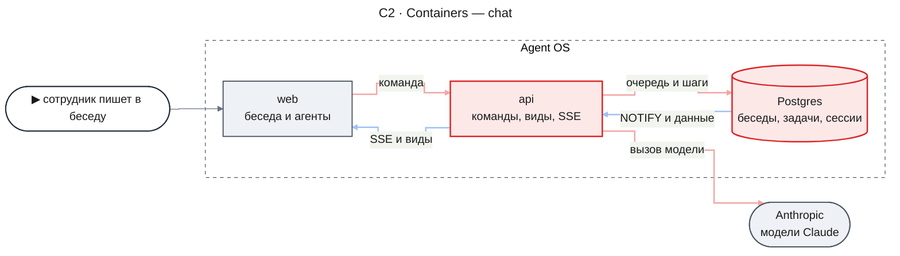
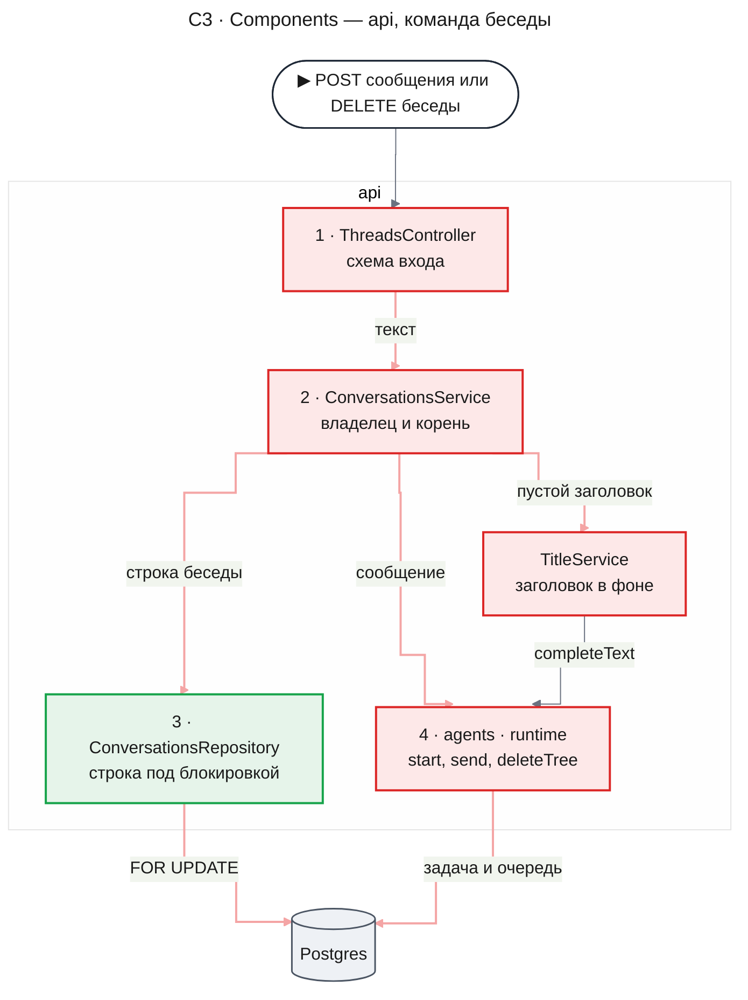
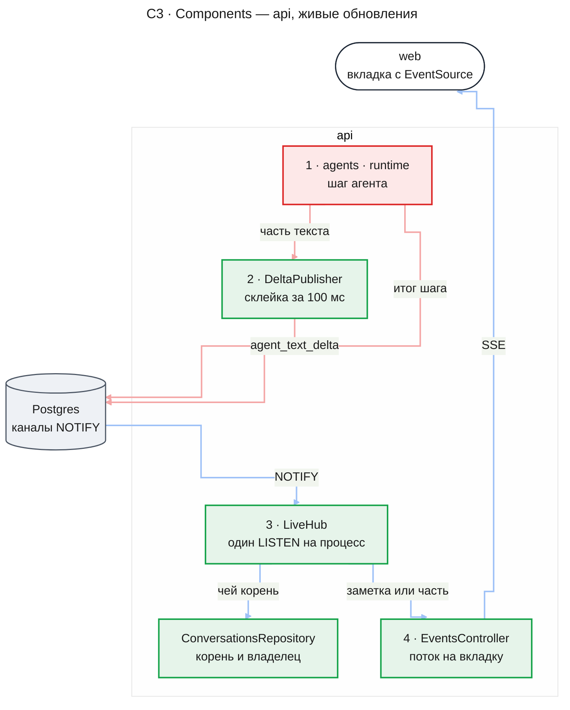
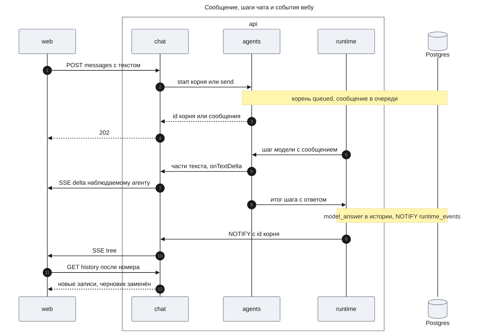
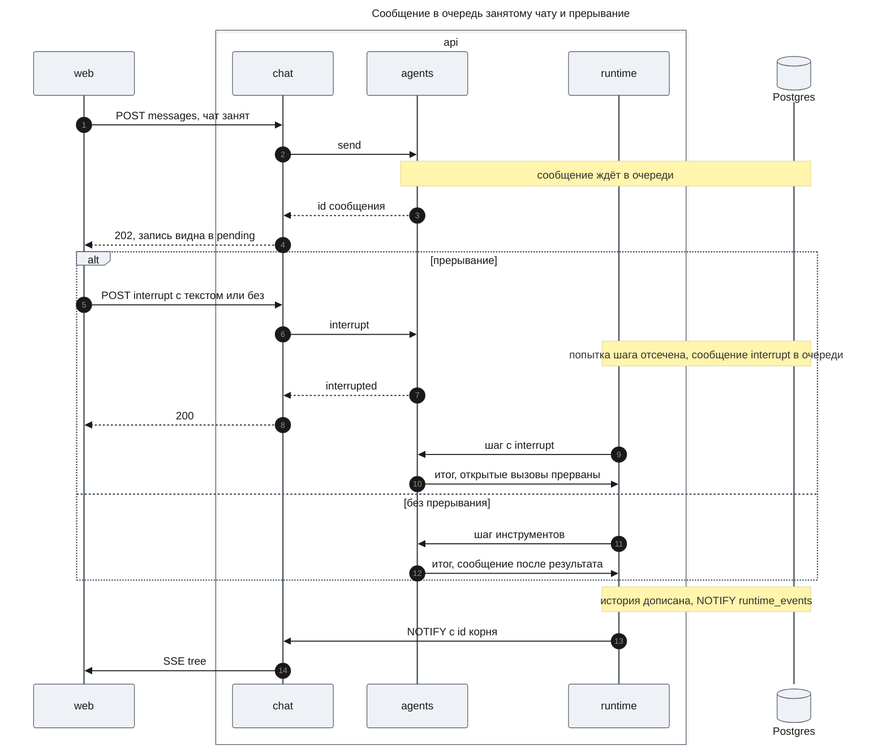
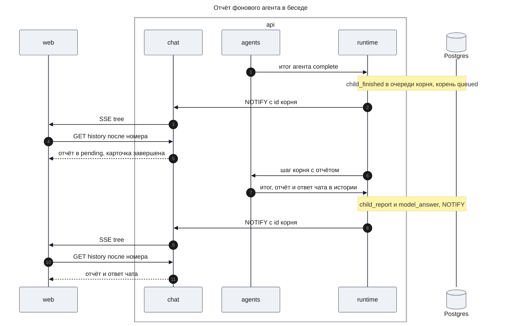
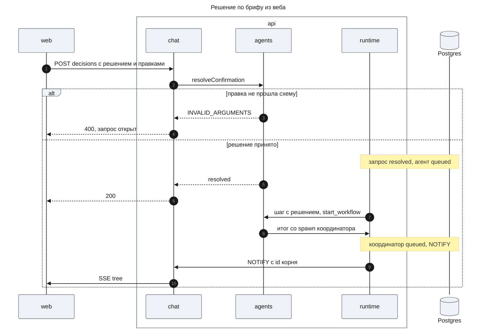
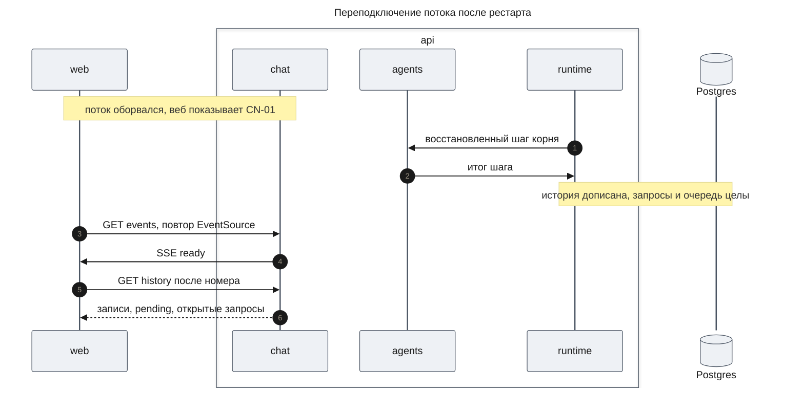
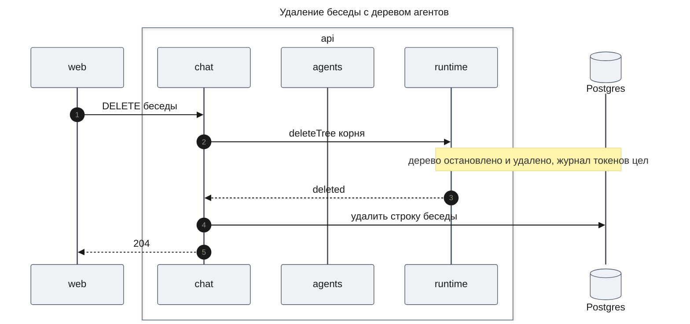
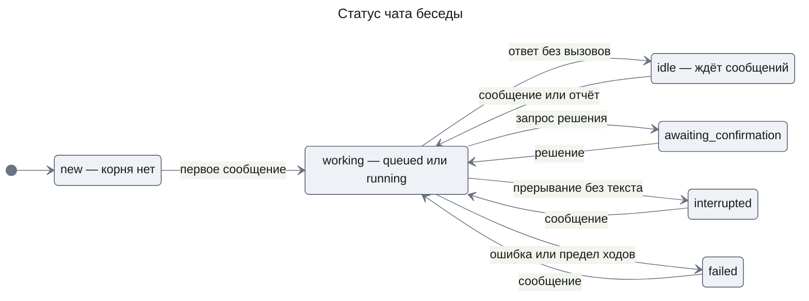

# Платформа агентов — Design Document — chat

**Status:** Approved · **Date:** 2026-11-14 · **PRD:** [prd.md](./prd.md) · **UXRD:** [uxrd.md](./uxrd.md) · **Depends on:** [design-agents.md](./design-agents.md#contract-definitions), [design-workflows.md](./design-workflows.md#contract-definitions)

## Snapshot

**Overview.** Эта часть переводит беседу на слой агентов и даёт вебу API для работы с агентами. Беседа — строка нашей таблицы с заголовком и ссылкой на корневую сессию главного чата; первое сообщение сотрудника создаёт эту сессию, а каждое следующее ложится в её очередь. Отвечает чат в воркерах runtime, а не внутри HTTP-запроса, поэтому команды веба — обычные короткие запросы, а живые изменения веб получает одним потоком SSE на вкладку. Поток несёт только заметки «в этой беседе что-то изменилось» и части текста ответа, а сами данные веб перечитывает обычными запросами. Mastra Memory, поток Mastra, замок беседы и реестр ответов уходят из `apps/api` вместе с прежними беседами.

- **Не меняется**: маршруты и формы списка, создания, переименования и удаления бесед; бюджеты производительности списка (NFR-03).
- **Первая работа плана**: правки контрактов в `packages/runtime`, `packages/agents` и `packages/workflows` (KD-6).
- **Biggest risk**: время до первого токена растёт на путь через очередь и воркер ([Risks and Mitigation](#risks-and-mitigation)).
- **Open questions**: нет.

### Key Decisions

#### KD-1: Беседа — строка `chat_conversations` и корневая сессия агента `chat`, созданная первым сообщением

Сессии агента нужно задание, а у новой беседы его нет. Поэтому `POST /api/threads` создаёт только строку беседы, а первое сообщение вызывает `agents.sessions.start` без родителя с текстом сообщения как заданием и записывает id корня в строку. Каждое следующее сообщение — `send` в очередь корня. Строка блокируется на время первой отправки и удаления, поэтому у беседы не бывает двух корней и удаление не расходится с отправкой; заголовок пишется условием «только в пустой». Этим заменяются Mastra Memory, замок `ThreadWriteLock`, реестр `ThreadRunRegistry` и таблица `chat_thread_runs`. Не взято: id беседы равен id корня — тогда корень пришлось бы создавать без задания.

#### KD-2: Команды — обычный HTTP, живые изменения — один поток SSE с заметками, данные — перечитывание

Ответ готовит воркер, поэтому запрос не держит ответ модели. Поток `GET /api/events` несёт заметку `tree` с id беседы, когда в её дереве записалось событие runtime ([design-runtime.md](./design-runtime.md#contract-definitions), канал `runtime_events`), и веб перечитывает вид экрана с последнего номера записи. Переподключение после обрыва или рестарта — то же перечитывание по первому событию `ready`, поэтому номер последнего события, буфер повторов и `Last-Event-ID` не нужны. Не взяты: события с данными и дочитывание `listAfter` по курсору — курсор по многим деревьям и его согласование стоят дороже повторного чтения; WebSocket — в коде нет ни одного шлюза, а командам хватает HTTP.

#### KD-3: Текст ответа приходит по частям через NOTIFY и нигде не хранится

AC-14.1 и UXRD («ответ стримится») требуют показывать ответ по мере генерации. `ModelClient` агентов вызывает модель потоком (`Agent.stream` Mastra с `maxSteps: 1`; `textStream` и обещания `toolCalls`, `usage` — [Mastra, Agents overview](https://mastra.ai/docs/agents/overview)) и отдаёт каждую часть текста хуку `onTextDelta`. Установленный `@mastra/core` 1.80.0 даёт у `MastraModelOutput` именно `textStream`, `toolCalls` и `usage`. `apps/api` шлёт первую часть сразу, а следующие склеивает за 100 мс и отправляет `pg_notify` в канал `agent_text_delta`, деля склейку на куски меньше предела полезной нагрузки NOTIFY; поток отдаёт части только агенту, за которым следит вкладка. Сохраняется по-прежнему один `model_answer` в конце шага. Целое сообщение без частей обошлось бы без хука, но не выполняет AC-14.1.

#### KD-4: Веб получает историю записями `HistoryEntry` агентов, а не сообщениями AI SDK

Беседа и страница агента показывают одни и те же записи ([HistoryEntry](./design-agents.md#contract-definitions)): задание, ответы модели, вызовы инструментов, сообщения, отчёты и события. API отдаёт их как есть, а веб сам превращает их в сообщения ленты через `useExternalStoreRuntime` assistant-ui: состояние держит приложение, `isRunning` и `onCancel` задаёт оно же ([assistant-ui, External Store](https://www.assistant-ui.com/docs/runtimes/custom/external-store)). Транспорт `AssistantChatTransport` и поток UI-сообщений AI SDK уходят: им нужен один запрос на ответ, а здесь ответ приходит без запроса. Не взято: перевод записей в UIMessage на сервере — второй формат той же истории.

#### KD-5: Главный чат — определение `chat` с правилом выбора в промпте

Чат регистрирует в каталоге агентов определение `chat`: встроенные `start_agent`, `message_agent`, `list_agents`, `stop_agent`, инструмент `start_workflow` части `workflows`, `mcpServers` `*` (доступ сотрудника режет таблица доступа агентов), каталог `agents` — только `general-purpose`, без модели, `maxTurns` 20. Заголовки каталога и шаблонов модель видит в описаниях `start_agent` и `start_workflow` по контракту нижних частей, а промпт чата словами задаёт правило FR-15 по порядку веток. Модель — `AGENT_DEFAULT_MODEL` (Haiku); `ASSISTANT_MODEL` и отдельной настройки модели чата нет: модель меняется полем определения.

#### KD-6: Часть сама меняет контракты `runtime` и `agents` первой работой, а не обходит их в `apps/api`

Контрактов `agents` и `runtime` не хватает в трёх местах. Дизайны и уже разбитые планы `runtime`, `agents` и `workflows` не меняются, потому что их сборка идёт; вместо этого эта часть первой работой правит сами пакеты:

- в `packages/agents` — хук `createAgents({ onTextDelta })`, ради которого `ModelClient` переходит с `generate` на `Agent.stream` с `maxSteps: 1` (KD-3);
- в `packages/agents` — `agents.completeText` для заголовка: разовый вызов модели без задачи, который пишет строку журнала токенов без `taskId` (так журнал уже допускает), поэтому Mastra не остаётся в `apps/api`;
- в `packages/runtime` — `decisions.listTree` вместо `decisions.listOpen`, а в `packages/agents` на нём — `agents.sessions.confirmations(rootId, ownerId)` вместо `pendingConfirmations`: запросы дерева со статусом `open`, `resolved` или `cancelled` и решением. Без этого беседа после перезагрузки теряла бы решённые копии запросов фоновых агентов (AC-14.2).

Прежние `listOpen`, `pendingConfirmations` и вызов `generate` удаляются, а не живут рядом с новыми (CLAUDE.md). Их вызовы, в том числе в пакете `workflows` и тестах всех трёх пакетов, переходят на новые операции в той же работе. Не взято: обходы в `apps/api` (свой вызов Mastra, чтение таблиц `agents` и `runtime`) — они нарушают правила пакетов [ADR-0004](../../adr/ADR-0004-agent-framework-packages.md).

#### KD-7: Список агентов сотрудника собирается по его беседам

Операции «все агенты владельца» в нижних пакетах нет, и читать их таблицы `apps/api` нельзя. Поэтому `GET /api/agents` берёт беседы владельца из своей таблицы, для каждой с корнем вызывает `agents.sessions.list` и отдаёт страницу верхних агентов, новые сверху, с курсором по времени создания и id — тем же приёмом, каким раньше листался список бесед. Счётчик ждущих решений (NV-01) так же суммирует `confirmations`.

## Terms

- **Беседа** — строка `chat_conversations`: владелец, заголовок, корень. В API и контрактах она `thread`.
- **Корень беседы** — корневая сессия агента `chat`; все агенты и запуски беседы — её потомки.
- **Заметка** — событие потока SSE без данных о содержимом: «перечитай эту беседу».
- **Часть текста** — кусок ответа модели, который ещё пишется; живёт только в потоке.
- **Наблюдаемый агент** — агент, чьи части текста просит вкладка: корень открытой беседы (вкладка называет беседу, потому что корня может ещё не быть) или открытый агент.

## Part

- **Part**: `chat` — четвёртая часть Delivery Parts в PRD.
- **Covers**: FR-14, FR-15, FR-16, FR-17; API для FR-21–FR-24 и FR-29; NFR-06 на каждой точке доступа этого API; NFR-02 и NFR-03 в доле беседы.
- **Depends on**: [design-agents.md, Contract Definitions](./design-agents.md#contract-definitions) — `createAgents`, `definitions.register`, операции агентов `start`, `send`, `interrupt`, `stop`, `restart`, `get`, `list`, `history`, `resolveConfirmation`, `AgentView`, `HistoryEntry`, событие `agents.history_appended`. Операции агентов — сервис `agents.sessions` (`agents.sessions.start` и так далее); `start()` и `stop()` жизненного цикла — на `Agents`; [design-workflows.md, Contract Definitions](./design-workflows.md#contract-definitions) — `createWorkflows`, `templates.list`, `runs.get`, `WorkflowRunView`, `start_workflow`; [design-runtime.md, Contract Definitions](./design-runtime.md#contract-definitions) — `tasks.get`, `tasks.deleteTree`, `inbox.listPending`, канал `runtime_events`, `ledger.monthSpend`, логгер `common`.
- **Prerequisite ADRs**: [ADR-0001](../../adr/ADR-0001-durable-runtime-owner.md) (состояние только в Postgres), [ADR-0003](../../adr/ADR-0003-drizzle-data-layer.md) (Drizzle, миграции вперёд), [ADR-0004](../../adr/ADR-0004-agent-framework-packages.md) (правила пакетов).
- **Sibling parts**: `runtime`, `agents`, `workflows` — контракты выше; `web` — экраны поверх этого API.
- **Правки в пакетах нижних частей**: эта часть сама меняет `packages/runtime`, `packages/agents` и `packages/workflows` по KD-6, и план работ ставит эти правки первыми; дизайны и планы нижних частей не меняются.

**Out of scope**

- Экраны, лоток, карточки, строка связи и перевод записей в ленту assistant-ui — часть `web`.
- Перегенерация ответа после ошибки (chat-shell AC-14.6) уходит: беседа после сбоя модели продолжается следующим сообщением (AC-09.1), а AC-14.3 требует поведения только FR-13, FR-15–FR-17.
- Таблица `audit_events` и `AuditInterceptor` остаются; из перехватчика уходит только чтение `threadId` из тела `/chat/:agentId`.
- Таблицы Mastra (`mastra_threads`, `mastra_messages`) больше не читаются; удалить их из локальной базы — решение разработчика.

**Constraints**

- PoC: прежние беседы не переносятся, старый код удаляется сразу (CLAUDE.md).
- Mastra остаётся только в `packages/agents`: `apps/api` теряет все `@mastra/*` и `ai`.
- Всё состояние — в Postgres: в памяти процесса только подписки потока SSE и склейка частей текста за 100 мс; потеря того и другого лечится перечитыванием (KD-2).
- Вход и выход каждой точки — zod-схемы `packages/contracts`; ошибки — тело `ApiErrorSchema` с `errorCode`.
- Логирование через логгер `common` ([logging.md](../../code-system/patterns/logging.md)): каждая команда, подключение потока и сбой заголовка — с владельцем, беседой или агентом, без текста сообщений.
- Тесты — немного и критичное; модель подменяется сценарием на границе `ModelClient` ([Test Strategy](#test-strategy)).

## Building-block Inventory

Follows the [code system](../../code-system/README.md).

| Building block | Pattern | Status | Note |
|---|---|---|---|
| `ChatModule` в `apps/api/src/chat/` | обычный провайдер Nest ([composition-root.md](../../code-system/patterns/composition-root.md), Not For) | extended | вместо прежних `ChatModule` и `ThreadsModule`; регистрирует определение `chat` в фабрике провайдера, до `agents.start()` |
| `ConversationsRepository` над `chat_conversations` | [repository-over-transaction.md](../../code-system/patterns/repository-over-transaction.md) | new — KD-1 | вместо вызовов Memory в `ThreadsService` |
| `ConversationsService`, `ThreadsController` | — | extended | маршруты и формы бесед прежние; добавлены история, отправка, прерывание |
| `AgentControlService`, `AgentsController`, `DecisionsController`, `SpendController` | — | new | тонкие обёртки над операциями `agents`, `workflows`, `runtime` с проверкой владельца |
| `LiveHub`, `EventsController` | — | new — KD-2 | искали: SSE, WebSocket и `EventSource` в коде нет; NOTIFY слушает только runtime для своих воркеров |
| `DeltaPublisher` | — | new — KD-3 | `pg_notify` через пул `RUNTIME_DATABASE` |
| `TitleService` | — | extended | правила `ThreadTitleService` прежние, вызов модели — `agents.completeText` |
| Курсор списка (`thread-cursor.ts`) | — | reused | тот же формат; выборка страницы уходит в SQL |
| `ModelClient` (`packages/agents`) | — | extended — KD-3, KD-6 | поток вместо `generate`, хук `onTextDelta`, `completeText` |
| `confirmations`, `decisions.listTree` | — | extended — KD-6 | вместо `pendingConfirmations` и `listOpen` |

## Acceptance Criteria

### FR-14: Беседа — корневая сессия

- From the PRD: AC-14.1, AC-14.2, AC-14.3, AC-14.4.
- У беседы без сообщений нет корня; первое сообщение создаёт корень с этим текстом как заданием, а следующие сообщения ложатся в его очередь (DC-1).
- Заголовок генерируется по первому сообщению и пишется только в пустой заголовок; сбой генерации оставляет его пустым и повторяется при следующей отправке (DC-2).

### FR-15: Инструменты чата и запуск по триггеру

- From the PRD: AC-15.1, AC-15.2, AC-15.3, AC-15.4, AC-15.5, AC-15.6. Выбор ветки — суждение модели по промпту (KD-5); автотест проверяет только связку инструментов, а выбор проверяется ручным прогоном (PRD, Assumptions).

### FR-16: Писать, пока чат работает

- From the PRD: AC-16.1, AC-16.2.

### FR-17: Фоновые результаты в беседе

- From the PRD: AC-17.1, AC-17.2, AC-17.3.

### API для веба (FR-21–FR-24, FR-29) и NFR-06

- Каждая точка API отвечает на чужой id так же, как на несуществующий, тем же телом; маршруты агентов так же отвечают на id корня беседы (DC-3).
- Поток SSE отдаёт сотруднику заметки только о его беседах и части текста только его агентов (DC-4).
- После каждого подключения поток первым отправляет `ready` (DC-5).

## Design

### Architecture (C1–C4)

#### C2 · Containers

- `api` принимает команды, отдаёт виды беседы и агентов и держит потоки SSE; отвечает чат в воркерах runtime того же процесса.
- `Postgres` получает таблицу `chat_conversations` и теряет `chat_thread_runs` миграцией вперёд; каналы `runtime_events` и `agent_text_delta` несут сигналы между экземплярами.
- `web` меняется в своей части; здесь он только потребитель контракта.

#### C3 · Components: api

**api — команда беседы**

- `ConversationsService` находит беседу по владельцу (иначе `THREAD_NOT_FOUND`), под блокировкой строки создаёт корень первым сообщением или кладёт сообщение в его очередь, а при удалении вызывает `tasks.deleteTree` корня и удаляет строку.
- `AgentControlService` (не нарисован, тот же путь) делает то же для маршрутов агентов и решений: владелец проверяется операцией `agents` или `workflows`, а корень беседы отвергается как несуществующий агент.
- `TitleService` пишет заголовок условием «только в пустой» и не держит блокировку.

**api — живые обновления**

- `LiveHub` держит одно отдельное соединение с `LISTEN runtime_events` и `LISTEN agent_text_delta` на процесс и раздаёт сигналы потокам своих вкладок. По `rootId` из `runtime_events` он находит беседу и владельца в `chat_conversations` (кэш в памяти) и шлёт заметку `tree` только потокам этого владельца. Часть текста несёт владельца и агента, и хаб отдаёт её только потоку того же владельца, который наблюдает этого агента.
- Потерянное соединение `LISTEN` хаб открывает заново и шлёт всем своим потокам `ready`, потому что сигналы за время обрыва потеряны.
- `EventsController` — точка `@Sse()` NestJS: поток событий `MessageEvent` с полями `type` и `data` и подсказкой переподключения ([NestJS, Server-Sent Events](https://docs.nestjs.com/techniques/server-sent-events)). Каждые 20 с он шлёт `ping`, чтобы прокси не закрыл простаивающий поток.

#### Сборка и что уходит

`AppModule` собирает пакеты по [composition-root.md](../../code-system/patterns/composition-root.md): `RuntimeModule` (`createRuntime`) → `AgentsModule` (`createAgents` с хуком `onTextDelta` от `DeltaPublisher`) → `WorkflowsModule` (`createWorkflows`) → `ChatModule`. Определения и инструменты регистрируются в фабриках провайдеров, потому что `agents.start()` идёт в `AgentsModule.onModuleInit`, до старта воркеров в `RuntimeModule.onApplicationBootstrap`: `WorkflowsModule` так регистрирует `start_workflow`, а `ChatModule` — определение `chat`. `ChatModule` открывает `LISTEN` хаба при старте приложения и закрывает потоки и соединение хаба перед остановкой воркеров. Логгер и Sentry уже подключила часть `runtime`, воркеры работают в процессе `api`, как там описано.

Изменение прежнего контракта для веба ломающее: маршрут `POST /api/chat/:agentId` и `GET /api/threads/:threadId/messages` уходят без замены формы, веб переходит на новые маршруты в своей части (KD-4). Удаляются целиком:

- прежние `ChatController`, `ChatDto` и их тест в `apps/api/src/chat` и весь `apps/api/src/mastra` (`MastraModule`, `MastraLifecycle`, `mastraProvider`, `models.ts`, агент `assistant`) с вызовом `MastraLifecycle.start()` в `main.ts`;
- из `apps/api/src/threads`: `thread-memory.provider.ts`, `thread-write-lock.ts`, `thread-lock.pool.ts`, `thread-run-registry.ts`, `thread-deletion-hooks.ts`, `thread-title.agent.ts`, `thread.mapper.ts` и их тесты; остальное переезжает в `apps/api/src/chat`;
- `apps/api/src/common/stream-error-text.ts`; из контрактов — `ChatRequestSchema`, `HistoryMessage*`, `ThreadMessagesResponseSchema`, `ChatMessageRefSchema`;
- таблица `chat_thread_runs`; зависимости `@mastra/*` и `ai` в `apps/api`; переменные из Runtime settings;
- `decisions.listOpen` в `packages/runtime`, `pendingConfirmations` и вызов `generate` в `ModelClient` в `packages/agents` (KD-6); их вызовы в `packages/workflows` и тестах трёх пакетов переходят на `decisions.listTree`, `confirmations` и поток;
- e2e `chat-threads`, `app` (неизвестный агент), опора обвязки на Memory: `seed`, `countMessages`, `rawMessageContents`, `createTestMastra`, `mockModels`; `threads.e2e-spec` и `threads.perf.e2e-spec` переписываются на данные через API.

### Runtime Flows

Во всех потоках `chat` — модуль `ChatModule` в `api`, `agents` — пакеты `agents` и `workflows`, `runtime` — пакет `runtime`; все три — внутри одного процесса `api`. Стрелка от `runtime` к `chat` — сигнал NOTIFY, который принёс `LiveHub`.

#### Flow 1: Сообщение и ответ по частям

**Starts when:** сотрудник отправляет сообщение в свободную беседу; for AC-14.1, AC-16.1, DC-1, DC-2.

**Outcome:** в истории корня — задание или доставленное сообщение и ответ модели одной записью; части текста не сохранены. Для первого сообщения строка беседы получила id корня, а `TitleService` запустил генерацию заголовка.

**Failure handling:**

- Беседа чужая или удалена → 404 `THREAD_NOT_FOUND`, в очередь ничего не легло.
- Процесс умер между `agents.sessions.start` и записью id корня → корень без беседы отвечает на сообщение, но его не видит ни одна беседа; это пишется в лог, а следующая отправка создаёт новый корень.
- Повтор вызова модели внутри `ModelClient` или повтор потерянного шага начинает части заново с `offset` 0 → веб сбрасывает черновик.
- Ошибка модели после повторов → корень `failed` с `model_error`; заметка `tree` показывает вебу статус, черновик убирается, следующее сообщение продолжает беседу (AC-09.1).
- Потерянный `pg_notify` части текста → черновик неполный до прихода записи истории; запись истории полная.

#### Flow 2: Сообщение, пока чат работает, и прерывание

**Starts when:** сотрудник отправляет сообщение или нажимает «Прервать» во время шага чата; for AC-16.1, AC-16.2.

**Outcome:** сообщение стоит в истории после результата инструмента или конца хода (AC-07.1, AC-07.3), пока ждёт — в `pending` вида беседы. Прерывание с текстом сразу продолжает чат этим текстом, без текста оставляет корень в статусе «прерван» (AC-08.1, AC-08.2). Пока бриф или действие чата ждёт решения, новое сообщение не вытесняет запрос и ждёт в `pending` до решения (UXRD, «Чат ждёт решения»).

**Failure handling:**

- Чат ждёт решения или уже свободен → `interrupt` отвечает `not_active`; текст, если был, уходит обычным `send` и ждёт в `pending` или будит чат, без текста ничего не меняется.
- Пустой или длиннее `CHAT_MESSAGE_MAX_LENGTH` текст → 400 `VALIDATION_FAILED`, очередь не тронута.
- Сеть оборвалась до ответа → веб не знает, принято ли сообщение, и перечитывает вид: принятое видно в `pending` или истории.

#### Flow 3: Отчёт фонового агента в беседе

**Starts when:** агент беседы сдал отчёт; for AC-17.1, AC-17.2, AC-06.1, AC-06.2.

**Outcome:** отчёт стоит в истории корня записью `child_report`, за ним ответ чата (AC-06.1). Беседа, открытая позже, получает то же из истории (AC-17.2). Пока чат занят, отчёт ждёт в `pending` с источником `report` (AC-06.2).

**Failure handling:**

- Вкладка не подключена → заметка никому не уходит; данные лежат в базе и читаются при открытии.
- Агент упал или остановлен → `child_report` несёт статус и причину (AC-06.3), путь тот же.

#### Flow 4: Решение по брифу или действию из веба

**Starts when:** сотрудник нажал «Запустить», «Запустить с правками», «Подтвердить» или «Отклонить» на карточке решения; for AC-17.3, AC-24.2, AC-28.1–AC-28.3.

**Outcome:** при подтверждении под беседой ровно один координатор с подтверждённым брифом ([design-workflows.md, Flow 1](./design-workflows.md#flow-1-запуск-через-бриф)); вид беседы показывает запрос как `resolved` и новый запуск в `agents`. Так же решается изменяющее действие агента любой глубины: id запроса берётся из `decisions` вида беседы.

**Failure handling:**

- Запрос чужой или его нет → 404 `DECISION_NOT_FOUND`.
- Решение уже записано в другой вкладке → 200 `already_resolved`, второго запуска нет.
- Сеть оборвалась → веб показывает MC-19 и повторяет; повтор отвечает `already_resolved`, если первый дошёл.

#### Flow 5: Переподключение после рестарта сервера

**Starts when:** сервер перезапустился, пока вкладка была открыта; for DC-5, AC-12.5, AC-01.3 в доле беседы.

**Outcome:** веб снимает строку связи после `ready` и дочитывает историю с последнего номера, поэтому записи не повторяются и не пропадают; запросы решений и сообщения в очереди на месте (AC-12.5, AC-01.3).

**Failure handling:**

- Сервер ещё не поднялся → `EventSource` повторяет подключение через 2 с (подсказка `retry` потока).
- Черновик части текста оборвался → после рестарта шаг идёт заново с `offset` 0.

#### Flow 6: Удаление беседы с работающими агентами

**Starts when:** сотрудник удаляет беседу; for AC-14.4, AC-14.3.

**Outcome:** беседы, её агентов, очередей, запросов и событий нет; строки журнала токенов остались, расход месяца не уменьшился. Строка беседы заблокирована на время удаления, поэтому первая отправка в ту же беседу ждёт и затем получает 404.

**Failure handling:**

- Беседа чужая или уже удалена → 404 `THREAD_NOT_FOUND`, ничего не удалено.
- Шаг агента дерева ещё идёт → runtime отсекает его попытку, итог не записывается ([design-runtime.md](./design-runtime.md#contract-definitions), `stop`).
- Ошибка базы между `deleteTree` и удалением строки → 500; повтор удаления находит строку без дерева и удаляет её.

### Contract Definitions

Все маршруты — под `/api`, под `SessionGuard`; владелец — `req.user.id`. Вход и ответы — zod-схемы `packages/contracts`. Чужой id отвечает тем же кодом и телом, что несуществующий.

**Беседы** (`ThreadsController`)

- **`GET /threads?cursor`**, **`POST /threads`**, **`GET /threads/:threadId`**, **`PATCH /threads/:threadId`**, **`DELETE /threads/:threadId`** — как сейчас: страница `THREAD_PAGE_SIZE` по `updatedAt` по убыванию с `nextCursor`, создание с пустым заголовком (201 `ThreadSummary`), чтение, переименование (`title` после обрезки пробелов от 1 до `THREAD_TITLE_MAX_LENGTH`), удаление (204). Удаление останавливает и удаляет дерево беседы (Flow 6). `updatedAt` растёт при отправке сообщения и переименовании.
- **`GET /threads/:threadId/history?afterSeq`** — `ConversationView`; `afterSeq` по умолчанию 0.
- **`GET /threads/:threadId/agents`** — дерево агентов беседы без корня, массив `AgentNode`; для абзаца MC-26 и живого обновления списка агентов.
- **`POST /threads/:threadId/messages`** с `text` — первое сообщение создаёт корень, остальные идут в очередь (DC-1). Ответ 202 с `messageId`, у первого сообщения он пуст: оно становится заданием. Текст после обрезки — от 1 до `CHAT_MESSAGE_MAX_LENGTH` символов.
- **`POST /threads/:threadId/interrupt`** с необязательным `text` — 200 с `outcome`: `interrupted` или `not_active` (у беседы без корня — `not_active`). При `not_active` с текстом API отправляет текст как обычное сообщение и возвращает `not_active` с `messageId`, поэтому текст «Прервать и отправить» не теряется (FR-16).

**Агенты** (`AgentsController`). Корень беседы для этих маршрутов не существует: `AGENT_NOT_FOUND`.

- **`GET /agents?cursor`** — `AgentListPage`: верхние агенты всех бесед владельца (дети корней), новые сверху, по `AGENT_PAGE_SIZE`, с поддеревьями и `nextCursor` (KD-7).
- **`GET /agents/awaiting`** — `count`: число открытых запросов решений во всех беседах владельца (NV-01).
- **`GET /agents/:agentId/history?afterSeq`** — `AgentPageView`.
- **`GET /agents/:agentId/inherited?afterSeq`** — записи истории родителя ответвления до `throughSeq` с тем же постраничным правилом; у агента без ответвления — пусто (AV-05).
- **`GET /agents/:agentId/run`** — `WorkflowRunView` из `runs.get`; не запуск — 404 `RUN_NOT_FOUND`.
- **`POST /agents/:agentId/messages`** с `text` — `send`, 202 с `messageId`; агенту в конечном статусе — продолжение с историей.
- **`POST /agents/:agentId/interrupt`** с необязательным `text` — 200 с `outcome`; `not_active` с текстом — как у беседы.
- **`POST /agents/:agentId/stop`** — 200 со `stopped`: id остановленных агентов.
- **`POST /agents/:agentId/restart`** — 201 с `agentId` нового агента; работающий — 409 `NOT_FINISHED`, родитель закончил — 409 `PARENT_FINISHED`.

**Решения и расход**

- **`POST /decisions/:decisionId`** с `approve` и необязательными `args` — `resolveConfirmation`; 200 с `outcome` `resolved` или `already_resolved`, 400 `INVALID_ARGUMENTS`, 404 `DECISION_NOT_FOUND`. `args` — полные аргументы инструмента по его схеме: для брифа веб передаёт `template` из `Confirmation` без изменений и три поля брифа.
- **`GET /spend`** — `month` (`YYYY-MM`, текущий месяц по UTC) и `costUsd` из `ledger.monthSpend`.

**Поток** (`EventsController`)

- **`GET /events?watch`** — поток SSE владельца; `watch` необязателен: `thread:<threadId>` — корень этой беседы, в том числе созданный после подключения (часть несёт `rootId`, и хаб сравнивает его с корнем беседы), или `agent:<agentId>` — открытый агент. События:
  - `ready` — первое после каждого подключения и после восстановления `LISTEN`: веб перечитывает экран (DC-5).
  - `tree` с `threadId` — в дереве беседы записано событие runtime: статус, история, очередь, запрос, новый агент.
  - `delta` с `agentId`, `offset` и `text` — часть ответа наблюдаемого агента. `offset` — позиция части в тексте этого вызова модели; `offset` 0 начинает черновик заново; часть с `offset`, не равным длине черновика, веб отбрасывает до следующего `offset` 0 или записи истории.
  - `ping` — раз в 20 с.
- Подсказка переподключения `retry` — 2000 мс. Чужой или неизвестный `watch` не ошибка: частей просто нет.

**ConversationView**

- `thread` — `ThreadSummary`.
- `chat` — состояние чата: `status` (`new`, `idle`, `working`, `awaiting_confirmation`, `interrupted`, `failed`; см. State Transitions), `failureReason` при `failed`, `rootAgentId` или пусто, `model`.
- `entries` — записи `HistoryEntry` корня с номером больше `afterSeq`, не больше `HISTORY_PAGE_SIZE`; `nextAfterSeq` — номер, с которого читать дальше, или пусто, если всё прочитано.
- `pending` — недоставленные сообщения корня по порядку: `messageId`, `source` (`user`, `report`, `parent`), `interrupt` (признак «Прервать и отправить»), текст или для отчёта описание агента и статус, время.
- `decisions` — `Confirmation` всего дерева, все статусы.
- `agents` — `AgentNode` детей корня.

**AgentPageView** — `agent` (`AgentView` с `threadId` и `threadTitle`), `entries` и `nextAfterSeq` по тем же правилам, `pending` этого агента, `decisions` только этого агента, `children` — его поддерево `AgentNode`.

**AgentNode** — `AgentView` ([design-agents.md](./design-agents.md#contract-definitions)) и `children`. В `AgentListPage` у верхних узлов ещё `threadId` и `threadTitle`.

**Confirmation** — запрос решения: `decisionId`, `agentId`, описание агента, вид (`agents.tool_confirmation` или `workflows.brief`), инструмент, сервер, аргументы, `status` (`open`, `resolved`, `cancelled`), решение и итоговые аргументы при `resolved`, время создания и решения; у брифа ещё `templateTitle` из `templates.list`.

**Расширения нижних пакетов** (KD-6, пишет эта часть первой работой; прежние операции удаляются)

- **`createAgents({ ..., onTextDelta })`** — `ModelClient` вызывает хук на каждую часть текста с `ownerId`, `rootId`, `agentId`, `offset`, `text`; ошибка хука логируется и не ломает шаг.
- **`agents.completeText({ ownerId, system, prompt, maxOutputTokens, signal })`** — один вызов модели `AGENT_DEFAULT_MODEL` вне задачи; пишет строку журнала без `taskId`; возвращает текст.
- **`agents.sessions.confirmations(rootId, ownerId)`** заменяет `pendingConfirmations` и отдаёт `Confirmation` всех статусов; строится на `decisions.listTree(rootId, ownerId)` runtime, который заменяет `listOpen` и возвращает запросы дерева со статусом, решением и временем.

**Error handling**

- `THREAD_NOT_FOUND` — 404, беседы нет или она чужая.
- `AGENT_NOT_FOUND`, `RUN_NOT_FOUND`, `DECISION_NOT_FOUND` — 404, нет, чужой или корень беседы.
- `VALIDATION_FAILED` — 400, вход не прошёл схему; `INVALID_CURSOR` — 400; `INVALID_ARGUMENTS` — 400, правка аргументов решения.
- `NOT_FINISHED`, `PARENT_FINISHED` — 409.
- Сбой сервера — 500 без текста ошибки и стека.

**Значения контрактов** (`packages/contracts`)

- `THREAD_PAGE_SIZE` 20, `THREAD_TITLE_MAX_LENGTH` 200, `GENERATED_THREAD_TITLE_MAX_LENGTH` 80 — прежние.
- `CHAT_MESSAGE_MAX_LENGTH` — 20000 символов.
- `HISTORY_PAGE_SIZE` — 500, предел `history` агентов.
- `AGENT_PAGE_SIZE` — 20.

**Runtime settings.** Новых настроек нет. Уходят `ASSISTANT_MODEL`, `REASONING_EFFORT`, `TITLE_MODEL`, `OPENAI_API_KEY`; модель заголовка — `AGENT_DEFAULT_MODEL`.

### Data Model

`chat_conversations` — одна строка на беседу: владелец, заголовок (пустая строка, пока его нет), id корня, время создания и обновления. Id корня пуст до первого сообщения и уникален; внешнего ключа на задачу runtime нет, потому что строку держит блокировка во время `deleteTree`, а удаляет её Flow 6 после дерева. Всё остальное — история, очередь, запросы, статусы, токены — живёт в таблицах `runtime_*` и `agent_*` и сюда не копируется. Та же миграция вперёд удаляет `chat_thread_runs`.

### State Transitions and Invariants

Статус чата для композера выводится из задачи корня (`tasks.get`) и её `AgentView`: у `AgentView` корня ожидание сообщений и работа — оба `working`, а композеру нужно их различать.

Корень, остановленный runtime иначе как удалением, показывается как `idle`: сообщение его оживляет.

**Invariants**

1. У беседы не больше одного корня, и владелец корня — владелец беседы.
2. Автоматический заголовок не перезаписывает непустой заголовок.
3. Заметка `tree` и часть текста уходят только потокам владельца дерева.
4. Каждый вызов модели части, в том числе заголовка, — строка журнала токенов.

## Test Strategy

Модель подменяется сценарием на границе `ModelClient`, база — настоящий Postgres, приложение — настоящий `AppModule`, как в нынешней обвязке e2e. Выбор ветки FR-15 моделью проверяется ручным прогоном.

### Main Use Cases

- **UC-1: Ответ по частям и в истории** — covers AC-14.1, AC-16.1, DC-1
  - Given: новая беседа, поток подключён с `watch` на беседу; сценарий модели отдаёт текст тремя частями.
  - When: сотрудник отправляет первое сообщение.
  - Then: поток приносит `delta` с `offset` 0 и дальше, затем `tree`; история корня — задание с текстом сообщения и один `model_answer` со склеенным текстом.
- **UC-2: Беседа после перезагрузки** — covers AC-14.2, AC-17.2, AC-17.3, AC-24.2
  - Given: сценарий, где чат вызывает читающий MCP-инструмент, запускает агента, агент просит изменяющее действие, сотрудник подтверждает через `POST /decisions`, агент сдаёт отчёт.
  - When: вид беседы читается заново с `afterSeq` 0.
  - Then: в нём вызов с исходом, `child_report`, ответ чата и запрос агента со статусом `resolved` — те же записи, что приходили по ходу.
- **UC-3: Список, переименование, удаление, заголовок** — covers AC-14.3, DC-2
  - Given: у сотрудника 25 бесед; сценарий модели заголовка отвечает, падает или ждёт.
  - When: он листает список, переименовывает, удаляет и отправляет первое сообщение.
  - Then: страницы по 20 без дублей, пустой заголовок — 400, удалённая беседа — 404 на чтение и отправку; заголовок появляется не дольше бюджета `chat-shell` AC-17.1, ручной заголовок не перезаписан, сбой оставляет заголовок пустым и пишет предупреждение, следующая отправка повторяет генерацию.
- **UC-4: Удаление беседы с работающим агентом** — covers AC-14.4
  - Given: в беседе агент ждёт долгого инструмента; в журнале есть его вызовы модели.
  - When: беседу удаляют.
  - Then: агент недоступен (404), его инструмент не получил новых вызовов, `GET /spend` показывает ту же сумму.
- **UC-5: Сообщение занятому чату и прерывание** — covers AC-16.1, AC-16.2
  - Given: чат в шаге с долгим читающим инструментом.
  - When: сотрудник отправляет сообщение, затем прерывает с текстом.
  - Then: сообщение видно в `pending`, потом в истории после результата прерванного вызова; вызов — с исходом «прервано»; `interrupt` вернул `interrupted`.
- **UC-6: Бриф из веба** — covers AC-15.4, AC-28.1–AC-28.3
  - Given: сценарий модели вызывает `start_workflow`.
  - When: вид беседы читается, затем решение отправляется с правкой вопроса.
  - Then: до решения координатора нет и запрос `open`; после — ровно один запуск в `agents` с исправленным вопросом в брифе; повторное решение — `already_resolved`.

- **UC-7: Отчёт в открытой беседе** — covers AC-17.1, AC-06.1, NFR-02
  - Given: поток подключён с `watch` на беседу; сценарий запускает агента, который сдаёт отчёт после одного вызова.
  - When: агент сдаёт отчёт, пока чат свободен.
  - Then: приходит `tree`, вид беседы показывает `child_report` и следующий ответ чата; от записи отчёта до события `tree` — в пределах бюджета NFR-02.
- **UC-8: Чат управляет агентами беседы** — covers AC-15.2, AC-15.3
  - Given: в беседе работает агент; сценарий модели чата вызывает `list_agents`, затем `message_agent` и `stop_agent`.
  - When: сотрудник отправляет три соответствующих сообщения.
  - Then: результат `list_agents` перечисляет агента со статусом, сообщение встаёт в историю агента, агент получает статус «остановлен».

### Error and Edge Use Cases

- **UC-E1: Два сотрудника на каждой точке API** — covers NFR-06, DC-3, DC-4, AC-13.3
  - Given: у сотрудника A беседа, агент, запуск workflow и открытый запрос решения; у B свои.
  - When: B вызывает каждый маршрут из Contract Definitions с id A, подключает поток с `watch` на агента A, и одновременно агент A пишет историю и текст.
  - Then: каждый маршрут отвечает тем же кодом и телом, что для несуществующего id; данные A не изменились; поток B не получил ни `tree`, ни `delta` A; `GET /agents` и `GET /spend` B не включают данных A; маршруты агентов с id корня беседы отвечают `AGENT_NOT_FOUND`.
- **UC-E2: Потеря соединения LISTEN** — covers DC-5
  - Given: поток подключён, соединение `LiveHub` с базой разорвано.
  - When: хаб переподключается.
  - Then: поток получает `ready`, а заметки после переподключения приходят снова.
- **UC-E3: Первые две отправки одновременно** — covers DC-1
  - Given: беседа без корня.
  - When: два первых сообщения отправлены одновременно.
  - Then: у беседы один корень; одно сообщение — задание, другое — в его очереди.

## Security Considerations

- **Authentication & Authorization**: каждый контроллер, включая поток SSE, — под `SessionGuard`; в production до настоящей аутентификации все маршруты отвечают 401, как сейчас. `EventSource` не умеет свои заголовки, поэтому поток получает того же пользователя, что и остальные запросы вкладки без `x-user-id`; настоящая аутентификация позже придёт cookie. Владельца проверяет каждая операция `agents`, `workflows`, `runtime`, а бесед — `ConversationsService`; одна проверка на точку, одинаковый 404 для чужого и несуществующего (DC-3).
- **Input Validation**: тела, параметры и курсоры проверяют схемы `packages/contracts` через `ZodValidationPipe`; правку аргументов решения проверяет схема инструмента в `agents`. Текст сообщения ограничен `CHAT_MESSAGE_MAX_LENGTH`, а `INBOX_PAYLOAD_MAX_BYTES` runtime больше этого предела.
- **Sensitive Data Handling**: логи не содержат текстов сообщений, заголовков и частей ответа — только id, исходы и длительности. Поток отдаёт данные только владельцу (DC-4). Ответы об ошибках не несут текстов исключений и стеков.

## Risks and Mitigation

- **Время до первого токена превышает бюджет NFR-03 (нынешний чат + 50 мс)** — среднее влияние, средняя вероятность: добавились захват шага, чтение сессии и два NOTIFY. Первая часть текста уходит без склейки, воркер будит NOTIFY runtime, а не опрос; замер делается ручным прогоном после части, и при промахе склейка уменьшается.
- **Базовая линия NFR-03**: время до первого токена нынешнего чата замеряется ручным прогоном до того, как часть удалит прежний путь, если есть ключ модели; без ключа критерий проверяется только по абсолютной цели.
- **Части текста фоновых агентов создают лишний поток NOTIFY** — низкое влияние, средняя вероятность. Склейка за 100 мс; хаб отбрасывает части агентов, за которыми никто не следит, до разбора в потоки.
- **`GET /agents` и счётчик NV-01 делают по запросу на беседу** — низкое влияние, средняя вероятность при сотнях бесед. Счётчик веб перечитывает не чаще раза в секунду; операция «все агенты владельца» в `agents` уберёт перебор, когда понадобится.
- **Haiku выбирает не ту ветку правила FR-15** — высокое влияние, средняя вероятность. Правило словами в промпте, каталог в описаниях инструментов, ручной прогон после части (PRD, Assumptions); модель чата меняется полем определения (KD-5).

## Appendix: Fact Disposition

| Fact | Disposition | Handled in |
|------|-------------|------------|
| Маршрут `POST /api/chat/:agentId`, порядок `register → mark → release`, остановка закрытием соединения (`chat.controller.ts`, ChatController.chat) | remove | KD-1, KD-2; Flow 1, Flow 2 |
| Поток UI-сообщений AI SDK v7 через `toAISdkStream` (`chat.controller.ts`, toAISdkStream) | remove | KD-3, KD-4 |
| Формат `HistoryMessage` и `ThreadMessagesResponseSchema` (`packages/contracts/src/threads.ts`) | transform | KD-4; `ConversationView` |
| CRUD бесед и проверка владельца поверх Memory (`threads.service.ts`, ThreadsService) | transform | KD-1; Contract Definitions, «Беседы» |
| Замок `ThreadWriteLock` и его пул (`thread-write-lock.ts`) | remove | KD-1: блокировка строки и условная запись |
| Реестр ответов и `chat_thread_runs` (`thread-run-registry.ts`; `schema.ts`, chatThreadRuns) | remove | KD-1; Data Model |
| Хуки удаления беседы (`thread-deletion-hooks.ts`) | remove | Flow 6: `tasks.deleteTree` |
| Автозаголовок на агенте Mastra `thread-title` (`thread-title.service.ts`) | transform | KD-6, DC-2 |
| Агент `assistant` на Opus с инструментами расследования (`assistant.agent.ts`) | transform | KD-5 |
| Связки с `ResearchLaunchService` в контроллере чата (`research-launch.service.ts`) | remove | уходят с контроллером; сам контур удаляет `runtime` (KD-7 там) |
| Обновления опросом, SSE в коде нет (`research-chat.controller.ts`) | transform | KD-2; `LiveHub`, `EventsController` |
| Сборка `AppModule`: `MastraModule`, `MastraLifecycle`, `ThreadsModule` (`app.module.ts`) | transform | Building-block Inventory; `ChatModule` |
| Обвязка e2e на Mastra Memory и `MockLanguageModelV4` (`createTestApp.ts`) | transform | Test Strategy: подмена на границе `ModelClient`, данные через API |
| Логи через `new Logger` и `withFields` (`log-fields.ts`) | transform | Constraints: логгер `common` |

Сохраняются: `SessionGuard` и отказ `system:`-владельцам (`session.guard.ts`), формат курсора списка, коды и тело `THREAD_NOT_FOUND`.

## Update History

| Version | Date | Change |
|---------|------|--------|
| 1.0 | 2026-11-14 | Initial version |
| 1.1 | 2026-11-14 | Утверждён оркестратором по поручению владельца. Правки контрактов `runtime` и `agents` (`decisions.listTree`, `confirmations`, `onTextDelta` с `Agent.stream`, `completeText`) эта часть делает сама первой работой, удаляя прежние операции и переводя их вызовы в `packages/workflows` и тестах; дизайны и планы нижних частей не меняются (KD-6, Part). В Risks — базовая линия NFR-03. |
