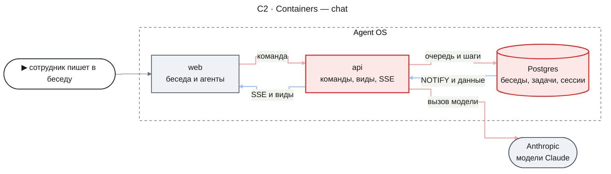
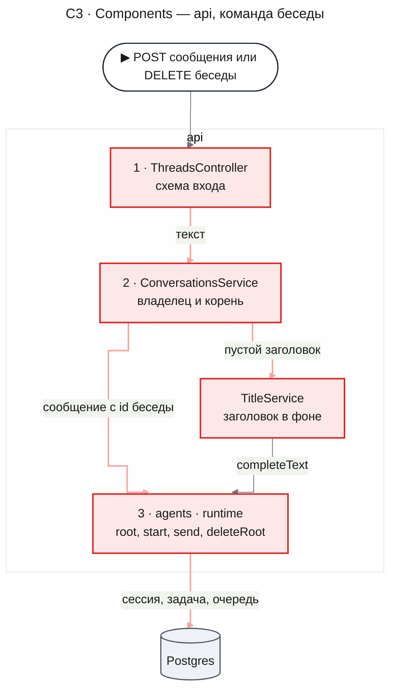
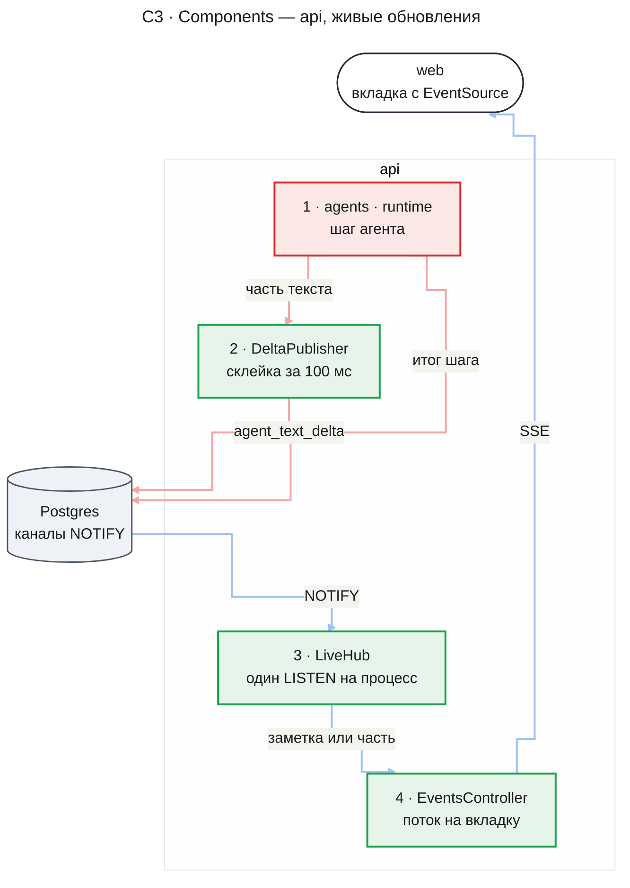
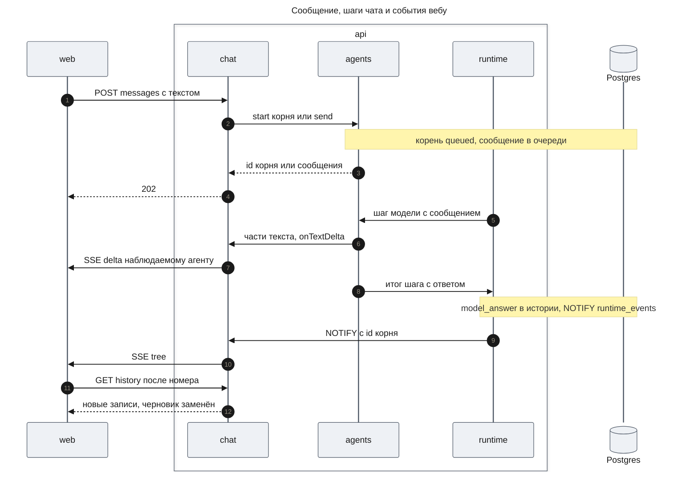
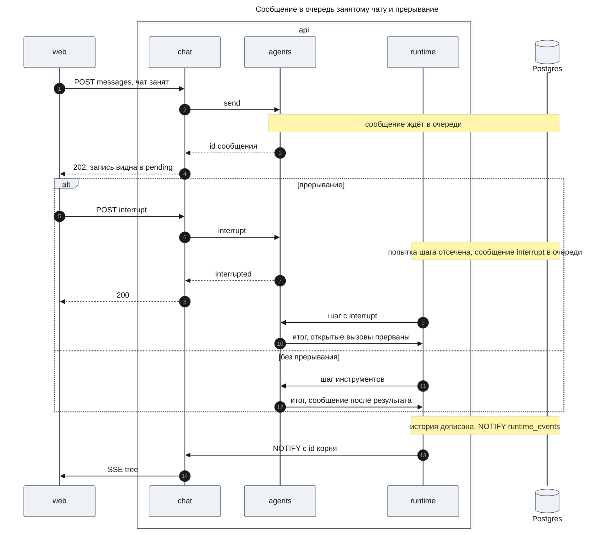
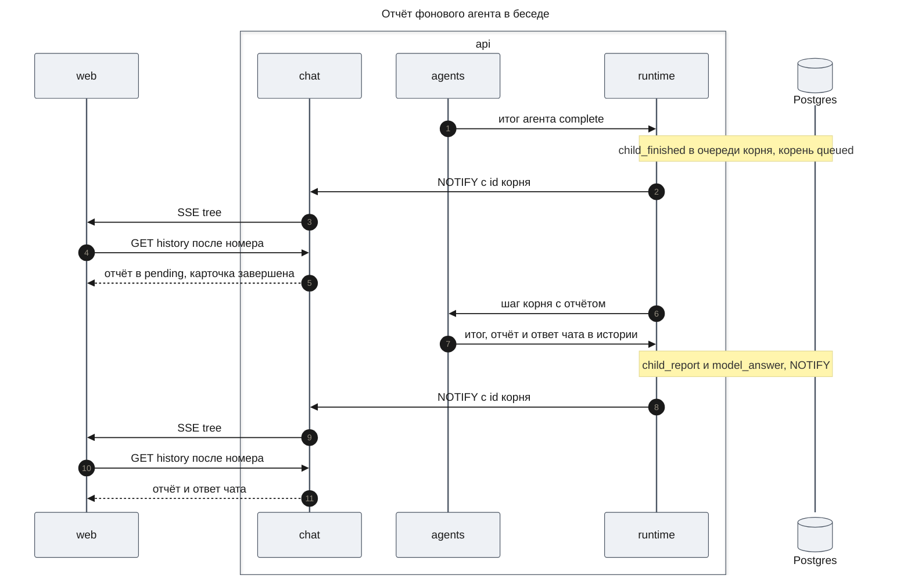
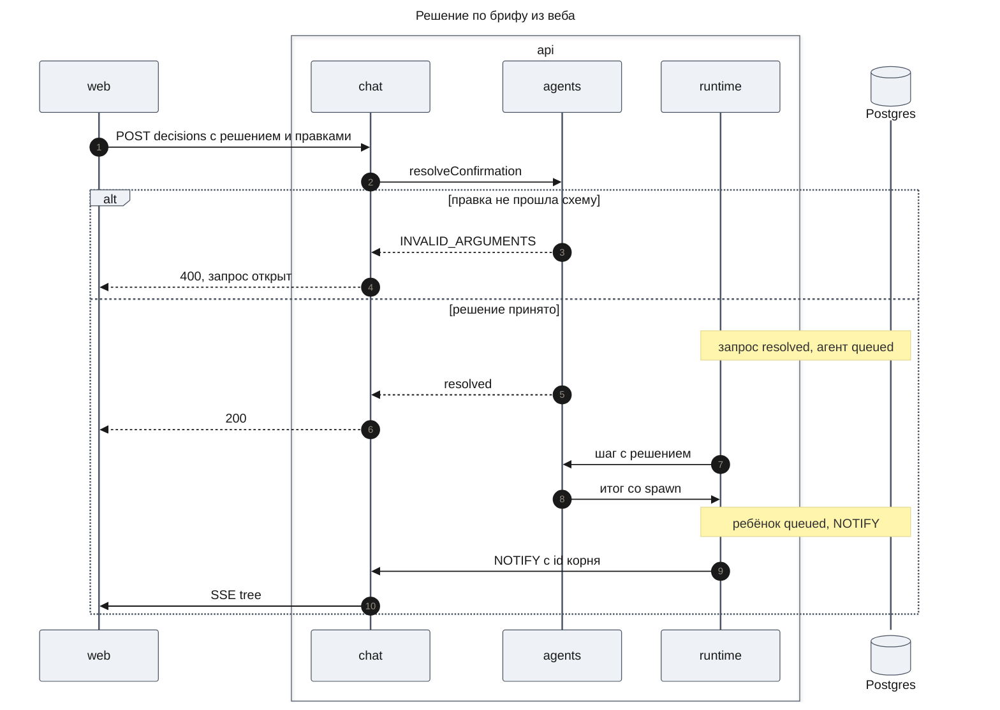
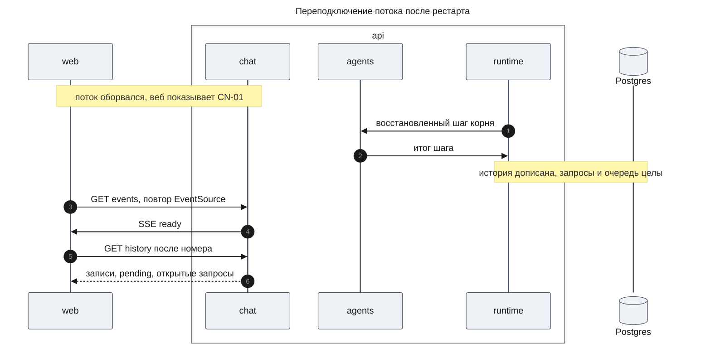
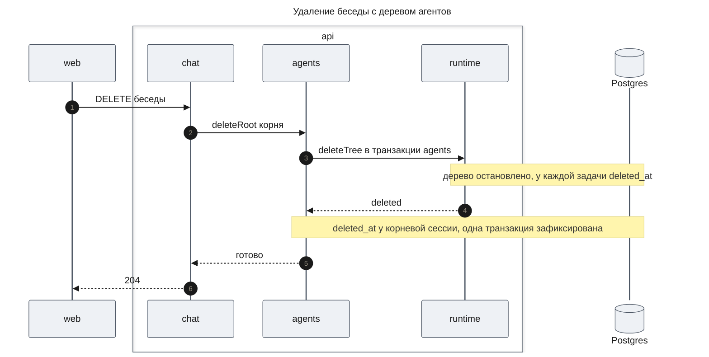
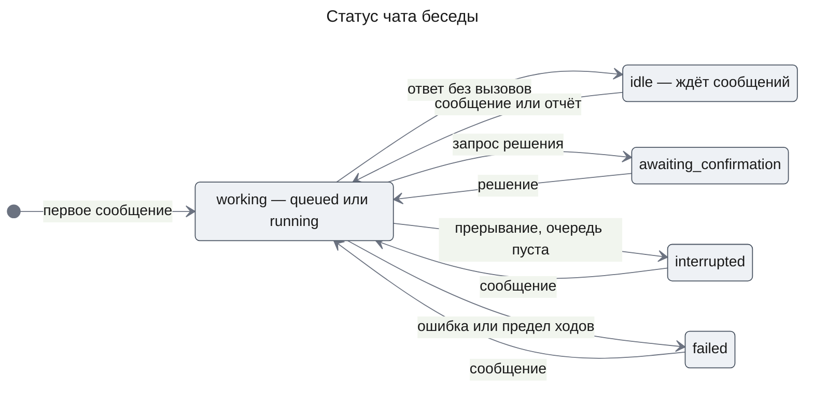

# Платформа агентов — Design Document — chat

**Status:** На утверждении · **Date:** 2026-11-21 · **PRD:** [prd.md](./prd.md) · **UXRD:** [uxrd.md](./uxrd.md) · **Depends on:** [design-agents.md](./design-agents.md#contract-definitions)

## Snapshot

**Overview.** Эта часть переводит беседу на слой агентов и даёт вебу API для работы с агентами. Беседа — корневая сессия главного чата с заголовком, и id беседы — id этой сессии. `POST /api/threads` только выдаёт новый id; первое сообщение сотрудника создаёт сессию с этим id, и лишь тогда беседа появляется, а каждое следующее сообщение ложится в её очередь. Отвечает чат в воркерах runtime, а не внутри HTTP-запроса, поэтому команды веба — обычные короткие запросы, а живые изменения веб получает одним потоком SSE на вкладку. Поток несёт только заметки «в этой беседе что-то изменилось» и части текста ответа, а сами данные веб перечитывает обычными запросами.

- **Не меняется**: маршруты бесед и формы их ответов; бюджеты производительности списка (NFR-03). Поведение создания меняет KD-1: беседа появляется с первым сообщением.
- **Biggest risk**: время до первого токена растёт на путь через очередь и воркер ([Risks and Mitigation](#risks-and-mitigation)).
- **Open questions**: нет.

### Key Decisions

#### KD-1: Беседа — корневая сессия агента `chat`; её id — id беседы, и появляется она с первым сообщением

Сессии агента нужно задание, а у новой беседы его нет. Поэтому `POST /api/threads` ничего не пишет и только выдаёт новый UUID. Первое сообщение вызывает `agents.sessions.start` без родителя с этим id и текстом сообщения как заданием: задача runtime и сессия создаются в одной транзакции. Каждое следующее сообщение — `send` в очередь корня. До первого сообщения беседы нет: её нет в списке, и все маршруты беседы, кроме отправки, отвечают 404 `THREAD_NOT_FOUND`. `apps/api` доходит до бесед только через операции корня в `agents.sessions` (`root`, `rootOwner`, `roots`, `touchRoot`, `renameRoot`, `titleRootIfEmpty`, `deleteRoot`).

Гонки решает runtime. Из двух одновременных первых отправок вторая ждёт транзакцию первой и получает `TASK_EXISTS` на первичном ключе, а её сообщение уходит в очередь уже созданного корня. Отправка и удаление по очереди берут замок задачи корня. Заголовок пишется условием «только в пустой».

Удаление помечает беседу, а не стирает её. Операция `agents.sessions.deleteRoot` одной транзакцией останавливает дерево и ставит отметку `deleted_at` каждой задаче дерева и корневой сессии; с этого момента все чтения и команды видят беседу и её агентов как несуществующие. Записи вызовов инструментов в журнале агентов — аудит и должны пережить удаление, а id удалённой беседы не должен снова стать беседой. Не взято: стирание дерева каскадом вместе с сессиями и журналом — оно уничтожает аудит и освобождает id.

Последствия, принятые вместе с решениями:

- строки удалённой беседы держат её id занятым, поэтому отправка на этот id отвечает 404 `THREAD_NOT_FOUND` и ничего не создаёт — и владельцу, и любому другому; новую беседу начинает только никогда не использованный id;
- на маршруте отправки чужой и удалённый id отвечают 404, а никогда не использованный принимается, поэтому только здесь чужой id отвечает не так, как несуществующий;
- строки удалённых бесед копятся: очистки по сроку хранения нет, внешние ключи с каскадом остаются в схеме для неё;
- переименование до первого сообщения — 404;
- `touchRoot` поднимает беседу в списке после постановки сообщения в очередь, а не в одной транзакции с ней.

#### KD-2: Команды — обычный HTTP, живые изменения — один поток SSE с заметками, данные — перечитывание

Ответ готовит воркер, поэтому запрос не держит ответ модели. Поток `GET /api/events` несёт заметку `tree` с id беседы, когда в её дереве записалось событие runtime ([design-runtime.md](./design-runtime.md#contract-definitions), канал `runtime_events`), и веб перечитывает вид экрана с последнего номера записи. Переподключение после обрыва или рестарта — то же перечитывание по первому событию `ready`, поэтому номер последнего события, буфер повторов и `Last-Event-ID` не нужны. Не взяты: события с данными и дочитывание `listAfter` по курсору — курсор по многим деревьям и его согласование стоят дороже повторного чтения; WebSocket — в коде нет ни одного шлюза, а командам хватает HTTP.

#### KD-3: Текст ответа приходит по частям через NOTIFY и нигде не хранится

AC-14.1 и UXRD («ответ стримится») требуют показывать ответ по мере генерации. `ModelClient` агентов вызывает модель потоком (`Agent.stream` Mastra с `maxSteps: 1`; `textStream` и обещания `toolCalls`, `usage` — [Mastra, Agents overview](https://mastra.ai/docs/agents/overview)) и отдаёт каждую часть текста хуку `onTextDelta`. Установленный `@mastra/core` 1.80.0 даёт у `MastraModelOutput` именно `textStream`, `toolCalls` и `usage`. `apps/api` шлёт первую часть сразу, а следующие склеивает за 100 мс и отправляет `pg_notify` в канал `agent_text_delta`, деля склейку на куски меньше предела полезной нагрузки NOTIFY; поток отдаёт части только агенту, за которым следит вкладка. Сохраняется по-прежнему один `model_answer` в конце шага. Целое сообщение без частей обошлось бы без хука, но не выполняет AC-14.1.

#### KD-4: Веб получает историю записями `HistoryEntry` агентов, а не сообщениями AI SDK

Беседа и страница агента показывают одни и те же записи ([HistoryEntry](./design-agents.md#contract-definitions)): задание, ответы модели, вызовы инструментов, сообщения, отчёты и события. API отдаёт их как есть, а веб сам превращает их в сообщения ленты через `useExternalStoreRuntime` assistant-ui: состояние держит приложение, `isRunning` и `onCancel` задаёт оно же ([assistant-ui, External Store](https://www.assistant-ui.com/docs/runtimes/custom/external-store)). Не взято: перевод записей в UIMessage на сервере — второй формат той же истории.

#### KD-5: Главный чат — запись `chat` с правилом выбора в промпте

У `chat` встроенные `start_agent`, `message_agent`, `list_agents`, `stop_agent`, `mcpServers` `*`, каталог `agents` — только `general-purpose`, без модели, `maxTurns` 20. Промпт чата словами задаёт правило FR-15 по порядку веток.

#### KD-6: Часть сама меняет контракты `runtime` и `agents` первой работой, а не обходит их в `apps/api`

Контрактов `agents` и `runtime` не хватает в четырёх местах, и эта часть правит сами пакеты:

- в `packages/agents` — хук `createAgents({ onTextDelta })`, ради которого `ModelClient` вызывает `Agent.stream` с `maxSteps: 1` (KD-3);
- в `packages/agents` — `agents.completeText` для заголовка: разовый вызов модели без задачи, который пишет строку журнала токенов без `taskId` (так журнал уже допускает), поэтому Mastra не остаётся в `apps/api`;
- в `packages/runtime` — `decisions.listTree`, а в `packages/agents` на нём — `agents.sessions.confirmations(rootId, ownerId)`: запросы дерева со статусом `open`, `resolved` или `cancelled` и решением. Без этого беседа после перезагрузки теряла бы решённые копии запросов фоновых агентов (AC-14.2);
- в `packages/agents` — `start` с id, который задаёт вызывающий, и операции корневой сессии `root`, `rootOwner`, `roots`, `touchRoot`, `renameRoot`, `titleRootIfEmpty`, `deleteRoot`: беседа — корневая сессия (KD-1), и `apps/api` не читает таблицы `agents` сам.

Не взято: обходы в `apps/api` (свой вызов Mastra, чтение таблиц `agents` и `runtime`) — они нарушают правила пакетов [ADR-0004](../../adr/ADR-0004-agent-framework-packages.md).

#### KD-7: Список агентов сотрудника собирается по его беседам

Операции «все агенты владельца» в нижних пакетах нет, и читать их таблицы `apps/api` нельзя. Поэтому `GET /api/agents` берёт беседы владельца через `agents.sessions.roots`, для каждой вызывает `agents.sessions.list` и отдаёт страницу верхних агентов, новые сверху, с курсором по времени создания и id — тем же приёмом, каким листается список бесед. Счётчик ждущих решений (NV-01) так же суммирует `confirmations`.

## Terms

- **Беседа** — корневая сессия агента `chat` с заголовком и временем изменения; id беседы — id этой сессии. В API и контрактах она `thread`.
- **Корень беседы** — та же сессия как агент; все агенты и запуски беседы — её потомки.
- **Заметка** — событие потока SSE без данных о содержимом: «перечитай эту беседу».
- **Часть текста** — кусок ответа модели, который ещё пишется; живёт только в потоке.
- **Наблюдаемый агент** — агент, чьи части текста просит вкладка: корень открытой беседы (вкладка называет беседу, и это работает до первого сообщения: id беседы и есть id будущего корня) или открытый агент.

## Part

- **Part**: `chat` — четвёртая часть Delivery Parts в PRD.
- **Covers**: FR-14, FR-15, FR-16, FR-17; API для FR-21–FR-24 и FR-29; NFR-06 на каждой точке доступа этого API; NFR-02 и NFR-03 в доле беседы.
- **Depends on**: [design-agents.md, Contract Definitions](./design-agents.md#contract-definitions) — `createAgents`, операции агентов `start`, `send`, `interrupt`, `stop`, `restart`, `get`, `list`, `history`, `resolveConfirmation` и операции корня из KD-6, `AgentView`, `HistoryEntry`, событие `agents.history_appended`. Операции агентов — сервис `agents.sessions` (`agents.sessions.start` и так далее); `start()` и `stop()` жизненного цикла — на `Agents`; [design-runtime.md, Contract Definitions](./design-runtime.md#contract-definitions) — `tasks.get`, `inbox.listPending`, канал `runtime_events`, `ledger.monthSpend`, логгер `common`.
- **Prerequisite ADRs**: [ADR-0001](../../adr/ADR-0001-durable-runtime-owner.md) (состояние только в Postgres), [ADR-0003](../../adr/ADR-0003-drizzle-data-layer.md) (Drizzle, миграции вперёд), [ADR-0004](../../adr/ADR-0004-agent-framework-packages.md) (правила пакетов).
- **Sibling parts**: `runtime`, `agents` — контракты выше; `web` — экраны поверх этого API.

**Out of scope**

- Экраны, лоток, карточки, строка связи и перевод записей в ленту assistant-ui — часть `web`.
- Перегенерации ответа после ошибки (chat-shell AC-14.6) нет: беседа после сбоя модели продолжается следующим сообщением (AC-09.1), а AC-14.3 требует поведения только FR-13, FR-15–FR-17.

**Constraints**

- Mastra остаётся только в `packages/agents`.
- Всё состояние — в Postgres: в памяти процесса только подписки потока SSE и склейка частей текста за 100 мс; потеря того и другого лечится перечитыванием (KD-2).
- Вход и выход каждой точки — zod-схемы `packages/contracts`; ошибки — тело `ApiErrorSchema` с `errorCode`.
- Логирование через логгер `common` ([logging.md](../../code-system/patterns/logging.md)): каждая команда, подключение потока и сбой заголовка — с владельцем, беседой или агентом, без текста сообщений.
- Тесты — немного и критичное; модель подменяется сценарием на границе `ModelClient` ([Test Strategy](#test-strategy)).

## Building-block Inventory

Follows the [code system](../../code-system/README.md).

| Building block | Pattern | Status | Note |
|---|---|---|---|
| `ChatModule` в `apps/api/src/chat/` | обычный провайдер Nest ([composition-root.md](../../code-system/patterns/composition-root.md), Not For) | extended | — |
| Операции корня в `agents.sessions` (`root`, `rootOwner`, `roots`, `touchRoot`, `renameRoot`, `titleRootIfEmpty`, `deleteRoot`) | [repository-over-transaction.md](../../code-system/patterns/repository-over-transaction.md) | extended — KD-1 | над `agent_sessions` |
| `ConversationsService`, `ThreadsController` | — | extended | маршруты и формы бесед прежние; добавлены история, отправка, прерывание |
| `AgentControlService`, `AgentsController`, `DecisionsController`, `SpendController` | — | new | тонкие обёртки над операциями `agents`, `runtime` с проверкой владельца |
| `LiveHub`, `EventsController` | — | new — KD-2 | искали: SSE, WebSocket и `EventSource` в коде нет; NOTIFY слушает только runtime для своих воркеров |
| `DeltaPublisher` | — | new — KD-3 | `pg_notify` через пул `RUNTIME_DATABASE` |
| `TitleService` | — | extended | вызов модели — `agents.completeText` |
| Курсор списка (`thread-cursor.ts`) | — | reused | тот же формат; выборка страницы уходит в SQL |
| `ModelClient` (`packages/agents`) | — | extended — KD-3, KD-6 | поток, хук `onTextDelta`, `completeText` |
| `confirmations`, `decisions.listTree` | — | extended — KD-6 | — |

## Acceptance Criteria

### FR-14: Беседа — корневая сессия

- From the PRD: AC-14.1, AC-14.2, AC-14.3, AC-14.4.
- Беседа появляется с первым сообщением: до него id из `POST /threads` нет в списке, а маршруты беседы, кроме отправки, отвечают 404 `THREAD_NOT_FOUND`. Первое сообщение создаёт корень с id беседы и текстом как заданием, а следующие сообщения ложатся в его очередь (DC-1).
- Заголовок генерируется по первому сообщению и пишется только в пустой заголовок; сбой генерации оставляет его пустым и повторяется при следующей отправке (DC-2).

### FR-15: Инструменты чата и запуск по триггеру

- From the PRD: AC-15.1, AC-15.2, AC-15.3, AC-15.4, AC-15.5, AC-15.6. Выбор ветки — суждение модели по промпту (KD-5); автотест проверяет только связку инструментов, а выбор проверяется ручным прогоном (PRD, Assumptions).

### FR-16: Писать, пока чат работает

- From the PRD: AC-16.1, AC-16.2.

### FR-17: Фоновые результаты в беседе

- From the PRD: AC-17.1, AC-17.2, AC-17.3.

### API для веба (FR-21–FR-24, FR-29) и NFR-06

- Каждая точка API отвечает на чужой id так же, как на несуществующий, тем же телом; маршруты агентов так же отвечают на id корня беседы. Исключение — отправка в беседу: никогда не использованный id начинает новую беседу, а чужой отвечает 404 `THREAD_NOT_FOUND` и ничего не создаёт (DC-3, KD-1).
- Удалённая беседа и её агенты отвечают своему владельцу на каждом маршруте так же, как несуществующий id, тем же телом; отправка на id удалённой беседы — 404 `THREAD_NOT_FOUND`, и ничего не создаётся (KD-1).
- Поток SSE отдаёт сотруднику заметки только о его беседах и части текста только его агентов (DC-4).
- После каждого подключения поток первым отправляет `ready` (DC-5).

## Design

### Architecture (C1–C4)

#### C2 · Containers

- `api` принимает команды, отдаёт виды беседы и агентов и держит потоки SSE; отвечает чат в воркерах runtime того же процесса.
- В `Postgres` беседа — строка `agent_sessions` её корня (Data Model); каналы `runtime_events` и `agent_text_delta` несут сигналы между экземплярами.
- `web` меняется в своей части; здесь он только потребитель контракта.

#### C3 · Components: api

**api — команда беседы**

- `ConversationsService` находит корневую сессию владельца через `agents.sessions.root` (иначе `THREAD_NOT_FOUND`). Если корня ещё нет, отправка создаёт его через `agents.sessions.start` с id беседы, а иначе кладёт сообщение в очередь через `send` и поднимает беседу в списке через `touchRoot`. Удаление — проверка владельца и `agents.sessions.deleteRoot`: дерево остановлено и помечено удалённым вместе с корневой сессией, а строки остаются (Flow 6).
- `AgentControlService` (не нарисован, тот же путь) делает то же для маршрутов агентов и решений: владелец проверяется операцией `agents`, а корень беседы отвергается как несуществующий агент.
- `TitleService` пишет заголовок через `titleRootIfEmpty` — условием «только в пустой».

**api — живые обновления**

- `LiveHub` держит одно отдельное соединение с `LISTEN runtime_events` и `LISTEN agent_text_delta` на процесс и раздаёт сигналы потокам своих вкладок. `rootId` из `runtime_events` и есть id беседы, поэтому искать беседу не нужно: хаб берёт только владельца корня у `agents.sessions.rootOwner` на каждую заметку, ничего не запоминая, и шлёт заметку `tree` только потокам этого владельца. У помеченного удалённым корня владельца нет, поэтому заметки его дерева не уходят никому. Часть текста несёт владельца и агента, и хаб отдаёт её только потоку того же владельца, который наблюдает этого агента.
- Потерянное соединение `LISTEN` хаб открывает заново и шлёт всем своим потокам `ready`, потому что сигналы за время обрыва потеряны.
- `EventsController` — точка `@Sse()` NestJS: поток событий `MessageEvent` с полями `type` и `data` и подсказкой переподключения ([NestJS, Server-Sent Events](https://docs.nestjs.com/techniques/server-sent-events)). Каждые 20 с он шлёт `ping`, чтобы прокси не закрыл простаивающий поток.

#### Сборка

`AppModule` собирает пакеты по [composition-root.md](../../code-system/patterns/composition-root.md): `RuntimeModule` (`createRuntime`) → `AgentsModule` (`createAgents` с хуком `onTextDelta` от `DeltaPublisher`) → `ChatModule`. Инструменты регистрируются в фабриках провайдеров, потому что `agents.start()` идёт в `AgentsModule.onModuleInit`, до старта воркеров в `RuntimeModule.onApplicationBootstrap`. `ChatModule` открывает `LISTEN` хаба при старте приложения и закрывает потоки и соединение хаба перед остановкой воркеров. Логгер и Sentry уже подключила часть `runtime`, воркеры работают в процессе `api`, как там описано.

### Runtime Flows

Во всех потоках `chat` — модуль `ChatModule` в `api`, `agents` — пакет `agents`, `runtime` — пакет `runtime`; все три — внутри одного процесса `api`. Стрелка от `runtime` к `chat` — сигнал NOTIFY, который принёс `LiveHub`.

#### Flow 1: Сообщение и ответ по частям

**Starts when:** сотрудник отправляет сообщение в свободную беседу; for AC-14.1, AC-16.1, DC-1, DC-2.

**Outcome:** в истории корня — задание или доставленное сообщение и ответ модели одной записью; части текста не сохранены. Первое сообщение создало корень с id беседы, беседа появилась в списке, а `TitleService` запустил генерацию заголовка.

**Failure handling:**

- Id занят чужой задачей, например беседой другого сотрудника → 404 `THREAD_NOT_FOUND`, в очередь ничего не легло.
- Беседа удалена → её строки держат id: `start` получает `TASK_EXISTS`, ответ — 404 `THREAD_NOT_FOUND`, как на чужой id, и ничего не создано (KD-1). Отказ процедуры старта проверяется раньше и даёт 409 `START_REFUSED` одинаково для удалённого, чужого и нового id.
- Id никогда не использовался → отправка начинает новую беседу с этим id.
- Две первые отправки одновременно → `start` второй ждёт транзакцию первой и получает `TASK_EXISTS`, а её сообщение ложится в очередь созданного корня.
- Сбой `touchRoot` после `send` → сообщение уже в очереди, а ответ 500 и беседа не поднялась в списке: `touchRoot` идёт не в одной транзакции с постановкой в очередь.
- Повтор вызова модели внутри `ModelClient` или повтор потерянного шага начинает части заново с `offset` 0 → веб сбрасывает черновик.
- Ошибка модели после повторов → корень `failed` с `model_error`; заметка `tree` показывает вебу статус, черновик убирается, следующее сообщение продолжает беседу (AC-09.1).
- Потерянный `pg_notify` части текста → черновик неполный до прихода записи истории; запись истории полная.

#### Flow 2: Сообщение, пока чат работает, и прерывание

**Starts when:** сотрудник отправляет сообщение или нажимает «Прервать» во время шага чата; for AC-16.1, AC-16.2.

**Outcome:** сообщение стоит в истории после результата инструмента или конца хода (AC-07.1, AC-07.3), пока ждёт — в `pending` вида беседы. Прерывание закрывает открытые вызовы. Если сообщения уже ждали в `pending`, шаг берёт их вместе с прерыванием, и чат продолжает с ними, иначе корень остаётся в статусе «прерван» (AC-08.1, AC-08.2). Пока бриф или действие чата ждёт решения, новое сообщение не вытесняет запрос и ждёт в `pending` до решения (UXRD, «Чат ждёт решения»).

**Failure handling:**

- Чат ждёт решения или уже свободен → `interrupt` отвечает `not_active`, ничего не меняется. До первого сообщения беседы нет, и `interrupt` отвечает 404 `THREAD_NOT_FOUND`.
- Пустой или длиннее `CHAT_MESSAGE_MAX_LENGTH` текст → 400 `VALIDATION_FAILED`, очередь не тронута.
- Сеть оборвалась до ответа → веб не знает, принято ли сообщение, и перечитывает вид: принятое видно в `pending` или истории.

#### Flow 3: Отчёт фонового агента в беседе

**Starts when:** агент беседы сдал отчёт; for AC-17.1, AC-17.2, AC-06.1, AC-06.2.

**Outcome:** отчёт стоит в истории корня записью `child_report`, за ним ответ чата (AC-06.1). Беседа, открытая позже, получает то же из истории (AC-17.2). Пока чат занят, отчёт ждёт в `pending` с источником `report` (AC-06.2).

**Failure handling:**

- Вкладка не подключена → заметка никому не уходит; данные лежат в базе и читаются при открытии.
- Агент упал или остановлен → `child_report` несёт статус и причину (AC-06.3), путь тот же.

#### Flow 4: Решение по брифу или действию из веба

**Starts when:** сотрудник нажал «Запустить», «Запустить с правками», «Подтвердить» или «Отклонить» на карточке решения; for AC-17.3, AC-24.2, AC-28.1–AC-28.3.

**Outcome:** вид беседы показывает запрос как `resolved` и новый запуск в `agents`. Так же решается изменяющее действие агента любой глубины: id запроса берётся из `decisions` вида беседы.

**Failure handling:**

- Запрос чужой или его нет → 404 `DECISION_NOT_FOUND`.
- Решение уже записано в другой вкладке → 200 `already_resolved`, второго запуска нет.
- Сеть оборвалась → веб показывает MC-19 и повторяет; повтор отвечает `already_resolved`, если первый дошёл.

#### Flow 5: Переподключение после рестарта сервера

**Starts when:** сервер перезапустился, пока вкладка была открыта; for DC-5, AC-12.5, AC-01.3 в доле беседы.

**Outcome:** веб снимает строку связи после `ready` и дочитывает историю с последнего номера, поэтому записи не повторяются и не пропадают; запросы решений и сообщения в очереди на месте (AC-12.5, AC-01.3).

**Failure handling:**

- Сервер ещё не поднялся → `EventSource` повторяет подключение через 2 с (подсказка `retry` потока).
- Черновик части текста оборвался → после рестарта шаг идёт заново с `offset` 0.

#### Flow 6: Удаление беседы с работающими агентами

**Starts when:** сотрудник удаляет беседу; for AC-14.4, AC-14.3.

**Outcome:** беседа и её агенты для всех маршрутов не существуют, но ничего не стёрто: задачи, очереди, запросы, события и их доставки, сессии, журнал агентов с записями вызовов, сохранённые результаты, вызовы кода и проходы знаний остаются в базе (KD-1). Строки журнала токенов не тронуты, расход месяца не уменьшился. Отправка и удаление по очереди берут замок задачи корня, а отметку отправка читает из этой же заблокированной строки. Поэтому отправка, которая ждала удаления, видит беседу несуществующей, отвечает 404 `THREAD_NOT_FOUND` и не оживляет корень; отправка после удаления отвечает так же (KD-1).

Остальные части видят удалённое дерево по своим правилам: извлечение знаний — [self-learning/design-core.md](../self-learning/design-core.md), счёт `firstRun` — [design-agents.md, Data Model](./design-agents.md#data-model).

**Failure handling:**

- Беседа чужая или уже удалена → 404 `THREAD_NOT_FOUND`, ничего не изменилось.
- Беседа удалена другим запросом между проверкой владельца и `deleteRoot` → `AGENT_NOT_FOUND` агентов, ответ тот же 404.
- Deadlock или сбой сериализации → транзакция повторяется целиком.
- Шаг агента дерева ещё идёт → runtime отсекает его попытку, итог не записывается ([design-runtime.md](./design-runtime.md#contract-definitions), `stop`).

### Contract Definitions

Все маршруты — под `/api`, под `SessionGuard`; владелец — `req.user.id`. Вход и ответы — zod-схемы `packages/contracts`. Чужой id отвечает тем же кодом и телом, что несуществующий, кроме отправки в беседу (KD-1).

**Беседы** (`ThreadsController`)

- **`GET /threads?cursor`**, **`POST /threads`**, **`GET /threads/:threadId`**, **`PATCH /threads/:threadId`**, **`DELETE /threads/:threadId`** — страница `THREAD_PAGE_SIZE` по `updatedAt` по убыванию с `nextCursor`, создание (201 `ThreadSummary`), чтение, переименование (`title` после обрезки пробелов от 1 до `THREAD_TITLE_MAX_LENGTH`), удаление (204). `POST /threads` ничего не пишет: он выдаёт новый UUID с пустым заголовком, а беседа появляется с первым сообщением. До него беседы нет в списке, а чтение, переименование и удаление отвечают 404 `THREAD_NOT_FOUND`. Удаление останавливает дерево беседы и помечает его удалённым, строки остаются; после него беседа на каждом маршруте — несуществующая (Flow 6). `updatedAt` растёт при отправке сообщения и переименовании.
- **`GET /threads/:threadId/history?afterSeq`** — `ConversationView`; `afterSeq` по умолчанию 0.
- **`GET /threads/:threadId/agents`** — дерево агентов беседы без корня, массив `AgentNode`; для абзаца MC-26 и живого обновления списка агентов.
- **`POST /threads/:threadId/messages`** с `text` — первое сообщение создаёт корень с id `threadId`, остальные идут в очередь (DC-1). Ответ 202 с `messageId`, у первого сообщения он пуст: оно становится заданием. Текст после обрезки — от 1 до `CHAT_MESSAGE_MAX_LENGTH` символов. Никогда не использованный id начинает беседу с этим id; id удалённой беседы и id, занятый чужой задачей, — 404 `THREAD_NOT_FOUND`, а при отказе процедуры старта — 409 `START_REFUSED`; ничего не создаётся (KD-1).
- **`POST /threads/:threadId/interrupt`** без тела — 200 с `outcome`: `interrupted` или `not_active`; до первого сообщения — 404 `THREAD_NOT_FOUND`. Новое сообщение, пока чат работает, идёт через `POST /threads/:threadId/messages` (FR-16).

**Агенты** (`AgentsController`). Корень беседы для этих маршрутов не существует: `AGENT_NOT_FOUND`.

- **`GET /agents?cursor`** — `AgentListPage`: верхние агенты всех бесед владельца (дети корней), новые сверху, по `AGENT_PAGE_SIZE`, с поддеревьями и `nextCursor` (KD-7).
- **`GET /agents/awaiting`** — `count`: число открытых запросов решений во всех беседах владельца (NV-01).
- **`GET /agents/:agentId/history?afterSeq`** — `AgentPageView`.
- **`GET /agents/:agentId/inherited?afterSeq`** — записи истории родителя ответвления до `throughSeq` с тем же постраничным правилом; у агента без ответвления — пусто (AV-05).
- **`GET /agents/:agentId/run`** — вид запуска; не запуск — 404 `RUN_NOT_FOUND`.
- **`POST /agents/:agentId/messages`** с `text` — `send`, 202 с `messageId`; агенту в конечном статусе — продолжение с историей.
- **`POST /agents/:agentId/interrupt`** без тела — 200 с `outcome`: `interrupted` или `not_active`.
- **`POST /agents/:agentId/stop`** — 200 со `stopped`: id остановленных агентов.
- **`POST /agents/:agentId/restart`** — 201 с `agentId` нового агента; работающий — 409 `NOT_FINISHED`, родитель закончил — 409 `PARENT_FINISHED`.

**Решения и расход**

- **`POST /decisions/:decisionId`** с `approve` и необязательными `args` — `resolveConfirmation`; 200 с `outcome` `resolved` или `already_resolved`, 400 `INVALID_ARGUMENTS`, 404 `DECISION_NOT_FOUND`. `args` — полные аргументы инструмента по его схеме: для брифа веб передаёт три поля брифа.
- **`GET /spend`** — `month` (`YYYY-MM`, текущий месяц по UTC) и `costUsd` из `ledger.monthSpend`.

**Поток** (`EventsController`)

- **`GET /events?watch`** — поток SSE владельца; `watch` необязателен: `thread:<threadId>` — корень этой беседы, в том числе созданный после подключения (часть несёт `rootId`, и хаб сравнивает его с `threadId`: это один id), или `agent:<agentId>` — открытый агент. События:
  - `ready` — первое после каждого подключения и после восстановления `LISTEN`: веб перечитывает экран (DC-5).
  - `tree` с `threadId` — в дереве беседы записано событие runtime: статус, история, очередь, запрос, новый агент.
  - `delta` с `agentId`, `offset` и `text` — часть ответа наблюдаемого агента. `offset` — позиция части в тексте этого вызова модели; `offset` 0 начинает черновик заново; часть с `offset`, не равным длине черновика, веб отбрасывает до следующего `offset` 0 или записи истории.
  - `ping` — раз в 20 с.
- Подсказка переподключения `retry` — 2000 мс. Чужой или неизвестный `watch` не ошибка: частей просто нет.

**ConversationView**

- `thread` — `ThreadSummary`.
- `chat` — состояние чата: `status` (`idle`, `working`, `awaiting_confirmation`, `interrupted`, `failed`; см. State Transitions), `failureReason` при `failed`, `rootAgentId` — равен id беседы, `model` — модель корня.
- `entries` — записи `HistoryEntry` корня с номером больше `afterSeq`, не больше `HISTORY_PAGE_SIZE`; `nextAfterSeq` — номер, с которого читать дальше, или пусто, если всё прочитано.
- `pending` — недоставленные сообщения корня по порядку: `messageId`, `source` (`user`, `report`, `parent`), текст или для отчёта описание агента и статус, время. Сообщения `interrupt` в `pending` не попадают.
- `decisions` — `Confirmation` всего дерева, все статусы.
- `agents` — `AgentNode` детей корня.

**AgentPageView** — `agent` (`AgentView` с `threadId`, `threadTitle` и `parentDescription` — описанием родителя из `agents.sessions.get`; у ребёнка корня беседы `parentDescription` нет), `entries` и `nextAfterSeq` по тем же правилам, `pending` этого агента, `decisions` только этого агента, `children` — его поддерево `AgentNode`.

**AgentNode** — `AgentView` ([design-agents.md](./design-agents.md#contract-definitions)) и `children`. В `AgentListPage` у верхних узлов ещё `threadId` и `threadTitle`.

**Confirmation** — запрос решения: `decisionId`, `agentId`, описание агента, вид, инструмент, сервер, аргументы, `status` (`open`, `resolved`, `cancelled`), решение и итоговые аргументы при `resolved`, время создания и решения.

**Расширения нижних пакетов** (KD-6)

- **`createAgents({ ..., onTextDelta })`** — `ModelClient` вызывает хук на каждую часть текста с `ownerId`, `rootId`, `agentId`, `offset`, `text`; ошибка хука логируется и не ломает шаг.
- **`agents.completeText({ ownerId, system, prompt, maxOutputTokens, signal })`** — один вызов модели вне задачи; пишет строку журнала без `taskId`; возвращает текст.
- **`agents.sessions.confirmations(rootId, ownerId)`** отдаёт `Confirmation` всех статусов; строится на `decisions.listTree(rootId, ownerId)` runtime, который возвращает запросы дерева со статусом, решением и временем.
- **`agents.sessions.start({ agentId?, ownerId, prompt, description, record? })`** — создаёт задачу и корневую сессию в одной транзакции; без `agentId` id новый, а занятый id — `TASK_EXISTS` runtime.
- **Операции корневой сессии** (KD-1). Чужой корень, удалённый корень, сессия не-корень и отсутствующий id для них одинаково отсутствуют.
  - `root(rootId, ownerId)` — корневая сессия владельца: id, заголовок (пустой, пока не записан), время создания и изменения; иначе ничего.
  - `rootOwner(rootId)` — владелец корневой сессии, кто бы он ни был; иначе ничего. Нужна `LiveHub`, потому что сигнал `runtime_events` не несёт владельца.
  - `roots({ ownerId, limit?, after? })` — корни владельца по времени изменения, затем по id, по убыванию, строго после `after`.
  - `touchRoot(rootId, ownerId)` поднимает корень в списке; `renameRoot(rootId, ownerId, title)` пишет заголовок, поднимает корень и возвращает его или ничего.
  - `titleRootIfEmpty(rootId, ownerId, title)` пишет заголовок только в пустой и отвечает, записан ли он.
  - `deleteRoot(rootId, ownerId)` одной транзакцией останавливает дерево беседы и помечает удалёнными каждую его задачу и корневую сессию; строки остаются. При deadlock или сбое сериализации транзакция повторяется целиком. Отсутствующий, чужой и уже удалённый корень — `AGENT_NOT_FOUND`.

**Error handling**

- `THREAD_NOT_FOUND` — 404, беседы нет, она чужая или удалена.
- `START_REFUSED` — 409, процедура старта отказала первому сообщению или перезапуску; причина и модель — [custom-agents/design-runtime.md](../custom-agents/design-runtime.md#contract-definitions).
- `AGENT_NOT_FOUND`, `RUN_NOT_FOUND`, `DECISION_NOT_FOUND` — 404, нет, чужой, из удалённой беседы или корень беседы.
- `VALIDATION_FAILED` — 400, вход не прошёл схему; `INVALID_CURSOR` — 400; `INVALID_ARGUMENTS` — 400, правка аргументов решения.
- `NOT_FINISHED`, `PARENT_FINISHED` — 409.
- Сбой сервера — 500 без текста ошибки и стека.

**Значения контрактов** (`packages/contracts`)

- `THREAD_PAGE_SIZE` 20, `THREAD_TITLE_MAX_LENGTH` 200, `GENERATED_THREAD_TITLE_MAX_LENGTH` 80.
- `CHAT_MESSAGE_MAX_LENGTH` — 20000 символов.
- `HISTORY_PAGE_SIZE` — 500, предел `history` агентов.
- `AGENT_PAGE_SIZE` — 20.

### Data Model

Своей таблицы бесед у части нет. Беседа — строка `agent_sessions` её корня ([design-agents.md, Data Model](./design-agents.md#data-model)), а id беседы — `task_id` корня. Только у корня заполнены `title` (пустая строка, пока заголовка нет) и `updated_at` — ключ списка бесед владельца; у остальных сессий оба поля пусты, а `parent_id` и `root_id` есть у каждой сессии. Корень хранит ссылку на встроенную запись «Главный чат» (`record_*`, `builtin_key = 'chat'`), но вид API для корня отдаёт `origin: null`. Удалённая беседа — та же строка с отметкой `deleted_at`: список бесед и операции корня её не видят (KD-1). История, очередь, запросы, статусы и токены живут в таблицах `runtime_*` и `agent_*`.

### State Transitions and Invariants

Статус чата для композера выводится из задачи корня (`tasks.get`) и её `AgentView`: у `AgentView` корня ожидание сообщений и работа — оба `working`, а композеру нужно их различать.

Корень, остановленный runtime иначе как удалением, показывается как `idle`: сообщение его оживляет. Беседа появляется вместе с корнем, поэтому статус начинается с `working`.

**Invariants**

1. Беседа и её корень — одна сессия: id беседы равен id корня, владелец беседы — владелец корня.
2. Автоматический заголовок не перезаписывает непустой заголовок.
3. Заметка `tree` и часть текста уходят только потокам владельца дерева.
4. Каждый вызов модели части, в том числе заголовка, — строка журнала токенов.
5. Удалённая беседа не возвращается: её строки не стираются, но ни один маршрут её не видит, ни одна команда не меняет её дерево, а её id не начинает новую беседу.

## Test Strategy

Модель подменяется сценарием на границе `ModelClient`, база — настоящий Postgres, приложение — настоящий `AppModule`, как в нынешней обвязке e2e. Выбор ветки FR-15 моделью проверяется ручным прогоном.

### Main Use Cases

- **UC-1: Ответ по частям и в истории** — covers AC-14.1, AC-16.1, DC-1
  - Given: новая беседа, поток подключён с `watch` на беседу; сценарий модели отдаёт текст тремя частями.
  - When: сотрудник отправляет первое сообщение.
  - Then: поток приносит `delta` с `offset` 0 и дальше, затем `tree`; история корня — задание с текстом сообщения и один `model_answer` со склеенным текстом.
- **UC-2: Беседа после перезагрузки** — covers AC-14.2, AC-17.2, AC-17.3, AC-24.2
  - Given: сценарий, где чат вызывает читающий MCP-инструмент, запускает агента, агент просит изменяющее действие, сотрудник подтверждает через `POST /decisions`, агент сдаёт отчёт.
  - When: вид беседы читается заново с `afterSeq` 0.
  - Then: в нём вызов с исходом, `child_report`, ответ чата и запрос агента со статусом `resolved` — те же записи, что приходили по ходу.
- **UC-3: Список, переименование, удаление, заголовок** — covers AC-14.3, DC-2
  - Given: у сотрудника 25 бесед; сценарий модели заголовка отвечает, падает или ждёт.
  - When: он листает список, переименовывает, удаляет и отправляет первое сообщение.
  - Then: страницы по 20 без дублей, id из `POST /threads` не виден в списке до первого сообщения, пустой заголовок — 400, удалённая беседа — 404 на чтение, переименование, удаление и отправку, а отправка на её id беседы не создаёт; заголовок появляется не дольше бюджета `chat-shell` AC-17.1, ручной заголовок не перезаписан, сбой оставляет заголовок пустым и пишет предупреждение, следующая отправка повторяет генерацию.
- **UC-4: Удаление беседы с работающим агентом** — covers AC-14.4
  - Given: в беседе агент ждёт долгого инструмента; в журнале есть его вызовы модели.
  - When: беседу удаляют.
  - Then: агент недоступен (404), его инструмент не получил новых вызовов, `GET /spend` показывает ту же сумму; задача и сессия корня остались в базе с отметкой удаления, а журнал агентов цел.
- **UC-5: Сообщение занятому чату и прерывание** — covers AC-16.1, AC-16.2
  - Given: чат в шаге с долгим читающим инструментом.
  - When: сотрудник отправляет сообщение, затем прерывает.
  - Then: сообщение видно в `pending`, потом в истории после результата прерванного вызова; вызов — с исходом «прервано»; `interrupt` вернул `interrupted`.
- **UC-7: Отчёт в открытой беседе** — covers AC-17.1, AC-06.1, NFR-02
  - Given: поток подключён с `watch` на беседу; сценарий запускает агента, который сдаёт отчёт после одного вызова.
  - When: агент сдаёт отчёт, пока чат свободен.
  - Then: приходит `tree`, вид беседы показывает `child_report` и следующий ответ чата; от записи отчёта до события `tree` — в пределах бюджета NFR-02.
- **UC-8: Чат управляет агентами беседы** — covers AC-15.2, AC-15.3
  - Given: в беседе работает агент; сценарий модели чата вызывает `list_agents`, затем `message_agent` и `stop_agent`.
  - When: сотрудник отправляет три соответствующих сообщения.
  - Then: результат `list_agents` перечисляет агента со статусом, сообщение встаёт в историю агента, агент получает статус «остановлен».

### Error and Edge Use Cases

- **UC-E1: Два сотрудника на каждой точке API** — covers NFR-06, DC-3, DC-4, AC-13.3
  - Given: у сотрудника A беседа, агент и открытый запрос решения; у B свои.
  - When: B вызывает каждый маршрут из Contract Definitions с id A, подключает поток с `watch` на агента A, и одновременно агент A пишет историю и текст.
  - Then: каждый маршрут, кроме отправки в беседу, отвечает тем же кодом и телом, что для несуществующего id; отправка в беседу A отвечает 404 `THREAD_NOT_FOUND`; данные A не изменились; поток B не получил ни `tree`, ни `delta` A; `GET /agents` и `GET /spend` B не включают данных A; маршруты агентов с id корня беседы отвечают `AGENT_NOT_FOUND`.
- **UC-E2: Потеря соединения LISTEN** — covers DC-5
  - Given: поток подключён, соединение `LiveHub` с базой разорвано.
  - When: хаб переподключается.
  - Then: поток получает `ready`, а заметки после переподключения приходят снова.
- **UC-E3: Первые две отправки одновременно** — covers DC-1
  - Given: id из `POST /threads`, сообщений ещё нет.
  - When: два первых сообщения отправлены одновременно.
  - Then: обе отправки ответили 202, появилась одна беседа с этим id; одно сообщение — задание корня, другое — в его очереди.

## Security Considerations

- **Authentication & Authorization**: каждый контроллер, включая поток SSE, — под `SessionGuard`. `EventSource` не умеет свои заголовки, поэтому поток получает того же пользователя, что и остальные запросы вкладки. Владельца проверяет каждая операция `agents`, `runtime`, а бесед — `ConversationsService`; одна проверка на точку, одинаковый 404 для чужого и несуществующего (DC-3). Исключение — отправка в беседу: чужой и удалённый id отвечают 404, а никогда не использованный начинает беседу, поэтому по ответу отправки видно, занят ли id. Это принято вместе с KD-1: id — случайный UUID, и данных чужой беседы ответ не раскрывает.
- **Input Validation**: тела, параметры и курсоры проверяют схемы `packages/contracts` через `ZodValidationPipe`; правку аргументов решения проверяет схема инструмента в `agents`. Текст сообщения ограничен `CHAT_MESSAGE_MAX_LENGTH`, а `INBOX_PAYLOAD_MAX_BYTES` runtime больше этого предела.
- **Sensitive Data Handling**: логи не содержат текстов сообщений, заголовков и частей ответа — только id, исходы и длительности. Поток отдаёт данные только владельцу (DC-4). Ответы об ошибках не несут текстов исключений и стеков.

## Risks and Mitigation

- **Время до первого токена превышает бюджет NFR-03 (нынешний чат + 50 мс)** — среднее влияние, средняя вероятность: добавились захват шага, чтение сессии и два NOTIFY. Первая часть текста уходит без склейки, воркер будит NOTIFY runtime, а не опрос; замер делается ручным прогоном после части, и при промахе склейка уменьшается.
- **Части текста фоновых агентов создают лишний поток NOTIFY** — низкое влияние, средняя вероятность. Склейка за 100 мс; хаб отбрасывает части агентов, за которыми никто не следит, до разбора в потоки.
- **`GET /agents` и счётчик NV-01 делают по запросу на беседу** — низкое влияние, средняя вероятность при сотнях бесед. Счётчик веб перечитывает не чаще раза в секунду; операция «все агенты владельца» в `agents` уберёт перебор, когда понадобится.
- **Haiku выбирает не ту ветку правила FR-15** — высокое влияние, средняя вероятность. Правило словами в промпте, каталог в описаниях инструментов, ручной прогон после части (PRD, Assumptions).
- **Удаление беседы не шлёт заметку `tree`, и другие вкладки владельца видят беседу до следующего чтения** — низкое влияние, высокая вероятность при нескольких вкладках. Хаб находит владельца по корневой сессии, а у помеченного удалённым корня владельца нет, поэтому заметка об остановке дерева тоже не уходит; вкладка узнаёт об удалении по 404 при следующем чтении или после `ready`. Одной строкой заметку не добавить: экземпляров `api` может быть несколько, и сигнал об удалении должен дойти до хаба каждого — для этого нужен свой канал NOTIFY с владельцем и беседой и третий `LISTEN` хаба. Своя вкладка перечитывает дерево и экран сама ([design-web.md](./design-web.md#risks-and-mitigation)).

## Update History

| Version | Date | Change |
|---------|------|--------|
| 1.0 | 2026-11-14 | Initial version |
| 1.1 | 2026-11-14 | Утверждена |
| 1.2 | 2026-11-14 | Допущения части `web` |
| 1.3 | 2026-11-21 | Беседа — корневая сессия |
| 1.4 | 2026-11-21 | Удаление беседы — пометка `deleted_at` |
| 1.5 | 2026-11-22 | Удалено описанное, чего нет в коде |
