# Платформа агентов — Design Document — runtime

**Status:** На утверждении · **Date:** 2026-11-14 · **PRD:** [prd.md](./prd.md) · **UXRD:** [uxrd.md](./uxrd.md) · **Depends on:** nothing

## Snapshot

**Overview.** Эта часть — фундамент платформы агентов: она даёт верхним слоям долговечную работу и учёт токенов. Нынешний runtime расследований обобщается в runtime задач: задача — единица работы с владельцем, родителем и статусом, и идёт она **шагами**. Воркер захватывает один шаг, исполняет его и фиксирует итог одной транзакцией, поэтому рестарт сервера теряет не больше шага, который был в работе, и продолжить задачу может любой экземпляр. У каждой задачи есть очередь сообщений, которая доставляется на границе шагов, и долговечное ожидание решения человека; о конце дочерней задачи runtime сам кладёт уведомление в очередь родителя. Журнал токенов записывает каждый вызов модели со стоимостью по ценам из настроек развёртывания и считает расход сотрудника за месяц, ничего не ограничивая. Новый пакет `packages/common` даёт всем один логгер, который пишет каждую запись в консоль и в Sentry.

- **Не меняется**: сам принцип ADR-0001 — Postgres как единственный владелец состояния, lease, fencing, outbox, восстановление; чат остаётся на Mastra Memory до части `chat`.
- **Biggest risk**: гонки между доставкой сообщения, концом шага, прерыванием и рестартом теряют или дублируют сообщение ([Risks and Mitigation](#risks-and-mitigation)).
- **Open questions**: одно — какая часть удаляет контур расследования ([Open Questions](#open-questions)).

### Key Decisions

#### KD-1: Runtime расследований обобщается на месте в runtime задач, а не пишется заново

Lease, fencing по номеру попытки, захват `SKIP LOCKED`, heartbeat, возврат потерянной работы, transactional outbox и матрица убийств уже работают и доказаны тестами. Поэтому `packages/runtime` остаётся тем же пакетом с теми же механизмами, а исчезает из него всё, что принадлежит расследованию: расследование как корень и замок, evidence, зависимости и ожидание задач друг друга, дедупликация, бюджеты вызовов, дедлайны задачи. Корнем дерева и точкой упорядочивания структурных изменений становится корневая задача дерева. Таблицы `research_*` заменяются таблицами `runtime_*` без переноса данных.

Не взяты: новый runtime с нуля — он заново строит доказанную механику конкуренции и восстановления; очередь задач на готовой библиотеке (pg-boss, graphile-worker) — её отверг ADR-0001, и в ней нет транзакции, общей с данными платформы; Mastra workflows — запрещены ADR-0001 и решением владельца, что Mastra только вызывает модель.

#### KD-2: Работа идёт шагами, и каждый шаг заканчивается одной транзакцией

Обработчик верхнего слоя исполняет за один захват ровно один шаг: внешнюю работу (вызов модели, инструмента) он делает вне транзакции и возвращает итог с записями своих таблиц. Runtime фиксирует эти записи вместе с доставкой взятых сообщений, новым статусом и событиями в одной транзакции. Если процесс умер раньше, не записано ничего, и шаг выполнится снова; если позже — шаг сделан. Для действия, которое нельзя повторить, внутри шага есть охраняемая запись намерения (переносится как есть из нынешнего `withAttemptGuard`): следующая попытка видит, что шаг был потерян, и находит намерение без результата.

Не взяты: обработчик, который работает долго и сохраняет checkpoint, — так устроено сейчас, но тогда рестарт откатывает к последнему checkpoint, а не к последнему шагу, а предел попытки заставляет движок резать работу на куски; запись итога отдельной транзакцией после записей обработчика — между ними остаётся окно, где история уже записана, а сообщения не отмечены доставленными, и сообщение приходит дважды.

#### KD-3: Одна очередь сообщений на задачу; уведомление о конце дочерней задачи кладёт сам runtime

Сообщения сотрудника, сообщения родителя и уведомления о детях попадают в одну очередь получателя по порядку отправки (NFR-04). Шаг берёт все сообщения, которые ждали к его началу, и отмечает их доставленными в своей транзакции; пришедшие во время шага ждут следующего шага. Положить сообщение свободной задаче — значит в той же транзакции разбудить её. Когда задача заканчивается, runtime в транзакции этого перехода кладёт уведомление родителю, поэтому родитель получает его ровно один раз. Законченную задачу сообщение оживляет только с явным признаком `revive`: сообщение сотрудника её продолжает (FR-09), а уведомление о ребёнке остановленного родителя не оживляет.

Не взяты: ожидание детей рёбрами `waits_for`, как сейчас, — родитель просыпается только когда закончились все дети, а нужен отчёт каждого по мере готовности; доставка уведомлений через outbox и потребителей — порядок доставки там не FIFO по получателю, и неудачная доставка уходит в повтор после более поздних событий.

#### KD-4: Прерывание и остановка меняют статус сразу, а шаг в работе отсекается

Команда меняет статус в своей транзакции и тем же действием делает текущую попытку шага недействительной; затем шаг получает сигнал прерывания: на своём экземпляре сразу, на других — через Postgres NOTIFY. Обработчик заканчивает шаг кооперативно, а его итог runtime отвергает, кроме уже записанных строк журнала токенов и записей намерения. Поэтому статус меняется в пределах самой команды (NFR-01), даже если обработчик реагирует на сигнал медленно. Остановка захватывает задачу и всех её незаконченных потомков (AC-08.4).

Не взяты: ждать, пока обработчик сам закончит шаг, — время смены статуса зависит от обработчика и долгого инструмента; отмена через heartbeat, как сейчас, — экземпляр узнаёт о ней только через период heartbeat (10 с), больше бюджета NFR-01.

#### KD-5: Журнал токенов переезжает в runtime и только записывает

Каждый законченный вызов модели — одна строка журнала: владелец, задача, модель, токены и стоимость. Стоимость считается при записи по правилу нынешнего `callCostUsd` из цен развёртывания: по одной записи цены на модель, с ценами входа, выхода и кеша и ступенью по размеру входа, как в нынешнем каталоге. Строку пишет отдельная короткая транзакция сразу после ответа модели, вне fencing, потому что деньги потрачены и потерянной попыткой. Строки переживают удаление дерева задач, иначе удаление беседы уменьшало бы расход месяца. Месяц считается по UTC. Резервирование перед вызовом, отказ по бюджету, ожидание «busy», доли детей и счётчики расследования удаляются: ограничения нет (FR-02). Предел позже станет проверкой расхода месяца перед вызовом, на тех же строках.

Не взяты: перенести нынешний `postgresCallLedger` целиком — он тянет в runtime принуждение бюджета, которого PRD не хочет; писать строку в транзакции итога шага — вызов потерянного шага выпадает из расхода; одна цена числом на модель — расходится с прайсом, где вход, выход и кеш стоят по-разному.

#### KD-6: Один логгер в `packages/common`, Sentry подключает каждое приложение

`common` задаёт интерфейс логгера, вырезание секретов и два приёмника — консольный и Sentry. Приёмник Sentry принимает объект SDK, который передаёт приложение: `@sentry/nestjs` в `apps/api` и `@sentry/nextjs` в `apps/web` (он сам выбирает сервер Next или браузер). Поэтому `common` не зависит ни от одного SDK и одинаково работает в трёх средах. Каждая запись уходит в Sentry Logs (`Sentry.logger`), а запись с ошибкой ещё и как ошибка (issue). Логгер Nest направлен в этот логгер, поэтому записи фреймворка и существующие `new Logger()` проходят тот же путь. Пакетные порты логгера (`RuntimeLogger` и подобные) удаляются.

Не взяты: `common` с зависимостью от `@sentry/core` — SDK разных приложений держат глобальное состояние по версии, и копия `@sentry/core` другой версии пишет мимо инициализированного SDK; логгер в каждом приложении свой — правило CLAUDE.md требует одного места; pino или winston — вывод в Sentry и вырезание секретов всё равно писать самим, а браузер они не покрывают одинаково. Источник API Sentry Logs: [Sentry — Next.js Logs](https://docs.sentry.io/platforms/javascript/guides/nextjs/logs/), [Sentry — NestJS Logs](https://docs.sentry.io/platforms/javascript/guides/nestjs/logs/).

#### KD-7: Репозиторий остаётся собираемым, потому что контур расследования удаляется этой частью

Движок, источники и связанные с ними модули `apps/api` компилируются против прежнего API runtime. Переносить их на новый API незачем: части `agents` и `workflows` их заменяют, а слой совместимости запрещён. Поэтому эта часть удаляет `packages/engine`, `packages/sources`, модули `research`, `research-chat`, `engine`, `sources` в `apps/api` и карточку расследования в `apps/web`. Чат остаётся рабочей беседой на Mastra без инструментов расследования, так что после части виден рабочий продукт. Глубокий ресерч недоступен до части `workflows`, которая возвращает его шаблоном (FR-19). Файлы, которые часть `agents` возьмёт за основу обёртки вызова модели (`role-agent.ts`, `token-counter.ts`, `anthropic-token-counter.ts`, `retry-policy.ts` из `packages/engine/src/model`), она восстанавливает из git; правило цены уже переезжает в runtime (KD-5). Схема меняется одной новой миграцией вперёд, которую генерирует drizzle-kit: она удаляет старые таблицы и создаёт новые, так что ADR-0003 соблюдается и сброс локальной базы не нужен.

Не взяты: оставить старый runtime рядом под другим именем до части `workflows` — две версии одного запрещены; перенести движок на новый API — работа, которую следующие части выбросят; перегенерировать историю миграций с нуля — нарушает правило ADR-0003 «применённый файл не меняется» без выигрыша.

## Terms

- **Задача** (task) — единица долговечной работы в runtime: тип, владелец, родитель, вход, статус. Агент и запуск workflow из верхних частей — задачи.
- **Дерево задач** — задача-корень и все её потомки. Беседа будет корнем своего дерева (часть `chat`).
- **Шаг** — одна порция работы задачи между двумя фиксациями: обычно вызов модели и исполнение инструментов, которые он попросил.
- **Захват** (claim) — воркер забирает готовую задачу, чтобы выполнить её шаг; другие воркеры её уже не возьмут.
- **Lease** — срок, на который воркер держит захват; воркер продлевает его, пока жив. Истёкший lease значит, что воркер умер.
- **Попытка** (attempt) — номер захвата задачи. Запись с номером, который уже не текущий, отвергается; это fencing.
- **Обработчик** (`TaskHandler`) — код верхнего слоя, который исполняет шаг задачи своего типа.
- **Очередь сообщений** (inbox) — сообщения задаче, которые ждут доставки; доставляются в начале шага.
- **Запрос решения** (decision) — долговечное ожидание ответа человека, например подтверждения изменяющего действия; процесс при этом не занят.
- **Журнал событий** — упорядоченный список событий runtime и верхних слоёв в базе; по нему наблюдатели узнают об изменениях.
- **Журнал токенов** — строка на каждый законченный вызов модели со стоимостью в долларах.
- **Приёмник** (sink) — куда логгер отправляет запись: консоль или Sentry.

## Part

- **Part**: `runtime` — первая часть Delivery Parts в PRD.
- **Covers**: FR-01, FR-02; NFR-01 (смена статуса при прерывании и остановке), NFR-04, NFR-05; NFR-06 в части, которую даёт runtime (проверка владельца в каждой операции).
- **Depends on**: none — first part.
- **Prerequisite ADRs**: [ADR-0001](../../adr/ADR-0001-durable-runtime-owner.md) (runtime на Postgres — единственный durable-владелец, Mastra без durability), [ADR-0003](../../adr/ADR-0003-drizzle-data-layer.md) (Drizzle, схема `app`, миграции вперёд), [ADR-0004](../../adr/ADR-0004-agent-framework-packages.md) — в силе его правила пакетов: один вход `.`, закрытые подпути, никакого `@nestjs/*` в пакетах, настройки и порты параметрами, модель схемы `app` в `@agent-os/db`. Его таблицу пакетов и правило «Mastra объявляют engine и `apps/api`» заменяет Layer Map [code system](../../code-system/README.md); статус ADR-0004 становится «частично заменён» ссылкой туда. ADR-0009 и ADR-0010 относятся к удаляемому движку и этой частью не применяются.
- **Sibling parts**: `agents`, `workflows`, `chat`, `web`. Модель агента, история агента, статусы агента для сотрудника, предел ходов и вложенности, MCP, бриф, API для веба и экраны — их требования; здесь они видны только как потребители контрактов runtime.

**Out of scope**

- Беседы, их список и хранение остаются на Mastra Memory и `chat_thread_runs` до части `chat`. Чат теряет только инструменты и ходы расследования (KD-7): разговор, история, переименование, удаление и заголовки работают как прежде.
- Вызов модели, Mastra и счёт токенов входа до вызова принадлежат части `agents`; runtime только записывает законченный вызов.
- Права на MCP-серверы и таблица `SOURCE_ACCESS_TABLE` уходят вместе с `packages/sources` и возвращаются в части `agents` (FR-11).
- Ограничение расхода — ни на вызов, ни на задачу, ни на месяц.
- Мягкое удаление: удаление дерева физическое.

**Constraints**

- PoC без обратной совместимости: старые таблицы, API и код удаляются, данные не переносятся (KD-1, KD-7).
- Слои `runtime ← agents ← workflows ← приложения` и общий `common` — по [code system](../../code-system/README.md), Layer Map; runtime не зависит от Mastra, lint пакета это запрещает.
- Всё состояние в базе: в памяти процесса только ссылки на шаги, которые идут сейчас, и сигналы их прерывания (KD-2).
- Вся работа с базой — через функции сборки и репозитории пакетов, один Postgres ([repository-over-transaction.md](../../code-system/patterns/repository-over-transaction.md)).
- Логирование только через логгер `common`, без секретов (KD-6).
- Лёгкий процесс тестов: тесты пишутся с задачами и запускаются один раз в конце; ревью тестов — только для рестартов, конкуренции и прерывания ([Test Strategy](#test-strategy)).

## Building-block Inventory

Follows the [code system](../../code-system/README.md).

| Building block | Pattern | Status | Note |
|---|---|---|---|
| `createRuntime` и `RuntimeModule` в `apps/api` | [composition-root.md](../../code-system/patterns/composition-root.md) | extended | модуль Nest заменяет `ResearchModule`; новые сервисы очереди, решений и журнала |
| Порт обработчика `TaskHandler` | [step-handler.md](../../code-system/patterns/step-handler.md) | extended | ключ — тип задачи без версии, шаг вместо долгого `run` (KD-2) |
| `Dispatcher` (захват, lease, heartbeat, фиксация) | step-handler.md | extended | итог шага с записями обработчика и доставкой сообщений; отсечение по команде (KD-4) |
| `RecoverySweeper` | step-handler.md | reused | без дедлайнов и предела ожидания в очереди |
| `EventLog`, `OutboxRelay`, `EventConsumerRegistry` | [transactional-outbox.md](../../code-system/patterns/transactional-outbox.md) | reused | типы событий обобщены, корреляция по корню дерева |
| Таблицы и репозитории `runtime_*` | [repository-over-transaction.md](../../code-system/patterns/repository-over-transaction.md) | extended | из `research_tasks`, `research_events`, `research_event_deliveries` |
| Очередь сообщений `Inbox` | step-handler.md | new — KD-3 | искали очередь в runtime, движке и `apps/api`: `research_agent_messages` — история сессии движка, `chat_thread_runs` — отметка работы беседы; очереди с доставкой нет |
| Запросы решений `Decisions` | step-handler.md | new — KD-2 | искали ожидание человека: состояние `waiting` в `research_agent_tool_calls` принадлежит движку и удаляется с ним |
| Журнал токенов `TokenLedger` | repository-over-transaction.md | extended — KD-5 | из `postgresCallLedger` остаётся запись; правило цены `callCostUsd` переезжает из движка |
| Логгер `packages/common` | [logging.md](../../code-system/patterns/logging.md) | new — KD-6 | искали общий логгер: есть только порты пакетов и адаптеры над Nest `Logger`, Sentry нет нигде |

## Acceptance Criteria

### FR-01: Работа переживает рестарт сервера

- From the PRD: AC-01.1, AC-01.3. AC-01.2 runtime выполняет в своей доле: шаг не повторяется молча, а обработчик получает признак потери и своё намерение; пометку «исход неизвестен» в истории агента пишет часть `agents`.
- Записи обработчика за шаг, доставка взятых им сообщений, новый статус задачи и события фиксируются вместе или не фиксируются вовсе (DC-1).
- Если воркер умер посреди шага, другой экземпляр или перезапущенный сервер выполняет этот шаг заново, и обработчик видит, что прежняя попытка шага потеряна (DC-2).
- Если один и тот же шаг теряет процесс `RUNTIME_MAX_RECOVERIES` раз подряд, задача падает с причиной `recovery_exhausted`, и родитель получает уведомление (DC-3).
- Сообщение свободной задаче будит её в той же транзакции; занятая задача получает его в следующем шаге; задача, которая ждёт решения, получает его после решения; законченная задача оживает от сообщения, только если оно отправлено с `revive` (DC-4).
- Когда задача заканчивается — завершена, упала или остановлена, — в очереди её родителя появляется ровно одно уведомление со статусом и итогом (DC-5).
- Прерывание и остановка меняют статус в пределах команды; итог шага, который шёл в этот момент, не применяется; остановка захватывает всех незаконченных потомков (DC-6).
- Запрос решения переживает рестарт и решается один раз; повторное решение получает `already_resolved` (DC-7).
- Операция с задачей, сообщением или запросом чужого владельца отвечает так же, как для несуществующего (DC-8).

### FR-02: Журнал токенов и расход сотрудника

- From the PRD: AC-02.1, AC-02.2. Агента у строки журнала определяет её задача: задача и есть сессия агента, а имя его определения хранит часть `agents`.
- Запись вызова с моделью, для которой нет цены, отвергается, и ничего не записывается (DC-9).
- Расход месяца — сумма стоимостей строк сотрудника с началом вызова в этом календарном месяце по UTC, и он не меняется, когда дерево задач удаляют (DC-10).

### Логирование

- Каждая запись логгера попадает и в консоль, и в Sentry; значения полей с именами секретов и точные значения секретов из настроек заменены на `[redacted]` в обоих приёмниках (DC-11).

## Design

### Architecture (C1–C4)

#### C1 · Context

Для сотрудника и разработчика меняется одно: Agent OS теперь пишет каждую запись лога в Sentry. Вызов модели остаётся за Anthropic; его ведёт часть `agents`, а runtime записывает результат.

```mermaid
---
title: "C1 · Context — runtime"
config:
  theme: base
  look: classic
  themeVariables:
    primaryColor: "#eef1f5"
    primaryBorderColor: "#4b5563"
    primaryTextColor: "#1a1a1a"
    lineColor: "#6b7280"
  flowchart:
    curve: step
  themeCSS: |
    @keyframes lit_c1{0%,22.5%{stroke:#991b1b;stroke-width:6px}25%,100%{stroke:#f4a5a5;stroke-width:2px}}
    @keyframes litr_c1{0%,22.5%{stroke:#1d4ed8;stroke-width:6px}25%,100%{stroke:#9ec1f7;stroke-width:2px}}
---
flowchart LR
    entry(["▶ сотрудник работает с агентами"])
    emp(["сотрудник"])
    aos["Agent OS<br/>задачи, очереди, журнал токенов"]
    llm(["Anthropic<br/>модели Claude"])
    sentry(["Sentry<br/>логи и ошибки"])
    dev(["разработчик"])
    entry --> emp
    emp e1@-->|"сообщения и команды"| aos
    aos e2@-->|"вызов модели"| llm
    aos e3@-->|"каждая запись лога"| sentry
    sentry e4@-->|"логи и ошибки"| dev
    classDef entry fill:#ffffff,stroke:#1f2937,stroke-width:1.5px,color:#1a1a1a
    classDef changed fill:#fde8e8,stroke:#dc2626,stroke-width:2px,color:#1a1a1a
    classDef new fill:#e6f4ea,stroke:#16a34a,stroke-width:2px,color:#1a1a1a
    classDef unchanged fill:#eef1f5,stroke:#4b5563,stroke-width:1.5px,color:#1a1a1a
    classDef w1 stroke:#f4a5a5,stroke-width:2px,animation:lit_c1 4.8s linear 0s infinite
    classDef w2 stroke:#f4a5a5,stroke-width:2px,animation:lit_c1 4.8s linear 1.2s infinite
    classDef w3 stroke:#f4a5a5,stroke-width:2px,animation:lit_c1 4.8s linear 2.4s infinite
    classDef r1 stroke:#9ec1f7,stroke-width:2px,animation:litr_c1 4.8s linear 3.6s infinite
    class entry entry
    class aos changed
    class sentry new
    class emp,llm,dev unchanged
    class e1 w1
    class e2 w2
    class e3 w3
    class e4 r1
```

#### C2 · Containers

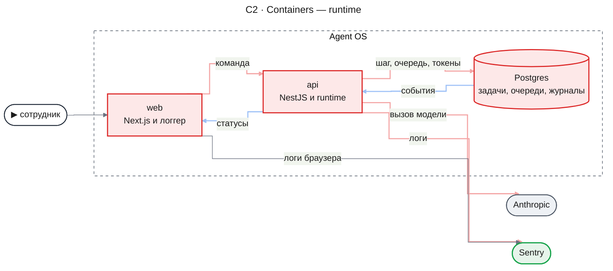

- `web` теряет карточку расследования и пишет лог через логгер `common` с Sentry для Next; новых экранов в этой части нет.
- `api` собирает runtime в модуле `RuntimeModule`, запускает его воркеры с сервером, направляет логгер Nest в логгер `common` и инициализирует Sentry до старта. Модули расследования уходят (KD-7).
- `Postgres` получает таблицы `runtime_*` вместо `research_*` одной миграцией вперёд. Таблицы Mastra и `chat_thread_runs` не меняются.

Пакеты внутри `api` и `web` и направление зависимостей между ними показывает схема ниже. Правила слоёв и границ записаны в [code system](../../code-system/README.md); здесь видно, что меняет эта часть. Части `agents` и `workflows` создают свои пакеты сами.

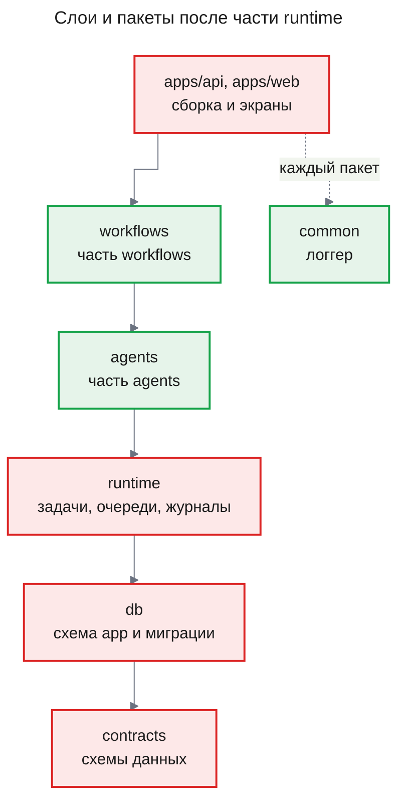

Стрелка ведёт от пакета к слою, на который он опирается; пакет может использовать любой слой ниже себя. `apps/web` использует только `contracts` и `common`.

#### C3 · Components: api

**api — шаг задачи**

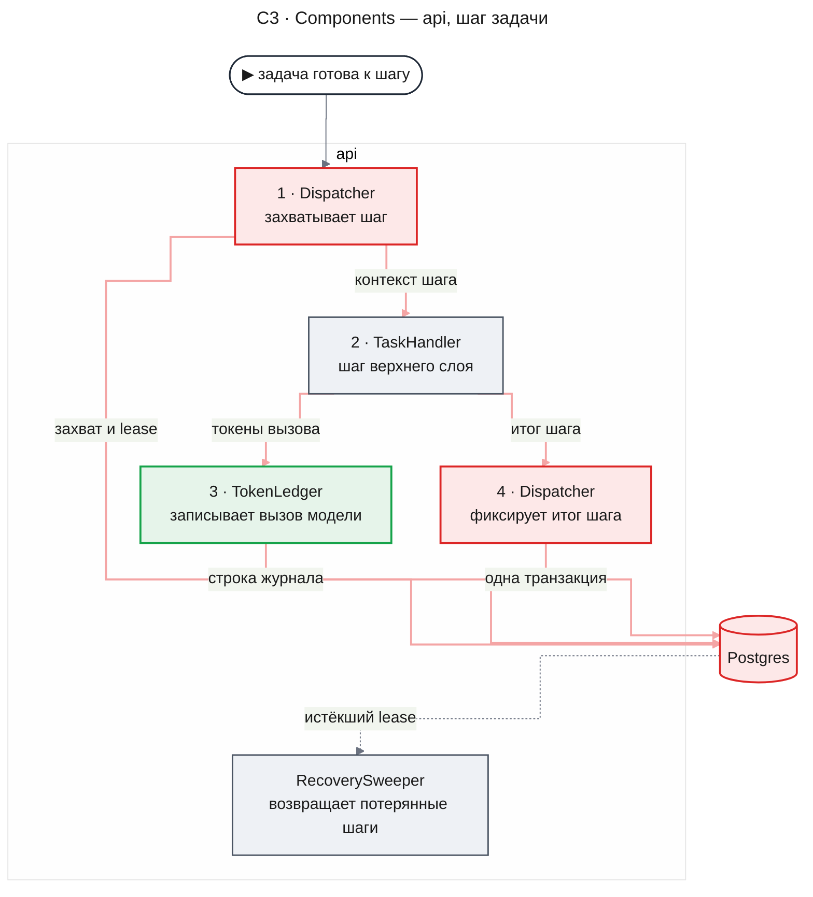

- `Dispatcher` держит слоты воркера, захватывает самую старую готовую задачу зарегистрированного типа, собирает контекст шага, продлевает lease, пока шаг идёт, и фиксирует итог. Отсечённый итог он отбрасывает и пишет об этом в лог.
- `TaskHandler` здесь — обработчик верхнего слоя; в этой части его роль играет тестовый обработчик.
- `TokenLedger` считает стоимость по ценам развёртывания и пишет строку журнала своей транзакцией сразу после ответа модели (KD-5).
- `RecoverySweeper` раз в `RUNTIME_REAPER_MS` возвращает в очередь задачи с истёкшим lease и роняет задачу после `RUNTIME_MAX_RECOVERIES` потерь одного шага.

**api — сообщение задаче**

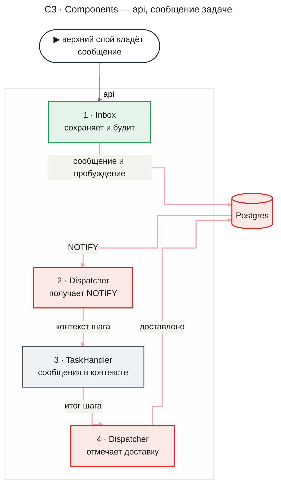

- `Inbox` проверяет владельца получателя, присваивает сообщению следующий номер в очереди получателя и в той же транзакции будит свободную задачу.
- Остальные компоненты команд — `TaskControl` (создать, прервать, остановить, удалить дерево) и `Decisions` (решить запрос) — пишут свои изменения так же, одной транзакцией с событием и NOTIFY; их путь показывают Flow 2 и Flow 4.
- `EventLog` пишет событие каждого изменения в той же транзакции, а `OutboxRelay` доставляет его зарегистрированным потребителям, как сейчас.

### Что сохраняется, меняется и уходит

Таблица перечисляет то, что видит потребитель runtime. Код, который удаляется вместе с пакетами и модулями, назван в KD-7.

| Элемент | Судьба | Что с ним |
|---|---|---|
| lease, heartbeat, fencing по попытке, захват `SKIP LOCKED`, NOTIFY для пробуждения | сохраняется | работает для шага так же, как для попытки |
| `RecoverySweeper`, `CrashPoints`, `Clock`, `WorkerLoop` | сохраняется | точки падения переименованы под шаги; дедлайн задачи и предел ожидания в очереди удалены |
| `EventLog`, `OutboxRelay`, `EventConsumerRegistry` | меняется | события получают тип-строку с префиксом владельца и корень дерева вместо расследования |
| `research_tasks` → `runtime_tasks`, `guardedTaskWrite` | меняется | новые статусы и переходы; зависимости, дедупликация, бюджет, checkpoint, `expected_output`, `input_refs` удалены |
| `TaskHandler`, `TaskContext`, `HandlerResult` | меняется | шаг вместо долгого `run`, итог шага вместо `HandlerResult` (KD-2) |
| `HandlerRegistry` | меняется | ключ — тип задачи без версии |
| `withAttemptGuard` | сохраняется | становится охраняемой записью шага `guard` |
| `TaskScheduler`, `SchedulerConsumer` | уходит | создание задачи и порождение ребёнка — в `TaskControl` и итоге шага; пробуждение — в `Inbox` |
| `InvestigationService`, `ThreadOwnership` | уходит | корень дерева и владелец задачи заменяют расследование и беседу |
| `EvidenceStore`, `EvidenceReader`, `computeDedupKey`, `RunningTaskRegistry.abortInvestigation` | уходит | — |
| `RuntimeLogger`, `NestRuntimeLogger` | уходит | логгер `common` и адаптер Nest над ним (KD-6) |
| журнал `research_llm_calls`, `callCostUsd` | меняется | журнал `runtime_model_calls` в runtime; правило цены переезжает из движка (KD-5) |
| резервирование токенов, `reserve-rule`, доли детей, `research_engine_runs`, транскрипты | уходит | принуждения бюджета нет |
| `RUNTIME_ATTEMPT_MS` | меняется | становится `RUNTIME_STEP_MS` |
| `RUNTIME_QUEUE_WAIT_MS` | уходит | задача не падает от ожидания свободного воркера |

### Runtime Flows

#### Flow 1: Шаг выполняется и сохраняется

**Starts when:** задача стала готовой — создана, разбужена сообщением или решением, или прошлый шаг вернул «продолжить»; for AC-01.1, DC-1, DC-5.

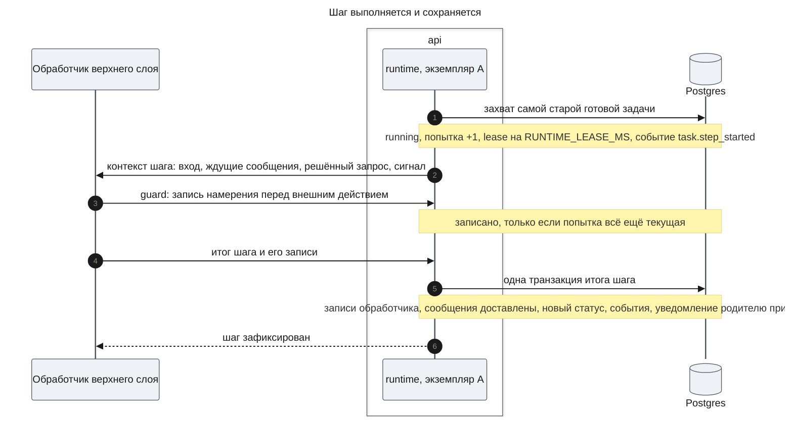

**Outcome:** номер шага задачи вырос на один; задача стала `queued`, `waiting`, `completed` или `failed` по итогу; при конце задачи в очереди родителя лежит уведомление; на каждое изменение есть событие и NOTIFY.

**Failure handling:**

- Обработчик бросил исключение → задача `failed` с причиной `handler_error`, полная ошибка в логе, родитель получает уведомление.
- Шаг дольше `RUNTIME_STEP_MS` → сигнал с причиной `step_timeout`, задача `failed` с той же причиной, родитель получает уведомление.
- Итог не прошёл проверку (неизвестный тип ребёнка, вход ребёнка не по схеме, слишком большой итог) → задача `failed` с причиной `invalid_step_result`; записи обработчика не применяются.
- Транзакция итога не прошла → три повтора, затем lease истекает, и шаг выполняется заново (Flow 2).
- Попытка уже не текущая (задачу прервали, остановили или вернули sweeper'ом) → итог отвергнут, ничего не записано, запись в лог.

#### Flow 2: Падение посреди шага и восстановление

**Starts when:** процесс, который держит шаг, убит или сервер остановлен без graceful shutdown; for AC-01.1, AC-01.2, AC-01.3, DC-2, DC-3, NFR-05.

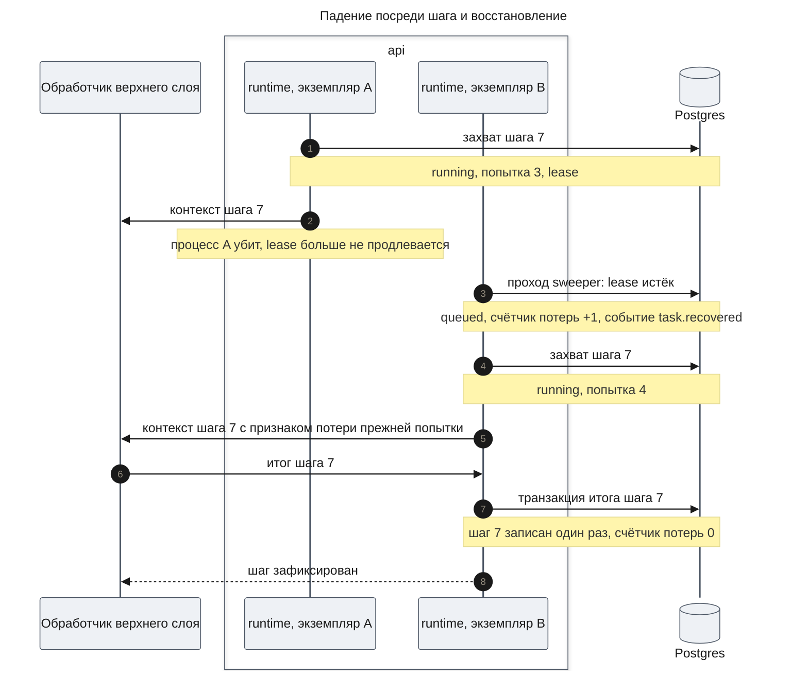

**Outcome:** шаг 7 записан один раз; сообщения, которые ждали к началу шага 7, доставлены в нём один раз; запрос решения, если задача его ждала, по-прежнему ждёт. Когда упал единственный экземпляр, роль B играет он же после запуска.

**Failure handling:**

- Шаг теряет процесс `RUNTIME_MAX_RECOVERIES` раз подряд → задача `failed` с причиной `recovery_exhausted`, родитель получает уведомление.
- Поздний итог попытки 3 (процесс был жив, но потерял lease) → отвергнут fencing'ом, обработчик получил сигнал `lease_lost`.
- Внешнее действие попытки 3 могло состояться → обработчик видит признак потери и своё намерение без результата и не повторяет действие сам (AC-01.2).
- Graceful shutdown → шаги в работе получают сигнал `shutdown`, через `RUNTIME_SHUTDOWN_GRACE_MS` их задачи возвращаются в `queued` без счёта потерь.

#### Flow 3: Сообщение занятой и свободной задаче

**Starts when:** верхний слой кладёт сообщение задаче — от сотрудника, родителя или runtime (уведомление о ребёнке); for AC-01.3, DC-4, NFR-04.

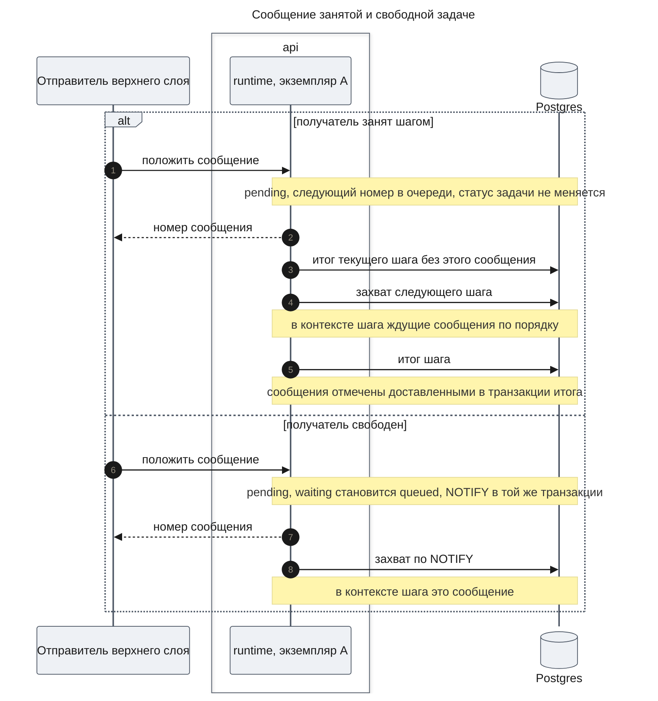

**Outcome:** каждое сообщение доставлено ровно в одном зафиксированном шаге и в порядке номеров; ни одна задача, которая ждёт сообщений, не остаётся в `waiting` с ждущим сообщением.

**Failure handling:**

- Получатель чужой или не существует → `TASK_NOT_FOUND`, ничего не записано.
- Получатель ждёт решения → сообщение ждёт; задача проснётся от решения и получит его вместе с сообщениями (UXRD: сообщения уходят после решения).
- Получатель закончен, `revive` не задан → сообщение ждёт, пока задачу не оживят; уведомления о детях шлются без `revive`.
- Шаг вернул «ждать сообщений», а сообщение пришло во время шага → транзакция итога видит его и ставит задачу в `queued`, а не в `waiting`.
- Шаг потерян → сообщения не отмечены доставленными и попадут в контекст повторного шага.

#### Flow 4: Прерывание и остановка

**Starts when:** верхний слой прерывает или останавливает задачу по команде сотрудника или родителя; for DC-6, NFR-01.

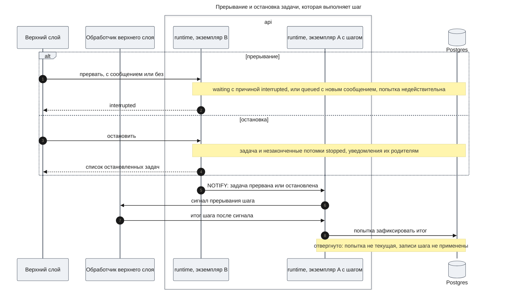

**Outcome:** статус сменился в транзакции команды; шаг в работе потерян, а его строки журнала токенов и записи намерения остались; прерванная задача ждёт следующего сообщения или уже стоит в очереди с ним.

**Failure handling:**

- Задача закончена → прерывание отвечает `not_active`, остановка возвращает пустой список, ничего не меняется.
- Задача ждёт решения → прерывание отвечает `not_active` (решение принимают кнопки запроса); остановка закрывает задачу, а её открытый запрос получает статус `cancelled`.
- NOTIFY потерян → heartbeat экземпляра A через `RUNTIME_HEARTBEAT_MS` видит, что попытка не текущая, и подаёт тот же сигнал.
- Обработчик не реагирует на сигнал → шаг держит слот до `RUNTIME_STEP_MS`, но его итог отвергнут, а guard отказывает в новых записях, поэтому обработчик не начинает новое внешнее действие через охраняемую запись намерения.

#### Flow 5: Вызов модели в журнале и расход за месяц

**Starts when:** обёртка вызова модели (часть `agents`) получила ответ модели, или верхний слой читает расход сотрудника; for AC-02.1, AC-02.2, DC-9, DC-10.

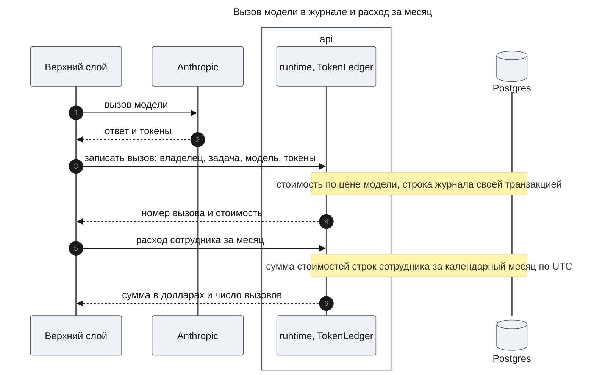

**Outcome:** строка журнала есть сразу после ответа модели, независимо от судьбы шага; расход месяца равен сумме стоимостей строк сотрудника.

**Failure handling:**

- Для модели нет цены → `UNKNOWN_MODEL_PRICE`, строка не записана, ошибка в логе. Верхний слой проверяет модель по списку цен заранее, при запуске агента.
- Процесс умер, пока модель отвечала → строки нет: ответа не было; риск расхождения с провайдером в [Risks and Mitigation](#risks-and-mitigation).
- Месяц без вызовов → сумма 0 и число вызовов 0.

### Contract Definitions

Все операции принимают владельца (`ownerId`, идентификатор сотрудника) и для чужой задачи, сообщения или запроса отвечают так же, как для несуществующих. Runtime не аутентифицирует: владельца передаёт `apps/api` из сессии.

**Сборка**

- **`createRuntime(options)`** — собирает runtime из базы (клиент и пул), разобранных настроек `RuntimeConfig`, логгера `common`, часов `Clock` и цен моделей. Возвращает `Runtime` с сервисами `handlers`, `tasks`, `inbox`, `decisions`, `events`, `eventConsumers`, `ledger` и методами `start()` и `stop()`. Обработчики и потребители регистрируются до `start()`.
- **`parseRuntimeConfig(variables)`** — проверяет переменные из `Runtime settings` и отдаёт `RuntimeConfig`; неверное значение останавливает старт с именем переменной.
- **`parseModelPrices(json)`** — проверяет файл цен и отдаёт цены по моделям; файл без моделей или с отрицательной ценой останавливает старт.

**Порт обработчика**

- **`TaskHandler`** — регистрируется в `handlers.register` и описывает тип задачи: имя типа (`type`, уникально в процессе, повтор останавливает старт), zod-схему входа (`inputSchema`, проверяется при создании задачи) и функцию шага. Функция шага получает `StepContext` и возвращает `StepResult`; исключение роняет задачу с `handler_error`.

**StepContext** — что обработчик знает о шаге.

- `taskId`, `rootId`, `parentId` (нет у корня), `ownerId`, `depth` (у корня 0), `type`, `input`.
- `stepNo` — сколько шагов задачи уже зафиксировано; растёт на один с каждым итогом.
- `resumedAfterLoss` — прежняя попытка этого шага закончилась без итога: процесс умер, задачу прервали или вернули sweeper'ом.
- `messages` — сообщения, которые ждали к началу шага, по порядку номеров; шаг обязан учесть их, они отмечаются доставленными его итогом.
- `decision` — запрос, ради которого задача ждала, с его решением, или его нет; передаётся в одном шаге.
- `signal` — сигнал прерывания с причиной `interrupted`, `stopped`, `shutdown`, `lease_lost` или `step_timeout`. Обработчик не рассчитывает, что его шаг — единственный работающий шаг задачи: после сигнала следующий шаг может уже идти (Invariant 1).
- `logger` — дочерний логгер с привязанными `taskId`, `rootId`, `ownerId`, `stepNo` и номером попытки.
- `guard(work)` — выполняет запись обработчика в его таблицы отдельной короткой транзакцией, если попытка ещё текущая и задача не прервана и не остановлена. Возвращает `committed` со значением или `fenced`, когда записи не было. Внутри `work` нет вызовов модели и внешних систем.

**StepResult** — итог шага: исход и, по желанию, записи обработчика.

- Исход `continue` — нужен ещё шаг; задача становится `queued`.
- Исход `wait` — делать нечего до следующего сообщения; задача становится `waiting` с причиной `messages`, или `queued`, если сообщение уже ждёт.
- Исход `await_decision` с видом запроса (`kind`, строка верхнего слоя) и содержимым (`payload`, JSON) — создаётся открытый запрос, задача становится `waiting` с причиной `decision`.
- Исход `complete` с итогом (`result`, JSON) — задача `completed`, родителю уходит уведомление с этим итогом.
- Исход `fail` с причиной (`reason`, строка верхнего слоя) и текстом — задача `failed`, родителю уходит уведомление.
- Записи `commit(tx, effects)` — runtime выполняет их внутри транзакции итога. `tx` — транзакция для репозиториев обработчика. `effects.spawn({ type, input })` создаёт дочернюю задачу в `queued` с тем же владельцем и корнем и глубиной на один больше и сразу возвращает её `taskId`, поэтому запуск в фоне отвечает немедленно. `effects.enqueue(...)` кладёт сообщение по правилам `inbox.enqueue`. `effects.emit(type, payload)` пишет событие верхнего слоя.

**Задачи (`tasks`)**

- **`create({ type, ownerId, input, parentId? })`** — создаёт корневую задачу или, с `parentId`, дочернюю задачу вне шага (запуск с нуля, FR-09). Возвращает `taskId`. Ошибки: `UNKNOWN_TASK_TYPE`, `INVALID_TASK_INPUT`, `TASK_NOT_FOUND` для родителя, `PARENT_FINISHED` для родителя в `completed`, `failed` или `stopped` (задача не создана).
- **`get(taskId, ownerId)`** — возвращает `Task` или `TASK_NOT_FOUND`.
- **`listTree(rootId, ownerId)`** — все задачи дерева в порядке создания, каждая как `Task`.
- **`interrupt(taskId, ownerId, message?)`** — прерывает задачу в `queued`, `running` или `waiting` с причиной не `decision`: без сообщения задача становится `waiting` с причиной `interrupted`, с сообщением — сообщение ложится в очередь и задача становится `queued`. Возвращает `interrupted` или `not_active`.
- **`stop(taskId, ownerId)`** — делает `stopped` задачу и всех её незаконченных потомков, закрывает их открытые запросы со статусом `cancelled` и кладёт уведомление родителю каждой. Возвращает список остановленных `taskId`, пустой для законченной задачи.
- **`deleteTree(rootId, ownerId)`** — останавливает дерево так же, как `stop`, и физически удаляет задачи, сообщения, запросы и события дерева. Строки журнала токенов остаются. Возвращает `deleted` или `TASK_NOT_FOUND`; удалить можно только корень.

**Task**

- `taskId`, `type`, `ownerId`, `parentId`, `rootId`, `depth`.
- `status` — `queued`, `running`, `waiting`, `completed`, `failed`, `stopped`.
- `waitReason` — при `waiting`: `messages`, `decision` или `interrupted`.
- `stepNo`, `result` (при `completed`), `failure` (при `failed`: причина и текст).
- `createdAt`, `updatedAt`, `finishedAt`.

**Очередь (`inbox`)**

- **`enqueue({ recipientId, ownerId, kind, sender, payload, revive })`** — кладёт сообщение в очередь получателя. `kind` — вид сообщения, строка верхнего слоя; `child_finished` занят runtime. `sender` — кто отправил: идентификатор задачи или сотрудника. `payload` — JSON до `INBOX_PAYLOAD_MAX_BYTES`. `revive` — оживить законченного получателя. Возвращает `messageId` и номер в очереди. Ошибки: `TASK_NOT_FOUND`, `PAYLOAD_TOO_LARGE`.
- **`listPending(taskId, ownerId)`** — недоставленные сообщения задачи по порядку; для лотка очереди в UI.
- Уведомление о конце задачи: `kind` `child_finished`, отправитель — дочерняя задача, `payload` — её `taskId`, статус (`completed`, `failed`, `stopped`), `result` или `failure`, число шагов и длительность от создания до конца. Оно не оживляет законченного родителя.

**Запросы решений (`decisions`)**

- **`resolve(decisionId, ownerId, resolution)`** — записывает решение (JSON верхнего слоя) один раз и ставит задачу в `queued`. Возвращает `resolved`, `already_resolved` или `DECISION_NOT_FOUND`.
- **`listOpen(rootId, ownerId)`** — открытые запросы дерева: `decisionId`, `taskId`, `kind`, `payload`, `createdAt`. Нужен беседе, чтобы показать запрос агента любой глубины (AC-17.3).
- Запрос имеет статус `open`, `resolved` или `cancelled`. У задачи не больше одного открытого запроса.

**События (`events`)**

- **`listAfter(rootId, ownerId, afterSeq, limit)`** — события дерева с номером больше `afterSeq` по порядку, не больше `limit` (до 500). Каждое событие: номер, тип, `taskId`, время, `payload` до 8 KiB.
- После каждой транзакции с событием runtime шлёт NOTIFY в канал `runtime_events` с `rootId`; наблюдатель (часть `chat`) слушает канал и дочитывает `listAfter`.
- Типы событий runtime: `task.created`, `task.queued`, `task.step_started`, `task.step_committed`, `task.waiting`, `task.interrupted`, `task.completed`, `task.failed`, `task.stopped`, `task.recovered`, `inbox.enqueued`, `inbox.delivered`, `decision.requested`, `decision.resolved`. Событие верхнего слоя (`effects.emit`) имеет тип с префиксом своего пакета, например `agents.`; префикс `task.`, `inbox.`, `decision.` верхнему слою запрещён.
- **`eventConsumers.register(consumer)`** — потребитель с именем, типами и обработкой в транзакции доставки, как сейчас.

**Журнал токенов (`ledger`)**

- **`record({ ownerId, taskId?, model, usage })`** — записывает законченный вызов модели. `usage` — входные, выходные, прочитанные из кеша и записанные в кеш токены. `taskId` не задан для вызова вне задачи. Возвращает `callId` и `costUsd`. Ошибка `UNKNOWN_MODEL_PRICE`.
- **`monthSpend(ownerId, month)`** — расход сотрудника за месяц `YYYY-MM` по UTC: `costUsd` и число вызовов.
- **`pricedModels()`** — модели, для которых есть цена; верхний слой проверяет по нему модель агента.

**Логгер (`packages/common`)**

- **`createLogger({ sinks, secrets, minLevel })`** — собирает логгер. `sinks` — приёмники; `secrets` — значения секретов из настроек, которые вырезаются везде; `minLevel` — нижний уровень. Возвращает `Logger`.
- **`Logger`** — методы `debug`, `info`, `warn`, `error` с сообщением и полями, и `child(fields)`, который отдаёт логгер с привязанными полями. Поле `error` принимает любое брошенное значение и раскрывается в имя, текст, стек и цепочку причин. Поле `durationMs` — длительность в миллисекундах.
- **`consoleSink()`** — пишет строку на запись: время, уровень, сообщение и поля в JSON.
- **`sentrySink(sdk)`** — пишет запись в Sentry Logs методом своего уровня; запись с полем `error` ещё и отправляет как исключение с полями в контексте. `sdk` — объект SDK приложения.
- Вырезание до приёмников: значение поля с именем `password`, `secret`, `token`, `accessToken`, `refreshToken`, `apiKey`, `authorization`, `cookie` или `dsn` (без учёта регистра) и любое вхождение значения из `secrets` заменяются на `[redacted]`. Строка длиннее 16 KiB обрезается с пометкой о числе обрезанных байт.
- Вход `@agent-os/common/testing` даёт приёмник в память для тестов.

**Error handling**

- `TASK_NOT_FOUND` — задачи нет или она чужая.
- `UNKNOWN_TASK_TYPE` — для типа не зарегистрирован обработчик.
- `PARENT_FINISHED` — дочернюю задачу создают под законченным родителем; родителя сначала продолжают сообщением с `revive`.
- `INVALID_TASK_INPUT` — вход не прошёл схему обработчика; в ошибке путь и причина.
- `PAYLOAD_TOO_LARGE` — сообщение больше `INBOX_PAYLOAD_MAX_BYTES`.
- `DECISION_NOT_FOUND` — запроса нет или он чужой.
- `UNKNOWN_MODEL_PRICE` — для модели нет цены.
- Причины падения задачи, которые ставит runtime: `handler_error`, `invalid_step_result`, `step_timeout`, `recovery_exhausted`.

**Runtime settings**

Переменные читает `apps/api` и передаёт в разбор настроек.

- `RUNTIME_WORKERS` — default `on`; `off` выключает воркеры экземпляра.
- `RUNTIME_CONCURRENCY` — default `16`; сколько шагов экземпляр выполняет одновременно. Шаг почти всё время ждёт модель или инструмент, поэтому значение выше прежних 4.
- `RUNTIME_POLL_MS` — default `500`; период опроса готовых задач, когда NOTIFY не пришёл.
- `RUNTIME_NOTIFY` — default `on`; пробуждение и сигналы прерывания через NOTIFY.
- `RUNTIME_LEASE_MS` — default `30000`; срок lease.
- `RUNTIME_HEARTBEAT_MS` — default `10000`; период продления lease и проверки, что попытка текущая.
- `RUNTIME_REAPER_MS` — default `5000`; период прохода sweeper.
- `RUNTIME_MAX_RECOVERIES` — default `3`; сколько потерь одного шага подряд допустимо.
- `RUNTIME_STEP_MS` — default `900000`; предел длительности шага.
- `RUNTIME_SHUTDOWN_GRACE_MS` — default `5000`; сколько шаг доделывается при остановке сервера.
- `RUNTIME_DELIVERY_MAX_ATTEMPTS` — default `5`; попытки доставки события потребителю.
- `RUNTIME_CRASH_AT` — по умолчанию пусто; точка падения для матрицы убийств, в production не действует.
- `DB_POOL_MAX` — default `10`; размер пула базы.
- `INBOX_PAYLOAD_MAX_BYTES` — default `1048576`; предел сообщения.
- `MODEL_PRICES_FILE` — default `config/model-prices.json` в `apps/api`; файл цен: на модель цены за миллион токенов входа, выхода, записи и чтения кеша и, по желанию, ступень цен выше заданного числа входных токенов. Поставляется с ценами двух нынешних моделей каталога.
- `SENTRY_DSN` (`apps/api`) и `NEXT_PUBLIC_SENTRY_DSN` (`apps/web`) — default пусто; пусто значит, что SDK Sentry не отправляет ничего, а логи идут только в консоль.
- `LOG_LEVEL` — default `debug`; нижний уровень логгера.

### Data Model

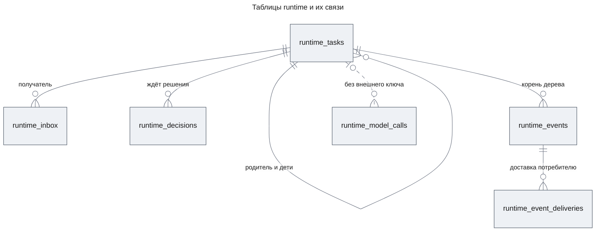

- `runtime_tasks` — задачи. Каждая знает владельца, родителя, корень и глубину; корень — сама задача, у которой нет родителя. Здесь же статус, причина ожидания, номер шага, номер попытки, lease, счётчик потерь шага, итог или причина падения. Удаление корня удаляет дерево.
- `runtime_inbox` — сообщения. Номер в очереди растёт в пределах получателя и задаёт порядок доставки; доставленное сообщение помнит, в каком шаге его доставили.
- `runtime_decisions` — запросы решений с видом, содержимым, статусом, решением и временем.
- `runtime_events` и `runtime_event_deliveries` — журнал событий с корнем дерева и доставки потребителям, как нынешние `research_events` и `research_event_deliveries`.
- `runtime_model_calls` — журнал токенов: владелец, задача, модель, четыре счёта токенов, стоимость, время. Внешнего ключа на задачу нет, поэтому строки переживают удаление дерева.

Наборы значений статусов задаются в `packages/contracts` и строят CHECK в модели схемы `app`, как сейчас. Таблицы, которых больше нет: все `research_*`, `agent_tool_audit`, `agent_definition_memory`.

### State Transitions and Invariants

Схема показывает статусы задачи в runtime. Статусы агента для сотрудника выводит из них часть `agents`.

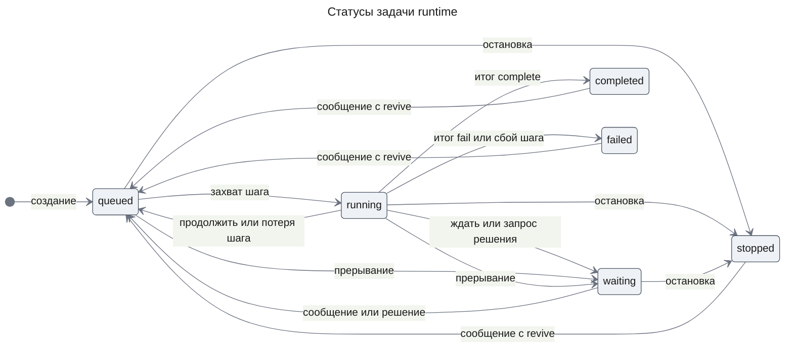

**Invariants**

1. Записать итог шага или охраняемую запись может только текущая попытка задачи. После прерывания или остановки отсечённый шаг может ещё выполняться, пока не ответит на сигнал или не истечёт `RUNTIME_STEP_MS`, — в том числе одновременно со следующим шагом той же задачи.
2. Задача в `waiting` с причиной `messages` никогда не имеет недоставленных сообщений.
3. Задача в `waiting` с причиной `decision` имеет ровно один открытый запрос, а у задачи в другом статусе открытых запросов нет.
4. Каждое сообщение доставлено не больше чем в одном зафиксированном шаге, и сообщения одного получателя доставляются в порядке номеров.
5. Каждая задача, которая дошла до `completed`, `failed` или `stopped`, положила родителю ровно одно уведомление за этот переход.
6. Дочерняя задача не создаётся под законченным родителем, а остановка дерева не оставляет в нём незаконченных задач, даже когда ребёнка порождают одновременно с остановкой.
7. Дерево целиком принадлежит одному владельцу.
8. Каждый вызов модели, о котором верхний слой сообщил `record`, — одна строка журнала со стоимостью; строки не меняются и не удаляются вместе с задачами.

## Test Strategy

Тесты пишутся вместе с задачами плана и запускаются один раз в конце части. Ревью тестов проходит только для рискованных мест этой части: матрица убийств и рестарты, одновременные события, прерывание и остановка. Обработчики в тестах — тестовые обработчики шага; реальная модель не вызывается.

### Main Use Cases

- **UC-1: Многошаговая задача доходит до конца** — covers AC-01.1, DC-1, DC-5
  - Given: дочерняя задача тестового типа, которая делает три шага, каждый пишет строку в свою таблицу в итоге шага.
  - When: воркеры работают.
  - Then: в таблице обработчика три строки с номерами шагов 0, 1, 2; задача `completed`; в очереди родителя одно уведомление `child_finished` со статусом `completed` и итогом.
- **UC-2: Рестарт посреди работы не теряет и не повторяет шаги** — covers AC-01.1, AC-01.3, DC-2, NFR-05
  - Given: дерево из родителя и двух детей, процесс runtime в отдельном процессе, точка падения задана по очереди на каждой точке матрицы.
  - When: процесс убивают в этой точке, а второй экземпляр продолжает.
  - Then: конечное состояние одинаково для всех точек: каждая задача `completed`, каждый шаг записан один раз, каждое сообщение доставлено один раз.
- **UC-3: Сообщение занятой задаче приходит в следующем шаге** — covers AC-01.3, DC-4, NFR-04
  - Given: задача выполняет шаг, который ждёт сигнала теста.
  - When: тест кладёт три сообщения подряд, затем отпускает шаг.
  - Then: текущий шаг не видит сообщений; следующий шаг получает все три в порядке отправки; после его итога они доставлены, повторно не приходят.
- **UC-4: Сообщение будит свободную задачу** — covers DC-4
  - Given: задача в `waiting` с причиной `messages`.
  - When: тест кладёт сообщение.
  - Then: задача сразу `queued`, следующий шаг получает сообщение.
- **UC-5: Сообщение законченной задаче** — covers DC-4
  - Given: задача `completed`.
  - When: тест кладёт сообщение без `revive`, затем второе с `revive`.
  - Then: после первого задача остаётся `completed`, сообщение ждёт; после второго задача `queued`, и её шаг получает оба сообщения по порядку.
- **UC-6: Запрос решения переживает рестарт и решается один раз** — covers DC-7
  - Given: шаг вернул запрос решения, задача `waiting` с причиной `decision`, и для неё ждёт сообщение.
  - When: runtime перезапускают, затем решение отправляют дважды.
  - Then: после рестарта запрос открыт; первое решение — `resolved`, второе — `already_resolved`; следующий шаг получает решение и ждавшее сообщение.
- **UC-7: Внешнее действие не повторяется после падения** — covers AC-01.2, DC-2
  - Given: тестовый обработчик через `guard` пишет намерение, затем выполняет внешнее действие у тестового двойника и падает до итога шага.
  - When: шаг выполняется заново.
  - Then: контекст шага сообщает о потере прежней попытки; обработчик видит намерение без результата и не вызывает двойник второй раз; двойник получил один вызов.
- **UC-8: Журнал токенов и расход месяца** — covers AC-02.1, AC-02.2, DC-10
  - Given: цены двух моделей с разными ценами входа и выхода; вызовы сотрудника на обеих моделях в ноябре и один в октябре; вызовы другого сотрудника.
  - When: вызовы записывают, затем читают расход ноября.
  - Then: у каждой строки владелец, задача, модель, токены и стоимость по цене своей модели; расход ноября равен сумме ноябрьских строк этого сотрудника, без октября и без чужих.
- **UC-9: Логгер пишет в оба приёмника без секретов** — covers DC-11
  - Given: логгер с консольным приёмником и приёмником Sentry над двойником SDK, секрет из настроек.
  - When: код пишет запись с полем `apiKey`, ошибкой с причиной и сообщением, где встречается значение секрета.
  - Then: оба приёмника получили запись; поле и вхождение секрета — `[redacted]`; ошибка раскрыта со стеком и причиной; двойник Sentry получил и лог, и исключение.

### Error and Edge Use Cases

- **UC-E1: Шаг, который роняет процесс** — covers DC-3
  - Given: шаг, который убивает процесс при каждой попытке.
  - When: экземпляры подхватывают его после истечения lease.
  - Then: после `RUNTIME_MAX_RECOVERIES` потерь задача `failed` с `recovery_exhausted`, родитель получил уведомление.
- **UC-E2: Прерывание шага в работе** — covers DC-6, NFR-01
  - Given: шаг ждёт долгого вызова тестового двойника на другом экземпляре.
  - When: тест прерывает задачу с сообщением, а потом обработчик возвращает итог.
  - Then: статус сменился в ответе на команду; итог прерванного шага отвергнут; следующий шаг получает сообщение и признак потери прежней попытки.
- **UC-E3: Остановка дерева** — covers DC-5, DC-6
  - Given: родитель с работающим ребёнком и внуком, у ребёнка открытый запрос.
  - When: тест останавливает ребёнка.
  - Then: ребёнок и внук `stopped`, запрос `cancelled`, у родителя одно уведомление со статусом `stopped`; новых шагов у остановленных задач нет; родитель продолжает работу.
- **UC-E4: Одновременные сообщение, конец шага, прерывание и рестарт** — covers DC-4, NFR-04
  - Given: задача, чей шаг возвращает «ждать сообщений».
  - When: сообщения кладут параллельно с итогом шага, с прерыванием и с убийством процесса, много раз подряд.
  - Then: ни одна задача не осталась в `waiting` с причиной `messages` и ждущим сообщением; каждое сообщение доставлено один раз и по порядку.
- **UC-E9: Ребёнок под законченным родителем** — covers DC-6
  - Given: родитель `completed`, и одновременно с его остановкой другой шаг порождает ребёнка.
  - When: вызывают `create` с этим родителем, и гонка остановки с порождением повторяется много раз.
  - Then: `create` отвечает `PARENT_FINISHED` и задачи не создаёт; после каждой остановки в дереве нет незаконченных задач.
- **UC-E5: Чужой владелец** — covers DC-8
  - Given: дерево сотрудника А.
  - When: от имени сотрудника Б читают задачу, дерево, события, кладут сообщение, прерывают, останавливают, решают запрос, удаляют дерево.
  - Then: каждый ответ такой же, как для несуществующего объекта, и ничего не изменилось.
- **UC-E6: Цена неизвестна** — covers DC-9
  - Given: цены только одной модели.
  - When: записывают вызов другой модели.
  - Then: `UNKNOWN_MODEL_PRICE`, строк в журнале не прибавилось, в логе ошибка с моделью.
- **UC-E7: Удаление дерева не уменьшает расход** — covers DC-10
  - Given: дерево с записанными вызовами модели.
  - When: дерево удаляют.
  - Then: задач, сообщений, запросов и событий дерева нет; расход месяца прежний.
- **UC-E8: Обработчик бросил исключение** — covers DC-5
  - Given: шаг, который бросает ошибку с причиной.
  - When: шаг выполняется.
  - Then: задача `failed` с `handler_error`; в логе ошибка со стеком и причиной; родитель получил уведомление.

### Non-Functional Use Cases

Оба замера — отдельный скрипт проверки, вне обычного прогона, как нынешний `test:verify`.

- **UC-N1: Возобновление после убийства** — covers NFR-05
  - Given: задача выполняет шаг на единственном экземпляре.
  - When: процесс убивают и сразу запускают заново.
  - Then: шаг снова начат не позже чем через 60 с после убийства.
- **UC-N2: Смена статуса при прерывании и остановке** — covers NFR-01
  - Given: шаг ждёт долгого вызова на другом экземпляре.
  - When: задачу прерывают или останавливают.
  - Then: новый статус читается не позже чем через 5 с после команды (p95).

## Security Considerations

- **Authentication & Authorization**: runtime не принимает внешних запросов. Владельца каждой операции передаёт `apps/api` из сессии, и каждая операция проверяет, что задача, дерево, сообщение или запрос принадлежат ему (DC-8). Дерево целиком принадлежит одному владельцу, поэтому ребёнок не может уйти к чужому сотруднику.
- **Input Validation**: вход задачи проверяет схема обработчика при создании и при порождении ребёнка; сообщение и итог проверяются по пределам размера; решение и содержимое запроса — JSON, смысл которого проверяет верхний слой. Файл цен и переменные проверяются при старте.
- **Sensitive Data Handling**: логгер пишет входы, сообщения и итоги задач, как требует CLAUDE.md, поэтому в лог попадают тексты сотрудников; секреты вырезаются по имени поля и по значению (DC-11). Ключ провайдера модели, DSN Sentry и пароль базы передаются логгеру как секреты при сборке. Журнал токенов хранит только счета токенов и стоимость, без текстов.

## Risks and Mitigation

- **Гонки между доставкой, концом шага, прерыванием и рестартом теряют или дублируют сообщение** — высокое влияние, средняя вероятность. Доставка, новый статус и пробуждение живут в одной транзакции под замком задачи (Invariants 2, 4); тест одновременных событий (UC-E4) и матрица убийств (UC-2) проходят ревью тестов.
- **Вызов модели, прерванный падением процесса, провайдер списал, а журнала нет** — малое влияние, низкая вероятность. Журнал пишется сразу после ответа (KD-5); расхождение ограничено вызовами в полёте в момент убийства, и ограничения расхода сейчас нет.
- **Глубокий ресерч недоступен между этой частью и частью `workflows`** — среднее влияние, определённо. Чат продолжает работать; порядок частей ведёт к рабочей беседе на агентах раньше экранов веба (PRD, Risks).
- **Обработчик игнорирует сигнал прерывания и держит слот до `RUNTIME_STEP_MS`** — среднее влияние, низкая вероятность. Статус всё равно сменился (KD-4), итог отвергнут, а охраняемая запись перед внешним действием отказывает.
- **Логи с полными входами растут и попадают в Sentry вместе с текстами сотрудников** — среднее влияние, средняя вероятность. Поля обрезаются на 16 KiB; DSN пуст по умолчанию, и Sentry подключает развёртывание.

## Open Questions

- PRD отдаёт удаление контура расследования части `workflows` (Delivery Parts, FR-20), а эта часть удаляет его раньше, потому что без него репозиторий не собирается на новом API runtime, а держать старый рядом запрещено (KD-7). Вопрос блокирует утверждение KD-7 и строку `runtime` в Delivery Parts. Решает владелец: изменение списка частей идёт через обновление PRD.

## Appendix: Fact Disposition

| Fact | Disposition | Handled in |
|------|-------------|------------|
| Порт обработчика с `investigationId`, `inputRefs`, `putEvidence`, бюджетом и checkpoint; его потребители — engine, sources, apps/api (`packages/runtime/src/handler.registry.ts:TaskContext`) | transform | порт шага (Contract Definitions, KD-2); потребители удаляются (KD-7) |
| Расследование как корень, владелец, замок, связь с беседой через `ThreadOwnership` (`packages/db/src/schema.ts:researchInvestigations`) | remove | корень дерева задач и владелец задачи (KD-1, Data Model) |
| Строка задачи: конечные статусы без выхода, дедлайн до часа, обязательные `expected_output` и `input_refs`, ключ дедупликации (`packages/db/src/schema.ts:researchTasks`) | transform | новые статусы с оживлением по `revive`, без дедлайна и полей ресерча (State Transitions, KD-3) |
| Отмена только целым расследованием, локальный реестр и heartbeat 10 с (`packages/runtime/src/dispatcher.ts:Dispatcher`) | transform | прерывание и остановка задачи с отсечением и NOTIFY (KD-4, Flow 4) |
| Допуск с бюджетом, дедупликацией, проверкой цикла и ожиданием всех детей (`packages/runtime/src/task-scheduler.ts:TaskScheduler`) | remove | порождение ребёнка в итоге шага и уведомления в очередь (KD-3) |
| Журнал событий с типами расследования, доставка не FIFO по получателю (`packages/runtime/src/event-log.ts:EventLog`) | transform | типы событий с префиксом владельца, корень дерева; сообщения идут через очередь, а не через outbox (KD-3, Contract Definitions) |
| Восстановление, точки падения и матрица убийств (`packages/runtime/src/recovery.sweeper.ts:RecoverySweeper`) | transform | без дедлайна и предела очереди; матрица перенесена на шаги (UC-2, Flow 2) |
| Evidence и provenance в runtime (`packages/runtime/src/evidence.store.ts:EvidenceStore`) | remove | KD-1, KD-7 |
| Журнал токенов в движке с резервированием и бюджетами (`packages/engine/src/model/ledger.ts:postgresCallLedger`) | transform | журнал только записывает, в runtime (KD-5) |
| Цены — константа кода, нет расхода по сотруднику и месяцу (`packages/engine/src/config/model-catalog.ts:DEFAULT_MODEL_CATALOG`) | transform | файл цен в настройках, `monthSpend` по UTC (KD-5, Runtime settings) |
| Схема `app`, миграции вперёд, список таблиц в тесте миграций (`packages/db/src/schema.ts:app`) | transform | одна новая миграция вперёд, список таблиц теста обновляется (KD-7, Data Model) |
| Правила пакета и потребление `dist` приложением Next (`packages/runtime/package.json:workspace-package-conventions`) | transform | `packages/common` без зависимостей и SDK, собирается как остальные пакеты и используется `apps/web` (KD-6, code system) |
| Логгер — порт каждого пакета, нет Sentry и общего пакета, запрет логировать входы (`apps/api/src/research/nest-runtime-logger.ts:NestRuntimeLogger`) | transform | логгер `common`, адаптер Nest, Sentry в приложениях, входы логируются без секретов (KD-6) |
| Тесты runtime привязаны к расследованиям и evidence (`packages/runtime/test/research-runtime-runtime.int.e2e-spec.ts:INT-1..INT-5`) | transform | тесты захвата, lease, fencing, доставки событий и матрица убийств переносятся на задачи; тесты допуска, дедупликации, циклов, бюджета и evidence удаляются (Test Strategy) |

| Инструменты чата «запустить» и «остановить расследование», режим расследования и модель хода расследования (`apps/api/src/mastra/agents/assistant.agent.ts`, `mastra.provider.ts`, `chat.controller.ts`) | remove | KD-7; беседа на агентах — часть `chat` |
| Скрытые ходы решения о расследовании и связь удаления беседы с расследованиями (`apps/api/src/threads/threads.service.ts`, `thread-deletion-hooks.ts`) | remove | KD-7; хук удаления остаётся без регистрантов, удаление дерева — `deleteTree` |
| Карточка, опрос и остановка расследования в беседе (`apps/web/src/components/research/`, `lib/threads/thread-research-store.ts`, `threads-api-client.ts`, `main-view.tsx`, `thread.aui.tsx`) | remove | KD-7; ход workflow в беседе — часть `web` (FR-24) |
| Часы и база беседы из токенов модуля `research`, размер пула из настроек runtime (`apps/api/src/threads/threads.module.ts`, `thread-lock.pool.ts`) | transform | берутся из `RuntimeModule` (C2, `api`) |

The design preserves транзакцию «переход, событие, доставка» и отсутствие транзакции через вызов обработчика (ADR-0001), упорядоченную доставку событий потребителям с повтором и `needs_attention` (`packages/runtime/src/event-log.ts:EventLog`), а также правило цены по ступени входа и кешу (`packages/engine/src/config/model-catalog.ts:DEFAULT_MODEL_CATALOG`).

## Update History

| Version | Date | Change |
|---------|------|--------|
| 1.0 | 2026-11-14 | Первая версия |
