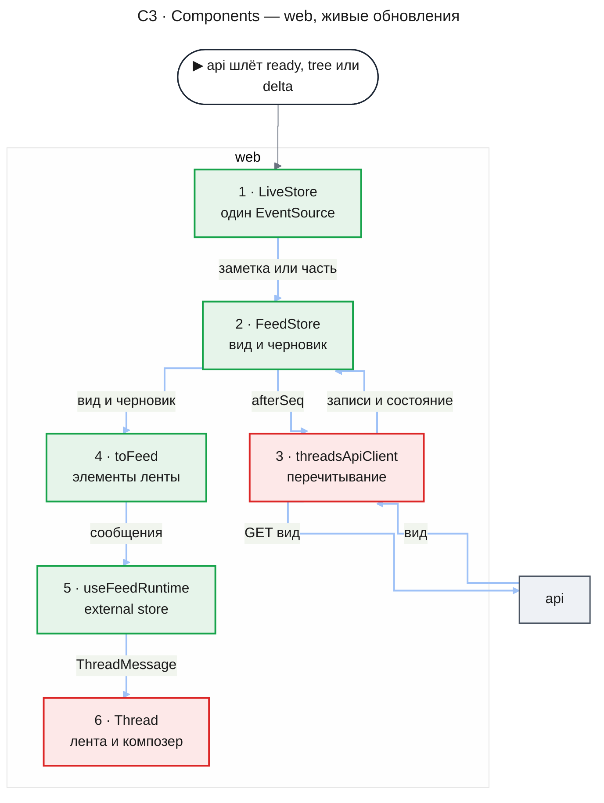
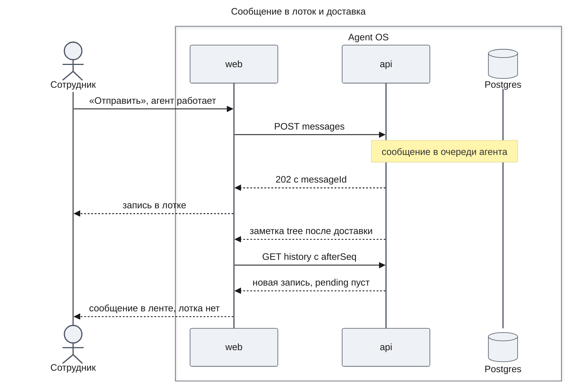
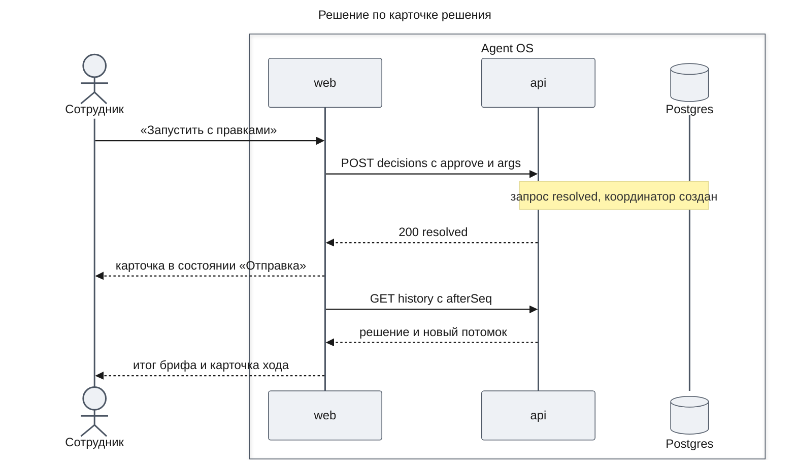
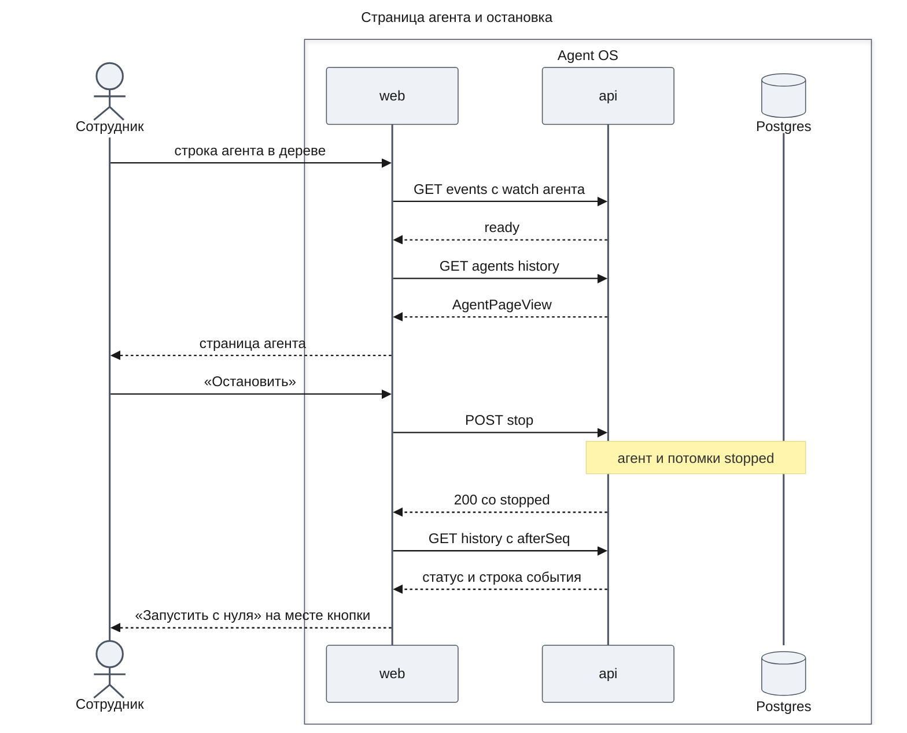
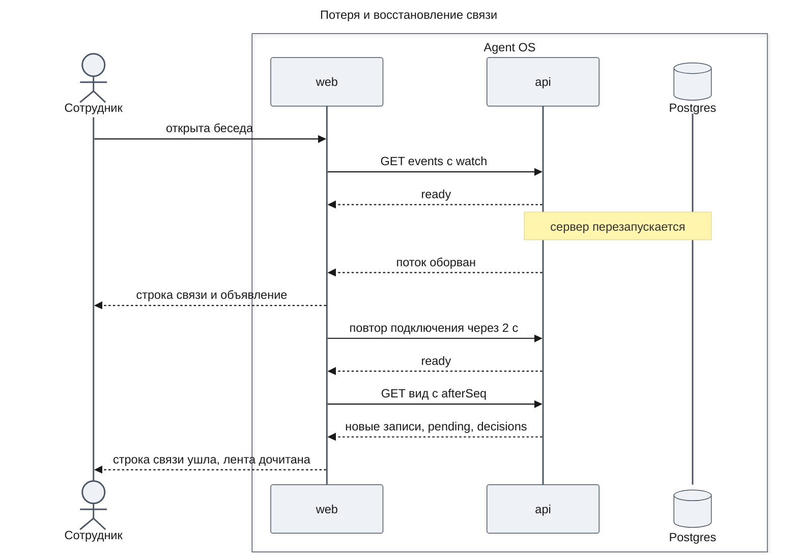

# Платформа агентов — Design Document — web

**Status:** Draft · **Date:** 2026-11-14 · **PRD:** [prd.md](./prd.md) · **UXRD:** [uxrd.md](./uxrd.md) · **Depends on:** [design-chat.md](./design-chat.md#contract-definitions), [design-workflows.md](./design-workflows.md#contract-definitions)

## Snapshot

**Overview.** Эта часть переводит веб-чат на новый API части `chat` и добавляет экраны агентов. Отправка сообщения становится обычной командой HTTP, а ответ приходит не из этого запроса: вкладка держит один поток событий, по заметке «в беседе что-то изменилось» перечитывает вид экрана и показывает текст ответа по частям. Из этих данных приложение собирает ленту и отдаёт её assistant-ui как внешнее хранилище, поэтому прежние лента, композер и блоки сообщений остаются. В ленте появляются карточки хода, решения и отчёты, лоток недоставленных сообщений и кнопка «Прервать»; в оболочке — дерево агентов, страница агента, строка связи и расход за месяц.

- **Не меняется**: список бесед, переименование, удаление и заголовки бесед; раскладка оболочки (chat-shell UXRD).
- **Biggest risk**: поведение assistant-ui с внешним хранилищем внутри списка бесед проверено только по документации и типам; его проверяет спайк S-1 до работы над экранами ([Risks and Mitigation](#risks-and-mitigation)).
- **Open questions**: нет. Дизайн ждёт два поля в контракте `chat` (A-1, A-2 в [Part](#part)); их добавляет часть `chat`, после чего допущения заменяются ссылкой на её контракт.

### Key Decisions

#### KD-1: assistant-ui получает ленту из нашего хранилища, транспорт AI SDK уходит

Список бесед остаётся на `useRemoteThreadListRuntime` с прежним адаптером, а хук беседы вместо `useChatRuntime` строится на `useExternalStoreRuntime`: сообщения, `onNew` и признак загрузки даёт хранилище `FeedStore` ([assistant-ui, External Store](https://www.assistant-ui.com/docs/runtimes/custom/external-store)). Для новой беседы `onNew` сначала ждёт `initialize()` элемента списка ([assistant-ui, Threads](https://www.assistant-ui.com/docs/runtimes/concepts/threads)). Признак `isRunning` библиотеке не передаётся: с ним она блокирует «Отправить» (`composerSendDisabled` в `@assistant-ui/core` 0.3.32), а писать нужно в любой момент (FR-16). Занятость агента кнопка «Прервать», лоток и плейсхолдер читают из хранилища. Страница агента ставит вокруг той же `Thread` свой `AssistantRuntimeProvider`. Уходят `AssistantChatTransport`, `useChatRuntime`, адаптер истории, пакеты `ai` и `@assistant-ui/ai-sdk`.

Не взяты: очередь assistant-ui (`queue`) — она держит сообщения в браузере, а наша очередь на сервере; своя лента без assistant-ui — заново прокрутка, Markdown, action bar и композер; `ExternalStoreThreadListAdapter` — переписка сайдбара без выигрыша.

#### KD-2: Один `EventSource` на вкладку; заметка вызывает перечитывание, а смена экрана — переподключение

`LiveStore` открывает `GET /api/events` с `withCredentials` при монтировании оболочки. `watch` следует за экраном: `thread:<id>` на беседе, `agent:<id>` на странице агента, без него на остальных. URL потока не меняется, поэтому смена экрана закрывает поток и открывает новый, а первое `ready` перечитывает экран. Заметка `tree` перечитывает то, что показано: беседу — только со своим `threadId`, страницу агента — с `threadId` агента, загруженные страницы дерева и счётчик NV-01 — по любой заметке, не чаще раза в секунду ([design-chat.md, Risks](./design-chat.md#risks-and-mitigation)). Пока идёт одно перечитывание, новые заметки ставят одно повторное. Первое сообщение новой беседы ждёт `ready` потока с новым `watch` не дольше 1 с, чтобы не потерять первые части ответа.

Не взяты: поток на экран — несколько соединений на вкладку; клиент SSE поверх `fetch` — `EventSource` сам переподключается; опрос — его убирает PRD.

#### KD-3: Лента строится одним правилом: записи по номеру, решения и карточки хода по времени создания

Контракт `chat` не связывает вызов инструмента ни с запросом решения, ни с запущенным агентом. Поэтому `toFeed` ставит записи истории по `seq`, а каждый `Confirmation` из `decisions` и каждого прямого потомка из `agents` или `children` — после последней записи, созданной не позже него. Запрос чата создаётся в шаге своего вызова и встаёт сразу под ним (CV-03); запрос фонового агента встаёт там, где пришёл; координатор создаётся решением по брифу и встаёт под карточкой брифа (CV-01). При равном времени решает порядок списка из API. Удачные `start_agent` и `start_workflow` в ленте не рисуются: их заменяет карточка хода (MC-23).

Не взято: просить у `chat` ссылки «вызов → запрос» и «вызов → агент» — правка контракта ради того, что время уже даёт.

#### KD-4: Принятое сообщение видно сразу — в ленте или в лотке

После ответа 202 композер очищается, а `FeedStore` ставит оптимистичную запись: занятому агенту — в лоток, свободному агенту и «Прервать и отправить» — в конец ленты, потому что агент получит её первой и лоток только мигнул бы (Screen 1, «Чат свободен»). Запись лотка убирает первое перечитывание, начатое после ответа 202: сервер уже показывает сообщение в `pending` или в истории. Запись в ленте остаётся там, пока её `messageId` не уйдёт из `pending`, а запись `pending` с этим `messageId` рисуется в ленте, не в лотке; первое сообщение новой беседы (без `messageId`) уходит, когда появляется запись `task`. Если сервер не принял сообщение, оптимистичной записи нет, текст возвращается в поле, под полем строка MC-27.

Не взяты: ждать перечитывания без оптимистичной записи — заметная пауза после «Отправить»; очередь в браузере — дублирует серверную.

#### KD-5: Одно окно решения — `DecisionCard`; блок инструмента теряет свой поток подтверждения

`ToolFallback` сводится к [tool-call.md](../../design-system/components/tool-call.md): десять исходов, сервер, время, строка причины отказа. Его ветки подтверждения, вопросов и квитанций assistant-ui удаляются: изменяющие действия и брифы решает только `DecisionCard`, иначе для одного вызова было бы две кнопки «Подтвердить».

#### KD-6: Тексты, которых нет в UXRD

- Причины отказа `unknown_agent`, `unknown_model`, `invalid_arguments` и любая будущая — одна строка «Платформа отказала в вызове»; код причины — в подсказке строки. Остальные причины — тексты MC-22.
- Причины сбоя вне MC-14 и MC-18 (`handler_error`, `step_timeout`, `recovery_exhausted`, `invalid_step_result`) — «Сбой: ошибка платформы» в строке события и «Причина: ошибка платформы» в отчёте; код — в подсказке.
- Сбой «Остановить» или «Запустить с нуля» — тост sonner, как сбой переименования беседы: «Не удалось остановить агента. Попробуйте ещё раз.» и «Не удалось запустить агента с нуля.»; экран перечитывается и показывает настоящий статус.

Не взято: свой текст на каждый код — эти исходы редки, а сотрудник с ними всё равно ничего не делает.

## Terms

- **Вид** — ответ `GET` экрана: `ConversationView` беседы или `AgentPageView` агента ([design-chat.md, Contract Definitions](./design-chat.md#contract-definitions)).
- **Заметка, часть текста, наблюдаемый агент** — как в [design-chat.md, Terms](./design-chat.md#terms).
- **Черновик** — текст ответа наблюдаемого агента, собранный из частей; живёт только в браузере до записи истории.
- **Элемент ленты** — сообщение, ответ модели с вызовами, карточка хода или решения, отчёт, строка события.

## Part

- **Part**: `web` — пятая часть Delivery Parts в PRD.
- **Covers**: FR-21, FR-22, FR-23, FR-24, FR-29, NFR-08; веб-доля AC-14.x, AC-16.x, AC-17.x, которые UXRD относит к экранам.
- **Depends on**: [design-chat.md, Contract Definitions](./design-chat.md#contract-definitions) — маршруты бесед, агентов, решений, `GET /spend`, поток `GET /events`, `ConversationView`, `AgentPageView`, `AgentNode`, `Confirmation`, коды ошибок; [design-agents.md, Contract Definitions](./design-agents.md#contract-definitions) — `AgentView`, `HistoryEntry`, исходы и причины отказа; [design-workflows.md, Contract Definitions](./design-workflows.md#contract-definitions) — `WorkflowRunView`; [design-runtime.md](./design-runtime.md) и [logging.md](../../code-system/patterns/logging.md) — логгер `src/lib/logger.ts`.
- **Prerequisite ADRs**: нет общих ADR для фронтенда; [ADR-0004](../../adr/ADR-0004-agent-framework-packages.md) задаёт, что `apps/web` зависит только от `contracts` и `common`.
- **Sibling parts**: `runtime`, `agents`, `workflows`, `chat` — их требования здесь только контракты.

**Допущения о контракте `chat`** (переданы оркестратору как замечания к [design-chat.md](./design-chat.md#contract-definitions)):

- **A-1.** У `AgentView` координатора workflow есть `template` с `name` и `title` шаблона; у остальных агентов поля нет. Без него веб не отличит запуск от агента в дереве, в карточке хода и в отчёте. Часть `chat` уже знает шаблоны через `templates.list`.
- **A-2.** У `agent` в `AgentPageView` есть описание родителя, если родитель — не корень беседы. Без него строка мета (MC-8) и подпись «От агента «…»» (MC-10) у агентов глубже первого уровня остаются без имени.

**Out of scope**

- Экраны шаблонов, настроек MCP, бюджета и цен, стоимость по агентам (PRD, Won't Have).
- Отдельный запуск агентов: агентов запускает только беседа (FR-15).
- Сервер, поток, контракты `packages/contracts` и их значения — часть `chat`.
- Удаление трёх спецификаций `docs/design-system/components/research-card.md`, `research-answer.md`, `research-launch-label.md`: хук запрещает агентам удалять их, удаляет владелец.

**Constraints**

- Всё внутри оболочки chat-shell; спецификации дизайн-системы и UXRD реализуются как написаны, `foundations.md` задаёт движение: смена статуса не мигает и не меняет высоту.
- PoC: прежний транспорт и код ресерча удаляются, без слоёв совместимости.
- Логи — только через `logger` из `src/lib/logger.ts` (часть `runtime`, пишет в консоль и `@sentry/nextjs`); оставшиеся вызовы `console` переходят на него. Тела ответов и тексты сообщений не логируются, как и сейчас.
- Тесты — немного, только главный путь каждой поверхности с MSW ([Test Strategy](#test-strategy)).

## Building-block Inventory

Follows the [code system](../../code-system/README.md). Новых паттернов часть не вводит: все её модули используются одним приложением.

| Building block | Pattern | Status | Note |
|---|---|---|---|
| `threadsApiClient` | — | extended | функции новых маршрутов на прежней обёртке `send` и схемах `contracts`; уходят `getThreadMessages` и разбор UIMessage |
| `ShellStatusStore` | — | reused | статусы истории беседы, `titleWaiting`, `activityAt`; `FeedStore` пишет в него `ready`, `not_found`, `load_failed`, `deleted` |
| `LiveStore` | — | new — KD-2 | искали `EventSource` и SSE в `apps/web`: только транспорт AI SDK |
| `FeedStore`, `toFeed`, `useFeedRuntime` | — | new — KD-1, KD-3 | одно хранилище для беседы и агента; заменяет адаптер истории |
| `ChatRuntimeProvider`, `MainView`, `ChatHeader`, `ChatShell`, `DocumentTitle` | — | extended | маршруты агентов, шапка агента, строка связи |
| `Thread`, `Composer`, `AssistantMessage`, `UserMessage` | — | extended | «Прервать», лоток, части `data-*`, подписи источника |
| `ToolFallback` | — | extended — KD-5 | по tool-call.md, без подтверждения |
| `AppSidebar`, `UserMenu`, `DeleteThreadDialog`, `ThreadNotice` | — | extended | NV-01, SP-01, MC-26, MC-15 и MC-16 |
| `AgentStatus`, `RunCard`, `DecisionCard`, `AgentReport`, `QueueTray`, `AgentTree`, `ConnectionBar`, `Announcer`, `AgentHeader`, `InheritedHistory` | — | new | спецификации дизайн-системы и UXRD; искали в `components/**`: нет ни статуса, ни дерева, ни лотка |
| `ThreadActivityTracker`, адаптер истории, `reportChatError`, `regenerateAfterError`, ожидание отмены хода в `shell-actions` | — | removed | им нужны `isRunning` и запрос ответа; `activityAt` теперь ставит `send`, перегенерации нет ([design-chat.md, Part](./design-chat.md#part)) |

## Acceptance Criteria

### FR-21: Список агентов

- From the PRD: AC-21.1. AC-21.2 обеспечивает API ([design-chat.md, Acceptance Criteria](./design-chat.md#acceptance-criteria)): веб показывает только то, что вернул `GET /agents`.

### FR-22, FR-23: Агент как беседа и управление

- From the PRD: AC-22.1, AC-22.2, AC-23.1, AC-23.2.

### FR-24: Беседа показывает работу агентов

- From the PRD: AC-24.1, AC-24.2.
- Лента после перечитывания с `afterSeq` совпадает с лентой, собранной вживую: записи не повторяются и не пропадают (DC-1).
- Сообщение, которое сервер принял, видно сразу — в конце ленты или в лотке (KD-4); непринятое возвращается в поле со строкой MC-27 (DC-2).

### FR-29: Расход за месяц

- From the PRD: AC-29.1, AC-29.2. Веб читает `GET /spend` один раз при загрузке страницы и не обновляет его по заметкам.

### NFR-08 и связь

- From the PRD: NFR-08.
- Пока поток событий оборван, под шапкой стоит строка связи; после `ready` она уходит, а экран дочитывается без повторов и без прокрутки (DC-3).

## Design

### Architecture (C1–C4)

Контейнеры те же, что в [design-chat.md, C2](./design-chat.md#c2--containers): `web` шлёт команды обычными запросами, держит один поток SSE на вкладку и перечитывает вид по заметке; запроса, который ждёт ответ модели, больше нет. `api` в этой части не меняется, поэтому ниже — только компоненты `web`.

#### C3 · Components: web

Команды идут коротким путём: компонент вызывает `FeedStore`, тот ставит оптимистичную запись (KD-4), шлёт запрос через `threadsApiClient` и после ответа перечитывает вид (Flow 1–3). Живые обновления — длинный путь:

- `LiveStore` раздаёт заметки хранилищу открытого экрана, дереву и счётчику NV-01, а части текста — только `FeedStore` наблюдаемого агента; `toFeed` собирает элементы ленты по KD-3 (таблица ниже).

#### Компоненты и маршруты

Маршруты `app/(chat)/agents/page.tsx` и `app/(chat)/agents/[agentId]/page.tsx` возвращают `null`, как страницы бесед: весь UI живёт в макете `(chat)`, а экран выбирает `MainView` по пути. `parseRouteThreadId` уступает функции разбора пути с тремя видами — беседа, список агентов, агент; `syncUrlWithThread` по-прежнему трогает только пути `/chat/`.

- `ChatShell` — changed: между `ChatHeader` и областью `MainView` встаёт `ConnectionBar` (CN-01), рядом — `Announcer`.
  - `ChatRuntimeProvider` — changed (KD-1); создаёт `LiveStore` вместе с прочими службами оболочки.
  - `AppSidebar` — changed: пункт «Агенты» (NV-01) под «Новый чат»; `UserMenu` — changed: строка расхода (SP-01).
  - `ChatHeader` — changed: заголовок по маршруту; на `/agents` — «Агенты»; на агенте — `AgentHeader` (AV-01): `AgentStatus` и одна кнопка управления, на мобильном — меню «⋯» (MC-11). Кнопка рабочей области на маршрутах агентов скрыта.
  - `MainView` — changed:
    - беседа — прежняя `Thread`, `resolveMainView` без изменений;
    - `/agents` — `AgentsScreen`: `AgentTree` и состояния Screen 2;
    - `/agents/<id>` — `AgentScreen`: свой `AssistantRuntimeProvider`, `Thread` с строкой мета (AV-02), `InheritedHistory` (AV-05) и композером; «не найден» и «ошибка» — `ThreadNotice` с MC-15 и MC-16.
  - `Thread` — changed: в `ViewportFooter` над композером — `QueueTray`; в ряду композера — `InterruptButton` рядом с «Отправить» (KD-2 UXRD); плейсхолдер агента — MC-12.
  - `DocumentTitle` — changed: MC-4, MC-8, MC-15.
  - `DeleteThreadDialog` — changed: абзац MC-26.

| Что сотрудник видит | Компонент | Данные |
|---|---|---|
| Задание, сообщение сотрудника, сообщение родителя (MC-9, MC-10) | `UserMessage` с подписью источника | `task`, `user_message`, `agent_message`; бриф координатора — `WorkflowRunView.brief` |
| Ответ модели с вызовами | `AssistantMessage`, `ToolFallback` | `model_answer` и `tool_result` по `callId`; исход, сервер, время и причина — в `artifact` части `tool-call` |
| Ответ, который пишется | `AssistantMessage` со статусом `running` | черновик из `delta` |
| Карточка хода (CV-01) | `RunCard` | прямой потомок из `agents` или `children`; шаги — его `children` (A-1) |
| Карточка решения (CV-03) | `DecisionCard` | `Confirmation` из `decisions` |
| Отчёт (CV-02, AV-04) | `AgentReport`; на странице агента — `AssistantMessage` с подписью «Отчёт» | `child_report`; у самого агента — ответ модели без вызовов, которым он закончил ход |
| Строка события (MC-14) | `AgentStatus`, вариант «Строка события» | `event`; сбой модели корня беседы — блок TH-08 |
| Лоток (CV-04) | `QueueTray` | `pending` и оптимистичные записи |

Записи `notice` и `compaction` — для модели, в ленте их нет; отметку сжатия показывает `event` `compacted`. Карточки, отчёт и строка события доходят до assistant-ui частями `data-*`, и `AssistantMessage` рисует их своими компонентами.

### Runtime Flows

Во всех потоках `web` — вкладка браузера, `api` — приложение части `chat` вместе с её пакетами, `Postgres` — их база.

#### Flow 1: Сообщение занятому агенту — лоток и доставка

**Starts when:** сотрудник отправляет сообщение, пока чат или агент работает; for AC-23.1, AC-16.1, DC-2.

**Outcome:** сообщение стоит в ленте на месте доставки (KD-3 UXRD); лоток пуст и место под него не занято. После перезагрузки лента та же (DC-1).

**Failure handling:**

- 400, 404, 500 или сеть → оптимистичной записи нет, текст в поле, строка MC-27; 404 `THREAD_NOT_FOUND` ещё и переводит беседу в «удалена» (chat-shell E-8).
- Ответ 202 потерян вместе с соединением → `FeedStore` перечитывает вид после `ready`: принятое сообщение видно в `pending` или в истории, непринятое не появляется, текст сотрудник набирает заново.
- Агент ждёт решения → запись стоит в лотке с подсказкой «К запросу», которая переводит фокус на открытую карточку решения этого агента.
- «Прервать и отправить» → `POST interrupt` с текстом; запись сразу в ленте (KD-4); исход `not_active` с `messageId` значит, что API отправил текст обычным сообщением, и путь тот же.

#### Flow 2: Решение по карточке

**Starts when:** сотрудник нажимает «Подтвердить», «Отклонить», «Запустить» или «Запустить с правками»; for AC-24.2, AC-28.2, AC-28.3.

**Outcome:** карточка показывает итог MC-19 или MC-20 с подтверждённым текстом; фокус — на карточке. Копия той же карточки в беседе или на странице агента получает итог при своём перечитывании.

**Failure handling:**

- Сеть, 500 или 400 `INVALID_ARGUMENTS` → карточка возвращается в «Ждёт» со строкой ошибки MC-19 (`role="alert"`), повтор — та же кнопка.
- 200 `already_resolved` → решение уже принято в другой копии или вкладке; перечитывание показывает итог без строки ошибки.
- 404 `DECISION_NOT_FOUND` → перечитывание экрана: беседу удалили, и экран показывает «не найдено».
- «Запустить с правками» с пустым вопросом → запрос не уходит, состояние «Пустой вопрос»; бриф отправляет `template` из `Confirmation` без изменений и три поля ([design-chat.md](./design-chat.md#contract-definitions)).

#### Flow 3: Открыть агента и остановить его

**Starts when:** сотрудник открывает агента из дерева, карточки хода или отчёта и нажимает «Остановить»; for AC-21.1, AC-22.1, AC-22.2, AC-23.2.

**Outcome:** шапка, строка события «Остановлен вами» и композер с плейсхолдером «продолжить с историей» показывают новый статус; дерево и карточка хода в беседе получают его по своей заметке `tree` (AC-23.2). Кнопка управления — один элемент, который меняет подпись, поэтому фокус остаётся на месте.

**Failure handling:**

- 404 `AGENT_NOT_FOUND` при чтении → экран MC-15, фокус на `h1`; одинаково для чужого, удалённого и несуществующего агента.
- Другая ошибка чтения → экран MC-16 с «Повторить».
- Сбой `stop` → тост KD-6 и перечитывание.
- «Запустить с нуля» → `POST restart`, ответ 201 с `agentId` открывает страницу нового агента, фокус на `h1`; 409 `NOT_FINISHED` или `PARENT_FINISHED` и прочие сбои → тост KD-6 и перечитывание.
- У агента с `forkedFrom` страница один раз читает `GET /agents/:agentId/inherited` для блока AV-05; ошибка оставляет блок свёрнутым с подписью без числа.
- У координатора страница читает `GET /agents/:agentId/run` для брифа в задании (AV-03); 404 `RUN_NOT_FOUND` показывает задание текстом.

#### Flow 4: Связь пропала и вернулась

**Starts when:** поток событий оборвался — рестарт сервера или сети; for AC-01.1, AC-12.5, DC-3.

**Outcome:** записи не повторяются и не пропадают, потому что вид дочитывается с последнего номера; лоток и карточки решения берут состояние из полного `pending` и `decisions`; черновик сбрасывается, шаг агента начнёт части с `offset` 0. Прокрутка не двигается, строка связи уходит без анимации.

**Failure handling:**

- Сервер отвечает ошибкой, и `EventSource` закрывается сам (`readyState` CLOSED) → `LiveStore` открывает поток заново через 2 с, строка связи стоит.
- Команда, отправленная без связи → своя ошибка: MC-27 у композера, MC-19 у карточки.

### Contract Definitions

Все запросы — `${NEXT_PUBLIC_API_URL}/api/...` с `credentials: 'include'`; ответы разбираются схемами `@agent-os/contracts`; несовпадение схемы — ошибка `invalid_response`. Маршруты и формы — [design-chat.md, Contract Definitions](./design-chat.md#contract-definitions).

**`threadsApiClient`** (расширен) — по функции на каждый маршрут из [design-chat.md](./design-chat.md#contract-definitions), который нужен вебу. Функция возвращает разобранную форму или бросает `ThreadsApiError`; 404 с кодом `*_NOT_FOUND` — вид `not_found`.

**`LiveStore`** — один на вкладку, создаётся в `ChatRuntimeProvider`.

- Состояние: связь `connecting`, `open` или `lost`; текущий `watch`.
- `watch(target)` — беседа, агент или ничего; при смене цели закрывает поток и открывает новый; обещание выполняется с первым `ready` или через 1 с.
- Экраны подписываются на `tree` и `ready`; `delta` получает только наблюдаемый агент.
- Поток открывает внедряемая функция: jsdom не умеет `EventSource`, и тест подставляет свой источник.
- Ошибка потока переводит связь в `lost` и объявляет MC-25 один раз; `ready` возвращает `open` и объявляет восстановление, если связь была `lost`.

**`FeedStore`** — по одному на открытую беседу или агента, zustand vanilla, как `ShellStatusStore`.

- Вход: источник (`thread` или `agent` с id) и `threadsApiClient`.
- Состояние: записи истории, последний `seq`, `pending`, `decisions`, потомки, статус (чат: `ConversationView.chat`; агент: `AgentView`), черновик, оптимистичные записи, признак загрузки и ошибка загрузки.
- `load()` читает вид с `afterSeq` 0 и дочитывает, пока есть `nextAfterSeq`; `refresh()` дочитывает с последнего номера, остальные поля заменяет целиком; одновременно идёт одно чтение, заметки во время него ставят ещё одно.
- Черновик: `offset` 0 начинает его заново, часть с `offset`, равным длине, дописывается, остальные отбрасываются; перечитывание, которое добавило записи, черновик очищает.
- `send(text)`, `interrupt(text?)`, `decide(decisionId, approve, args?)`, `stop()`, `restart()` — команды с оптимистичным состоянием (KD-4); каждая после успеха вызывает `refresh()`. Ошибка команды возвращается вызывающему компоненту: композер, карточка и шапка показывают её по UXRD.
- Беседа пишет статус истории в `ShellStatusStore`, поэтому `resolveMainView` и экраны TH-05–TH-07 и E-8 работают как прежде.
- Объявления MC-25: новая открытая карточка решения или бриф и пришедший `child_report` — только из перечитывания, не из первой загрузки.

**`toFeed(view, draft, optimistic)`** — элементы ленты по KD-3 и таблице выше; на выходе сообщения `ThreadMessageLike` со стабильными id (`seq`, `decisionId`, `agentId`), чтобы assistant-ui не перерисовывал прежние строки.

**`useFeedRuntime(feed)`** — `useExternalStoreRuntime` с сообщениями из `toFeed`, `onNew` → `feed.send`, `isLoading` до первой загрузки; без `isRunning`, `onCancel`, `onEdit`, `onReload` (KD-1).

**Компоненты дизайн-системы** — свойства соответствуют частям спецификаций, без своего состояния данных:

- `AgentStatus` — статус и вариант; все вращающиеся иконки получают отрицательную задержку анимации от общего времени страницы, поэтому вращаются в одной фазе ([agent-status.md](../../design-system/components/agent-status.md)).
- `RunCard` — `AgentNode`; вариант «Workflow», если у узла есть `template` (A-1).
- `DecisionCard` — `Confirmation`, исход отправки и обработчик решения; правка брифа и её проверка — локальное состояние карточки ([decision-card.md](../../design-system/components/decision-card.md)).
- `QueueTray` — записи лотка, признак «Заблокирован решением» и id карточки для «К запросу».
- `AgentTree` — страницы `AgentListPage`, раскрытие строк и обработчик «Показать ещё»; раскрытие живёт в памяти до перезагрузки; две строки или колонки — по container query 720 px ([agent-tree.md](../../design-system/components/agent-tree.md)).
- `ConnectionBar` — состояние связи `LiveStore`; высота 32 px, пока связь `lost`.

**Доступность.** `Announcer` — единственная вежливая область (`role="status"`, sr-only) в оболочке; `LiveStore` и `FeedStore` отдают в неё только тексты MC-25, а лоток — «Сообщение ждёт доставки» (MC-21). Ошибка отправки решения — `role="alert"` внутри карточки. Фокус после событий — таблица UXRD, Accessibility: целевые элементы помечаются `data-shell-focus`, как `composer` и `page-title` в `lib/focus.ts`; карточка решения и экран «не найден» получают фокус контейнером с `tabIndex` −1.

**Сайдбар.** Счётчик NV-01 — `GET /agents/awaiting` при загрузке, по `ready` и по заметкам `tree` не чаще раза в секунду. Расход SP-01 — `GET /spend` один раз при загрузке оболочки; формат MC-2, месяц из поля `month`; ошибка — «Расход недоступен».

**Error handling** — общий для экранов:

- `not_found` вида → «не найдено» экрана (TH-06 или MC-15); `http`, `network`, `invalid_response` вида → «ошибка загрузки» (TH-07 или MC-16).
- Ошибка перечитывания после успешной загрузки экран не ломает: остаётся прежний вид, сбой пишется в лог, следующая заметка или `ready` пробуют снова.
- Каждый сбой пишется `logger` с видом ошибки, кодом и id беседы или агента, без тел ответов.

### State Transitions and Invariants

Управление агентом в шапке и композере берётся из статуса по таблице UXRD, Screen 3, «Управление по статусу»; у беседы — из `chat.status`: `working` даёт «Прервать», `awaiting_confirmation` — подсказку в лотке без «Прервать», остальные статусы — только «Отправить».

**Invariants**

1. На вкладке открыт не больше чем один поток событий.
2. Запись истории стоит в ленте один раз и на месте своего `seq`.
3. Сообщение из лотка уходит из него только тогда, когда его запись появилась в ленте.
4. Смена статуса не меняет высоту карточек, строк дерева и шапки; единственное изменение высоты — карточка решения после итога (decision-card).

## Test Strategy

Тесты пишутся с задачами и запускаются один раз в конце части. Граница — сеть (MSW) и источник событий `LiveStore`; оболочка настоящая, как в тестах `shell.*`. Библиотеки и чистое отображение не тестируются; остальное — L1 в браузере.

### Main Use Cases

- **UC-1: Лента беседы вживую и после перечитывания** — covers AC-24.1, AC-22.2, DC-1; тест
  - Given: вид беседы с ответом чата, вызовом MCP-инструмента, подтверждённым брифом и запуском workflow с двумя шагами.
  - When: приходят части текста, затем заметка `tree`, после которой вид содержит третий шаг и отчёт.
  - Then: черновик виден до записи и сменяется ею; карточка хода под брифом показывает три шага с их статусами; отчёт — в конце ленты; ни одна запись не повторилась.
- **UC-2: Лоток и «Прервать и отправить»** — covers AC-23.1, AC-16.1, AC-16.2, DC-2; тест
  - Given: чат беседы в статусе `working`.
  - When: сотрудник отправляет сообщение, затем набирает текст и нажимает «Прервать и отправить»; третья отправка получает 500.
  - Then: первое сообщение стоит в лотке до перечитывания, где оно уже в истории; второй текст сразу в ленте, фокус в поле, и после перечитывания, где он ещё в `pending`, он остаётся в конце ленты, а лоток его не показывает; после 500 текст в поле и строка MC-27, в лотке записи нет.
- **UC-3: Карточка решения** — covers AC-24.2, AC-28.2, AC-28.3; тест
  - Given: в беседе открытый бриф и открытый запрос изменяющего действия фонового агента.
  - When: сотрудник правит вопрос брифа и запускает, затем отклоняет действие; первая отправка отклонения получает сетевую ошибку.
  - Then: запрос брифа несёт `template` и три поля, карточка показывает «Бриф подтверждён» и фокус на ней; отклонение показывает MC-19 с ошибкой, повтор — «Отклонено».
- **UC-4: Дерево, страница агента и управление** — covers AC-21.1, AC-22.1, AC-23.2; тест
  - Given: у сотрудника корневой агент с потомком в статусе «Работает».
  - When: заметка `tree` добавляет новый корень, сотрудник открывает агента, нажимает «Остановить», затем «Запустить с нуля».
  - Then: новая строка в дереве без перезагрузки; на странице история и статус; после остановки — строка события и «Запустить с нуля» в фокусе; после запуска с нуля открыта страница нового агента.
- **UC-5: Расход за месяц** — covers AC-29.1, AC-29.2; L1
  - Given: у сотрудника вызовы модели в этом месяце.
  - When: он открывает веб, агент тратит ещё, он перезагружает страницу.
  - Then: строка SP-01 показывает сумму `GET /spend` и после перезагрузки — новую.

### Error and Edge Use Cases

- **UC-E1: Связь пропала и вернулась** — covers AC-01.1, AC-12.5, DC-3; тест
  - Given: открыта беседа с записью в лотке и открытой карточкой решения.
  - When: источник событий сообщает ошибку, затем `ready`, а вид содержит одну новую запись.
  - Then: строка связи появляется и уходит; объявлены потеря и восстановление; запрос вида — с последним `afterSeq`; новая запись одна, лоток и карточка на месте.
- **UC-E2: Агент не найден** — covers AC-13.3, AC-21.2; L1
  - Given: ссылка на агента другого сотрудника.
  - When: сотрудник открывает её.
  - Then: экран MC-15, фокус на `h1`, вкладка «Агент не найден — Agent OS».

### Non-Functional Use Cases

- **UC-N1: Доступность и ширина** — covers NFR-08; L1
  - Given: беседа с карточками и лотком, дерево и страница агента; 360 px, грубый указатель, reduced motion, тёмная тема.
  - When: сотрудник проходит экраны клавиатурой и скринридером.
  - Then: порядок Tab и фокус — UXRD, Accessibility; объявления только MC-25; цели касания 44 px; нет горизонтальной прокрутки; вращение заменено `CircleDashed`.

**L1-сценарии** — `next build && next start` против настоящего API, Claude-in-Chrome:

| Сценарий | Проверяемый сигнал |
|---|---|
| Фоновый агент (UXRD Flow 1) | в Network один `GET /api/events`; `POST messages` — 202; карточка хода и отчёт без перезагрузки |
| Смена статусов | высота строк дерева и карточки хода до и после смены одинакова (DOM-замер) |
| Рестарт API посреди работы | строка связи появляется и уходит; записей в ленте столько же, сколько в истории API |
| Workflow deep-research (UXRD Flow 2) | правка брифа, шаги в карточке, отчёт workflow |
| UC-5, UC-E2, UC-N1 | как в use cases; в консоли нет ошибок |

**Спайк S-1** — до экранов: `useRemoteThreadListRuntime` с хуком на `useExternalStoreRuntime`. Успех: первое сообщение новой беседы создаёт её через `initialize()`; «Отправить» активна, пока агент работает; заголовок новой беседы появляется через прежний `generateTitle` (иначе — явный вызов генерации заголовка элемента после первого ответа); второй `AssistantRuntimeProvider` страницы агента не ломает список бесед в сайдбаре; части `data-*` рисуются своими компонентами.

## Security Considerations

- **Authentication & Authorization**: веб не проверяет права — каждую точку проверяет API ([design-chat.md, Security](./design-chat.md#security-considerations)); `EventSource` идёт с `withCredentials`, как остальные запросы с `credentials: 'include'`.
- **Input Validation**: вход проверяют схемы API, веб показывает 400 как ошибку отправки; ответы API проходят схемы `contracts` до хранилища.
- **Sensitive Data Handling**: аргументы и результаты инструментов, тексты и отчёты выводятся как текст или через прежний Markdown-рендер с политикой `markdown-policy`; в лог идут только id, виды ошибок и коды.

## Risks and Mitigation

- **assistant-ui ведёт себя иначе, чем говорят документация и типы** (заголовок, вложенный провайдер, отправка во время работы) — высокое влияние, средняя вероятность. Спайк S-1 до экранов; запасной путь для заголовка в нём же.
- **Время создания ставит карточку не на то место** (KD-3), если часы записей и задач расходятся — низкое влияние, низкая вероятность: обе отметки пишет одна база в одной транзакции итога шага.
- **Удаление беседы в другой вкладке не шлёт заметку** ([design-chat.md, Flow 6](./design-chat.md#flow-6-удаление-беседы-с-работающими-агентами)) — низкое влияние. В своей вкладке веб после удаления перечитывает дерево и открытый экран; другая вкладка увидит изменение при следующей заметке или перезагрузке.
- **Короткий обрыв сети показывает строку связи на мгновение** — низкое влияние. Строка без анимации и не сдвигает ленту.

## Appendix: Fact Disposition

| Fact | Disposition | Handled in |
|------|-------------|------------|
| Только `/` и `/chat/<id>`; на других путях новый чат (`parseRouteThreadId`) | transform | «Компоненты и маршруты» |
| Один runtime с транспортом AI SDK, адаптер истории, постоянный id агента (`ChatRuntimeProvider`) | transform | KD-1 |
| «Отправить» или «Остановить», без очереди (`ComposerAction`) | transform | KD-1, KD-4; `InterruptButton`, `QueueTray` |
| Подтверждение assistant-ui в блоке инструмента (`ToolFallbackApproval`) | remove | KD-5 |
| Четыре статуса и свои иконки блока инструмента (`statusIconMap`) | transform | KD-5; tool-call.md |
| Ресерч: карточка, ответ, метка, переключатель, опрос (`ThreadResearchProvider`); скрытые сообщения решений (`isHiddenMessageAt`) | remove | уже удалены частью `runtime`; три спецификации — Part, Out of scope; решения — `DecisionCard` |
| Сайдбар без пункта навигации и без расхода (`AppSidebar`) | transform | NV-01, SP-01 |
| Шапка без статуса, кнопка рабочей области везде (`ChatHeaderView`) | transform | `AgentHeader`; скрытие на маршрутах агентов |
| Опрос вместо живого канала, нет `EventSource` (`threadsApiClient.send`) | transform | KD-2; `LiveStore` |
| Абзац о ресерче и отмена хода перед удалением (`RunningResearchNotice`) | transform | MC-26 по `GET /threads/:id/agents`; ожидание отмены уходит — сервер останавливает дерево сам |
| Тесты ресерча и фикстуры AI SDK (`renderWithRuntime`) | transform | тесты ресерча удалены `runtime`; фикстуры UIMessage уходят, тесты — Test Strategy |
| `console.*` в 9 файлах, логгера нет (`ShellError`) | transform | Constraints: `logger` из `src/lib/logger.ts` |

The design preserves: токены статусов и движения в `globals.css` без новых определений (`--approval`), примитивы shadcn на base-ui (`buttonVariants`), брейкпоинты 768 и 1024 px, фокусные цели и skip link (`CloseDrawerOnDesktop`).

## Update History

| Version | Date | Change |
|---------|------|--------|
| 1.0 | 2026-11-14 | Initial version |
