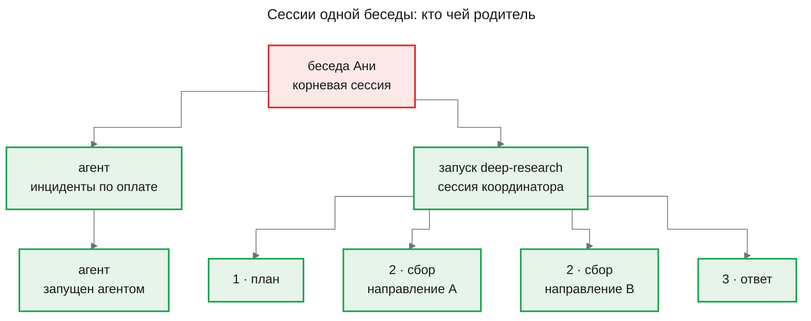
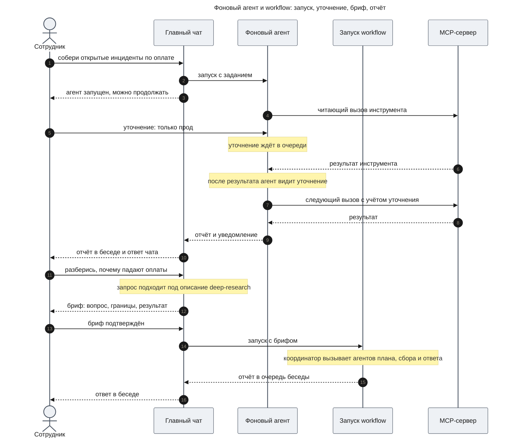
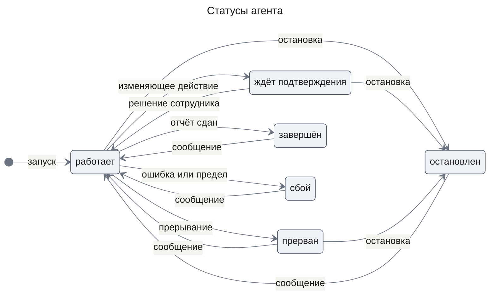
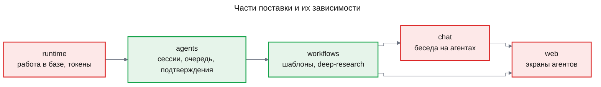

# PRD: Платформа агентов (agent-platform)

| Статус | Дата | Глубина | UXRD | Дизайны |
|---|---|---|---|---|
| Утверждён | 2026-11-14 | full | [uxrd.md](uxrd.md) | [design-runtime.md](design-runtime.md) |

## Snapshot

**Overview.** Сейчас в Agent OS есть чат и отдельный контур глубокого расследования, а сам чат умеет только запустить расследование и остановить его. Фича превращает продукт в платформу агентов по образцу Claude Code. Главный чат становится агентом с инструментами внешних систем, а любую долгую работу он отдаёт фоновому агенту, который трудится в своей сессии и возвращает отчёт. Агенту можно написать прямо во время работы, его можно прервать, остановить и запустить снова, а изменяющее действие во внешней системе ждёт подтверждения сотрудника. Глубокий ресерч становится первым шаблоном workflow: агент-координатор ведёт три шага — план, сбор, ответ — в рамках ограничений, которые соблюдает платформа. Чат выбирает агента или шаблон по описанию в его заголовке, а workflow запускает только после того, как сотрудник подтвердил бриф. Вся работа переживает рестарт сервера. Расход считается в долларах и пока ничем не ограничен; сотрудник видит свой расход за месяц.

- **Для**: сотрудники, которые работают через чат, и разработчик платформы, который следит за стоимостью.
- **Не входит**: шаблоны от пользователей, скиллы, ограничение расходов, самокоррекция, проверка утверждений и калибровка уверенности, перенос старых бесед и расследований.
- **Части**: `runtime` → `agents` → `workflows` → `chat` → `web`.
- **Главный риск**: модели класса Haiku могут не удержать свободный цикл агента и плохо делегировать работу ([Risks](#risks)).
- **Открытые вопросы**: нет.

## Terms

Пример везде один: SRE Аня спрашивает в чате про ошибки оплаты и просит в фоне собрать открытые инциденты.

- **Агент** — модель с промптом, набором инструментов и своей сессией. Агент работает над одним заданием, пока не вернёт отчёт. Пример: агент «собери открытые инциденты по оплате».
- **Сессия** — вся история одного агента: задание, ответы модели, вызовы инструментов с результатами, входящие сообщения. Модель сама ничего не помнит и на каждом шаге снова получает сессию.
- **Родительская сессия** — сессия, из которой агента запустили. Беседа в чате — **корневая сессия**: у неё нет родителя, а все агенты и workflow беседы висят под ней деревом.
- **Ход агента** — один вызов модели и исполнение инструментов, которые модель в этом ответе попросила.
- **Определение агента** — описание агента данными: заголовок, промпт, инструменты, модель и предел числа ходов.
- **Заголовок** — имя и описание того, когда агента или шаблон использовать, как frontmatter у Claude. Главный чат видит только заголовки и по описанию решает, что запрос подходит, — это **триггер**.
- **Инструмент** — операция, которую модель просит исполнить, например «найти тикеты». Исполняет её платформа, а результат приходит модели следующим сообщением.
- **MCP** (Model Context Protocol) — стандарт, по которому внешняя система (Jira, почта, логи) отдаёт свои операции как инструменты. **MCP-сервер** — программа, которая отдаёт инструменты одной системы.
- **Встроенные инструменты** — инструменты самой платформы: запустить агента, написать агенту, показать агентов, остановить агента, запустить workflow.
- **Читающее и изменяющее действие** — вызов инструмента, который только читает данные, и вызов, который что-то меняет во внешней системе, например создаёт тикет.
- **Отчёт** — итоговый текст фонового агента. С ним родителю приходит **уведомление**: статус, число вызовов инструментов и длительность.
- **Очередь сообщений** — сообщения агенту, которые ждут доставки. В одну очередь попадают сообщения сотрудника, отчёты дочерних агентов и уведомления.
- **Граница результата инструмента** — момент, когда инструмент вернул результат, а следующий вызов модели ещё не начался. В этот момент агент получает сообщения из очереди.
- **Прерывание** — отмена текущей операции агента; агент жив и ждёт указаний. **Остановка** — конец работы агента со статусом «остановлен».
- **Продолжение с историей** — новое сообщение агенту, который закончил работу: он снова работает с той же сессией. **Запуск с нуля** — новый агент с тем же определением и тем же заданием, без прежней истории.
- **Workflow** — работа по шаблону. **Шаблон** — заголовок, определения агентов-исполнителей, агент-координатор и ограничения. **Координатор** — агент, в промпте которого словами записаны правила workflow: порядок шагов, что каждый шаг получает от предыдущих, какие шаги идут параллельно, что делать при сбое шага и когда workflow закончен; исполнителей он вызывает сам. **Ограничения** шаблон объявляет данными, а соблюдает их платформа: каких агентов координатор может вызвать, сколько раз и какой шаг должен быть последним. **Системный шаблон** поставляется с платформой.
- **Бриф** — вопрос, его границы и что считается результатом. Чат готовит бриф перед запуском workflow, и workflow получает только его.
- **Журнал токенов** хранит каждый вызов модели: кто вызвал, какая модель и сколько токенов. **Стоимость** вызова считается в долларах из его токенов по цене этой модели: у каждой модели своя цена.
- **Месячный бюджет** — будущий предел расходов сотрудника за календарный месяц. В этой фиче он не действует: расход только считается (FR-02).
- **Haiku** — младшая модель Claude: быстрая и дешёвая. На платформе это модель по умолчанию.

## Background

Сегодня у сотрудника есть чат. Сверх разговора модель чата умеет две вещи: запустить глубокое расследование по логам и остановить его. Расследование идёт в отдельном контуре движка: модель-руководитель вызывает агентов плана, сбора, проверки и итога, а движок проверяет каждое утверждение ответа и калибрует уверенность. Чат не подключён к внешним системам, во время ответа не принимает новое сообщение, а запустить работу в фоне сотрудник не может.

Владелец меняет направление: вместо продукта вокруг расследования нужна общая платформа агентов. Образец — Claude Code. Там главный агент работает с инструментами, отдаёт задачи фоновым агентам и получает их отчёты и сообщения человека через одну очередь. Глубокий ресерч остаётся, но становится одним из шаблонов поверх агентов, а не отдельной архитектурой.

Схема показывает путь сообщения сотрудника на новой платформе: долгую задачу чат сразу отдаёт фоновому агенту, а workflow запускает только после подтверждённого брифа. Красным — то, что меняется, зелёным — то, чего раньше не было.

```mermaid
---
title: "Как будет устроено: беседа, фоновый агент и workflow"
config:
  theme: base
  look: classic
  themeVariables:
    primaryColor: "#eef1f5"
    primaryBorderColor: "#4b5563"
    primaryTextColor: "#1a1a1a"
    lineColor: "#6b7280"
  flowchart:
    curve: step
  themeCSS: |
    @keyframes lit_ov{0%,10%{stroke:#991b1b;stroke-width:6px}11.11%,100%{stroke:#f4a5a5;stroke-width:2px}}
    @keyframes litr_ov{0%,10%{stroke:#1d4ed8;stroke-width:6px}11.11%,100%{stroke:#9ec1f7;stroke-width:2px}}
---
flowchart LR
    entry(["▶ сотрудник пишет в чат"])
    web["1 · web<br/>беседа и список агентов"]
    chat["2 · главный чат<br/>корневой агент"]
    agent["3 · фоновый агент<br/>своя сессия"]
    brief["4 · бриф<br/>ждёт подтверждения"]
    wf["5 · координатор workflow<br/>сессия под беседой"]
    steps["6 · агенты шагов<br/>план, сбор, ответ"]
    mcp(["MCP-серверы<br/>внешние системы"])
    db[("база<br/>сессии, очереди, токены")]
    entry --> web
    web e1@-->|"сообщение"| chat
    chat e2@-->|"запуск агента"| agent
    chat e3@-->|"триггер по описанию"| brief
    brief e4@-->|"сотрудник подтвердил"| wf
    wf e5@-->|"вызов в пределах шаблона"| steps
    steps e6@-->|"отчёты"| wf
    wf e7@-->|"отчёт в очередь"| chat
    agent e8@-->|"отчёт в очередь"| chat
    chat e9@-->|"ответ и отчёты"| web
    agent -->|"инструменты"| mcp
    steps -->|"инструменты"| mcp
    agent -.->|"всё состояние"| db
    classDef entry fill:#ffffff,stroke:#1f2937,stroke-width:1.5px,color:#1a1a1a
    classDef changed fill:#fde8e8,stroke:#dc2626,stroke-width:2px,color:#1a1a1a
    classDef new fill:#e6f4ea,stroke:#16a34a,stroke-width:2px,color:#1a1a1a
    classDef unchanged fill:#eef1f5,stroke:#4b5563,stroke-width:1.5px,color:#1a1a1a
    classDef w1 stroke:#f4a5a5,stroke-width:2px,animation:lit_ov 10.8s linear 0s infinite
    classDef w2 stroke:#f4a5a5,stroke-width:2px,animation:lit_ov 10.8s linear 1.2s infinite
    classDef w3 stroke:#f4a5a5,stroke-width:2px,animation:lit_ov 10.8s linear 2.4s infinite
    classDef w4 stroke:#f4a5a5,stroke-width:2px,animation:lit_ov 10.8s linear 3.6s infinite
    classDef w5 stroke:#f4a5a5,stroke-width:2px,animation:lit_ov 10.8s linear 4.8s infinite
    classDef r1 stroke:#9ec1f7,stroke-width:2px,animation:litr_ov 10.8s linear 6s infinite
    classDef r2 stroke:#9ec1f7,stroke-width:2px,animation:litr_ov 10.8s linear 7.2s infinite
    classDef r3 stroke:#9ec1f7,stroke-width:2px,animation:litr_ov 10.8s linear 8.4s infinite
    classDef r4 stroke:#9ec1f7,stroke-width:2px,animation:litr_ov 10.8s linear 9.6s infinite
    class entry entry
    class web,chat,db,mcp changed
    class agent,brief,wf,steps new
    class e1 w1
    class e2 w2
    class e3 w3
    class e4 w4
    class e5 w5
    class e6 r1
    class e7 r2
    class e8 r3
    class e9 r4
```

Главный чат и любой агент пользуются одними и теми же инструментами внешних систем, а workflow запускает своих агентов так же, как чат. Из продукта уходят карточка расследования в беседе, проверка утверждений, калибровка уверенности и отдельный инструмент запуска расследования.

Каждый агент и каждый запуск workflow — сессия, привязанная к родительской. Поэтому всё, что запущено из одной беседы, складывается в дерево с беседой в корне.

Отчёт поднимается по дереву на один уровень: агент, запущенный агентом, отчитывается своему родителю, а не беседе.

## Users and Use Cases

### Users

- **Сотрудник** — аналитик, SRE, инженер или менеджер, который работает через чат. Ему важно отдать долгую задачу в фон, не терять нить разговора и не допустить действия во внешней системе без своего согласия.
- **Разработчик платформы** — единственный разработчик Agent OS. Ему важно видеть, на какой модели работал каждый агент и сколько он стоил, и чтобы работа не пропадала при рестарте сервера.

### Use Cases

- **UC-1**: Сотрудник просит чат найти данные во внешней системе → чат сам вызывает нужный инструмент и отвечает, а изменение во внешней системе делает только после подтверждения, так что рутинные дела решаются в одном окне.
- **UC-2**: Сотрудник отдаёт долгую задачу фоновому агенту → получает подтверждение запуска, продолжает разговор и потом видит отчёт в беседе, так что не ждёт, пока агент работает.
- **UC-3**: Сотрудник уточняет задачу работающему агенту → агент учитывает уточнение после текущего шага, без перезапуска, так что работа не начинается заново.
- **UC-4**: Сотрудник видит, что агент идёт не туда → прерывает или останавливает его, а потом продолжает с историей или запускает с нуля, так что сам решает, сколько уже сделанного сохранить.
- **UC-5**: Сотрудник задаёт в чате большой вопрос → проверяет и подтверждает бриф, видит, как идут план, сбор и ответ, и получает ответ в беседе, так что большой вопрос разбирается без ручной декомпозиции.
- **UC-6**: Сотрудник получает запрос на изменяющее действие → подтверждает или отклоняет его, так что ни одно изменение во внешней системе не происходит без него.
- **UC-7**: Разработчик смотрит журнал токенов → видит по каждому агенту модель, токены и стоимость, так что может проверить, что схема на Haiku дешевле одной сильной модели.
- **UC-8**: Разработчик перезапускает сервер посреди работы агентов → агенты продолжают с того же места, так что рестарт не стоит сотруднику потерянной работы.

### Путь сотрудника

Диаграмма показывает UC-2, UC-3 и UC-5 вместе: Аня отдаёт задачу в фон, пока агент работает, присылает уточнение и получает отчёт в беседе, а затем запускает глубокий ресерч через бриф.

Агент не прерывает вызов инструмента ради уточнения: уточнение ждёт границы результата. Чтобы агент отреагировал сразу, сотрудник прерывает его (FR-08).

## Functional Requirements

Требования сгруппированы по частям поставки ([Delivery Parts](#delivery-parts)).

### Must Have (MVP)

#### Основа: работа в базе и учёт токенов

- **FR-01. Работа переживает рестарт сервера.** Агенты и workflow, которые работали в момент остановки сервера, после его запуска продолжают с того же места.
  - AC-01.1: Given агент выполняет многошаговое задание, when сервер останавливают посреди работы и запускают снова, then агент продолжает и сдаёт отчёт, а в его истории нет потерянных и повторённых шагов.
  - AC-01.2: Given изменяющее действие начато до остановки сервера, when сервер запускается снова, then действие не повторяется само, а в истории агента виден его результат или пометка «исход неизвестен».
  - AC-01.3: Given сообщение агенту ждало в очереди, when сервер перезапускается, then сообщение доставляется агенту один раз.

- **FR-02. Журнал токенов и расход сотрудника.** Каждый вызов модели записывается в журнал токенов, а его стоимость считается по цене модели. Цены задаются в настройках развёртывания, по одной на модель; экрана для их правки нет. Расход сотрудника считается за календарный месяц по всем его беседам, агентам и workflow, чтобы позже построить на нём месячный бюджет. Превышение расхода в этой фиче ничего не блокирует.
  - AC-02.1: Given агент вызвал модель, when вызов закончился, then в журнале есть запись: сессия, агент, модель, входные и выходные токены, стоимость в долларах.
  - AC-02.2: Given у сотрудника есть агенты на разных моделях, when их вызовы записаны, then стоимость каждого вызова посчитана по цене его модели, а расход сотрудника за месяц равен сумме этих стоимостей.

#### Агенты

Статусы агента и переходы между ними:

«Сбой» объединяет ошибку модели и исчерпанный предел ходов; причина видна в уведомлении. Сообщение агенту в конечном статусе — это продолжение с историей (FR-09).

- **FR-03. Определение агента.** Агент работает по определению: заголовок, промпт, встроенные и MCP-инструменты, модель, предел ходов. Определения поставляет платформа, среди них агент общего назначения со всеми инструментами развёртывания. Предел ходов считается на одно задание: продолжение с историей (FR-09) начинает отсчёт заново, а у главного чата отсчёт начинает каждое сообщение сотрудника.
  - AC-03.1: Given в определении агента есть набор инструментов, when модель агента просит инструмент вне набора, then вызов не исполняется, а в историю приходит отказ.
  - AC-03.2: Given агент сделал предельное число ходов, when модель просит ещё один ход, then агент получает статус «сбой» с причиной «исчерпан предел ходов», а родитель — уведомление.

- **FR-04. Модель агента.** Модель выбирается по порядку: указанная при запуске, затем указанная в определении, иначе Haiku. Правило действует и для главного чата.
  - AC-04.1: Given при запуске указана модель, when агент работает, then все его вызовы идут на эту модель.
  - AC-04.2: Given при запуске модель не указана, а в определении указана, when агент работает, then вызовы идут на модель из определения.
  - AC-04.3: Given модель не указана ни при запуске, ни в определении, when агент или беседа работает, then вызовы идут на Haiku.

- **FR-05. Запуск агента в фоне.** Чат, сотрудник через чат или другой агент запускает агента с заданием и сразу продолжает свою работу. Дочерний агент видит только своё определение и текст задания.
  - AC-05.1: Given беседа, when сотрудник просит выполнить задачу в фоне, then чат сразу сообщает, что агент запущен, и принимает следующее сообщение до того, как агент закончит.
  - AC-05.2: Given агент запущен, when открыть его историю, then она начинается с текста задания, и в ней нет сообщений родительской сессии.
  - AC-05.3: Given из одной беседы запущено несколько агентов, when они работают, then они работают одновременно и не ждут друг друга.

- **FR-06. Отчёт возвращается родителю.** Когда агент заканчивает, родитель получает только его отчёт и уведомление, без промежуточных сообщений.
  - AC-06.1: Given агент сдал отчёт, when родитель свободен, then отчёт начинает его следующий ход: в беседе чат сам отвечает на отчёт, без нового сообщения сотрудника.
  - AC-06.2: Given агент сдал отчёт, when родитель занят, then отчёт ждёт в очереди родителя и доставляется по FR-07.
  - AC-06.3: Given агент закончил со статусом «сбой» или «остановлен», when родитель получает уведомление, then в нём есть статус и причина.

- **FR-07. Сообщение работающему агенту.** Сотрудник или родительский агент пишет агенту в любой момент. Если агент занят, сообщение ждёт в очереди и добавляется в историю на ближайшей границе результата инструмента.
  - AC-07.1: Given агент ждёт результата инструмента, when сотрудник отправляет ему сообщение, then сообщение появляется в истории сразу после этого результата, и следующий вызов модели его учитывает.
  - AC-07.2: Given агенту отправлено несколько сообщений подряд, when они доставляются, then порядок в истории совпадает с порядком отправки.
  - AC-07.3: Given агент отвечает текстом без вызова инструментов, when приходит сообщение, then оно доставляется после конца хода и начинает следующий ход.

- **FR-08. Прерывание и остановка.** Прерывание отменяет текущую операцию агента. Остановка заканчивает работу агента и всех его работающих потомков.
  - AC-08.1: Given агент работает, when сотрудник прерывает его вместе с сообщением, then текущая операция отменяется, незаконченные вызовы инструментов получают в истории результат «прервано пользователем», и агент сразу продолжает с этим сообщением.
  - AC-08.2: Given агент работает, when сотрудник прерывает его без сообщения, then агент получает статус «прерван» и ждёт следующего сообщения.
  - AC-08.3: Given агент работает или ждёт, when сотрудник его останавливает, then агент получает статус «остановлен», больше не вызывает ни модель, ни инструменты, а родитель получает уведомление.
  - AC-08.4: Given у агента есть работающие потомки, when агента останавливают, then потомки тоже получают статус «остановлен».

- **FR-09. Продолжение с историей и запуск с нуля.** Агента, который закончил работу, можно продолжить с полной историей или запустить заново с нуля.
  - AC-09.1: Given агент в статусе «завершён», «сбой», «остановлен» или «прерван», when ему приходит сообщение, then он снова работает в той же сессии, видит всю прежнюю историю и новое сообщение, а потом сдаёт родителю ещё один отчёт.
  - AC-09.2: Given агент закончил работу, when сотрудник запускает его с нуля, then появляется новый агент с тем же определением, заданием и родителем, его история начинается с задания, а прежний агент остаётся в списке.

- **FR-10. Агент запускает агента.** Агент, у которого в определении есть инструмент запуска, запускает дочерних агентов по тем же правилам, что и чат.
  - AC-10.1: Given агент запустил дочернего, when дочерний сдаёт отчёт, then отчёт получает этот агент, а не беседа.
  - AC-10.2: Given в определении агента нет инструмента запуска, when модель просит запустить агента, then запуск не происходит (AC-03.1).
  - AC-10.3: Given глубина вложенности достигла предела, when агент просит запустить ещё одного, then запуск отклоняется, а в историю приходит причина.

- **FR-11. MCP-инструменты развёртывания.** У развёртывания один общий список MCP-серверов. Их инструменты доступны главному чату и агентам, в определении которых они есть. Каждый инструмент считается читающим или изменяющим; инструмент без пометки считается изменяющим. Какие серверы из списка доступны сотруднику, задаёт таблица развёртывания «сотрудник → доступные MCP-серверы»: ей подчиняются и чат сотрудника, и его агенты. Ролей в этой фиче нет, но доступ проверяется в одном месте, чтобы роли можно было добавить туда позже без переделки.
  - AC-11.1: Given MCP-сервер есть в списке и разрешён сотруднику в таблице доступа, when сервер платформы запущен, then инструменты этого MCP-сервера доступны чату сотрудника и агентам из его бесед.
  - AC-11.2: Given MCP-сервер недоступен, when агент вызывает его инструмент, then в историю приходит ошибка вызова, а агент и беседа продолжают работать.
  - AC-11.3: Given MCP-сервер не разрешён сотруднику в таблице доступа, when чат или агент этого сотрудника просит инструмент сервера, then вызов не исполняется, а в историю приходит отказ (как в AC-03.1).

- **FR-12. Подтверждение изменяющих действий.** Изменяющее действие ждёт решения сотрудника, которому принадлежит беседа. Пока решения нет, агент стоит в статусе «ждёт подтверждения». Чтобы подтверждение было на чём проверить, MCP-фикстура получает изменяющий инструмент с видимым результатом, например «создать заметку об инциденте».
  - AC-12.1: Given агент вызывает читающий инструмент, when вызов начинается, then он исполняется без вопроса сотруднику.
  - AC-12.2: Given агент вызывает изменяющий инструмент, when вызов начинается, then во внешнюю систему ничего не уходит, а сотрудник видит запрос: какой агент, какой инструмент и с какими аргументами.
  - AC-12.3: Given запрос на действие ждёт, when сотрудник подтверждает, then действие исполняется один раз, и агент продолжает работу.
  - AC-12.4: Given запрос на действие ждёт, when сотрудник отклоняет, then действие не исполняется, агент получает результат «отклонено пользователем» и продолжает работу.
  - AC-12.5: Given запрос на действие ждёт, when сервер перезапускают, then запрос по-прежнему ждёт решения, и подтвердить его можно как раньше.

- **FR-13. История агента.** Платформа хранит полную историю каждого агента и показывает её только владельцу. По каждому агенту видна его модель.
  - AC-13.1: Given агент вызвал инструмент, when открыть его историю, then в ней есть время, инструмент, аргументы и исход вызова: успех, пустой результат, ошибка инструмента, сбой связи или отказ.
  - AC-13.2: Given агент работал, when открыть его, then видна его модель, а токены и стоимость сотруднику не показываются: они есть только в журнале токенов (AC-02.1).
  - AC-13.3: Given агент принадлежит другому сотруднику, when сотрудник пытается его открыть, написать ему или остановить его, then ответ такой же, как для несуществующего агента.

#### Беседа на агентах

- **FR-14. Беседа — корневая сессия.** Каждая беседа — сессия главного чата на новом слое агентов. Для сотрудника беседа ведёт себя как раньше. Требования к данным бесед с этой фичи задаёт этот PRD вместо `chat-shell` FR-13–FR-18.
  - AC-14.1: Given сотрудник отправил сообщение, when чат отвечает, then ответ появляется по мере генерации.
  - AC-14.2: Given беседа с вызовами инструментов, отчётами агентов и запросами на действия, when сотрудник открывает её снова, then видит всё так же, как видел вживую.
  - AC-14.3: Given у сотрудника есть беседы, when он работает со списком, then список, переименование, удаление и автоматический заголовок ведут себя как в `chat-shell` FR-13, FR-15–FR-17.
  - AC-14.4: Given в беседе работают агенты, when сотрудник удаляет беседу, then её агенты останавливаются и удаляются вместе с ней.

- **FR-15. Инструменты чата и запуск по триггеру.** Главный чат получает MCP-инструменты развёртывания и встроенные инструменты: запустить агента, написать агенту, показать агентов, остановить агента, запустить workflow. Каталог чата — агенты и шаблоны, которые чат может запустить; их чат видит только по заголовкам. Кто выполнит запрос, чат решает по одному правилу, как Claude Code. Ветки правила проверяются по порядку, и срабатывает первая подходящая:
  1. Сотрудник называет агента или шаблон по имени — чат запускает названного агента или готовит бриф для workflow.
  2. Под запрос подходит описание специализированного агента из каталога чата или шаблона — срабатывает триггер. Чат запускает этого агента или готовит бриф для workflow.
  3. Сотрудник просит сделать работу в фоне и никого не называет — чат запускает агента общего назначения (FR-03).
  4. В остальных случаях чат по инструкции оценивает объём работы: короткую, которую покрывают его инструменты, делает сам, а долгую или многошаговую отдаёт фоновому агенту общего назначения. Этот выбор остаётся на усмотрение чата.

  Описание агента общего назначения триггером не служит. Агентов, которых шаблон держит для себя, — плана, сбора и ответа шаблона deep-research — чат не видит и запустить не может: их вызывает только координатор. В первой версии каталог чата держит только агента общего назначения и шаблон deep-research, поэтому у триггера специализированного агента пока нет предмета: он нужен для агентов, которых добавят позже. Отдельной кнопки или режима запуска нет.
  - AC-15.1: Given в развёртывании подключён MCP-сервер, его инструменты сотруднику разрешены (AC-11.1), и запрос не подходит под описание специализированного агента или шаблона, when сотрудник просит найти в этой системе данные, которые возвращает один вызов инструмента, не просит работы в фоне и не называет агента, then чат сам вызывает инструмент и отвечает по его результату.
  - AC-15.2: Given беседа, when сотрудник спрашивает, какие агенты работают, then чат перечисляет агентов этой беседы с их статусами.
  - AC-15.3: Given в беседе работает агент, when сотрудник просит чат написать агенту или остановить его, then сообщение доставляется по FR-07, а остановка происходит по FR-08.
  - AC-15.4: Given беседа, when вопрос сотрудника подходит под описание шаблона deep-research или сотрудник называет шаблон по имени, then чат готовит бриф (FR-28), а не запускает workflow сразу.
  - AC-15.5: Given запрос подходит под описание специализированного агента из каталога чата или сотрудник называет агента по имени, when чат обрабатывает запрос, then чат сразу запускает этого агента в фоне, без брифа (AC-05.1).
  - AC-15.6: Given сотрудник просит сделать работу в фоне, не называет агента, и запрос не подходит под описание специализированного агента или шаблона, when чат обрабатывает запрос, then чат сразу запускает в фоне агента общего назначения, без брифа.

- **FR-16. Писать, пока чат работает.** Сотрудник отправляет сообщение в беседу в любой момент, и сообщение не теряется. Пока чат занят, сообщение ждёт в очереди беседы по тем же правилам, что у агента.
  - AC-16.1: Given чат отвечает, when сотрудник отправляет новое сообщение, then оно принято, видно в беседе как ожидающее и учитывается чатом на ближайшей границе (FR-07).
  - AC-16.2: Given чат отвечает, when сотрудник прерывает ответ, then чат прекращает текущую операцию по FR-08.

- **FR-17. Фоновые результаты в беседе.** Отчёты, уведомления и запросы на действия от всех агентов и workflow беседы появляются в беседе.
  - AC-17.1: Given беседа открыта, when агент этой беседы сдаёт отчёт, then отчёт появляется без перезагрузки страницы.
  - AC-17.2: Given беседа закрыта, когда агент сдал отчёт, when сотрудник открывает беседу, then видит отчёт и ответ чата на него.
  - AC-17.3: Given агент любой глубины в дереве беседы ждёт подтверждения, when сотрудник смотрит беседу, then видит этот запрос и может его решить.

#### Workflow и глубокий ресерч

- **FR-18. Запуск workflow по шаблону.** Workflow запускается по шаблону, и каждый запуск — сессия координатора, родитель своих агентов. Поэтому список, история, остановка и перезапуск работают для workflow так же, как для агента. Координатор — обычный агент, и его модель выбирается по FR-04, так что ему можно дать модель сильнее, чем исполнителям.
  - AC-18.1: Given workflow запущен из беседы, when сотрудник открывает список агентов, then видит запуск как одну запись, а его агентов — под ним.
  - AC-18.2: Given шаблон объявляет, каких агентов и сколько раз координатор может вызвать, when координатор просит агента вне списка или сверх числа, then вызов не происходит, а координатор получает отказ с причиной.
  - AC-18.3: Given workflow идёт, when сотрудник его останавливает, then останавливаются все его агенты (AC-08.4).
  - AC-18.4: Given workflow остановлен или упал, when сотрудник продолжает его с историей, then координатор продолжает в той же сессии и видит отчёты уже законченных агентов (AC-09.1).
  - AC-18.5: Given шаблон объявляет обязательный последний шаг, when workflow заканчивается, then родитель получает как отчёт (FR-06) итог агента этого шага, а попытка координатора закончить без него получает отказ.

- **FR-19. Системный шаблон deep-research.** Глубокий ресерч идёт по системному шаблону: координатор ведёт три шага — план, сбор, ответ. Агент плана делит вопрос на направления, агенты сбора собирают данные инструментами развёртывания, агент ответа пишет ответ из собранного. Шаблон разрешает координатору только этих агентов и объявляет последним шагом агента ответа.
  - AC-19.1: Given подключён источник данных, when сотрудник подтвердил бриф глубокого ресерча, then в беседу приходит ответ агента ответа, а у запуска видны агенты плана, сбора и ответа.
  - AC-19.2: Given координатор запустил несколько агентов сбора, when они работают, then они работают одновременно, и их не больше, чем разрешает шаблон.
  - AC-19.3: Given один агент сбора закончил со сбоем, when остальные закончили, then workflow всё равно заканчивается ответом агента ответа, и в ответе названо направление, по которому данных нет.

- **FR-20. Один путь к глубокому ресерчу.** Глубокий ресерч запускается только как workflow по шаблону. Прежний контур расследования удалён целиком, вместе с проверкой утверждений и калибровкой уверенности.
  - AC-20.1: Given беседа, when сотрудник просит глубокий ресерч, then чат готовит бриф и после подтверждения запускает workflow, а другого способа запустить расследование в продукте нет.
  - AC-20.2: Given ответ глубокого ресерча, when сотрудник его читает, then в ответе нет статусов утверждений и групп уверенности.

- **FR-28. Бриф перед запуском workflow.** Прежде чем запустить workflow, главный чат готовит бриф и показывает его сотруднику. Workflow стартует только после подтверждения; сотрудник может исправить бриф или отказаться. Подтверждённый бриф — единственный вход workflow: историю беседы workflow не видит. Бриф ждёт решения так же, как изменяющее действие (FR-12). Бриф нужен только workflow: фоновый агент стартует сразу, а агент, запущенный другим агентом, никогда не просит бриф у человека. Workflow запускает только главный чат: в определения агентов инструмент «запустить workflow» не входит.
  - AC-28.1: Given чат подготовил бриф, when сотрудник ещё не решил, then workflow не запущен, а бриф ждёт решения в беседе.
  - AC-28.2: Given бриф ждёт, when сотрудник подтверждает его, в том числе исправив текст, then запускается один workflow, и его агенты получают подтверждённый бриф, но не историю беседы.
  - AC-28.3: Given бриф ждёт, when сотрудник отказывается, then workflow не запускается, а чат получает результат «отклонено пользователем» (как AC-12.4).

#### Веб-интерфейс агентов

- **FR-21. Список агентов.** Сотрудник видит своих агентов и запуски workflow: описание, статус, модель, время запуска, беседу. Дочерние агенты показаны под родителями.
  - AC-21.1: Given сотрудник запустил агента из беседы, when открыт список агентов, then агент появляется в списке без перезагрузки, а смена его статуса видна сразу.
  - AC-21.2: Given у другого сотрудника есть агенты, when сотрудник открывает список, then чужих агентов в нём нет.

- **FR-22. Агент как беседа.** Сотрудник открывает любого своего агента и читает его историю как беседу.
  - AC-22.1: Given агент работал, when сотрудник открывает его, then видит задание, ответы модели, вызовы инструментов с аргументами и результатами, доставленные и ожидающие сообщения, запросы на действия и отчёты дочерних агентов.
  - AC-22.2: Given агент работает, when сотрудник смотрит его историю, then новые записи появляются без перезагрузки.

- **FR-23. Управление агентом из веба.** Из открытого агента сотрудник пишет ему, прерывает его, останавливает, продолжает с историей или запускает с нуля.
  - AC-23.1: Given агент открыт, when сотрудник отправляет сообщение, then оно видно как ожидающее до доставки и доставляется по FR-07.
  - AC-23.2: Given агент открыт, when сотрудник прерывает, останавливает, продолжает или запускает его с нуля, then исход совпадает с FR-08 и FR-09, а новый статус виден в истории и в списке.

- **FR-24. Беседа показывает работу агентов.** В беседе видны вызовы инструментов, ожидающие сообщения, запросы на действия с возможностью подтвердить или отклонить, брифы workflow с возможностью подтвердить, исправить или отклонить, отчёты фоновых агентов и ход запусков workflow. Ход workflow заменяет карточку расследования.
  - AC-24.1: Given в беседе идёт workflow deep-research, when сотрудник смотрит беседу, then видит агентов, которых вызвал координатор, и их статусы, и картина обновляется без перезагрузки.
  - AC-24.2: Given в беседе ждёт запрос на действие или бриф, when сотрудник решает его в беседе, then исход совпадает с AC-12.3, AC-12.4 или AC-28.2, AC-28.3.

- **FR-29. Расход за месяц.** Сотрудник видит в вебе одну цифру: свой расход в долларах за текущий календарный месяц (FR-02). Цифра обновляется при загрузке страницы, а не в реальном времени.
  - AC-29.1: Given у сотрудника в этом месяце были вызовы модели, when он открывает веб, then видит сумму их стоимостей, и она совпадает с журналом токенов.
  - AC-29.2: Given агент сотрудника потратил ещё, when сотрудник перезагружает страницу, then цифра включает новые вызовы.

### Should Have

- **FR-25. Ответвление агента (fork).** Агента можно запустить ответвлением: он начинает с истории родителя до текущего момента и нового задания. История родителя при этом не меняется.
  - AC-25.1: Given беседа с историей, when чат запускает ответвление, then агент отвечает с учётом разговора до момента запуска, а история беседы не меняется.

- **FR-26. Сообщение запущенному workflow.** Сотрудник пишет запущенному workflow так же, как агенту: сообщение получает координатор по FR-07.
  - AC-26.1: Given идёт шаг сбора, when сотрудник пишет workflow «смотри только прод», then сообщение появляется в истории координатора на ближайшей границе результата инструмента.

### Could Have

- **FR-27. Сжатие длинной истории.** Когда история агента подходит к пределу окна модели, старая часть заменяется сводкой внутри той же сессии. Сотрудник по-прежнему читает полную историю.
  - AC-27.1: Given история агента подошла к пределу окна модели, when агент делает следующий ход, then ход проходит без ошибки переполнения, а в истории видна отметка сжатия.

### Won't Have

- Создание и правка шаблонов и определений агентов пользователями — позже. Формат шаблона это допускает, но в первой версии работает только системный шаблон deep-research.
- Шаги, которые исполняет сама платформа по объявлению в шаблоне, — позже: формат шаблона можно расширить. Пока workflow ведёт координатор (FR-18).
- Скиллы — инструкции с заголовком, которые чат подгружает в контекст по триггеру, — позже. Общий формат заголовка позволит добавить их без переделки.
- Ограничение расходов — сумма месячного бюджета, предел на агента или запуск и что происходит при превышении — позже. Пока расход только считается (FR-02).
- Токены и стоимость по каждому агенту в вебе — не показываются; сотрудник видит только свой расход за месяц (FR-29).
- Самокоррекция workflow — позже, отдельной фичей.
- Проверка утверждений, калибровка уверенности и привязка каждого утверждения ответа к записи-источнику — удаляются. Могут вернуться вместе с самокоррекцией.
- Стенд оценки качества (self-check) — прежний удалён; новый для workflow напишут позже.
- Свой список MCP-серверов у каждого пользователя — у развёртывания один общий список.
- Права на инструменты по ролям — позже. Пока доступ к MCP-серверам задаёт таблица «сотрудник → доступные MCP-серверы» (FR-11), а роли добавятся в ту же проверку.
- Экран для правки цен моделей — цены задаются настройками развёртывания (FR-02).
- Отдельный режим ресерча без источника, на знаниях модели (`deep-research` FR-25), — удаляется вместе с прежним контуром: в развёртывании всегда подключена MCP-фикстура.
- Мягкое удаление — удаление остаётся физическим, вместе со всем деревом сессий.
- Обратная совместимость и перенос данных — PoC: существующие беседы и расследования на новую платформу не переносятся, старый код удаляется.

## Non-Functional Requirements

### Performance

- **NFR-01**: Прерывание и остановка меняют статус агента не позже чем через 5 с после команды (p95). Измеряется тестом, где агент ждёт долгого инструмента.
- **NFR-02**: Отчёт фонового агента появляется в открытой беседе не позже чем через 2 с после сдачи (p95). Измеряется по отметкам времени в e2e-тесте.
- **NFR-03**: Список бесед, сообщения беседы и время до первого токена укладываются в бюджеты раздела «Performance Requirements» в `.claude/skills/project-context/SKILL.md`. Время до первого токена сравнивается с нынешним чатом на той же модели.

### Reliability

- **NFR-04**: Каждое принятое сообщение, отчёт и уведомление доставляется ровно один раз и в порядке отправки — в том числе когда отправка, конец хода, прерывание и рестарт сервера совпадают по времени. Проверяется тестами на одновременные события и тестом с рестартом.
- **NFR-05**: После запуска сервера прерванная рестартом работа возобновляется не позже чем через 60 с. Измеряется тестом с остановкой сервера посреди работы агента.

### Security

- **NFR-06**: Изоляция данных пользователей — как в бизнес-ограничении 2 в `.claude/skills/project-context/SKILL.md`: каждая точка доступа к агентам, сессиям и workflow покрыта e2e-тестом с двумя пользователями.
- **NFR-07**: Ни одно изменяющее действие не уходит во внешнюю систему без подтверждения. Для каждого изменяющего инструмента есть тест: без подтверждения MCP-сервер не получает ни одного вызова.

### Accessibility and responsiveness

- **NFR-08**: Новые экраны соответствуют уровню `chat-shell` NFR-18 (WCAG 2.1 AA) и пригодны к работе от ширины `chat-shell` NFR-22.

## Delivery Parts

| Часть | Покрывает | Срез | Зависит от | Почему отдельно |
|------|--------|-----------|------------|-----------|
| `runtime` | FR-01, FR-02; удаление прежнего контура расследования из FR-20 | domain | — | Основа без привязки к расследованиям: работа в базе, восстановление после рестарта и журнал токенов нужны всем слоям выше. Общие таблицы runtime ломают код прежнего контура, поэтому эта часть удаляет его целиком: старый движок, запуск расследования из чата и экраны расследований. От выпуска `runtime` до выпуска `workflows` чат работает как обычный чат, а глубокий ресерч недоступен. |
| `agents` | FR-03–FR-13, FR-25, FR-27 | domain | `runtime` | Агент как сессия с очередью, прерыванием и подтверждениями — отдельный слой, на котором стоят и чат, и workflow. |
| `workflows` | FR-18, FR-19, FR-20 (глубокий ресерч идёт только как workflow), FR-26, FR-28 | domain | `agents` | Шаблоны, координатор, ограничения и бриф — свой слой поверх агентов. Часть задаёт бриф и запуск workflow, которыми пользуется чат. |
| `chat` | FR-14–FR-17 | backend | `agents`, `workflows` | Беседа уходит со своего хранилища на сессии агентов и получает инструменты. Часть также отдаёт вебу API: список агентов и запусков, их история и управление ими, расход за месяц (контракт для FR-21–FR-24, FR-29). |
| `web` | FR-21–FR-24, FR-29 | frontend | `chat`, `workflows` | Экраны агентов и беседы потребляют контракты чата и workflow. |

### Part Dependency Diagram

Стрелка идёт от части к той, что строится на её утверждённом дизайне.

## Success Criteria

- Семь сценариев проходят вручную на dev-развёртывании за одну сессию после выпуска части `web`: фоновый агент из беседы присылает отчёт; уточнение работающему агенту учтено после текущего вызова инструмента; агент продолжен с историей и запущен с нуля; сервер убит посреди работы, а агент дошёл до отчёта; глубокий ресерч запущен по описанию шаблона, после подтверждённого брифа ответил на источнике-фикстуре; запрос на изменяющее действие один раз подтверждён и один раз отклонён; расход за месяц в вебе совпадает с журналом токенов. Цель — все семь; результат читается в веб-интерфейсе и в журнале токенов.
- Фоновые агенты на Haiku доводят типичные задания до отчёта, а не до сбоя по пределу ходов. Цель — не меньше 4 из 5 заданий в ручном прогоне; читается в списке агентов по статусам и причинам.
- Прогон deep-research стоит меньше, чем тот же вопрос одному агенту на сильной модели. Цель — на 3 вопросах из 3; стоимость в долларах по ценам моделей сравнивается вручную по журналу токенов.

## Constraints and Risks

### Constraints

- Проект — PoC: обратной совместимости нет, старый код и старые форматы удаляются сразу, существующие записи не переносятся.
- Платформа делится на слои-пакеты с зависимостями в одну сторону: runtime ← agents ← workflows ← приложения.
- Агенты хранят всё состояние в базе, а не в памяти процесса. Вся работа с базой идёт через собственный интерфейс платформы.
- Mastra используется только для вызова модели, через собственную обёртку платформы. Память, хранилище и цикл инструментов Mastra не используются.
- Модель по умолчанию — Haiku, в том числе для главного чата.
- Формат шаблона должен допускать шаблоны от пользователей в будущем.
- Единственный подключённый источник данных — MCP-фикстура с синтетическими логами; она остаётся и получает изменяющий инструмент (FR-12).
- Фича снимает бизнес-ограничение 5 (provenance фактов) из `.claude/skills/project-context/SKILL.md`: ответ deep-research не ссылается на записи-источники.
- Документы `chat-shell` не правятся: этот PRD заменяет их требования к данным бесед ссылкой (FR-14).
- Бизнес-ограничение 1 (инструменты по ролям) в этой фиче выполняет нынешняя заглушка прав на источники `SOURCE_ACCESS_TABLE`: она переходит с источников на MCP-серверы (FR-11).
- Бизнес-ограничение 4 (явный бюджет у каждой задачи и расследования) в этой фиче не выполняется и откладывается: расход считается (FR-02), но не ограничивается.

### Assumptions

- Модели класса Haiku удерживают цикл инструментов главного чата и фоновых агентов. Проверяется ручным прогоном сразу после части `chat`, до начала `web`.
- Обёртка над Mastra отдаёт ответ модели по частям без памяти Mastra, так что чат стримит ответ. Проверяется пробой в дизайне части `chat`.
- MCP-серверы позволяют отличить читающие инструменты от изменяющих. Проверяется в дизайне части `agents`; если нет, все инструменты сервера считаются изменяющими (FR-11).

### Risks

| Риск | Влияние | Вероятность | Что делаем |
|------|--------|-------------|------------|
| Haiku не удерживает свободный цикл агента и плохо делегирует | Высокое | Среднее | Координатор глубокого ресерча работает в ограничениях шаблона, и ему можно дать модель сильнее (FR-18); у агентов есть предел ходов; модель задаётся в определении или при запуске (FR-04). |
| Гонки между доставкой из очереди, прерыванием и рестартом теряют или дублируют сообщения | Высокое | Среднее | Требование NFR-04 и тесты на одновременные события; изменяющее действие исполняется только после подтверждения (FR-12). |
| Стриминг беседы без стрима и памяти Mastra окажется сложнее ожидаемого | Среднее | Среднее | Проба в дизайне `chat` до остальной работы части. |
| MCP-инструменты в чате расширяют круг действий модели | Высокое | Низкое | Инструмент без пометки считается изменяющим и ждёт подтверждения; каждый вызов записан в истории (AC-13.1). |
| Переписывание целиком надолго оставляет продукт без рабочего чата | Среднее | Высокое | Порядок частей даёт первым наблюдаемым результатом рабочую беседу на новом слое агентов (`runtime`, `agents`, `workflows`, `chat`) ещё до экранов веба. |
| Главный чат переходит с Opus на Haiku, и ответы беседы становятся слабее | Среднее | Среднее | Модель чата задаётся в его определении (FR-04). |

## Update History

| Версия | Дата | Изменение |
|---------|------|--------|
| 1.0 | 2026-11-14 | Первая версия |
| 1.1 | 2026-11-14 | Права на MCP-серверы через таблицу «сотрудник → серверы»; месячный бюджет сотрудника в долларах с ценой на каждую модель; открытым остаётся предел расходов одного агента |
| 1.2 | 2026-11-14 | Запуск по триггеру из заголовка; бриф с подтверждением перед workflow; шаблон — координатор с ограничениями платформы; расход считается, но не ограничивается, сотрудник видит только расход за месяц; API веба в части `chat`; предел ходов на задание; скиллы в Won't Have |
| 1.3 | 2026-11-14 | Порядок частей `runtime` → `agents` → `workflows` → `chat` → `web`; правило выбора исполнителя запроса в FR-15 (AC-15.6); workflow запускает только главный чат |
| 1.4 | 2026-11-14 | Ветки правила FR-15 проверяются по порядку; агентов шаблона чат не видит и не запускает, каталог чата в первой версии — агент общего назначения и deep-research; утверждён владельцем вместе с Delivery Parts (`runtime` → `agents` → `workflows` → `chat` → `web`) |
| 1.5 | 2026-11-14 | Удаление прежнего контура расследования (FR-20) перенесено из `workflows` в `runtime` по дизайну части `runtime`; между `runtime` и `workflows` чат работает без глубокого ресерча; в шапке — ссылки на утверждённый UXRD и дизайн `runtime` |
