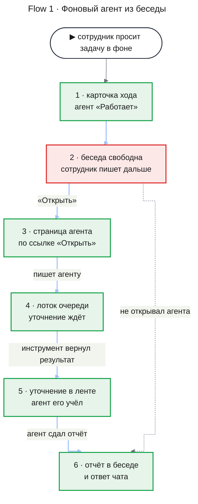
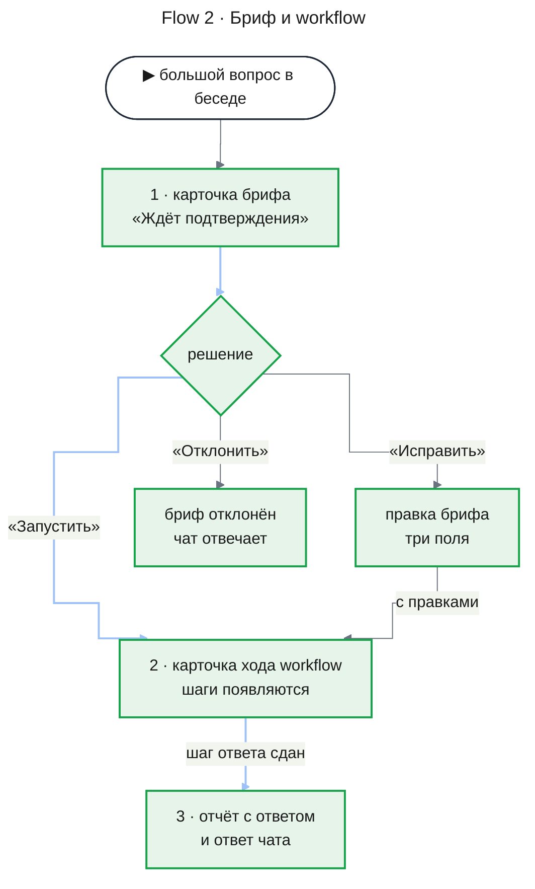
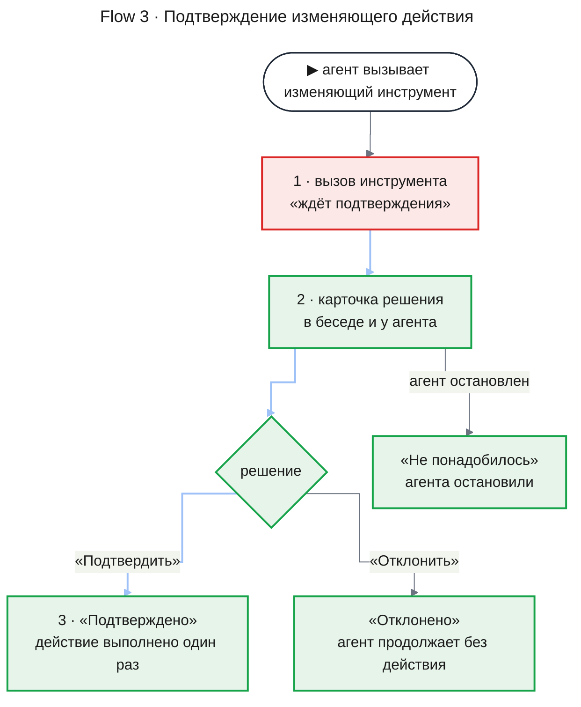
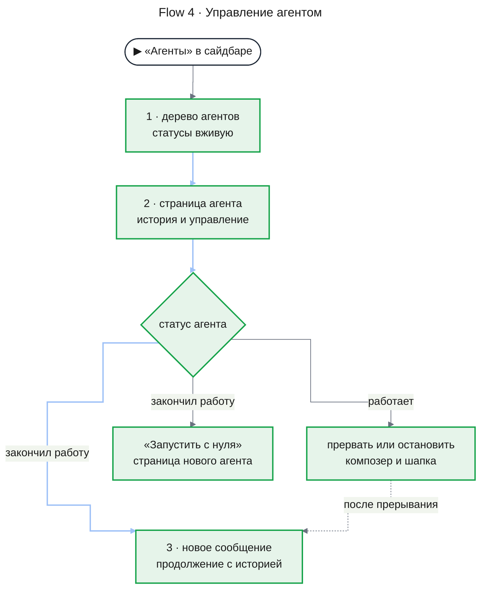

# UXRD: Платформа агентов (agent-platform)

| Статус | Дата | PRD | Дизайны |
|---|---|---|---|
| Approved | 2026-11-14 | [prd.md](./prd.md) | — |

## Snapshot

**Overview.** Беседа показывает работу агентов прямо в ленте: вызовы инструментов с исходом, карточку хода на месте запуска агента или workflow, карточки решения для изменяющих действий и брифа, отчёты фоновых агентов. Писать можно в любой момент: пока чат или агент занят, сообщение ждёт в лотке над композером, а кнопка «Прервать» сразу поворачивает работу. В сайдбаре появляется пункт «Агенты» — дерево всех агентов сотрудника; любой агент открывается как беседа, и там его можно прервать, остановить, продолжить с историей или запустить с нуля. Под именем пользователя в сайдбаре стоит расход за текущий месяц. Всё собрано из той же оболочки и дизайн-системы, а статусы десятков агентов меняются, не мигая и не сдвигая текст, который читает сотрудник.

- **Не меняется**: список бесед, переименование, удаление и заголовки бесед (chat-shell UXRD; AC-14.3). Отдельной кнопки или режима запуска агентов нет — запуск только из беседы по триггеру (FR-15).
- **Главный UX-риск**: пока чат ждёт решения по брифу или действию, сотрудник пишет уточнение вместо нажатия кнопки, и сообщение стоит в лотке до решения. Защищает от этого только подсказка в лотке (KD-5).
- **Открытые вопросы**: нет.

### Key Decisions

| ID | Решение | Почему |
|---|---|---|
| KD-1 | Список агентов и агент — страницы той же оболочки: `/agents` и `/agents/<id>`, вход — пункт «Агенты» в сайдбаре (NV-01). Страница агента — лента и композер беседы с шапкой агента | Сотрудник читает агента так же, как беседу. Рабочая область остаётся пустой и только на десктопе (chat-shell UXRD, D-05), а список нужен и на 360 px |
| KD-2 | Пока чат или агент занят, «Отправить» активна и кладёт сообщение в лоток, а на месте «Остановить» стоит «Прервать». С текстом в поле кнопка называется «Прервать и отправить» и уносит текст вместе с прерыванием. Так и в беседе, и на странице агента | Писать можно в любой момент (FR-16), а повернуть работу — одним нажатием (AC-08.1). Решение меняет композер chat-shell UXRD, TH-04 |
| KD-3 | Недоставленные сообщения и отчёты стоят в лотке над композером и попадают в ленту только в момент доставки, на своё место | Лента показывает то, что агент действительно получил, и после перезагрузки выглядит так же (AC-14.2). Ответ, который стримится, не толкает ожидающее сообщение |
| KD-4 | Запуск агента или workflow показывает карточка хода на месте запуска; она обновляется на месте и не двигается. Отчёт приходит отдельным блоком в конец ленты. Карточка хода и отчёт заменяют карточку ресерча, ответ ресерча и метку запуска; переключателя «Глубокий ресерч» в композере нет | Место запуска хранит контекст, отчёт — новое событие беседы. Ресерч запускается только как workflow из беседы (FR-15, FR-20) |
| KD-5 | Запрос на изменяющее действие и бриф — одна карточка решения. Она стоит в беседе для агента любой глубины и в истории самого агента; решение в одном месте закрывает обе копии. Пока карточка держит чат, лоток показывает подсказку со ссылкой «К запросу» | Сотрудник решает там, где работает (AC-17.3), и видит, почему его сообщение не уходит |
| KD-6 | Статус везде — иконка и метка из одного набора из шести; вращается только «Работает»; смена статуса не меняет высоту элементов. Правило записано в [foundations → Motion](../../design-system/foundations.md#motion) | Живые статусы многих агентов не мигают и не двигают текст, который сотрудник читает часами |
| KD-7 | Расход за месяц — одна строка в блоке пользователя сайдбара (SP-01); цифра читается при загрузке страницы | Цифра видна на любом экране без отдельной страницы, как требует FR-29 |

## Terms

Термины продукта — в PRD, раздел Terms; здесь — термины интерфейса.

- **Лоток очереди** — полоса над композером с сообщениями и отчётами, которые приняты, но ещё не доставлены.
- **Карточка хода** — блок в ленте на месте запуска агента или workflow; показывает его статус вживую.
- **Карточка решения** — блок с кнопками, которым сотрудник подтверждает или отклоняет изменяющее действие или бриф.
- **Строка события** — короткая строка в ленте о смене статуса без реплики модели: «Остановлен вами · 14:40».
- **Страница агента** — агент, открытый как беседа: шапка с управлением, история и композер.
- **Строка связи** — полоса под шапкой, пока веб потерял связь с сервером.

## Design System

Фича следует [дизайн-системе](../../design-system/README.md): цвета статусов, плотности, движение и иконки — из [foundations](../../design-system/foundations.md). Беседа и страница агента — комфортная плотность, список агентов, строки шагов и вызовы инструментов — компактная.

### Component Inventory

Перед решением «new» поиск шёл по `apps/web/src/components/**` (`shell`, `assistant-ui/elements`, `research`, `ui`) и по `docs/design-system/components/`.

| Компонент | Спецификация | Статус | Примечание |
|---|---|---|---|
| Статус агента | [agent-status.md](../../design-system/components/agent-status.md) | new | Статусы жили только внутри карточки ресерча; общего компонента не было |
| Вызов инструмента | [tool-call.md](../../design-system/components/tool-call.md) | extended | Расширяет блок инструмента assistant-ui (chat-shell UXRD, TH-01, D-15): исходы, время, подписи встроенных инструментов, аргументы строками «подпись — значение» вместо JSON |
| Карточка хода | [agent-run-card.md](../../design-system/components/agent-run-card.md) | new | Заменяет карточку ресерча; в оболочке и assistant-ui нет блока с живым списком агентов |
| Отчёт агента | [agent-report.md](../../design-system/components/agent-report.md) | new | Заменяет ответ ресерча; сносок, групп и меток уверенности больше нет (AC-20.2) |
| Карточка решения | [decision-card.md](../../design-system/components/decision-card.md) | new | Подтверждение в блоке инструмента assistant-ui не умеет правку брифа и копию в беседе для агента любой глубины |
| Лоток очереди | [message-queue.md](../../design-system/components/message-queue.md) | new | В оболочке и assistant-ui нет очереди недоставленных сообщений |
| Дерево агентов | [agent-tree.md](../../design-system/components/agent-tree.md) | new | Список бесед (chat-shell UXRD, SB-04) плоский и группирует по датам |
| Лента, action bar, скелетон истории | chat-shell UXRD, TH-01, TH-05, TH-10 | reused | Страница агента использует ту же ленту |
| Композер | chat-shell UXRD, TH-04 | extended | «Прервать» и лоток (KD-2, KD-3), плейсхолдер по статусу агента (MC-12); переключателя ресерча нет (KD-4) |
| Сайдбар, блок пользователя | chat-shell UXRD, SB-01, SB-11 | extended | Пункт «Агенты» (NV-01) и строка расхода (SP-01) |
| Шапка | chat-shell UXRD, HD-01, HD-03 | extended | На странице агента — статус и управление (AV-01); на страницах агентов нет кнопки рабочей области |
| Строка связи | Screen 4, CN-01 (элемент оболочки) | new | В оболочке нет индикатора потери связи |
| Унаследованная история | Screen 3, AV-05 | new | Свёрнутый блок над заданием ответвления |
| Диалог удаления беседы | chat-shell UXRD, DLG-01 | extended | Абзац об агентах беседы (MC-26) вместо абзаца о ресерче |
| Экраны «не найдено» и «ошибка загрузки» | chat-shell UXRD, TH-06, TH-07 | extended | Тексты для агента (MC-15, MC-16) |
| Кнопка, тултип, скелетон, меню, поле | shadcn `button`, `tooltip`, `skeleton`, `dropdown-menu`, `textarea` | reused | — |
| Карточка ресерча, ответ ресерча, метка запуска ресерча, переключатель «Глубокий ресерч» | — | удалены | Их роль перешла к карточке хода, отчёту агента и запуску по триггеру (KD-4) |

## User Flows

### Primary User Flow

**Flow 1.** Фоновый агент из беседы: запуск, уточнение, отчёт.

**Implements:** UC-2, UC-3; AC-05.1, AC-05.3, AC-15.5, AC-15.6, AC-16.1, AC-07.1, AC-07.2, AC-23.1, AC-06.1, AC-17.1, AC-17.2

Сотрудник просит сделать задачу в фоне. Чат отвечает, а на месте запуска встаёт карточка хода со статусом «Работает», и беседа сразу принимает следующее сообщение. По ссылке «Открыть» сотрудник попадает на страницу агента и пишет уточнение; оно ждёт в лотке, пока инструмент не вернёт результат, и потом встаёт в ленту агента. Когда агент сдаёт отчёт, отчёт появляется в конце беседы без перезагрузки, а за ним — ответ чата.



Если чат занят, когда приходит отчёт, отчёт ждёт в лотке беседы с источником «Отчёт» и встаёт в ленту при доставке (AC-06.2). Несколько агентов одной беседы работают одновременно, и у каждого своя карточка хода (AC-05.3).

### Alternative Flows

**Flow 2. Бриф и workflow.** Implements: UC-5; AC-15.4, AC-28.1, AC-28.2, AC-28.3, AC-24.1, AC-24.2, AC-18.1, AC-18.5, AC-19.1, AC-19.3, AC-20.1

Вопрос подходит под описание шаблона, и чат показывает в беседе карточку решения с брифом. Workflow не стартует, пока сотрудник не нажмёт «Запустить» или не исправит бриф и не нажмёт «Запустить с правками». После запуска под брифом встаёт карточка хода workflow: строки агентов плана, сбора и ответа появляются по мере того, как их вызывает координатор. Ответ агента ответа приходит как отчёт workflow, за ним отвечает чат. Агент сбора со сбоем остаётся в карточке со статусом «Сбой», а ответ всё равно приходит.



**Flow 3. Подтверждение изменяющего действия.** Implements: UC-1, UC-6; AC-12.1, AC-12.2, AC-12.3, AC-12.4, AC-12.5, AC-15.1, AC-17.3, AC-24.2

Читающий инструмент выполняется без вопроса: в ленте только блок вызова. Изменяющий инструмент получает исход «ждёт подтверждения», и карточка решения встаёт в беседе и в истории агента, который просит. Решение в любой копии закрывает обе; агент продолжает работу.



**Flow 4. Управление агентом из веба.** Implements: UC-4; AC-21.1, AC-22.1, AC-22.2, AC-23.1, AC-23.2, AC-08.1, AC-08.2, AC-08.3, AC-08.4, AC-09.1, AC-09.2, AC-18.3, AC-18.4, AC-26.1

Из пункта «Агенты» сотрудник открывает дерево и любого агента. Что можно сделать, зависит от статуса агента (Screen 3, «Управление по статусу»): работающего — прервать или остановить, закончившего — продолжить сообщением или запустить с нуля. Запуск с нуля открывает страницу нового агента, а прежний остаётся в списке. Всё то же работает для запуска workflow: его страница — страница координатора.



Ещё четыре пути без своей схемы:

- **Агент запускает агента** (AC-10.1). Карточка хода дочернего агента и его отчёт стоят в ленте родительского агента, а не в беседе. В дереве дочерний агент стоит под родителем.
- **Ответвление** (FR-25; AC-25.1). Страница ответвления начинается со свёрнутой унаследованной истории (AV-05), за ней — задание. История беседы не меняется.
- **Сообщение чату про агента** (AC-15.2, AC-15.3). Просьбы «какие агенты работают», «напиши агенту», «останови агента» чат выполняет встроенными инструментами; в ленте — блоки вызова с подписями MC-23 и ответ чата.
- **Удаление беседы с агентами** (AC-14.4). Диалог удаления (chat-shell UXRD, DLG-01) добавляет абзац MC-26. После удаления строки агентов этой беседы схлопываются в дереве, а открытая страница такого агента переходит в состояние «Агент не найден».

### Error Flows

- **Сбой агента** (AC-03.2, AC-06.3). Статус «Сбой»; в ленте агента — строка события с причиной (MC-14), в ленте родителя — отчёт со статусом и причиной.
- **Отказ в инструменте** (AC-03.1, AC-10.3, AC-11.3, AC-18.2). Блок вызова с исходом «отказано» и строкой причины (MC-22); агент продолжает работу. Запуск агента или workflow, в котором платформа отказала, показан этим же блоком, карточки хода нет.
- **MCP-сервер недоступен** (AC-11.2). Блок вызова с исходом «нет связи с сервером»; агент и беседа работают дальше.
- **Решение не отправилось.** Карточка решения возвращается в «Ждёт» со строкой ошибки (MC-19); повтор — та же кнопка.
- **Чужой или удалённый агент** (AC-13.3, AC-21.2). Страница показывает «Агент не найден» — тот же экран, что для несуществующего; в дереве чужих агентов нет.

**Рестарт сервера** (UC-8; AC-01.1, AC-01.2, AC-01.3, AC-12.5). Таблица показывает, что видит сотрудник на любом экране.

| Момент | Что видит сотрудник |
|---|---|
| Связь пропала | Под шапкой — строка связи (CN-01). Ленты, дерево и статусы остаются как были; кнопки работают, а действие, которое не дошло до сервера, показывает своё состояние ошибки: карточка решения — строку MC-19, композер — строку MC-27 с текстом в поле (Screen 1, «Сообщение не отправилось») |
| Связь вернулась | Строка связи уходит; экран перечитывает ленту, дерево и лоток без повторов, без вспышек и без прокрутки |
| Агент работал | Статус снова «Работает», лента продолжается с того же места |
| Изменяющее действие было в пути | Блок вызова с исходом «исход неизвестен» |
| Запрос на решение ждал | Карточка решения в состоянии «Ждёт», кнопки работают |
| Сообщение было в лотке | Остаётся в лотке и доставляется один раз |

## Screens

### Screen 1: Беседа с работой агентов (`/chat/<id>`)

Беседа на десктопе 1280 px: агент запущен и сдал отчёт, другой запрос ждёт решения, чат отвечает, сообщение ждёт в лотке.

```
┌─────────────────────┬────────────────────────────────────────────────────────┐
│ ◆ Agent OS          │ ◧  Ошибки оплаты                                        │
│ [✎ Новый чат      ] │────────────────────────────────────────────────────────│
│ ⌬ Агенты       ✋ 1 │       Собери в фоне открытые инциденты по оплате       │
│                     │  ┌ ⟳ Работает  Инциденты по оплате  14:20  Открыть → ┐ │ CV-01
│ Сегодня             │  └────────────────────────────────────────────────────┘ │
│ ▌Ошибки оплаты      │  Запустил агента — пока он работает, можно продолжать. │
│  План отпуска       │  ▸ ✓ Найти инциденты · incidents       готово   14:21  │ вызов
│                     │  ┌ ✋ Ждёт подтверждения ─────────────────────── 14:23 ┐ │ CV-03
│                     │  │ Агент «Сбор · выкладки» хочет выполнить:           │ │
│                     │  │ Создать заметку об инциденте                       │ │
│                     │  │ create_incident_note · incidents                   │ │
│                     │  │ Заголовок   Рост 5xx в payments                    │ │
│                     │  │ ▸ Показать как JSON                                │ │
│                     │  │ [ Подтвердить ]  [ Отклонить ]                     │ │
│                     │  └────────────────────────────────────────────────────┘ │
│                     │  ┌ Отчёт · Инциденты по оплате           ✓ Завершён ┐ │ CV-02
│                     │  │ 9 вызовов инструментов · 3 мин 40 с · 14:24        │ │
│                     │  │ Открыто 3 инцидента по payments: INC-412 …         │ │
│                     │  └────────────────────────────────────────────────────┘ │
│                     │  По отчёту агента: три открытых инцидента, самый…      │
│                     │  ┌ ◷ Ждут доставки · 1 ──────────────────────────────┐ │ CV-04
│ (DU) dev-user       │  │ Вы      а что по стейджу?                          │ │
│ Расход за ноябрь:   │  └────────────────────────────────────────────────────┘ │
│ 3,42 $              │  │ Спросите что-нибудь…          [■ Прервать]  [↑]  │ │ CV-05
└─────────────────────┴────────────────────────────────────────────────────────┘
```

Workflow в той же беседе: бриф подтверждён, координатор вызвал трёх агентов.

```
│       Разберись, почему с 14:00 падают оплаты                                │
│  ┌ ✓ Бриф подтверждён · 14:35 ──────────────────────────────────────────┐   │ CV-03, бриф
│  │ Бриф · Глубокий ресерч                                                │   │
│  │ Вопрос      Почему с 14:00 падают оплаты в payments                   │   │
│  │ Границы     прод, последние 24 часа                                   │   │
│  │ Результат   причина и данные, которые её подтверждают                 │   │
│  └───────────────────────────────────────────────────────────────────────┘   │
│  ┌ ⟳ Работает   Глубокий ресерч                                   14:35 ┐   │ CV-01, workflow
│  │ Почему с 14:00 падают оплаты в payments                              │   │
│  │ ✓ План                                                               │   │
│  │ ⟳ Сбор · ошибки gateway                                              │   │
│  │ ⓧ Сбор · выкладки за день                                            │   │
│  │ Открыть запуск →                                                     │   │
│  └───────────────────────────────────────────────────────────────────────┘   │
```

**Раскладка**:

- **Карточка хода (CV-01)** встаёт на месте, где чат вызвал запуск агента или workflow; у workflow — сразу под подтверждённым брифом. Запуск, в котором платформа отказала, — блок вызова с исходом «отказано», без карточки.
- **Отчёт (CV-02)** встаёт в конец ленты в момент доставки; следующий ответ чата идёт за ним.
- **Карточка решения (CV-03)** для запроса самого чата стоит сразу под блоком вызова с исходом «ждёт подтверждения». Запрос фонового агента любой глубины встаёт в конец ленты в момент, когда пришёл, и дальше не двигается.
- **Лоток (CV-04)** — над композером ([message-queue](../../design-system/components/message-queue.md)).
- **Композер (CV-05)**: пока чат занят, «Отправить» активна, а рядом стоит «Прервать» или, с текстом в поле, «Прервать и отправить» (KD-2).
- Все блоки стоят в колонке прозы ленты (chat-shell UXRD, D-01) с промежутком 16 px сверху и снизу.

**Состояния экрана**:

| Состояние | Что показано | AC |
|---|---|---|
| Чат свободен | Композер с «Отправить», лотка нет | AC-14.1 |
| Чат отвечает | Ответ стримится, вызовы инструментов — блоками; сообщение из композера уходит в лоток; «Прервать» | AC-14.1, AC-15.1, AC-16.1, AC-07.3 |
| Чат прерван | Незаконченные вызовы — с исходом «прервано»; строка события «Прервано вами». Текст из поля, если был, встаёт в ленту, и чат сразу продолжает с ним; без текста чат ждёт следующего сообщения | AC-16.2, AC-08.1, AC-08.2 |
| Чат ждёт решения | Карточка решения или брифа; «Отправить» кладёт сообщение в лоток с подсказкой «К запросу»; «Прервать» нет — решение принимают кнопки карточки | AC-12.2, AC-28.1 |
| Сообщение не отправилось | Сервер не принял сообщение, например при потере связи: текст остаётся в поле композера, под полем — строка ошибки MC-27 (Caption, `--destructive`); в лоток запись не попадает. Повтор — та же «Отправить» | AC-16.1 |
| Запущен фоновый агент | Карточка хода, вариант «Агент», статус вживую | AC-05.1, AC-15.5, AC-15.6 |
| Идёт workflow | Карточка хода, вариант «Workflow»; новые строки шагов снизу | AC-24.1, AC-19.1, AC-19.3 |
| Запрос от агента любой глубины | Карточка решения в конце ленты | AC-17.3, AC-24.2 |
| Пришёл отчёт | Отчёт в конце ленты; если чат свободен, сразу за ним ответ чата, иначе отчёт ждёт в лотке | AC-06.1, AC-06.2, AC-06.3, AC-17.1 |
| Сбой хода чата | Ошибка модели — блок ошибки ответа (chat-shell UXRD, TH-08); предел ходов — строка события со сбоем | AC-03.2 |
| Возврат в беседу, перезагрузка | Всё, как было вживую: вызовы, карточки, отчёты, недоставленное — в лотке | AC-14.2, AC-17.2 |
| Нет связи | Строка связи CN-01 | AC-01.1 |
| Загрузка, не найдена, ошибка | Как в chat-shell UXRD, TH-05, TH-06, TH-07 | AC-14.3 |

### Screen 2: Агенты (`/agents`)

Десктоп 1280 px:

```
┌─────────────────────┬────────────────────────────────────────────────────────────────┐
│ ◆ Agent OS          │ ◧  Агенты                                                       │
│ [✎ Новый чат      ] │────────────────────────────────────────────────────────────────│
│ ▌⌬ Агенты      ✋ 1 │  Агент                           Статус          Модель  Запущен Беседа │
│                     │  ▾ Глубокий ресерч · почему пада… ⟳ Работает      Sonnet  14:35  Ошибки…│
│ Сегодня             │      План                         ✓ Завершён      Haiku   14:35         │
│  Ошибки оплаты      │      Сбор · ошибки gateway        ⟳ Работает      Haiku   14:36         │
│  План отпуска       │      Сбор · выкладки за день      ✋ Ждёт подтв…   Haiku   14:36         │
│                     │  ▸ Инциденты по оплате            ✓ Завершён      Haiku   14:20  Ошибки…│
│                     │  ▸ Сводка писем за неделю         ⏹ Остановлен    Haiku   11 нояб.  Почта│
│ (DU) dev-user       │                                                                 │
│ Расход за ноябрь:   │                       [ Показать ещё ]                          │
│ 3,42 $              │                                                                 │
└─────────────────────┴────────────────────────────────────────────────────────────────┘
```

Мобильный 375 px:

```
┌───────────────────────────────────┐
│ ≡  Агенты                          │
│───────────────────────────────────│
│ ▾ ⟳ Глубокий ресерч · почему па…  │
│     Sonnet · 14:35 · Ошибки оплаты │
│     ✓ План                         │
│       Haiku · 14:35                │
│     ⟳ Сбор · ошибки gateway        │
│       Haiku · 14:36                │
│ ▸ ✓ Инциденты по оплате            │
│     Haiku · 14:20 · Ошибки оплаты  │
└───────────────────────────────────┘
```

**Раскладка**:

- Заголовок страницы «Агенты» — в шапке на месте названия беседы (chat-shell UXRD, HD-03); композера и кнопки рабочей области нет.
- [Дерево агентов](../../design-system/components/agent-tree.md) занимает основную область, поля 24 px (16 px на мобильном). Колонки или строки в две линии выбирает спецификация дерева по ширине основной области.

**Состояния экрана**:

| Состояние | Что показано | AC |
|---|---|---|
| Loading | Скелетон дерева | — |
| Default | Корневые агенты и запуски сотрудника, новые сверху; только его собственные | AC-21.2, AC-05.3, AC-18.1, AC-13.2 |
| Живое обновление | Новый агент появляется строкой без перезагрузки, статус меняется на месте | AC-21.1, AC-23.2, AC-08.4 |
| Empty | Текст MC-5, без кнопки: агенты запускаются только из беседы | — |
| Error | Текст и «Повторить» (MC-6) по центру области; «Повторить» показывает скелетон | — |
| Partial | «Показать ещё» под последней строкой | — |
| Нет связи | Строка связи CN-01; дерево остаётся | — |

### Screen 3: Страница агента (`/agents/<id>`)

Агент работает, сотрудник набирает уточнение:

```
┌─────────────────────┬────────────────────────────────────────────────────────┐
│ ◆ Agent OS          │ ◧  Инциденты по оплате   ⟳ Работает     [⏹ Остановить] │ AV-01
│ [✎ Новый чат      ] │────────────────────────────────────────────────────────│
│ ▌⌬ Агенты           │  Haiku · запущен 14:20 · из беседы «Ошибки оплаты»     │ AV-02
│                     │  Задание                                                │ AV-03
│ Сегодня             │  ┌───────────────────────────────────────────────────┐ │
│  Ошибки оплаты      │  │ Собери открытые инциденты по оплате и кратко …     │ │
│                     │  └───────────────────────────────────────────────────┘ │
│                     │  Ищу открытые инциденты по сервису payments.           │
│                     │  ▸ ✓ Найти инциденты · incidents       готово   14:21  │
│                     │                         только прод, без стейджа (вы) │
│                     │  ▸ ⟳ Найти инциденты · incidents  выполняется   14:22  │
│                     │  ┌ ◷ Ждут доставки · 1 ──────────────────────────────┐ │
│ (DU) dev-user       │  │ Вы      и приложи ссылки на тикеты                 │ │
│ Расход за ноябрь:   │  └────────────────────────────────────────────────────┘ │
│ 3,42 $              │  │ Сообщение агенту — получит после…  [■ Прервать] [↑] │ │ AV-06
└─────────────────────┴────────────────────────────────────────────────────────┘
```

Агент завершён:

```
│ ◧  Инциденты по оплате   ✓ Завершён             [↺ Запустить с нуля] │ AV-01
│  …                                                                     │
│  Отчёт                                                                 │ AV-04
│  Открыто 3 инцидента по payments: INC-412 …                            │
│  ⧉                                                                     │
│  │ Напишите, чтобы продолжить с прежней историей                [↑] │ │
```

Мобильный 375 px: статус уходит в строку мета, управление — в меню «⋯».

```
┌───────────────────────────────────┐
│ ≡  Инциденты по оплате         ⋯  │
│───────────────────────────────────│
│ ⟳ Работает · Haiku · 14:20         │
│ из беседы «Ошибки оплаты»          │
│ Задание                            │
│ ┌───────────────────────────────┐ │
│ │ Собери открытые инциденты …   │ │
│ └───────────────────────────────┘ │
│ ▸ ✓ Найти инциденты     14:21     │
│ │ Сообщение агенту…    [■] [↑]  │ │
└───────────────────────────────────┘
```

**Элементы страницы**:

- **Шапка (AV-01)** — название агента (`h1`, на месте HD-03), [статус](../../design-system/components/agent-status.md) «Метка» и справа кнопка управления по статусу: «Остановить» или «Запустить с нуля» (`outline`, `sm`, иконки `CircleStop` и `RotateCcw`). Кнопка стоит в одном месте шапки, поэтому смена одной на другую не двигает шапку. На мобильном кнопка уходит в меню «⋯» (MC-11), статус — в строку мета.
- **Строка мета (AV-02)** — первая строка ленты, Caption, `--muted-foreground`: модель, время запуска и родитель — ссылка на беседу или на агента (MC-8). Токенов и стоимости нет (AC-13.2).
- **Задание (AV-03)** — первое сообщение ленты, справа, как сообщение пользователя, с подписью «Задание»; у запуска workflow — «Бриф» с тремя частями брифа (AC-05.2, AC-28.2). Задание агента-исполнителя, которое несёт бриф, читается так же, как карточка брифа: подписанные строки «Вопрос», «Границы», «Результат» обычным текстом; JSON в задании не показывается.
- **Отчёт агента (AV-04)** — реплика, которой агент закончил задание, с подписью «Отчёт» над ней. После каждого продолжения с историей — свой отчёт.
- **Унаследованная история (AV-05)** — только у ответвления: свёрнутый блок над заданием (MC-9); раскрытие показывает историю родителя до запуска (AC-25.1).
- **Композер (AV-06)** — композер беседы с лотком (KD-2, KD-3) и плейсхолдером по статусу (MC-12).
- В ленте — ответы модели, [вызовы инструментов](../../design-system/components/tool-call.md), доставленные сообщения, карточки решения, карточки хода и отчёты дочерних агентов (AC-22.1, AC-10.1). Блок вызова показывает время, инструмент, аргументы и исход (AC-13.1). Доставленное сообщение не от сотрудника несёт подпись источника (MC-10). Смены статуса без реплики — строки события (MC-14). Отметка сжатия истории — строка события «История сжата» на месте сжатия (AC-27.1).

**Управление по статусу**:

| Статус | Кнопка в шапке | Композер | AC |
|---|---|---|---|
| Работает | «Остановить» | «Отправить» кладёт в лоток; «Прервать» / «Прервать и отправить» | AC-07.1, AC-08.1, AC-08.2, AC-08.3, AC-23.1, AC-26.1 |
| Ждёт подтверждения | «Остановить» | «Отправить» кладёт в лоток, лоток с подсказкой «К запросу»; «Прервать» нет | AC-12.2, AC-08.3 |
| Прерван | «Остановить» | «Отправить» сразу продолжает работу | AC-08.2, AC-09.1 |
| Завершён, Сбой, Остановлен | «Запустить с нуля» | «Отправить» продолжает с историей; в ленте — строка события «Продолжен с историей» | AC-09.1, AC-09.2, AC-18.4 |

- «Остановить» работает без диалога: работу можно вернуть продолжением с историей. Строка события «Остановлен вами» встаёт в ленту агента, у работающих потомков — «Остановлен вместе с родителем» (AC-08.4, AC-18.3).
- «Запустить с нуля» открывает страницу нового агента; прежний остаётся в дереве (AC-09.2).
- Новый статус виден сразу и в шапке, и в дереве, и в карточке хода (AC-23.2).

**Состояния экрана**:

| Состояние | Что показано | AC |
|---|---|---|
| Loading | Шапка со скелетоном названия, скелетон истории (chat-shell UXRD, TH-05) | — |
| Default | Как в разделах выше; новые записи появляются без перезагрузки | AC-22.1, AC-22.2 |
| Агент не найден | Экран как chat-shell UXRD, TH-06, с текстами MC-15; одинаков для чужого, удалённого и несуществующего агента | AC-13.3 |
| Ошибка загрузки | Экран как chat-shell UXRD, TH-07, с текстами MC-16 | — |
| Нет связи | Строка связи CN-01 | AC-01.1 |

### Screen 4: Общие элементы — сайдбар и строка связи

```
Развёрнутый сайдбар                 Полоса 48 px      Строка связи под шапкой
┌───────────────────────────┐      ┌────┐            ┌─────────────────────────────────────┐
│ [✎ Новый чат            ] │      │ ✎  │            │ ◧  Ошибки оплаты                     │
│ ⌬ Агенты             ✋ 2  │ NV-01│ ⌬• │            │ ⊘ Нет связи с сервером.               │ CN-01
│ …                         │      │    │            │   Переподключаемся…                   │
│ (DU) dev-user           ⌃ │ SP-01│(DU)│            └─────────────────────────────────────┘
│      Расход за ноябрь: 3,42 $│   └────┘
└───────────────────────────┘
```

**NV-01. Пункт «Агенты»** — строка меню сайдбара под «Новый чат» (chat-shell UXRD, SB-03), иконка `Bot`, подпись MC-1. Если у сотрудника есть агенты в статусе «Ждёт подтверждения», справа — иконка `Hand` и их число цветом `--approval`, табличные цифры. В полосе — иконка с точкой 6 px `--approval` и подсказкой MC-1. На `/agents` и `/agents/<id>` пункт выбран, как активная беседа (chat-shell UXRD, SB-06, Active). Число меняется без анимации.

**SP-01. Расход за месяц** — вторая строка блока пользователя (chat-shell UXRD, SB-11) под «dev-user»: Caption, `--muted-foreground`, табличные цифры, текст MC-2. В полосе текст уходит в подсказку аватара.

| Состояние | Что показано | AC |
|---|---|---|
| Loading | Скелетон 120×12 px на месте строки | — |
| Default | Сумма за текущий календарный месяц; меняется только при загрузке страницы | AC-29.1, AC-29.2 |
| Ноль | «0,00 $» | — |
| Error | Текст ошибки MC-2, без кнопки: цифра вернётся при следующей загрузке | — |

**CN-01. Строка связи** — полоса во всю ширину основной области под шапкой, высота 32 px, подложка `--muted`, иконка `CloudOff` и текст MC-24 (UI, `--foreground`). Иконка статична. Полоса появляется, когда связь с сервером пропала, и уходит, когда связь вернулась; содержимое под ней не прокручивается и не мигает (Error Flows, «Рестарт сервера»).

## Accessibility

- **Целевой уровень**: WCAG 2.1 AA и работа от 360 px — PRD NFR-08 (уровень chat-shell PRD NFR-18 и NFR-22). Роли, имена, клавиатура и фокус компонентов — в их спецификациях.
- **Заголовки страниц**: на `/agents` `h1` — «Агенты»; на странице агента `h1` — название агента. Заголовок вкладки — MC-4 и MC-8.
- **Новых глобальных сочетаний клавиш нет**; порядок Tab на странице агента: skip link → сайдбар → шапка (переключатель сайдбара, кнопка управления) → строка мета → лента → ссылка «К запросу» в лотке → композер.

**Порядок фокуса между экранами**:

| Событие | Куда фокус |
|---|---|
| Открытие агента из дерева, карточки хода или отчёта | Как открытие беседы (chat-shell UXRD, «Порядок фокуса»): точный указатель — композер, грубый — `h1` |
| «Остановить» | «Запустить с нуля», которая встаёт на то же место |
| «Запустить с нуля» | `h1` страницы нового агента |
| «Прервать», «Прервать и отправить» | Поле композера |
| Решение в карточке решения | Карточка решения |
| «Исправить» в брифе / «Отмена» правки | Поле вопроса / «Исправить» |
| «К запросу» в лотке | Карточка решения |
| Раскрытие строки дерева | Остаётся на кнопке раскрытия |
| Строка дерева удалена вместе с беседой | Следующая строка; если её нет — предыдущая; если дерево пусто — `h1` |
| Открытая страница агента стала «Агент не найден» | `h1` экрана |

**Объявления** — одна вежливая (`polite`) live-область на страницу; тексты — MC-25:

- появилась карточка решения или бриф — одно объявление на событие; если пришло несколько запросов сразу — одно объявление с их числом;
- пришёл отчёт;
- пропала и вернулась связь.

Не объявляются: смена статусов, новые строки дерева и шаги карточки хода, вызовы инструментов, доставка из лотка. Ошибка отправки решения — `alert` внутри карточки (decision-card).

- **Сниженное движение**: как в [foundations → Motion](../../design-system/foundations.md#motion); раскрытие строк, лотка и шагов — мгновенно, вращение — статичная `CircleDashed`.

## Responsive Behavior

| Брейкпоинт | Ширина | Экран | Что меняется |
|---|---|---|---|
| Mobile | < 768 px | Агенты | Колонки или две линии — по ширине основной области ([agent-tree](../../design-system/components/agent-tree.md)); поля 16 px |
| Mobile | < 768 px | Страница агента | Статус — в строке мета; «Остановить» и «Запустить с нуля» — в меню «⋯» шапки |
| Mobile | < 768 px | Беседа, страница агента | Лоток, карточки и композер во всю ширину ленты |
| Tablet | 768–1023 px | Агенты | Колонки или две линии — по ширине основной области ([agent-tree](../../design-system/components/agent-tree.md)) |
| Desktop | ≥ 1024 px | Агенты | Колонки |
| Desktop | ≥ 1024 px | Беседа | Как chat-shell UXRD; карточки — в колонке прозы ленты |

Цели касания при грубом указателе — 44 px, по [foundations → Spacing & Density](../../design-system/foundations.md#spacing--density) и спецификациям компонентов.

Пункт «Агенты» и строка расхода ведут себя в шторке и полосе, как остальной сайдбар (chat-shell UXRD, SB-12, SB-13). На 360 px нет горизонтальной прокрутки страницы: строки аргументов и JSON переносятся, результаты инструментов прокручиваются внутри своего блока.

## Content and Microcopy

Тон и знаки — как в chat-shell UXRD, Content and Microcopy. Названия агентов и шаблонов, описания шагов, имена инструментов и тексты отчётов приходят от сервера и не переводятся.

| ID | Где (экран / компонент / состояние) | Текст | Примечание |
|---|---|---|---|
| MC-1 | Сайдбар — пункт «Агенты» (NV-01) | «Агенты»; скринридер и подсказка при ожидающих решениях: «Агенты, ждут решения: {N}» | — |
| MC-2 | Сайдбар — расход (SP-01) | «Расход за {месяц}: {сумма}», пример «Расход за ноябрь: 3,42 $»; ошибка «Расход недоступен»; загрузка (скринридер) «Загружаем расход…» | Сумма — два знака после запятой, разряды узким неразрывным пробелом |
| MC-3 | Статус агента | «Работает», «Ждёт подтверждения», «Прерван», «Завершён», «Сбой», «Остановлен» | agent-status |
| MC-4 | Агенты — заголовок, вкладка, колонки | «Агенты»; «Агенты — Agent OS»; «Агент», «Статус», «Модель», «Запущен», «Беседа» | Скрытые подписи ячеек — «модель», «запущен», «беседа» |
| MC-5 | Агенты — пусто | «Агентов пока нет» / «Попросите в беседе сделать задачу в фоне — агент появится здесь.» | — |
| MC-6 | Агенты — ошибка, загрузка, подгрузка | «Не удалось загрузить агентов» + «Повторить»; «Загружаем агентов…»; «Показать ещё» | — |
| MC-7 | Дерево — раскрытие (скринридер) | «Показать вложенных: {описание}» / «Скрыть вложенных: {описание}» | — |
| MC-8 | Страница агента — вкладка и строка мета | «{название} — Agent OS»; «{модель} · запущен {время} · из беседы «{беседа}»» или «· запущен агентом «{описание}»»; у workflow — «Workflow «{шаблон}» · координатор · {модель} · запущен {время}» | — |
| MC-9 | Страница агента — задание, унаследованная история | «Задание»; «Бриф»; «История до ответвления · {N} сообщений» | Склонение «сообщение, сообщения, сообщений» |
| MC-10 | Страница агента — источник доставленного сообщения | «От беседы»; «От агента «{описание}»»; над отчётом — «Отчёт» | Сообщения сотрудника — без подписи |
| MC-11 | Страница агента — управление | «Остановить»; «Запустить с нуля»; меню на мобильном — «Действия с агентом» | — |
| MC-12 | Композер — плейсхолдер по статусу агента | Работает, ждёт подтверждения: «Сообщение агенту — получит после текущего шага»; прерван: «Напишите, что делать дальше»; завершён, сбой, остановлен: «Напишите, чтобы продолжить с прежней историей» | В беседе — chat-shell MC-25 без изменений |
| MC-13 | Композер — прерывание | «Прервать»; с текстом в поле — «Прервать и отправить» | Заменяет «Остановить» из chat-shell MC-27 |
| MC-14 | Строки события | «Прервано вами · {время}»; «Остановлен вами · {время}»; «Остановлен вместе с родителем · {время}»; «Сбой: исчерпан предел ходов · {время}»; «Сбой: ошибка модели · {время}»; «Продолжен с историей · {время}»; «История сжата для модели · {время}» | — |
| MC-15 | Агент не найден | «Агент не найден» / «Возможно, его удалили вместе с беседой или ссылка указана неверно.» / «К списку агентов» | Вкладка «Агент не найден — Agent OS» |
| MC-16 | Ошибка загрузки агента | «Не удалось загрузить агента» / «Проверьте подключение и попробуйте ещё раз.» / «Повторить» | — |
| MC-17 | Карточка хода | «Открыть» (скринридер «Открыть агента «{описание}»»); у workflow — «Открыть запуск» | — |
| MC-18 | Отчёт агента | «Отчёт · {описание}»; «{N} вызовов инструментов · {длительность} · {время}»; «Причина: исчерпан предел ходов», «Причина: ошибка модели», «Причина: остановлен вами», «Причина: остановлен вместе с родителем»; «Отчёта нет.» | Склонение «вызов, вызова, вызовов» |
| MC-19 | Карточка решения — действие | «Агент «{описание}» хочет выполнить:»; «Чат хочет выполнить:»; «Аргументы»; «Подтвердить», «Отклонить»; «Подтверждено · {время}», «Отклонено · {время}», «Не понадобилось: агент остановлен»; «Не удалось отправить решение. Попробуйте ещё раз.» | — |
| MC-20 | Карточка решения — бриф | «Бриф · {шаблон}»; «Вопрос», «Границы», «Результат»; «Запустить», «Исправить», «Отклонить»; «Запустить с правками», «Отмена»; «Вопрос не может быть пустым»; «Бриф подтверждён · {время}», «Бриф отклонён · {время}» | — |
| MC-21 | Лоток очереди | «Ждут доставки · {N}»; источники «Вы», «Отчёт», «Агент»; «и ещё {N}»; «Ждём вашего решения по запросу выше — сообщения уйдут после него.» + «К запросу»; скринридер «Сообщение ждёт доставки» | — |
| MC-22 | Вызов инструмента — исходы и причины отказа | «выполняется», «готово», «пустой результат», «ошибка инструмента», «нет связи с сервером», «отказано», «ждёт подтверждения», «отклонено», «прервано», «исход неизвестен»; «Аргументы», «Результат»; причины отказа: «Нет доступа к серверу», «Инструмент не входит в набор агента», «Достигнут предел вложенности», «Шаблон не разрешает этот вызов» | Заменяет chat-shell MC-36 и MC-37 |
| MC-28 | Аргументы и результат — строки и сырой вид (вызов инструмента, карточка решения) | «Показать как JSON», «Скрыть JSON»; логические значения «да», «нет»; пустое значение «—» | Подписи строк — `title` аргумента из схемы инструмента или ключ как есть; не переводятся |
| MC-27 | Композер — отправка не удалась | «Не удалось отправить сообщение. Попробуйте ещё раз.» | Текст остаётся в поле |
| MC-23 | Встроенные инструменты | «Запустить агента», «Запустить workflow», «Написать агенту», «Остановить агента», «Показать агентов» | Запуск показывается блоком вызова только при отказе |
| MC-24 | Строка связи | «Нет связи с сервером. Переподключаемся…» | — |
| MC-25 | Объявления | «Нужно ваше решение: {кто} хочет {действие}»; «Нужно ваше решение: {N} запроса»; «Бриф готов — нужно ваше решение»; «Пришёл отчёт: {описание}»; «Связь с сервером потеряна»; «Связь с сервером восстановлена» | Склонение «запрос, запроса, запросов» |
| MC-26 | Диалог удаления беседы (chat-shell DLG-01) | «Агенты и запуски workflow этой беседы тоже будут удалены, работающие — остановлены.» | Только если в беседе есть агенты; заменяет абзац о ресерче |

## Update History

| Версия | Дата | Изменение |
|---------|------|--------|
| 1.0 | 2026-11-14 | Первая версия |
| 1.1 | 2026-11-14 | Утверждён владельцем; раскладка дерева на Mobile — по ширине основной области; строка связи и унаследованная история в Component Inventory |
| 1.2 | 2026-11-14 | Решение владельца: аргументы инструментов — строки «подпись — значение» с раскрытием «Показать как JSON» вместо блока JSON, название инструмента от сервера с техническим именем второй строкой (MC-28); задание с брифом — подписанными строками |
