# Качество и надёжность расследований — Design Doc — engine

**Статус:** Черновик · **Дата:** 2026-11-06 · **PRD:** [prd.md](./prd.md) · **UXRD:** [uxrd.md](./uxrd.md) · **Зависит от:** [design-self-check.md](./design-self-check.md#contract-definitions)

## Snapshot

**Overview.** Сотрудник задаёт вопрос в чате, в фоне идёт расследование, и в беседу приходит ответ с разделами «Установлено», «Предположения» и «Не выяснено». Сейчас вывод попадает в «Установлено», если код нашёл в логах названные в нём значения, а смысл никто не проверяет; сводку модель пишет своими словами. Эта часть меняет проверку и сборку ответа. Каждое утверждение указывает на свои записи. Отдельный вызов модели читает утверждение с этими записями и заполняет короткую форму с закрытыми ответами, а код по этой форме и по сверке значений ставит статус и группу уверенности. Границы групп ставит калибровка на парах с известным ответом, сводку код собирает из текстов принятых утверждений, шаг модели-руководителя расследования становится дешевле, а бюджет перестаёт останавливать расследование раньше времени.

- **Не меняется**: путь ресерча в беседе — карточка, фон, ответ отдельным сообщением; сбор записей, план, состав ролей и модели ролей; схема `ProcessConfig`.
- **Главный риск**: строгая проверка отсеивает и верные выводы; доля найденных причин может упасть. Это меряет самопроверка ([Risks and Mitigation](#risks-and-mitigation)).
- **Открытые вопросы**: четыре — вторая независимая проверка, кто строит текстовую версию ответа, как мерить H-02, пороги U-6 ([Open Questions](#open-questions)).

### Key Decisions

#### KD-1: Утверждение указывает на номера записей в странице, а проверяющий вызов получает одно утверждение и только эти записи

Worker видит каждую страницу записей с пронумерованными записями и в утверждении называет страницу и номера записей, на которые опирается. Проверку одного утверждения ведёт своя задача `research.verify`: код проверяет указатель, достаёт из страниц названные записи и делает один вызов роли `verifier` с текстом утверждения и этими записями. Повторного запроса записей из источника больше нет — проверяющий оценивает ровно те записи, на которых утверждение построено, и поэтому ссылки под установленным выводом всегда ведут на проверенное (FR-09, FR-11, FR-12).

Роль `verifier` остаётся той же ролью процесса с прежней моделью; меняются её промпт и форма ответа. Поэтому журнал вызовов, транскрипты и бюджет считают проверяющие вызовы без новых значений роли (FR-10).

#### KD-2: Модель оценивает, алгоритм решает: статус выводит чистая функция по JSON-оценке, указателю и сверке значений

Проверяющий вызов отвечает формой с закрытыми значениями: подтверждают ли записи смысл утверждения, какого оно типа и как каждая данная ему запись к нему относится. Статус ставит функция `decideClaim`, которая смотрит только на поля формы, номера записей и типизированные поля записей. Сверку значений делает прежний `verifyClaim`, только теперь на записях указателя (FR-13). Причинное утверждение получает новый статус `causal` и идёт в «Предположения» с меткой (FR-14). Код не читает текст утверждения и записей ни поиском слов, ни подстрокой.

Тот же `decideClaim` работает и в расследовании, и в калибровке, поэтому калибровка меряет именно то правило, по которому решает движок.

#### KD-3: Группа уверенности — профиль из четырёх признаков, а группу профиля задаёт таблица, которую строит калибровка

Алгоритм описывает каждое установленное утверждение профилем: тип, сверка значений, число независимых подтверждающих записей и наличие противоречащих записей. Какой группе принадлежит профиль, решает таблица групп. Её строит новая команда `calibrate` программы самопроверки: она прогоняет проверяющий вызов на калибровочных парах генератора, выстраивает профили по измеренной доле верных и делит ряд на три группы (FR-06, FR-15). Руками границы никто не ставит.

Таблица привязана к модели и версии промпта проверяющего вызова. Сервер не стартует с конфигурацией, для проверяющего вызова которой таблицы нет, поэтому после смены модели или промпта группы берутся только из новой калибровки (AC-06.2). Программа самопроверки этой проверки не требует: без таблицы она может прогнать калибровку, которая таблицу и строит. Видимых групп три — «высокая», «средняя», «низкая» (UXRD, MC-1).

#### KD-4: Ссылки и сводку ответа собирает код из хранимого, а synthesis только выбирает

Шлюз ответа берёт ссылки установленного вывода из основы его проверки, хранимой в ревизии утверждения, а не из черновика synthesis (FR-09). Synthesis больше не пишет сводку: она возвращает список идентификаторов утверждений для сводки, а код оставляет из него до трёх принятых утверждений этого ответа и подставляет их хранимые тексты и группы (FR-16). Нет принятых утверждений — нет сводки; у ответа, собранного кодом при принудительной остановке, и у ответа без источников сводки тоже нет.

#### KD-5: Резерв не отказывает из-за чужих открытых резервов — вызов ждёт, пока они закроются

Резерв по-прежнему равен посчитанному входу плюс запас и потолок выхода, поэтому расход никогда не превышает бюджет. Меняется решение об отказе: отказ «бюджет исчерпан» наступает, только когда уже списанное плюс этот резерв больше бюджета. Если вызов не помещается лишь из-за резервов других идущих вызовов, он ждёт их закрытия и пробует снова (FR-10). Четыре параллельных worker, чей фактический расход укладывается в бюджет, больше не останавливают расследование.

#### KD-6: Повтор шага controller видит отклонённые попытки и их причины, а неизменное начало его входа кэшируется

Когда код отклоняет решение controller, следующая попытка того же шага получает список отклонённых попыток этого шага: вид решения и код причины из закрытого перечня (FR-08). Вход controller перестроен: сначала неизменный блок — инструменты источников и текущая ревизия плана — с меткой кэша провайдера, потом всё, что меняется от шага к шагу (FR-18). Клиент модели ролей ставит метку `cacheControl` на последнюю часть неизменного блока, а не на весь запрос, как у агента чата: метка на весь запрос кэширует вход до его конца, а конец у каждого шага свой.

#### KD-7: Новые промпты и формы ответа поставляются версией процесса `deep-research` v2, которая заменяет v1; схема конфигурации не меняется

Промпты ролей controller, worker, verifier и synthesis меняются, поэтому поставляемая конфигурация получает версию 2 рядом с прежним местом v1, а v1 из поставляемого набора уходит. Схема `ProcessConfig` не меняется: новые поля живут в формах ответа ролей, в хранимых ревизиях утверждений и в ответе. Версию промпта в транскриптах самопроверка считает сама по шаблону роли ([design-self-check.md](./design-self-check.md#key-decisions), KD-2), поэтому новые промпты получают новые версии без отдельного поля. Миграция этой части добавляет ревизии утверждения указатель, тип, оценку и группу и новый статус `causal`.

#### KD-8: Контракт ответа для `web` расширяется только добавлением полей

Метаданные `researchAnswer` получают пункты сводки, группу у установленного вывода и метку причинности у предположения. Прежнее поле `summary` остаётся для сообщений, записанных до этой части, и в новых ответах всегда null. Старые сообщения беседы разбираются той же схемой без ошибок, а `web` рисует новый ответ по новым полям ([Contract Definitions](#contract-definitions)).

## Terms

Слова расследования и проверки качества — модель, роль, утверждение, проверяющий вызов, JSON-оценка, тип утверждения, сверка значений, алгоритм, порог, группа уверенности, калибровка, транскрипт, сводка, принятое утверждение — объяснены в [Terms PRD](./prd.md#terms). Здесь только слова этого дизайна.

- **Страница записей** — один сохранённый результат запроса к источнику логов: до 500 строк логов или групп подсчёта. В PRD она называется «запись (evidence)». Пример: ответ инструмента поиска по `payment-api` за вечер 15 сентября.
- **Запись** — одна строка страницы: строка лога с полями `ts`, `service`, `event`, `traceId` и другими или одна группа подсчёта с полями `key` и `count`. В PRD это «место в записи».
- **Номер записи** — её позиция в странице, начиная с нуля. Worker и проверяющий вызов видят записи страницы с номерами.
- **Указатель** — список пар «страница записей и номера записей в ней», на которые опирается утверждение. Не больше 20 записей на утверждение.
- **Оценка** — JSON-ответ проверяющего вызова: подтверждают ли записи утверждение, тип утверждения и отношение каждой записи к утверждению.
- **Основа проверки** — страницы записей, которые проверяющий вызов отметил как подтверждающие. Именно они становятся ссылками установленного вывода.
- **Независимые записи** — подтверждающие записи с разными значениями `traceId`; запись без `traceId`, например группа подсчёта, считается отдельной. Две строки одного запроса пользователя — одно подтверждение, а не два.
- **Профиль** — сочетание четырёх признаков установленного утверждения, по которому выбирается группа: тип, сверка значений, число независимых записей, есть ли противоречащие записи.
- **Таблица групп** — файл данных, который строит калибровка: какая группа у каждого профиля, для какой модели и версии промпта проверяющего вызова.
- **Резерв** — строка журнала вызовов, которую шлюз модели пишет до вызова: посчитанный вход, запас и потолок выхода. После ответа резерв заменяется фактическим расходом.
- **Неизменное начало входа** — часть входа controller, одинаковая на всех шагах расследования до смены плана: системный промпт, инструменты источников и ревизия плана. Её провайдер может кэшировать.

## Part

- **Part**: `engine`
- **Covers**: FR-06, FR-08, FR-09, FR-10, FR-11, FR-12, FR-13, FR-17, FR-18 — все их критерии; данные для FR-14, FR-15, FR-16 — AC-14.1, AC-15.2, AC-16.1, AC-16.2, AC-16.3, AC-16.4
- **Depends on**: [design-self-check.md, Contract Definitions](./design-self-check.md#contract-definitions) — транскрипты `research_llm_transcripts` и `readTranscripts`, `Engine.assess`, `buildCalibrationPairs` и `CalibrationPair`, `RunRecord`, `RunResult` и файл порогов, версия промпта (KD-2 там же)
- **Prerequisite ADRs**: [ADR-0001](../../adr/ADR-0001-durable-runtime-owner.md) — задачи проверки исполняет собственный runtime; [ADR-0002](../../adr/ADR-0002-app-schema-migrations.md) и [ADR-0003](../../adr/ADR-0003-drizzle-data-layer.md) — миграция этой части вперёд в схеме `app`; [ADR-0004](../../adr/ADR-0004-agent-framework-packages.md) — пакеты не читают окружение, программа самопроверки живёт в `apps/api`; [ADR-0005](../../adr/ADR-0005-process-config-data-only.md) — процесс задаёт конфигурация-данные, и v2 — данные той же схемы; [ADR-0006](../../adr/ADR-0006-investigation-final-states.md) — резерв отказывает ответом `stopping` в закрытом или остановленном расследовании
- **Sibling parts**: что покрывает каждая часть, задаёт [Delivery Parts PRD](./prd.md#delivery-parts).
  - **`self-check`** — эта часть потребляет её контракты как есть. В `RunRecord.claims` эта часть добавляет поля указателя, типа, группы и оценки, а в `RunResult.metrics` — метрику влияния текста, обращённого к модели. Обе точки расширения предусмотрены контрактом самопроверки. Программе самопроверки эта часть добавляет команду `calibrate`, а команде `run` — замер влияния этого текста ([Contract Definitions](#contract-definitions)).
  - **`lifecycle`** — расследование закрывается, как только ответ записан движком, и после закрытия резерв отказывает ответом `stopping` ([design-lifecycle.md](./design-lifecycle.md#contract-definitions), KD-1, KD-2). Ожидание резерва из KD-5 прекращается тем же отказом. Ответ, собранный кодом при принудительной остановке, ведёт к `completed`, и в нём нет сводки (AC-16.4).
  - **`web`** — экран ответа. Он читает метаданные `researchAnswer` по контракту этой части и показывает группы словами MC-1, подпись MC-2 и метку MC-3 из UXRD.

**Out of scope**

- Сбор записей, решения controller, план, предел шагов и раундов проверки, остановка и сроки задач остаются прежними; меняется только то, что названо в Key Decisions.
- Экран ответа, карточка и кнопка «Остановить» — часть `web` и часть `lifecycle`.
- Генератор сценариев, калибровочные пары, судья, транскрипты и сравнение запусков — часть `self-check`; здесь они только используются.
- Кэш входа других ролей, кроме controller, не строится: FR-18 касается только controller.
- Режим без источников остаётся прежним: проверки нет, все выводы — в «Предположениях» с пометкой знаний модели; сводки в этом режиме нет по UXRD (раздел Alternative Flows, «Без источников»).

**Constraints**

- **Модель оценивает, алгоритм решает.** Понимание текста — только в проверяющем вызове и только через форму с закрытыми значениями. Статус, группа, сводка, ссылки и отказ резерва — правила кода над полями формы, номерами записей, статусами и типизированными полями записей (KD-2). Списков слов, поиска подстрок и правил по тексту в коде нет.
- **Нет инструмента или источника — решает модель.** Если для подвопроса нет подходящего источника или инструмента, controller и worker поступают так, как решит модель по своему промпту; дополнительной обработки в коде нет.
- **Бюджет.** Каждый проверяющий вызов проходит тот же резерв, что и остальные роли, и входит в бюджет расследования (AC-10.2). Вызовы калибровки идут через `Engine.assess` вне бюджета расследования; их стоимость показывает отчёт калибровки.
- **Запись ответа одна.** Ответ по-прежнему пишется один раз на расследование тем же `answerRepository.writeAnswer`.
- **Совместимость с сохранёнными данными.** Ответы и сообщения, записанные до этой части, читаются без ошибок: новые поля в них считаются пустыми (KD-8).
- **Прототип.** Один разработчик, выпуск делается, когда в базе нет идущих расследований ([Risks and Mitigation](#risks-and-mitigation)).

## Acceptance Criteria

### FR-06: Калибровка проверяющего вызова и групп

- From the PRD: AC-06.1, AC-06.2
- Отчёт калибровки показывает для каждого вида пар — `supported`, `values_match_meaning_wrong`, `causal`, `contradicted`, `insufficient` — долю пар, где оценка совпала с ключом по ответу «подтверждают ли» и по типу, и долю пар, где решение алгоритма совпало с ключом (DC-1).
- Сервер не стартует, если у загруженной конфигурации с возможностью `verify` нет таблицы групп для модели и версии промпта её роли `verifier`; ошибка называет процесс, версию и отпечаток промпта. Программа самопроверки стартует и без таблицы (DC-2).

### FR-08: Повтор решения controller с причиной отказа

- From the PRD: AC-08.1
- Вход повторной попытки шага содержит каждую отклонённую попытку этого шага — вид решения, если он был, и код причины, — в том числе попытки, записанные до перезапуска задачи (DC-3).

### FR-09: Ссылки установленного вывода — только записи его проверки

- From the PRD: AC-09.1
- Ссылки установленного вывода — ровно основа его проверки из последней ревизии; ссылки, которые synthesis написала у этого вывода в черновике, в ответ не попадают (DC-4).

### FR-10: Бюджет не останавливает расследование раньше времени

- From the PRD: AC-10.1, AC-10.2
- Вызов, который не помещается только из-за открытых резервов других вызовов, ждёт и повторяет резерв раз в 2 секунды, пока не поместится, не придёт отказ `stopping` или не наступит `notAfter`; пока он ждёт, строки в журнале у него нет (DC-5).

### FR-11: Утверждение указывает на место в записи

- From the PRD: AC-11.1
- Утверждение без указателя, с номером вне страницы или со страницей не своего расследования получает статус `insufficient`, и проверяющий вызов для него не делается (DC-6).

### FR-12: Статус решает отдельный проверяющий вызов

- From the PRD: AC-12.1, AC-12.2, AC-12.3
- Оценка не по форме — значение вне списка, отношение не для каждой данной записи, номер записи, которой не было во входе, или «подтверждают» без единой подтверждающей записи — после одной повторной попытки даёт статус `insufficient` (DC-7).
- Утверждение, которое не удалось проверить из-за отказа резерва, отмены или `notAfter`, остаётся `unverified` и стоит в «Предположениях» с пометкой «не проверено» (DC-8).

### FR-13: Сверка значений — второе условие

- From the PRD: AC-13.1
- Если оценка «подтверждают», а атом-число или атом-интервал противоречит записи указателя, статус — `refuted`; если атома нет среди записей указателя — `insufficient`; утверждение без атомов проходит сверку как «неприменимо» (DC-9).

### FR-14: Причинные выводы — в предположения

- From the PRD: AC-14.1
- Утверждение, которое оценка отнесла к причинным, получает статус `causal` при любом ответе «подтверждают ли»; ответ показывает его в «Предположениях» с признаком причинности и признаком «проверено» (DC-10).

### FR-15: Группа уверенности

- From the PRD: AC-15.2
- Каждое установленное утверждение хранит группу из таблицы групп по своему профилю; профиль, которого нет в таблице, и утверждение расследования, чья замороженная конфигурация не имеет таблицы, получают низшую группу (DC-11).

### FR-16: Сводка без непроверенных фактов

- From the PRD: AC-16.1, AC-16.2, AC-16.3, AC-16.4
- Сводка — не больше трёх пунктов, в порядке выбора synthesis, без повторов; идентификаторы, которых нет среди принятых утверждений ответа, отбрасываются молча (DC-12).
- В режиме без источников сводки нет (DC-13).

### FR-17: Защита входа проверяющего вызова

- From the PRD: AC-17.1
- Записи приходят проверяющему вызову отдельным разделом данных, каждая — JSON-объектом с номером; промпт роли называет этот раздел данными, а не инструкциями. Форма ответа закрыта (DC-14).

### FR-18: Шаг controller дешевле при неизменном начале входа

- From the PRD: AC-18.1
- Неизменный блок входа controller побайтно одинаков на всех шагах расследования, пока не сменилась ревизия плана, и запрос к провайдеру несёт метку кэша на его конце (DC-15).

## Design

### Как это встраивается в диалог

Сотрудник видит только беседу: вопрос, реплику агента с карточкой ресерча и потом ответ отдельным сообщением. Всё, что меняет эта часть, происходит в фоне, а наружу выходит через содержимое ответа.

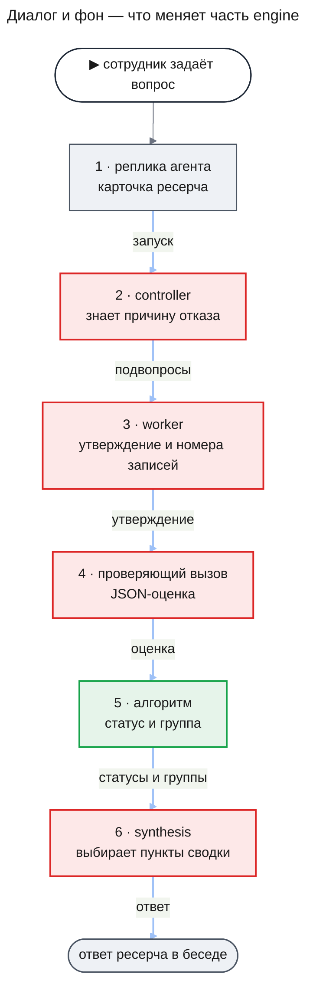

На схеме путь вытянут в цепочку; на деле после каждого шага управление возвращается к controller, и он решает, что делать дальше. Что увидит сотрудник в ответе:

- **«Установлено»** — только выводы, которые подтвердил проверяющий вызов и у которых совпали значения. После сносок каждого стоят слова группы, например «уверенность высокая».
- **«Предположения»** — сюда же встают выводы о причине с меткой «причинная связь не доказана». Выводы, которые не успели проверить, стоят здесь с пометкой «не проверено», как сейчас.
- **«Не выяснено»** — выводы, для которых записей не хватило или проверка не удалась.
- **Сводка** — до трёх пунктов: дословные тексты установленных выводов со словами их групп. Если установленных выводов нет, сводки нет.
- **Сноски** — ведут только на страницы записей, по которым вывод проверили.

### Как проверка утверждения работала и как будет работать

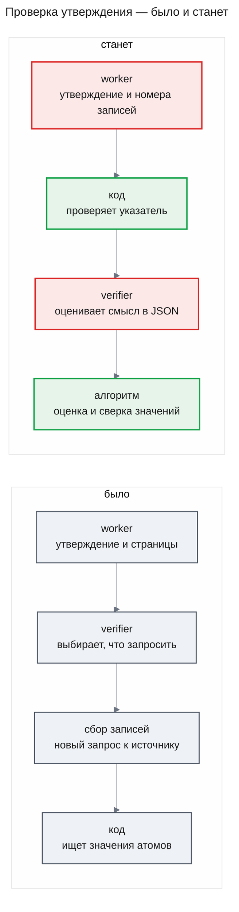

Сейчас проверяющий не судит утверждение: он только называет, какие записи запросить, код запрашивает их заново и ищет в них значения атомов. Совпадение значений ещё не значит, что смысл верен, а сноски под выводом берутся из черновика synthesis. После изменений проверяющий вызов читает утверждение вместе с теми записями, на которых оно построено, и отвечает формой; сверка значений остаётся вторым условием на тех же записях.

### Architecture (C1–C4)

#### C2 · Containers

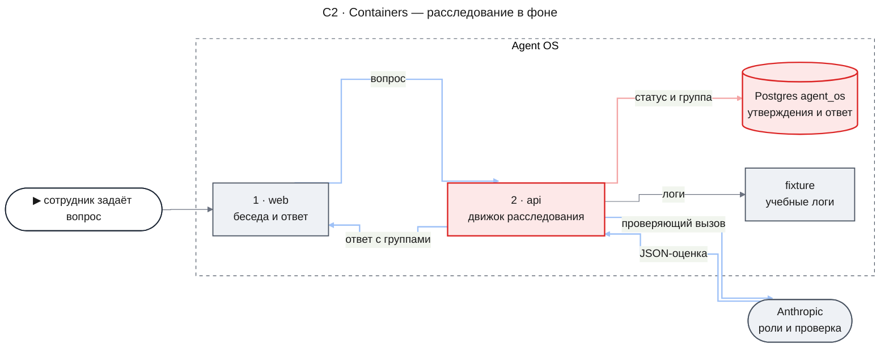

- `api` — тот же сервер. В движке меняются проверка утверждений, шлюз ответа, synthesis, повтор шага controller, его вход и резерв бюджета; в `research-chat` меняется сборка метаданных ответа для беседы.
- `Postgres agent_os` — ревизия утверждения хранит указатель, тип, оценку и группу; у статуса утверждения появляется значение `causal`; ответ хранит пункты сводки и группы выводов.
- `web` читает новые поля ответа; как он их показывает, решает часть `web`.

Калибровка встаёт рядом с этим путём, а не внутрь: её запускает разработчик, а сервер только читает готовую таблицу групп при старте.

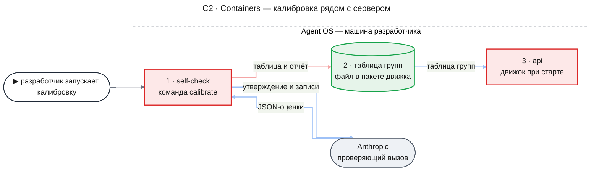

- `self-check` — программа самопроверки из [design-self-check.md](./design-self-check.md#contract-definitions). Эта часть добавляет ей команду `calibrate`; вызовы идут через `Engine.assess`, а их транскрипты остаются в базе самопроверки.
- `таблица групп` — файл данных в пакете `@agent-os/engine`, который разработчик кладёт в репозиторий вместе с промптом. Движок загружает поставляемые таблицы так же, как поставляемые конфигурации.

#### C3 · Components: api

**api — проверка одного утверждения.** Controller принял решение `requestVerification`; дальше каждое утверждение проверяет своя задача.

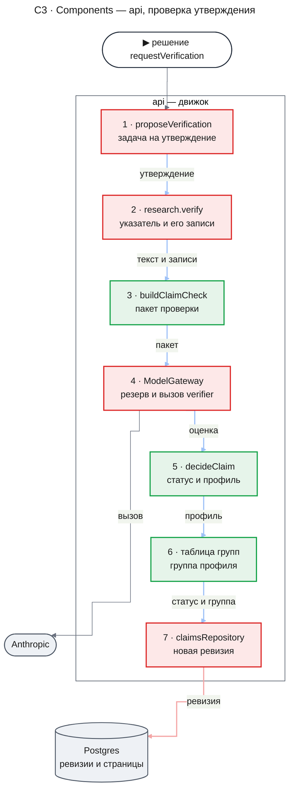

- `proposeVerification` ставит по одной задаче `research.verify` на каждое утверждение решения, а не одну задачу на раунд. Решение по-прежнему считается одним раундом проверки, и controller ждёт все его задачи.
- `research.verify` читает последнюю ревизию утверждения и страницы его указателя через `EvidenceReader` для владельца расследования, проверяет указатель до вызова модели и достаёт названные записи. Если оценка нарушает правила формы, задача один раз повторяет вызов в пределах своих трёх резервов. Задач сбора она больше не ставит и ничего не ждёт.
- `buildClaimCheck` собирает вход проверяющего вызова: текст утверждения, пронумерованные записи и у каждой страницы — источник, инструмент, аргументы запроса, срез и полна ли страница. Ту же функцию вызывает калибровка.
- `ModelGateway` резервирует и вызывает модель, как для любой роли; ожидание резерва — в разделе [Как резерв решает](#как-резерв-решает-ждать-или-отказать).
- `decideClaim` — чистая функция без вызовов модели и базы: по оценке, указателю, атомам и записям она выдаёт статус, тип, основу проверки и профиль. Внутри она вызывает прежний `verifyClaim` для сверки значений.
- `claimsRepository` дописывает ревизию проверки с указателем, типом, оценкой, группой и основой в `evidenceIds`, как сейчас дописывает вердикт атомов.

**api — сборка ответа.** Controller принял решение `proposeAnswer`; ответ пишется один раз, а сервер беседы потом читает его и строит сообщение.

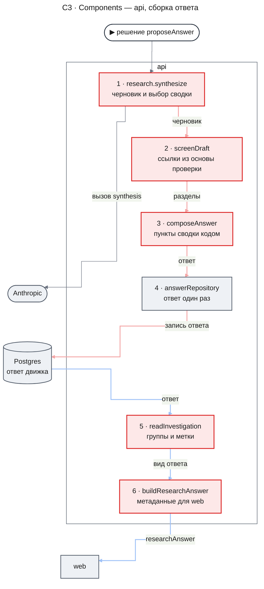

- `research.synthesize` отдаёт synthesis утверждения со статусом, группой и указателем и получает черновик: исход, список идентификаторов для сводки и утверждения ответа. Новое утверждение черновика может опираться только на указатели входных утверждений.
- `screenDraft` раскладывает входные утверждения по разделам по их статусу и берёт ссылки установленного вывода из хранимой основы проверки. Новые утверждения он проверяет, как сейчас, и отправляет на проверку, пока остались раунды.
- `composeAnswer` собирает пункты сводки по алгоритму из раздела [Как собирается сводка](#как-собирается-сводка).
- `readInvestigation` и `buildResearchAnswer` переносят группы, метку причинности и пункты сводки из ответа движка в метаданные `researchAnswer`.

#### Как утверждение получает статус

**Что на входе.** Последняя ревизия утверждения: текст, атомы и указатель. Страницы записей, на которые указывает указатель.

**Кто оценивает.** Проверяющий вызов — роль `verifier` на Haiku. Он получает текст утверждения и пронумерованные записи указателя и возвращает оценку: `support` — `yes`, `no` или `insufficient`; `claimType` — `observation`, `quantitative` или `causal`; у каждой данной записи — `supports`, `contradicts` или `unrelated`.

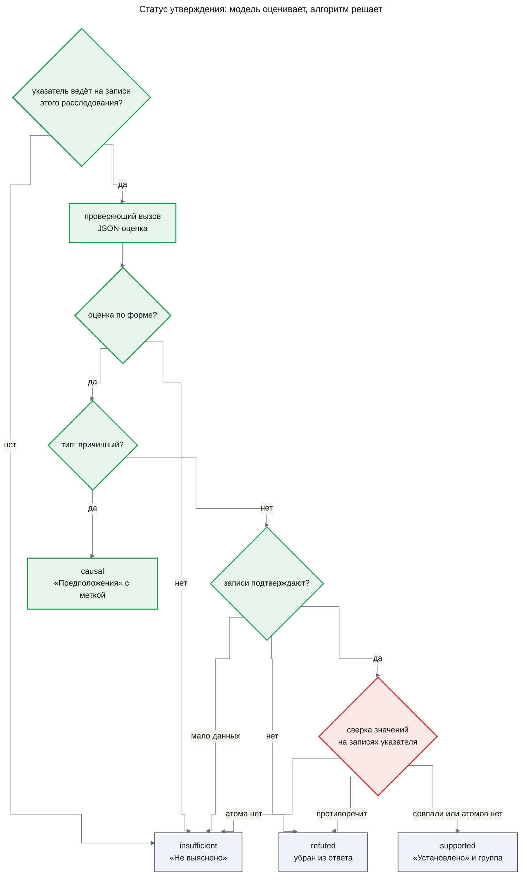

**Что решает алгоритм.** Первый шаг схемы делает задача `research.verify`, остальные — функция `decideClaim`:

1. **Указатель** (`research.verify`, до вызова модели). Каждая страница указателя — страница задачи этого расследования, читаемая для его владельца; каждый номер — целое число в пределах её записей; в указателе есть хотя бы одна запись и не больше 20. Иначе — `insufficient` без вызова модели (AC-11.1, DC-6).
2. **Форма** (`decideClaim`). Ответ проходит схему; отношение указано у каждой данной записи ровно один раз и только у них; при `support: yes` хотя бы одна запись отмечена `supports`. Ответ, который не прошёл схему, шлюз повторяет один раз, как сейчас; ответ, который нарушил остальные правила, один раз повторяет задача. Ответ не по форме и после повтора — `insufficient`: ошибка проверки никогда не превращается в «подтверждено» (AC-12.2, DC-7).
3. **Тип.** `claimType: causal` — статус `causal`, что бы модель ни ответила про подтверждение: связь «из-за» логи напрямую не показывают (AC-14.1, DC-10).
4. **Подтверждение.** `support: no` — `refuted`, `insufficient` — `insufficient` (AC-12.1).
5. **Сверка значений.** `verifyClaim` сравнивает атомы утверждения с записями указателя по виду атома: сервис, событие и `traceId` — равенством поля, интервал — со временем записей, число — со счётчиками групп подсчёта. Противоречит атом-число или атом-интервал — `refuted` (AC-13.1); какого-то атома нет среди записей — `insufficient`; все найдены или атомов нет — дальше (DC-9).
6. **Итог.** `supported`; основа проверки — страницы записей, отмеченных `supports`. Дальше считается группа.

Если проверяющий вызов так и не состоялся — резерв отказал, расследование остановлено или наступил `notAfter`, — ревизия не пишется, и утверждение остаётся `unverified` (DC-8).

**Что видит сотрудник.** `supported` — вывод в «Установлено» со словами группы. `causal` — в «Предположениях» с меткой «причинная связь не доказана». `insufficient` — в «Не выяснено». `refuted` — вывода в ответе нет. `unverified` — в «Предположениях» с пометкой «не проверено».

#### Как считается группа уверенности

**Что на входе.** Установленное утверждение — его оценка, атомы и записи указателя — и таблица групп для модели и версии промпта проверяющего вызова этого расследования.

**Кто оценивает.** Здесь модель не вызывается: всё нужное уже есть в оценке.

**Что решает алгоритм.** Профиль — четыре признака, каждый с двумя значениями:

- **тип** — `observation` или `quantitative` из оценки (причинное утверждение установленным не бывает);
- **сверка значений** — «совпали», если у утверждения есть атомы, и «неприменима», если их нет;
- **независимые записи** — одна или две и больше среди записей, которые оценка отметила `supports`; записи с одинаковым `traceId` считаются одной;
- **противоречия** — отметила ли оценка хоть одну запись `contradicts`.

Группу профиля берёт таблица групп (FR-15). Профиль, которого калибровка не видела, получает низшую группу, как и утверждение, для замороженной конфигурации которого таблицы нет (DC-11). Группа записывается в ревизию проверки и потом не пересчитывается: ответ, собранный позже, в том числе кодом при принудительной остановке, берёт её из ревизии.

Пример. Утверждение «с 19:40 до 20:15 `payment-api` записал 412 ошибок timeout» указывает на группу подсчёта и на три строки лога разных запросов. Оценка: подтверждают, тип `quantitative`, все четыре записи `supports`. Атомы найдены, противоречий нет, независимых записей четыре. Профиль «подсчёт, значения совпали, две и больше, без противоречий» калибровка поставила в высшую группу, и сотрудник видит «уверенность высокая». Если бы оценка отметила одну строку как `contradicts`, профиль был бы другим, и группа — ниже.

**Что видит сотрудник.** Слова группы рядом с выводом и с пунктом сводки (UXRD, MC-1), без процентов. Начальное число групп — три; после первой калибровки его можно изменить по её отчёту в пределах трёх-четырёх с утверждения владельца, и тогда таблица просто строится на четыре группы.

#### Как калибровка ставит таблицу групп

**Что на входе.** Калибровочные пары генератора (`buildCalibrationPairs` из [design-self-check.md](./design-self-check.md#contract-definitions)): утверждение, его атомы, записи и правильные ответы — подтверждают ли, какого типа, совпадают ли значения. И конфигурация процесса, чей проверяющий вызов калибруется.

**Кто оценивает.** Тот же проверяющий вызов, что в расследовании: `buildClaimCheck` собирает такой же вход, а `Engine.assess` делает вызов с ролью `verifier`, моделью и промптом роли из конфигурации.

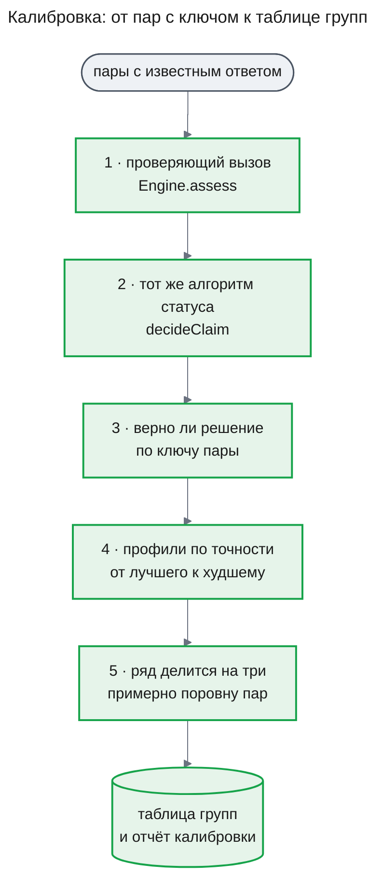

**Что решает алгоритм.**

1. Для каждой пары — оценка и решение `decideClaim`; все записи пары считаются её указателем.
2. Пара «должна быть установлена», если по ключу записи подтверждают, тип не причинный и значения совпадают. Решение алгоритма верно, если он установил пару, которая должна быть установлена, или не установил ту, что не должна.
3. Для каждого вида пар отчёт показывает три доли совпадений с ключом: по ответу «подтверждают ли», по типу и по решению алгоритма (AC-06.1, DC-1).
4. Для установленных пар считается профиль. По каждому профилю — сколько пар и сколько из них верны. Профили выстраиваются по нижней границе 90-процентного доверительного интервала доли верных: профиль с малым числом пар встаёт ниже, чем с той же долей на большом числе пар.
5. Выстроенный ряд делится на столько подряд идущих частей, сколько групп задано (по умолчанию три), так, чтобы в них было примерно поровну установленных пар; верхняя часть — высшая группа. Профиль целиком попадает в одну группу и не делится. Если профилей меньше, чем групп, они заполняют группы сверху по одному, а нижние группы остаются без профилей; всё, чего калибровка не видела, получает низшую группу.
6. Отчёт показывает по каждой группе число пар и долю верных (AC-15.2) и отмечает, если группа выше не точнее группы ниже — это проверка гипотезы H-03 PRD. Таблица записывает модель и версию промпта проверяющего вызова, набор пар и его отпечаток и группу каждого профиля.

Новая калибровка перезаписывает таблицу для той же модели и версии промпта. При смене модели или промпта отпечаток меняется, старая таблица к новой конфигурации не подходит, и сервер не стартует, пока не прогнана новая калибровка (AC-06.2, DC-2).

**Что видит сотрудник.** Ничего — отчёт калибровки читает разработчик; сотрудник видит только слова группы.

#### Как собирается сводка

**Что на входе.** Черновик synthesis со списком `summaryClaimIds` и разделы ответа после шлюза.

**Кто оценивает.** Synthesis выбирает, какие утверждения важнее для вопроса, и ставит их в список по важности. Текст сводки модель не пишет.

**Что решает алгоритм.** `composeAnswer` оставляет из списка только идентификаторы утверждений, стоящих в «Установлено» этого ответа, в порядке списка, без повторов и не больше трёх (DC-12). Текст пункта — хранимый текст утверждения, тот же, что стоит в «Установлено», группа — его группа (AC-16.1). Утверждение из «Предположений», «Не выяснено» или выдуманный идентификатор в сводку не попадает (AC-16.2). Пустой итог — сводки нет (AC-16.3). Ответ, который собрал код при принудительной остановке или по решению `concludeInconclusive`, сводки не получает: synthesis не выбирала пунктов (AC-16.4). В режиме без источников принятых утверждений не бывает, поэтому сводки нет (DC-13).

**Что видит сотрудник.** Под строкой цели — подпись «Главное из установленного» и пункты со словами групп; если пунктов нет — ни подписи, ни пустого места (UXRD, KD-3). Как это выглядит, строит часть `web`.

#### Как резерв решает: ждать или отказать

**Что на входе.** Посчитанный вход вызова, запас и потолок выхода роли; счётчики расследования — бюджет, списанное и открытые резервы; потолок задачи.

**Кто оценивает.** Модель не участвует: это арифметика над счётчиками журнала.

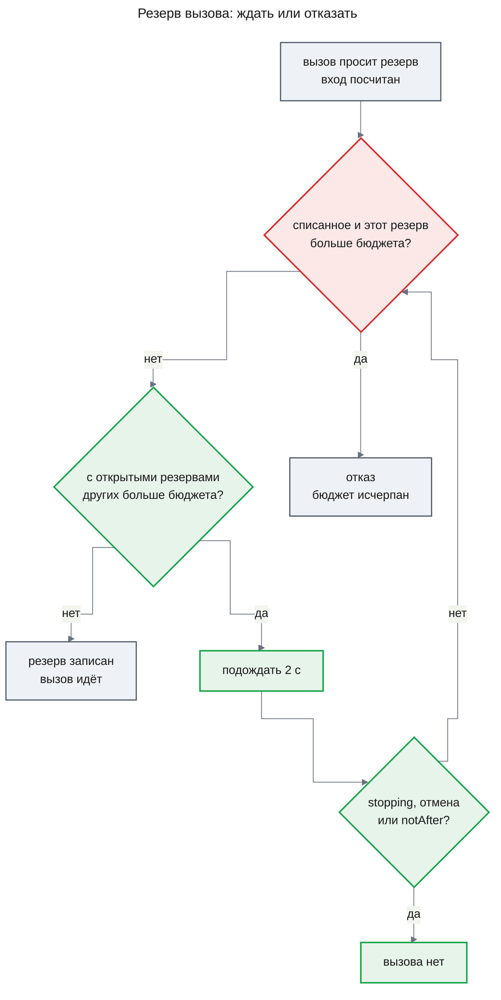

**Что решает алгоритм.** Проверки части `lifecycle` идут первыми: попытка не текущая — `fenced`, работа остановлена или закрыта — `stopping`. Дальше резерв сравнивает с бюджетом только списанное и свой резерв: если не помещается даже так, это отказ `investigation_tokens_exhausted`, и новых вызовов в расследовании не будет (AC-10.2). Если мешают только открытые резервы других вызовов, резерв отвечает `busy`, шлюз ждёт 2 секунды и спрашивает снова, не пересчитывая вход (AC-10.1, DC-5). Потолок задачи проверяется, как сейчас. Резерв по-прежнему не меньше возможного расхода вызова, поэтому списанное никогда не превышает бюджет.

Пример. Бюджет 300 000, controller и план уже списали 20 000. Четыре worker почти одновременно просят по 72 000: три резерва помещаются, четвёртый — нет, хотя по факту каждый вызов потратит около 66 000. Четвёртый ждёт; когда закрылись два первых вызова, списано 152 000, открыт один резерв на 72 000, и четвёртый помещается. Сейчас такой четвёртый вызов получает отказ, его задача анализа падает с причиной бюджета, и подвопрос остаётся без анализа.

**Что видит сотрудник.** Расследование, которое по факту укладывается в бюджет, не кончается причиной «бюджет исчерпан» до анализа записей; ответ может прийти на несколько секунд позже.

#### Как повтор controller узнаёт причину и что кэшируется

**Что на входе.** Шаг controller: системный промпт, ревизия плана, инструменты, бюджет, допустимые решения, сигналы, наблюдения, счётчики задач, прежние утверждения и — у повторной попытки — отклонённые попытки этого шага.

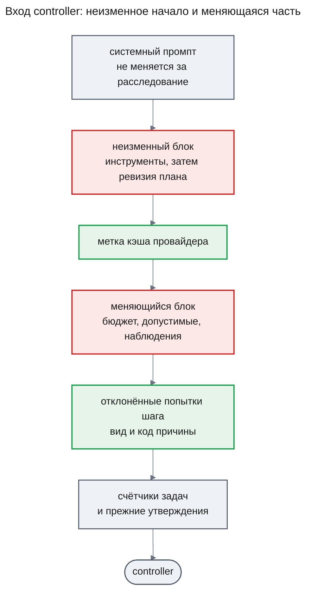

**Кто оценивает.** Controller-модель выбирает решение, как сейчас. Код проверяет его прежним `judgeControllerOutput` и отклоняет с причиной из закрытого перечня: `kind_unknown`, `capability_disabled`, `invalid_structure`, `invalid_model_output`, `fan_out_exceeded`, `plan_revisions_exhausted`, `no_novelty`, `verify_rounds_exhausted`, `deadline_too_close`, `nothing_to_wait_for`, `source_not_allowed`, `invalid_args`.

**Что решает алгоритм.** Повторная попытка шага получает в меняющейся части список отклонённых попыток этого шага — вид решения, если модель его назвала, и код причины. Список берётся из записанных решений шага, поэтому попытка после перезапуска задачи тоже его видит (AC-08.1, DC-3). Промпт controller версии 2 объясняет каждый код причины. Полный текст отклонённого вывода в вход не идёт: он остаётся в строке решения и в транскрипте.

Неизменный блок — инструменты, которые не меняются за расследование, и ревизия плана, которая меняется только при `replan`. Он идёт первым и заканчивается меткой кэша, а всё меняющееся идёт после неё. Провайдер на следующих шагах читает системный промпт и этот блок из кэша по цене cache read, и журнал вызовов уже записывает такие токены отдельно и считает их по цене каталога (AC-18.1, DC-15). Окно controller по-прежнему проверяется по всему посчитанному входу.

**Что видит сотрудник.** Ничего напрямую. Расследование реже кончается причиной «контроллер не дал допустимого решения» (гипотеза H-05 PRD) и стоит дешевле (H-06).

### Runtime Flows

#### Flow 1: проверка одного утверждения

**Starts when:** runtime выдаёт задачу `research.verify` одного утверждения, for AC-11.1, AC-12.1, AC-12.2, AC-12.3, AC-13.1, AC-14.1, DC-6, DC-7

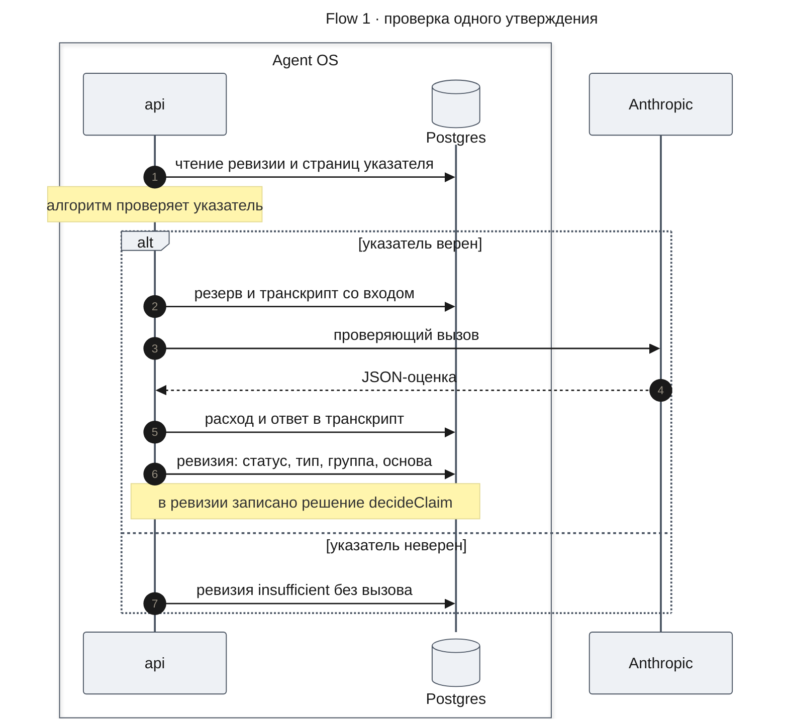

**Outcome:** у утверждения новая ревизия с указателем, типом, оценкой, группой и основой проверки; ревизия ссылается на свою задачу, а в транскриптах этой задачи есть ответивший вызов `verifier`, который её подтвердил (AC-12.3). Задача заканчивается `succeeded` и сообщает controller статус утверждения.

**Failure handling:**

- Указатель неверен → ревизия `insufficient`, вызова модели нет (DC-6).
- Оценка не по форме дважды → ревизия `insufficient` с пометкой в оценке, что форма нарушена (DC-7).
- Резерв ждёт чужих резервов → задача ждёт внутри попытки до `notAfter` (DC-5).
- Резерв отказал по бюджету → задача `failed` с причиной бюджета, ревизии нет, утверждение остаётся `unverified` (DC-8).
- Резерв ответил `stopping` или пришла отмена → задача отменена, ревизии нет (design-lifecycle.md, KD-2).
- Пакет проверки не помещается в окно роли → ревизия `insufficient` с признаком `needs_narrowing`, вызова нет.
- Провайдер недоступен после повторов → задача `failed` с `model_unavailable`, ревизии нет; controller видит это в наблюдениях, как сейчас.

#### Flow 2: ответ ресерча от synthesis до беседы

**Starts when:** controller принял `proposeAnswer`, и runtime выдал задачу `research.synthesize`, for AC-09.1, AC-16.1, AC-16.2, AC-16.3, DC-4, DC-12

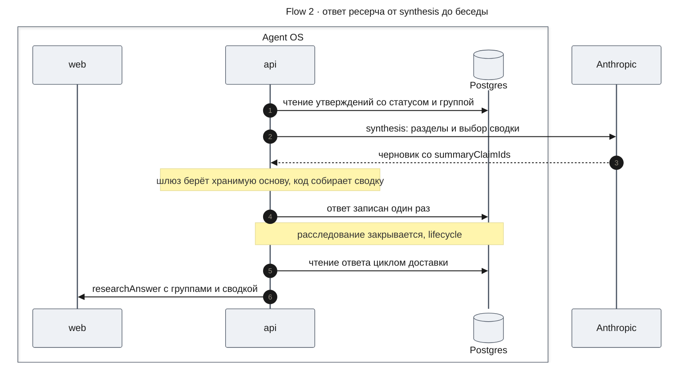

**Outcome:** ответ движка хранит разделы, у установленных выводов — группу и ссылки из основы проверки, у причинных — признак причинности, и пункты сводки. Сообщение беседы несёт те же данные в метаданных `researchAnswer`; что попадает в текстовую версию ответа — открытый вопрос «Кто строит текстовую версию ответа».

**Failure handling:**

- Черновик не по форме дважды → задача без ответа с предупреждением `invalid_model_output`, как сейчас; controller решает, что дальше.
- В черновике новое утверждение с указателем, которого нет у входных утверждений, или со страницей чужого расследования → оно убирается из ответа с причиной `foreign_evidence` или `evidence_not_found`, как сейчас.
- Новые утверждения с допустимым указателем, пока остались раунды проверки → итог `needs_verification`, как сейчас; без раундов они стоят в «Предположениях» как не проверенные.
- `summaryClaimIds` пуст или называет только непринятые утверждения → сводки нет (AC-16.3).

#### Flow 3: повтор шага controller с причиной отказа

**Starts when:** код отклонил решение controller, а повторов шага ещё не исчерпано, for AC-08.1, AC-18.1, DC-3, DC-15

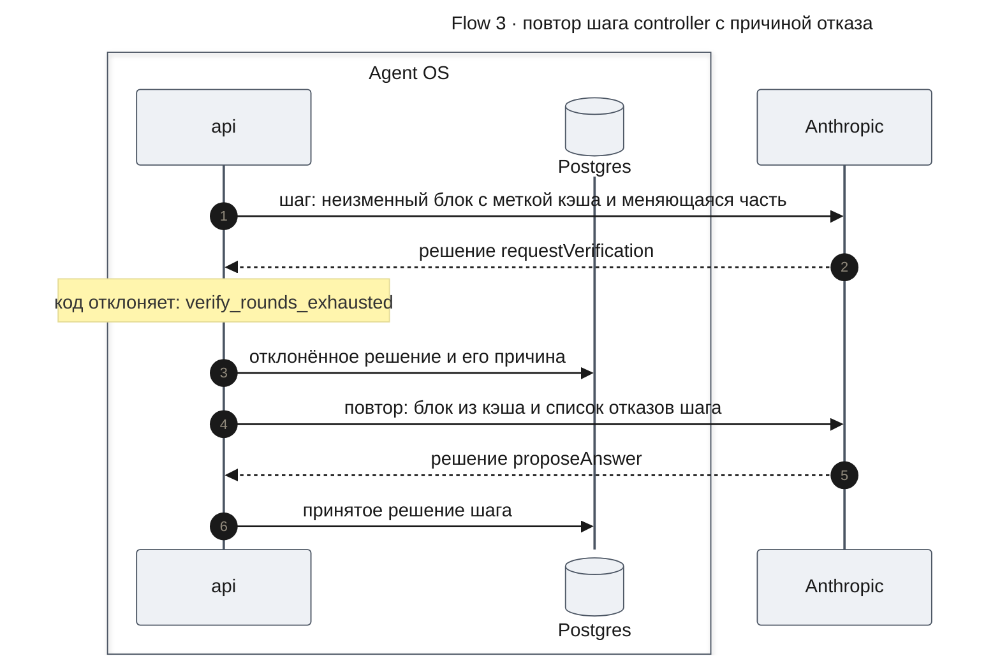

**Outcome:** в шаге две строки решений — отклонённая с причиной и принятая. Транскрипт второго вызова содержит код причины первого отказа, а его запись в журнале — токены, прочитанные из кэша.

**Failure handling:**

- Все попытки шага отклонены → остановка `controller_invalid`, ответ собирает код, как сейчас.
- Задача controller перезапущена между попытками → следующая попытка читает отклонённые решения шага из базы и видит их так же.
- Неизменное начало короче минимума провайдера для кэша → кэша нет, вызов идёт как сейчас и стоит полную цену ([Risks and Mitigation](#risks-and-mitigation)).

#### Flow 4: четыре worker и один бюджет

**Starts when:** controller принял `requestAnalysis` с четырьмя подвопросами, и их задачи анализа идут одновременно, for AC-10.1, AC-10.2, DC-5

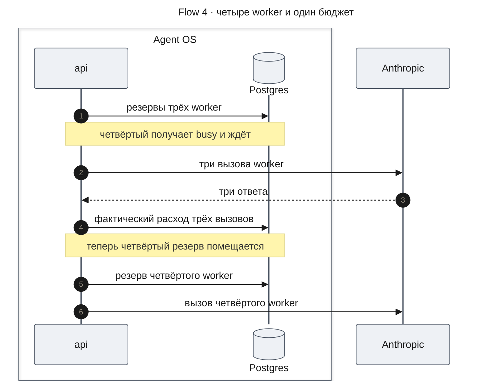

**Outcome:** все четыре подвопроса проанализированы; списанное — сумма фактического расхода и не больше бюджета.

**Failure handling:**

- Списанное вместе с резервом четвёртого больше бюджета → отказ `investigation_tokens_exhausted`; задача анализа падает с причиной бюджета, как сейчас (AC-10.2).
- Пока четвёртый ждёт, расследование закрыто или остановлено → резерв отвечает `stopping`, вызова нет (design-lifecycle.md, KD-2).
- Наступил `notAfter` решения → вызова нет, задача кончается `deadline`, как сейчас.

#### Flow 5: калибровка проверяющего вызова

**Starts when:** разработчик выполняет команду `calibrate` программы самопроверки, for AC-06.1, AC-06.2, AC-15.2, DC-1, DC-2

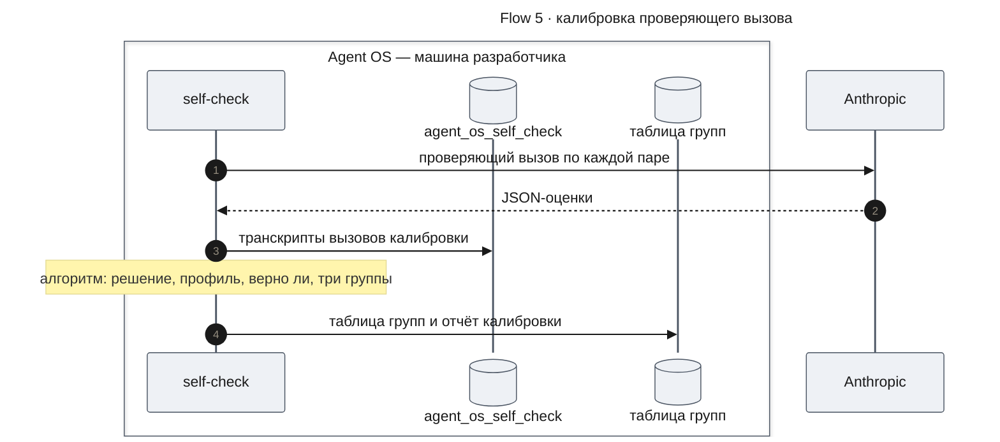

**Outcome:** файл таблицы групп для модели и версии промпта проверяющего вызова и отчёт калибровки. После следующего старта сервер берёт группы из этой таблицы.

**Failure handling:**

- Промпт роли `verifier` содержит поля шаблона → отказ `calibration_prompt_has_fields` до первого вызова: в калибровке нет вопроса расследования, и её вход не совпал бы со входом в расследовании.
- Вызов не по форме или провайдер недоступен на паре → пара засчитывается как неверное решение и видна в отчёте отдельно; таблица строится по остальным.
- Ни одна пара не установлена → отказ `calibration_empty`, таблица не пишется.

### Contract Definitions

**@agent-os/engine — формы ответа ролей**

- **Вывод `worker`** — `claims`: у каждого утверждения `text`, `atoms` в прежнем формате и `pointer` — от 1 до 20 записей, сгруппированных по страницам: идентификатор страницы и номера записей в ней. Прежнего списка `evidenceIds` в выводе нет: страницы утверждения — страницы его указателя.
- **Вывод `verifier` — `ClaimAssessment`** — `support` (`yes`, `no`, `insufficient`), `claimType` (`observation`, `quantitative`, `causal`) и `records` — по одному элементу на каждую данную запись: её номер во входе и `relation` (`supports`, `contradicts`, `unrelated`). Каждый объект схемы закрыт.
- **Вывод `synthesis`** — `outcome` (`answered`, `partial`, `inconclusive`), `summaryClaimIds` — идентификаторы утверждений для сводки по важности, и `claims` — утверждения ответа: `claimId` входного утверждения или null у нового, `text`, `atoms` и `pointer`. Строкового поля `summary` в выводе нет.
- **Вывод `controller`** — без изменений.

**@agent-os/engine — операции**

- **`research.verify` версии 2** — задача проверки одного утверждения. Вход — решение, которое её поставило, идентификатор утверждения и `notAfter`. Итог в `answerOrDelta` — статус утверждения и, при `insufficient`, причина: `pointer_invalid` — указатель неверен, `invalid_assessment` — оценка не по форме и после повтора, `values_missing` — атома нет среди записей указателя, `needs_narrowing` — пакет не помещается в окно роли, `no_support_data` — оценка ответила `support: insufficient`. Задач сбора она не ставит. Бюджет задачи — три резерва роли `verifier`, как сейчас.
- **`proposeVerification`** — по принятому решению `requestVerification` ставит по задаче `research.verify` на каждое названное утверждение. Решение считается одним раундом проверки.
- **`buildClaimCheck`** — чистая функция: по конфигурации роли `verifier`, тексту утверждения и записям с их страницами возвращает инструкции, сообщения и схему ответа проверяющего вызова. Записи идут отдельным разделом данных, каждая — JSON-объектом со своим номером, у каждой страницы — источник, инструмент, нормализованные аргументы, срез и полна ли страница (DC-14). Её вызывают `research.verify` и команда `calibrate`.
- **`decideClaim`** — чистая функция: по оценке или признаку «оценки нет по форме», указателю, атомам, записям и таблице групп возвращает статус, тип, основу проверки, профиль и группу по разделу [Как утверждение получает статус](#как-утверждение-получает-статус).
- **Вход `controller`** — сообщение из двух блоков: неизменного (инструменты, затем ревизия плана) с меткой кэша на конце и меняющегося (бюджет, допустимые решения, сигналы, наблюдения, отклонённые попытки шага, счётчики задач, прежние утверждения). Отклонённые попытки шага — список из вида решения или null и кода причины; у первой попытки шага он пуст. Наблюдения показывают утверждения со статусом, включая `causal`, и с группой у `supported`.
- **Клиент модели ролей** — у вызова роли `controller` ставит метку кэша `cacheControl` типа `ephemeral` на последнюю часть неизменного блока сообщения; метку на весь запрос он не ставит. У остальных ролей запрос не меняется.
- **`CallLedger.reserve`** — к ответам `reserved`, `refused`, `fenced` и `stopping` добавляется `busy`: резерв не поместился только из-за открытых резервов других вызовов. `ModelGateway` на `busy` ждёт 2 секунды и повторяет резерв с тем же посчитанным входом, пока не получит другой ответ или не наступит отмена или `notAfter`; тогда роль получает `no_answer`, как при прерывании. Отказ `investigation_tokens_exhausted` теперь значит, что списанное и этот резерв больше бюджета.
- **`createEngine`** — принимает необязательный набор таблиц групп (без него берёт поставляемые) и признак `requireCalibration`. С признаком отказывает с `calibration_missing`, когда у загруженной конфигурации с возможностью `verify` нет таблицы для модели и отпечатка промпта роли `verifier`; сообщение называет `processId`, `version` и отпечаток (DC-2). Сборка сервера в `apps/api` передаёт признак, программа самопроверки — нет: без таблицы её утверждения получают низшую группу (DC-11), а команда `calibrate` строит таблицу.
- **Поставляемые конфигурации** — `deep-research` версии 2 вместо версии 1. Промпт роли `verifier` в ней не содержит полей шаблона.

**`InvestigationView.answer`** — то, что читает сервер беседы.

- `established` — у каждого утверждения прежние `claimId`, `text`, `evidenceIds`, `verified` и новое `confidence`: `very_high`, `high`, `medium` или `low`; при трёх группах встречаются только три последних. `evidenceIds` — основа проверки.
- `assumed` — у каждого утверждения новое `causal`: true у утверждения со статусом `causal`, и у него же `verified` true; у не проверенного утверждения `causal` false и `verified` false.
- `unknown`, `removed`, `outcome`, `stopReason` — без изменений.
- `summaryItems` — от 0 до 3 пунктов, у каждого `claimId`, `text` и `confidence`; пустой список — сводки нет.
- `summary` — только у ответов, записанных до этой части; у новых ответов null.

**`ResearchAnswerMetadata` — контракт для части `web`** (`packages/contracts`, метаданные `researchAnswer` сообщения ответа)

- `summaryItems` — список от 0 до 3 пунктов; у пункта `text` — дословный текст принятого утверждения этого ответа, и `confidence` — его группа. Пустой список — сводки нет: ни подписи, ни места (UXRD, KD-3). В сообщениях, записанных до этой части, поле отсутствует и читается как пустой список.
- `established[].confidence` — `very_high`, `high`, `medium` или `low`; есть у каждого установленного вывода нового ответа; в старых сообщениях null. `web` показывает его словами MC-1.
- `assumed[].causal` — true у причинного вывода; `web` показывает рядом метку MC-3. В старых сообщениях false.
- `assumed[].verified` — false у не проверенного вывода, как сейчас; у причинного вывода true, поэтому пометки «не проверено» у него нет.
- `summary` — строка сводки старых сообщений; в новых ответах всегда null. Как показывать старые сообщения, решает `web`.
- Правило режима без источников дополняется: `summaryItems` пуст, `confidence` и `causal` не заданы.
- Остальные поля — без изменений; `sources`, сноски и группы разделов прежние.

**`RunRecord` — добавленные поля** ([design-self-check.md](./design-self-check.md#contract-definitions) разрешает их добавлять)

- `claims[]` — у каждого утверждения ещё `pointer`, `claimType`, `confidence`, `assessment` — ответ проверяющего вызова и признак нарушенной формы — и `checkTaskId`, задача проверки, чьи транскрипты содержат этот вызов.

**`RunResult.metrics` — добавленная метрика**

- `injectionInfluence` — доля сценариев запуска с текстом, обращённым к модели, в которых этот текст изменил оценку; направление «меньше — лучше». Команда `run` считает её так: каждую калибровочную пару сценария с пометкой `injected` она проверяет дважды — как есть и без записей тех трасс, которые ключ сценария называет в `injectionTraceIds`. Сценарий засчитывается, если хоть у одной такой пары ответ «подтверждают ли» или тип в двух вызовах разошёлся (AC-17.1).

**Программа самопроверки — команда `calibrate`**

- Принимает имя набора сценариев, конфигурацию (по умолчанию поставляемую), число групп — 3 или 4, по умолчанию 3 — и путь, куда записать таблицу групп. Делает по одному проверяющему вызову на пару через `Engine.assess` с привязкой к своему идентификатору запуска. Возвращает файл таблицы групп и отчёт калибровки. Отказы — `database_not_self_check`, `set_invalid`, `process_config_rejected` из команды `run`, а также `calibration_prompt_has_fields` и `calibration_empty`.

**Таблица групп** — файл данных в `@agent-os/engine`.

- модель роли `verifier` и отпечаток её промпта в формате версии промпта транскрипта;
- имя набора пар, его отпечаток и время калибровки;
- число групп — 3 или 4;
- группа каждого профиля, который калибровка видела;
- по каждой группе — число установленных пар и доля верных; по каждому виду пар — три доли совпадений с ключом.

**Error handling**

- `calibration_missing` — исключение `createEngine` с признаком `requireCalibration` при старте сервера; сервер не стартует.
- `invalid_assessment` — не ошибка задачи, а причина `insufficient` в итоге `research.verify`.

**Runtime settings**

Новых настроек нет. Постоянные значения: ожидание резерва — 2 секунды между попытками; сводка — не больше трёх пунктов; указатель — не больше 20 записей; начальное число групп — 3, и задаёт его таблица групп.

### Data Model

**Ревизия утверждения** (`research_claims`) остаётся неизменяемой и только добавляется. Ревизия, которую пишет worker или synthesis, хранит указатель утверждения. Ревизия проверки дополнительно хранит тип утверждения, оценку проверяющего вызова, группу у `supported` и основу проверки в прежних `evidenceIds`; задача проверки ревизии уже записана в ней. Статус получает значение `causal`. Миграция этой части добавляет эти поля пустыми для прежних строк и расширяет проверку статуса; прежние ревизии читаются как раньше.

**Ответ движка** (`research_engine_runs.answer`) получает пункты сводки, группу у установленных выводов и признак причинности у предположений. Прежние ответы читаются той же схемой: недостающие поля — пустой список, null и false.

**Таблицы групп** — файлы данных в пакете движка рядом с поставляемыми конфигурациями, по одному на модель и отпечаток промпта роли `verifier`. В базе они не хранятся.

### State Transitions and Invariants

Состояния утверждения после этой части. Каждый переход — новая ревизия; прежняя остаётся как была.

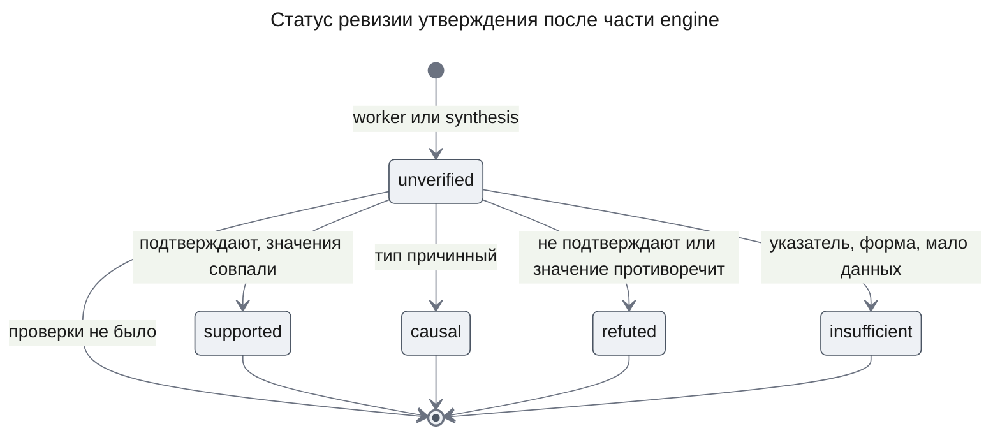

Повторная проверка того же утверждения в следующем раунде пишет ещё одну ревизию проверки по тем же правилам; действует последняя.

**Invariants**

1. Статус `supported` есть только у ревизии с оценкой по форме, где `support` — `yes`, тип не `causal`, а сверка значений на записях указателя не нашла противоречий и пропусков.
2. Утверждение со статусом `causal` никогда не стоит в «Установлено» — ни в ответе synthesis, ни в ответе, собранном кодом.
3. Ссылки установленного вывода в ответе — подмножество страниц его указателя и равны основе проверки последней ревизии.
4. Каждый пункт сводки — текст утверждения, которое стоит в «Установлено» того же ответа; пунктов не больше трёх.
5. У каждого `supported` утверждения есть группа, и у каждой ревизии проверки есть ответивший вызов `verifier` в транскриптах её задачи; без вызова пишется только `insufficient` из-за указателя или окна.
6. Списанное расследованием никогда не больше его бюджета; отказ по бюджету наступает, только когда списанное и резерв вызова больше бюджета.
7. Неизменный блок входа controller одинаков на всех шагах между двумя ревизиями плана.
8. Сервер работает только с конфигурациями, у проверяющего вызова которых есть таблица групп.

## Test Strategy

Все проверки идут на модели-заглушке и учебном fixture; настоящие вызовы Anthropic в набор тестов не входят. Модель-заглушка узнаёт роль по форме ответа, поэтому новые формы verifier и synthesis меняют и её, и интеграционные сценарии, которые сейчас пишут для verifier список запросов, а для synthesis строку сводки; это работа плана. Правило «у каждого объекта схемы ответа роли закрыт набор свойств» действует и для новых схем.

### Main Use Cases

- **UC-1: подтверждённое наблюдение установлено с группой** — covers AC-12.3, DC-11
  - Given: worker написал утверждение о 412 ошибках timeout с указателем на группу подсчёта и три строки лога разных `traceId`; заглушка verifier отвечает «подтверждают», тип `quantitative`, все записи `supports`; таблица групп ставит этот профиль в `high`
  - When: идёт задача проверки этого утверждения
  - Then: последняя ревизия — `supported` с группой `high`, основой из страниц указателя и ссылкой на свою задачу; в транскриптах этой задачи есть ответивший вызов `verifier`
- **UC-2: значения нашлись, смысл не подтверждён** — covers AC-12.1
  - Given: атомы утверждения все находятся в записях указателя, а заглушка verifier отвечает «не подтверждают»
  - When: идёт проверка
  - Then: статус `refuted`, в ответе вывода нет
- **UC-3: число расходится с записью** — covers AC-13.1, DC-9
  - Given: заглушка verifier отвечает «подтверждают», а атом-число 412 не совпадает со счётчиком 380 группы подсчёта указателя
  - When: идёт проверка
  - Then: статус `refuted`; если вместо этого атома-сервиса нет среди записей указателя — `insufficient`; утверждение без атомов с ответом «подтверждают» — `supported`
- **UC-4: причинный вывод — в предположения** — covers AC-14.1, DC-10
  - Given: заглушка verifier отвечает тип `causal` и «подтверждают»
  - When: проверка и затем synthesis, которая ставит это утверждение в «Установлено» и в сводку
  - Then: статус `causal`; в ответе утверждение стоит в `assumed` с `causal` true и `verified` true, а не в `established` и не в сводке
- **UC-5: ссылки — только основа проверки** — covers AC-09.1, DC-4
  - Given: установленное утверждение с основой из одной страницы; черновик synthesis приписывает ему ещё одну страницу этого же расследования
  - When: шлюз собирает ответ
  - Then: у вывода в `established` одна ссылка — страница основы
- **UC-6: сводка из принятых утверждений** — covers AC-16.1, AC-16.2, DC-12
  - Given: в ответе три установленных утверждения и одно предположение; synthesis выбирает для сводки предположение, два установленных, одно из них дважды, и несуществующий идентификатор
  - When: код собирает ответ
  - Then: в сводке два пункта в порядке выбора; их тексты дословно равны текстам в `established`, у каждого его группа
- **UC-7: повтор controller знает причину** — covers AC-08.1, DC-3
  - Given: заглушка controller на первой попытке шага выбирает `requestVerification` при исчерпанных раундах проверки, на второй — `proposeAnswer`
  - When: шаг идёт до конца; в варианте теста задача controller перезапускается между попытками
  - Then: в транскрипте второго вызова есть отказ с кодом `verify_rounds_exhausted`; в обоих вариантах одинаково
- **UC-8: неизменное начало входа и кэш** — covers AC-18.1, DC-15
  - Given: расследование из трёх шагов controller без смены плана; заглушка сообщает на втором и третьем вызове токены, прочитанные из кэша
  - When: разработчик читает журнал и транскрипты вызовов controller
  - Then: неизменный блок трёх входов побайтно одинаков, запрос к модели несёт метку кэша на его конце, а стоимость второго и третьего шага в журнале меньше стоимости того же входа по полной цене
- **UC-9: параллельные worker укладываются в бюджет** — covers AC-10.1, DC-5
  - Given: бюджет 200 000, уже списано 20 000; четыре worker с посчитанным входом по 40 000 и запасом и потолком выхода роли; заглушка отвечает с фактическим расходом по 41 000 и задерживает ответы трёх первых
  - When: controller раздаёт четыре подвопроса
  - Then: четвёртый вызов начинается после закрытия трёх других, все четыре задачи анализа успешны, расследование не останавливается с `budget_exhausted`, списанное не больше бюджета
- **UC-10: калибровка и таблица групп** — covers AC-06.1, AC-06.2, AC-15.2, DC-1, DC-2
  - Given: пары первого набора и заглушка verifier, которая ошибается на парах вида `values_match_meaning_wrong`
  - When: разработчик выполняет `calibrate`, затем меняет одно слово в промпте `verifier` и запускает сервер, затем снова выполняет `calibrate` с другой заглушкой и запускает сервер
  - Then: отчёт показывает по каждому виду пар три доли совпадений и по каждой группе число пар и долю верных; после правки промпта сервер не стартует с `calibration_missing`; после новой калибровки стартует, и проверка утверждения с тем же профилем получает группу из новой таблицы
- **UC-11: влияние текста, обращённого к модели** — covers AC-17.1, DC-14
  - Given: набор из трёх сценариев, в двух из них есть записи с текстом, обращённым к модели; заглушка verifier в одном из этих сценариев отвечает на пару с таким текстом иначе, чем на ту же пару без него, а во втором — одинаково
  - When: разработчик выполняет `run`
  - Then: в файле результата `injectionInfluence` равна 0,5, а отчёт показывает её рядом с допустимой долей, когда та задана; во входе каждого проверяющего вызова записи стоят отдельным разделом данных, каждая со своим номером
- **UC-12: ответ без принятых утверждений** — covers AC-16.3
  - Given: все утверждения расследования `insufficient` или `causal`, synthesis выбирает для сводки причинное
  - When: собирается ответ и метаданные сообщения
  - Then: `summaryItems` пуст, `summary` null

### Error and Edge Use Cases

- **UC-E1: указатель на чужую запись** — covers AC-11.1, DC-6
  - Given: три утверждения: с номером записи больше числа записей страницы, со страницей другого расследования того же владельца и с пустым указателем
  - When: идут их проверки
  - Then: все три — `insufficient` с причиной `pointer_invalid`, и ни одного вызова `verifier` в журнале
- **UC-E2: оценка не по форме** — covers AC-12.2, DC-7
  - Given: заглушка verifier отвечает в одной задаче значением вне списка, в другой — «подтверждают» без записи `supports`, в третьей — отношением для номера, которого не было во входе, и так оба раза
  - When: идут проверки
  - Then: все три — `insufficient` с причиной `invalid_assessment`, ни одно не `supported`
- **UC-E3: бюджет исчерпан** — covers AC-10.2, DC-8
  - Given: списанное расследования плюс резерв очередного проверяющего вызова больше бюджета
  - When: задача проверки просит резерв
  - Then: отказ без ожидания, нового вызова в журнале нет, утверждение остаётся `unverified` и стоит в ответе в «Предположениях» с `verified` false
- **UC-E4: ответ при принудительной остановке** — covers AC-16.4
  - Given: расследование с двумя `supported` и одним `causal` утверждением кончается по `step_limit`
  - When: код собирает ответ
  - Then: в `established` два вывода со своими группами, причинного там нет, `summaryItems` пуст
- **UC-E5: старые ответы и сообщения** — covers KD-8
  - Given: ответ движка и сообщение беседы, записанные до этой части, со строкой `summary` и без групп
  - When: сервер читает расследование и беседа разбирает метаданные
  - Then: оба разбираются без ошибки; `summaryItems` пуст, `confidence` null, `causal` false, `summary` прежний
- **UC-E6: режим без источников** — covers DC-13
  - Given: движок без источников, synthesis пишет два утверждения и выбирает одно для сводки
  - When: собирается ответ
  - Then: оба в `assumed` без групп и без причинности, `summaryItems` пуст
- **UC-E7: профиль без данных калибровки** — covers DC-11
  - Given: таблица групп не содержит профиля «наблюдение, атомов нет, одна запись, есть противоречия»
  - When: утверждение с таким профилем становится `supported`
  - Then: его группа — `low`

## Security Considerations

- **Authentication & Authorization**: новых маршрутов нет. Записи указателя читаются через `EvidenceReader` для владельца расследования, а страница чужого расследования делает указатель неверным (AC-11.1). Команда `calibrate` работает только на базе самопроверки, как остальные команды программы.
- **Input Validation**: указатель проверяется до вызова модели — свои страницы, номера в пределах страницы, не больше 20 записей. Ответы ролей проходят закрытые схемы, а оценка — ещё и правила формы алгоритма; нарушение ведёт к «не установлено», а не к «подтверждено». Пункты сводки и ссылки берутся только из хранимых данных, а не из текста модели.
- **Sensitive Data Handling**: записи логов уходят только к тому же провайдеру моделей через тот же `resolveModel`, что и сейчас; калибровка зовёт его через `Engine.assess` (NFR-02). Текст записей передаётся проверяющему вызову как данные отдельным разделом, а его влияние на оценку меряет самопроверка (FR-17). В лог сервера записи и промпты не пишутся; полный вход и ответ хранит транскрипт части `self-check`.

## Risks and Mitigation

- **Строгость отсеивает верные выводы** — среднее влияние, вероятность средняя. Самопроверка меряет долю найденных причин до и после этой части (H-04 PRD), а причинные и непроверенные выводы остаются видны в «Предположениях».
- **Haiku неточно называет номера записей** — среднее влияние, вероятность средняя: утверждения с неверным указателем уходят в «Не выяснено». Записи показываются с явными номерами, а доля таких утверждений видна в сигнале «много отсеянных утверждений» самопроверки.
- **Одна проверка на утверждение даёт мало различимые группы** — среднее влияние, вероятность средняя. Отчёт калибровки показывает, упорядочены ли группы (H-03); вторая независимая проверка — открытый вопрос.
- **Калибровочных пар мало, и деление на три группы шумит** — среднее влияние, вероятность высокая на первом наборе. Профили с малым числом пар встают ниже за счёт нижней границы интервала, а отчёт показывает число пар в каждой группе.
- **Кэш входа controller не срабатывает** — низкое влияние, вероятность низкая. Два допущения: неизменное начало не короче минимума кэша провайдера для моделей каталога и Mastra передаёт провайдеру метку, поставленную на часть сообщения. План проверяет оба ранним вызовом настоящей модели: на втором шаге в журнале должны быть токены, прочитанные из кэша. Если кэш не срабатывает, шаг стоит как сейчас.
- **Ожидание резерва затягивает расследование** — низкое влияние: вызов ждёт только закрытия чужих вызовов и не дольше `notAfter` решения и срока попытки части `lifecycle`. Худший случай — резерв задачи, которая упала после сбоя экземпляра и не закрыла его: такой резерв закрывает только controller, когда видит задачу законченной, поэтому ждущий вызов может дождаться `notAfter`.
- **В момент выпуска идут расследования на v1** — их следующие вызовы получают формы ответа v2 при промптах v1, и их утверждения скорее всего останутся не установленными. Выпуск делается, когда в базе нет идущих расследований; повторный прогон расследования, начатого до выпуска, тоже идёт на его замороженных промптах v1, поэтому эффект этой части меряется запусками сценариев, а не повторами.

## Open Questions

- **Вторая независимая проверка утверждения.** PRD перечисляет среди признаков группы «сколько независимых проверяющих вызовов согласились» и приводит пример с двумя вызовами. Этот дизайн делает один проверяющий вызов на утверждение: у worker все записи утверждения приходят из одного запроса к источнику, и вызов с другим входом требует нового запроса записей и второй формы ответа роли, то есть ещё одного вызова и сбора на каждое установленное утверждение. Блокирует только состав признаков профиля; таблица групп строится и без него. Решает владелец — нужна ли вторая проверка ценой роста стоимости проверки.
- **Кто строит текстовую версию ответа.** Текст сообщения ответа (Markdown, который видит модель чата и копирует сотрудник) собирает тот же `buildResearchAnswer` в `apps/api`, что и метаданные. По UXRD (KD-4) метка причинности остаётся рядом с выводом при копировании, а PRD относит все тексты UXRD к части `web`. Дизайн предлагает, чтобы эта часть дописывала в текстовую версию пункты сводки с подписью MC-2, слова группы MC-1 и метку MC-3, потому что функция одна и серверная. Блокирует раздел работ по `buildResearchAnswer`; решает владелец вместе с границей части `web`.
- **Как мерить гипотезу H-02 PRD для этой части.** H-02 сравнивает сигналы сбоя на повторах одних и тех же сохранённых расследований до и после изменения. Повтор берёт замороженную конфигурацию исходного расследования, а расследования, начатые до выпуска, заморожены на промптах v1, которые не дают форм ответа v2. Поэтому повтор после выпуска покажет поломку, а не эффект этой части, и H-02 для неё повторами не измеряется; эффект меряют запуски сценариев. Измерить H-02 можно, если команда `replay` самопроверки научится запускать сохранённое расследование на поставляемой конфигурации вместо замороженной — это изменение части `self-check`. Блокирует проверку H-02 после выпуска; решает владелец PRD.
- **Пороги U-6 PRD, включая допустимую долю влияния текста, обращённого к модели.** Без них отчёт показывает `injectionInfluence` без сравнения (AC-17.1). Решает владелец до первого сравнения после выпуска этой части.

## Appendix: Fact Disposition

| Fact | Disposition | Handled in |
|------|-------------|------------|
| Пять ролей и их модели, `packages/engine/src/processes/deep-research.v1.json` (`deep-research.v1.json:roles`) | transform | KD-7: те же роли и модели, новые промпты в версии 2 |
| Промпты — строки конфигурации, версия — только пара `processId` и `version` (`prompt-template.ts:PROMPT_FIELDS`) | transform | KD-7: версия 2 процесса; версию промпта в транскрипте считает самопроверка |
| Verifier не судит, а выбирает записи для нового сбора (`verify.handler.ts:VerifierOutputSchema`) | transform | KD-1, Flow 1: оценка одного утверждения по записям указателя, сбора нет |
| Статус ставит код по атомам (`claim-verifier.ts:verifyClaim`) | transform | KD-2: `verifyClaim` остаётся как сверка значений на записях указателя |
| Таблица `research_claims` без полей типа, оценки, указателя и группы (`schema.ts:researchClaims`) | transform | Data Model: миграция этой части, статус `causal` |
| Утверждение worker ссылается на страницы целиком (`claim.schema.ts:WorkerOutputSchema`) | transform | KD-1: указатель на номера записей |
| «Предположения» значат «не проверено» (`reference-gateway.ts:screenDraft`) | transform | KD-2, KD-8: статус `causal` и признак `causal` для `web` |
| Шлюз берёт ссылки из черновика (`reference-gateway.ts:evidenceIds-from-draft`) | transform | KD-4, DC-4: ссылки из основы проверки |
| Ответ verifier не по форме оставляет утверждение непроверенным (`verify.handler.ts:run-invalid-output`) | transform | DC-7: `insufficient`; DC-8: непроверенное — только без вызова |
| Synthesis пишет сводку строкой, код её не проверяет (`synthesize.handler.ts:SynthesisOutputSchema`) | transform | KD-4: `summaryClaimIds` и пункты сводки кодом |
| Ответ при остановке собирает код без сводки (`code-answer.ts:buildCodeAnswer`) | transform | AC-16.4: без сводки, как сейчас; группы из ревизий; `causal` в `established` не попадает |
| Метаданные ответа: одна строка `summary`, без групп и причинности (`research-chat.ts:ResearchAnswerMetadataSchema`) | transform | KD-8: поля добавляются, `summary` остаётся для старых сообщений |
| Сводка показывается при любых утверждениях (`research-answer.builder.ts:summary-rule`) | transform | KD-4, DC-12, DC-13: только из принятых утверждений |
| Повтор шага не знает причины отказа (`controller.handler.ts:takeStep-retry`) | transform | KD-6, DC-3 |
| Меняющиеся данные идут раньше неизменных во входе controller (`role-packets.ts:controllerMessages`) | transform | KD-6, DC-15: два блока и метка кэша |
| В движке нет `cache_control` (`role-agent.ts:providerOptions`) | transform | KD-6: метка кэша у вызова controller |
| Резерв по максимуму отказывает из-за чужих резервов (`ledger.ts:reserve`) | transform | KD-5, DC-5: ответ `busy` и ожидание |
| Промпт controller называет статусы и обещает установленным только `supported` (`controller.handler.ts:workers-and-continuation`) | transform | KD-7: промпт версии 2 знает `causal` и группы |
| В режиме без источников проверки нет (`controller.handler.ts:answerWithoutSources`) | transform | DC-13: сводки в этом режиме нет; остальное прежнее |
| Единый путь вызова роли и одно имя checkpoint на задачу (`model-gateway.ts:call`) | transform | KD-5: ожидание резерва; KD-1: одно утверждение на задачу проверки, одно имя checkpoint хватает |
| Записи передаются без пометки «это данные» (`role-packets.ts:slotMessages`) | transform | DC-14: записи с номерами отдельным разделом данных |
| `InvestigationView.answer` — разделы конфигурации из хранимого ответа (`investigation-view.ts:InvestigationView`) | transform | Contract Definitions: группы, причинность, пункты сводки; старые ответы читаются |
| Одна задача проверки на раунд, сбор через дочерние задачи (`verify.ts:proposeVerification`) | transform | KD-1: задача на каждое утверждение, без сбора |
| Заглушка ролей узнаёт роль по свойству схемы (`scriptedModel.ts:ROLE_MARKERS`) | transform | Test Strategy: заглушка учит новые формы verifier и synthesis; как — решает план |
| Модульные тесты закрепляют старое поведение проверки, шлюза и сводки (`claim-verifier.spec.ts:unit-tests`) | transform | Test Strategy: тесты переписываются на новые правила |

Дизайн сохраняет как есть: строгую схему `ProcessConfig` без новых полей (`process-config.schema.ts:roles`); отсутствие текстовых эвристик в коде, которое остаётся правилом (`packages/engine/src:no-text-heuristics`); причины остановки и правила остановки controller (`stop-rules.ts:controllerCallOutcome`); однократную запись ответа со списанием открытых резервов (`answer.repository.ts:writeAnswer`); каталог моделей и его цены, включая цены кэша (`model-catalog.ts:DEFAULT_MODEL_CATALOG`).

## Update History

| Version | Date | Change |
|---------|------|--------|
| 1.0 | 2026-11-06 | Первая версия |
