# Качество и надёжность расследований — Design Doc — engine

**Статус:** Утверждён владельцем 2026-11-08 (версия 1.5.2) · **Дата:** 2026-11-08 · **PRD:** [prd.md](./prd.md) · **UXRD:** [uxrd.md](./uxrd.md) · **Зависит от:** [design-self-check.md](./design-self-check.md#contract-definitions)

## Snapshot

**Overview.** Сотрудник задаёт вопрос в чате, в фоне идёт расследование, и в беседу приходит ответ с разделами «Установлено», «Предположения» и «Не выяснено». Сейчас вывод попадает в «Установлено», если код нашёл в логах названные в нём значения, а смысл никто не проверяет; сводку модель пишет своими словами. Эта часть меняет проверку и сборку ответа, а сообщение ответа для беседы теперь строит сам движок последним шагом. Каждое утверждение указывает на свои записи, а код до проверки сверяет его значения с этими записями, не зная имён полей. Каждое утверждение анализа код сам отправляет на отдельный вызов модели, который читает утверждение с записями и итогом сверки и заполняет короткую форму с закрытыми ответами; статус код ставит по этой форме, а группу уверенности — по таблице, которую строит калибровка. Сводку код собирает из текстов принятых утверждений, шаг модели-руководителя дешевле и видит свои прошлые запросы, а бюджет перестаёт останавливать расследование раньше времени.

- **Не меняется**: путь ресерча в беседе — карточка, фон, ответ отдельным сообщением; сбор записей, план, состав ролей и модели ролей; схема `ProcessConfig`.
- **Главный риск**: проверяющий вызов может подтвердить утверждение, чьё значение в записях не нашлось; код это больше не запрещает. Такие утверждения попадают в свои профили с несовпавшими значениями, и их точность меряет калибровка ([Risks and Mitigation](#risks-and-mitigation)).
- **Открытые вопросы**: два — значения порогов U-6 и признак независимых записей по `traceId` ([Open Questions](#open-questions)).

### Key Decisions

#### KD-1: Утверждение указывает на номера записей в странице, а проверяющий вызов получает одно утверждение и только эти записи

Worker видит каждую страницу записей с пронумерованными записями и в утверждении называет страницу и номера записей, на которые опирается. Проверку одного утверждения ведёт своя задача `research.verify`: код проверяет указатель, достаёт из страниц названные записи и делает один вызов роли `verifier` с текстом утверждения и этими записями. Повторного запроса записей из источника больше нет — проверяющий оценивает ровно те записи, на которых утверждение построено, и поэтому ссылки под установленным выводом всегда ведут на проверенное (FR-09, FR-11, FR-12).

Роль `verifier` остаётся той же ролью процесса с прежней моделью; меняются её промпт и форма ответа. Поэтому журнал вызовов, транскрипты и бюджет считают проверяющие вызовы без новых значений роли (FR-10).

#### KD-2: Статус ставит закрытый ответ проверяющего вызова, а сверка атомов — его вход и признак профиля, а не вето

Проверяющий вызов отвечает формой с закрытыми значениями: подтверждают ли записи смысл утверждения, какого оно типа и как каждая данная ему запись к нему относится. Статус ставит функция `decideClaim` только по полям этой формы: `support: yes` — `supported`, `no` — `refuted`, `insufficient` — `insufficient`, а `claimType: causal` — новый статус `causal`, который идёт в «Предположения» с меткой (FR-14). Сверку атомов делает код до вызова: её итог стоит во входе проверяющего вызова как данные и входит в профиль утверждения (KD-3), но `support: yes` не отменяет.

Код по-прежнему решает сам только то, что проверяется без понимания текста: указатель ведёт на существующие записи этого расследования и их не больше `MAX_POINTER_RECORDS` (20), пакет помещается в окно роли, ответ проходит закрытую форму, а резерв помещается в бюджет. Кодовых причин `values_missing` и «опровергнуто сверкой» больше нет. Код не читает текст утверждения и записей ни поиском слов, ни подстрокой.

Разбор первых четырёх расследований на настоящих моделях показал: все шесть утверждений, которые проверяющий вызов подтвердил, код убрал как `values_missing`. Они указывали на группы подсчёта `aggregate_logs`, а сверка интервала искала у записи поле `ts`, которого у группы нет. Какое время у группы подсчёта, дизайн не определял, и в калибровочных парах этот случай был обойдён. Рассмотрены три пути:

- **оставить сверку вето и научить её группам подсчёта** — у каждого нового вида записей и источника своя дыра в словаре, и вето снова молча отсеет верные выводы;
- **универсальные атомы, но сверка остаётся вето** — сверка без имён полей не знает, к какому полю относится значение, поэтому «не найдено» и «противоречит» у неё слабее, чем суждение модели, а вето снова решало бы по слабому признаку;
- **универсальные атомы как вход вызова и признак профиля, статус по ответу модели (выбран)** — модель судит смысл и значения, видя итог сверки; утверждения с несовпавшими значениями получают свой профиль, и калибровка меряет их точность отдельно.

Тот же `decideClaim` и та же сверка атомов работают и в расследовании, и в калибровке, поэтому калибровка меряет именно то правило, по которому решает движок. Решение вместе с KD-3 записано в [ADR-0008](../../adr/ADR-0008-claim-status-from-verifier-answer-and-universal-atoms.md), которое заменяет [ADR-0007](../../adr/ADR-0007-claim-status-from-assessment-and-calibrated-groups.md).

#### KD-3: Группа уверенности — профиль из четырёх признаков, а группу профиля задаёт таблица, которую строит калибровка

Алгоритм описывает каждое установленное утверждение профилем: тип, итог сверки атомов, число независимых подтверждающих записей и наличие противоречащих записей. Итог сверки — признак профиля `valueCheck` с тремя значениями: `matched` — все атомы найдены, `unmatched` — хоть один не найден или противоречит, `not_applicable` — атомов нет; поэтому профилей 24. Слова, которыми отчёт калибровки показывает эти значения, задаёт контракт команды `calibrate` ([Contract Definitions](#contract-definitions)). Какой группе принадлежит профиль, решает таблица групп. Её строит новая команда `calibrate` программы самопроверки: она прогоняет проверяющий вызов на калибровочных парах генератора, выстраивает профили по измеренной доле верных и делит ряд на три группы (FR-06, FR-15). Руками границы никто не ставит.

Таблица привязана к модели и версии промпта проверяющего вызова. Сервер не стартует с конфигурацией, для проверяющего вызова которой таблицы нет, поэтому после смены модели или промпта группы берутся только из новой калибровки (AC-06.2). Программа самопроверки этой проверки не требует: без таблицы она может прогнать калибровку, которая таблицу и строит. Поставляемая таблица строится для текущего промпта `verifier` (KD-2), а набор калибровочных пар несёт пары, где время или число приписано не той записи ([Как калибровка ставит таблицу групп](#как-калибровка-ставит-таблицу-групп)). Решение вместе с KD-2 записано в [ADR-0008](../../adr/ADR-0008-claim-status-from-verifier-answer-and-universal-atoms.md). Видимых групп три — «высокая», «средняя», «низкая» (UXRD, MC-1).

#### KD-4: Ссылки и сводку ответа собирает код из хранимого, а synthesis только выбирает

Шлюз ответа берёт ссылки установленного вывода из основы его проверки, хранимой в ревизии утверждения, а не из черновика synthesis (FR-09). Synthesis больше не пишет сводку: она возвращает список идентификаторов утверждений для сводки, а код оставляет из него до трёх принятых утверждений этого ответа и подставляет их хранимые тексты и группы (FR-16). Нет принятых утверждений — нет сводки; у ответа, собранного кодом при принудительной остановке, и у ответа без источников сводки тоже нет.

#### KD-5: Резерв не отказывает из-за чужих открытых резервов — вызов ждёт, пока они закроются

Резерв по-прежнему равен посчитанному входу плюс запас и потолок выхода, поэтому расход никогда не превышает бюджет. Меняется решение об отказе: отказ «бюджет исчерпан» наступает, только когда уже списанное плюс этот резерв больше бюджета. Если вызов не помещается лишь из-за резервов других идущих вызовов, он ждёт их закрытия и пробует снова (FR-10). Четыре параллельных worker, чей фактический расход укладывается в бюджет, больше не останавливают расследование.

Потолок выхода controller снижается с 8000 до 2000 токенов. На первых четырёх расследованиях на настоящих моделях controller писал от 185 до 836 токенов, а каждый его шаг резервировал 8000, и расследования кончались с 12–17 тысячами неистраченного бюджета. Потолок 2000 больше самого длинного замеченного решения в два с лишним раза; решение длиннее потолка обрывается и отклоняется как `invalid_model_output`, и шаг повторяется ([Risks and Mitigation](#risks-and-mitigation)).

#### KD-6: Повтор шага controller видит отклонённые попытки и их причины, а неизменное начало его входа кэшируется

Когда код отклоняет решение controller, следующая попытка того же шага получает список отклонённых попыток этого шага: вид решения и код причины из закрытого перечня (FR-08). Вход controller перестроен в два сообщения пользователя: первое — неизменный блок, то есть инструменты источников и текущая ревизия плана, с меткой кэша провайдера; второе — всё, что меняется от шага к шагу (FR-18). Метку `cacheControl` клиент модели ролей ставит на первое сообщение целиком, а не на весь запрос, как у агента чата: метка на весь запрос кэширует вход до его конца, а конец у каждого шага свой.

#### KD-7: Новые промпты и формы ответа поставляются версией процесса `deep-research` v2, которая заменяет v1; схема конфигурации не меняется

Промпты ролей controller, worker, verifier и synthesis меняются, поэтому поставляемая конфигурация получает версию 2 рядом с прежним местом v1, а v1 из поставляемого набора уходит. Схема `ProcessConfig` не меняется: новые поля живут в формах ответа ролей, в хранимых ревизиях утверждений и в ответе. Версию промпта в транскриптах самопроверка считает сама по шаблону роли ([design-self-check.md](./design-self-check.md#key-decisions), KD-2), поэтому новые промпты получают новые версии без отдельного поля. Миграция этой части добавляет ревизии утверждения указатель, тип, оценку и группу и новый статус `causal`.

Атомы KD-9, промпты worker, verifier и controller и потолок выхода controller — данные той же версии 2, а не версия 3: версия 2 ещё не выпущена из ветки этой части, и ею прошли только четыре расследования, которые разработчик провёл для разбора. Отпечатки промптов при этом меняются, поэтому транскрипты и таблица групп различают старый и новый текст. Повтор этих четырёх расследований разработчик делает на поставляемой конфигурации, как разрешает команда `replay`.

#### KD-8: Сообщение ответа для беседы строит движок последним шагом, а контракт для `web` только расширяется

Последний шаг расследования сводит готовый ответ в сообщение для основного чата. Функция `buildResearchAnswer` переезжает из `apps/api` в `@agent-os/engine` и работает перед каждой записью ответа — после synthesis и шлюза и у ответа, который собирает код. Она строит текст ответа в Markdown, который читает модель чата и копирует сотрудник, и метаданные `researchAnswer`; движок хранит их вместе с ответом. Сервер беседы читает готовое сообщение отдельным чтением движка `readAnswerMessage` и дописывает его в беседу ([Как строится сообщение ответа](#как-строится-сообщение-ответа)). Сообщение ответа, записанного до этой части, движок строит только в этом чтении, поэтому чтения статуса расследования записей не читают.

Так вывод расследования целиком принадлежит движку: правила ответа — разделы, слова групп, сводка и метки — живут в одной библиотеке, а текст и метаданные строит одна функция из одного ответа, поэтому копия и экран говорят одно и то же (инвариант 9). Сообщение хранится вместе с ответом, потому что ответ пишется один раз и потом не меняется: первая доставка и повторная дописка после перегенерации получают тот же текст, а серверу беседы не нужно читать записи.

Метаданные `researchAnswer` получают пункты сводки, группу у установленного вывода и метку причинности у предположения. Прежнее поле `summary` остаётся для сообщений, записанных до этой части, и в новых ответах всегда null. Старые сообщения беседы разбираются той же схемой без ошибок, а `web` рисует новый ответ по новым полям ([Contract Definitions](#contract-definitions)).

#### KD-9: Атомы — три примитива без предметного словаря: `text`, `number`, `time`

Атом утверждения раньше был одного из пяти видов `traceId`, `service`, `event`, `interval`, `number` — это словарь одного учебного источника логов, и сверка знала, в каком поле искать каждый вид. Теперь вид атома — один из трёх примитивов, одинаковых для любого источника: `text` — строка как написана в записи (имя, статус, идентификатор), `number` — число, `time` — момент или интервал в ISO 8601. Код сверяет атом со всеми полями записей указателя, не зная их имён ([Как утверждение получает статус](#как-утверждение-получает-статус), «Сверка атомов»). Worker пишет атомы одинаково для любого источника данных.

Структура атома остаётся прежней — вид и значение строкой, — меняется только перечень видов; новая структура не вводится. Отвергнуты два меньших пути: добавить в старый перечень виды для групп подсчёта (каждый новый источник снова потребует правки словаря и сверки) и убрать атомы совсем (модель теряет точный итог сверки как свидетельство, а профиль — признак, который калибровка уже различает). Сохранённые ревизии с прежними видами читаются как есть: при сверке `traceId`, `service` и `event` считаются `text`, `interval` — `time`, `number` — `number`.

#### KD-10: Каждое утверждение анализа код сам отправляет на проверку; `requestVerification` остаётся для повторной проверки

На первых расследованиях на настоящих моделях 7 из 18 непроверенных утверждений имели все значения в своих записях, но до проверяющего вызова не дошли: в одном расследовании controller отправил на проверку 4 утверждения из 8 и не успел на второй раунд, в другом ни разу не выбрал `requestVerification`. Теперь задача анализа, записав свои утверждения, ставит по задаче `research.verify` на каждое из них и ждёт их; задача анализа кончается, когда кончились её проверки, и controller, который при `await` по умолчанию ждёт задачи своего решения, на следующем шаге видит уже проверенные статусы. Модель для этого не вызывается, раунд проверки не тратится.

`requestVerification` остаётся для повторной проверки — утверждения, чья проверка не состоялась, и новых утверждений synthesis — и только она тратит `maxVerifyRounds`. Ключ задачи автопроверки — задача анализа и утверждение, поэтому повторная попытка задачи анализа получает те же задачи (`subscribed`), а не новые.

Последствия для бюджета. Каждая проверка резервирует посчитанный вход — текст утверждения, итог сверки и до 20 записей — плюс запас 1600 и потолок выхода 4000 роли `verifier`. Проверок становится столько, сколько утверждений написал анализ, а не столько, сколько выбрал controller.

Параллельные проверки и worker делят бюджет по правилу KD-5: вызов, которому мешают только чужие открытые резервы, ждёт, а отказ наступает, только когда списанное и его резерв больше бюджета. `maxFanOut` ограничивает число подвопросов решения, а не число проверок; проверки одного анализа идут одновременно и ждут резерва по KD-5. Если бюджет кончился посреди проверок, непроверенные утверждения остаются `unverified` (DC-8), а уже проверенные `supported` попадают в «Установлено» и ответа, который собирает код.

Отвергнуты два пути: оставить проверку решением controller (так и терялись утверждения) и ставить проверки кодом в шаге controller после конца всех задач анализа (проверка начинается позже, и шагу controller нужна отдельная запись решения кодом).

#### KD-11: Новизна шага — непустая страница новой задачи или новая ревизия утверждения

Terms части `deep-research` определяют новизну шага как новое evidence или новую ревизию утверждения, появившиеся после предыдущего шага ([deep-research/design-engine.md](../deep-research/design-engine.md), Terms). Код считал новым evidence любую задачу решения со ссылкой на страницу: и пустую страницу, и задачу сбора, которую дедупликация вернула из прошлых шагов (`subscribed` отдаёт идентификатор старой задачи). Поэтому счётчик шагов без новизны был нулём во всех 26 шагах первых расследований; по записанным данным третье из них остановилось бы по `no_novelty` на 11-м шаге, когда в бюджете оставалось 70 000 токенов.

Теперь новое evidence шага — страница задачи, которую решение этого шага создало после своей записи, с `coverage.returned` больше нуля. Задача, на которую решение лишь подписалось, и пустая страница новизной не считаются. Новые ревизии утверждений считаются, как раньше.

#### KD-12: Наблюдения controller несут запрос и число вернувшихся записей

Наблюдение задачи сбора или анализа несло только идентификатор, тип, статус и охват, поэтому controller не видел, какой запрос он уже делал, и повторял запрос с пустым ответом до восьми раз. Теперь такое наблюдение несёт запрос — `sourceId`, `toolName`, `args` — и `returned`, число вернувшихся записей, так же как уже несёт запрос наблюдение запроса, по которому задача не создана ([deep-research/design-engine.md](../deep-research/design-engine.md), KD-10). Промпт controller велит не повторять запрос, который вернул 0 записей, а сначала узнать значения поля группировкой (`groupBy` в `aggregate_logs`) и только потом фильтровать по ним.

## Terms

Слова расследования и проверки качества — модель, роль, утверждение, проверяющий вызов, JSON-оценка, тип утверждения, сверка значений, алгоритм, порог, группа уверенности, калибровка, транскрипт, сводка, принятое утверждение — объяснены в [Terms PRD](./prd.md#terms). Здесь только слова этого дизайна.

- **Страница записей** — один сохранённый результат запроса к источнику логов: до 500 строк логов или групп подсчёта. В PRD она называется «запись (evidence)». Пример: ответ инструмента поиска по `payment-api` за вечер 15 сентября.
- **Запись** — одна строка страницы: строка лога с полями `ts`, `service`, `event`, `traceId` и другими или одна группа подсчёта с полями `start`, `key` и `count`. В PRD это «место в записи».
- **Номер записи** — её позиция в странице, начиная с нуля. Worker и проверяющий вызов видят записи страницы с номерами.
- **Указатель** — список пар «страница записей и номера записей в ней», на которые опирается утверждение. Не больше 20 записей на утверждение.
- **Атом** — значение, которое утверждение называет и которое код может найти в записях: `text` — строка как написана в записи, `number` — число, `time` — момент или интервал ISO 8601 вида `start/end`. Пример: у утверждения «с 19:00 до 20:00 `payment-api` записал 412 событий `timeout`» атомы `text` `payment-api`, `text` `timeout`, `number` 412 и `time` `2026-09-15T19:00:00Z/2026-09-15T20:00:00Z`.
- **Сверка атомов** — сравнение каждого атома со всеми полями записей указателя без знания имён полей. Её итог по атому — `found`, `missing` или `contradicted`; итог идёт во вход проверяющего вызова и в профиль, но статуса не ставит.
- **Поле-дата** — строковое поле записи, которое разбирается как дата и время ISO 8601 с зоной, например `2026-09-15T19:00:00Z`. У строки лога это обычно `ts`, у группы подсчёта — `start`; сверка имён не знает и смотрит на все такие поля.
- **Автопроверка** — задачи `research.verify`, которые задача анализа ставит кодом на каждое своё утверждение (KD-10).
- **Новое evidence шага** — непустая страница задачи, созданной решением этого шага после его записи (KD-11).
- **Оценка** — JSON-ответ проверяющего вызова: подтверждают ли записи утверждение, тип утверждения и отношение каждой записи к утверждению.
- **Основа проверки** — страницы записей, которые проверяющий вызов отметил как подтверждающие. Именно они становятся ссылками установленного вывода.
- **Независимые записи** — подтверждающие записи с разными значениями `traceId`; запись без `traceId`, например группа подсчёта, считается отдельной. Две строки одного запроса пользователя — одно подтверждение, а не два.
- **Профиль** — сочетание четырёх признаков установленного утверждения, по которому выбирается группа: тип, итог сверки атомов, число независимых записей, есть ли противоречащие записи.
- **Таблица групп** — файл данных, который строит калибровка: какая группа у каждого профиля, для какой модели и версии промпта проверяющего вызова.
- **Резерв** — строка журнала вызовов, которую шлюз модели пишет до вызова: посчитанный вход, запас и потолок выхода. После ответа резерв заменяется фактическим расходом.
- **Неизменное начало входа** — часть входа controller, одинаковая на всех шагах расследования до смены плана: системный промпт, инструменты источников и ревизия плана. Её провайдер может кэшировать.

## Part

- **Part**: `engine`
- **Covers**: FR-06, FR-08, FR-09, FR-10, FR-11, FR-12, FR-13, FR-17, FR-18 — все их критерии; данные для FR-14, FR-15, FR-16 — AC-14.1, AC-15.2, AC-16.1, AC-16.2, AC-16.3, AC-16.4
- **Depends on**: [design-self-check.md, Contract Definitions](./design-self-check.md#contract-definitions) — транскрипты `research_llm_transcripts` и `readTranscripts`, `Engine.assess`, `buildCalibrationPairs` и `CalibrationPair`, `RunRecord`, `RunResult` и файл порогов, версия промпта (KD-2 там же)
- **Prerequisite ADRs**: [ADR-0001](../../adr/ADR-0001-durable-runtime-owner.md) — задачи проверки исполняет собственный runtime; [ADR-0002](../../adr/ADR-0002-app-schema-migrations.md) и [ADR-0003](../../adr/ADR-0003-drizzle-data-layer.md) — миграция этой части вперёд в схеме `app`; [ADR-0004](../../adr/ADR-0004-agent-framework-packages.md) — пакеты не читают окружение, программа самопроверки живёт в `apps/api`; [ADR-0005](../../adr/ADR-0005-process-config-data-only.md) — процесс задаёт конфигурация-данные, и v2 — данные той же схемы; [ADR-0006](../../adr/ADR-0006-investigation-final-states.md) — резерв отказывает ответом `stopping` в закрытом или остановленном расследовании
- **ADR этой части**: [ADR-0008](../../adr/ADR-0008-claim-status-from-verifier-answer-and-universal-atoms.md) — статус утверждения ставит закрытый ответ проверяющего вызова, атомы — примитивы без предметного словаря, а сверка атомов — вход вызова и признак профиля; группу уверенности задаёт таблица из калибровки (KD-2, KD-3, KD-9). Оно заменяет [ADR-0007](../../adr/ADR-0007-claim-status-from-assessment-and-calibrated-groups.md), где сверка значений была вторым условием статуса. Остальные решения ADR не получают. KD-1, KD-4 и KD-6 — детали этой части: их меняет следующий выпуск, не трогая чужих данных. KD-5 легко отменить — правило отказа живёт в одном месте, журнала вызовов и хранимых данных оно не меняет. KD-7 не новое решение: оно следует ADR-0005, а версия процесса меняется обычной правкой данных. KD-8 легко отменить: сообщение строит одна функция, контракт только получает поля, а старые ответы и сообщения читаются как раньше, поэтому откат не требует переноса данных. KD-10, KD-11 и KD-12 — правила движка в одном месте каждое; хранимых данных и чужих контрактов они не меняют.
- **Sibling parts**: что покрывает каждая часть, задаёт [Delivery Parts PRD](./prd.md#delivery-parts).
  - **`self-check`** — эта часть потребляет её контракты как есть. Точки расширения, которые там названы, эта часть заполняет так: поля утверждения в `RunRecord.claims`, метрика `injectionInfluence` с допустимым уровнем `injectionInfluenceMax`, команда `calibrate` и замер влияния в `run` ([Contract Definitions](#contract-definitions)). Ответ, решения controller с отклонёнными попытками и транскрипты самопроверка читает сама по своим контрактам.
    - **Что эта часть меняет в контракте `self-check`.** KD-9 меняет формат атомов, поэтому в [`CalibrationPair`](./design-self-check.md#contract-definitions) меняются `claimAtoms` — виды `text`, `number`, `time` вместо пяти прежних — и правило генератора, какие атомы пара несёт: пара на подсчёте теперь несёт и время группы. Набор пар получает новые пары на группах подсчёта с числом и временем: верно приписанные (`supported`), приписанные не той группе (`values_match_meaning_wrong`) и с числом, которого в группе нет (`contradicted`); перечень `pairKind` остаётся прежним, отпечаток набора меняется. Так контракт `CalibrationPair` записан в `design-self-check.md` версии 1.7 ([Contract Definitions](./design-self-check.md#contract-definitions)). Метки профиля в отчёте `calibrate` получают третье значение итога сверки; это контракт этой части ([команда `calibrate`](#contract-definitions)).
  - **`lifecycle`** — расследование закрывается, как только ответ записан движком, и после закрытия резерв отказывает ответом `stopping` ([design-lifecycle.md](./design-lifecycle.md#contract-definitions), KD-1, KD-2). Ожидание резерва из KD-5 прекращается тем же отказом. Ответ, собранный кодом при принудительной остановке, ведёт к `completed`, и в нём нет сводки (AC-16.4).
  - **`web`** — экран ответа. Он читает метаданные `researchAnswer` по контракту этой части и показывает группы словами MC-1, подпись MC-2 и метку MC-3 из UXRD. Текстовую версию ответа с теми же словами из UXRD строит эта часть (KD-8). Атомы и причины `insufficient` в метаданные ответа не входят, поэтому KD-2 и KD-9 контракт для `web` не меняют.

**Out of scope**

- Сбор записей, решения controller, план, значения пределов шагов и раундов проверки, остановка и сроки задач остаются прежними; правила, которые меняют KD-10 (что считается раундом) и KD-11 (что считается новизной), названы там.
- Экран ответа, карточка и кнопка «Остановить» — часть `web` и часть `lifecycle`.
- Генератор сценариев, калибровочные пары, судья, транскрипты и сравнение запусков — часть `self-check`; здесь они только используются.
- Кэш входа других ролей, кроме controller, не строится: FR-18 касается только controller.
- Режим без источников остаётся прежним: проверки нет, все выводы — в «Предположениях» с пометкой знаний модели; сводки в этом режиме нет по UXRD (раздел Alternative Flows, «Без источников»).

**Constraints**

- **Модель оценивает, алгоритм решает.** Понимание текста — только в проверяющем вызове и только через форму с закрытыми значениями. Статус, группа, сводка, ссылки и отказ резерва — правила кода над полями формы, номерами записей, статусами и значениями полей записей (KD-2). Сверка атомов сравнивает значения целиком и не знает имён полей (KD-9). Списков слов, поиска подстрок и правил по тексту в коде нет.
- **Нет инструмента или источника — решает модель.** Если для подвопроса нет подходящего источника или инструмента, controller и worker поступают так, как решит модель по своему промпту; дополнительной обработки в коде нет.
- **Бюджет.** Каждый проверяющий вызов проходит тот же резерв, что и остальные роли, и входит в бюджет расследования (AC-10.2). Вызовы калибровки и замера влияния идут через `Engine.assess` вне бюджета расследования и входят в расход запуска самопроверки по её правилу ([design-self-check.md](./design-self-check.md#part), Constraints, «Бюджет токенов»).
- **Запись ответа одна.** Ответ по-прежнему пишется один раз на расследование тем же `answerRepository.writeAnswer`, и сообщение для беседы входит в ту же запись.
- **Совместимость с сохранёнными данными.** Ответы и сообщения, записанные до этой части, читаются без ошибок: новые поля в них считаются пустыми (KD-8).
- **Прототип.** Один разработчик, выпуск делается, когда в базе нет идущих расследований ([Risks and Mitigation](#risks-and-mitigation)).

## Acceptance Criteria

### FR-06: Калибровка проверяющего вызова и групп

- From the PRD: AC-06.1, AC-06.2
- Отчёт калибровки показывает для каждого вида пар — `supported`, `values_match_meaning_wrong`, `causal`, `contradicted`, `insufficient` — долю пар, где оценка совпала с ключом по ответу «подтверждают ли» и по типу, и долю пар, где решение алгоритма совпало с ключом (DC-1).
- Сервер не стартует, если у загруженной конфигурации с возможностью `verify` нет таблицы групп для модели и версии промпта её роли `verifier`; ошибка называет процесс, версию и отпечаток промпта. Программа самопроверки стартует и без таблицы (DC-2).

### FR-08: Повтор решения controller с причиной отказа

- From the PRD: AC-08.1
- Вход повторной попытки шага содержит каждую отклонённую попытку этого шага — вид решения, если он был, и код причины, — в том числе попытки, записанные до перезапуска задачи (DC-3).

### FR-09: Ссылки установленного вывода — только записи его проверки

- From the PRD: AC-09.1
- Ссылки установленного вывода — ровно основа его проверки из последней ревизии; ссылки, которые synthesis написала у этого вывода в черновике, в ответ не попадают (DC-4).

### FR-10: Бюджет не останавливает расследование раньше времени

- From the PRD: AC-10.1, AC-10.2
- Вызов, который не помещается только из-за открытых резервов других вызовов, ждёт и повторяет резерв раз в 2 секунды, пока не поместится, не придёт отказ `stopping` или не наступит `notAfter`; пока он ждёт, строки в журнале у него нет (DC-5).
- Шаг без новизны — шаг, после которого не появилось ни непустой страницы задачи, созданной его решением после записи решения, ни новой ревизии утверждения. Пустая страница и задача, которую решение получило подпиской на уже существующую, новизны не дают; `noveltyWindow` таких шагов подряд закрывает всё, кроме `proposeAnswer` и `concludeInconclusive` (DC-16). Доказательство на настоящих шагах — регрессия на записанных прогонах, UC-R2.
- Наблюдение задачи сбора или анализа во входе controller несёт её запрос — `sourceId`, `toolName`, `args` — и `returned`, число вернувшихся записей (DC-17).

### FR-11: Утверждение указывает на место в записи

- From the PRD: AC-11.1
- Утверждение без указателя, с номером вне страницы или со страницей не своего расследования получает статус `insufficient`, и проверяющий вызов для него не делается (DC-6).

### FR-12: Статус решает отдельный проверяющий вызов

- From the PRD: AC-12.1, AC-12.2, AC-12.3
- Оценка не по форме — значение вне списка, отношение не для каждой данной записи, номер записи, которой не было во входе, или «подтверждают» без единой подтверждающей записи — после одной повторной попытки даёт статус `insufficient` (DC-7).
- Утверждение, которое не удалось проверить из-за отказа резерва, отмены или `notAfter`, остаётся `unverified` и стоит в «Предположениях» с пометкой «не проверено» (DC-8).
- Каждое утверждение, которое записала задача анализа, получает свою задачу `research.verify` без решения controller; задача анализа кончается после своих проверок, и число принятых решений `requestVerification` от этого не растёт (DC-18).

### FR-13: Сверка значений — свидетельство, а не второе условие

- From the PRD: AC-13.1, AC-13.2. Сверка атомов не отменяет «подтверждают» (KD-2): расхождение числа видит проверяющий вызов во входе, и статус ставит его ответ. Отчёт калибровки ставит рядом долю верных решений алгоритма и долю прежнего правила «значение не нашлось — не установлено» (AC-13.2, шаг 3 алгоритма калибровки).
- Итог сверки каждого атома стоит во входе проверяющего вызова. Статус ставит только ответ: «подтверждают» — `supported` при любом итоге сверки, «не подтверждают» — `refuted`, «мало данных» — `insufficient`. Итог сверки входит в профиль: все атомы найдены — `matched`, хоть один `missing` или `contradicted` — `unmatched`, атомов нет — `not_applicable`. Причины `values_missing` в итоге проверки нет (DC-9).
- Утверждение с числом и временем, указывающее на группу подсчёта, чьё время начала лежит в его интервале и чей счётчик равен его числу, получает итог сверки `matched` (UC-3). На записанных выводах worker, страницах и оценках первых четырёх расследований все шесть утверждений, которые проверяющий вызов подтвердил, получают `supported`, а их атом времени сверяется с временем начала группы и не бывает `missing` из-за того, что у группы нет поля `ts`. Доказательство — регрессия на записанных прогонах, UC-R1 (DC-19).

### FR-14: Причинные выводы — в предположения

- From the PRD: AC-14.1
- Утверждение, которое оценка отнесла к причинным, получает статус `causal` при любом ответе «подтверждают ли»; ответ показывает его в «Предположениях» с признаком причинности и признаком «проверено» (DC-10).

### FR-15: Группа уверенности

- From the PRD: AC-15.2
- Каждое установленное утверждение хранит группу из таблицы групп по своему профилю; профиль, которого нет в таблице, и утверждение расследования, чья замороженная конфигурация не имеет таблицы, получают низшую группу (DC-11).

### FR-16: Сводка без непроверенных фактов

- From the PRD: AC-16.1, AC-16.2, AC-16.3, AC-16.4
- Сводка — не больше трёх пунктов, в порядке выбора synthesis, без повторов; идентификаторы, которых нет среди принятых утверждений ответа, отбрасываются молча (DC-12).
- В режиме без источников сводки нет (DC-13).

### FR-17: Защита входа проверяющего вызова

- From the PRD: AC-17.1
- Записи приходят проверяющему вызову отдельным разделом данных, каждая — JSON-объектом с номером; промпт роли называет этот раздел данными, а не инструкциями. Форма ответа закрыта (DC-14).

### FR-18: Шаг controller дешевле при неизменном начале входа

- From the PRD: AC-18.1
- Неизменный блок входа controller побайтно одинаков на всех шагах расследования, пока не сменилась ревизия плана, и запрос к провайдеру несёт метку кэша на его конце (DC-15).

## Design

### Как это встраивается в диалог

Сотрудник видит только беседу: вопрос, реплику агента с карточкой ресерча и потом ответ отдельным сообщением. Всё, что меняет эта часть, происходит в фоне, а наружу выходит через содержимое ответа.

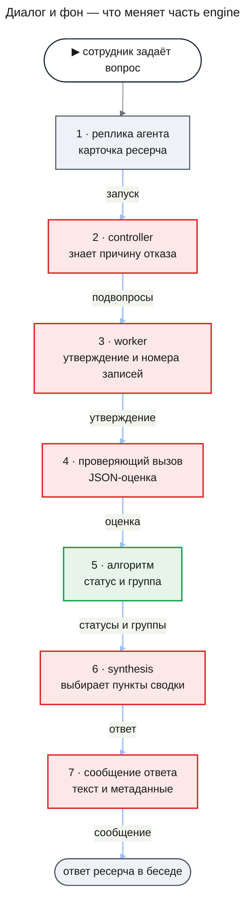

На схеме путь вытянут в цепочку; на деле после каждого шага управление возвращается к controller, и он решает, что делать дальше. Последний шаг движка собирает из ответа сообщение для беседы, и сервер беседы его только дописывает. Что увидит сотрудник в ответе:

- **«Установлено»** — только выводы, которые подтвердил проверяющий вызов, видя записи и итог сверки атомов. После сносок каждого стоят слова группы, например «уверенность высокая».
- **«Предположения»** — сюда же встают выводы о причине с меткой «причинная связь не доказана». Выводы, которые не успели проверить, стоят здесь с пометкой «не проверено», как сейчас.
- **«Не выяснено»** — выводы, для которых записей не хватило или проверка не удалась.
- **Сводка** — до трёх пунктов: дословные тексты установленных выводов со словами их групп. Если установленных выводов нет, сводки нет.
- **Сноски** — ведут только на страницы записей, по которым вывод проверили.
- **Копия ответа** — текст, который сотрудник копирует и который читает модель чата, несёт те же слова групп, подпись сводки и метку причинности, что экран.

### Как проверка утверждения работала и как будет работать

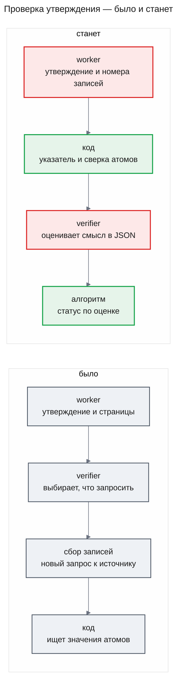

Сейчас проверяющий не судит утверждение: он только называет, какие записи запросить, код запрашивает их заново и ищет в них значения атомов. Совпадение значений ещё не значит, что смысл верен, а сноски под выводом берутся из черновика synthesis. После изменений код до вызова сверяет атомы утверждения с записями его указателя, а проверяющий вызов читает утверждение вместе с этими записями и итогом сверки и отвечает формой. Статус ставит ответ; итог сверки — свидетельство для модели и признак профиля (KD-2).

### Architecture (C1–C4)

#### C2 · Containers


- `api` — тот же сервер. В движке меняются проверка утверждений и её постановка после анализа, шлюз ответа, synthesis, повтор шага controller, его вход и счёт новизны и резерв бюджета. Сборка сообщения ответа переезжает из `research-chat` в движок; `research-chat` читает готовое сообщение и дописывает его в беседу.
- `Postgres agent_os` — ревизия утверждения хранит указатель, тип, оценку и группу; у статуса утверждения появляется значение `causal`; ответ хранит пункты сводки и группы выводов.
- `web` читает новые поля ответа; как он их показывает, решает часть `web`.

Калибровка встаёт рядом с этим путём, а не внутрь: её запускает разработчик, а сервер только читает готовую таблицу групп при старте.

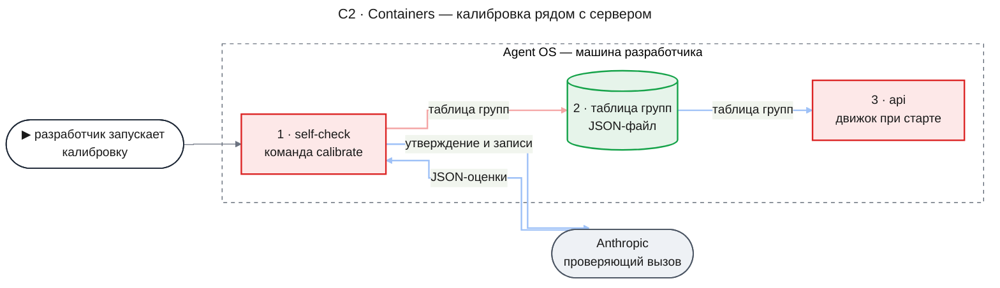

- `self-check` — программа самопроверки из [design-self-check.md](./design-self-check.md#contract-definitions). Эта часть добавляет ей команду `calibrate`; вызовы идут через `Engine.assess`, а их транскрипты остаются в базе `DATABASE_URL`, привязанные к идентификатору запуска самопроверки; очистка по сроку их не трогает.
- `таблица групп` — JSON-файл. Команда пишет его по пути, который ей дали, а отчёт калибровки печатает в консоль. Поставляемой таблица становится, когда разработчик кладёт файл в пакет `@agent-os/engine` рядом с поставляемыми конфигурациями вместе с промптом и импортирует его в `shipped-group-tables.ts`, так же как `shipped-processes.ts` импортирует конфигурации.

#### C3 · Components: api

**api — проверка одного утверждения.** Задача анализа записала утверждения и ставит их проверки сама (KD-10), или controller принял решение `requestVerification` о повторной проверке; дальше каждое утверждение проверяет своя задача.

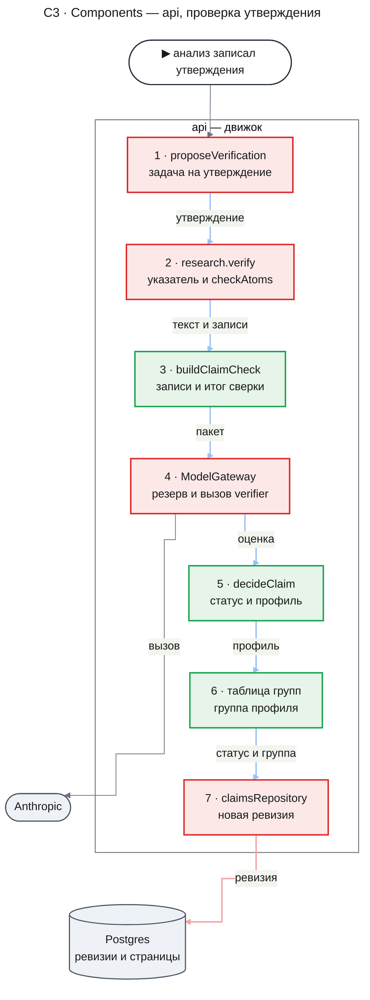

- `proposeVerification` ставит по одной задаче `research.verify` на утверждение. Её зовут двое. Задача анализа `research.analyze`, записав утверждения, ставит проверку каждого из них и ждёт эти задачи; ключ задачи — задача анализа и утверждение (KD-10). Решение `requestVerification` ставит проверку каждого названного утверждения; ключ — решение и утверждение, такое решение считается одним раундом проверки, и controller ждёт все его задачи.
- `research.verify` читает последнюю ревизию утверждения и страницы его указателя через `EvidenceReader` для владельца расследования, проверяет указатель до вызова модели и достаёт названные записи. Затем она сверяет атомы с этими записями функцией `checkAtoms`, и этот итог получают и `buildClaimCheck`, и `decideClaim`. Если оценка нарушает правила формы, задача один раз повторяет вызов в пределах своих трёх резервов. Задач сбора она больше не ставит и ничего не ждёт.
- `buildClaimCheck` собирает вход проверяющего вызова: текст утверждения, его атомы с итогом сверки, пронумерованные записи и у каждой страницы — источник, инструмент, аргументы запроса, срез и полна ли страница. Ту же функцию и `checkAtoms` вызывает калибровка.
- `ModelGateway` резервирует и вызывает модель, как для любой роли; ожидание резерва — в разделе [Как резерв решает](#как-резерв-решает-ждать-или-отказать).
- `decideClaim` — чистая функция без вызовов модели и базы: по оценке, указателю, записям и итогу сверки атомов она выдаёт статус, тип, основу проверки и профиль. Статус она берёт из оценки, итог сверки — только в профиль. Прежний `verifyClaim` с его статусом по атомам уходит.
- `claimsRepository` дописывает ревизию проверки с указателем, типом, оценкой, группой и основой в `evidenceIds`, как сейчас дописывает вердикт атомов.

**api — сборка ответа.** Controller принял решение `proposeAnswer`; ответ вместе с сообщением для беседы пишется один раз, а сервер беседы потом читает готовое сообщение и дописывает его.

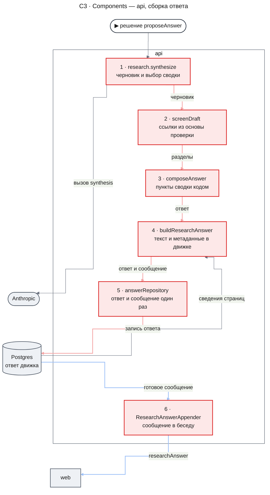

- `research.synthesize` отдаёт synthesis утверждения со статусом, группой и указателем и получает черновик: исход, список идентификаторов для сводки и утверждения ответа. Входные утверждения — последние ревизии всех утверждений, которые движок отдал synthesis. Черновик называет входное утверждение по его `claimId`, а утверждение с `claimId` null или неизвестным считается новым.
- `screenDraft` раскладывает входные утверждения только по хранимому статусу и берёт ссылки из хранимой ревизии; указатель, который черновик написал у входного утверждения, он не читает. `supported` идёт в «Установлено» с хранимой основой проверки и группой, `causal` — в «Предположения» с меткой и хранимой основой, `insufficient` — в «Не выяснено» без ссылок, `refuted` убирается. `unverified` идёт в «Предположения» со страницами своего хранимого указателя; шлюз проверяет, что это страницы этого расследования, и убирает утверждение, если страница чужая или её нет.
- Проверки указателя черновика `screenDraft` делает только у новых утверждений. Новое утверждение может опираться только на пары «страница и номер записи» из объединения указателей входных утверждений; иначе или без указателя оно убирается. Новые утверждения с допустимым указателем шлюз отправляет на проверку, пока остались раунды.
- `composeAnswer` собирает пункты сводки по алгоритму из раздела [Как собирается сводка](#как-собирается-сводка).
- `buildResearchAnswer` теперь живёт в движке. Перед каждой записью ответа — и здесь, и у ответа, который собирает код, — она строит из ответа сообщение для беседы: текст и метаданные `researchAnswer` ([Как строится сообщение ответа](#как-строится-сообщение-ответа)).
- `answerRepository` пишет ответ вместе с сообщением одной записью.
- `ResearchAnswerAppender` в `research-chat` берёт готовое сообщение через `readAnswerMessage` и сохраняет его в беседу по контракту этого чтения. Сам он ответ больше не собирает и записей не читает.

#### Как утверждение получает статус

**Что на входе.** Последняя ревизия утверждения: текст, атомы и указатель. Страницы записей, на которые указывает указатель.

**Кто оценивает.** Проверяющий вызов — роль `verifier` на Haiku. Он получает текст утверждения, его атомы с итогом сверки и пронумерованные записи указателя и возвращает оценку: `support` — `yes`, `no` или `insufficient`; `claimType` — `observation`, `quantitative` или `causal`; у каждой данной записи — `supports`, `contradicts` или `unrelated`.

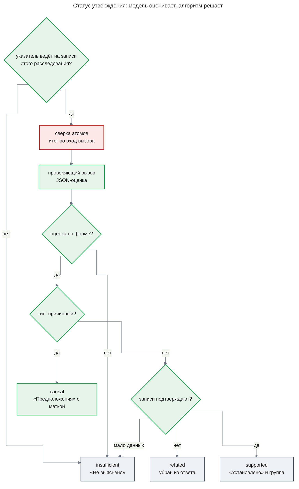

**Что решает алгоритм.** Первые два шага схемы делает задача `research.verify`, остальные — функция `decideClaim`. Код решает сам только то, что не требует понимания текста: указатель, окно роли, форму ответа и резерв бюджета. Всё остальное решает ответ проверяющего вызова.

1. **Указатель** (`research.verify`, до вызова модели). Каждая страница указателя — страница задачи этого расследования, читаемая для его владельца; каждый номер — целое число в пределах её записей; в указателе есть хотя бы одна запись и не больше `MAX_POINTER_RECORDS` (20). Иначе — `insufficient` без вызова модели (AC-11.1, DC-6).
2. **Сверка атомов** (`research.verify`, функция `checkAtoms`, до вызова модели). Каждый атом сравнивается со всеми полями записей указателя по правилам ниже. Итог по каждому атому и номера записей, где он найден, идут во вход проверяющего вызова и в профиль; статуса сверка не ставит (DC-9).
3. **Форма** (`decideClaim`). Ответ проходит схему; отношение указано у каждой данной записи ровно один раз и только у них; при `support: yes` хотя бы одна запись отмечена `supports`. Ответ, который не прошёл схему, шлюз повторяет один раз, как сейчас; ответ, который нарушил остальные правила, один раз повторяет задача. Ответ не по форме и после повтора — `insufficient`: ошибка проверки никогда не превращается в «подтверждено» (AC-12.2, DC-7).
4. **Тип.** `claimType: causal` — статус `causal`, что бы модель ни ответила про подтверждение: связь «из-за» логи напрямую не показывают (AC-14.1, DC-10). Наблюдаемое изменение без связи с вопросом — утверждение `observation`, и оно может быть установлено.
5. **Подтверждение.** `support: no` — `refuted`, `insufficient` — `insufficient` с причиной `no_support_data` (AC-12.1), `yes` — `supported` при любом итоге сверки атомов (DC-9). Кодового `refuted` по сверке и причины `values_missing` больше нет.
6. **Итог.** У `supported` основа проверки — страницы записей, отмеченных `supports`. Дальше считается группа: итог сверки атомов — один из четырёх признаков профиля.

**Сверка атомов.** Код не знает имён полей и не читает ключи: он обходит все значения каждой записи указателя на любой глубине, включая элементы списков, и сравнивает их с атомом целиком.

| Вид атома | `found` | `missing` | `contradicted` |
|---|---|---|---|
| `text` | какое-то строковое значение записи равно атому символ в символ | ни одно строковое значение не равно | не бывает: без имени поля код не знает, о каком значении утверждение |
| `number` | какое-то числовое значение записи равно числу атома | ни одно числовое значение не равно; значение атома не число | не бывает по той же причине |
| `time` | какое-то поле-дата записи лежит внутри интервала — начало включительно, конец нет, как `[from, to)` у инструментов fixture, — или равно моменту | у записей указателя нет ни одного поля-даты; значение атома не момент и не интервал ISO 8601 | поля-даты есть, но ни одно не лежит внутри интервала и не равно моменту |

Сумму по нескольким записям сверка не ищет: атом `number` найден, только если число стоит в одной записи. Утверждение о сумме нескольких групп получает у этого атома `missing`, и сумму проверяет сама модель; поэтому worker пишет атомом счётчик одной группы.

Итог утверждения для профиля: `matched` — все атомы `found`, `unmatched` — хоть один `missing` или `contradicted`, `not_applicable` — атомов нет. Пример. Утверждение «с 19:00 до 20:00 `payment-api` записал 412 событий `timeout`» указывает на группу подсчёта `aggregate_logs` с `start` 19:00, `key` `timeout` и `count` 412. `text` `timeout` и `number` 412 найдены в этой группе, `time` найден по её `start`, а `text` `payment-api` — `missing`, если группа сгруппирована по событию и сервиса в ней нет. Итог — `unmatched`, а проверяющий вызов видит, что сервис в записи не назван, и сам решает, подтверждают ли записи утверждение.

Сверка сравнивает значения буквально и не знает, что значит поле: время начала группы подсчёта она не отличает от времени строки лога. Поэтому её итог — свидетельство для модели, а не решение. Промпт `verifier` говорит это прямо: какой атом и в какой записи найден, ещё не значит, что запись говорит то, что утверждение.

Если проверяющий вызов так и не состоялся — резерв отказал, расследование остановлено или наступил `notAfter`, — ревизия не пишется, и утверждение остаётся `unverified` (DC-8). Так же остаётся `unverified` утверждение, чья задача израсходовала все три своих резерва роли `verifier`: их может съесть ответ не по схеме, который шлюз повторил, вместе с повторным вызовом, который задача делает из-за правил формы ([Risks and Mitigation](#risks-and-mitigation)).

**Что видит сотрудник.** `supported` — вывод в «Установлено» со словами группы. `causal` — в «Предположениях» с меткой «причинная связь не доказана». `insufficient` — в «Не выяснено». `refuted` — вывода в ответе нет. `unverified` — в «Предположениях» с пометкой «не проверено».

#### Как считается группа уверенности

**Что на входе.** Установленное утверждение — его оценка, итог сверки атомов и записи указателя — и таблица групп для модели и версии промпта проверяющего вызова этого расследования.

**Кто оценивает.** Здесь модель не вызывается: всё нужное уже есть в оценке.

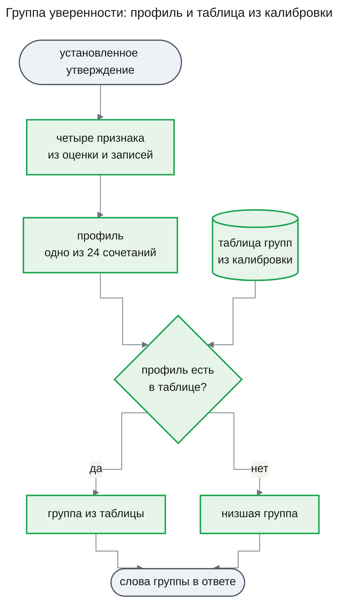

**Что решает алгоритм.** Профиль — четыре признака; у итога сверки три значения, у остальных по два:

- **тип** — `observation` или `quantitative` из оценки (причинное утверждение установленным не бывает);
- **итог сверки атомов** (`valueCheck`) — `matched`, если все атомы найдены, `unmatched`, если хоть один не найден или противоречит, и `not_applicable`, если атомов нет;
- **независимые записи** — одна или две и больше среди записей, которые оценка отметила `supports`; записи с одинаковым `traceId` считаются одной;
- **противоречия** — отметила ли оценка хоть одну запись `contradicts`.

Группу профиля берёт таблица групп (FR-15). Профиль, которого калибровка не видела, получает низшую группу, как и утверждение, для замороженной конфигурации которого таблицы нет (DC-11). Группа записывается в ревизию проверки и потом не пересчитывается: ответ, собранный позже, в том числе кодом при принудительной остановке, берёт её из ревизии.

Пример. Утверждение «с 19:00 до 20:00 `payment-api` записал 412 ошибок timeout» указывает на часовую группу подсчёта с `count` 412 и на три строки лога разных запросов. Оценка: подтверждают, тип `quantitative`, все четыре записи `supports`. Все атомы найдены — сервис в строках лога, число и время в группе, — противоречий нет, независимых записей четыре. Профиль «подсчёт, значения совпали, две и больше, без противоречий» калибровка поставила в высшую группу, и сотрудник видит «уверенность высокая». Если бы оценка отметила одну строку как `contradicts`, профиль был бы другим, и группа — ниже.

**Что видит сотрудник.** Слова группы рядом с выводом и с пунктом сводки (UXRD, MC-1), без процентов. Начальное число групп — три; после первой калибровки его можно изменить по её отчёту в пределах трёх-четырёх с утверждения владельца, и тогда таблица просто строится на четыре группы.

#### Как калибровка ставит таблицу групп

**Что на входе.** Калибровочные пары генератора и отпечаток их набора — то, что отдаёт `buildCalibrationPairs` ([design-self-check.md](./design-self-check.md#contract-definitions), `CalibrationPair`). Страницы пары устроены так же, как страницы указателя в расследовании: записи пронумерованы, а у количественных пар есть страница групп подсчёта. Атомы пар — в формате KD-9. Набор несёт и пары на группах подсчёта с числом и временем: верно приписанные (`supported`), где число и время взяты из разных групп одной страницы (`values_match_meaning_wrong`) — каждое значение в записях есть, но не в той группе, о которой утверждение, — и с числом, которого в группе этого часа нет (`contradicted`). Как их строит генератор, решает контракт `CalibrationPair` части `self-check` (Part, Sibling parts). И конфигурация процесса, чей проверяющий вызов калибруется.

**Кто оценивает.** Тот же проверяющий вызов, что в расследовании: `checkAtoms` сверяет атомы пары с её записями, `buildClaimCheck` собирает вход из текста пары, итога сверки и её страниц, а `Engine.assess` делает вызов с ролью `verifier`, моделью и промптом роли из конфигурации. Команды `calibrate` и `run` собирают движок, передавая в `assessModels` модель роли `verifier` выбранной конфигурации; `run` передаёт туда же и модель судьи из настроек самопроверки ([design-self-check.md](./design-self-check.md#key-decisions), KD-5). Исполнителей задач `calibrate` не запускает — правило в её контракте ([Contract Definitions](#contract-definitions), команда `calibrate`). Версия промпта такого вызова совпадает с версией роли в расследовании по правилу `Engine.assess` из того же контракта: промпт роли `verifier` версии 2 не содержит полей подстановки, а `buildClaimCheck` передаёт его как есть.

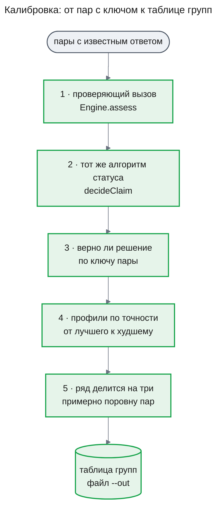

**Что решает алгоритм.**

1. Для каждой пары — сверка атомов, оценка и решение `decideClaim`; указатель пары — все её записи, как задаёт `CalibrationPair`.
2. Пара «должна быть установлена», если по ключу записи подтверждают и тип не причинный. Совпадение значений в это правило больше не входит: пара `values_match_meaning_wrong` со всеми найденными значениями установлена быть не должна, а сверка атомов статуса не решает (KD-2). Решение алгоритма верно, если он установил пару, которая должна быть установлена, или не установил ту, что не должна.
3. Для каждого вида пар отчёт показывает три доли совпадений с ключом: по ответу «подтверждают ли», по типу и по решению алгоритма (AC-06.1, DC-1). Рядом с долей по решению алгоритма стоит доля, которую на тех же парах дало бы правило «итог сверки `unmatched` — не установлено»: так разработчик видит, точнее ли модель прежнего вето (AC-13.2). Пара, на которой провайдер не ответил или оценка не прошла форму, считается неверной и стоит в отчёте отдельным списком.
4. Для установленных пар считается профиль. По каждому профилю — сколько пар и сколько из них верны. Профили выстраиваются по нижней границе интервала Уилсона для доли верных при z = 1,645, то есть двустороннего 90-процентного: профиль с малым числом пар встаёт ниже, чем с той же долей на большом числе пар.
5. Выстроенный ряд делится на столько подряд идущих непустых частей, сколько групп задано (по умолчанию три); верхняя часть — высшая группа. Из всех таких делений берётся то, у которого наибольшее отклонение числа установленных пар в части от равной доли меньше всего; при равенстве выигрывает деление с меньшей верхней группой. Профиль целиком попадает в одну группу и не делится. Если профилей меньше, чем групп, они заполняют группы сверху по одному, а нижние группы остаются без профилей; всё, чего калибровка не видела, получает низшую группу.
6. Отчёт показывает по каждой группе число пар и долю верных (AC-15.2) и проверяет гипотезу H-03 PRD: каждую непустую группу он сравнивает со следующей непустой группой ниже и отмечает ту, что не точнее её. Таблица записывает модель и версию промпта проверяющего вызова, набор пар и его отпечаток и группу каждого профиля.

Команда пишет таблицу в файл, который ей назвали, и перезаписывает прежний файл без вопроса. При смене модели или промпта отпечаток меняется, старая таблица к новой конфигурации не подходит, и сервер не стартует, пока новая таблица не поставлена в пакет движка (AC-06.2, DC-2).

**Что видит сотрудник.** Ничего — отчёт калибровки читает разработчик; сотрудник видит только слова группы.

#### Как собирается сводка

**Что на входе.** Черновик synthesis со списком `summaryClaimIds` и разделы ответа после шлюза.

**Кто оценивает.** Synthesis выбирает, какие утверждения важнее для вопроса, и ставит их в список по важности. Текст сводки модель не пишет.

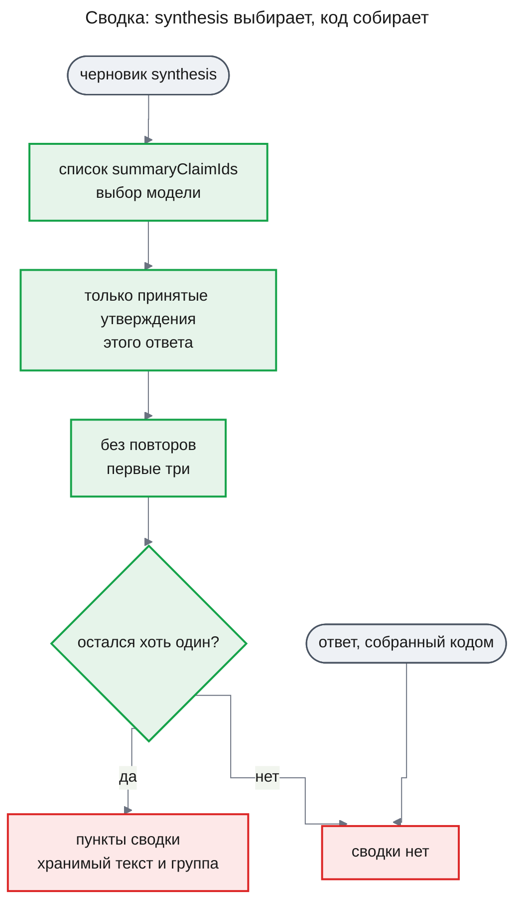

**Что решает алгоритм.** `composeAnswer` оставляет из списка только идентификаторы утверждений, стоящих в «Установлено» этого ответа, в порядке списка, без повторов и не больше трёх (DC-12). Текст пункта — хранимый текст утверждения, тот же, что стоит в «Установлено», группа — его группа (AC-16.1). Утверждение из «Предположений», «Не выяснено» или выдуманный идентификатор в сводку не попадает (AC-16.2). Пустой итог — сводки нет (AC-16.3). Ответ, который собрал код при принудительной остановке или по решению `concludeInconclusive`, сводки не получает: synthesis не выбирала пунктов (AC-16.4). В режиме без источников принятых утверждений не бывает, поэтому сводки нет (DC-13).

**Что видит сотрудник.** Под строкой цели — подпись «Главное из установленного» и пункты со словами групп; если пунктов нет — ни подписи, ни пустого места (UXRD, KD-3). Как это выглядит на экране, строит часть `web`; в текстовой версии ответа пункты стоят с той же подписью.

#### Как строится сообщение ответа

**Что на входе.** Собранный ответ — исход, причина остановки, разделы и пункты сводки; вопрос и `launchKey` расследования и его режим источников. Ещё — сведения о каждой странице записей, на которую ссылается ответ: источник, инструмент, срез и усечена ли страница. Их шаг читает через `EvidenceReader` для владельца расследования.

Модель здесь не вызывается: сообщение собирает код из хранимого ответа.

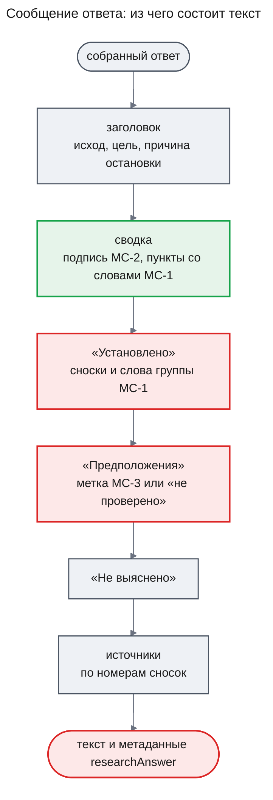

**Что решает алгоритм.**

1. Номера сносок идут по первому появлению страницы: разделы «Установлено», «Предположения», «Не выяснено» по порядку, выводы — в порядке раздела. Убранные утверждения в сообщение не входят.
2. Текст в Markdown идёт в порядке схемы. Сводка — подпись MC-2 и пункты со словами их групп MC-1; без пунктов нет ни подписи, ни пустой строки. После сносок установленного вывода стоят слова его группы MC-1, рядом с причинным выводом — метка MC-3, у непроверенного — пометка «не проверено», как сейчас.
3. Метаданные `researchAnswer` несут те же разделы, пункты сводки, группы и метки, что текст.
4. Тексты утверждений и пунктов сводки текст сообщения приводит к одной строке: переносы строк и управляющие символы становятся пробелом, а знак блока Markdown в начале — заголовок, список, цитата — и разметка ссылки или картинки экранируются. Поэтому утверждение не может изобразить в сообщении свой раздел, подпись или сноску. Метаданные хранят исходный текст: `web` показывает его как текст, а не как разметку.
5. Без источников текст, как сейчас, начинается с предупреждения, что источники не подключены, а выводы вместо сносок помечены «из знаний модели»; сводки нет (DC-13).
6. Ответ, записанный до этой части, хранимого сообщения не имеет. Его сообщение строит та же функция только при чтении для доставки — `readAnswerMessage`, например при повторной дописке после перегенерации. Правило UXRD KD-7 действует и на текстовую версию: в таком сообщении нет ни сводки с подписью MC-34 или MC-2, ни слов групп MC-1, ни метки MC-3, а разделы, сноски, «не проверено» и список источников — как раньше. В его метаданных `summary` null.

Шаг стоит перед каждой записью ответа: после synthesis и шлюза и у ответа, который код собирает при принудительной остановке или по решению `concludeInconclusive`. Сообщение записывается вместе с ответом.

**Что видит сотрудник.** Ответ в беседе, его копия и история, которую читает модель чата, говорят одно и то же: те же пункты сводки, слова групп и метки причинности. Как ответ выглядит на экране, решает часть `web`.

#### Как резерв решает: ждать или отказать

**Что на входе.** Посчитанный вход вызова, запас и потолок выхода роли; счётчики расследования — бюджет, списанное и открытые резервы; потолок задачи.

**Кто оценивает.** Модель не участвует: это арифметика над счётчиками журнала.

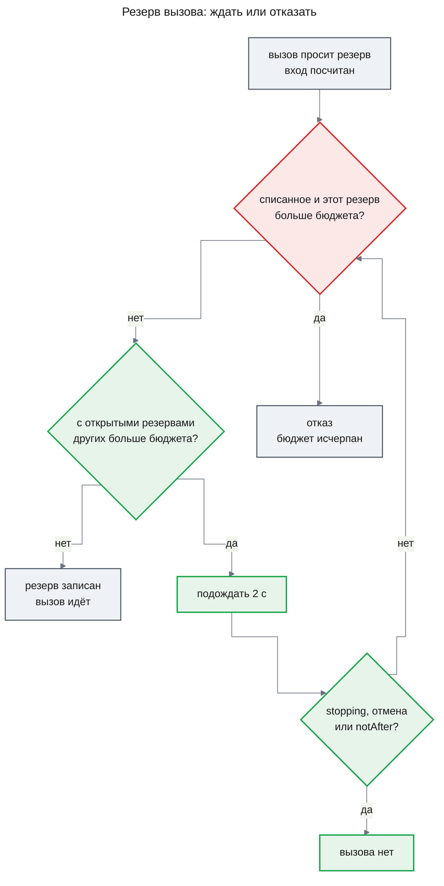

**Что решает алгоритм.** Проверки части `lifecycle` идут первыми: попытка не текущая — `fenced`, работа остановлена или закрыта — `stopping`. Дальше резерв сравнивает с бюджетом только списанное и свой резерв: если не помещается даже так, это отказ `investigation_tokens_exhausted`, и новых вызовов в расследовании не будет (AC-10.2). Если мешают только открытые резервы других вызовов, резерв отвечает `busy`, шлюз ждёт 2 секунды и спрашивает снова, не пересчитывая вход (AC-10.1, DC-5). Потолок задачи проверяется, как сейчас. Резерв по-прежнему не меньше возможного расхода вызова, поэтому списанное никогда не превышает бюджет.

Пример. Бюджет 300 000, controller и план уже списали 20 000. Четыре worker почти одновременно просят по 72 000: три резерва помещаются, четвёртый — нет, хотя по факту каждый вызов потратит около 66 000. Четвёртый ждёт; когда закрылись два первых вызова, списано 152 000, открыт один резерв на 72 000, и четвёртый помещается. Сейчас такой четвёртый вызов получает отказ, его задача анализа падает с причиной бюджета, и подвопрос остаётся без анализа.

**Что видит сотрудник.** Расследование, которое по факту укладывается в бюджет, не кончается причиной «бюджет исчерпан» до анализа записей; ответ может прийти на несколько секунд позже.

#### Как повтор controller узнаёт причину и что кэшируется

**Что на входе.** Шаг controller: системный промпт, ревизия плана, инструменты, бюджет, допустимые решения, сигналы, наблюдения, счётчики задач, прежние утверждения и — у повторной попытки — отклонённые попытки этого шага.

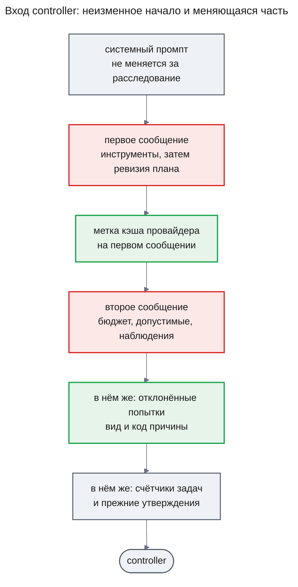

**Кто оценивает.** Controller-модель выбирает решение, как сейчас. Код проверяет его прежним `judgeControllerOutput` и отклоняет с причиной из закрытого перечня: `kind_unknown`, `capability_disabled`, `invalid_structure`, `invalid_model_output`, `fan_out_exceeded`, `plan_revisions_exhausted`, `no_novelty`, `verify_rounds_exhausted`, `deadline_too_close`, `nothing_to_wait_for`, `source_not_allowed`, `invalid_args`.

**Что решает алгоритм.** Повторная попытка шага получает в меняющейся части список отклонённых попыток этого шага — вид решения, если модель его назвала, и код причины. Список берётся из записанных решений шага, поэтому попытка после перезапуска задачи тоже его видит (AC-08.1, DC-3). Промпт controller версии 2 объясняет каждый код причины. Полный текст отклонённого вывода в вход не идёт: он остаётся в строке решения и в транскрипте.

Неизменный блок — инструменты, которые не меняются за расследование, и ревизия плана, которая меняется только при `replan`. Он идёт первым сообщением с меткой кэша, а всё меняющееся — вторым сообщением после него. Провайдер на следующих шагах читает системный промпт и этот блок из кэша по цене cache read, и журнал вызовов уже записывает такие токены отдельно и считает их по цене каталога (AC-18.1, DC-15). Окно controller по-прежнему проверяется по всему посчитанному входу.

**Что видит сотрудник.** Ничего напрямую. Расследование реже кончается причиной «контроллер не дал допустимого решения» (гипотеза H-05 PRD) и стоит дешевле (H-06).

#### Как утверждения анализа попадают на проверку

**Что на входе.** Задача анализа `research.analyze`, которая записала утверждения своего подвопроса; `notAfter` решения, которое её поставило.

**Кто оценивает.** Модель не вызывается: проверки ставит код (KD-10). Каждая проверка — обычная задача `research.verify` из [Flow 1](#flow-1-проверка-одного-утверждения).

**Что решает алгоритм.**

1. Записав утверждения, задача анализа ставит по задаче `research.verify` на каждое из них с ключом «задача анализа и утверждение» и с `notAfter` своего решения. Повторная попытка задачи анализа после перезапуска получает те же задачи как `subscribed`.
2. Задача анализа ждёт свои проверки и кончается `succeeded`, когда кончились они все, с каким бы итогом ни кончилась каждая. Её итог в `answerOrDelta` — утверждения со статусами после проверок.
3. Controller ждёт задачи своего решения `requestAnalysis`, как раньше, поэтому на следующем шаге видит уже проверенные утверждения.
4. Принятых решений `requestVerification` от автопроверки не прибавляется, поэтому `maxVerifyRounds` расходуют только повторные проверки, которые выбрал controller.
5. Анализ без утверждений проверок не ставит. Анализ, чей вызов worker не состоялся, утверждений не пишет и проверок не ставит, как раньше.

**Что видит сотрудник.** Больше выводов доходит до «Установлено» или «Не выяснено» вместо «Предположений» с пометкой «не проверено».

#### Новизна шага и наблюдения controller

**Что на входе.** Принятые решения расследования по порядку, задачи, которые каждое из них предложило, и последние ревизии утверждений.

**Кто оценивает.** Модель не участвует: это правило кода над временем записи решения, временем создания задачи и охватом её страницы.

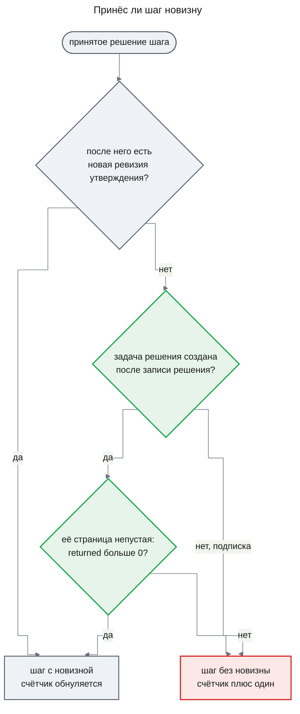

**Что решает алгоритм.** Шаги считаются с конца, от последнего принятого решения, пока не встретится шаг с новизной (KD-11). Новизну дают новая ревизия утверждения, записанная после решения и до следующего, или задача, которую решение этого шага создало позже своей записи, со страницей, где `coverage.returned` больше нуля. Задача, которую решение получило подпиской на уже существующую, создана раньше решения и новизны не даёт; пустая страница тоже. `noveltyWindow` шагов без новизны подряд оставляют допустимыми только `proposeAnswer` и `concludeInconclusive`, как раньше (DC-16).

Наблюдение задачи сбора или анализа в `<decision_input>` несёт её запрос — `sourceId`, `toolName`, `args` — и `returned`, число вернувшихся записей; у задачи анализа это запрос и число записей задачи сбора, страницу которой читал worker (KD-12, DC-17). Промпт controller велит не повторять запрос, который вернул 0 записей, а когда фильтр по значению поля ничего не нашёл, сначала узнать значения этого поля группировкой — у `aggregate_logs` это аргумент `groupBy` — и только потом фильтровать по найденному значению.

**Что видит сотрудник.** Расследование, которое повторяет пустые запросы, раньше кончается ответом по `no_novelty` вместо остановки «бюджет исчерпан».

### Runtime Flows

#### Flow 1: проверка одного утверждения

**Starts when:** runtime выдаёт задачу `research.verify` одного утверждения — поставленную задачей анализа (Flow 6) или решением `requestVerification`, for AC-11.1, AC-12.1, AC-12.2, AC-12.3, AC-13.1, AC-14.1, DC-6, DC-7, DC-9

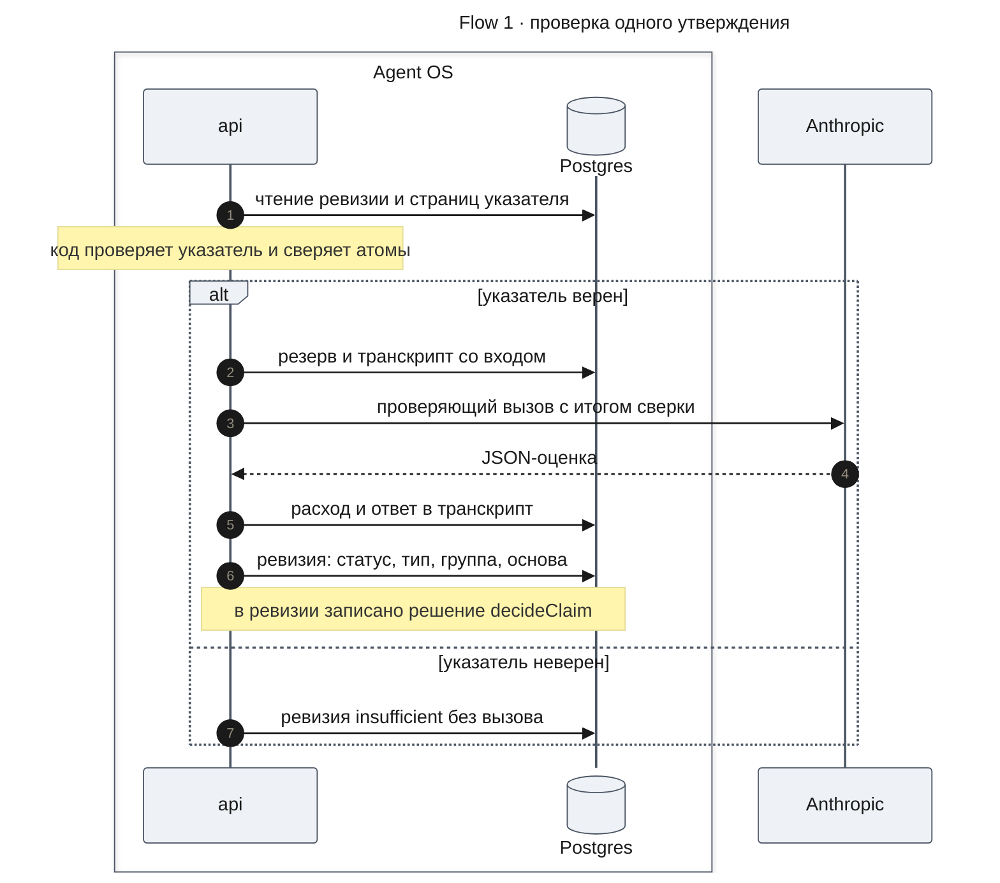

**Outcome:** у утверждения новая ревизия с указателем, типом, оценкой, группой и основой проверки; ревизия ссылается на свою задачу. Среди транскриптов этой задачи есть ответивший вызов `verifier`, который её подтвердил (AC-12.3); их отдаёт `readTranscripts` по задаче ([design-self-check.md](./design-self-check.md#contract-definitions)). Задача заканчивается `succeeded` и сообщает статус утверждения задаче, которая её поставила, — задаче анализа или controller.

**Failure handling:**

- Указатель неверен → ревизия `insufficient`, вызова модели нет; оценка ревизии хранит ответ null и причину `pointer_invalid` (DC-6).
- Оценка не по форме дважды → ревизия `insufficient`; оценка ревизии хранит ответ модели и признак нарушенной формы (DC-7).
- Резерв ждёт чужих резервов → задача ждёт внутри попытки до `notAfter` (DC-5).
- Резерв отказал по бюджету → задача `failed` с причиной бюджета, ревизии нет, утверждение остаётся `unverified` (DC-8).
- Резерв ответил `stopping` или пришла отмена → задача отменена, ревизии нет (design-lifecycle.md, KD-2).
- Пакет проверки не помещается в окно роли → ревизия `insufficient`, вызова нет; оценка ревизии хранит ответ null и причину `needs_narrowing`.
- Провайдер недоступен после повторов → задача `failed` с `model_unavailable`, ревизии нет; controller видит это в наблюдениях, как сейчас.

#### Flow 2: ответ ресерча от synthesis до беседы

**Starts when:** controller принял `proposeAnswer`, и runtime выдал задачу `research.synthesize`, for AC-09.1, AC-16.1, AC-16.2, AC-16.3, DC-4, DC-12

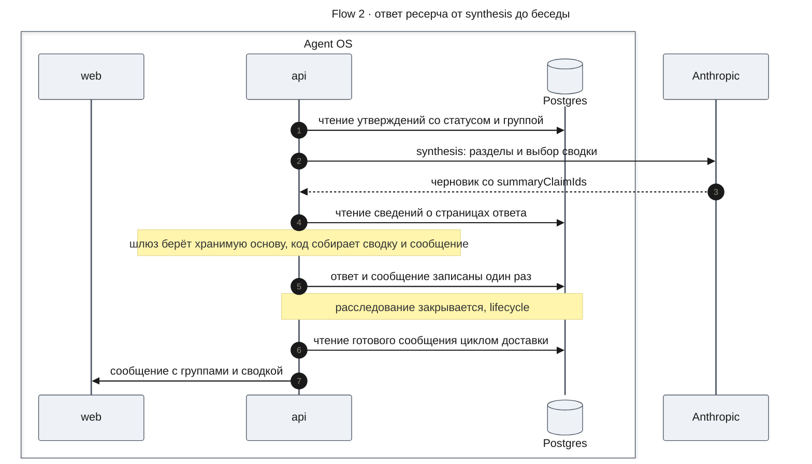

**Outcome:** ответ движка хранит разделы, у установленных выводов — группу и ссылки из основы проверки, у причинных — признак причинности, пункты сводки и готовое сообщение для беседы. Сообщение в беседе — это оно же: текст с подписью сводки MC-2, словами групп MC-1 и меткой MC-3 и те же данные в метаданных `researchAnswer`.

**Failure handling:**

- Черновик не по форме дважды → задача без ответа с предупреждением `invalid_model_output`, как сейчас; controller решает, что дальше.
- В черновике новое утверждение опирается на пару «страница и номер записи» вне объединения указателей входных утверждений или на страницу чужого расследования → оно убирается из ответа с причиной `foreign_evidence` или `evidence_not_found`, как сейчас; без указателя — с причиной `no_reference`.
- Хранимый указатель входного `unverified` утверждения ведёт на чужую или несуществующую страницу → утверждение убирается из ответа с той же причиной. Указатель, который черновик написал у входного утверждения, не проверяется и не используется.
- Новые утверждения с допустимым указателем, пока остались раунды проверки → итог `needs_verification`, как сейчас; без раундов они стоят в «Предположениях» как не проверенные.
- `summaryClaimIds` пуст или называет только непринятые утверждения → сводки нет (AC-16.3).
- Сведения о странице ответа не прочитаны при сборке сообщения → задача `research.synthesize` кончается ошибкой до записи ответа, ответа нет, и controller видит упавшую задачу в наблюдениях, как при любой ошибке задачи. У ответа, который собирает код, та же ошибка роняет задачу controller, и расследование закрывается `failed` без ответа по правилу части `lifecycle` ([design-lifecycle.md](./design-lifecycle.md#acceptance-criteria), DC-1).
- Сообщение ответа, записанного до этой части, не построено при доставке, потому что база или сведения о странице не прочитаны → ошибка доходит только до цикла доставки, и он повторяет запись после паузы до окна отказа, как сейчас.

#### Flow 3: повтор шага controller с причиной отказа

**Starts when:** код отклонил решение controller, а повторов шага ещё не исчерпано, for AC-08.1, AC-18.1, DC-3, DC-15

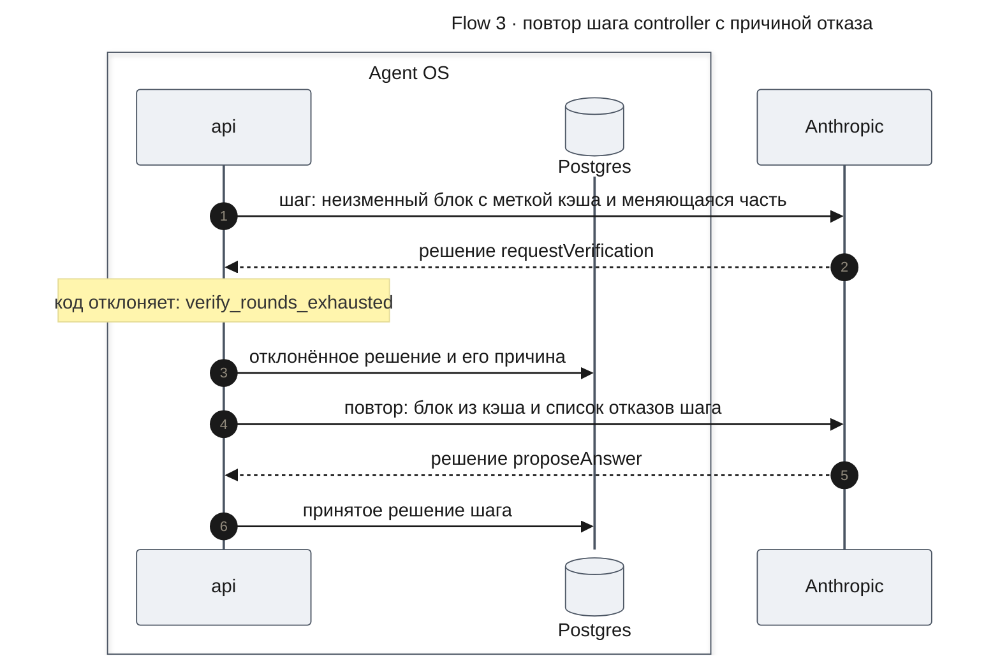

**Outcome:** в шаге две строки решений — отклонённая с причиной и принятая. Транскрипт второго вызова содержит код причины первого отказа, а его запись в журнале — токены, прочитанные из кэша.

**Failure handling:**

- Все попытки шага отклонены → остановка `controller_invalid`, ответ собирает код, как сейчас.
- Задача controller перезапущена между попытками → следующая попытка читает отклонённые решения шага из базы и видит их так же.
- Неизменное начало короче минимума провайдера для кэша → кэша нет, вызов идёт как сейчас и стоит полную цену ([Risks and Mitigation](#risks-and-mitigation)).

#### Flow 4: четыре worker и один бюджет

**Starts when:** controller принял `requestAnalysis` с четырьмя подвопросами, и их задачи анализа идут одновременно, for AC-10.1, AC-10.2, DC-5

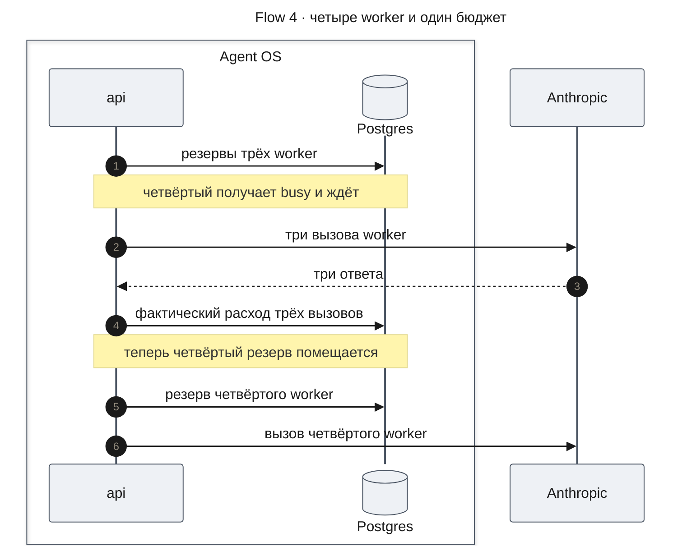

**Outcome:** все четыре подвопроса проанализированы; списанное — сумма фактического расхода и не больше бюджета.

**Failure handling:**

- Списанное вместе с резервом четвёртого больше бюджета → отказ `investigation_tokens_exhausted`; задача анализа падает с причиной бюджета, как сейчас (AC-10.2).
- Пока четвёртый ждёт, расследование закрыто или остановлено → резерв отвечает `stopping`, вызова нет (design-lifecycle.md, KD-2).
- Наступил `notAfter` решения → вызова нет, задача кончается `deadline`, как сейчас.

#### Flow 5: калибровка проверяющего вызова

**Starts when:** разработчик выполняет команду `calibrate` программы самопроверки, for AC-06.1, AC-06.2, AC-15.2, DC-1, DC-2

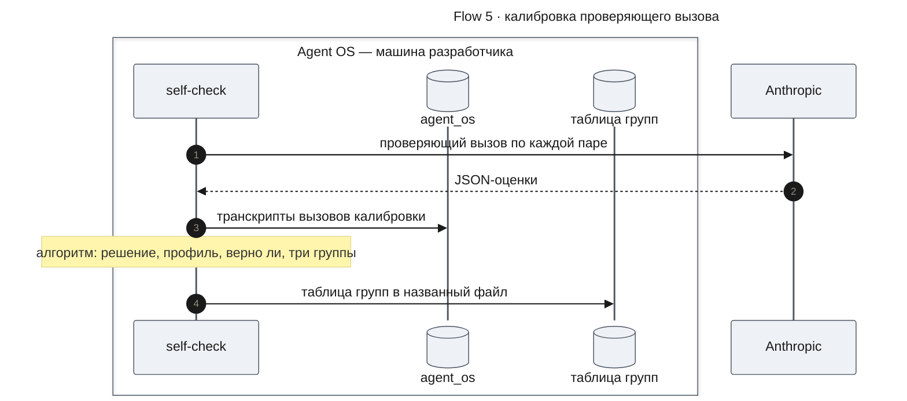

**Outcome:** файл таблицы групп для модели и версии промпта проверяющего вызова и отчёт калибровки в консоли. Когда разработчик поставил файл в пакет движка, сервер после следующего старта берёт группы из этой таблицы.

**Failure handling:**

- Промпт роли `verifier` содержит поля шаблона → отказ `calibration_prompt_has_fields` до первого вызова: в калибровке нет вопроса расследования, и по правилу версии промпта `Engine.assess` таблица оказалась бы привязана не к той версии, что у роли в расследовании.
- Вызов не по форме или провайдер недоступен на паре → пара засчитывается как неверное решение, не получает профиля и стоит в отчёте отдельным списком; таблица строится по остальным.
- Ни одна пара не установлена → отказ `calibration_empty`, таблица не пишется.

#### Flow 6: автопроверка утверждений анализа

**Starts when:** задача анализа получила ответ worker с утверждениями, for DC-18

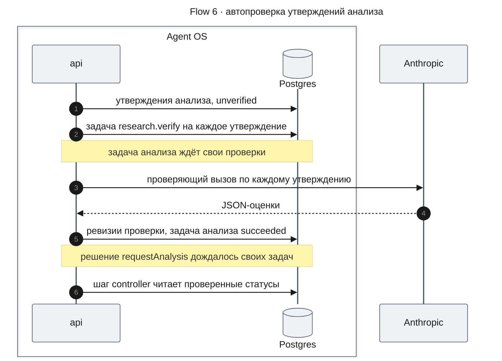

**Outcome:** у каждого утверждения анализа есть своя задача `research.verify` с ключом «задача анализа и утверждение» и, если проверка состоялась, ревизия проверки. Задача анализа кончилась после своих проверок; принятых решений `requestVerification` не прибавилось.

**Failure handling:**

- Повторная попытка задачи анализа после перезапуска → те же задачи проверки приходят как `subscribed`, новых не ставится.
- Проверка кончилась `failed` или отменена → утверждение остаётся `unverified` (DC-8); задача анализа всё равно кончается `succeeded`, и controller может поставить его повторную проверку решением `requestVerification`.
- Резерв проверки ждёт чужих резервов → проверка ждёт по KD-5; задача анализа ждёт её до `notAfter` решения.
- Предложение задачи отклонено как `budget_exhausted` → расследование останавливается по бюджету, как при любом отказе предложить задачу; ответ собирает код и ставит в «Установлено» уже проверенные `supported`.
- Расследование остановлено или закрыто → задачи проверки отменяются вместе с остальными по правилу части `lifecycle`.

### Contract Definitions

**@agent-os/engine — формы ответа ролей**

- **Вывод `worker`** — `claims`: у каждого утверждения `text`, `atoms` — у каждого атома `kind` (`text`, `number` или `time`) и `value` строкой (KD-9) — и `pointer` — от 1 до 20 записей, сгруппированных по страницам: идентификатор страницы и номера записей в ней. Прежнего списка `evidenceIds` в выводе нет: страницы утверждения — страницы его указателя. Промпт worker версии 2 велит писать наблюдаемое изменение, например «с 14:00 `provider-adapter` ждёт провайдера 2 секунды вместо 5», и его связь с вопросом отдельными утверждениями: первое — наблюдение, второе — причинное (FR-14). Тот же промпт велит писать атомы одинаково для любого источника: `text` — строка ровно как в записи указателя, `number` — число ровно как в записи, `time` — момент или интервал ISO 8601 `start/end`; атом пишется только для значения, которое есть в записях указателя, время группы подсчёта — интервал от её начала длиной в шаг группы, а число — счётчик одной группы.
- **Вывод `verifier` — `ClaimAssessment`** — `support` (`yes`, `no`, `insufficient`), `claimType` (`observation`, `quantitative`, `causal`) и `records` — по одному элементу на каждую данную запись: её номер во входе и `relation` (`supports`, `contradicts`, `unrelated`). Каждый объект схемы закрыт.
- **Вывод `synthesis`** — `outcome` (`answered`, `partial`, `inconclusive`), `summaryClaimIds` — идентификаторы утверждений для сводки по важности, и `claims` — утверждения ответа: `claimId` входного утверждения или null у нового (неизвестный `claimId` шлюз тоже считает новым), `text`, `atoms` и `pointer`. Строкового поля `summary` в выводе нет.
- **Вывод `controller`** — без изменений.
- **Промпт `verifier`** — больше не говорит, что код сам сравнивает имена, время и числа утверждения с записями. Он говорит, что во входе стоит итог буквальной сверки каждого атома — найден, не найден или противоречит, и в каких записях найден, — что сверка не знает значения полей, и что модель сама судит, подтверждают ли записи смысл утверждения вместе с его значениями: число или время, найденное в записи, которая говорит о другом, не подтверждает утверждение. Отпечаток промпта меняется, поэтому таблица групп строится заново (KD-3).

**@agent-os/engine — операции**

- **`research.verify` версии 2** — задача проверки одного утверждения. Вход — решение, которое её поставило, идентификатор утверждения и `notAfter`. Итог в `answerOrDelta` — статус утверждения и, при `insufficient`, причина: `pointer_invalid` — указатель неверен, `invalid_assessment` — оценка не по форме и после повтора, `needs_narrowing` — пакет не помещается в окно роли, `no_support_data` — оценка ответила `support: insufficient`. Причины `values_missing` нет: сверка атомов статуса не ставит (KD-2). Задач сбора она не ставит. Бюджет задачи — три резерва роли `verifier`, как сейчас.
- **`proposeVerification`** — ставит по задаче `research.verify` на каждое утверждение. Для решения `requestVerification` — на каждое названное утверждение с ключом «решение и утверждение»; решение считается одним раундом проверки. Для задачи анализа — на каждое её утверждение с ключом «задача анализа и утверждение»; раунда это не тратит (KD-10).
- **`research.analyze`** — вход прежний. Записав утверждения, задача ставит их проверки через `proposeVerification` с `notAfter` своего решения, ждёт их и кончается `succeeded`, когда кончились они все; итог в `answerOrDelta` — её утверждения со статусами после проверок. Отказ предложить задачу по бюджету останавливает расследование, как при любом предложении задачи.
- **`checkAtoms`** — чистая функция: по атомам утверждения и записям указателя — или записям `CalibrationPair.pages` в калибровке — возвращает итог каждого атома (`found`, `missing`, `contradicted`) с номерами записей, где он найден, и итог утверждения для профиля (`matched`, `unmatched`, `not_applicable`) по таблице раздела [Как утверждение получает статус](#как-утверждение-получает-статус). Атом прежнего вида из сохранённой ревизии она читает по правилу KD-9. Её вызывают `research.verify` и команда `calibrate`; прежний `verifyClaim` уходит.
- **`buildClaimCheck`** — чистая функция: по конфигурации роли `verifier`, тексту утверждения, итогу `checkAtoms` и страницам с пронумерованными записями — записям указателя в расследовании или `CalibrationPair.pages` в калибровке, у которых та же форма, — возвращает инструкции, сообщения и схему ответа проверяющего вызова. Инструкции — шаблон `prompt` роли `verifier` без изменений; текст утверждения, его атомы с итогом сверки и записи идут только в сообщения. Раздел `<claim>` несёт текст и атомы — у каждого вид, значение, итог и номера записей, где атом найден. Записи идут отдельным разделом данных, каждая — JSON-объектом со своим номером, у каждой страницы — источник, инструмент, нормализованные аргументы, срез и полна ли страница (DC-14). Её вызывают `research.verify` и команда `calibrate`.
- **`decideClaim`** — чистая функция: по оценке или признаку «оценки нет по форме», указателю, записям, итогу `checkAtoms` и таблице групп возвращает статус, тип, основу проверки, профиль и группу. Статус зависит только от оценки; итог сверки входит только в профиль по разделу [Как утверждение получает статус](#как-утверждение-получает-статус).
- **Вход `controller`** — два сообщения пользователя. Первое — неизменный блок: разделы `<tools>` и `<plan_revision>`, с меткой кэша. Второе — меняющийся блок: `<decision_input>` с бюджетом, допустимыми решениями, сигналами, наблюдениями и отклонёнными попытками шага `rejectedAttempts`, затем `<task_counts>` и, если есть, `<earlier_claims>` — прежние утверждения. Отклонённые попытки шага — список из вида решения или null и кода причины; у первой попытки шага он пуст. Наблюдения показывают утверждения со статусом, включая `causal`, и с группой у `supported`. Наблюдение задачи сбора или анализа несёт `request` — `sourceId`, `toolName`, `args` — и `returned`, число вернувшихся записей; у задачи анализа это запрос и число записей задачи сбора, которую она читала (KD-12). `stepsWithoutNovelty` считается по правилу KD-11.
- **Клиент модели ролей** — сообщение с признаком метки кэша он отправляет с параметром уровня сообщения `providerOptions.anthropic.cacheControl` типа `ephemeral`; такой признак есть только у первого сообщения входа `controller`. Метку на весь запрос он не ставит. У остальных ролей запрос не меняется.
- **`CallLedger.reserve`** — к ответам `reserved`, `refused`, `fenced` и `stopping` добавляется `busy`: резерв не поместился только из-за открытых резервов других вызовов. `ModelGateway` на `busy` ждёт 2 секунды и повторяет резерв с тем же посчитанным входом, пока не получит другой ответ или не наступит отмена или `notAfter`; тогда роль получает `no_answer`, как при прерывании. Отказ `investigation_tokens_exhausted` теперь значит, что списанное и этот резерв больше бюджета.
- **`createEngine`** — принимает необязательный набор таблиц групп (без него берёт поставляемые) и признак `requireCalibration`. С признаком отказывает с `calibration_missing`, когда у загруженной конфигурации с возможностью `verify` нет таблицы для модели и отпечатка промпта роли `verifier`; сообщение называет `processId`, `version` и отпечаток (DC-2). Сборка сервера в `apps/api` передаёт признак, программа самопроверки — нет: без таблицы её утверждения получают низшую группу (DC-11), а команда `calibrate` строит таблицу.
- **Поставляемые конфигурации** — `deep-research` версии 2 вместо версии 1. Промпт роли `verifier` в ней не содержит полей шаблона. В её данных `maxOutputTokens` роли `controller` — 2000 (KD-5, KD-7). Промпт controller больше не называет причину `values_missing`, говорит, что утверждения анализа проверяются сами и `requestVerification` нужна только для повторной проверки, и велит не повторять запрос с `returned` 0 и узнавать значения поля группировкой перед фильтром по нему (KD-12).
- **`buildResearchAnswer`** — чистая функция движка, перенесённая из `apps/api`. По собранному ответу, вопросу и `launchKey` расследования, режиму источников и сведениям о страницах, на которые ссылается ответ, возвращает сообщение ответа: `text` в Markdown и `metadata` — метаданные `researchAnswer` без поля `launch` ([Как строится сообщение ответа](#как-строится-сообщение-ответа)). Сведения о страницах читает вызывающий шаг; страница без сведений — ошибка шага, а не пропущенная сноска. Её вызывают шаг перед каждой записью ответа и `readAnswerMessage` для ответа, записанного до этой части.
- **`Engine.readAnswerMessage` — сообщение ответа для беседы.** Чтение для доставки; его вызывает только цикл доставки сервера беседы. Вход — расследование и владелец. У завершённого расследования возвращает сообщение: `text` и `metadata` без поля `launch`. У нового ответа это хранимое сообщение, у ответа, записанного до этой части, — построенное сейчас по правилу UXRD KD-7 ([Как строится сообщение ответа](#как-строится-сообщение-ответа), шаг 6). Отказы: `investigation_not_found` — чужое или неизвестное расследование, `no_answer` — расследование не завершено ответом. Ошибка чтения базы или сведений о страницах — исключение для вызывающего. Сервер беседы берёт сообщение как есть и добавляет только `launch` — ссылку на сообщение пользователя или на карточку запуска.

**`InvestigationView.answer`** — то, что читает сервер беседы.

- `established` — у каждого утверждения прежние `claimId`, `text`, `evidenceIds`, `verified` и новое `confidence`: `very_high`, `high`, `medium` или `low`; при трёх группах встречаются только три последних. `evidenceIds` — основа проверки.
- `assumed` — у каждого утверждения новое `causal`: true у утверждения со статусом `causal`, и у него же `verified` true; у не проверенного утверждения `causal` false и `verified` false.
- `unknown`, `removed`, `outcome`, `stopReason` — без изменений.
- `summaryItems` — от 0 до 3 пунктов, у каждого `claimId`, `text` и `confidence`; пустой список — сводки нет.
- `summary` — только у ответов, записанных до этой части; у новых ответов null.
- Сообщения для беседы в виде нет: его отдаёт только `readAnswerMessage`, поэтому `readInvestigation` записей не читает.

**`ResearchAnswerMetadata` — контракт для части `web`** (`packages/contracts`, метаданные `researchAnswer` сообщения ответа). Поля строит движок в `buildResearchAnswer`, кроме `launch` (контракт `readAnswerMessage`).

- `summaryItems` — список от 0 до 3 пунктов; у пункта `claimId` — идентификатор принятого утверждения этого ответа, `text` — его дословный текст и `confidence` — его группа. Пустой список — сводки нет: ни подписи, ни места (UXRD, KD-3). В сообщениях, записанных до этой части, поле отсутствует и читается как пустой список.
- `established[].confidence` — `very_high`, `high`, `medium` или `low`; есть у каждого установленного вывода нового ответа; в старых сообщениях null. `web` показывает его словами MC-1.
- `assumed[].causal` — true у причинного вывода; `web` показывает рядом метку MC-3. В старых сообщениях false.
- `assumed[].verified` — false у не проверенного вывода, как сейчас; у причинного вывода true, поэтому пометки «не проверено» у него нет.
- `summary` — строка сводки сообщений, записанных в беседу до этой части; во всех сообщениях, которые строит движок, null — и в новых ответах, и в старых, дописанных заново. Как показывать старые сообщения, решает `web`.
- Правило режима без источников дополняется: `summaryItems` пуст, `confidence` и `causal` не заданы.
- Остальные поля — без изменений; `sources`, сноски и группы разделов прежние.

**`RunRecord` — добавленные поля** ([design-self-check.md](./design-self-check.md#contract-definitions) разрешает их добавлять)

- `claims[]` — у каждого утверждения ещё `pointer`, `claimType`, `confidence`, `assessment` — оценка ревизии в том виде, как её хранит [Data Model](#data-model), — и `checkTaskId`, задача проверки, чьи транскрипты содержат этот вызов.

**`RunResult.metrics` — добавленная метрика**

- `injectionInfluence` — доля сценариев запуска с текстом, обращённым к модели, в которых этот текст изменил оценку. Вид метрики — `level`, допустимый уровень — `injectionInfluenceMax`; как запуск сравнивает её с уровнем и как её показывает `compare`, задают `RunResult` и файл порогов в [design-self-check.md](./design-self-check.md#contract-definitions). Метрику меряет только запуск сценариев, поэтому файл порогов такого запуска обязан содержать `injectionInfluenceMax`.
  - Команда `run` проверяет каждую калибровочную пару сценария с пометкой `injected` дважды: как есть и без записей тех трасс, которые ключ сценария называет в `injectionTraceIds`, с заново пронумерованными остальными записями. Пара изменилась, если в двух вызовах разошлись `support` или `claimType`; сценарий засчитывается, если изменилась хоть одна его пара (AC-17.1).
  - Пара, у которой без этих записей ничего не остаётся, не проверяется. Пара, у которой хоть один из двух вызовов не удался или ответил не по форме, считается неоценённой и в замер не входит. Сценарий входит в знаменатель доли, только если у него есть хотя бы одна измеренная пара.
  - В файле результата, записанном до этой части, замера нет: `compare` показывает метрику как «не измерено», и вердикт сравнения её не учитывает.

**Программа самопроверки — команда `calibrate`**

- Аргументы: `--set <name>` — набор сценариев, `--out <file>` — файл таблицы групп, необязательные `--config <file>` — конфигурация (по умолчанию поставляемая) и `--groups 3|4` — число групп (по умолчанию 3). Путь `--out` считается от каталога `apps/api`, из которого запускается программа самопроверки.
- Программа собирает для команды движок, не запуская исполнителей задач runtime, так же как для команды `show` ([design-self-check.md](./design-self-check.md#разделение-синтетики), DC-18): калибровке нужен только `Engine.assess`, поэтому задач из очереди она не берёт и незаконченных расследований не отменяет. Команда делает по одному проверяющему вызову на пару через `Engine.assess` с привязкой к своему идентификатору запуска.
- Итог: таблица групп в файле `--out` — прежний файл перезаписывается без вопроса — и отчёт калибровки в консоли.
- В отчёте профиль назван четырьмя признаками через запятую. Признак `valueCheck` отчёт пишет словами: `matched` — «значения совпали», `unmatched` — «значения не совпали», `not_applicable` — «без атомов».
- Отказы: `invalid_arguments` — аргументы не по форме, `set_invalid` — набора нет или он не прошёл проверку, `process_config_rejected` — конфигурация отклонена, `calibration_prompt_has_fields` — все до первого вызова; `calibration_empty` — после вызовов, таблица не пишется.

**Таблица групп** — файл данных в `@agent-os/engine`.

- модель роли `verifier` и отпечаток её промпта в формате версии промпта транскрипта;
- имя набора сценариев, отпечаток набора пар, который отдал `buildCalibrationPairs`, и время калибровки;
- число групп — 3 или 4;
- группа каждого профиля, который калибровка видела; итог сверки в профиле — признак `valueCheck` со значением `matched`, `unmatched` или `not_applicable`, а слова отчёта для них задаёт команда `calibrate` выше;
- по каждой группе — число установленных пар и доля верных; по каждому виду пар — три доли совпадений с ключом.

**Error handling**

- `calibration_missing` — исключение `createEngine` с признаком `requireCalibration` при старте сервера; сервер не стартует.
- `invalid_assessment` — не ошибка задачи, а причина `insufficient` в итоге `research.verify`.

**Runtime settings**

Новых настроек нет. Меняется значение в конфигурации: `controller.maxOutputTokens` — 2000 вместо 8000. Постоянные значения: ожидание резерва — 2 секунды между попытками; сводка — не больше трёх пунктов; указатель — не больше `MAX_POINTER_RECORDS`, 20 записей; начальное число групп — 3, и задаёт его таблица групп.

### Data Model

**Ревизия утверждения** (`research_claims`) остаётся неизменяемой и только добавляется. Ревизия, которую пишет worker или synthesis, хранит указатель утверждения. Ревизия проверки дополнительно хранит тип утверждения, оценку, группу у `supported` и основу проверки в прежних `evidenceIds`; задача проверки ревизии уже записана в ней. После вызова модели оценка хранит `answer` — ответ модели как есть — и `invalidForm`: true, если ответ так и не прошёл форму. У ревизии, решённой без вызова, `answer` null, `invalidForm` false, а третье поле `reason` называет причину — `pointer_invalid` или `needs_narrowing`. Статус получает значение `causal`. Миграция этой части добавляет эти поля пустыми для прежних строк и расширяет проверку статуса; прежние ревизии читаются как раньше. Атомы ревизии хранятся в прежнем столбце `atoms` той же формой — вид, значение и у ревизии проверки итог сверки; новые ревизии пишут виды `text`, `number`, `time`. Столбец видов не ограничивает, а чтение принимает любой вид строкой, поэтому ревизии с прежними видами читаются без миграции и сверяются по правилу KD-9.

**Ответ движка** (`research_engine_runs.answer`) получает пункты сводки, группу у установленных выводов, признак причинности у предположений и сообщение для беседы — то, что отдаёт `readAnswerMessage`. Прежние ответы читаются той же схемой: недостающие поля — пустой список, null и false; сообщения у них нет, и его строит `readAnswerMessage` при доставке.

**Таблицы групп** — файлы данных в пакете движка рядом с поставляемыми конфигурациями, по одному на модель и отпечаток промпта роли `verifier`. В базе они не хранятся.

### State Transitions and Invariants

Состояния утверждения после этой части. Каждый переход — новая ревизия; прежняя остаётся как была.

```mermaid
---
title: "Статус ревизии утверждения после части engine"
config:
  theme: base
  look: classic
  themeVariables:
    primaryColor: "#eef1f5"
    primaryBorderColor: "#4b5563"
    primaryTextColor: "#1a1a1a"
    lineColor: "#6b7280"
---
stateDiagram-v2
    [*] --> unverified : worker или synthesis
    unverified --> supported : оценка подтверждают
    unverified --> causal : тип причинный
    unverified --> refuted : оценка не подтверждают
    unverified --> insufficient : указатель, форма, мало данных
    unverified --> [*] : проверки не было
    supported --> [*]
    causal --> [*]
    refuted --> [*]
    insufficient --> [*]
```

Повторная проверка того же утверждения в следующем раунде пишет ещё одну ревизию проверки по тем же правилам; действует последняя.

**Invariants**

1. Статус `supported` есть только у ревизии с оценкой по форме, где `support` — `yes` и тип не `causal`; итог сверки атомов статус не меняет, а стоит в профиле ревизии.
2. Утверждение со статусом `causal` никогда не стоит в «Установлено» — ни в ответе synthesis, ни в ответе, собранном кодом.
3. Ссылки установленного вывода в ответе — подмножество страниц его указателя и равны основе проверки последней ревизии.
4. Каждый пункт сводки — текст утверждения, которое стоит в «Установлено» того же ответа; пунктов не больше трёх.
5. У каждого `supported` утверждения есть группа, и у каждой ревизии проверки есть ответивший вызов `verifier` в транскриптах её задачи; без вызова пишется только `insufficient` из-за указателя или окна.
6. Списанное расследованием никогда не больше его бюджета; отказ по бюджету наступает, только когда списанное и резерв вызова больше бюджета.
7. Неизменный блок входа controller одинаков на всех шагах между двумя ревизиями плана.
8. Сервер работает только с конфигурациями, у проверяющего вызова которых есть таблица групп.
9. Текст и метаданные сообщения ответа построены одной функцией движка из одного ответа, поэтому пункты сводки, слова групп и метки в них совпадают; сервер беседы добавляет к метаданным только поле `launch`.
10. У каждого утверждения, которое записала задача анализа, есть задача `research.verify` с ключом этой задачи анализа; задача анализа кончается только после них. Число раундов проверки — число принятых решений `requestVerification`.
11. Пустая страница и задача, на которую решение только подписалось, не дают шагу новизны.

## Test Strategy

Все проверки идут на модели-заглушке и учебном fixture; настоящие вызовы Anthropic в набор тестов не входят. Модель-заглушка узнаёт роль по форме ответа, поэтому новые формы verifier и synthesis меняют и её, и интеграционные сценарии, которые сейчас пишут для verifier список запросов, а для synthesis строку сводки; это работа плана. Правило «у каждого объекта схемы ответа роли закрыт набор свойств» действует и для новых схем.

Два критерия заглушка доказать не может: она повторяет предположения автора о том, как настоящий worker пишет атомы и как настоящий controller ведёт шаги, а разбор первых четырёх расследований показал, что эти предположения и подвели. Для них есть регрессия на записанных прогонах — fixture из выводов worker, страниц, оценок verifier и строк решений и задач этих расследований, взятых из базы. Регрессия прогоняет записанное через `checkAtoms`, `decideClaim` и счёт новизны без вызовов модели и сравнивает с литеральными ожиданиями; она идёт в обычном наборе тестов. Оценки в fixture сделаны прежним промптом `verifier`, поэтому регрессия проверяет правило кода, а не новый промпт; новый промпт меряет калибровка.

### Main Use Cases

- **UC-1: подтверждённое наблюдение установлено с группой** — covers AC-12.3, DC-11
  - Given: worker написал утверждение о 412 ошибках timeout с указателем на группу подсчёта и три строки лога разных `traceId`; заглушка verifier отвечает «подтверждают», тип `quantitative`, все записи `supports`; таблица групп ставит этот профиль в `high`
  - When: идёт задача проверки этого утверждения
  - Then: последняя ревизия — `supported` с группой `high`, основой из страниц указателя и ссылкой на свою задачу; в транскриптах этой задачи есть ответивший вызов `verifier`
- **UC-2: значения нашлись, смысл не подтверждён** — covers AC-12.1
  - Given: атомы утверждения все находятся в записях указателя, а заглушка verifier отвечает «не подтверждают»
  - When: идёт проверка
  - Then: статус `refuted`, в ответе вывода нет
- **UC-3: число расходится с записью** — covers AC-13.1, DC-9
  - Given: утверждение с атомами `number` 412 и `time` за час указывает на часовую группу подсчёта со счётчиком 380 и временем начала в этом часе; в одном варианте заглушка verifier отвечает «не подтверждают», в другом и третьем — «подтверждают»
  - When: идёт проверка
  - Then: во входе проверяющего вызова у атома 412 итог `missing`, у атома времени — `found` с номером группы; в первом варианте статус `refuted`, во втором — `supported` с итогом сверки `unmatched` в профиле; ни в одном варианте нет причины `values_missing`; в третьем варианте счётчик группы — 412, и итог сверки утверждения — `matched`
- **UC-4: причинный вывод — в предположения** — covers AC-14.1, DC-10
  - Given: заглушка verifier отвечает тип `causal` и «подтверждают»
  - When: проверка и затем synthesis, которая ставит это утверждение в «Установлено» и в сводку
  - Then: статус `causal`; в ответе утверждение стоит в `assumed` с `causal` true и `verified` true, а не в `established` и не в сводке; в тексте сообщения рядом с ним метка MC-3
- **UC-5: ссылки — только основа проверки** — covers AC-09.1, DC-4
  - Given: установленное утверждение с основой из одной страницы; черновик synthesis приписывает ему ещё одну страницу этого же расследования
  - When: шлюз собирает ответ
  - Then: у вывода в `established` одна ссылка — страница основы
- **UC-6: сводка из принятых утверждений** — covers AC-16.1, AC-16.2, DC-12
  - Given: в ответе три установленных утверждения и одно предположение; synthesis выбирает для сводки предположение, два установленных, одно из них дважды, и несуществующий идентификатор
  - When: код собирает ответ
  - Then: в сводке два пункта в порядке выбора; их тексты дословно равны текстам в `established`, у каждого его группа; в тексте сообщения после строки цели стоят подпись MC-2 и эти же пункты со словами их групп MC-1
- **UC-7: повтор controller знает причину** — covers AC-08.1, DC-3
  - Given: заглушка controller на первой попытке шага выбирает `requestVerification` при исчерпанных раундах проверки, на второй — `proposeAnswer`
  - When: шаг идёт до конца; в варианте теста задача controller перезапускается между попытками
  - Then: в транскрипте второго вызова есть отказ с кодом `verify_rounds_exhausted`; в обоих вариантах одинаково
- **UC-8: неизменное начало входа и кэш** — covers AC-18.1, DC-15
  - Given: расследование из трёх шагов controller без смены плана; заглушка сообщает на втором и третьем вызове токены, прочитанные из кэша
  - When: разработчик читает журнал и транскрипты вызовов controller
  - Then: неизменный блок трёх входов побайтно одинаков; вход в транскрипте показывает метку кэша на его сообщении (поля входа и расхода задаёт `Transcript` в [design-self-check.md](./design-self-check.md#contract-definitions)); у второго и третьего шага в журнале есть токены, прочитанные из кэша, и их стоимость меньше стоимости того же входа по полной цене
- **UC-9: параллельные worker укладываются в бюджет** — covers AC-10.1, DC-5
  - Given: бюджет 200 000, уже списано 20 000; четыре worker с посчитанным входом по 40 000 и запасом и потолком выхода роли; заглушка отвечает с фактическим расходом по 41 000 и задерживает ответы трёх первых
  - When: controller раздаёт четыре подвопроса
  - Then: четвёртый вызов начинается после закрытия трёх других, все четыре задачи анализа успешны, расследование не останавливается с `budget_exhausted`, списанное не больше бюджета
- **UC-10: калибровка и таблица групп** — covers AC-06.1, AC-06.2, AC-15.2, DC-1, DC-2
  - Given: пары набора с новыми парами на группах подсчёта с числом и временем и заглушка verifier, которая ошибается на парах вида `values_match_meaning_wrong`
  - When: разработчик выполняет `calibrate` с файлом `--out`, затем меняет одно слово в промпте `verifier` и запускает сервер, затем снова выполняет `calibrate` с другой заглушкой, передаёт новую таблицу движку как поставляемую и запускает сервер
  - Then: отчёт показывает по каждому виду пар три доли совпадений и по каждой группе число пар и долю верных; у пары, где число и время взяты из разных групп, итог сверки `matched`, а установленной она по ключу быть не должна; после правки промпта сервер не стартует с `calibration_missing`; после новой калибровки стартует, и проверка утверждения с тем же профилем получает группу из новой таблицы
- **UC-11: влияние текста, обращённого к модели** — covers AC-17.1, DC-14
  - Given: набор из трёх сценариев, в двух из них есть записи с текстом, обращённым к модели; заглушка verifier в одном из этих сценариев отвечает на пару с таким текстом иначе, чем на ту же пару без него, а во втором — одинаково; запуску передан полный файл порогов, где `injectionInfluenceMax` — 0,25
  - When: разработчик выполняет `run`
  - Then: в файле результата `injectionInfluence` равна 0,5, и отчёт пишет «за пределом допустимого»; во входе каждого проверяющего вызова записи стоят отдельным разделом данных, каждая со своим номером
- **UC-12: ответ без принятых утверждений** — covers AC-16.3
  - Given: все утверждения расследования `insufficient` или `causal`, synthesis выбирает для сводки причинное
  - When: собирается ответ и метаданные сообщения
  - Then: `summaryItems` пуст, `summary` null
- **UC-13: утверждения анализа проверяются без решения controller** — covers DC-18
  - Given: заглушка controller выбирает `requestAnalysis` с двумя подвопросами, затем `proposeAnswer`; worker пишет три и пять утверждений; в варианте теста задача анализа перезапускается после записи утверждений
  - When: расследование идёт до ответа
  - Then: у всех восьми утверждений есть задача `research.verify` с ключом своей задачи анализа и ревизия проверки; каждая задача анализа кончилась после своих проверок; принятых решений `requestVerification` нет, и `maxVerifyRounds` не тронут; в варианте с перезапуском задач проверки столько же — восемь
- **UC-14: пустая страница и подписка — не новизна** — covers DC-16
  - Given: три шага подряд — `requestEvidence`, чья страница вернула 0 записей, `requestEvidence` с тем же запросом и срезом, который дедупликация вернул как `subscribed`, и `requestEvidence` с другой пустой страницей; новых ревизий утверждений нет; `noveltyWindow` — 3
  - When: controller делает следующий шаг
  - Then: `stepsWithoutNovelty` во входе — 3, допустимы только `proposeAnswer` и `concludeInconclusive`; если у первой страницы `returned` больше нуля, счётчик — 2
- **UC-15: наблюдения несут запрос и число записей** — covers DC-17
  - Given: прошлый шаг поставил анализ, чья задача сбора вернула 0 записей
  - When: controller делает следующий шаг
  - Then: наблюдения задач сбора и анализа в `<decision_input>` несут `sourceId`, `toolName`, `args` запроса и `returned` 0

### Error and Edge Use Cases

- **UC-E1: указатель на чужую запись** — covers AC-11.1, DC-6
  - Given: три утверждения: с номером записи больше числа записей страницы, со страницей другого расследования того же владельца и с пустым указателем
  - When: идут их проверки
  - Then: все три — `insufficient` с причиной `pointer_invalid`, и ни одного вызова `verifier` в журнале
- **UC-E2: оценка не по форме** — covers AC-12.2, DC-7
  - Given: заглушка verifier отвечает в одной задаче значением вне списка, в другой — «подтверждают» без записи `supports`, в третьей — отношением для номера, которого не было во входе, и так оба раза
  - When: идут проверки
  - Then: все три — `insufficient` с причиной `invalid_assessment`, ни одно не `supported`
- **UC-E3: бюджет исчерпан** — covers AC-10.2, DC-8
  - Given: списанное расследования плюс резерв очередного проверяющего вызова больше бюджета
  - When: задача проверки просит резерв
  - Then: отказ без ожидания, нового вызова в журнале нет, утверждение остаётся `unverified` и стоит в ответе в «Предположениях» с `verified` false
- **UC-E4: ответ при принудительной остановке** — covers AC-16.4
  - Given: расследование с двумя `supported` и одним `causal` утверждением кончается по `step_limit`
  - When: код собирает ответ
  - Then: в `established` два вывода со своими группами, причинного там нет, `summaryItems` пуст; у ответа есть сообщение, и в его тексте нет подписи сводки
- **UC-E5: старые ответы и сообщения** — covers KD-8
  - Given: ответ движка и сообщение беседы, записанные до этой части, со строкой `summary` и без групп
  - When: сервер читает расследование и беседа разбирает метаданные
  - Then: оба разбираются без ошибки; `summaryItems` пуст, `confidence` null, `causal` false, `summary` прежний; `readAnswerMessage` отдаёт для старого ответа сообщение без сводки, без слов групп и без метки причинности, с разделами, сносками и списком источников, как раньше, а `readInvestigation` того же расследования ни одной записи не читает
- **UC-E6: режим без источников** — covers DC-13
  - Given: движок без источников, synthesis пишет два утверждения и выбирает одно для сводки
  - When: собирается ответ
  - Then: оба в `assumed` без групп и без причинности, `summaryItems` пуст
- **UC-E7: профиль без данных калибровки** — covers DC-11
  - Given: таблица групп не содержит профиля «наблюдение, атомов нет, одна запись, есть противоречия»
  - When: утверждение с таким профилем становится `supported`
  - Then: его группа — `low`

### Regression on Recorded Runs

- **UC-R1: подтверждённые утверждения на группах подсчёта больше не отсеиваются** — covers DC-19, DC-9
  - Given: записанные выводы worker, страницы `aggregate_logs` и оценки verifier первых четырёх расследований, в том числе шесть утверждений с `support: yes`, указывающих только на группы подсчёта
  - When: каждое записанное утверждение проходит `checkAtoms` и `decideClaim` с записанной оценкой
  - Then: все шесть — `supported`; у их атома времени итог `found` или `contradicted` по времени начала группы, а не `missing`; итог ни одного утверждения не несёт причины `values_missing`
- **UC-R2: счёт новизны на записанных шагах** — covers DC-16
  - Given: записанные строки решений и задач третьего расследования, где повторялись запросы с пустой страницей
  - When: `stepsWithoutNovelty` считается после каждого принятого решения
  - Then: счётчик доходит до `noveltyWindow` к 11-му шагу, тогда как прежнее правило давало 0 на всех шагах

## Security Considerations

- **Authentication & Authorization**: новых маршрутов нет. Записи указателя читаются через `EvidenceReader` для владельца расследования, а страница чужого расследования делает указатель неверным (AC-11.1). Команда `calibrate` работает на базе `DATABASE_URL`, как остальные команды программы, и пишет туда только транскрипты своих вызовов. Она перезаписывает файл `--out` без подтверждения; это принято, потому что команду запускает разработчик на своей машине.
- **Input Validation**: указатель проверяется до вызова модели — свои страницы, номера в пределах страницы, не больше 20 записей. Ответы ролей проходят закрытые схемы, а оценка — ещё и правила формы алгоритма; нарушение ведёт к «не установлено», а не к «подтверждено». Пункты сводки и ссылки берутся только из хранимых данных, а не из текста модели. Тексты утверждений в текст сообщения ответа попадают одной строкой с экранированной разметкой, поэтому утверждение не изображает раздел, подпись или сноску ([Как строится сообщение ответа](#как-строится-сообщение-ответа), шаг 4).
- **Sensitive Data Handling**: записи логов уходят только к тому же провайдеру моделей через тот же `resolveModel`, что и сейчас; калибровка зовёт его через `Engine.assess` (NFR-02). Текст записей передаётся проверяющему вызову как данные отдельным разделом, а его влияние на оценку меряет самопроверка (FR-17). Промпты worker и verifier называют записи данными, а не инструкциями; промпт synthesis так же называет данными тексты утверждений в разделе `<assignment>`. В лог сервера записи и промпты не пишутся; полный вход и ответ хранит транскрипт части `self-check`.

## Risks and Mitigation

- **Строгость отсеивает верные выводы** — среднее влияние, вероятность средняя. Самопроверка меряет долю найденных причин до и после этой части (H-04 PRD). Сценарий с причиной она засчитывает, когда в «Установлено» стоит наблюдаемое изменение, а связь с вопросом может стоять в «Предположениях» ([design-self-check.md](./design-self-check.md#как-выносится-вердикт-сценария)). Поэтому worker пишет изменение и связь отдельными утверждениями (контракт «Вывод `worker`»); утверждение, где они слиты, проверяющий вызов отнесёт к причинным, и изменение не будет установлено.
- **Проверяющий вызов подтверждает утверждение, чьё значение в записях не нашлось** — среднее влияние, вероятность средняя. Код больше не отменяет «подтверждают» (KD-2). Итог сверки стоит во входе вызова, а утверждение с итогом `unmatched` получает свой профиль; калибровка меряет точность таких профилей отдельно и ставит их в группу по измеренной доле, а пары `values_match_meaning_wrong` и `contradicted` на группах подсчёта меряют, ловит ли модель неверно приписанные число и время. Отчёт калибровки ставит рядом долю верных решений алгоритма и долю, которую дало бы вето по итогу `unmatched` (AC-13.2); если на этих парах первая ниже, это довод владельцу вернуться к вето для этой модели и промпта.
- **Автопроверка расходует бюджет быстрее** — среднее влияние, вероятность средняя на малых бюджетах. Проверок столько, сколько утверждений написал анализ, и каждая резервирует вход, запас 1600 и потолок выхода 4000 роли `verifier` (KD-10). На бюджете 60 000 токенов, с каким шли первые расследования, восемь проверок могут съесть больше трети бюджета. Снижение потолка выхода controller освобождает по 6000 токенов резерва на каждом шаге (KD-5); если бюджет всё же кончится посреди проверок, уже проверенные `supported` попадут в «Установлено» ответа, собранного кодом. Расход проверок по расследованию видит самопроверка.
- **Решение controller длиннее 2000 токенов обрывается** — низкое влияние, вероятность низкая: самое длинное решение на первых расследованиях — 836 токенов. Оборванный вывод не проходит форму, отклоняется как `invalid_model_output`, и шаг повторяется в пределах `maxDecisionRetries`.
- **Haiku неточно называет номера записей** — среднее влияние, вероятность средняя: утверждения с неверным указателем получают `insufficient` и уходят в «Не выяснено». Записи показываются с явными номерами, а такие утверждения входят в сигнал «много отсеянных утверждений» по его определению в [design-self-check.md](./design-self-check.md#как-считаются-сигналы-сбоя).
- **Одна проверка на утверждение даёт мало различимые группы** — среднее влияние, вероятность средняя. Дизайн делает один проверяющий вызов на утверждение. Отчёт калибровки по каждой группе показывает число пар и долю верных и отмечает группу, которая не точнее группы ниже (H-03), поэтому разработчик видит, различимы ли группы для этой модели и промпта, по каждой новой таблице.
- **Калибровочных пар мало, и деление на три группы шумит** — среднее влияние, вероятность высокая на первом наборе. Профили с малым числом пар встают ниже за счёт нижней границы интервала, а отчёт показывает число пар в каждой группе.
- **Кэш входа controller не срабатывает** — низкое влияние, вероятность низкая. Три допущения: неизменное начало не короче минимума кэша провайдера для моделей каталога; провайдер получает два сообщения пользователя подряд как один ход, в котором неизменный блок — первая часть; метку уровня сообщения Mastra передаёт провайдеру и он её соблюдает. Владелец проверяет их вызовом настоящей модели: на втором шаге в журнале должны быть токены, прочитанные из кэша. Если кэш не срабатывает, шаг стоит как сейчас.
- **Проверке утверждения не хватает резервов** — низкое влияние, вероятность низкая. У задачи проверки три резерва роли `verifier`. Ответ не по схеме, который шлюз повторяет, вместе с повторным вызовом, который задача делает из-за правил формы, может израсходовать все три, и утверждение остаётся `unverified` в «Предположениях» с пометкой «не проверено». Случай редкий, и он принят.
- **Ожидание резерва затягивает расследование** — низкое влияние: вызов ждёт только закрытия чужих вызовов и не дольше `notAfter` решения и срока попытки части `lifecycle`. Худший случай — резерв задачи, которая упала после сбоя экземпляра и не закрыла его: такой резерв закрывает только controller, когда видит задачу законченной, поэтому ждущий вызов может дождаться `notAfter`.
- **В момент выпуска идут расследования на v1** — их следующие вызовы получают формы ответа v2 при промптах v1, и их утверждения скорее всего останутся не установленными. Выпуск делается, когда в базе нет идущих расследований. Повтор расследования, начатого до выпуска, по умолчанию идёт на замороженных промптах v1 и покажет поломку форм ответа, а не эффект этой части; поэтому для гипотезы H-02 PRD разработчик повторяет его на поставляемой конфигурации, как разрешает команда `replay` ([design-self-check.md](./design-self-check.md#key-decisions), KD-7).

## Open Questions

- **Независимые записи по `traceId`.** Признак профиля «независимые записи» считает одной записью строки с одним `traceId` — это поле одного источника логов, а у записей без него каждая считается отдельной. Для источников без `traceId` признак завышает независимость. Менять ли его вместе с универсальными атомами, решает владелец до следующей калибровки.
- **Значения порогов U-6 PRD, включая `injectionInfluenceMax`.** Без файла порогов запуск пишет `injectionInfluence`, но отчёт не говорит, в пределах ли она допустимого (AC-17.1); форму файла и правило полноты задаёт [design-self-check.md](./design-self-check.md#contract-definitions). Решает владелец до первого сравнения после выпуска этой части.

## Appendix: Fact Disposition

| Fact | Disposition | Handled in |
|------|-------------|------------|
| Пять ролей и их модели, `packages/engine/src/processes/deep-research.v2.json` (`deep-research.v2.json:roles`) | transform | KD-7: те же роли и модели, новые промпты в версии 2 |
| Промпты — строки конфигурации, версия — только пара `processId` и `version` (`prompt-template.ts:PROMPT_FIELDS`) | transform | KD-7: версия 2 процесса; версию промпта в транскрипте считает самопроверка |
| Verifier не судит, а выбирает записи для нового сбора (`verify.handler.ts:VerifierOutputSchema`) | transform | KD-1, Flow 1: оценка одного утверждения по записям указателя, сбора нет |
| Статус ставит код по атомам (`claim-verifier.ts:verifyClaim`) | transform | KD-2, KD-9: статус ставит оценка; сверку атомов на записях указателя делает `checkAtoms`, а `verifyClaim` уходит |
| Таблица `research_claims` без полей типа, оценки, указателя и группы (`schema.ts:researchClaims`) | transform | Data Model: миграция этой части, статус `causal` |
| Утверждение worker ссылается на страницы целиком (`claim.schema.ts:WorkerOutputSchema`) | transform | KD-1: указатель на номера записей |
| «Предположения» значат «не проверено» (`reference-gateway.ts:screenDraft`) | transform | KD-2, KD-8: статус `causal` и признак `causal` для `web` |
| Шлюз берёт ссылки из черновика (`reference-gateway.ts:evidenceIds-from-draft`) | transform | KD-4, DC-4: ссылки из основы проверки |
| Ответ verifier не по форме оставляет утверждение непроверенным (`verify.handler.ts:run-invalid-output`) | transform | DC-7: `insufficient`; DC-8: непроверенное — только без вызова |
| Synthesis пишет сводку строкой, код её не проверяет (`synthesize.handler.ts:SynthesisOutputSchema`) | transform | KD-4: `summaryClaimIds` и пункты сводки кодом |
| Ответ при остановке собирает код без сводки (`code-answer.ts:buildCodeAnswer`) | transform | AC-16.4: без сводки, как сейчас; группы из ревизий; `causal` в `established` не попадает |
| Метаданные ответа: одна строка `summary`, без групп и причинности (`research-chat.ts:ResearchAnswerMetadataSchema`) | transform | KD-8: поля добавляются, `summary` остаётся для старых сообщений |
| Сводка показывается при любых утверждениях (`research-answer.builder.ts:summary-rule`) | transform | KD-4, DC-12, DC-13: только из принятых утверждений; KD-8: `buildResearchAnswer` переезжает в движок и строит текст и метаданные перед записью ответа |
| Повтор шага не знает причины отказа (`controller.handler.ts:takeStep-retry`) | transform | KD-6, DC-3 |
| Меняющиеся данные идут раньше неизменных во входе controller (`role-packets.ts:controllerMessages`) | transform | KD-6, DC-15: два сообщения и метка кэша на первом |
| В движке нет `cache_control` (`role-agent.ts:providerOptions`) | transform | KD-6: метка кэша у вызова controller |
| Резерв по максимуму отказывает из-за чужих резервов (`ledger.ts:reserve`) | transform | KD-5, DC-5: ответ `busy` и ожидание |
| Промпт controller называет статусы и обещает установленным только `supported` (`controller.handler.ts:workers-and-continuation`) | transform | KD-7: промпт версии 2 знает `causal` и группы |
| В режиме без источников проверки нет (`controller.handler.ts:answerWithoutSources`) | transform | DC-13: сводки в этом режиме нет; остальное прежнее |
| Единый путь вызова роли и одно имя checkpoint на задачу (`model-gateway.ts:call`) | transform | KD-5: ожидание резерва; KD-1: одно утверждение на задачу проверки, одно имя checkpoint хватает |
| Записи передаются без пометки «это данные» (`role-packets.ts:slotMessages`) | transform | DC-14: записи с номерами отдельным разделом данных |
| `InvestigationView.answer` — разделы конфигурации из хранимого ответа (`investigation-view.ts:InvestigationView`) | transform | Contract Definitions: группы, причинность, пункты сводки; старые ответы читаются |
| Одна задача проверки на раунд, сбор через дочерние задачи (`verify.ts:proposeVerification`) | transform | KD-1: задача на каждое утверждение, без сбора |
| Заглушка ролей узнаёт роль по свойству схемы (`scriptedModel.ts:ROLE_MARKERS`) | transform | Test Strategy: заглушка учит новые формы verifier и synthesis; как — решает план |
| Модульные тесты закрепляют старое поведение проверки, шлюза и сводки (`claim-verifier.spec.ts:unit-tests`) | transform | Test Strategy: тесты переписываются на новые правила |
| Виды атомов — закрытый список одного учебного источника (`claim.schema.ts:ATOM_KINDS`), и тот же список повторён в генераторе пар (`calibration-pairs.ts:ClaimAtom`) и в тестовой обвязке | transform | KD-9: три примитива `text`, `number`, `time` |
| Сверка интервала смотрит только на записи с полем `ts`, поэтому у группы подсчёта интервал всегда `missing` (`claim-verifier.ts:judgeInterval`) | transform | KD-9, DC-9: время сверяется с любым полем-датой, итог — свидетельство, а не вето |
| Пара на подсчёте несёт только событие и число, без времени (`calibration-pairs.ts:countAtoms`) | transform | KD-3: новые пары на группах подсчёта с числом и временем |
| Профиль различает только «совпали» и «атомов нет» (`claim-assessment.ts:ClaimProfileSchema`) | transform | KD-3: третье значение `unmatched`, 24 профиля |
| Новым evidence считается любая задача решения со ссылкой на страницу (`decision-input.ts:stepsWithoutNovelty`), а дедупликация отдаёт идентификатор старой задачи (`gather.ts:proposeSpec`) | transform | KD-11, DC-16 |
| Наблюдение задачи — только идентификатор, тип, статус и охват (`decision-input.ts:taskObservation`) | transform | KD-12, DC-17: запрос и `returned` |
| Утверждения анализа ждут решения `requestVerification` (`analyze.handler.ts:writeTaskClaims`) | transform | KD-10, DC-18: автопроверка из задачи анализа |
| Резерв controller включает потолок выхода 8000 (`model-gateway.ts:reserve`, `deep-research.v2.json:roles.controller`) | transform | KD-5: потолок 2000 |
| Число находится и как сумма групп подсчёта (`claim-verifier.ts:judgeNumber`) | transform | «Сверка атомов»: сумма по нескольким записям не ищется, сумму судит модель |
| Сохранённые атомы читаются с видом строкой (`verify.handler.ts:StoredAtomsSchema`) | keep | KD-9: прежние виды читаются без миграции |

Дизайн сохраняет как есть: строгую схему `ProcessConfig` без новых полей (`process-config.schema.ts:roles`); отсутствие текстовых эвристик в коде, которое остаётся правилом (`packages/engine/src:no-text-heuristics`); причины остановки и правила остановки controller (`stop-rules.ts:controllerCallOutcome`); однократную запись ответа со списанием открытых резервов (`answer.repository.ts:writeAnswer`); каталог моделей и его цены, включая цены кэша (`model-catalog.ts:DEFAULT_MODEL_CATALOG`).

## Update History

| Version | Date | Change |
|---------|------|--------|
| 1.0 | 2026-11-06 | Первая версия |
| 1.1 | 2026-11-07 | Согласовано с `design-self-check.md` 1.4: `injectionInfluence` — метрика с допустимым уровнем `injectionInfluenceMax`; риск о номерах записей ссылается на определение сигнала «много отсеянных утверждений»; калибровка и `buildClaimCheck` берут страницы `CalibrationPair` и отпечаток набора пар; вопрос о H-02 снят — `replay` умеет поставляемую конфигурацию; промпт worker пишет наблюдаемое изменение отдельно от причинной связи, как ждёт вердикт сценария; бюджет вызовов вне расследования, чтение транскриптов по задаче, правило версии промпта `Engine.assess`, `assessModels` и кэш в транскрипте — ссылками на контракт самопроверки |
| 1.2 | 2026-11-07 | Решение KD-2 и KD-3 записано в ADR-0007, ссылки на него — в Part и в KD-2, KD-3; в Part записано, почему остальные решения ADR не получают; `run` передаёт в `assessModels` и модель судьи |
| 1.3 | 2026-11-07 | Утверждён владельцем. Текст и метаданные ответа строит движок последним шагом перед записью ответа: `buildResearchAnswer` переезжает из `apps/api` в `@agent-os/engine`, сервер беседы только добавляет `launch` и дописывает сообщение (KD-8, новый раздел о сообщении ответа, C3, Flow 2, контракты, инвариант 9); вопрос о текстовой версии снят. Одна проверка на утверждение: вопрос о второй независимой проверке снят, риск о различимости групп опирается на отчёт калибровки (H-03). `calibrate` собирает движок без исполнителей runtime, как `show` (правило — в контракте команды). Сообщение ответа сервер беседы берёт новым чтением `Engine.readAnswerMessage`; для ответа, записанного до этой части, оно строится только там, по UXRD KD-7 без сводки и новых меток, а `InvestigationView` сообщения не несёт. Чтение сведений о страницах нарисовано в C3 и Flow 2; правило «сервер беседы добавляет только `launch`» оставлено в контракте `readAnswerMessage` и инварианте 9. В `deep-research/design-chat-entry.md` у KD-5 — отметка о сборке сообщения движком |
| 1.4 | 2026-11-07 | Приведено к построенному коду. Пункт сводки в `ResearchAnswerMetadata` несёт `claimId`. Вход controller — два сообщения пользователя, метка кэша уровня сообщения на первом (KD-6, C3, контракты, риск о кэше). Оценка ревизии, решённой без вызова, хранит причину; ответ не по форме — признак `invalidForm` (Data Model, Flow 1). Шлюз раскладывает входные утверждения только по хранимому статусу, проверки указателя черновика — только у новых утверждений в пределах указателей входных (C3, Flow 2). Текст сообщения ответа сводит тексты утверждений к одной строке и экранирует разметку (новый шаг 4). Промпт synthesis называет утверждения в `<assignment>` данными. Команда `calibrate` описана как построена: аргументы, отказы, файл `--out` и отчёт в консоли, поставляемая таблица через `shipped-group-tables.ts`, интервал Уилсона, правило деления и H-03 по непустым группам. `injectionInfluence` описана как построена: неоценённые пары, знаменатель, вид `level`, «не измерено» у старой базы. Риск о трёх резервах проверки. В безопасности — перезапись `--out` без подтверждения |
| 1.4.1 | 2026-11-08 | Согласовано с `design-self-check.md` 1.6: отдельной базы самопроверки нет. Во Flow 5 база калибровки — `agent_os`; транскрипты `calibrate` лежат в базе `DATABASE_URL`, привязанные к идентификатору запуска, и очистка по сроку их не трогает; из отказов `calibrate` и из Security убраны `database_not_self_check` и запуск только на базе самопроверки |
| 1.5 | 2026-11-08 | По разбору первых четырёх расследований на настоящих моделях и решениям владельца. Атомы — три примитива `text`, `number`, `time`, которые код сверяет с любыми полями записей без имён полей (KD-9, Terms, «Как утверждение получает статус»: таблица сверки). Статус ставит закрытый ответ проверяющего вызова; итог сверки — его вход и признак профиля с третьим значением `unmatched`, причины `values_missing` и кодового `refuted` нет (KD-2, KD-3, FR-13 и DC-9, шаги 2 и 5 алгоритма, контракты `checkAtoms`, `buildClaimCheck`, `decideClaim`, `research.verify`, промпт `verifier`, Data Model, инвариант 1). Решение записано в ADR-0008, которое заменяет ADR-0007. Калибровка: правило «должна быть установлена» без совпадения значений, новые пары на группах подсчёта с числом и временем; изменение контракта `CalibrationPair` части `self-check` названо в Part. Автопроверка утверждений анализа, `requestVerification` — только для повторной проверки (KD-10, DC-18, Flow 6, инвариант 10). Новизна шага — непустая страница задачи, созданной после решения (KD-11, DC-16, инвариант 11). Наблюдения controller несут запрос и `returned`, промпт controller не повторяет пустые запросы (KD-12, DC-17). `controller.maxOutputTokens` — 2000 (KD-5, Runtime settings). Регрессия на записанных прогонах (UC-R1, UC-R2), UC-3 переписан, UC-13–UC-15. Новые риски и три открытых вопроса — FR-13 PRD, контракт `CalibrationPair` части `self-check` и независимые записи по `traceId` |
| 1.5.1 | 2026-11-08 | Согласовано с PRD 1.12 и `design-self-check.md` 1.7. Заголовок раздела FR-13 — как в PRD, «Сверка значений — свидетельство, а не второе условие»; фраза о расхождении с PRD убрана; сравнение с правилом «значение не нашлось — не установлено» в отчёте калибровки ссылается на AC-13.2 (раздел FR-13, шаг 3 алгоритма калибровки, риск о подтверждении без найденного значения). Вопросы о тексте FR-13 и о контракте `CalibrationPair` сняты: PRD и `design-self-check.md` исправлены; в Part — ссылка на контракт `design-self-check.md` 1.7; в Snapshot два открытых вопроса. В Fact Disposition конфигурация ролей указана в `deep-research.v2.json`: файл версии 1 удалён |
| 1.5.2 | 2026-11-08 | Уточнено без смены решений. Признак профиля назван `valueCheck` в KD-3, в «Как считается группа уверенности» и в таблице групп. Контракт `calibrate` задаёт слова отчёта для его значений: `matched` — «значения совпали», `unmatched` — «значения не совпали», `not_applicable` — «без атомов». «Не совпали», а не «не найдены», потому что `unmatched` покрывает и противоречащее значение; «значения совпали» — слова, которые отчёт уже печатает. В `deep-research/design-engine.md` добавлены отметки о версии 2 `research.verify`, автопроверке, потолке выхода controller, ответе резерва `busy`, наблюдениях и полях ответа (его версия 1.20) |
