# Качество и надёжность расследований — Design Document — lifecycle

**Status:** Утверждён владельцем 2026-11-06 · **Date:** 2026-11-06 · **PRD:** [prd.md](./prd.md) · **UXRD:** [uxrd.md](./uxrd.md) · **Depends on:** ничего

## Snapshot

**Overview.** Сотрудник видит беседу, а расследование идёт в фоне: сервер дробит его на задачи, исполнители берут их по очереди, и в конце ответ появляется в беседе отдельным сообщением. Сейчас после ответа задачи расследования продолжают работать и тратить токены, задача может бесконечно ждать в очереди, «Остановить» срабатывает только через вызов модели, а часть гарантий беседы держится, лишь пока сервер запущен одной копией. Эта часть учит расследование заканчиваться: когда работа сделана или сорвалась, сервер одним действием закрывает расследование и отменяет всё незаконченное, а новый вызов модели в закрытом или остановленном расследовании не начинается. У задачи появляются три срока — на ожидание в очереди, на одну попытку и на всю работу. «Остановить» становится прямым запросом к серверу без модели, а блокировка беседы и отметка «агент сейчас пишет ответ» переезжают в Postgres, чтобы их видели все копии сервера.

- **Не меняется**: набор состояний карточки, запуск ресерча и решения «Запустить» / «Не нужно», доставка ответа в беседу; число ресерчей в одной беседе по-прежнему не ограничено.
- **Главный риск**: сроки очереди и попытки могут оборвать законную долгую работу под нагрузкой; их значения — настройки ([Risks and Mitigation](#risks-and-mitigation)).
- **Открытые вопросы**: нет.

### Key Decisions

#### KD-1: Окончательные состояния хранит строка расследования runtime — к `active`, `cancelled` и `deleting` добавляются `completed` и `failed`; закрывает расследование потребитель событий движка, когда кончилась задача controller

Сейчас законченное расследование навсегда остаётся `active`, а «завершено» движок вычисляет по задаче controller. Теперь новый потребитель событий движка `engine.lifecycle` получает событие конца задачи controller и в той же транзакции доставки вызывает новую операцию runtime `InvestigationService.closeInTx`. Успех задачи controller закрывает расследование как `completed`, провал — как `failed`; тем же действием отменяются все незаконченные задачи, точно так же, как при отмене. `InvestigationView.status` движок теперь берёт из закрытого статуса, поэтому «завершено» для всех, кто читает расследование, наступает только после закрытия. Так выполняется FR-19 PRD: расследование становится «завершено», как только ответ готов, — раньше, чем ответ записан в беседу; с этого момента новый вызов модели не начинается, а уже идущая работа прекращается вскоре после закрытия. Поэтому и AC-19.1 выполняется: к записи ответа в беседу расследование уже закрыто.

Ответ, собранный при принудительной остановке — бюджет, недоступная модель, предел шагов, — даёт `completed`: у сотрудника есть ответ с причиной остановки (AC-19.3). `failed` значит, что ответа нет: задача controller упала, вышла за срок или исчерпала повторы. Миграция добавляет оба значения в проверку столбца и закрывает уже законченные расследования по статусу их задачи controller.

Не взяты три варианта, которые разобраны в [ADR-0006](../../adr/ADR-0006-investigation-final-states.md): оставить прежние статусы и вызывать отмену в момент ответа, закрывать в самой задаче controller и закрывать в момент записи ответа в беседу.

#### KD-2: Новый вызов модели не начинается в остановленной или закрытой работе — резерв вызова проверяет это в своей транзакции

Каждый вызов модели сначала резервирует токены в журнале вызовов (`postgresCallLedger.reserve`), и резерв уже идёт в охраняемой транзакции попытки (`TaskContext.withAttemptGuard`). Охрана получает режим `requireActive`: в нём она отвечает `stopping` и ничего не пишет, если у задачи стоит запрос отмены или расследование не `active`. Резерв вызывает охрану в этом режиме, а шлюз модели (`createModelGateway`) понимает `stopping` как прерывание: вызова нет, токены не списаны. Запрет действует на любом экземпляре сервера с момента, когда остановка или закрытие зафиксированы в базе; уже идущий вызов прерывает сигнал отмены — в своём процессе сразу, на другом экземпляре после ближайшего пульса аренды.

Отказ `stopping` ведёт себя как прежний отказ `fenced`: не пишутся ни запись журнала, ни транскрипт вызова, который часть `self-check` пишет в той же транзакции (`design-self-check.md`, KD-1).

Не взяты два варианта, которые разобраны в [ADR-0006](../../adr/ADR-0006-investigation-final-states.md): только сигнал отмены и отдельное чтение статуса в шлюзе до резерва.

#### KD-3: Три срока задачи считаются от моментов, которые уже хранятся; зависшая попытка обрабатывается как потерянная

Срок очереди действует до первого захвата и отсчитывается от момента, когда задача стала готовой: создана, и все её зависимости `depends_on` успешны. Его предел — меньшее из настройки `RUNTIME_QUEUE_WAIT_MS` и общего срока самой задачи; готовую задачу, которая ждёт дольше, сборщик завершает `failed` с кодом `queue_wait_exceeded`. Срок попытки — меньшее из `RUNTIME_ATTEMPT_MS` и времени, оставшегося до общего срока. Когда он вышел раньше общего срока, диспетчер прерывает попытку и сразу делает её аренду просроченной, а дальше задачу ведёт сборщик по обычным правилам потерянной попытки: снова в очередь, если повторы не исчерпаны и общий срок не вышел, иначе `failed`.

Общий срок остаётся прежним: он считается от первого захвата (`deadline_at`), и по нему задача завершается `failed` с кодом `deadline_exceeded` без повтора. Не взяты: новые столбцы «готова с» и «срок попытки» — оба момента выводятся из уже хранимых времён создания, конца зависимостей и захвата; свой срок попытки для каждого типа задачи в конфигурации процесса — ни одному типу пока не нужен свой предел, а замороженная конфигурация меняется только новой версией процесса (ADR-0005); повтор, который диспетчер пишет сам, — второй экземпляр правил повтора рядом с правилами сборщика.

#### KD-4: Остановка — одна операция `ResearchLaunchService.stopLaunch` без модели с тремя входами: маршрут для кнопки, инструмент агента `stopResearch` и прежний скрытый ход решения

Операция под блокировкой беседы находит запуск по `launchKey` в беседе владельца, отменяет его расследование существующей отменой runtime (`InvestigationService.cancel` — без обработчиков задач и без модели) и переводит запуск в `stopped`. Запуск, который не идёт — уже закончился или ещё стартует, — она не трогает и возвращает его состояние без ошибки. Кнопка карточки вызывает маршрут `POST /api/threads/:threadId/research/:launchKey/stop`, поэтому остановка работает при недоступном провайдере модели и не ждёт конца ответа агента. Агент получает инструмент `stopResearch`: модель называет `launchKey` из истории беседы, а код проверяет, что запуск принадлежит этой беседе этого владельца; без названного ключа код останавливает ресерч, только если в беседе идёт ровно один. Скрытый ход решения со `stop`, который отправляла прежняя карточка, по-прежнему принимается и ведёт в ту же операцию. Причина одна — совместимость на время выкатки: вкладка, открытая до обновления, держит прежнюю карточку и останавливает ресерч ходом решения, пока её не перезагрузят. Этот вход можно убрать в следующем выпуске после этой части. Просьбу обычной фразой задают AC-21.2 и UXRD, поток «Остановка», шаг 4: сотрудник пишет «останови ресерч», и карточка останавливается тем же запросом, что и кнопкой.

Решение меняет KD-2 `design-chat-entry.md` для «Остановить» и сужает его KD-1: для остановки модель выбирает запуск, но только среди запусков своей беседы. Не взяты: оставить вторым входом только скрытый ход решения — после изменения его не отправляет ни один клиент, и попросить агента остановить ресерч было бы нечем (AC-21.2); действие остановки в инструменте `deepResearch` — он нарочно не читает решение из аргументов модели, и смешать в нём запуск и остановку значит ослабить это правило для запуска; новая операция остановки в runtime — она повторила бы существующую отмену с тем же порядком блокировок.

#### KD-5: Блокировка беседы общая для всех экземпляров — `ThreadWriteLock` поверх очереди в процессе берёт транзакционный advisory lock Postgres на ключ беседы

Контракт `ThreadWriteLock.run` не меняется, поэтому все, кто пишет под блокировкой беседы, получают сериализацию между экземплярами без изменений у себя: запись строки запуска, решения карточки, остановка, отбор хвоста при перегенерации, запись ответа циклом доставки, создание расследования, переименование, автозаголовок и удаление беседы. Замок держится на соединении из отдельного небольшого пула, а работа под ним идёт через свои обычные соединения, поэтому ожидание пула замков не может остановить работу под замком. Ожидание замка ограничено 15 секундами (`lock_timeout` Postgres; проверено на Postgres 16 проекта); по истечении вызывающий получает ошибку и ведёт себя как при любом отказе базы. Падение экземпляра обрывает соединение, и Postgres сам снимает его замки.

Не взяты: строка-замок с арендой в таблице — нужны продление, срок и уборка, которые advisory lock даёт сам; блокировка строки запуска `FOR UPDATE` — у переименования, автозаголовка и удаления беседы такой строки нет, а ответ пишется в хранилище Mastra; внешний координатор вроде Redis — в проекте его нет, а Postgres уже общий для всех экземпляров. Advisory lock Postgres проект уже применяет для миграций (`applyMigrations`).

#### KD-6: Отметка «в беседе идёт ответ агента» хранится в новой таблице `chat_thread_runs` с арендой, которую экземпляр продлевает, пока стримит

Цикл доставки не пишет ответ ресерча в беседу, пока в ней идёт ответ агента: иначе после перезагрузки ответ ресерча встал бы между сообщением сотрудника и ответом агента. Сейчас он узнаёт о прогоне только из памяти своего процесса (`ThreadRunRegistry`). Теперь `ThreadRunRegistry.register` кроме записи в памяти вставляет строку прогона, продлевает её каждые 10 секунд и удаляет в конце прогона, а заодно удаляет строки с просроченной арендой во всех беседах; `hasRuns` отвечает, есть ли у беседы строка с непросроченной арендой (30 секунд) от любого экземпляра. Экземпляр, упавший посреди ответа, задерживает ответы ресерчей своей беседы не дольше одной аренды.

Не взяты: сессионный advisory lock на время стрима — каждый идущий ответ агента держал бы соединение с базой минутами; блокировка беседы на время стрима — остановка и решения карточки ждали бы конца ответа, а «Остановить» должна работать во время ответа ([UXRD, KD-5](./uxrd.md#key-decisions)).

## Terms

Пример везде один: сотрудник спросил «почему вчера вечером росли ошибки оплаты?», и в беседе идёт ресерч.

- **Экземпляр сервера** — одна запущенная копия серверной программы `apps/api`. Под нагрузкой их несколько, и два запроса одной беседы могут попасть на разные копии.
- **Задача** — единица фоновой работы расследования: сбор записей, анализ подвопроса, проверка, ответ. Главная задача — **controller**: она одна на расследование, ведёт его по шагам и в конце пишет ответ.
- **Попытка** — один прогон задачи исполнителем. Если исполнитель пропал, задача получает следующую попытку.
- **Диспетчер** (`Dispatcher`) — код runtime в каждом экземпляре, который берёт готовые задачи в работу; взятие задачи называется **захватом**.
- **Аренда** — отметка в строке задачи «эту попытку ведёт такой-то экземпляр до такого-то времени». Диспетчер продлевает её **пульсом** каждые 10 секунд; аренда, которую не продлили, **просрочена**.
- **Сборщик** (`RecoverySweeper`) — код runtime, который каждые 5 секунд ищет задачи с просроченной арендой или вышедшим сроком и решает, повторить их или завершить.
- **Событие и потребитель** — каждое изменение задачи записывается событием в той же транзакции; **потребитель** — код, которому runtime доставляет события по одному, в транзакции и с повтором при сбое.
- **Запуск** — строка `research_chat_launches`: одна карточка ресерча в беседе и судьба её расследования. То, что показывает карточка, — состояние запуска.
- **Закрытие расследования** — переход строки расследования из `active` в окончательный статус, который тем же действием отменяет всю незаконченную работу.
- **Журнал вызовов** — таблица `research_llm_calls`: строка на каждый вызов модели с резервом и расходом токенов. **Резерв** — запись этой строки до вызова.
- **Блокировка беседы** — `ThreadWriteLock`: пока идёт одна запись беседы, другая ждёт.
- **Advisory lock** — замок Postgres на числовой ключ; база держит его за соединением и снимает, когда транзакция или соединение закончились.

## Part

- **Part**: `lifecycle`
- **Covers**: FR-19, FR-20, FR-21, FR-22
- **Depends on**: ничего — часть не потребляет контрактов других частей этой фичи. Утверждённые контракты, которые она меняет, перечислены ниже.
- **Prerequisite ADRs**: [ADR-0001](../../adr/ADR-0001-durable-runtime-owner.md) — задачи, повторы и отмену ведёт собственный runtime; [ADR-0002](../../adr/ADR-0002-app-schema-migrations.md) и [ADR-0003](../../adr/ADR-0003-drizzle-data-layer.md) — одна миграция вперёд в схеме `app`; [ADR-0004](../../adr/ADR-0004-agent-framework-packages.md) — пакеты не читают окружение, настройки передаёт `apps/api`; [ADR-0005](../../adr/ADR-0005-process-config-data-only.md) — конфигурация процесса не меняется.
- **ADR этой части**: [ADR-0006](../../adr/ADR-0006-investigation-final-states.md) — окончательные статусы расследования, закрытие потребителем событий движка и отказ резерва вызова модели после закрытия или остановки (KD-1, KD-2).
- **Sibling parts**: `self-check`, `engine` и `web`; что покрывает каждая, задаёт [PRD, Delivery Parts](./prd.md#delivery-parts). `web` — экран беседы; он зависит от `engine` и этой части и вызывает маршрут остановки по [Contract Definitions](#contract-definitions).
- **Связь с `self-check`**: зависимости `dependsOn` между этой частью и `self-check` нет, и их можно строить в любом порядке. Самопроверка берёт `RunRecord.status` из `InvestigationView.status` движка. Эта часть меняет только источник `InvestigationView.status` — закрытый статус расследования вместо итога задачи controller ([Contract Definitions](#contract-definitions)), — а контракт самопроверки остаётся прежним. Отмена расследования, которую самопроверка делает после чтения ответа, тоже остаётся: когда эта часть построена, отмена застаёт расследование уже закрытым и ничего не делает.

**Какие утверждённые решения меняются.** Отметку о замене ставит владелец каждого документа в самом документе.

- [`design-chat-entry.md`](../deep-research/design-chat-entry.md), KD-2: кнопка «Остановить» вызывает маршрут остановки вместо скрытого хода решения; ход решения со `stop` остаётся принятым (KD-4).
- `design-chat-entry.md`, KD-1: для остановки модель выбирает запуск — только среди запусков своей беседы (KD-4).
- `design-chat-entry.md`, KD-4: цикл доставки пишет ответ только закрытого расследования (KD-1) и видит прогоны чата всех экземпляров (KD-6).
- `design-chat-entry.md`, раздел Part (несколько экземпляров `apps/api` вне области) и риск «Блокировка и реестр прогонов локальны» — их заменяют KD-5 и KD-6.
- [`design-engine.md`](../deep-research/design-engine.md), Contract Definitions: `InvestigationView.status` берётся из закрытого состояния расследования, а не из итога задачи controller (KD-1); KD-4 там же — резерв вызова модели отказывает в остановленной или закрытой работе (KD-2).
- [`design-runtime.md`](../research-runtime/design-runtime.md): статусы расследования и переходы задачи (State Transitions and Invariants), срок задачи (FR-19 там же), `TaskContext.withAttemptGuard`, `InvestigationService` и настройки runtime (KD-1 — KD-3).
- [`design-threads-api.md`](../chat-shell/design-threads-api.md): `ThreadWriteLock` и `ThreadRunRegistry` перестают быть видны только своему процессу (KD-5, KD-6); риск «действуют только в своём процессе» остаётся для удаления беседы.
- [`design-self-check.md`](./design-self-check.md), KD-1: у резерва появляется отказ `stopping`, и на нём, как на `fenced`, не пишутся ни строка журнала, ни транскрипт (KD-2). Контракт `RunRecord.status` не меняется: он читается из `InvestigationView.status`, у которого эта часть меняет только источник (KD-1). Отмена расследования после чтения ответа остаётся в самопроверке и, когда эта часть построена, ничего не делает — расследование к тому моменту уже закрыто.
**Out of scope**

- Срок хранения транскриптов и удаление старых данных — FR-01, часть `self-check`. Эта часть ничего не удаляет и метку синтетического прогона не вводит: прогоны самопроверки живут в отдельной базе (`design-self-check.md`).
- Число ресерчей в беседе не ограничивается: несколько ресерчей в одной беседе идут одновременно, как и сейчас.
- Удаление беседы, начатое на одном экземпляре, по-прежнему не прерывает ответ агента, который стримит другой экземпляр (риск `design-threads-api.md`).
- Изменение карточки в `apps/web` — вызов маршрута вместо хода решения и кнопка «Остановить», доступная во время ответа агента, — делает часть `web` по [UXRD, KD-5](./uxrd.md#key-decisions) и [спецификации карточки](../../design-system/components/research-card.md). Здесь только контракт, который карточка читает.
- Причина и автор остановки не сохраняются.
- Возобновление закрытого расследования — фича `research-followup`; здесь закрытие окончательно.

**Constraints**

- **Модель оценивает, алгоритм решает.** Каждый переход — закрытие, отмена, повтор, отказ в резерве, запись ответа — решает код по статусам задач, расследования и запуска и по времени. Модель участвует в одном месте: агент называет `launchKey` в `stopResearch`, а код проверяет принадлежность и состояние запуска.
- **Изоляция данных** (бизнес-ограничение 2). Маршрут остановки находит запуск только в беседе вызывающего и покрыт тестом с двумя пользователями (UC-E3).
- **Бюджет токенов** (бизнес-ограничение 4). Правила бюджета не меняются; у резерва появляется ещё одна причина отказа (KD-2).
- **Аудит** (бизнес-ограничение 3). Маршрут остановки пишет одну запись аудита через общий `AuditInterceptor`: пользователь, беседа, маршрут. Аудита каждого вызова инструмента агента в коде нет и для `deepResearch`; он придёт с фичей `access-control`.
- **Рестарт не теряет и не дублирует работу.** Закрытие идёт через доставку события, которую runtime повторяет до успеха, а повторное закрытие ничего не меняет. Зависшую попытку повторяет сборщик по правилам, которые уже проверены тестами с убийством процесса. Замки и отметки прогонов упавшего экземпляра снимаются сами — с обрывом соединения и по сроку аренды.
- **Время до первого токена** — в пределах NFR-06 фичи `chat-shell` ([PRD chat-shell](../chat-shell/prd.md)): отметка прогона добавляет перед стримом одну короткую запись в Postgres — вставку своей строки и удаление просроченных. Как это проверяется — UC-N2.
- **ADR-0004.** Настройки `RUNTIME_QUEUE_WAIT_MS` и `RUNTIME_ATTEMPT_MS` читает `apps/api` через список разрешённых имён и передаёт в `parseRuntimeConfig`.

## Acceptance Criteria

### FR-19: Окончательные состояния «завершено» и «не удалось»

- From the PRD: AC-19.1, AC-19.2, AC-19.3
- Когда задача controller завершилась успешно, расследование становится `completed`, когда провалилась — `failed`; тем же действием все его незаконченные задачи отменяются (DC-1).
- Ответ пишется в беседу, только когда расследование уже `completed`; к моменту, когда карточка показывает «Завершён», незаконченные задачи уже отменены или получили запрос отмены (DC-2).
- После закрытия или остановки расследования ни одна его задача не начинает новый вызов модели ни на одном экземпляре: резерв вызова отказывает (DC-3).
- Ответ принудительной остановки (AC-19.3) закрывает расследование как `completed`, и карточка показывает «Завершён», а не «Не удалось» (DC-4).

### FR-20: Работа расследования не зависает

- From the PRD: AC-20.1, AC-20.2, AC-20.3
- Срок очереди отсчитывается от момента, когда задача стала готовой, и действует до первого захвата; его предел — меньшее из `RUNTIME_QUEUE_WAIT_MS` и общего срока задачи. Задача, которая ждёт незаконченную зависимость, в очереди не стоит, и её срок очереди не идёт (DC-5).
- Попытка, которая длится дольше `RUNTIME_ATTEMPT_MS`, прерывается, и задача повторяется, пока повторы не исчерпаны и общий срок не вышел; иначе она `failed` с кодом `recovery_exhausted` или `deadline_exceeded` (DC-6).
- Причина «истёк срок ожидания в очереди» записывается кодом `queue_wait_exceeded`, «истёк общий срок» — кодом `deadline_exceeded`; у обеих класс `deadline` (DC-7).

### FR-21: Остановка без вызова модели

- From the PRD: AC-21.1, AC-21.2
- Остановка уже завершённого, упавшего или остановленного ресерча ничего не меняет и возвращает его состояние без ошибки (DC-8).
- Остановка с карточки не ждёт конца ответа агента в беседе (DC-9).
- Агент без названного `launchKey` останавливает ресерч, только если в беседе идёт ровно один; при нескольких идущих он ничего не меняет и получает их список (DC-10).

### FR-22: Гарантии беседы при нескольких экземплярах сервера

- From the PRD: AC-22.1, AC-22.2, AC-22.3, AC-22.4
- Экземпляр, упавший посреди ответа агента, задерживает ответы ресерчей своей беседы не дольше одной аренды отметки прогона (DC-11).

## Design

### Architecture (C1–C4)

C1 не меняется: сотрудник, Agent OS и провайдер модели остаются теми же. Меняются контейнеры и связи между ними.

#### C2 · Containers

Схема показывает путь остановки с карточки и второй экземпляр `api`, который работает с той же беседой.

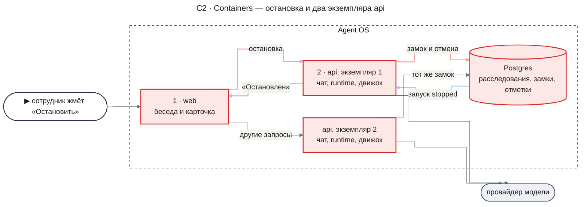

- `web` — беседа и карточки ресерча; кнопку «Остановить» часть `web` переводит на маршрут остановки вместо скрытого хода беседы.
- `api` — в каждом экземпляре работают чат-агент, runtime с диспетчером и сборщиком и движок расследования. Запрос беседы может прийти на любой экземпляр.
- `Postgres` хранит беседы, расследования, задачи и журнал вызовов. Теперь он же держит замок беседы и отметки идущих ответов агента, общие для всех экземпляров.
- Провайдер модели вызывают чат-агент и роли расследования; остановка его не вызывает.

#### C3 · Components: api

**api — остановка**

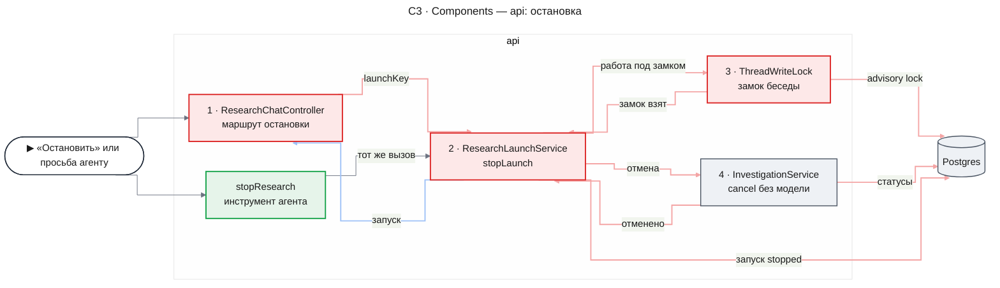

- `ResearchChatController` получает новый маршрут остановки рядом с прежним чтением карточек.
- `stopResearch` — второй вход в ту же операцию из обычного хода агента.
- `ResearchLaunchService.stopLaunch` отдаёт свою работу `ThreadWriteLock` и, когда замок взят, сама находит запуск, вызывает отмену и переводит запуск в `stopped`. Прежний ход решения со `stop` тоже приходит сюда.
- `ThreadWriteLock` берёт advisory lock в Postgres и выполняет под ним переданную работу; сам он ни отмену, ни запуск не трогает.
- `InvestigationService.cancel` не меняется: в одной транзакции он переводит расследование в `cancelled` и отменяет задачи, не вызывая ни модель, ни обработчики задач.

**api — закрытие расследования**

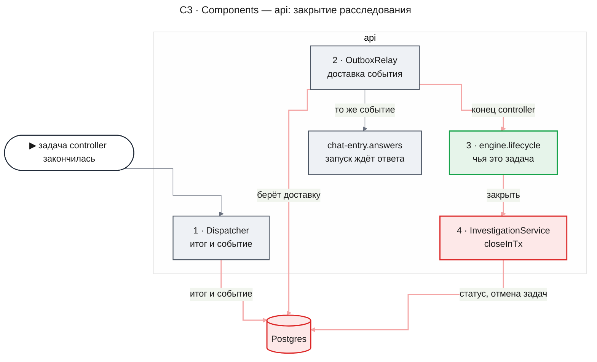

- `Dispatcher` записывает итог задачи controller и событие в одной транзакции, как сейчас.
- `OutboxRelay` раз в `RUNTIME_POLL_MS` берёт из Postgres ждущие доставки и доставляет событие каждому подписанному потребителю отдельно, под блокировкой строки расследования.
- `engine.lifecycle` — новый потребитель движка. Он узнаёт задачу controller по строке движка `research_engine_runs` и вызывает закрытие; события других задач пропускает.
- `InvestigationService.closeInTx` в транзакции доставки меняет статус и отменяет незаконченные задачи.
- `chat-entry.answers` получает то же событие и, как раньше, переводит запуск в `answer_pending` или `failed`.

#### Как расследование заканчивается

Так было и так становится в момент, когда controller написал ответ.

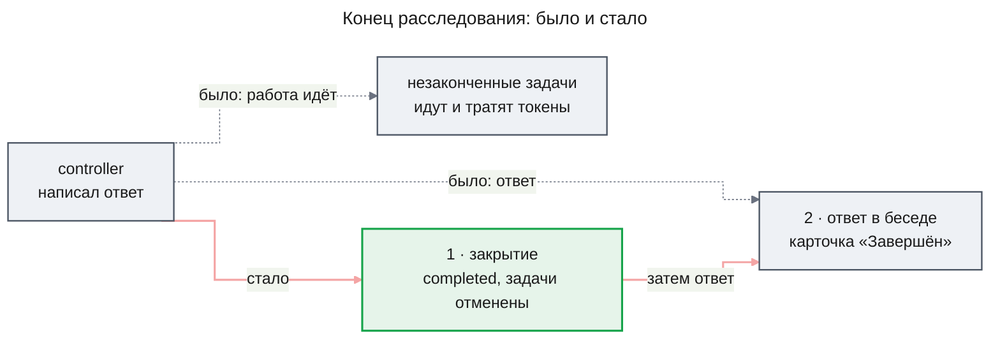

- **Что приходит**: событие конца задачи controller — `TaskSucceeded` или `TaskFailed`.
- **Кто решает**: потребитель `engine.lifecycle` по статусу задачи. `succeeded` закрывает расследование как `completed`, `failed` — как `failed`; конец любой другой задачи его не касается. Если расследование уже не `active` — например, его остановили, — закрытие ничего не меняет.
- **Что выходит**: строка расследования в окончательном статусе, ждущие задачи `cancelled`, идущим задачам — запрос отмены и событие `InvestigationCompleted` или `InvestigationFailed`.
- **Что видит сотрудник**: карточку «Завершён» с ответом или «Не удалось». После закрытия расследование новых вызовов модели не начинает.

Идущая задача узнаёт о закрытии на ближайшем пульсе на любом экземпляре, включая свой: закрытие идёт в транзакции доставки события и, в отличие от остановки, попытки своего процесса сразу не прерывает. Задачу пропавшего исполнителя отменяет сборщик. Её уже начатый вызов модели может закончиться, но новый она не начнёт (KD-2).

#### Можно ли начать вызов модели

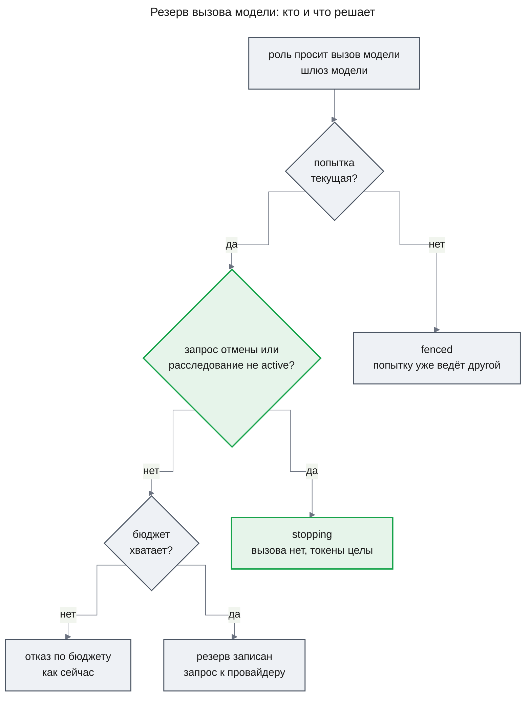

Резерв — последняя проверка перед запросом к провайдеру, и все три вопроса задаются в одной транзакции. Отказ `stopping` значит, что вызова нет и токены не списаны; роль получает ответ «нет ответа», как при прерывании, а задача заканчивается отменённой по запросу отмены. Перед резервом шлюз, как и сейчас, просит провайдера посчитать токены входа. Это бесплатный запрос, а не вызов модели, и отдельной строки журнала у него нет: его результат хранится в строке резерва, в поле `countedInputTokens`. При отказе `stopping` строка резерва не пишется, поэтому и этот счёт нигде не остаётся.

#### Как работают сроки задачи

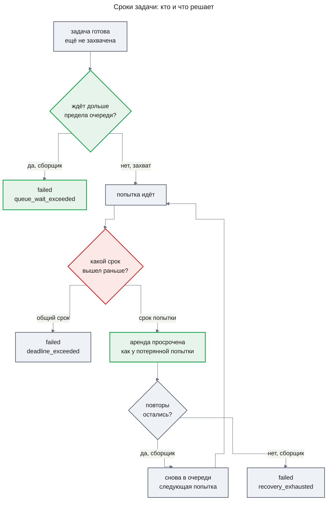

- **Что приходит**: строки задач и текущее время.
- **Кто решает**: сборщик — для задач в очереди и для попыток с просроченной арендой; диспетчер — для своей идущей попытки, когда вышел её срок.
- **Что выходит**: задача `failed` с кодом причины или снова в очереди со следующим номером попытки.
- **Что видит сотрудник**: ничего напрямую. Controller получает итог упавшей задачи как обычно и решает, что делать дальше, поэтому зависшая задача больше не держит расследование.

Повтор после срока попытки идёт по тем же правилам, что повтор после падения экземпляра: тот же счётчик повторов и тот же предел `RUNTIME_MAX_RECOVERIES`. Сообщение причины `recovery_exhausted` теперь говорит, что каждая попытка потеряна или вышла за срок. Срок очереди сборщик замечает на ближайшем проходе, поэтому задача ждёт не дольше предела плюс период сборщика.

#### Как агент выбирает, что остановить

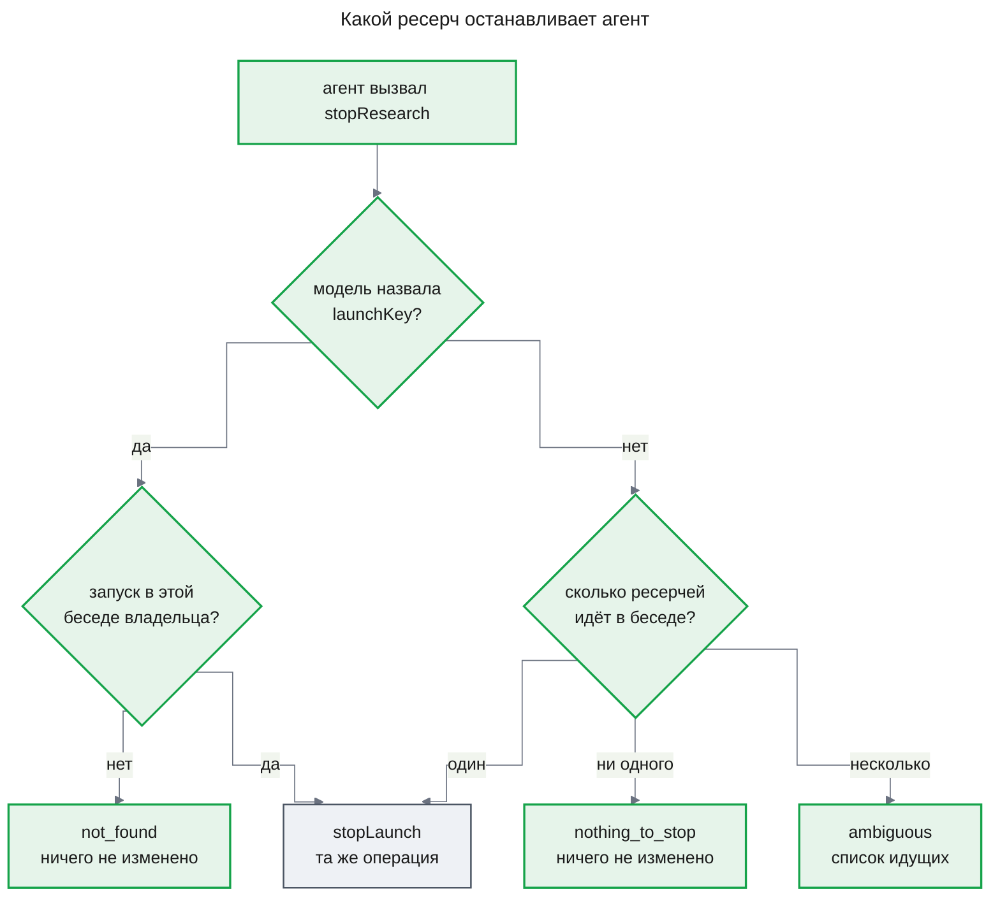

Модель решает только одно — какой ресерч имел в виду сотрудник — и называет его `launchKey`: он есть в истории беседы, в результате вызова `deepResearch` у каждой карточки. Всё остальное решает код по запускам беседы. «Идёт» здесь значит запуск в `running` или `answer_pending` — те же состояния, в которых работает кнопка. Получив `ambiguous`, агент спрашивает сотрудника, какой ресерч остановить, или вызывает инструмент ещё раз с ключом.

#### Как цикл доставки решает, писать ли ответ

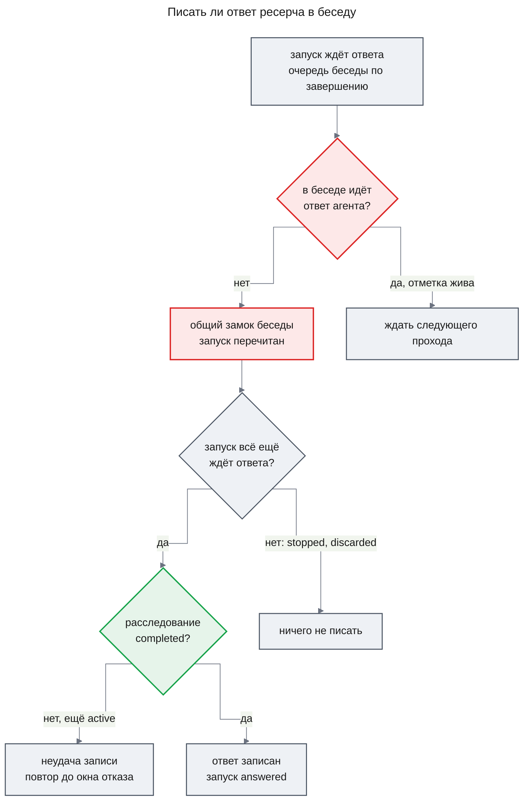

Цикл доставки работает в каждом экземпляре и раз в `RUNTIME_POLL_MS` берёт запуски, ждущие ответа, беседа за беседой в порядке завершения; первый ждущий запуск беседы держит остальные. Новое в нём два места. Отметки прогонов он видит со всех экземпляров (KD-6), а замок беседы общий (KD-5). Пока расследование ещё не закрыто — обычно это доли секунды между двумя доставками одного события, — запись считается неудачной и повторяется по прежним правилам цикла с окном отказа `RESEARCH_APPEND_GIVE_UP_MS`.

#### Как беседа работает на нескольких экземплярах

Каждая гарантия беседы держится на одном из двух общих механизмов в Postgres.

- **Остановленный или перегенерированный ресерч не дописывает ответ** (AC-22.2, AC-22.4). Остановка, отбор хвоста при перегенерации и запись ответа идут под общим замком беседы, а запись перечитывает запуск под замком. Кто взял замок первым, тот и решил: остановка раньше — ответ не пишется; запись раньше — ответ уже в беседе, и остановка возвращает «Завершён» без ошибки, как на одном экземпляре (Flow 5).
- **Ответ ресерча не встаёт внутрь ответа агента, а ответы идут по порядку завершения** (AC-22.3). Цикл доставки ждёт, пока у беседы нет живой отметки прогона, а потом пишет ответы по одному в порядке завершения, перечитывая каждый запуск под замком (Flow 6).
- **Повторное подтверждение предложения не запускает второе расследование** (AC-22.1). Эта гарантия держалась и раньше: запуск переходит из `proposed` условным обновлением, а движок не создаёт второго расследования с тем же `launchKey`. Общий замок только делает так, что второе подтверждение сразу видит запуск уже начатым.

Одно окно остаётся таким же, как на одном экземпляре: прогон чата регистрируется вне замка беседы, и сообщение, отправленное в миллисекунды между проверкой отметок и записью ответа, увидит ответ ресерча перед собой ([design-chat-entry.md, Risks](../deep-research/design-chat-entry.md#risks-and-mitigation)).

### Runtime Flows

#### Flow 1: Остановка с карточки

**Starts when:** сотрудник подтверждает «Остановить» на карточке «Идёт», for AC-21.1, DC-3, DC-9

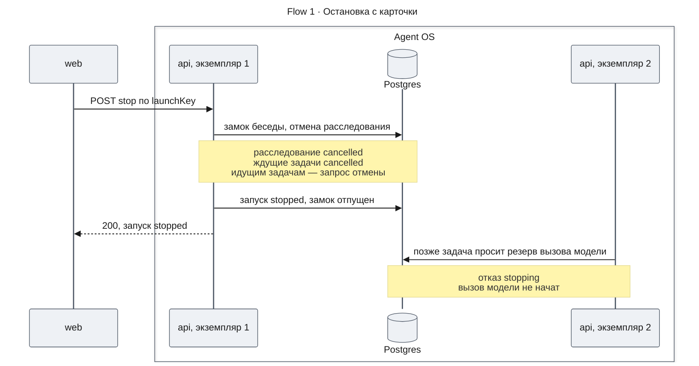

**Outcome:** расследование `cancelled`, запуск `stopped` со временем конца, карточка показывает «Остановлен». Ни одна задача расследования не начинает новый вызов модели; уже идущие прерываются — в экземпляре 1 сразу, в экземпляре 2 после пульса.

**Failure handling:**

- Запуск уже `answered`, `failed` или `stopped` → ничего не меняется, ответ 200 с этим состоянием, карточка показывает его без строки ошибки (DC-8). Так же возвращается запуск в любом другом состоянии, кроме `running` и `answer_pending`, — например, ещё `launching` (Contract Definitions).
- Ожидание замка беседы или отмена отказали → 500 `RESEARCH_STOP_FAILED`, запуск и расследование не изменились; карточка возвращается в «Идёт» со строкой ошибки, повтор безопасен.
- Отмена уже зафиксирована, а перевод запуска в `stopped` отказал из-за ошибки базы → тоже 500 `RESEARCH_STOP_FAILED`, но расследование уже `cancelled`, а запуск в прежнем состоянии; карточка возвращается в «Идёт» со строкой ошибки. Повтор доводит остановку: отмена застаёт расследование не `active` и ничего не делает, а запуск переходит в `stopped`.
- Остановку после отмены никто не повторил — база отказала на переводе запуска, или процесс упал между отменой и переводом → запуск в `running` переводит в `stopped` потребитель `chat-entry.answers`, когда задача controller заканчивается `cancelled`, как сейчас. Запуск в `answer_pending` цикл доставки не допишет, потому что расследование не `completed`, и по окну `RESEARCH_APPEND_GIVE_UP_MS` переведёт в `failed`.

#### Flow 2: Остановка через агента

**Starts when:** сотрудник пишет в беседе просьбу остановить ресерч, for AC-21.2, DC-10

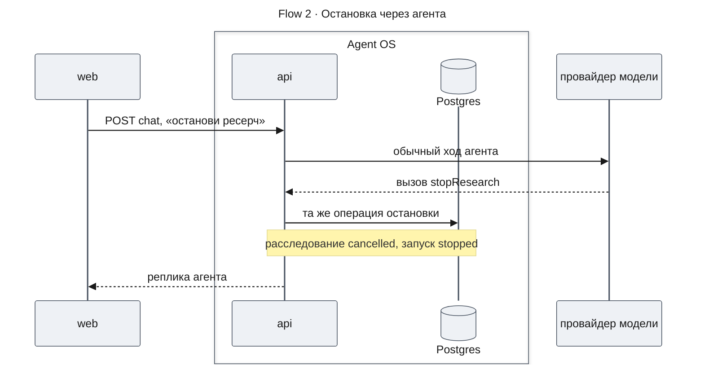

**Outcome:** то же, что во Flow 1; агент отвечает обычной репликой, а карточка переходит в «Остановлен» на ближайшем опросе `GET /api/threads/:threadId/research`, который идёт, пока в беседе есть идущий ресерч.

**Failure handling:**

- Провайдер модели недоступен → ход агента падает, как любой ход; остановки нет. Этот путь вызывает модель, поэтому при недоступной модели работает только кнопка (UXRD, поток «Остановка»).
- В беседе идут несколько ресерчей, а модель не назвала ключ → ничего не меняется, агент получает `ambiguous` со списком и уточняет у сотрудника (DC-10).
- Модель назвала ключ чужой беседы или несуществующий → `not_found`, ничего не меняется.
- Операция остановки отказала → `stop_failed`; агент говорит, что остановить ресерч не удалось.

#### Flow 3: Конец расследования и ответ в беседе

**Starts when:** задача controller записала ответ и закончилась успешно — или провалилась, for AC-19.1, AC-19.2, DC-1, DC-2

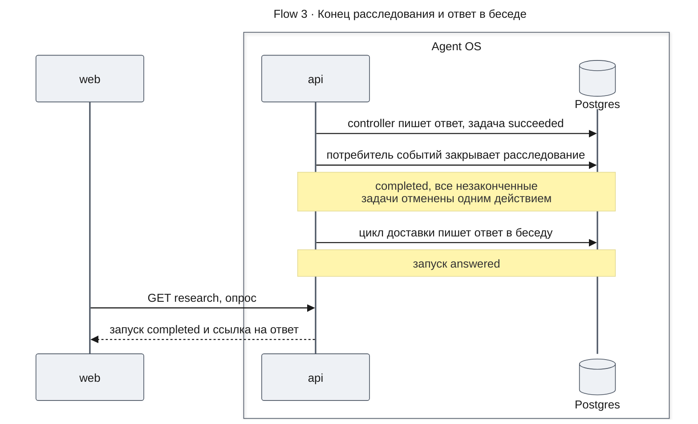

**Outcome:** расследование `completed`, его задачи закончены или получили запрос отмены, ответ стоит в беседе один раз, карточка показывает «Завершён». При провале задачи controller расследование `failed`, ответа нет, а карточка показывает «Не удалось» — её переводит прежний потребитель `chat-entry.answers`.

**Failure handling:**

- Доставка закрытия упала → runtime повторяет её с паузами; цикл доставки ответа тем временем считает запись неудачной и ждёт. Если доставка так и не прошла до окна `RESEARCH_APPEND_GIVE_UP_MS`, запуск становится `failed` (Risks).
- Процесс упал между итогом controller и закрытием → событие осталось недоставленным, и после подъёма runtime доставит его; закрытие произойдёт один раз.
- Остановка пришла раньше закрытия → расследование уже `cancelled`, закрытие ничего не меняет, запуск `stopped`, ответ не пишется.

#### Flow 4: Зависшая попытка повторяется

**Starts when:** попытка задачи идёт дольше `RUNTIME_ATTEMPT_MS`, а общий срок задачи ещё не вышел, for AC-20.2, DC-6. Срок очереди (AC-20.1) и общий срок (AC-20.3) — по одной записи сборщика или диспетчера; их показывают схема «Сроки задачи» и диаграмма состояний задачи.

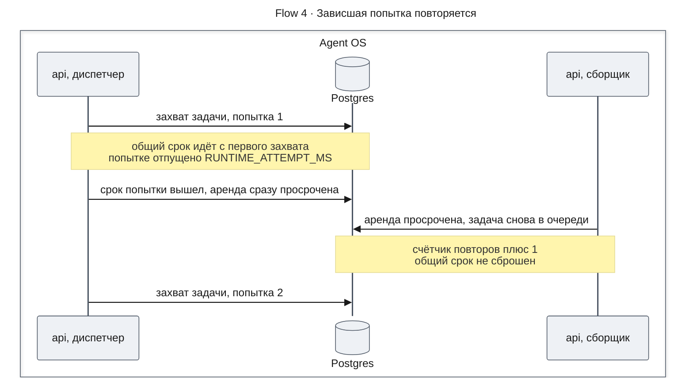

**Outcome:** задача снова идёт, со следующим номером попытки и счётчиком повторов, увеличенным на один. Записи и резервы первой попытки остаются за ней: первую попытку отсекает номер попытки, её открытые резервы закрываются при старте второй, как сейчас.

**Failure handling:**

- Повторы исчерпаны → сборщик завершает задачу `failed` с кодом `recovery_exhausted`.
- Общий срок вышел раньше срока попытки → диспетчер завершает задачу `failed` с кодом `deadline_exceeded`, без повтора.
- Процесс упал до записи просроченной аренды → аренда просрочится сама, и сборщик поступит так же.

#### Flow 5: Остановка и запись ответа на разных экземплярах

**Starts when:** ответ ресерча готов, и сотрудник останавливает ресерч, а остановку и запись ответа обрабатывают разные экземпляры, for AC-22.2, AC-22.4

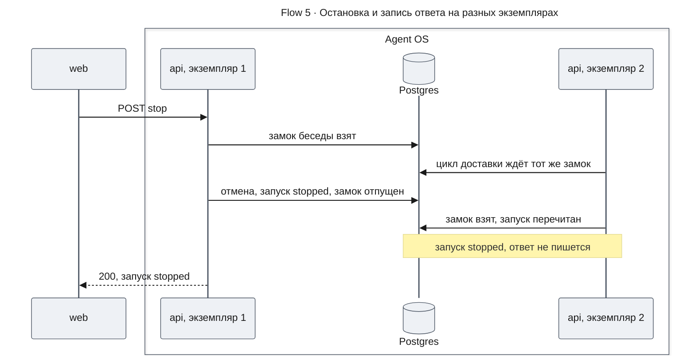

**Outcome:** ответ в беседу не дописан, карточка «Остановлен». Перегенерация идёт тем же путём: отбор хвоста под замком переводит запуск в `discarded` и отменяет расследование, и цикл доставки, перечитав запуск, ответ не пишет (AC-22.4).

**Failure handling:**

- Цикл доставки взял замок первым → ответ записан, запуск `answered`; остановка получает «Завершён» без ошибки — так же, как на одном экземпляре.
- Экземпляр, державший замок, упал → Postgres снимает замок с обрывом соединения, и второй экземпляр продолжает; запуск перечитывается под замком, поэтому недописанная работа упавшего видна как есть.

#### Flow 6: Ответ агента стримится на одном экземпляре, ответы ресерчей готовы на другом

**Starts when:** в беседе стримится ответ агента с экземпляра 1, а цикл доставки экземпляра 2 нашёл два готовых ответа ресерчей этой беседы, for AC-22.3, DC-11

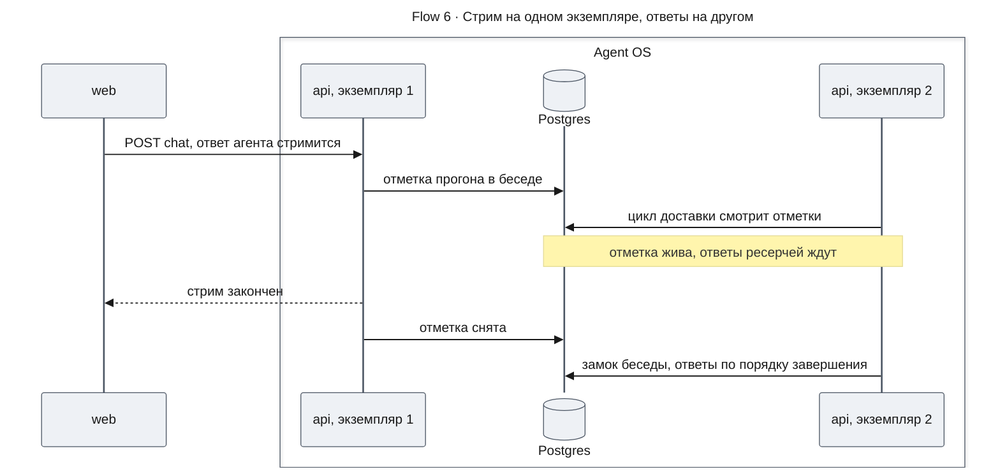

**Outcome:** каждый ответ ресерча стоит отдельным сообщением после ответа агента и до, и после перезагрузки; ответы стоят в порядке завершения своих расследований.

**Failure handling:**

- Экземпляр 1 упал посреди стрима → отметка перестаёт продлеваться, и через одну аренду цикл экземпляра 2 пишет ответы (DC-11).
- Продление отметки не удалось из-за ошибки базы → экземпляр пишет ошибку в журнал и пробует на следующем пульсе; если аренда успеет истечь, ответ ресерча может встать во время ответа агента (Risks).

### Contract Definitions

**Маршрут и операция остановки**

- **`POST /api/threads/:threadId/research/:launchKey/stop`** — останавливает ресерч карточки без вызова модели; тела запроса нет, доступ — под `SessionGuard`, как у `GET /api/threads/:threadId/research`. Возвращает 200 и `ResearchStopResponse`: запуск в `stopped`, если ресерч шёл, или в том состоянии, которое у него уже было, без ошибки (DC-8). Ответ приходит сразу после фиксации отмены и не ждёт ни конца задач, ни конца ответа агента в беседе (DC-9). Ошибки — в «Error handling» ниже; запрос пишет одну запись аудита через `AuditInterceptor`.
- **Что из этого читает карточка** (`apps/web`, часть `web`, UXRD KD-5): пока запрос идёт — «Остановка»; ответ 200 — состояние из `launch`, без строки ошибки; любая ошибка или отсутствие ответа — «Идёт» со строкой ошибки (`deep-research` UXRD, MC-16) и снова доступная «Остановить».
- **`ResearchLaunchService.stopLaunch`** — единственная операция остановки; её вызывают маршрут, инструмент `stopResearch` и ход решения со `stop`. Вход — беседа, владелец и `launchKey`. Под блокировкой беседы находит запуск этой беседы этого владельца. Запуск в `running` или `answer_pending` останавливает: отмена расследования (`InvestigationService.cancel`), затем запуск в `stopped` со временем конца. Запуск в любом другом состоянии — `proposed`, `launching`, `answered`, `answer_reappend`, `declined`, `superseded`, `failed`, `stopped` — возвращает как есть, без отмены и без ошибки. Для `launching` это значит, что старт ещё идёт: карточка показывает «Идёт», и повтор остановки сработает, когда старт закончится. Возвращает запуск; `not_found`, если такого запуска в беседе нет или он `discarded`; `stop_failed`, если отказали ожидание замка, отмена или перевод запуска. При `stop_failed` запуск не изменён. Расследование не изменено, если отказали замок или отмена, и уже `cancelled`, если отказал перевод запуска после отмены. Операция идемпотентна: повтор вызывает отмену, которая для расследования не в `active` ничего не делает, и доводит запуск до `stopped` (Flow 1).
- **Инструмент агента `stopResearch`** — у главного агента рядом с `deepResearch`, доступен в обычных ходах; в ходах режима и решения, как сейчас, доступен только `deepResearch`. Беседу и владельца инструмент берёт из памяти агента, а не из аргументов модели. Вход — необязательный `launchKey` с теми же пределами, что у ключа запуска (от 1 до 200 символов). Правило выбора — схема «Какой ресерч останавливает агент». Инструкция агента велит вызывать его, когда сотрудник просит остановить ресерч, и называть `launchKey` нужной карточки. Она же задаёт, что агент говорит сотруднику после каждого исхода `StopResearchToolResult`, как это задаёт [UXRD, «Остановка через агента ничего не остановила»](./uxrd.md#остановка-через-агента-ничего-не-остановила). Инструкция передаёт смысл, а текст реплики пишет модель.
  - `launch` в `stopped` — агент подтверждает, что ресерч остановлен.
  - `launch` в `answered`, `answer_reappend` или `failed` — ресерч уже закончился.
  - `launch` в `launching` — ресерч ещё запускается.
  - `launch` в `proposed`, `declined` или `superseded` — останавливать нечего: ресерч не идёт.
  - `ambiguous` — агент называет цели идущих ресерчей из `candidates` и спрашивает, какой остановить.
  - `nothing_to_stop` — в беседе не идёт ни один ресерч, останавливать нечего.
  - `not_found` — такого ресерча в беседе нет.
  - `stop_failed` — остановить ресерч не удалось.
- **Ход решения со `stop`** — `researchDecision` с действием `stop` по-прежнему принимается и возвращает `DeepResearchToolResult`, как в [`design-chat-entry.md`](../deep-research/design-chat-entry.md#contract-definitions), но выполняется операцией `stopLaunch`. Новая карточка его не отправляет; его шлют только вкладки, открытые до обновления (KD-4).

**ResearchStopResponse**

- `launch` — `ResearchLaunchView` из `design-chat-entry.md`, без изменений.

**StopResearchToolResult**

- `launch` — запуск после операции; `null` при `not_found`, `nothing_to_stop` и `ambiguous`.
- `error` — отсутствует при успехе или неизменном законченном запуске; иначе `stop_failed`, `not_found`, `nothing_to_stop` или `ambiguous`.
- `candidates` — только при `ambiguous`: идущие запуски беседы, у каждого `launchKey` и цель.

**Runtime**

- **Статусы расследования** — `InvestigationStatusSchema`: `active`, `completed`, `failed`, `cancelled`, `deleting`. Закрытые статусы — `completed`, `failed`, `cancelled`; из них возможен только переход в `deleting` при удалении беседы. Задачи захватываются и принимаются только у `active`, как сейчас.
- **`InvestigationService.closeInTx`** — новая операция для потребителей событий. В переданной транзакции закрывает `active` расследование статусом `completed` или `failed` и тем же действием отменяет незаконченные задачи так же, как `cancel`: ждущие — `cancelled` с прежней причиной `cancel_requested`, идущим — запрос отмены. Пишет событие `InvestigationCompleted` или `InvestigationFailed`. Расследование не `active` — ничего не делает, поэтому повторная доставка безопасна. Попытки своего процесса напрямую не прерывает: их останавливает пульс, а новые вызовы модели — резерв (KD-2).
- **`InvestigationService.cancel`** — без изменений; закрытое расследование она не трогает.
- **`TaskContext.withAttemptGuard`** — новый необязательный режим `requireActive`. В нём охрана, взяв строку задачи, отвечает `stopping` и не выполняет работу, если у задачи стоит `cancel_requested_at` или расследование не `active`. Без режима поведение прежнее: так пишутся ответ, утверждения и закрытие резервов, которые должны пройти и после запроса отмены.
- **События** — `RuntimeEventTypeSchema` получает `InvestigationCompleted` и `InvestigationFailed`, версия схемы 1, без полезной нагрузки сверх конверта. Подписанных на них потребителей нет.
- **Причины задачи** — новый код `queue_wait_exceeded` класса `deadline` с сообщением «The task waited in the queue past its limit»; `AbortReasonKindSchema` получает `attempt_timeout`. У `recovery_exhausted` сообщение становится «Every attempt of the task was lost or ran past its limit».

**Движок**

- **Потребитель `engine.lifecycle`** — его регистрирует `createEngine`; для этого параметры `createEngine` получают `runtime.eventConsumers` рядом с `runtime.handlers`. Типы событий — `TaskSucceeded` и `TaskFailed`, версия 1. Событие задачи, которая не является задачей controller ни одного расследования, он пропускает. Так закрытие получают все сборки движка: `apps/api`, программа самопроверки и тестовые обвязки.
- **`InvestigationView.status`** — `running`, пока расследование `active`; `completed`, `failed` или `cancelled` по закрытому статусу; `deleting` показывается как `cancelled`. Набор значений прежний, меняется момент: `completed` наступает после закрытия, а не после успеха задачи controller.
- **`CallLedger.reserve`** — может ответить `stopping`; шлюз модели возвращает роли `no_answer` с причиной `cancelled`, как при прерывании, и не пишет ни строку журнала, ни транскрипт — так же, как при `fenced`.

**Беседа в `apps/api`**

- **`ThreadWriteLock.run`** — контракт прежний; запись по ключу беседы сериализуется во всех экземплярах. Новый отказ: замок не получен за 15 секунд — исключение, которое вызывающий обрабатывает как отказ базы.
- **`ThreadRunRegistry.register`** — становится асинхронной: кроме записи в памяти вставляет строку прогона и продлевает её, пока прогон идёт; той же записью удаляет строки с просроченной арендой во всех беседах. `release` удаляет строку своего прогона. **`hasRuns`** — асинхронная, отвечает `true`, если у беседы есть строка с непросроченной арендой от любого экземпляра. Остальное поведение — отмена прогонов при удалении беседы — прежнее и видно только своему процессу.

**Error handling**

- `THREAD_NOT_FOUND` — 404: беседа не существует, удалена или чужая; ничего не меняется. Как у `GET /api/threads/:threadId/research`.
- `RESEARCH_LAUNCH_NOT_FOUND` — 404: в этой беседе нет запуска с таким `launchKey`, или его карточку удалила перегенерация; ничего не меняется.
- `RESEARCH_STOP_FAILED` — 500: отказали замок беседы, отмена или перевод запуска; запуск не изменился. Расследование не изменилось, если отказали замок или отмена, и уже `cancelled`, если отказал перевод запуска после отмены. Повтор безопасен и доводит остановку.
- Неверный `threadId` или `launchKey` — 400 от проверки параметров, как у остальных маршрутов бесед.

**Runtime settings**

- `RUNTIME_QUEUE_WAIT_MS` — default `600000` (10 минут), целое не меньше `1000`; предел ожидания готовой задачи в очереди до первого захвата. Действует меньшее из него и общего срока задачи.
- `RUNTIME_ATTEMPT_MS` — default `900000` (15 минут), целое не меньше `1000`; предел одной попытки. Действует меньшее из него и времени до общего срока.

Обе настройки входят в список разрешённых имён `RUNTIME_SETTINGS_VARIABLES`; неверное значение останавливает старт с именем настройки, как у остальных `RUNTIME_*`. Значения не настраиваются: ожидание замка беседы — 15 секунд, аренда отметки прогона — 30 секунд, её продление — каждые 10 секунд.

### Data Model

- **Статус расследования.** Проверка столбца `research_investigations.status` строится из `InvestigationStatusSchema`, как сейчас, и тест миграций сверяет её с перечнем. Миграция добавляет `completed` и `failed`.
- **Закрытие уже законченных расследований.** Та же миграция переводит строку `active`, у которой задача controller уже `succeeded`, `failed` или `cancelled`, в `completed`, `failed` или `cancelled`. Расследования без задачи controller — оболочки неудачного старта — остаются `active`: их переиспользует повтор старта. Незаконченные задачи таких старых расследований миграция не трогает: после закрытия их никто не захватит, а ни разу не захваченные завершит срок очереди.
- **Отметки прогонов** — новая таблица `chat_thread_runs` схемы `app`: строка на каждый идущий ответ агента — беседа и срок аренды. Строка с просроченной арендой прогоном не считается. Внешнего ключа на беседу нет: беседы хранит Mastra в своих таблицах, поэтому каскадного удаления тоже нет, и уборку делает сам реестр прогонов. Строку закончившегося прогона удаляет `release`. Строку прогона, чей экземпляр упал, удаляет первая регистрация любого прогона в любой беседе после конца её аренды: каждая регистрация удаляет все просроченные строки. Поэтому строки удалённой или брошенной беседы не копятся, и отдельной уборки при удалении беседы не нужно. В таблице не больше строк, чем ответов агента идёт одновременно, плюс строки прогонов, оборванных падением экземпляра после последней регистрации.
- **Сроки задач** новых столбцов не требуют: срок очереди считается от времени создания задачи и времени конца её зависимостей, общий срок — по существующему `deadline_at`, срок попытки — от захвата, в памяти диспетчера, который ведёт попытку.

### State Transitions and Invariants

**Строка расследования**

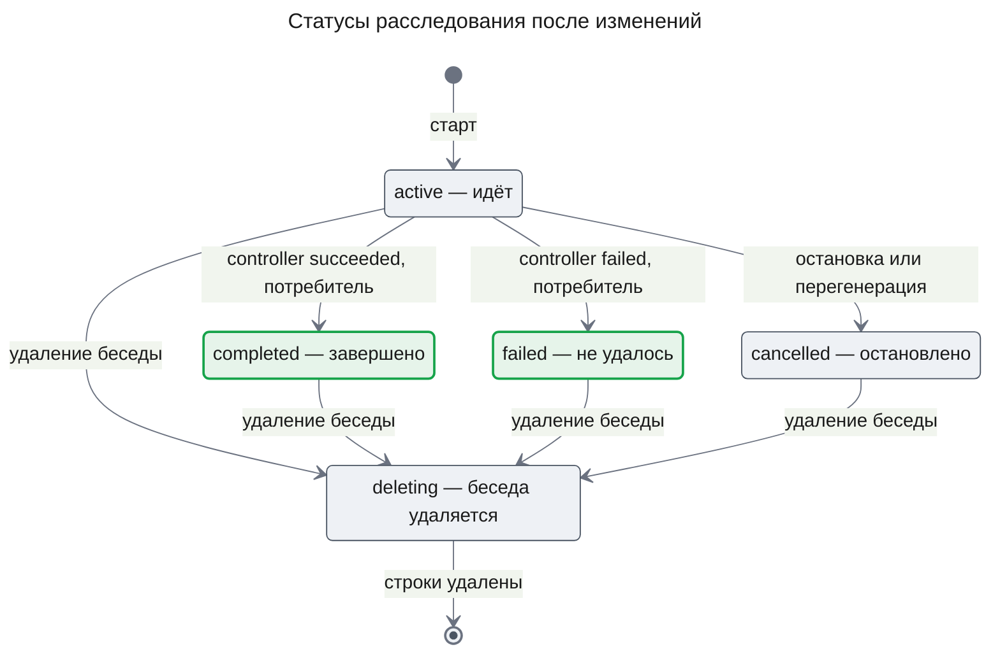

Сейчас строка знает только `active`, `cancelled` и `deleting`, и законченное расследование остаётся `active`. Зелёным отмечены новые статусы. Карточка в беседе показывает состояние запуска, а не строки расследования, и его машина состояний не меняется ([design-chat-entry.md, State Transitions](../deep-research/design-chat-entry.md#state-transitions-and-invariants)); меняется только, кто вызывает действие `stop`. Поэтому остановка уже закрытого `completed` расследования, ответ которого ещё не дописан, оставляет строку `completed`, а запуск переводит в `stopped`.

**Задача**

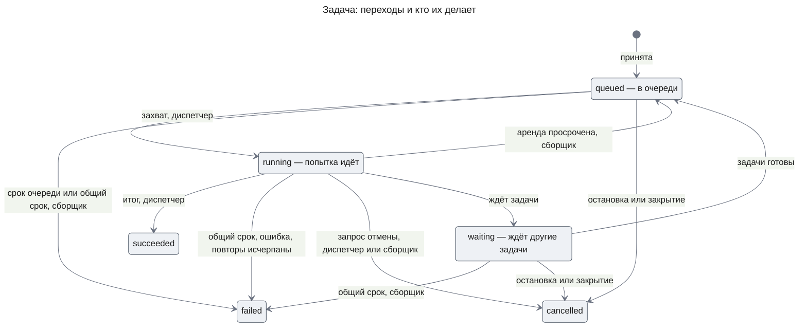

Набор переходов прежний; меняются причины двух из них. `queued → failed` теперь бывает и у задачи, которую ни разу не захватили, — по сроку очереди. `running → queued` теперь бывает и у живой, но зависшей попытки — диспетчер сам делает её аренду просроченной по сроку попытки. Отмена при закрытии идёт тем же путём, что при остановке: ждущие задачи сразу `cancelled`, идущие — через запрос отмены.

**Invariants**

1. Расследование выходит из `active` один раз; закрытый статус меняется только на `deleting`.
2. Каждое закрытие и каждая остановка отменяют все незаконченные задачи расследования в той же транзакции, что меняет его статус.
3. Пока расследование не `active`, ни одна его задача не захватывается, не принимается и не получает резерв вызова модели.
4. Ответ ресерча записывается в беседу, только если его расследование `completed`.
5. Ни одна операция остановки не вызывает модель.
6. Записи беседы — строка запуска, ответ ресерча, отбор хвоста, остановка — идут под одним замком беседы, общим для всех экземпляров.
7. Ответ ресерча пишется только в беседу, где нет строки прогона с непросроченной арендой.
8. Готовая, ни разу не захваченная задача ждёт в очереди не дольше своего предела плюс период сборщика; попытка идёт не дольше своего предела, после чего сборщик на ближайшем проходе возвращает задачу в очередь или завершает её.

## Test Strategy

### Main Use Cases

- **UC-1: после ответа новые вызовы модели не начинаются** — covers AC-19.1, DC-1, DC-2, DC-3
  - Given: идёт расследование; controller принял решение без ожидания, и задача worker на втором экземпляре ещё не начала свой вызов модели
  - When: controller пишет ответ и заканчивается успешно, а worker после этого просит резерв
  - Then: расследование `completed`, резерв worker получил `stopping`, задача worker `cancelled`; в журнале вызовов нет строки, созданной после закрытия; ответ стоит в беседе, карточка «Завершён»
- **UC-2: сбой controller закрывает расследование как «не удалось»** — covers AC-19.2, DC-1
  - Given: идущее расследование с одной ждущей и одной идущей задачей
  - When: задача controller проваливается
  - Then: расследование `failed`, ждущая задача `cancelled`, идущая получает запрос отмены и заканчивается `cancelled`; карточка «Не удалось», ответа в беседе нет
- **UC-3: ответ принудительной остановки — это «Завершён»** — covers AC-19.3, DC-4
  - Given: бюджет расследования меньше, чем нужно на анализ
  - When: controller останавливается по бюджету и пишет ответ с причиной остановки
  - Then: расследование `completed`, карточка «Завершён», ответ в беседе показывает причину остановки
- **UC-4: задача не дождалась очереди** — covers AC-20.1, DC-5, DC-7
  - Given: готовая задача типа, обработчик которого не зарегистрирован ни в одном экземпляре, и короткий `RUNTIME_QUEUE_WAIT_MS`
  - When: предел очереди прошёл
  - Then: задача `failed` с классом `deadline` и кодом `queue_wait_exceeded`; controller разбужен её итогом
- **UC-5: зависшая попытка повторяется** — covers AC-20.2, DC-6
  - Given: обработчик, который в первой попытке не отвечает дольше короткого `RUNTIME_ATTEMPT_MS`, а во второй отвечает сразу
  - When: срок первой попытки вышел
  - Then: первая попытка прервана, счётчик повторов равен 1, вторая попытка завершает задачу `succeeded`
- **UC-6: общий срок** — covers AC-20.3, DC-7
  - Given: задача, чья работа длится дольше её общего срока, при `RUNTIME_ATTEMPT_MS` больше этого срока
  - When: общий срок вышел
  - Then: задача `failed` с кодом `deadline_exceeded`, следующей попытки нет
- **UC-7: остановка при недоступной модели во время ответа агента** — covers AC-21.1, DC-3, DC-9
  - Given: провайдер модели отвечает ошибкой на любой вызов, ресерч идёт, и в той же беседе стримится ответ агента
  - When: сотрудник подтверждает остановку на карточке
  - Then: маршрут отвечает 200 с запуском `stopped` до конца стрима; опрос показывает «Остановлен»; в журнале вызовов нет строки, созданной после остановки
- **UC-8: остановка через агента** — covers AC-21.2, DC-10
  - Given: модель чата отвечает вызовом `stopResearch` (строки таблицы: с `launchKey` идущего ресерча; без ключа при одном идущем; без ключа при двух идущих)
  - When: сотрудник пишет «останови ресерч»
  - Then: в первых двух строках запуск `stopped`, расследование `cancelled` — тот же итог, что у маршрута; в третьей ничего не изменилось, агент получил `ambiguous` со списком из двух запусков
- **UC-9: двойное подтверждение на двух экземплярах** — covers AC-22.1
  - Given: два экземпляра `apps/api` над одной базой и предложение ресерча в беседе
  - When: подтверждение предложения приходит на оба экземпляра одновременно
  - Then: по предложению ровно одно расследование, в беседе одна карточка «Идёт»
- **UC-10: остановка и запись ответа на разных экземплярах** — covers AC-22.2
  - Given: два экземпляра, ответ ресерча готов и ещё не дописан
  - When: остановка приходит на первый экземпляр, а цикл доставки второго пытается записать ответ
  - Then: ответа в беседе нет, карточка «Остановлен»
- **UC-11: стрим на одном экземпляре, ответы на другом** — covers AC-22.3
  - Given: в беседе стримится ответ агента с первого экземпляра; на втором готовы ответы двух ресерчей, второй закончился раньше первого
  - When: стрим заканчивается
  - Then: оба ответа стоят отдельными сообщениями после ответа агента, сначала ресерч, закончившийся раньше; после перезагрузки порядок тот же
- **UC-12: перегенерация на одном экземпляре, ответ готов на другом** — covers AC-22.4
  - Given: два экземпляра; ответ ресерча готов к записи на втором
  - When: сотрудник перегенерирует ответ ассистента с карточкой этого ресерча через первый экземпляр
  - Then: расследование остановлено, его ответ в беседе не появляется

### Error and Edge Use Cases

- **UC-E1: остановка законченного ресерча** — covers DC-8
  - Given: ресерч с ответом в беседе
  - When: сотрудник вызывает остановку
  - Then: ответ 200 с запуском в «Завершён», ничего не изменилось, ошибки нет
- **UC-E2: остановка отказала** — covers DC-8, AC-21.1
  - Given: идущий ресерч и отказ базы (строки таблицы: при отмене; при переводе запуска, после того как отмена зафиксирована)
  - When: сотрудник вызывает остановку
  - Then: в обеих строках 500 `RESEARCH_STOP_FAILED` и запуск `running`; расследование в первой строке `active`, во второй `cancelled`; повтор после восстановления базы в обеих строках даёт 200 с запуском `stopped` и расследованием `cancelled`
- **UC-E3: чужая беседа и чужой запуск** — covers AC-21.1, бизнес-ограничение 2
  - Given: пользователи A и B, у A идёт ресерч
  - When: B вызывает остановку с беседой A, а затем со своей беседой и ключом запуска A
  - Then: первый вызов — 404 `THREAD_NOT_FOUND`, второй — 404 `RESEARCH_LAUNCH_NOT_FOUND`; ресерч A идёт
- **UC-E4: задача ждёт зависимость дольше предела очереди** — covers DC-5
  - Given: задача анализа зависит от сбора записей, который идёт дольше `RUNTIME_QUEUE_WAIT_MS`
  - When: сбор записей заканчивается успешно
  - Then: задача анализа не завершена по сроку очереди и захватывается; её срок очереди идёт с момента конца сбора
- **UC-E5: повторы исчерпаны по сроку попытки** — covers DC-6
  - Given: обработчик, который не отвечает ни в одной попытке
  - When: проходят все повторы
  - Then: задача `failed` с кодом `recovery_exhausted`
- **UC-E6: экземпляр упал посреди ответа агента** — covers DC-11
  - Given: отметка прогона, которую больше никто не продлевает, и готовый ответ ресерча в той же беседе
  - When: проходит аренда отметки
  - Then: ответ ресерча записан после истечения аренды, не раньше
- **UC-E7: остановка, пока стартует ресерч** — covers DC-8
  - Given: запуск в `launching`
  - When: сотрудник вызывает остановку
  - Then: ответ 200 с карточкой «Идёт», ничего не изменилось; повторная остановка после старта останавливает ресерч

### Non-Functional Use Cases

- **UC-N1: рестарт между итогом controller и закрытием** — covers DC-1, требование «рестарт не теряет и не дублирует работу»
  - Given: процесс убит после записи итога controller, до доставки события потребителю `engine.lifecycle`
  - When: процесс поднят снова
  - Then: расследование `completed` ровно один раз, незаконченные задачи отменены, ответ стоит в беседе один раз
- **UC-N2: время до первого токена** — covers NFR-06 фичи `chat-shell`
  - Given: сборка без этой части и сборка с отметкой прогона, один и тот же промпт
  - When: при приёмке время до первого токена замеряется вручную на обеих сборках способом, который задаёт метрика № 10 [PRD chat-shell](../chat-shell/prd.md)
  - Then: разница укладывается в предел NFR-06 фичи `chat-shell`
  - Автоматического замера времени до первого токена в коде нет, и эта часть его не вводит; поэтому UC-N2 — ручная проверка при приёмке, а не тест в наборе.

## Security Considerations

- **Authentication & Authorization**: маршрут остановки — под `SessionGuard`; цепочка владельца та же, что у чтения карточек: беседа проверяется по владельцу, запуск ищется по `launchKey` вместе с беседой и владельцем, отмена — по владельцу расследования. Инструмент `stopResearch` берёт беседу и владельца из памяти агента; ключ, названный моделью, проверяется в этой беседе, поэтому модель не может остановить чужой ресерч.
- **Input Validation**: `threadId` проверяется схемой `ThreadIdSchema`, `launchKey` — теми же пределами, что ключ запуска; тела у маршрута нет. Вход инструмента проверяет его схема; всё остальное — состояния из базы.
- **Sensitive Data Handling**: журналы сервера пишут только идентификаторы — `launchKey`, `threadId`, `investigationId`; тела ошибок — только коды. Список `candidates` получает только агент той же беседы того же владельца.

## Risks and Mitigation

- **Сроки обрывают законную работу под нагрузкой** — средний ущерб, низкая вероятность: при многих одновременных прогонах, например самопроверки, готовые задачи ждут дольше обычного. Пределы по умолчанию в разы выше наблюдаемых, обе — настройки; упавшая задача доходит до controller, который решает, что делать, а код причины виден в отчёте самопроверки.
- **Доставка закрытия застряла** — средний ущерб, низкая вероятность: если доставка события потребителю `engine.lifecycle` исчерпала попытки (`needs_attention`), расследование остаётся `active`, его задачи доходят до своих сроков, а запуск через окно `RESEARCH_APPEND_GIVE_UP_MS` становится «Не удалось». Такая доставка видна в журнале так же, как любая застрявшая.
- **Карточка «Не удалось» на одну доставку раньше отмены задач** — низкий ущерб: два потребителя одного события доставляются по отдельности. В это окно, обычно меньше секунды, задача провалившегося расследования ещё может начать вызов модели.
- **Соединение замка оборвалось посреди работы** — низкий ущерб, низкая вероятность: Postgres снимает замок, и работа под ним дописывается без сериализации. Все переходы запуска — условные записи «из такого-то состояния», поэтому худший случай — то, что было на одном экземпляре без замка.
- **Продление отметки прогона не удалось** — низкий ущерб: если аренда истечёт посреди стрима, ответ ресерча может встать во время ответа агента. Ошибка продления пишется в журнал.
- **Модель называет не тот ресерч** — низкий ущерб: остановить можно только ресерч своей беседы; без ключа при нескольких идущих не останавливается ничего; карточка показывает, что именно остановлено.
- **Совпадение хэшей ключей замка у двух бесед** — без ущерба: такие беседы лишь пишут по очереди.

## Appendix: Fact Disposition

| Fact | Disposition | Handled in |
|------|-------------|------------|
| Три статуса расследования, законченное остаётся `active` (`packages/contracts/src/research.ts:InvestigationStatusSchema`) | transform | KD-1, Data Model, State Transitions |
| Ответ пишет controller, задачи после ответа идут, провал controller ничего не отменяет (`packages/engine/src/controller/controller.handler.ts:finish`) | transform | KD-1, Flow 3 |
| Остановка — ход чата с вызовом модели; `STOPPABLE`, `stop_failed`, `not_found` (`apps/api/src/research-chat/research-launch.service.ts:ResearchLaunchService.stop`) | transform | KD-4, Contract Definitions |
| Переходы задачи и кто их пишет (`packages/runtime/src/guarded-transition.ts:guardedTaskWrite`) | transform | State Transitions: новые причины `queued → failed` и `running → queued` |
| `deadline_at` только с первого захвата, нет срока очереди и попытки (`packages/runtime/src/guarded-transition.ts:deadline_at`) | transform | KD-3 |
| Сборщик повторяет только попытку с просроченной арендой (`packages/runtime/src/recovery.sweeper.ts:RecoverySweeper`) | transform | KD-3, Flow 4 |
| Резерв не смотрит на отмену, статус и ответ (`packages/engine/src/model/model-gateway.ts:createModelGateway`) | transform | KD-2 |
| Гарантии беседы держит блокировка процесса; правила «один ресерч на беседу» нет (`apps/api/src/research-chat/research-launch.service.ts:ResearchLaunchService.launch`) | transform; ограничение числа — out-of-scope | KD-5, KD-6; Part, Out of scope |
| Только маршрут чтения ресерча (`apps/api/src/research-chat/research-chat.controller.ts:ResearchChatController`) | transform | KD-4, Contract Definitions |
| Карточка шлёт остановку ходом решения и не даёт её во время стрима (`apps/web/src/components/research/research-thread.tsx:decide`) | out-of-scope: карточку меняет часть `web` | Part, Out of scope; контракт для карточки — Contract Definitions |
| Каскад от расследования, нет срока хранения и метки синтетики (`packages/db/src/schema.ts:researchInvestigations`) | out-of-scope: этой частью не используется | Part, Out of scope: срок хранения — FR-01, `self-check` |
| Журнал токенов удаляется каскадом, в аудите нет расследования (`packages/db/src/schema.ts:researchLlmCalls`) | out-of-scope: этой частью не используется | Part, Out of scope и Constraints, аудит |
| Настройки — список разрешённых имён и zod, планировщика нет (`apps/api/src/research/runtime-settings.ts:RUNTIME_SETTINGS_VARIABLES`) | transform | Contract Definitions, Runtime settings |
| Запись ответа — событие слоя api; цикл видит прогоны только своего процесса (`apps/api/src/research-chat/research-answer.appender.ts:ResearchAnswerAppender`) | transform | KD-1, KD-6, «Как цикл доставки решает» |
| У расследования только события создания и отмены (`packages/contracts/src/research.ts:RuntimeEventTypeSchema`) | transform | KD-1, Contract Definitions |

Ядром любой остановки без модели остаётся `InvestigationService.cancel` без изменений: та же транзакция, тот же порядок блокировок, и причина и автор остановки по-прежнему не хранятся (`packages/runtime/src/investigation.service.ts:InvestigationService.cancel`).

## Update History

| Version | Date | Change |
|---------|------|--------|
| 1.0 | 2026-11-06 | Первая версия |
| 1.1 | 2026-11-06 | Остановка: отказ перевода запуска после отмены и повтор, который её доводит; неидущие состояния запуска возвращаются как есть; причина и срок жизни скрытого хода решения со `stop`. Схемы C3 остановки и закрытия и порядок ответа во Flow 1 сверены с кодом. Счёт токенов входа хранится в `countedInputTokens`. UC-N2 ссылается на NFR-06 `chat-shell` и стал ручной проверкой. Уборка просроченных строк `chat_thread_runs`. Связь с `design-self-check.md` описана без зависимости от порядка сборки. KD-1 сверен с FR-19 PRD 1.9, и PRD ушёл из списка меняемых решений |
| 1.2 | 2026-11-06 | Утверждён владельцем. Подтверждены инструмент агента `stopResearch` (остановку можно попросить в беседе, а не только кнопкой) и пределы по умолчанию `RUNTIME_QUEUE_WAIT_MS` 600000 и `RUNTIME_ATTEMPT_MS` 900000, обе — настройки. Изменение карточки отнесено к новой части `web`. Отвергнутые варианты KD-1 и KD-2 разобраны в ADR-0006, в KD остались ссылки |
| 1.3 | 2026-11-06 | ADR-0006 назван в разделе Part; связь с `self-check` вынесена в свой пункт; в C2 сказано, что кнопку меняет часть `web`; ссылка на ADR стоит в перечне отвергнутых вариантов KD-1 и KD-2 |
| 1.4 | 2026-11-06 | Инструкция агента для `stopResearch` задаёт смысл реплики при каждом исходе по UXRD; во Flow 2 добавлен отказ `stop_failed` |
| 1.5 | 2026-11-06 | Сверено с PRD 1.10: AC-19.3 добавлен в FR-19, DC-4, UC-3 и KD-1; KD-4 ссылается на AC-21.2 по ID; покрытие соседних частей взято из Delivery Parts PRD |
